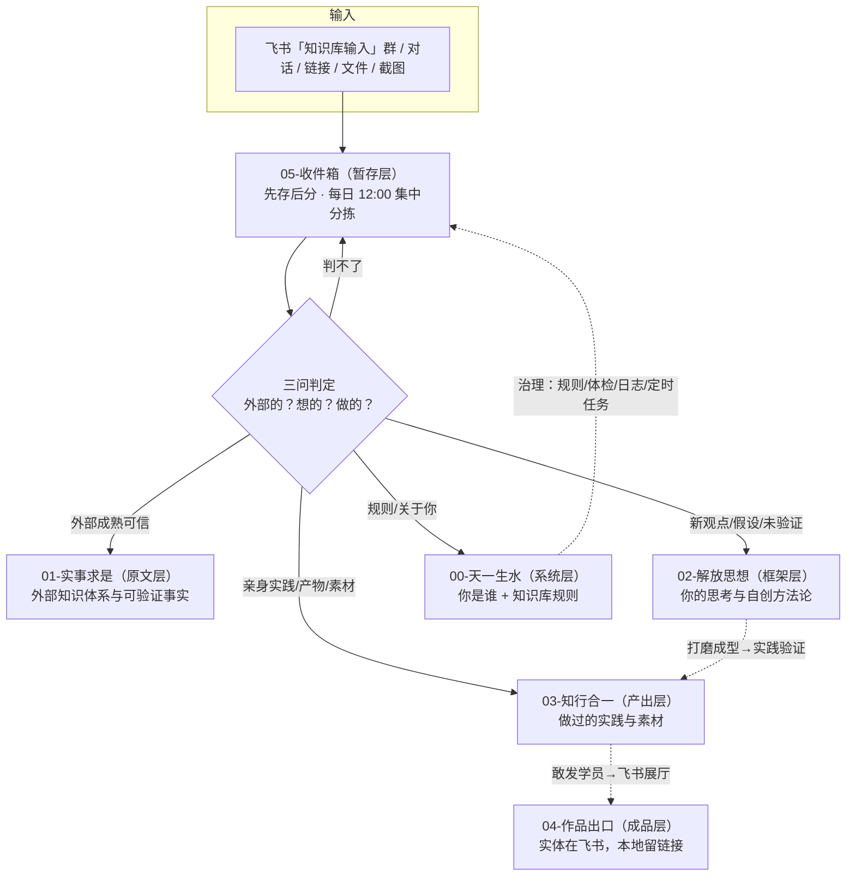

# 知识库设计指南

> **定位**：本库当前设计的速查总览——「为什么这样设计、每层放什么、文件怎么写、输入怎么走」的一张地图 + 一套规则。
> **权威细则**：顶层规则以 [[知识库运营计划]] 为准，文件夹边界以 [[文件夹定义规范]] 为准，输入流转以 [[收件箱转化说明]] 与 [[每日收件箱分拣SOP]] 为准。本指南是它们的**设计视角整合版**，不替代、不冲突；修订规则请直接改上述基本法文件。

---

## 0. 一句话设计

> **输入不用你管（飞书 / 微信 / PDF 进来 AI 自动分拣入库），输出帮你打赢（备课时自动拉料、好内容自动沉淀）。**

本库是一条「原料 → 认知 → 作品」的**认知升级生产线**：

- **人负责判断**：什么值得沉淀、敢不敢发给学员、审美标准、顶层框架；
- **AI 负责搬运**：接收、转档、分拣、补 YAML、按规则迁移、按时提醒。

---

## 1. 设计理念（为什么这样设计）

| 理念 | 落地方式 |
| --- | --- |
| 按认知阶段分层，不按主题分类 | 实事求是（外部成熟）→ 解放思想（自己想的）→ 知行合一（亲手做的）→ 作品出口（敢发的） |
| 分层即过滤 | 每层有准入闸；未验证的进不了 01；判不了的先落 05 |
| 证据驱动 | 状态不靠感觉，靠凭证（见 §4.3） |
| 反幻觉 | 原文层强制 `source` 证据；加工过的内容进 02，不冒充 01 |
| 过程即资产 | 版本文件 = 复盘核心资产，全部保留，按版本序列读（见 §4.4） |
| 人机分工 | 人把判断标准放进系统，AI 把系统变成产能 |

---

## 2. 顶层架构：六层



| 层 | 目录 | 一句话定位 | 稳定入口 |
| --- | --- | --- | --- |
| 系统层 | 00-天一生水 | 你是谁 + 知识库本身的规则 | `00-天一生水_Home` |
| 原文层 | 01-实事求是 | 外部已有、成熟可信、可验证的客观事实与方法论 | `01-实事求是_Home` |
| 框架层 | 02-解放思想 | 自己的想法、新观点、假设、研究（想的） | `02-解放思想_Home` |
| 产出层 | 03-知行合一 | 亲身实践过的产物与素材（做的） | `03-知行合一_Home` |
| 成品层 | 04-作品出口 | 敢发给学员的成品（实体在飞书，本地留链接） | 飞书 Wiki |
| 暂存层 | 05-收件箱 | 所有输入唯一入口，当日分拣不滞留 | — |

根目录入口：`00-知识库总索引.md`（全库地图）+ `README.md`。**铁律：每个根目录只放 `_Home` 入口文件，内容必须落在子文件夹。**

---

## 3. 目录结构与边界

### 3.1 准入判定口诀

每条进来的信息只问三问：**外部的还是自己的？想出来的还是做过的？敢不敢发给学员？**

| 文件夹 | 准入标准 | 口诀 |
| --- | --- | --- |
| 00-天一生水 | 关于「你是谁」和「知识库本身」的规则 | 规则文件 |
| 01-实事求是 | 外部已有、成熟可信、可验证（未经二次加工） | 外部的 → 01 |
| 02-解放思想 | 带个人思考印记的新观点 / 假设 / 问题 / 改造 | 想出来的 → 02 |
| 03-知行合一 | 亲身实践产物、可复用素材 | 做过的 → 03 |
| 04-作品出口 | 敢直接发给学员 / 粉丝的成品 | 敢发学员 → 04 |
| 05-收件箱 | 暂时无法判定去向 | 先收着 → 05 |

### 3.2 关键边界（最容易混淆的两处）

**① 01 vs 02：区别在「验证度」，不在「内外」。**
- 01 装**已经成熟、可信、可放心调用**的体系（一堂课程体系、经典理论、可验证数据）；
- 02 装**新理念、个人观点、未经验证的假设**（先接受验证，验证通过才可能升入 01）。

**01 准入闸（默认拒入）**：01 是「升级目的地」不是「接收口」——外部新素材一律先落 02，仅以下四类经用户拍板才升 01：
1. 一堂官方课程体系；
2. 经典 / 公认体系（教科书、行业标准、权威机构发布）；
3. 高验证度外部作品（来源权威 + 时间/规模检验 + 事实可核验 + 成体系，四者缺一不可）；
4. 本人反复验证、真·成体系可对外调用的成熟产物（否则留 03）。

进 01 的文件须写 `verification:`（方式 / 证据 / 日期）；拿不准一律降 02。

**② 02 vs 03：想的 vs 干的。**
- 没做过 / 刚想到 / 还没验证 → **02-解放思想**；
- 做过 / 正在做 / 已验证 → **03-知行合一**。

同名文件夹 ≠ 同性质：02 存「设计 / 构想」，03 存「实践 / 产物」（如双三角：02 是模型构想，03 是用它备的教案与复盘）。03 排除外部他人资料、对他人实践的纯研究笔记。

### 3.3 各层子目录速览

**00-天一生水（系统层）**

| 子目录 | 放什么 |
| --- | --- |
| 01-系统文档 | 系统级配置与说明、任务记录 |
| 02-工具标准 | 工具规范、操作标准、模板标准（含 `术语库`） |
| 03-基本法 | 全库运营规则（运营计划 / 文件夹规范 / 审美规则 / 分拣 SOP / 转化说明 / 定时任务台账） |
| 04-灵魂校准 | 价值观与原则校准（含 `AI-开机必读`） |
| 05-架构设计 | 知识库架构方案、设计指南、取舍记录 |
| 06-评估报告 | 月度统计、验收测试、评估结论 |
| 09 关于我 | 身份、人生红点、心理成长 |
| 99-归档 | 收件箱原文留档 |
| 00-vault-log | 库日志：AI 批量操作记录（迁移 / 清理 / 打标） |

**01-实事求是（原文层）**：课程原文 / AI技能 / 案例课 / 创业必修 / 管理必修 / 个人必修 / 在线教育 / 泛产品设计 / 99-其他成熟资料。

**02-解放思想（框架层）**：00-假设池（开放问题 / 半成品）→ 10-新模型（成型框架）→ 20-思想实验；另有 01-AI思考 / 02-一堂 / 03-原则思考 / 99-其他。生命周期：假设池 → 打磨成型 → 新模型 → 实践验证升 03。

**03-知行合一（产出层 · 实践流水线）**：备（01 AI 教育）→ 练（02 刻意练习）→ 复（03 项目复盘）→ AI 化（06-AI应用）→ 沉淀方法（08-元知识）→ 成品（04）。状态目录：00-待应用 / 90-已应用 / 95-素材；领域目录为历史实践存档。

**04-作品出口（成品层）**：AI双三角系列课 / 三天公开课 / C语言教学 / 初中生AI课 / 备课与复盘方法 / 提示词库——每件作品一个链接索引文件，正文在飞书。

**05-收件箱（暂存层）**：装卸区，不是一层知识；当日分拣不滞留。

### 3.4 判定速查表（分拣时直接查）

| 待判定的内容 | 去向 |
| --- | --- |
| 成熟的课程体系 / 经典理论 / 可验证数据 / 一手资料 | 01 |
| 个人观点 / 新理念 / 未验证假设 / 时效评测 / 行业观察 | 02 |
| 教案 / 课件 / 复盘 / 项目 / 练习记录 | 03（按状态进 00/90/95 或领域目录） |
| 提示词 / 金句 / 案例 / 模板 | 03/95-素材 |
| 关于你自己的身份 / 心理 | 00/09 关于我 |
| 工具规范 / 术语 | 00/02-工具标准 |
| 敢直接发给学员的成品 | 04（飞书展厅） |
| 判不了 | 05-收件箱（当天归档） |

---

## 4. 文件设计规范

### 4.1 命名

- 公式：**类型前缀 + 主题**，不超过 15 字；
- 前缀库：`概念：` `方法：` `案例：` `复盘：` `素材：` `问题：` `思考：` `模板：` `配置：` `判断：` `研究：` `术语：`
- 文件名不鼓励加序号和版本号；版本放 YAML `version`（唯一例外：成套课程大纲）；
- **对话产出的文件加编号前缀 `NNN_`**（两位起、三位封顶），按项目目录内产出顺序递增；版本文件保留 `_vN` 后缀（如 `01_xxx.md`、`xxx_v2.md`）。

### 4.2 YAML frontmatter（必填）

```yaml
---
type: 概念 | 方法 | 案例 | 复盘 | 素材 | 问题 | 思考 | 基本法 | 配置 | 术语
status: 原料 | 初稿 | 已验证 | 已应用 | 待应用
date: YYYY-MM-DD
source: 来源（链接/书名/课程/对话/自创）
audience: 面向谁（可选：自己/学员/家长/同行）
tags: []        # 领域标签，如 AI教育、刻意练习
related: []     # 关联笔记 [[链接]]
# 进 01 的文件追加：
verification: 方式/证据/日期
---
```

> 写 md 用 **Python3 原始字节**写入（保证 YAML 与双链精准对齐）。

### 4.3 状态流转（AI 负责推进）

`原料`（外部输入刚转档）→ `初稿`（加工过）→ `已验证`（实践验证过）→ `已应用`（真实场景用过）。

- 03 物理目录与 status 对应：`00-待应用` 内 status = 待应用；`90-已应用` 内 status = 已应用。
- **待应用 / 已应用 唯一标准 = 有没有「应用凭证」**（证据驱动，AI 不能在线下看到上课，凭证必须可验证）：

| 凭证（四选一） | 说明 |
| --- | --- |
| 用户声明 | 用户明说「用了 / 上完了 / 试讲了 xxx」，AI 记录日期 + 场景 |
| 复盘产物 | 出现关联的 `复盘：xxx` 笔记（含真实反馈） |
| 迭代痕迹 | 同一作品出现 V2+ 版本或基于真实反馈的修改记录 |
| 作品库状态 | 飞书作品索引 Base 手动改为「已应用」 |

有凭证 → 四同步迁移（移动文件 + 改 status + Base 同步 + vault-log 记一笔）；无凭证 → 保持待应用，不催不问；涉及质量评价的内容始终先问用户。

### 4.4 过程数据与版本（复盘核心资产）

- 铁律：**版本文件不删除、不覆盖、不合并**（V1→V2→V3… 全部保留）；
- 新增版本时 YAML 加 `series: <主题名>` 标识演进序列；能一句话说明时加 `changelog:`；
- AI 复盘按版本序列阅读：对比相邻版本改动 → 提炼演进规律 → 复盘落 `06-评估报告` 或 `03-项目复盘`。

---

## 5. 输入流水线

### 5.1 输入形态与默认去向

| 输入形态 | AI 处理动作 | 默认去向 |
| --- | --- | --- |
| 文字片段 | 提炼核心 → 转档 | 提示词 → `03/95-素材/AI提示词`；想法 → 02 或 03 |
| 链接 · 微信公众号 | 抓正文 → 转结构化笔记（保留出处）；受限则存链接 + 摘要待补 | 01 |
| 链接 · 飞书 | lark 技能读取 → 转笔记 | 01 或按内容归类 |
| 文件 · PDF | 解析 → 提炼要点 → 转文档 | 按内容归类（01 外部 / 03 素材） |
| 文件 · 图片 | OCR 识别 → 提炼 → 转文档 | 按内容归类 |

### 5.2 处理流程（5 步）

1. **接收**：用户在飞书 / 对话发链接、文件或文字，AI 全部接收；
2. **判定类型**：文字？链接（公众号 / 飞书 / 其他）？文件（PDF / 图片 / Office）？
3. **处理转档**：抓取 / 解析 / OCR → 结构化笔记，`source` 记录出处；
4. **入库归档**：按判定口诀定文件夹 → 补全 YAML → 规范命名；判不了的先落 `05-收件箱`；
5. **汇报**：一句话告知「已存入 路径」。

**服务层承诺**：用户不需要告诉 AI "存哪"；存哪是 AI 的职责。

### 5.3 先存后分 + 定时分拣

- 所有输入**先落 05-收件箱**（原文 + 来源 + 日期），不直接分类；
- **每日 12:00** 定时集中分拣一次（见 [[每日收件箱分拣SOP]]），另有每日 21:30 兜底清扫定时任务（见 [[配置：定时任务台账]]）；
- 输入唯一通道：`05-收件箱`；旧库 `memory-base-codex` 及 01 Inbox 作废。

### 5.4 意图识别（不逐条拆）

| 类型 | 识别特征 | 处理方式 |
| --- | --- | --- |
| A 任务指令 | "帮我… / 增加一个任务… / 把 xx 转成 md" | 落 `00/01-系统文档` 作任务记录（用户原话 + 意图） |
| B 资料入库 | 链接 / 文档 / 文字素材，无附加指令 | 按四层规则转化入库 |
| C 混合指令 | 素材 + 一句处理指令 | 按指令执行后入库，素材与指令合并不拆开 |

连续多条消息属同一意图（含手滑补充）→ 合并为一条处理。

---

## 6. 调用与沉淀机制

### 6.1 备课调用（决策支持）

用户说「备 xx 课」时，AI 自动拉料：01 方法论（教材 = 问题 + 解法、双三角）→ 02 思考与新模型 → 03 历史教案与复盘 → 素材（案例 / 金句 / 数据），产出备课包：教学目标 / 教学主线 / 关键案例 / 互动设计 / 课后练习。

### 6.2 审美沉淀（AI 学用户的判断标准）

- 默认自动沉淀，按《沉淀审美规则》执行，沉淀后一句话告知；
- **敏感内容始终先问**：个人隐私、未定稿内容、对外发布相关内容；
- 工作伙伴过程产物归档前先列全部候选清单经用户确认，不静默落位。

### 6.3 作品升级

内容达到「敢直接发给学员」标准 → AI 推送飞书作品展厅（Wiki + Doc + Base），Obsidian 只留 `[[链接]]` 与状态标记。

### 6.4 内容类 / 运营类互不污染

| 类别 | 落位 |
| --- | --- |
| 运营类（任务记录 / 规则 / 体检 / 评估 / 日志） | 00-天一生水 对应子目录 |
| 内容生产类（教案 / 课件 / 逐字稿 / 素材 / 复盘） | 03-知行合一 对应子域；达成品标准 → 04 |

---

## 7. 技术底座与工具链

| 组件 | 用途 |
| --- | --- |
| Obsidian | 主库载体：双链 `[[ ]]` + YAML + tag + Mermaid；`_Home` / MOC 作稳定入口 |
| Git | 版本管理（`.gitignore`：.DS_Store、workspace.json） |
| 飞书 Wiki | 作品展厅（AI双三角作品库） |
| 飞书 Base | 作品索引（状态同步：待应用 / 已应用） |
| 飞书「知识库输入」群 | 唯一输入通道 |
| 定时任务 | 每日 12:00 收件箱分拣；每日 21:30 兜底清扫（台账见 `00/03-基本法`） |
| 自动化 Skill | `knowledge-base-inbox-archive`（收件箱归档流水线）、`knowledge-base-health-check`（双周体检）、`course-doc-to-feishu / course-doc-to-local`（课程链接转录，保留图片+加粗）、`course-images-to-feishu`（课程截图转文字，纯文字不保留图片）、`wechat-article-to-local`、`feishu-share-doc-to-local`、`bilibili-video-to-local` 等 |
| Python3 | 写 md 用原始字节，保证 YAML / 双链精准 |

---

## 8. 运行与治理

- **00-vault-log**：AI 每次批量操作（迁移 / 清理 / 批量打标）记一条，库演进可追溯；
- **体检**：knowledge-base-health-check 扫描，报告落 `01-系统文档/知识库体检`；
- **月度评估**：各层文件数变化表，落 `06-评估报告`；
- **术语库**：`00-天一生水/02-工具标准/术语库`——术语定义 / 来源 / 状态 / 概念锚点，保证教学与笔记用词一致；
- 全库现状：约 1600 篇 md（01 约 950 篇最大，其后 03 约 350、00 约 125、02 约 118、04 约 22、05 约 18）。

---

## 9. 操作速查表

| 我想… | 怎么做 |
| --- | --- |
| 存一篇新资料 | 发「知识库输入」群或对话，AI 自动落 05 → 次日 12:00 分拣 |
| 备一节课 | 说「备 xx 课」，AI 自动拉 01 / 02 / 03 / 素材，出备课包 |
| 修改课程大纲 | 每次生成新版本 `_vN`，原名文件保留最老版，过程数据留档复盘 |
| 转录课程链接 | `course-doc-to-feishu`：保留全部图片 + 加粗 |
| 转录课程截图 | `course-images-to-feishu`：纯文字，不保留图片 |
| 课后复盘 | 48h 内 AI 触发，复盘落 03 项目复盘，回灌 02 / 01 |
| 成人课堂 | 不做「抽屏幕 / 亮结果」展示，改抽查提问；实操先完整演示再让学员动手 |
| 查体检 / 评估 | 看 `01-系统文档/知识库体检`、`06-评估报告` |

---

## 10. 关联文档导航

- [[知识库运营计划]] —— 顶层运营规则（六层结构 / 状态流转 / 过程数据 / 落位规则）
- [[文件夹定义规范]] —— 每个文件夹的边界与子目录（准入闸 / 判定树 / 速查表）
- [[收件箱转化说明]] —— 输入 → 四层转化规则与意图识别
- [[每日收件箱分拣SOP]] —— 每日 12:00 分拣操作步骤
- [[沉淀审美规则]] —— 具体判断经验（纠正沉淀）
- [[AI-开机必读]] —— 用户画像速览 + 工作铁律
- [[00-知识库总索引]] —— 全库地图

---

## 11. 变更记录

- **V1.0（2026-10-26）**：初版。整合《知识库运营计划》《文件夹定义规范》《收件箱转化说明》《AI-开机必读》等既有规则，形成设计视角速查总览。
