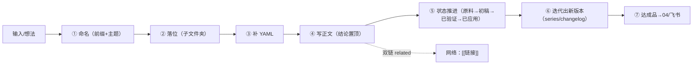

# 知识库文件指南

> **定位**：本库**单个文件**的操作手册——从「怎么起名、放哪、怎么写、怎么标注状态、怎么留版本、怎么链接」的可照做细则。
> **与设计指南的关系**：[[01_知识库设计指南]] 讲整体架构与流程；本指南讲文件层面。一切规则以 [[知识库运营计划]]（顶层）、[[文件夹定义规范]]（文件夹边界）为权威。

---

## 0. 一句话

> **文件 = 类型前缀 + 主题，进子文件夹，带 YAML，结论置顶，状态靠凭证，版本全保留。**

---

## 1. 文件全生命周期



---

## 2. 命名规则

### 2.1 核心公式

> **文件名 = 类型前缀 + 核心主题**，不超过 15 字。
> 前缀告诉你「这是什么」，主题告诉你「关于什么」。

### 2.2 类型前缀库（统一写法，不造新前缀）

| 前缀 | 含义 | 示例 |
| --- | --- | --- |
| `概念：` | 定义一个新概念或框架 | 概念：双三角 |
| `方法：` | 可复用的操作步骤（怎么做） | 方法：如何给笔记文件起名字 |
| `案例：` | 一个真实案例的拆解 | 案例：劉衛·AI第二大脑 |
| `复盘：` | 做完一件事后的总结 | 复盘：秋马转写 |
| `素材：` | 可复用片段（提示词/金句/痛点） | 素材：说人话提示词模板 |
| `问题：` | 开放问题、待验证假设 | 问题：如何验证复盘深度 |
| `思考：` | 思考碎片、观点 | 思考：个体改变条件 |
| `研究：` | 对他人实践 / 主题的探索 | 研究：Kimi Work深度评测 |
| `模板：` | 可套用的结构模板 | 模板：清单体课程笔记 |
| `配置：` | 工具接入 / 环境搭建 / 台账 | 配置：定时任务台账 |
| `判断：` | 一个决策或立场 | 判断：01 准入闸 |
| `术语：` | 术语定义与锚点 | 术语：IPO |

### 2.3 三条铁律

- **短**：扫一眼就知道内容，≤15 字；
- **准**：方法和概念不混用——方法是「怎么做」，概念是「怎么理解」；
- **统一**：同一前缀写法永远一样，不一篇叫 `方法：`、下一篇叫 `怎么做：`。

### 2.4 编号前缀（对话产出文件专用）

- **对话中产出的文件**加编号前缀 `NNN_`，按项目目录内产出顺序递增——**两位起、三位封顶**（`01_`、`02_`…`99_`、`100_`…）；
- 位置：`00-天一生水/05-架构设计/01_知识库设计指南.md`、`02_知识库文件指南.md`；
- 编号与类型前缀并存：对话产物用 `NNN_` 排序；规则类文件本身仍可带类型前缀。

### 2.5 版本后缀

- 版本号进 YAML `version`，**文件名不鼓励加版本号**（唯一例外：成套课程大纲）；
- 迭代文件保留 `_vN` 后缀（如 `for循环-V5.md`、`xxx_v2.md`），旧版不删。

### 2.6 命名正反例

| 场景 | 正确 | 错误 |
| --- | --- | --- |
| 讲可复用步骤 | `方法：深度复盘四步法` | `一些关于复盘的想法整理（最终版）` |
| 外部案例拆解 | `案例：小龙虾外卖千店` | `案例1-新-小龙虾` |
| 对话产物 | `02_知识库文件指南` | `知识库文件指南最终` |
| 迭代版本 | `课程大纲_v2.md` | `课程大纲-新版-最终版.md`（覆盖旧版） |
| 禁止 | — | `.md.md` 双后缀、序号当知识排序（`13_xxx`） |

### 2.7 文件 vs 文件夹（各管各的）

- **文件不加序号**：知识是网不是线，硬加序号插一篇全要改名；Obsidian 靠 `[[` 链接和 `Cmd+O` 搜索找人；
- **文件夹加序号**：一年建不了几个，侧边栏有视觉顺序需求；保留间隔（00、01、02…），中间插一个不疼。

---

## 3. 文件存放

### 3.1 根目录铁律

- **每个根目录只放 `_Home` 入口文件**，所有内容必须落在子文件夹，**任何文件不得散落根目录**；
- 没有匹配子目录时，新建一个主题域或进 `99-其他`，绝不落根目录。

### 3.2 落位速查（三问口诀）

每条信息只问三问：**外部的还是自己的？想出来的还是做过的？敢不敢发给学员？**

| 待判定内容 | 去向 |
| --- | --- |
| 成熟课程体系 / 经典理论 / 可验证数据 / 一手资料 | 01 |
| 个人观点 / 新理念 / 未验证假设 / 时效评测 / 行业观察 | 02 |
| 教案 / 课件 / 复盘 / 项目 / 练习记录 | 03 |
| 提示词 / 金句 / 案例 / 模板 | 03/95-素材 |
| 关于你自己的身份 / 心理 | 00/09 关于我 |
| 工具规范 / 术语 | 00/02-工具标准 |
| 敢直接发给学员的成品 | 04（飞书展厅） |
| 判不了 | 05-收件箱（当天归档） |

### 3.3 各层子目录

- **00-天一生水**：01-系统文档 / 02-工具标准（含术语库）/ 03-基本法 / 04-灵魂校准 / 05-架构设计 / 06-评估报告 / 09 关于我 / 99-归档 / 00-vault-log；
- **01-实事求是**：课程原文 / AI技能 / 案例课 / 创业必修 / 管理必修 / 个人必修 / 在线教育 / 泛产品设计 / 99-其他成熟资料；
- **02-解放思想**：00-假设池 / 01-AI思考 / 02-一堂 / 03-原则思考 / 10-新模型 / 20-思想实验 / 99-其他；
- **03-知行合一**：00-待应用 / 90-已应用 / 95-素材（状态目录）+ 01 AI 教育 / 02 刻意练习 / 03 项目复盘 / 06-AI应用 / 07-泛产品设计 / 08-元知识 / 99-其他（领域目录）；
- **04-作品出口**：AI双三角系列课 / 三天公开课 / C语言教学 / 初中生AI课 / 备课与复盘方法 / 提示词库（链接索引）。

---

## 4. YAML frontmatter（必填）

### 4.1 标准模板

```yaml
---
type: 概念 | 方法 | 案例 | 复盘 | 素材 | 问题 | 思考 | 基本法 | 配置 | 术语
status: 原料 | 初稿 | 已验证 | 已应用 | 待应用
date: YYYY-MM-DD
source: 来源（链接/书名/课程/对话/自创）
audience: 面向谁（可选：自己/学员/家长/同行）
tags: []        # 领域标签，如 AI教育、刻意练习
related: []     # 关联笔记，用文件 basename
---
```

### 4.2 字段详解

| 字段 | 是否必填 | 说明 |
| --- | --- | --- |
| `type` | 必填 | 文件性质，与文件名前缀一致（写 `方法：` 则 type 为方法类） |
| `status` | 必填 | 成熟度状态，见 §6 |
| `date` | 必填 | 创建日期；有更新时加 `updated:` |
| `source` | 必填 | 来源链接/书名/课程/对话/自创；外部内容必须可追溯 |
| `audience` | 可选 | 自己 / 学员 / 家长 / 同行 |
| `tags` | 必填 | 领域标签 + 主题标签，标签面板秒筛 |
| `related` | 可选 | 关联笔记，用 **basename（不含路径）**，Obsidian 自动解析 |
| `version` | 版本文件 | 版本号；版本号不进文件名（成套课程大纲例外） |
| `series` | 迭代文件 | 同一演进序列的主题名（见 §7） |
| `changelog` | 迭代文件 | 一句话说明本版相对上一版的核心改动 |
| `priority` | 可选 | 高 / 中 / 低（配合 Dataview 聚合） |

### 4.3 进 01 的特殊要求

- **01 是「升级目的地」不是「接收口」**（默认拒入）；外部新素材一律先落 02，仅四类经用户拍板才升 01：一堂官方课程体系 / 经典公认体系 / 高验证度外部作品 / 本人反复验证真成体系的成熟产物；
- 进 01 的文件须写 `verification: 方式/证据/日期`；拿不准一律降 02。

---

## 5. 正文结构

### 5.1 硬骨架（每篇必有，顺序固定）

1. **YAML frontmatter**；
2. **标题**：`类型前缀：<主题>`（课程类 `课程：<主题>·<日期/序号>`，≤15 字）；
3. **一句话结论（置顶）**：

```markdown
**一句话结论：** <全文最核心的一个判断，读到就能抓住全文>
```

### 5.2 内容模块（按内容选用，顺序固定）

| 模块 | 什么时候写 | 形态 |
| --- | --- | --- |
| 核心交付 | 课程类必有 | 3-5 条，一行一条（一个认知/一张地图/一个判断力） |
| 关键框架 | 有方法论必有 | 有序列表搭骨架，表格承载对比 |
| 金句与判断 | 有金句必有 | 引用块 `> 「……」` |
| 案例拆解 | 有案例必有 | 表格：背景/关键动作/结果/收获 |
| 速查卡 | 内容较长必有 | 一句话记住本课 |
| 行动建议 | 课程类必有 | 表格：基础/进阶/高阶 |
| 我的批注（双轨） | 有个人想法才写 | `我的：` / `待验证：`；成型想法独立成篇进 02/03 |

### 5.3 转写铁律

1. **结论置顶**：一句话结论永远在标题下第一位；
2. **一行一义**：每条尽量 ≤50 字，避免大段原文搬运（除非必须保留原话）；
3. **层级克制**：最多三级（`1.` → `a.` → `i.`），同层同颗粒、同尺度、同语法；
4. **表格意识**：对比、分类、评分、版本演进优先表格化；
5. **视觉锚点**：核心概念/关键判断用**加粗**；抽象思考用 `#关键词`；标题编号不加粗；
6. **图片不搬**：配图转述为 `[配图：<一句话描述画面信息>]`，图留飞书、source 跳回；
7. **双轨分离**：原文（老师的话）进 01 正文；「我的：」只放个人批注；成型想法独立成篇；
8. **拆分原则**：多案例/超长文档 → 每案例 1 篇 + 总览 1 篇，互相 related；
9. **反幻觉**：不确定标「待验证」；无来源不写事实；区分事实/判断/建议；
10. **关键信息九保**：结论/对象/动作/规则/数字/原因/风险/例子/下一步，一样不漏；
11. **文件名一致**：落位前确认目标文件名，禁止 `.md.md` 双后缀；related 用 basename；转写后验证文件实际存在。

### 5.4 长文档转写（raw > 5000 字 或 含 ≥3 个完整案例时强制执行）

- 流程：**先提清单 → 逐案例转写 → 对账验收**；
- 转写前提取完整案例清单（名称 + 行号范围）作为验收基准；
- 每个案例按五要素完整沉淀：**背景 / 过程（步骤·工具·提示词）/ 关键数据 / 结果变化 / 可复用方法**；
- 转写后逐案例对账，输出《案例覆盖清单》（原文位置 → 笔记文件 → 段落位置），**覆盖率 100% 才算完成**；
- 拆分策略：多案例 → 总览 1 + 每案例 1；单一连贯流程 → 可单篇分节但五要素完整；硬拆会产生近空碎片时压成表格化单篇并注明理由。

---

## 6. 状态流转

### 6.1 状态机（AI 负责推进）


### 6.2 03 物理目录与 status 对应

| 物理目录 | status | 含义 |
| --- | --- | --- |
| 00-待应用 | 待应用 | 内容完整、达到可用标准，但无真实使用记录 |
| 90-已应用 | 已应用 | 真实教学/实践场景中至少用过一次 |
| 95-素材 | — | 可复用片段（提示词/案例/金句/模板） |

### 6.3 待应用 / 已应用 唯一标准 = 应用凭证

> AI 不能在线下看到你上课，「用过了」必须可验证、可追溯；凭证缺失即视为未应用。

| 凭证（四选一） | 说明 |
| --- | --- |
| 用户声明 | 用户明说「用了/上完了/试讲了 xxx」，AI 记录日期 + 场景 |
| 复盘产物 | 出现关联的 `复盘：xxx` 笔记（含真实反馈） |
| 迭代痕迹 | 同一作品出现 V2+ 版本或基于真实反馈的修改记录 |
| 作品库状态 | 飞书作品索引 Base 手动改为「已应用」 |

- 有凭证 → **四同步迁移**：移动文件 + 改 status + Base 同步 + vault-log 记一笔；
- 无凭证 → 保持待应用，不催不问（宁可漏判，不可误判）；
- 涉及质量评价（「这课讲砸了/效果不好」）→ 不自动迁移、不评价，先问用户。
- 口诀：不是「放了多久」，而是「有没有证据」；证据不到，状态不动。

---

## 7. 版本与过程数据（复盘核心资产）

- **定义**：同一主题的多个版本文件（V1→V2→V3…）= 过程数据，记录每版怎么改，是复盘核心素材；
- **铁律**：
  1. **版本文件不删除、不覆盖、不合并**（全部保留不动）；
  2. 版本号保留在文件名（V1/V2 或 -V2 后缀），不手动删；
  3. 新增版本时 YAML 加 `series: <主题名>`；能一句话说明时加 `changelog: 本版核心改动`；
  4. AI 复盘按版本序列阅读：对比相邻版本 → 提炼演进规律（改了什么/为什么/结果如何）→ 复盘落 06-评估报告 或 03 项目复盘；
  5. 存量版本文件不批量改，规则只对新增内容生效。

---

## 8. 链接与断链

- **双链**：用 `[[文件 basename]]` 或 `[[basename|显示名]]`；打 `[[方法：` 能看到所有方法类笔记；
- **related**：用 basename（不含路径），Obsidian 自动解析；同课分节互链、跨层指认（原文 ↔ 教案）；
- **断链检查**：转写后运行断链检查脚本（`00-天一生水/02-工具标准/断链检查脚本.md`），**断链率 < 2%**；不写预期文件名（指向尚未创建的文件）。

---

## 9. 新文件自检清单

- [ ] 文件名 = 类型前缀 + 主题，≤15 字，无 `.md.md` 双后缀
- [ ] 对话产物带 `NNN_` 编号前缀；迭代文件保留 `_vN`
- [ ] 落在子文件夹，未散落根目录
- [ ] YAML 齐全：type / status / date / source / tags / related
- [ ] 进 01 的文件已写 `verification`
- [ ] 一句话结论置顶，能独立读懂
- [ ] 层级 ≤3 级，每行 ≤50 字，同层同颗粒
- [ ] 对比/分类已表格化；核心概念已加粗
- [ ] 图片已文字转述；金句/数字/案例/作业全部保留
- [ ] 双轨分离：个人想法用「我的：」或已独立成篇
- [ ] 长文档案例覆盖率 100%（案例清单逐一对照）
- [ ] 所有 `[[双链]]` 指向实际存在文件，断链率 < 2%
- [ ] 写 md 用 Python3 原始字节（YAML/双链精准）

---

## 10. 关联文档

- [[知识库运营计划]] —— 顶层运营规则（文件规则 §2、过程数据 §2.5、落位 §2.6）
- [[文件夹定义规范]] —— 文件夹边界与子目录
- [[方法：如何给笔记文件起名字]] —— 命名方法与前缀库
- [[模板：清单体课程笔记]] —— 统一沉淀标准（硬骨架/模块/铁律/自检）
- [[01_知识库设计指南]] —— 整体架构与流程
- [[收件箱转化说明]] / [[每日收件箱分拣SOP]] —— 输入到文件的转化

---

## 11. 变更记录

- **V1.0（2026-10-26）**：初版。整合《知识库运营计划》《文件夹定义规范》《方法：如何给笔记文件起名字》《模板：清单体课程笔记》中的文件级规则，形成命名/落位/frontmatter/正文/状态/版本/链接的可照做手册。
