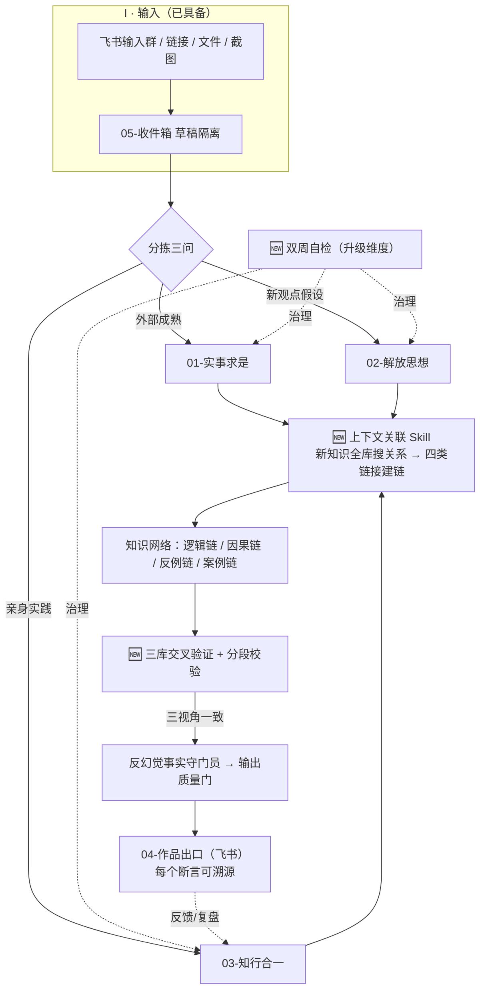
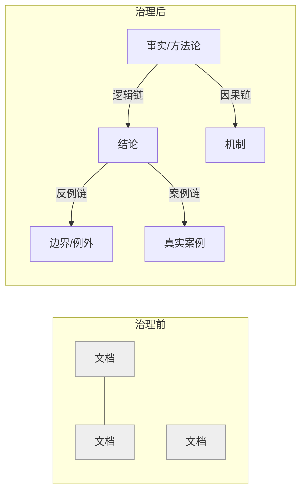

# 知识库改造计划：对标劉衛「AI 第二大脑」

> **一句话结论：** 我们的库已经走完劉衛的「① 手工导入 → ② 自动收录 + 认知分层」，但他最核心的「③ 知识连接 + 反幻觉治理 + 思考类 Skill 封装」在我们这里停留在 9-17 的 V0.1 草稿、没有落地，知识网络正在持续劣化（孤儿 549 且在增长）。**本次改造不重做架构，只补「连接」与「校验」两块短板，把库从「能存」升级为「能判、能追溯」。**
>
> 本计划是改造的**总契约**：架构仍以 [[01_知识库设计指南]] 为准，规则以 [[知识库运营计划]] 为准；本文件只定义「改什么、分几步、怎么验收」。

---

## 一、劉衛案例做对了什么（方法论锚点）

本质是一条 **IPO 闭环**，且每一环都有「闸」：

| 环节 | 关键动作 | 闸 / 机制 |
|---|---|---|
| **I 输入** | 飞书统一入口 → 草稿区隔离 | 新资料不直接进主库 |
| **P 处理** | 三层认知分层 + 知识类型分类 + **四类知识链接** | 按认知阶段而非主题；新知识全库搜关系并建链 |
| **O 输出** | 三库交叉验证 + 分段校验 + 倒查溯源 | 三视角结论一致才可信；每个断言可追溯 |
| **治理** | 双周自检 + 把思考习惯封装成 Skill | 19 种幻觉故障分类；用 AI 治理 AI |

四个可直接复用的成果：
1. **一个分层**：实事求是 / 解放思想 / 知行合一（按认知阶段）；
2. **四类链接**：逻辑链 / 因果链 / 反例链 / 案例链；
3. **一个反幻觉机制**：草稿隔离 + 四类链接 + 三段交叉验证；
4. **一个分工**：人负责方向与判断，AI 负责检索、验证、生成、倒查。

---

## 二、现状诊断：我们走到哪了

### 2.1 已具备（不用重做）

- 六层架构：00 系统 / 01 原文 / 02 框架 / 03 产出 / 04 作品出口（实体在飞书）/ 05 收件箱；
- 认知阶段分层（实事求是 / 解放思想 / 知行合一）与案例一致；
- 输入管道已通：飞书「知识库输入」群 → 05 收件箱（先存后分）→ 每日 12:00 自动接收 → 用户触发分拣；
- 规则体系完整：设计指南、文件指南、文件夹规范、运营计划、分拣 SOP、审美规则、定时台账；
- 可执行 Skill：`knowledge-base-health-check`（体检）、`knowledge-base-inbox-archive`（归档）、课程转录类 4 个；
- 5 个治理类 Skill 的 **V0.1 协议草稿**（2026-09-17，位于 `03/06-AI应用/AI skill/`）。

### 2.2 体检数据（最近报告 2026-10-21，健康分 78.9；此后已 5 周无新报告）

| 指标 | 数值 | 说明 |
|---|---|---|
| 总 md 数 | 约 1694（报告时 1567） | 01 占 954（56%）过度膨胀 |
| 孤儿笔记 | **549（约 35%）** | 521→549 增长中；其中 216 篇 >5KB 高价值 |
| 双链总数 | 2472 | 断链 1（PDF 误报） |
| 无 YAML | 406 | 多为设计如此的转录页 |
| 同名文件 | 91 | 转录通用页名，模板性歧义 |
| 双周自检 | 已停 | 自动任务「从未运行」被删，改手动后断档 |

### 2.3 差距对照表（案例能力 × 现状）

| 案例能力 | 现状 | 差距 | 优先级 |
|---|---|---|---|
| 飞书入口 + 草稿隔离 | 收件箱 + 飞书群 + 每日接收 | ✅ 已具备 | — |
| 三层认知分层 | 六层架构含三层 | ✅ 已具备 | — |
| **四类知识链接** | 裸双链、无类型 | ❌ 缺失 | **P0** |
| **新知识自动全库建链** | 无 | ❌ 缺失 | **P0** |
| 三库交叉验证 | 备课是顺序拉料、非对质 | ❌ 缺失 | P1 |
| 分段校验 | 无 | ❌ 缺失 | P1 |
| 输出倒查 / 来源追溯 | 质量门、反幻觉仅草稿 | ⚠️ 草稿未落地 | P1 |
| 幻觉故障模式库 | 草稿 8 类（案例 19 种） | ⚠️ 草稿未落地 | P1 |
| 思考类 Skill 封装 | 5 草稿，缺「上下文关联」 | ⚠️ 部分 | P1 |
| 知识类型五分类 | 草稿 F1–F4，未进 YAML | ⚠️ 未落地 | P2 |
| 双周自检 | 自动任务删除、手动断档 | ❌ 停摆 | P2 |
| 01 准入闸 / 新旧分离 | 01 有 954 篇、闸未严格执行 | ⚠️ 需收紧 | P2 |

> **定位：** 我们精确处在劉衛的第 ② 阶段完成、正要进入第 ③ 阶段（治理 + 连接 + Skill 封装）的位置。

---

## 三、目标架构：改造后的 IPO 闭环



**四类知识链接示意（治理前 → 治理后）：**



**推荐的链接标注语法（待拍板，见 §七）：** 正文末尾固定「## 关联」区，双链进图谱、类型可解析、可追溯：

```markdown
## 关联
- [因果] [[目标文档]] —— 一句话说明 A 如何导致 B
- [反例] [[目标文档]] —— 在 X 条件下本结论不成立
- [案例] [[目标文档]] —— 支撑该结论的真实案例
- [逻辑] [[目标文档]] —— 演绎/归纳的推理关系
```

---

## 四、改造路线图（6 阶段，按依赖排序）


### 阶段 0 · 基线冻结（0.5 天）
- 跑一次最新体检（已断档 5 周），拿到改造前真实基线；
- Git 提交并打 tag（如 `pre-reform-20261029`），保证可回滚；
- 记录基线：文件数、孤儿数、双链数、各层占比。

### 阶段 1 · 知识连接工程（P0，核心）
1. 确定四类链接的标注语法（§三推荐方案）；
2. **新建「上下文关联」Skill**：新笔记入库时，全库关键词 + 语义搜索，找候选关系，提出四类链接建议，**人工确认后写入**（不静默建链）；
3. **孤儿回收**：先回收 216 篇 >5KB 高价值孤儿，每篇建 ≥2 条带类型链接；其余 333 篇分批；
4. 目标：孤儿率 35% → <15%，图谱从「一坨坨」变为「主题清晰」。

### 阶段 2 · 治理类 Skill 封装落地（P1）
- 把 5 个 V0.1 草稿正式封装为**可执行 Skill**（每个先只做最小 `SKILL.md`，用真实备课试跑）：
  - 反幻觉事实守门员（断言分级 / 来源定级 / 数字溯源 / 高危扫描 / 出库复核）；
  - 输出质量门（G1 完整 → G2 论证 → G3 讲香 → G4 抗压）；
  - 检索素材雷达（意图五问 → 库内 → 库外 OSCAR → 分级 → 缺料报警）；
  - 子问题拆解引擎（问题树 / MECE / 可证伪 / 关键路径）；
- 落地阶段 1 的「上下文关联」Skill；
- 高危模式库（现 8 类）以教学真实事故为种子持续扩充（教育场景适配）。

### 阶段 3 · 三库交叉验证输出工作流（P1）
- 重要对外输出（课程 / 报告 / 逐字稿）分三路捞料并各自给结论：
  - 01 捞**事实**（可信视角）；02 捞**假设/可能性**（创新视角）；03 捞**实践验证**（经验视角）；
  - 三路一致 → 高可信；冲突 → 标记分歧点，人工裁决，不强行统一；
- **分段校验**：大课题切片，每片独立过交叉验证，不一次性全跑；
- **倒查溯源**：每个关键断言沿链接追溯到来源文档，无源断言删除或标注；
- 固定串联：子问题拆解 → 检索雷达 → 反幻觉 → 交叉验证 → 输出质量门。

### 阶段 4 · 自检机制重建（P2）
- 升级体检引擎，在现有结构检查上新增：链接类型覆盖率、孤儿增量趋势、出库作品的核查/质检凭证覆盖率、知识类型分布；
- 解决「自动任务从未运行」：**不恢复静默大改**，改为双周自动生成「体检候选清单」轻提醒（必能跑成），用户一键确认后跑完整流程；
- 报告落 `00-天一生水/01-系统文档/知识库体检/`。

### 阶段 5 · 01 瘦身与知识类型打标（P2）
- YAML 增加 `knowledge_type`（原文 / 事实 / 经验 / 观点 / 未验证理论）与验证度字段；
- 01 准入闸真正执行：954 篇中「未验证 / 转录中间态 / 新旧混杂」按规则分流到 02、03；01 保持「高可信精选」；
- 按目录分批，**每批先列清单经用户确认再移动**，不静默落位。

---

## 五、Skill 封装清单

| Skill | 来源 | 动作 | 阶段 |
|---|---|---|---|
| 上下文关联（自动建链） | 新建 | 从 0 封装 | 1 |
| 反幻觉事实守门员 | V0.1 草稿 | 升级封装 + 教育场景适配 | 2 |
| 输出质量门 | V0.1 草稿 | 升级封装 | 2 |
| 检索素材雷达 | V0.1 草稿 | 升级封装 | 2 |
| 子问题拆解引擎 | V0.1 草稿 | 升级封装 | 2 |
| 体检（维度升级） | 已可执行 | 升级 | 4 |

> 封装遵循「一个 Skill = 稳定意图 + 稳定工作流 + 稳定产物」，先跑最小版本、用真实场景迭代，不追求目录齐全。

---

## 六、验收标准（量化，改造完成的定义）

| 维度 | 现状 | 目标 |
|---|---|---|
| 孤儿率 | 35%（549） | <15%；216 篇高价值孤儿全部回收 |
| 新增笔记带类型链接 | 0% | 100% |
| 存量高价值笔记带类型链接 | 0% | ≥60% |
| 治理类可执行 Skill | 0（5 草稿） | 5 个落地 + 1 新建，各跑通真实场景 ≥1 次 |
| 对外交付作品凭证 | 无强制 | 100% 有事实核查报告 + 质检报告 |
| 体检节奏 | 断档 | 双周不缺席 |
| 01 占比 / 准入闸 | 56%、松弛 | 占比下降、闸生效 |
| 健康总分 | 78.9 | ≥85 |

---

## 七、决策结果（2026-10-29 用户已拍板：全部按推荐）

| # | 决策 | **最终采用** |
|---|---|---|
| 1 | 四类链接标注语法 | ✅ 正文末尾「## 关联」区固定格式（双链进图谱、类型可解析、可追溯） |
| 2 | 治理类 Skill 封装位置 | ✅ 库内 `.skills/`（随 git 走、与体检/归档 Skill 同处） |
| 3 | 孤儿回收范围 | ✅ 先回收 216 篇 >5KB 高价值孤儿，其余分批 |
| 4 | 自检触发方式 | ✅ 双周轻量提醒 + 用户确认后跑完整流程（不静默自动跑） |
| 5 | 01 瘦身是否纳入本轮 | ✅ 本轮不做，作为紧接着的第二轮（等连接/校验 Skill 跑顺后再做） |
| 6 | 幻觉故障模式种子 | ✅ 以教学真实事故为种子扩充，形成教育场景专属故障库 |

> 四类链接「关联」区标准格式：
> ```markdown
> ## 关联
> - [因果] [[目标文档]] —— 关系说明
> - [反例] [[目标文档]] —— 关系说明
> - [案例] [[目标文档]] —— 关系说明
> - [逻辑] [[目标文档]] —— 关系说明
> ```

---

## 八、风险与边界

- **不重做架构、不批量静默改动**：所有移动 / 删除 / 建链均先列清单经用户确认；
- 交叉验证**不能消除幻觉**，只提高追溯与发现错误的概率（与案例结论一致）；
- 阶段 1、5 是大工程，按「先高价值、分批、可回滚」推进，每阶段 Git 留痕；
- 人始终负责方向与最终判断，AI 不替人做决定。

---

## 九、变更记录

- **V1.0（2026-10-29）**：初版。对标《11-案例：劉衛》，结合 10-21 体检数据与 9-17 治理类 Skill 草稿，形成六阶段改造路线与验收标准；待用户评审、拍板 §七 后开工。
- **V1.1（2026-10-29）**：用户拍板，六项决策全部按推荐（见 §七），状态转「已确认」，正式开工。
