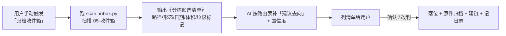
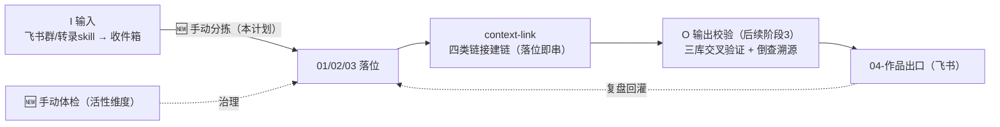

# 知识库 Skill 优化计划：归档与体检（含内容放置路由）

> **一句话结论：** 改造主体（批次 A–G）已完成、健康分 49.6→73.6、断链清零，但暴露出两个**机制性短板**——① 收件箱「只接收、不分拣」，分拣全靠手动喊，导致 830MB 内容堆积（批次 E 搁置）；② 体检只做「静态结构快照」，不看「知识流动与活性」，孤儿率反而从 35% 升到 45.9%。本计划**不重做架构**，把「归档」skill 升级为「手动触发 + 候选清单 + 固化路由」，把「体检」skill 升级为「看流动活性 + 趋势对比」，补齐 IPO 闭环的「分拣」与「活性检测」。
>
> **已拍板决策（2026-10-30）**：① 分拣**保持手动触发**，不做自动分拣、不建分拣定时任务；② 学会提问 / 科学决策 / 调研黑客 统一放 **10-个人成长**；③ 体检**保持手动**，不建双周定时；④ 执行顺序：改归档 → 清收件箱 → 封装反幻觉 → 升级体检。
>
> 与既有文档的关系：宏观对标路线见 [[03_知识库改造计划]]；改造批次收尾见 [[04_知识库改造收尾计划]]；**本文件只细化两个 skill 本身怎么升级、内容怎么放**。

---

## 一、现状基线（2026-10-29 体检，引擎 v2.3）

| 指标 | 数值 | 说明 |
|---|---|---|
| 总 md 数 | 1325 | 较改造前 1694 精简（去重/合并） |
| 健康总分 | 73.6 | 49.6 → 73.6（断链大头已修） |
| 断链 / 断链率 | 0 / 0.0% | 批次 G 修复 313 处 |
| **孤儿笔记** | **608（45.9%）** | 改造前 549（35%），**比例反升**——移动后未补链 |
| 同名文件 | 125 | 多为探月/转录通用页名（模板性歧义） |
| 空文件 / 小文件 | 3 / 21 | 待清理 |
| 收件箱 | 约 830MB | 8 个课程/直播/AMA + 2 散件，批次 E 搁置（2026-10-30 现为 13 条/约 616MB，含官方任务包 2 项） |
| 归档区 | 987MB / 4053 文件 | 4 个成品目录被整份复制（成品特例未执行）；2026-10-30 已手动清至约 117M（成品索引化完成，仅 AI 基本功 116.7M 待裁决） |
| 分拣方式 | **手动触发**（用户拍板） | 不做自动分拣 |
| 体检方式 | **手动触发**（用户拍板） | 不建双周定时 |

---

## 二、核心诊断：两个 skill 卡在哪（均有实证）

### 2.1 归档 skill（knowledge-base-inbox-archive）

| # | 问题 | 证据 | 后果 |
|---|---|---|---|
| A1 | **分拣全靠临场发挥，无辅助脚本** | 目录里只有 fetch_messages.py（拉群），六步分拣无脚本 | 手动分拣时靠读规则临场，易遗漏、质量不稳 |
| A2 | **成品落位路由不明确** | 课程文档落 01 还是 70？直播/AMA 落哪？规则散落在 4 个文档 | AI 判不准就搁置，越积越多 |
| A3 | **成品特例未执行、归档区暴涨** | 归档区 987MB：AI口喷378/双三角331/十指161/基本功117 被整份复制图片 | 成品本体已落位，归档区又存一份，纯冗余 |
| A4 | **过程垃圾入库** | 收件箱成品里有 `.venv`（005/006）、`.tmp_seg`（001/002/003）；根目录有 `.venv-course-docs` | 非笔记内容污染库，.gitignore 未拦截 |
| A5 | **分拣后不串联建链** | context-link 已建但分拣落位后不自动接上 | 新笔记落位即成孤儿（孤儿率 45.9% 的增量来源之一） |

### 2.2 体检 skill（knowledge-base-health-check）

| # | 问题 | 证据 |
|---|---|---|
| B1 | **只看静态结构，不看流动活性** | 脚本 v2.3 只检测断链/孤儿/空文件/重复，**不检测**：链接类型、三库对齐、status 停滞、verification 完整、转化周期 |
| B2 | **无趋势对比** | 报告留了 7 份，但没有自动对比基线、没有趋势曲线，看不出「孤儿在涨/分数在变」 |

### 2.3 对照刘卫：我们缺的不是「存」，是「可追溯 + 看活性」

刘卫 IPO 每一环都有「闸」：草稿隔离 → 自动归类 → 四类链接 → 三库交叉验证 → 双周自检。我们当前：**I（接收）自动、P（分拣）手动、连接（context-link）已建未串、O（输出校验）未封装**。本计划补「P 分拣辅助 + 落位即建链」和「检的活性维度」。

---

## 三、归档 skill 优化方案（保持手动）

### 3.1 【P0】补 `scan_inbox.py` 手动分拣辅助脚本（解决 A1）

用户说「归档 / 收一下收件箱」时，**先跑脚本**，不直接临场分拣：

**铁律：** 脚本只扫描、**不做任何落位移动**；落位仍由 AI 按路由表提议、用户确认后执行。

### 3.2 【P0】固化《内容放置路由表》（解决 A2，见 §五）

### 3.3 【P0】分拣落位后串联 context-link（解决 A5）

- 每篇落位笔记落位后自动走 context-link 建带类型链接（≥2 条）；
- 归档 skill 的落位动作里加一步「调用 context-link 流程」；
- 目标：新增笔记 100% 建链，不再制造新孤儿。

### 3.4 【P1】严格执行成品特例 + 归档区瘦身（解决 A3）

- 成品（转录完成的课程/定稿）落位时，归档区**只记一条索引**（原件名+落位+日期+来源），**不整份复制图片**；
- 补 `archive_audit.py`：扫描归档区，对「成品本体已落位」的整份复制目录（当前 4 个、约 987MB）标记「可清理候选」，列清单用户确认后删；
- 30 天生命周期标记改为随体检自动跑（不依赖归档是否手动触发）。

### 3.5 【P1】拦截过程垃圾（解决 A4）

- 转录 skill 交付前清理 `.tmp_seg`、`.venv`；
- `.gitignore` 增加：`.venv*/`、`**/.venv/`、`**/.tmp_seg/`、`**/__pycache__/`；
- 根目录 `.venv-course-docs` 移出库或删除（用户确认）。

---

## 四、体检 skill 优化方案（保持手动）

### 4.1 【P0】体检引擎升级：从「静态结构」到「流动活性」（解决 B1）

在现有 7 维度上新增 6 个活性维度：

| # | 新维度 | 检测什么 | 对应刘卫能力 |
|---|---|---|---|
| 8 | **链接类型覆盖率** | 笔记带 `[逻辑]/[因果]/[反例]/[案例]` 类型链接的比例（配合 context-link） | 四类知识链接 |
| 9 | **三库同领域对齐/失衡** | 10/20/30/50/60 各领域在 01/02/03 是否都有对应、比例是否失衡（如 01 独大） | 三库横向对齐 |
| 10 | **status 流转停滞** | 02「假设」停留 >60 天、03「待应用」停留 >60 天（只想不做/只进不出） | 状态流转 |
| 11 | **01 verification 完整性** | 升 01 的文件是否写了 verification（方式/证据/日期） | 准入闸 |
| 12 | **收件箱→落位转化周期** | 收件箱条目平均停留天数、超 3 天未清清单（收件箱应空） | 草稿隔离时效 |
| 13 | **孤儿增量趋势** | 对比上次报告：孤儿数/孤儿率是涨是跌、高价值孤儿回收进度 | 双周自检 |

### 4.2 【P1】趋势对比（解决 B2）

- 报告头部固定放「较上次变化」：健康分、孤儿数/率、断链率、各层占比、各领域 status 分布；
- 自动生成趋势数据（落 `知识库体检/trend.csv`），并在报告内嵌一张趋势折线图（健康分/孤儿率随时间）。

---

## 五、内容放置路由表（核心 · 固化进归档 skill）

### 5.1 通用路由（按「形态 + 认知阶段」）

| 输入形态 | 判定 | 标准落位 |
|---|---|---|
| 一堂官方课程转录成品（方法/技术，如建模/AI/调研） | 成熟外部体系，过准入闸+用户拍板 | `01/50-AI技术与应用/` |
| 一堂官方课程（商业/决策/增长） | 同上 | `01/30-创业与商业/` |
| 一堂官方课程（成长/思维/提问/决策/调研） | 同上 | `01/10-个人成长/` |
| 一堂官方课程（教学法/课程设计） | 同上 | `01/60-教育与教学/` |
| 案例集合 / 马拉松 / 别人的故事 | 备课素材 | `01/70-案例库/`（打领域 tags） |
| 外部直播 / AMA / 分享（非官方成体系） | 外部观点、待验证 | `02/<对应领域>/`，`status: 假设` |
| 本人教案 / 复盘 / 项目 / 练习记录 | 亲身实践 | `03/<对应领域>/`，`status: 待应用` |
| 可复用提示词 / 金句 / 模板 | 可复用素材 | `03/<领域>/`，`type: 素材` |
| 任务指令 / 规则 / 评估 / 关于我 | 系统层 | `00/01-系统文档`、`03-基本法`、`06-评估报告`、`09 关于我` |
| 判不了 / 涉隐私 / 未定稿 | 需裁决 | 暂留 `05-收件箱`，清单标「待裁决」 |

> 落位铁律不变：落**最细子文件夹**不落根目录/主题域根；**01 层再按「地图子文件夹」（10/30/40/70 按三张地图与现有子文件夹，见 rules.md 第〇节第三层）落最细层级**（V1.5）；文件名=类型前缀+主题（≤15 字）；补 YAML；新笔记落位后走 context-link 建带类型链接；写 md 用 python3 原始字节；迁移后重写 md 图片路径。

### 5.2 收件箱 13 项的实际落位（v2.1 · 2026-10-30 用户拍板后按三张地图归位）

| # | 条目 | 实际落位（v2.1） | 说明 |
|---|---|---|---|
| 1 | 001_学会提问 | `01/10-个人成长/03 不断练能力/06 学会提问/` | 个人地图「练能力·学会提问」 |
| 2 | 002_高阶建模实操框架篇 | `01/10-个人成长/02 不断提认知/04 思维建模/` | 个人地图「提认知·建模萃取/思维模型」 |
| 3 | 003_高阶建模第一课 | 同 002 | 同一系列 |
| 4 | 004_科学决策-AI落地篇 | `01/10-个人成长/04 形成竞争力/02 决策力/` | 个人地图「领先层·决策力」 |
| 5 | 005_单元模型-AI落地篇 | `01/30-创业与商业/02 起盘阶段/04 单元模型/` | 主体是单元模型（改判 30） |
| 6 | 005_调研黑客-实操篇 | `01/10-个人成长/02 不断提认知/05 调研黑客/` | 用户裁决个人成长 |
| 7 | 006_调研黑客5部曲认知篇 | 同 005 调研黑客 | 同上 |
| 8 | 直播262 AI场景第一课 | `01/50-AI技术与应用/AI技能/` | 用户裁决保持 |
| 9 | 代俊隆 Skill AMA | `02/50-AI技术与应用/` | 外部 AMA，02 层保持 |
| 10 | 01-Y模型 Partner 复盘 | `03/50-AI技术与应用/` | 本人复盘，03 层保持 |
| 11 | 人生红点诊断报告 | `00/09 关于我/` | 关于我评估，00 层保持 |
| 12 | 官方任务包01 封装 Skill | `01/50-AI技术与应用/AI技能/` | 官方任务包，保持 |
| 13 | 官方任务包02 封装 Partner | `01/50-AI技术与应用/AI技能/` | 同上 |

> 所有成品落位前先清 `.venv/.tmp_seg`；归档区只记索引不复制。

---

## 六、补齐 IPO 闭环（归档 → 连接 → 输出 → 体检）

- 本计划落地「手动分拣辅助」与「活性体检」；
- context-link 已建好，分拣落位后**串联调用**（不再是独立动作）；
- 体检维度 11/13 为后续「输出校验 skill（改造阶段 3）」预留接口（查出库质检凭证）；
- 转录类 skill 与归档 skill 的衔接明确：**转录完成 → 落收件箱 → 用户手动触发归档**（转录 skill 不自行落位，保证分拣口径统一）。

---

## 七、落地批次（每批先列清单经确认，不静默改动）

| 批次 | 内容 | 依赖 | 预计 | 状态 |
|---|---|---|---|---|
| **H1** | 更新本计划为已确认版；写 `scan_inbox.py`；对收件箱 11 项生成候选清单 → 确认后清收件箱（重启批次 E，含清 .venv/.tmp_seg） | 无 | 0.5 天 | 进行中 |
| **H2** | 归档 skill 升级：嵌入路由表 + scan 脚本 + 成品特例 + 落位串联 context-link；库内/系统两份副本同步 | H1 | 0.5 天 | 待做 |
| **H3** | 归档区瘦身（已手动完成 987M→117M，2026-10-30）：`archive_audit.py` **暂缓封装**——成品冗余已清，归档区 30 天体检并入体检引擎（health-check）的活性维度，不再单独建脚本 | H2 | 0 天 | 已重估/暂缓 |
| **H4** | 体检引擎升级 v3.0：新增 6 个活性维度 + 趋势对比（保持手动） | 无 | 1 天 | 待做 |
| **H5** | 封装反幻觉事实守门员 skill（03 草稿 → 库内 .skills） | H1 | 0.5 天 | 待做 |

每批独立 git 提交，提交信息写明范围与文件数。

---

## 八、验收标准（量化）

| 维度 | 现状 | 目标 |
|---|---|---|
| 收件箱 | 830MB 堆积 | 清空并保持「空」为常态（用户手动触发归档） |
| 分拣辅助 | 纯临场 | 手动触发即出候选清单，确认后落位 |
| 成品特例 | 未执行（987MB 冗余） | 成品只记索引；归档区冗余清理后 < 100MB（2026-10-30 已手动清至 117M，仅剩 AI 基本功待裁决） |
| 孤儿率 | 45.9%（608） | 分拣+建链跑顺后 < 20%（高价值孤儿优先回收） |
| 新增笔记带类型链接 | 部分 | 100% 落位后经 context-link 建链 |
| 体检 | 静态、无趋势 | 报告含 6 个活性维度 + 趋势对比 |
| 健康总分 | 73.6 | ≥ 85 |
| 过程垃圾 | .venv/.tmp_seg 入库 | .gitignore 拦截，库内零残留 |

---

## 九、已拍板决策（2026-10-30）

| # | 决策项 | 结论 |
|---|---|---|
| 1 | 分拣方式 | **手动触发**，不做自动分拣、不建分拣定时任务 |
| 2 | 路由表领域归属 | 学会提问 / 科学决策 / 调研黑客 统一放 **10-个人成长**；技术类（建模/单元模型）放 50；直播/AMA 放 02；复盘放 03 |
| 3 | 归档区 987MB | 同意做 `archive_audit.py`，列清单后清理成品冗余 |
| 4 | 体检方式 | **保持手动**，不建双周定时 |
| 5 | 开工顺序 | 改归档 → 清收件箱 → 封装反幻觉 → 升级体检 |

---

## 十、变更记录

- **V1.2（2026-10-30）**：校准 §5.2 路由快照——高阶建模（实操框架篇/第一课）改判 `01/10-个人成长`（主体是思维方法论，AI 只是案例）、直播262 改判 `01/50`（官方必修课，形式不决定归属）、快照 11→13 项（新增官方任务包 01/02，体积按 scan_inbox 最新值）；H3 archive_audit.py 暂缓封装（归档区已手动清至 117M，30 天体检并入 health-check）；基线表/验收表加注当前值。
- **V1.1（2026-10-30）**：用户拍板——分拣保持手动、不建定时；学会提问/科学决策/调研黑客统一放 10-个人成长；体检保持手动、不建双周定时；顺序：改归档→清收件箱→封装反幻觉→升级体检。状态转「已确认」。
- **V1.0（2026-10-29）**：初版。基于 10-29 体检基线（73.6 分、孤儿 608、收件箱 830MB、归档区 987MB）与刘卫案例，提出归档/体检两个 skill 的优化方案、内容放置路由表与落地批次；待用户评审、拍板。
