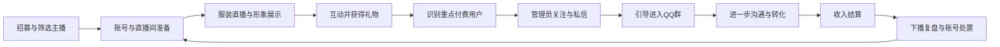
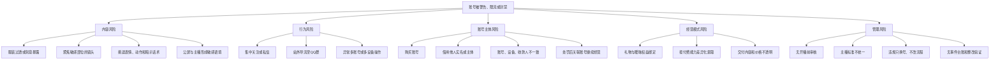
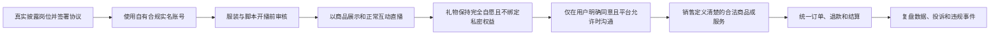

# 直播业务流程与账号风险梳理

> [!warning] 文档边界
> 本文依据当前文件夹中的聊天录音转写整理，目的是还原业务、识别问题并推动合规整改。原材料存在口语、省略和转写错误；其中关于平台规则、处罚阈值、账号交易和实名操作的说法，均属于聊天中的经验口述，**不视为已核实的平台规则**。
>
> 本文不会把买号、借用实名、规避平台识别或绕过封禁的方法整理成可执行教程。相关内容只作为风险事实和整改对象记录。

## 一、业务的一句话定义

当前业务以**女主播在抖音进行服装直播**为流量入口，通过服装上身展示、主播形象和直播互动吸引男性观众，以礼物收入及后续私域转化为主要变现方式；运营团队负责主播招募、直播协同、重点用户承接、账号管理、结算和复盘。

从聊天记录看，实际业务并不只是“卖衣服”，而是同时存在三条收入逻辑：

1. **商品收入**：直播间展示和销售 T 恤、男装等服装；
2. **直播礼物收入**：引导观众赠送“跑车”等礼物；
3. **后续转化收入**：管理员关注、私信重点用户，再引导至 QQ 群进行进一步转化。

其中，第 2、3 条与性感展示、暗示性互动结合后，构成目前最主要的封禁、投诉和法律风险来源。

---

## 二、当前业务全流程（As-Is）

### 1. 主播招募与筛选

**当前做法**

- 招募主要依赖熟人关系和身边资源向外扩散；
- 重点确认主播晚上是否有稳定时间、能否长期配合；
- 候选人先到现场看实际直播，再由双方互相筛选；
- 部分聊天将“缺钱”、单身或离异、能否放得开作为筛选条件；
- 招聘时可能先以“男装/服装直播”进行介绍，确认意愿后再解释具体展示方式。

**对应来源**

- [[07 Projects/01 抖音直播/运营/0108-寻找主播的两种途径-1916042210978338680]]
- [[07 Projects/01 抖音直播/运营/0110-男装直播招聘人员要求及筛选标准-1915967362583271288]]

**主要问题**

- 岗位说明可能不充分，候选人无法在加入前获得完整、真实的信息；
- 以经济压力或婚姻状态筛人，容易形成不当利用弱势处境的伦理与劳动争议；
- 缺少书面的工作内容、服装边界、收入算法、退出机制和个人信息保护约定。

### 2. 账号、设备与直播间准备

**当前做法**

- 开播前处理账号、手机、电脑、直播间设置和商品相关准备；
- 团队讨论过购买所谓“白号”、借用亲友账号或身份、个人号转企业号、实名认证资源等方案；
- 会调整隐私推荐、同城推荐、关注可见性等设置；
- 多账号运营被视为需要逐步积累经验的工作。

**对应来源**

- [[07 Projects/01 抖音直播/运营/0114-直播合规与运营要点培训-1915436934122028512]]
- [[07 Projects/01 抖音直播/运营/0126-直播账号运营与违规规避策略讨论-1916362479173407504]]
- [[07 Projects/01 抖音直播/运营/0136-电商账号购买与运营相关讨论-1916435850099724504]]
- [[07 Projects/01 抖音直播/运营/0137-直播设置与日常事务交流-1916434215864519632]]

**主要问题**

- 账号所有人、实际控制人、实名主体和收益主体可能不一致；
- 买号、借号、借实名或购买主体资料，会带来账号追回、资金冻结、身份冒用、合同无效和平台处罚风险；
- 如果旧账号被处罚后继续更换身份和账号重复经营，可能被平台识别为关联违规，而不是解决根因；
- 缺少账号资产台账、权限分级、设备管理和离职交接机制。

### 3. 直播内容与服装展示

**当前做法**

- 表面品类是 T 恤、男装或其他服装；
- 主播上半身展示商品，下半身可能搭配丝袜等偏性感服饰，通过身材展示增强停留和互动；
- 正常商品话术包括介绍颜色、版型、面料、尺码，提醒观众关注、点赞和购买；
- 聊天中已意识到服装过透、刻意暴露、挑逗表情、吐舌、性暗示动作及公屏敏感节奏可能引发处罚；
- 运营可能在场外通过提示器或口头提醒主播调整表达，并在下播后复盘。

**对应来源**

- [[07 Projects/01 抖音直播/运营/0113-直播间T恤销售与日常交流-1915612880678564448]]
- [[07 Projects/01 抖音直播/运营/0114-直播合规与运营要点培训-1915436934122028512]]
- [[07 Projects/01 抖音直播/运营/0130-直播技巧与个人风格塑造建议-1916090545466410080]]

**主要问题**

- “卖衣服”与“依靠性暗示吸引打赏”之间的定位不一致；
- 服装、镜头、动作、话术和公屏互动组合后，风险可能高于任何单一元素；
- 目前更偏向研究“怎样不被判罚”，而不是从业务设计上取消高风险内容；
- 主播依靠临场判断，标准不一致，培训也难以保证稳定执行。

### 4. 礼物触发与重点用户识别

**当前做法**

- 观众赠送“跑车”等礼物被视为业务流程中的第一个关键转化动作；
- 团队会根据观众等级、送礼行为、表达方式和付费爽快程度判断其价值；
- 运营目标不是单纯追求直播间人数，而是控制一定规模、识别更可能付费的人；
- 聊天中存在按用户等级和付费能力差异化报价、继续追加收费或包月的讨论。

**对应来源**

- [[07 Projects/01 抖音直播/运营/0112-note-1915711803439223640-1915711803439223640]]
- [[07 Projects/01 抖音直播/运营/0114-直播合规与运营要点培训-1915436934122028512]]
- [[07 Projects/01 抖音直播/运营/0125-直播运营策略与心态调整讨论-1916363386485113752]]

**主要问题**

- 若礼物与性感展示、私下权益或模糊承诺绑定，容易演变为诱导打赏和消费纠纷；
- 按用户经济能力临时抬价、持续索取，容易产生欺诈、胁迫式营销或针对脆弱用户牟利的风险；
- 缺少未成年人、醉酒者、冲动消费、异常高额付费等保护机制；
- 没有清楚区分“自愿礼物”“商品交易”和“群内付费服务”的权利义务。

### 5. 管理员关注、私信与 QQ 群承接

**当前做法**

- 主播收到重点礼物后，由运营或管理员账号识别该用户；
- 管理员使用抖音关注、私信等方式进行第一次承接；
- 随后引导用户进入 QQ 群，再进行后续沟通和转化；
- 聊天中多次出现“关注”“群”“QQ群”“转化”等环节，但具体责任人、标准话术、用户授权和数据记录并不清晰。

**对应来源**

- [[07 Projects/01 抖音直播/运营/0114-直播合规与运营要点培训-1915436934122028512]]
- [[07 Projects/01 抖音直播/运营/0122-直播违规处理及日常交流记录-1915053898201749840]]
- [[07 Projects/01 抖音直播/运营/0137-直播设置与日常事务交流-1916434215864519632]]

**主要问题**

- 站外导流本身可能违反平台规则，具体边界必须以抖音当前官方规则为准；
- 多管理员私信、重复关注或集中操作可能被判定为骚扰、营销或异常行为；
- 用户进入群后，其账号、消费能力和沟通记录属于需要谨慎处理的个人信息；
- 如果私域内容涉及色情暗示、付费观看、裸露内容或虚假承诺，风险将从平台违规上升到民事甚至刑事风险。

### 6. 私域沟通与后续转化

**当前做法**

- 在群内或私聊中继续维护关系，推动进一步付费；
- 可能根据用户等级、消费表现和沟通状态采用不同报价；
- 聊天材料没有形成清楚、统一的产品名称、交付内容、价格表、退款标准和售后规则。

**主要问题**

- 用户究竟购买什么、能够获得什么，目前定义模糊；
- 若只有“情绪价值”或暧昧互动，却按个人支付能力收费，争议极大；
- 主播、管理员、业务负责人之间的承诺可能不一致；
- 缺少订单、发票、退款、投诉和证据留存机制。

### 7. 收入结算、复盘与账号处置

**当前做法**

- 收入来源可能包括平台礼物分成、商品销售及线下/私域收入；
- 聊天中对平台抽成、工会提成、团队和主播之间的四六分、五五分、三七分存在明显理解分歧；
- 直播出现警告或违规后，会讨论停播、换号、调整服装和现场盯播；
- 已形成“每次下播后复盘”的意识，但没有看到统一模板和闭环台账。

**对应来源**

- [[07 Projects/01 抖音直播/运营/0109-直播收入分配比例争议讨论-1915968988229829728]]
- [[07 Projects/01 抖音直播/运营/0114-直播合规与运营要点培训-1915436934122028512]]
- [[07 Projects/01 抖音直播/运营/0122-直播违规处理及日常交流记录-1915053898201749840]]
- [[07 Projects/01 抖音直播/运营/0126-直播账号运营与违规规避策略讨论-1916362479173407504]]

**主要问题**

- “平台流水、平台结算额、团队可分配收入、私域收入”没有统一口径；
- 口头约定导致主播、工会和团队对分成基数及比例理解不同；
- 账号处罚后优先讨论换号，导致内容和转化方式的根因没有被消除；
- 缺少单场利润表、用户投诉表、违规事件表和整改验证记录。

---

## 三、角色与职责现状

| 角色       | 当前主要职责                | 当前断点                         |
| -------- | --------------------- | ---------------------------- |
| 业务一号位    | 设计业务模式、培训、协调资源、处理重大问题 | 经验集中在个人，规则没有文档化；部分经验与平台规则未区分 |
| 主播       | 服装展示、商品讲解、互动、获得礼物     | 内容边界依赖临场判断；劳动、形象和隐私保护不足      |
| 场控/运营    | 盯公屏、提示主播、控节奏、记录重点用户   | 缺少清晰预警等级和强制停播权限              |
| 管理员/承接人员 | 关注重点用户、私信、拉群、后续沟通     | 容易触发营销骚扰、站外导流和个人信息风险         |
| 账号/设备负责人 | 账号注册、实名、设备和权限管理       | 账号产权不清；存在买号、借号、借实名讨论         |
| 财务/结算    | 核算平台、商品和后续转化收入，执行分成   | 分成基数、比例、退款和成本口径不统一           |
| 招聘/后勤    | 找主播、安排场地、服装、排班与日常保障   | 招聘披露和书面协议不足；主播稳定性依赖个人关系      |

> 当前最明显的组织问题不是“没人做事”，而是**一件事多人参与，但谁对最终结果负责并不清楚**。

---

## 四、账号频繁封禁的原因树

### 核心判断

**“号不够用”不是根因，而是结果。**

只补充账号资源，最多解决短期排班问题；如果内容结构、导流方式、账号主体和付费产品不变，新账号仍会重复进入同一处罚路径。当前问题本质上是：

> 高风险内容获客 + 礼物筛选用户 + 站外导流 + 非标准化收费 + 非自有账号运营，形成了叠加风险。

---

## 五、建议重构后的合规流程（To-Be）

### 必须停止的做法

1. 停止购买、租用、借用或代持直播账号；
2. 停止使用无真实授权的身份证、营业执照或亲友身份；
3. 停止把“换号”作为违规后的默认修复方案；
4. 停止以挑逗动作、刻意暴露或性暗示作为核心获客手段；
5. 停止将礼物与私密照片、暧昧权益、特殊展示或其他模糊权益绑定；
6. 停止根据用户等级和支付能力临时抬价、反复索取；
7. 停止未经明确同意的批量关注、私信和站外拉群；
8. 停止让主播在未完整知情的情况下进入该业务。

### 需要建立的最小制度

#### A. 账号制度

- 一账号一真实主体，主体、运营方、收款方和合同关系可追溯；
- 建立账号台账：实名主体、管理员、设备、权限、开播记录、处罚记录；
- 账号密码、验证码和资金权限分离；
- 出现处罚时先暂停相关场景并申诉、整改，不启用替代账号复制原流程。

#### B. 内容制度

- 开播前审查服装、灯光、机位、动作清单和话术；
- 镜头服务于商品展示，不以敏感部位为视觉中心；
- 设置明确的红线动作与红线词；
- 场控发现高风险组合时有权立即切镜、换装或停播；
- 平台规则由指定负责人定期核验官方版本，不采用“听说几次以内没事”一类经验阈值。

#### C. 用户承接制度

- 只有用户明确表达沟通意愿时才进行一对一联系；
- 优先使用平台允许的客服、店铺和订单链路；
- 如确需站外沟通，先核验当前平台规则及法律要求，并取得用户明确同意；
- 不收集与交易无关的身份证、住址、家庭和财务信息；
- 建立未成年人和异常消费拦截机制。

#### D. 产品与收费制度

- 明确后续转化究竟销售什么合法商品或服务；
- 统一名称、价格、交付、期限、退款和售后规则；
- 礼物不视为购买凭证，不承诺隐性回报；
- 禁止成人视频、裸露内容、性交易及其变体；
- 对高额或连续付费设置人工复核和冷静提醒。

#### E. 主播与团队制度

- 招聘前完整披露工作内容、服装要求、镜头尺度和收入结构；
- 书面约定底薪、提成基数、结算周期、账号归属、肖像权和退出机制；
- 主播可以拒绝超出约定边界的服装、动作和话术；
- 每场至少明确主播、场控、承接、账号和结算五个责任人。

---

## 六、建议使用的单场运营闭环

| 阶段 | 必做动作 | 验证结果 |
|---|---|---|
| 开播前 | 核验账号主体、服装、机位、商品、脚本和人员 | 《开播检查表》全部通过 |
| 开播中 | 场控观察内容、公屏、用户异常消费和平台提示 | 风险事件有时间点和处置记录 |
| 用户承接 | 记录用户是否主动表达意愿、通过何种合规入口联系 | 不批量骚扰、不强制站外导流 |
| 下播后 | 核对时长、成交、礼物、投诉、警告和异常行为 | 形成单场数据记录 |
| 当日复盘 | 只复盘可改动作，不用“再换一个号”代替整改 | 责任人和完成时间明确 |
| 再次开播前 | 验证上一次整改是否真正落实 | 未验证通过则不开播 |

---

## 七、当前最需要补齐的业务定义

以下问题在聊天记录中没有形成一致答案，应由业务一号位、财务和实际执行人员共同确认：

1. **核心产品到底是什么？**是服装、直播礼物，还是 QQ 群内的某种商品/服务？
2. **用户送“跑车”后得到什么？**如果存在权益，必须明确、合法、可交付；如果没有权益，就不能暗示有特殊回报。
3. **QQ群内具体卖什么？**价格、交付、退款和售后分别是什么？
4. **收入如何计算？**平台流水、平台结算、工会分成、团队净收入、主播提成分别以什么为基数？
5. **账号属于谁？**实名人、使用人、出资人和收益人分别是谁？
6. **处罚原因如何确认？**依据平台处罚通知、直播回放时间点还是团队猜测？
7. **主播是否完全知情？**加入前是否清楚服装尺度、互动方式、收入模式及账号风险？
8. **谁有停播权？**发现高风险内容时，谁能立即终止直播而不承担业绩压力？

---

## 八、建议的整改优先级

### P0：立即处理

- 暂停买号、借号、借实名和处罚后换号复播；
- 暂停任何可能涉及色情暗示、私密权益或按支付能力索取费用的转化；
- 保存现有账号的处罚通知、直播回放、时间点和申诉结果；
- 对现有主播和用户关系进行风险盘点，优先处理投诉、退款和高额消费争议。

### P1：一周内建立

- 账号资产台账；
- 开播前检查表和下播后复盘表；
- 统一的收入分成说明；
- 主播岗位说明及知情同意文件；
- 明确合法产品、统一价格和退款规则。

### P2：稳定运行后优化

- 用商品成交率、停留、复购和投诉率替代“账号能撑多久”作为核心指标；
- 把一号位经验沉淀为合规培训材料；
- 对直播间、用户承接和财务结算分别设负责人；
- 定期依据抖音官方最新规则更新内容与导流边界。

---

## 九、资料可信度与使用说明

### 高相关材料

- [[07 Projects/01 抖音直播/运营/0108-寻找主播的两种途径-1916042210978338680]]
- [[07 Projects/01 抖音直播/运营/0109-直播收入分配比例争议讨论-1915968988229829728]]
- [[07 Projects/01 抖音直播/运营/0110-男装直播招聘人员要求及筛选标准-1915967362583271288]]
- [[07 Projects/01 抖音直播/运营/0112-note-1915711803439223640-1915711803439223640]]
- [[07 Projects/01 抖音直播/运营/0113-直播间T恤销售与日常交流-1915612880678564448]]
- [[07 Projects/01 抖音直播/运营/0114-直播合规与运营要点培训-1915436934122028512]]
- [[07 Projects/01 抖音直播/运营/0122-直播违规处理及日常交流记录-1915053898201749840]]
- [[07 Projects/01 抖音直播/运营/0125-直播运营策略与心态调整讨论-1916363386485113752]]
- [[07 Projects/01 抖音直播/运营/0126-直播账号运营与违规规避策略讨论-1916362479173407504]]
- [[07 Projects/01 抖音直播/运营/0130-直播技巧与个人风格塑造建议-1916090545466410080]]
- [[07 Projects/01 抖音直播/运营/0131-直播运营与日常交流杂记-1916087965264792184]]
- [[07 Projects/01 抖音直播/运营/0134-关于违规行为、法律风险及相关事件的讨论-1916442871297379624]]
- [[07 Projects/01 抖音直播/运营/0136-电商账号购买与运营相关讨论-1916435850099724504]]
- [[07 Projects/01 抖音直播/运营/0137-直播设置与日常事务交流-1916434215864519632]]

### 低相关或混合材料

以下记录以私人生活、闲聊或高度混杂的语音转写为主，只在出现明确业务信息时作为辅助，不宜据此直接作经营决策：

- [[07 Projects/01 抖音直播/运营/0127-关于婚姻、情感与生活意义的讨论-1916342807150498576]]
- [[07 Projects/01 抖音直播/运营/0129-生活与工作中的沟通问题及金钱观念探讨-1916092895888447352]]
- [[07 Projects/01 抖音直播/运营/0132-办公室深夜工作交流及日常事务讨论-1916445431098020056]]
- [[07 Projects/01 抖音直播/运营/0133-闲聊内容记录-1916443257844568280]]
- [[07 Projects/01 抖音直播/运营/0135-语音转写文本内容整理-1916441621462028504]]

---

## 十、结论

这套业务目前最大的误区，是把“账号被封”理解成账号资源问题。实际上，账号只是承载业务的外壳；真正决定账号寿命的是内容、互动、导流、收费、实名和团队管理方式。

如果继续沿用现有高风险逻辑，即使补充更多账号，也只是在重复消耗账号、主播和用户信任。更可持续的方向是：

> 从“性感展示筛选付费用户”转为“合规服装内容吸引目标用户”，从“礼物后私域收割”转为“透明商品或服务成交”，从“封号后换号”转为“处罚证据—根因整改—验证复播”的闭环。
