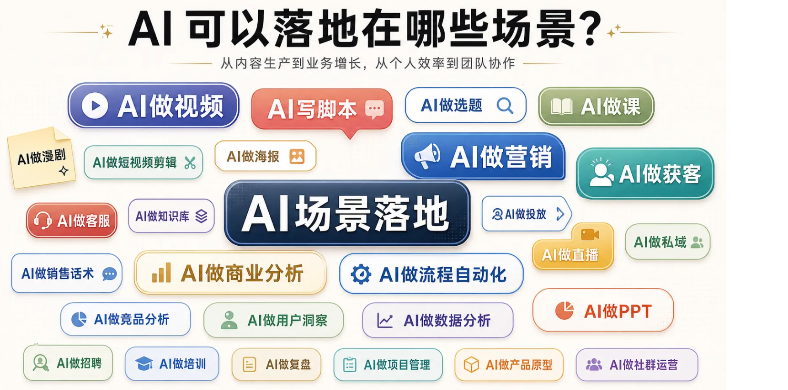
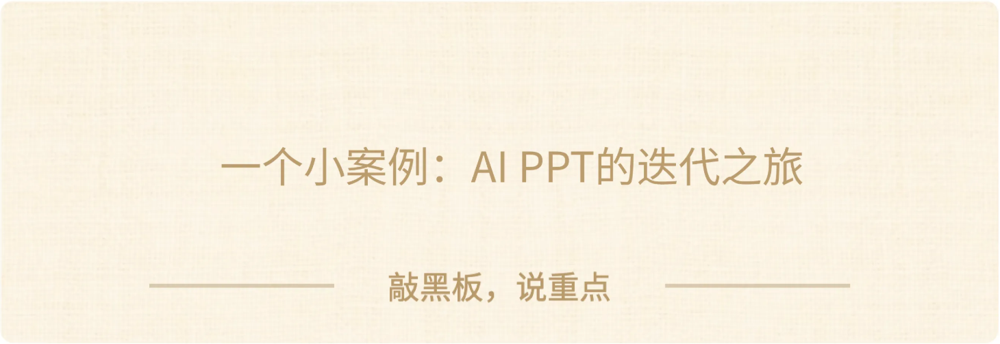
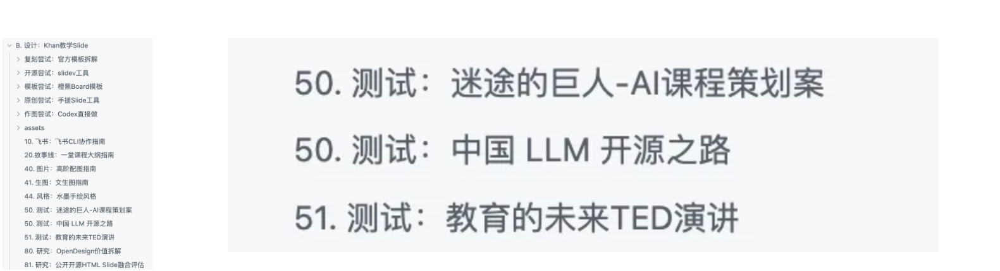
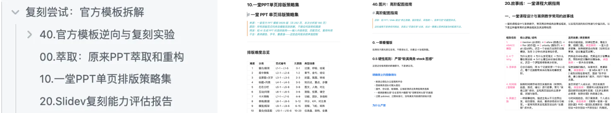
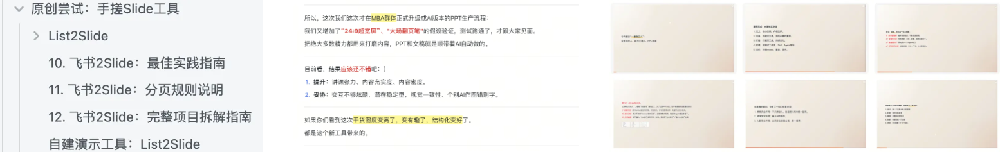
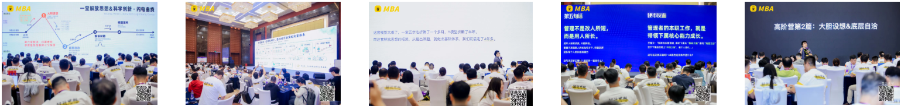

# AI 双三角 · 课程文档（00-04）

> 本文档由课程截图转录整理而成。**文字内容完整保留**，截图中的图片、金句卡片、
> 案例封面等视觉元素已从正文中分离，单独存放于 `images/` 文件夹，并在原位置以引用形式嵌入。
>
> 整理原则：
> - 讲课正文逐字转录，保留原本的口语表达
> - 原文中的红字/黄字强调、引用块，用 **加粗** / 引用块标示
> - 截图中的图片只保留图像本身，alt 文本为简短提示
>
> **本节划分说明**：标题一律取自原文页面里真实出现的标题文字，**不用截图文件名当标题**。
> 其中 **00 开场** 原文顶部只有浏览器水印条、正文直接从「热场」开始，**原文无标题**，故本节不设标题；
> 其余各节标题均为原文实际出现的文字。原始截图文件名中「03」出现两次（提前划重点 / 预热思考题），
> 文档内按出现顺序重新编号为 02、03。

---

## 目录

- [开场（原文无标题）](#开场原文无标题)
- [为什么一定要学](#为什么一定要学)
- [提前划一下重点](#提前划一下重点)
- [预热思考题](#预热思考题)
- [热身：AI可以科学化拆解么](#热身aican科学化拆解么)

---

## 开场（原文无标题）

> 【热场👏】来来来，我们热个身吧，如果一堂选择一节课，非常高价值和实操，每周用甚至每天用，可以用5-20年，可以让你变得越来越强强，超越很多同行/同龄人，你会选________

我猜很多人会选一堂五步法，ROI，清单体笔记，人生红点……

如果在2026年这个时间点来看，我会果断选**双三角**。

趁着大家对于AI还都刚入门，趁着大家都比较"焦虑/混乱"，我率先构建一套完备系统，去积累认知，去训练团队，去积累资产，靠这个带着一堂穿越周期，拿到AI的一张新船票。

过去半年，我和很多AI专家线下碰面，我几乎一直会重复一句话：**双三角每一周的含金量都在显著提升。**

随着我不断解决问题，不断搭工作流，不断挑战AI for Business的上限，不断和头部百亿美金CEO平等对话，我发现双三角的场景和价值远比我想的更高。

作为这个模型的提炼者，我还是大大低估了这个框架的价值了。

这个课题说来也尴尬，最近好多好多人过来找：

> 一堂最近讲课《场景第一课》《数据第一课》，讲了很多AI的课题，但是最重要的双三角没有一节独立的课啊，没有独立系统阐述过。
>
> 学了一堆叶子，没有树干课啊……

大家发现这个问题了么？

于是这节课来了，我们正式立项，给大家讲一节全员必修课。

---

## 为什么一定要学

先做一个热身互动吧：

> 【互动🎯】你对于双三角的理解和实践，现在到什么程度了？

1. 新人，第一次听说
2. 听过，听过课程，没啥感觉
3. 有道理，逻辑有启发，没怎么用过
4. 偶尔用：偶尔试着用它分析问题
5. 高频用：是我解决问题的主要工作
6. 战略用：这是我胜出很重要一张王牌

哈哈，实事求是，你现在在什么阶段？

这个课题研究最开始的背景是什么呢？

最开始，是一个大胆的假设：我们能不能尝试用科学建模的方式，来回应这个AI变革时代几乎最最重要的难题：**有了AI，人类如何和AI协作共生的问题。**

刚开始2023年工具刚来，所有人都懵懂，所有人都会，所有人都会装，人和人的差距只是一点点信息差的区别。

**但是随着大家都在用 AI，结果越来越分化，出现了10倍速，甚至100倍速的差异化。**有的人用 AI 持续做出 90 分交付。有的人用 AI 把原本自己亲自动手能做到 60 分的活儿，用了一堆AI硬生生做成了 40 分。

我曾经做过一个不那么恰当的比喻：一个广场上突然出现了数千个清华名校高材生，可以几乎免费认领带走跟你做事，你认领了几十个，但绝大部分公司并没有能用力好这些名校毕业生。

所以一堂一年前，联合一群AI专家和实践者，一起提炼了一个模型：双三角模型。经历了简单介绍、马拉松案例课、内部实践，今天终于形成正式课了。

如果说"一堂五步法"是过去五年里，一堂最重要的课程，那双三角应该是未来五年最重要的课程。

---

## 提前划一下重点

提前划一下重点，大家不要迷路，今天我会讲4个话题：

**第一部分：热身体感。**我们先来热个身，建立一个基本体感，我们真正的追求是什么，这一年我们有哪些变化。

**第二部分：现场推导。**我带你们完整推导一下双三角的形成过程，不管新老用户，形成一波理论自信和笃定。我会给你们演示一下十层解读基本功。

> *提醒：如果你们未来有机会给你们的团队、客户、学员教学双三角，请重点关注这一段。*

**第三部分：六大场景。**这是今天的重头戏，我会介绍双三角的六大使用场景，从入门进阶到高阶，双三角在我们AI工作流扮演的六个价值。

最后重新理解：为什么我说双三角每周的含金量都在显著上升，背后的体系和逻辑是什么。

---

## 预热思考题

来来，照例，给大家两个预热思考题吧：

**第一个题目：工具一致性。**

回顾一下过去，你使用AI工具解决过哪些复杂问题：做过PPT，做过商业分析，写过程序，做过视频，做过调研，甚至公司AI落地，做过很复杂的工作流。

问题来了，这些工具和方法完全不同，**背后有统一的思考原则和工作框架么？**彼此能迁移么？我做了N个脚本，能提升我文生图的能力么？

**第二个题目：长期稳定性。**

展望一下未来，你现在大量学习AI，各种工具、教程、案例，这些学习的有效性有多久呢？3个月以后还有用么？1年以后呢？3-5年以后？

AI工具一直在变，Coze、龙虾、Skill，哪些东西能穿越工具变化，长期值钱？**到底该积累什么核心能力和资产，才能真正建立长期核心竞争力，并在个人/公司竞争中脱颖而出？**

**第三个题目：原生AI范式。**

**大家都在讲原生AI，但从本质来看，真正的新范式到底什么样？**是会写提示词么？是会调模型吗？是会做几个Agent吗？

真正追求 AI 原生的团队，该用一套什么样的科学框架？它背后是否意味着一套完全不同的工作方式、判断方式、组织方式？

希望你可以做一个头脑实验，跳出来某一个AI工具和技术，试着理解一下整个系统本身。

---

## 热身：AI可以科学化拆解么

AI可以科学化么？科学追求的是可复用的因果规律，是体系，是完备的知识框架。

### 理想的追求

我不知道大家有没有经历过一段"焦虑又欣喜"的AI新手期。

欣喜的是，各种层出不穷的工具、技能，AI越来越强，每次体验都觉得好强好厉害。
焦虑的是，我的价值是什么？一直追工具我会逐步被替代啊，我的存在性是什么？

当年一堂五步法，人生红点，ROI体系出现也是类似，能不能有一套体系把随机变成确定，把偶遇变成计划，把一事一议变成长期复利？

这节课很重要，从"很有道理"到"非常好用"是一个巨大的鸿沟，希望大家让我多角度铺（luo）垫（suo）几轮，带大家充分理解这个模型的价值和体感。

先不说工具，先说结果，我简单回顾一下这一年我和一堂团队的变化吧。

### 我这一年的对比

一年前，应该说AI出现的前两年，从23-25年我一直是一种状态：积极尝试，拥抱变化。我学了很多工具，从Prompt到VibeCoding，从文生图到扣子。

但基本的情况就是：学了很多，开头很兴奋，觉得AI无所不能，然后动手后发现低于预期，失望，然后发现搞不定，然后放弃，整个实验项目全部废弃。

给你们举一个小的例子：AI做PPT，这一直是我的一个刚需，原始Keynote虽然好看，但非常原始，团队很难分工协作，AI很难参与，经常是抱着笔记本来回传递工作，非常痛苦。

为了AI化，给大家回顾一下我的经历：

- 我听说国内有一个AI PPT工具发布了，很兴奋，然后疯狂用了两个晚上发现文案遵循都做不到，立即放弃。
- 我又听说有一个SlideV开源工具很厉害，Demo很强，我做了真实案例，发现调试太难，放弃。
- 我又听说国外有个最佳实践Gamma很强，我又试了两个晚上，放弃。
- 我又听说NotebookLM很火，我也试了试，发现很难编辑和支持复杂内容，放弃。
- ……

怎么说呢，一次次发现新工具，一次次放弃，反复在燃起希望xAI太差(sb)之间循环，整个人的心态非常容易崩。

这只是一个小的场景，我还有AI写文案，AI写逐字稿，AI做插图，AI做作业挖掘，AI做Agent....都是一样，一次次把希望寄托于某一个更好的AI工具，发现结果都很差。

我曾经说过一句话：**面对一个复杂的课题，一个人真正入门的质变点是什么？**

是形成了对于这件事**基础的、朴素的、底层的框架性认知**。

先不说模型，当我在2025年真正入门以后，给大家讲讲真正的变化是什么。

首先第一点，AI行不行不重要，重点是我行不行，AI搞不定很正常，这是我的问题啊。
第二点：失败不再是工具的失败，而是在一直积累的路上而已。

就比如AI PPT这么简单的事情来说吧，AI某一些工具和技术不行很正常啊，这是整个行业的难题，我要系统的积累解题能力，于是我开始建立了一个独立的知识库，配置了一个独立Agent（Hermes），准备稳定的测试集，一次次迭代。

然后开始积累审美和数据，项目再怎么失败，积累优秀PPT的审美总不会错啊，积累一堂官方Slide模板库总不会错啊。

当我把"一周的实验对错"切换到了"季度/年"视角的能力积累以后，心态完全不同了：项目一直在失败没事，但我的资产库一直在进步，所有失败都是认知资产。

**结果不好，只是我的积累未到**，那就补审美，补工作流，补AI特性，补数据呗。

然后就是一个月，一个月有机会就练一下，试一下，最后在今年春天，终于开花结果了，我提了一个大胆的假设，探查出了一条"有点创新"的路：**自己一晚上，VibeCoding一个PPT工具，叫做Feishu2Slide，直接把飞书文档自动转成一个Slide。**

我可以跟团队多个人协作写飞书，跟设计师分工作图，跟10+Agent一起来分工工作内容，可以一直打磨内容到最后一秒，而整个生成PPT的部分（排版对齐动画）是自动生成的。

伴随这个新的Feishu2Slide工具，我还建立了一套新的**AI模型范式**：

1. **AI原生流程：**3个人+10个Agent可以同时协作工作。
2. **AI作图框架：**总结实践经验和最佳实践想家。
3. **AI原生体系：**使用Obsidian沉淀设计方法和工作流。
4. **AI自动复盘：**全自动复盘所有关键设计（不依赖Session记忆）

现在的AI PPT各种工具普遍能支撑10-30页PPT的简单分享，而我这个没有天花板，这一次MBA高阶营我们就做了差不多1000页PPT，依然可控。

这是高阶营这还变成了我的一个"惊喜小创新案例"做了开源和复盘，变成了一个很有趣的案例：

> 优点：没有协作天花板，没有页数天花板，没有功能天花板。
> 缺点：交互简单，有点粗糙。

大家有初步的体感了么？从被动用工具，到主动建立系统，从被动试错到主动接受所有认知，整个工作的过程就完全不一样了。

不只是我，整个一堂的研究团队这半年都一个个经历了我这样的变化：以前做一个AI教练（Partner）很容易慌，试一下失败，试一下失败，我们过去写过很多系统提示词、Coze工作流都废弃了。

现在就很自然地把它做成一个系统工程：**该从哪里建立审美，该从哪里处理数据包（DataPack），该从哪里测试工作流，一步步梳理就好了。**

即便搓不出来，没关系，这个就是必经之路，再积累一段时间呗，总能做得出来。

哈哈哈，大家猜猜看，产生这个Before After"质变"，背后最大的支撑和模型是什么？

---

<!-- 转录范围：00 ~ 04 -->