# AI 双三角 · 课程文档（11-15）

> 本文档由课程截图转录整理而成。**文字内容完整保留**，截图中的图片、金句卡片、
> 案例封面等视觉元素已从正文中分离，单独存放于 `images/` 文件夹，并在原位置以引用形式嵌入。
>
> 整理原则：
> - 讲课正文逐字转录，保留原本的口语表达
> - 原文中的红字/黄字强调、引用块，用 **加粗** / 引用块标示
> - 截图中的图片只保留图像本身，alt 文本为简短提示
>
> **本节划分说明**：标题一律取自原文页面里真实出现的标题文字，不用截图文件名当标题。
> 11-15 节覆盖"实操：双三角的六大落地场景"全部内容——入门（X光/心法）、
> 进阶（画布/拼图）、高阶（地图/底牌），以及回顾与作业。

---

## 目录

- [实操：双三角的六大落地场景](#实操双三角的六大落地场景)
- [入门场景：基础使用](#入门场景基础使用)
- [进阶使用：专业解题](#进阶使用专业解题)
- [高阶使用：修炼能力](#高阶使用修炼能力)
- [回顾和作业Candy](#回顾和作业candy)

---

## 实操：双三角的六大落地场景

第二部分讲完，我们来讲第三部分实操。

如果它是一个科学的因果关系内核，一堂双三角能用在哪些重要的工作场景呢？

> 【提问🤔】大家觉得，双三角在哪些场景下特别有用？
>
> 通用场景，比如员工培训，而不是文生图，写小说这种具体工作类型。

看看几百上千个同学加一起，能不能把这些高价值场景凑齐。

从入门到进阶，我们做了一次大的复盘，发现有六大高价值场景。
这个发动机转上去，AI的迭代和进步会全面提速。

> 【划重点💡】哈哈为了方便大家理解，我分别写了一个形象的比喻：
> - **入门基础**：X光（拆解用），心法（口喷用）
> - **进阶使用**：画布（筹备用），拼图（分工用）
> - **高阶修炼**：地图（训练用），底牌（战略用）

这是一个有六种变化的AI驱动引擎：

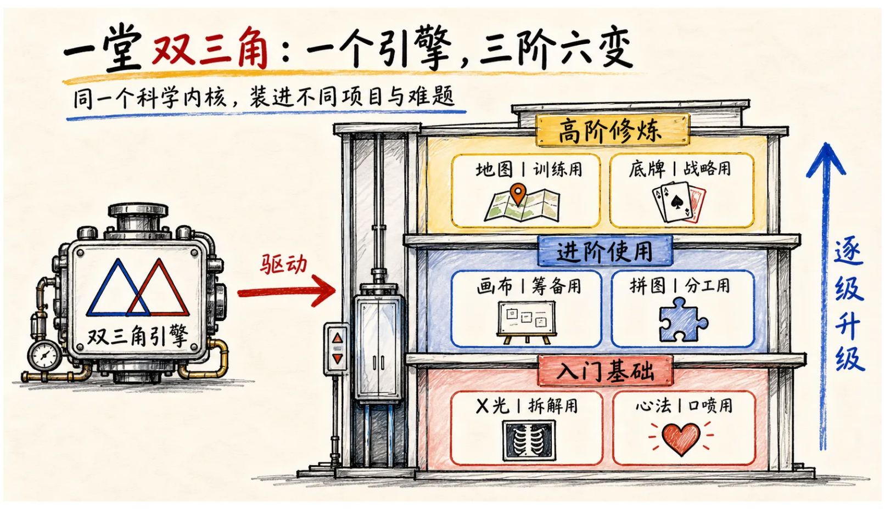

时间有限，我快速带大家理解一下这六种高价值的场景。
你们感受一下，是不是能体会到，每一周双三角都更值钱了hhh。

---

## 入门场景：基础使用

我们先来看两个高频的入门场景，不难，但是这两个场景是大家完成知行合一的行动开始关键。

### 1）拆解用：X光

第一个是最基础的用法，就是发现一个"很优秀""很有竞争力""很想学"的AI落地结果的时候，大家平时会如何条件反射的思考？

学之前，我们先来做一个测试：

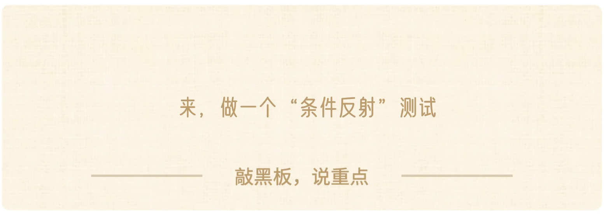

> 【思考🤔】一堂有哪些小的AI工具大家觉得很不错，比如某个Partner、某个AI小工具，某个场景，你如果要是能学会就太好了。

> 【思考🤔】如果你们想学，花1天-1周复刻，你们条件反射会想怎么学习？

> 【划重点💡】你们过去，习惯性会如何理解和学习？
> 1. **入门**：它用了什么AI工具？
> 2. **进阶**：它用了什么工作流组合？
> 3. **科学**：它背后的双三角是如何支撑的？

大家都说自己心里"认可双三角"，如果没有条件反射选【3】就是在手上还没有真正入门。

我曾经拆解过一堂的一些双三角：

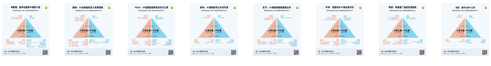

我们在马拉松拆解了大量的双三角：

很多时候，我们难以做到复刻，往往不是卡在AI技术和基本功，大概率是数据、审美，甚至我越来越发现，卡住我们难以做到的往往是工作流和体系。

除了拆别人，对于自己这个技能同样好用：

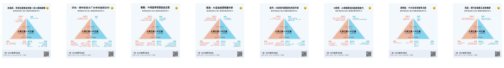

当我们做完了一个任务（Codex、YAI、OpenClaw）你直接让他扫瞄一下全文，然后给你基于双三角写一份入盘报告，比如这是我做的一个"AI高阶建模示范"，最后随口喷的提示词：

> 提示词：非常不错，你感觉咱们的工作质量怎么样？你去学一下一堂AI双三角，这个模型是用来解读人和AI高水平协作的框架。你去研究一下这个模型，然后帮我还原一下刚才咱们所有的工作过程，你做了什么，我做了什么，以及咱们两个是如何互补的。帮我尝试做一次大的复盘和整理，以及如果没有人，AI会怎么样？如果没有AI人会怎么样？为什么人乘以AI在双三角下会有如此巨大的产出，以及这个可以作为一个案例包作为全部的复盘。然后同时如果未来我给团队教学，这是一个很棒的AI双探角教学材料，帮我做一个完整的复盘吧。注意是总分，总的结构。

然后YAI做了一份复盘报告：

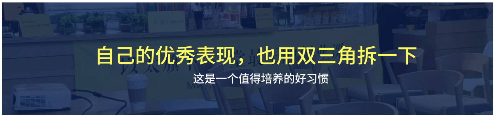

> 提醒：用YAI你可以直接让他自学知识库，然后干活儿；
> 如果是其它Agent，你需要自己准备双三角的数据包DataPack or 技能Skill；

### 2）口喷用：心法

入门阶段的第二种用法，光"学习不够"，我选了一个"解决问题"的场景。
这个场景比较有趣了，这是一个我最近反复强调、反复带大家练的基本功。

口喷是什么意思呢？简单说，就是直接语音输入，用类似于人类讨论的方式，直接用嘴来打字，调用AI来干活。

哈哈，大家有在一些场合发现我展现我的"口喷基本功"么？感受到我一直在刻意练习么？第一次听我完整口喷长提示词，感受如何hh。

> 【口喷🎤】现做一个调研吧：大家和AI协作，口喷的比例如何？
> 1. 基本没习惯，打字为主
> 2. 偶尔试试，使用很少
> 3. 多数口喷，占比很高
> 4. 基本口喷，每天几十几十百次口喷

在线下YAI训战营，我们画过一个图：

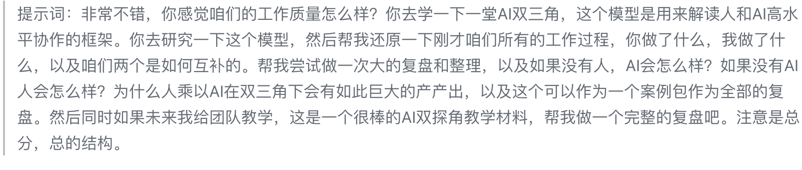

这不是今天的重点，口喷的刻意练习、工作和动作要领我先不讲，我只想回答一个问题：**喷的本质是什么？**

有人说口喷的本质是结构化提示词、是数据、是上下文、是给限制，这些都不本质。
那本质是什么？

其实我在线下讲过一句话：

喷出你的审美，喷出你的体系和节奏感，喷出你的数据，喷出你的技术特性，然后让AI在更高水准的双三角工作，整个工作的表现就会全面提升。

哈哈，我们画过一个示意图：

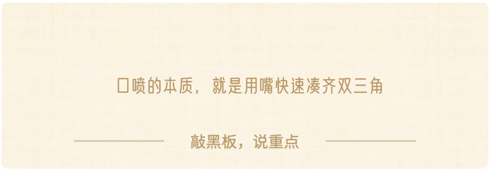

> 一句话：**双三角是内功，九字诀是外功，口喷提示词是动作。**
> 九字诀：定目标，控节奏，做纠偏。

哈哈哈，为了试图证明我会，我给你们演示一个Demo吧，你们挑一个例子：
1. 帮我写一封Top水准的信（比如新版本Y30扉页）
2. 做一个课程的Top插图（Codex文生图）
3. 帮我配置一个Top个人助理（龙虾/Hermes角色文档）。

只能喷一段，争取一次性喷干净，感受一下背后的刻意练习。

> 我是在线教育公司的CEO，希望做一个AI CEO助理来全面支撑我的工作。如果你不了解我和"一堂"，请去我们的代码库系统地认识一下我和一堂的背景；同时，帮我去obsidian里看一下关于角色配置的最佳实践，进行系统学习。
>
> 然后，请帮我设计一个OpenClaw的角色配置文档，一共5~7个角色。我对这些角色的美好想象是，它们主要的工作内容有以下三点：
> 1. 记录灵感与想法：我平时有任何灵感想法，可以随时抛给它，它帮我记录，并按照一定的规则进行分类，随时能帮我整理出一份完整的清单。
> 2. 定期汇报与事项提醒：它需要定期帮我汇报这些清单的变化，并实时帮我记着关键事项。
> 3. 专题研究：如果我需要学习一些专题，或者有一些感兴趣的课题，我会随手扔给它，由它帮我做一些专题研究。
>
> 寻找与定义助理特质：
> (a) 学习方法与最佳实践：关于这些学习的方法，你可以去知识库里学一下对应的方法和最佳实践的原则，自己去做一次扫描。
> (b) 全网摸查与研究报告：我过去没有人类助理，你去帮我全网扫一扫。对于一两百人量级的在线教育公司，CEO助理有哪些审美和特质？把他们的沟通方法、思考原则和习惯做一次全网的摸查，然后给我写一篇研究报告。
> (c) 理想助理画像：我对于这个助理美好的想象是：她可能是一个28岁、北大经济学和心理学双修的硕士女生。
> (1) 对人：跟人协作时情商极高，很容易给别人提供情绪价值，大家很愿意跟她说话，她可以自带温度。
> (2) 对事：面对事儿的时候非常理性，不会有情绪。每次讨论事儿的时候非常理性客观，有非常强的RY思维。
> (d) 补充RY方法论：如果对RY这个方法论不熟的话，你帮我去我们的课程体系里抽离一下，什么叫做"科学决策"和"讲道理"的理念，帮我打一个数据包。
>
> 生产过程设想：变过来整个的生产过程，我初步的设想是分成四个大的里程碑：
> 第一个里程碑，你先不要做任何的动手，帮我把刚才所有的工作写一篇工作计划，然后帮我去做一次预演，给我写一篇执行文档。
> 第二个，给我搜集信息啊，给我全面的去把我需要的一些内容一篇一篇的整理成文档。
> 第三个，完成初稿，你试着把我刚才说的这些信息拼成一个最佳实践的文档。
> 第四个，把所有的这些东西最终做一个MVP的测试啊，通过做大概5~10个小的测试任务来评估你的工作质量，最终来完成发布和交付

最后我想讲一个有趣的"理念"，我在一堂内部教练、NPC、主理人培训的时候，我讲过一个有趣的概念：

未来1年，这个指数会决定一堂同学们进步的代际差。

而口喷提示词，就是刻意练习这个**最小、最高频**的工具。

- 定义：内心装着双三角，用口喷的方式和AI协作。
- 动作要领：定目标，控节奏，做纠偏。
- 刻意练习：①目标 ②套路 ③非舒适区 ④大量重复 ⑤反馈
- 预期：每个月练习1000遍口喷提示词。

❤️ 期待：每次线下练习大家都很High，或许口喷提示词再酝酿一段时间，可以做成一节类似于《清单体笔记》《逐字稿》的必修课，大家可以期待一下。

好啦，双三角的两个场景（X光-拆解，心法-口喷）我就讲完了，还挺扎实的Hmm.吧。
这两个是比较基础、微观、低频的工作。

下面进入进阶阶段：面对一个AI难的项目和工程，如何来全面修炼和解题。

---

## 进阶使用：专业解题

我们分成两部分来讲：**事**和**人**。

### 3）筹备用：画布

其实在一堂内部，双三角最大的一个价值，就是用来"梳理和筹备"：遇到一个难题，先别怕，先试着凑一遍双三角，看看能有多少认知，多少牌能出，只要有牌，就不怕。

我们曾经提炼过一个简单的AI落地五步曲：

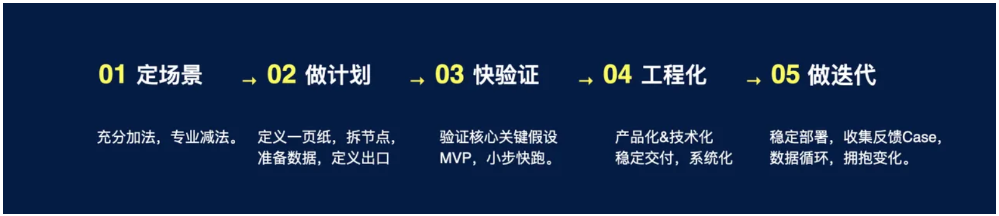

其中第二步做计划，就是在真正动手以前，提前准备素材，节点，工作流，数据，测试集等等。

在之前的工作和课程上，我们讲过各种版本：一页纸啊，雷达图啊，工作流啊。各个老师各个课程都不一样，大家混乱，我们也很难沉淀。

后来在一次磨课时候，花总突然说了一句：**准备的本质，不就是你们的双三角么？**
有点尴尬，但很有道理啊。

归根结底，不就是提前凑一凑双三角，做做计划，准备一下么？

后来我们逐步养成习惯，自己内部工作，先梳理和讨论双三角：

再比如，前两天我们需要临时搓一个复盘营"**新人第一课的教学Partner**"，时间紧任务重，如何快速启动，不跑偏呢？如果你只有15min在出租车上做计划，到公司就得开始拉团队启动分工测试，你会怎么做呢？

答案就是先凑一版本双三角：

为了让大家更好使用，这次我们做了一套"一堂双三角画布"：

从空白版本，到轻提醒，到完整提醒都在这里了，大家可以根据偏好自己选择使用。

有了画布以后，大家的沟通协作就能平等对话了。比如我们对外交付，一些同学现场做的小组汇报案例，放到这个画布里面：

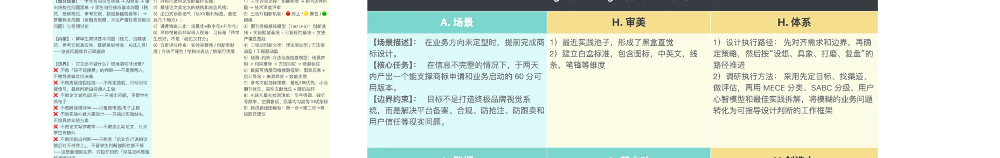

提醒：画布这些只是**备选项**，可能只有10-30%会入围，加法做的越多，越需要后面排序，取舍优先级。

这个很难，于是我们打磨了一个"双三角教练"：

给大家看一组对话，大家感受下质量和科学性：

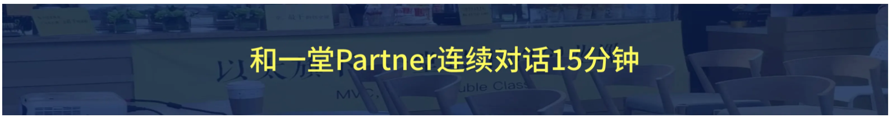

是不是双三角更值钱了hhh？

### 4）分工用：拼图

这个很有趣，AI转型，大家需要重新组织团队和工作方式，招人开人换人，有些公司换了一大波，发现效率并不好，还是原地踏步。

还有些人学习经典的"三人小组"：**产品，业务，程序员**，借鉴了别的大厂做法，发现效率也不高。

> 【思考🤔】问题来了：本质上是什么呢？

本质上分工和角色不重要，本质上是**凑齐这个业务/项目的高水平双三角**。

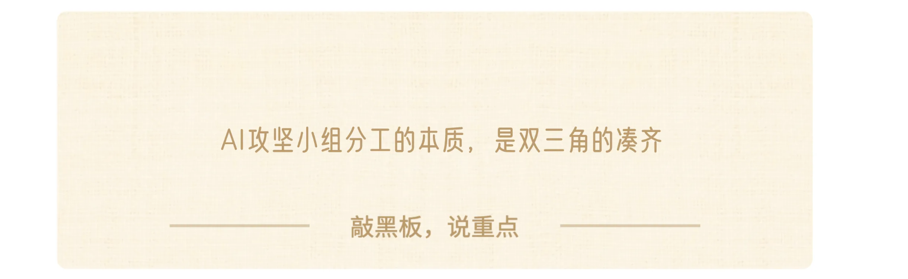

如果你想做AI客服落地，你想做AI招聘，你想做AI教练打磨，配置什么岗位不重要，重点是你得凑齐三个必要的要素：

1. **项目管理**：充分理解双三角，把控全局并且有很强的推动力。
2. **人类三角**：审美/体系/创造力，足够强，能够支撑结果。
3. **AI三角**：技术基本功/数据/场景预判，足够强，足以支撑AI测试。

至于是2个人还是20个人，至于是内部转岗、CEO顶上，还是外部顾问，手段都很灵活。

再深入一步看，为什么2C AI很好用，一旦进入2B的具体业务落地场景，AI就各种困难，难用，成功率很低，为什么？

从这个角度来看，归根结底，就是：**有意识+有能力凑齐双三角的人太少了。**

有些人把AI部署就当做=OpenClaw/Hermes部署；
有些人把AI部署就当做=AI Coze同行案例复刻。

但是现实很残酷：

> 缺少必要的数据，过去任务认知没有萃取，没有显性化就是不行。
> 缺少必要的审美，公司专家判断力不够，无法告诉AI审美体系，就是不行。

所以真正优秀的AI双三角项目经理，在战略宏观上足够乐观（类似双三角），在微观战术上足够悲观（承认很难凑齐），然后带着大家一步步构建核心能力。

> 【划重点💡】这个AI项目经理的核心工作，就是保持对于方法和策略的足够专业，但是对于答案和判断力足够空杯，承认自己不懂，然后一点点调用多方的优点把答案做出来。

这个辩证统一才是关键：
- 太自信不行：觉得自己一定行 or 复刻别人一定好使，大概率会失败。
- 不自信不行：觉得太难，难以做到，这个也不行，这个缺少落地决心。

一堂最近内部表现最好的2-3个人，最重要的工作就是"有勇气承担"，同时"积极凑牌"，比如最近出现了一个新气象：

> 我可以接这个Partner，但你得给我口喷30min你的所有审美，你得给我做3次1v1辅导模拟，你得给我时间打磨几次工作流，你得给我你的个人知识库的DataPack。

大家理解么？因为没有这些，专业的Partner真的搓不出来啊==。

市场大量顾问和咨询师都在给2B做落地咨询，但我一直觉得太碎太碰运气了。我们公司内部一直在试着培养业务负责人，能牵头攻坚一个又一个AI落地场景，最近拿到了一些结果，一堂Partner有点下饺子的感觉了。

哈哈，我有一个大胆的设想：

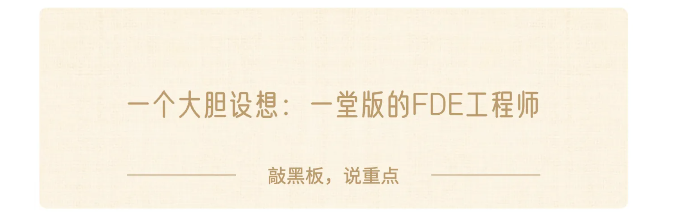

> FDE（Forward Deployed Engineer，前沿部署工程师），它是一个因AI落地热潮而迅速走红的新兴岗位，就是被派到客户现场的工程师。

我们有着统一的工作框架（双三角），我们有着科学的真实细节案例（双三角案例库），我们有着假设实验和科学精神，一堂能不能作为一个更好的FDE解决方案？

比如某公司想做"**专利申请AI化**"，我们有着过去3-5个同类的案例，充分知道什么样的判断体系、什么样的知识萃取程度才能支持好的结果，然后一起建模、讨论和测试验证。

这些科学体系派，会不会比市场上现在分散的个体服务者成功率和效率要高得多？

哈哈这是一个大胆的设想，我们一点点攒牌，拭目以待吧。

讲完了第一阶的X光，心法，讲完了第二阶的画布和拼图，
有没有感觉双三角价值又大了很多：)

这才是进阶，下面我们来讲高阶。

---

## 高阶使用：修炼能力

下面这两个比较难了，我试着解释一下，能点燃大家最好，至少让大家先有个感觉吧。

### 5）训练用：地图

先问大家一个问题：**双三角是一个短期问题，还是一个长期问题？**
**这是一个用完就忘的，还是要主动抓在手里的系统？**

如何用5-10年的心态来建立双三角的段位呢？

来了，我们给大家画了一个段位图：

如何螺旋上升，持续进步呢？给大家一个超级小抄吧（初版）：

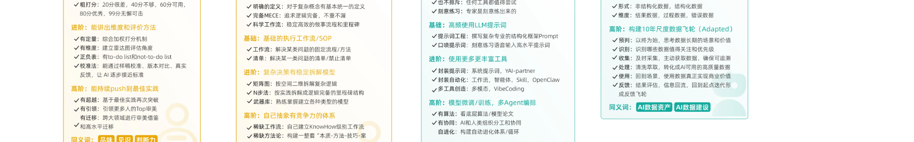

> 【🎁惊喜】送给大家一个小的礼物🎁。

如果大家真的想**刻意练习双三角**，但是又感觉自己的**刻意练习1+4要素凑不齐**。你们可以到YAI上，使用「**刻意练习十倍速教练**」，可以帮大家去提升你们的套路、非舒适区、重复次数和反馈，以及培养长期的追求。

这是我们这次增加的一个小的实验，这周限时开放。

下面是给大家的一段关于练习"填双三角画布"的「**用户提示词**」，大家可以直接发给刻意练习的C Partner，直接开始陪你一步步拆解、追问、补充、纠偏，最后给你一个《填双三角画布 刻意练习·十倍速梳理画布》：

> 1. 刻意练习不是一个普通成长方法，它几乎是所有能力成长背后的操作系统。
> 2. 刻意练习 = 长期追求 + 固定套路 × 非舒适区 × 及时反馈 × 大量重复
> 3. 我的刻意练习现在在「已经在某些能力上有意识使用刻意练习方法，但还不稳定」这个阶段
> 4. 我想练习的能力是：**在AI协作中主动填写双三角画布**，并在每次AI协作启动时，主动识别场景并完成双三角六要素的结构化填写，稳定产出高质量的协作前置输入；当AI交付质量不足时，能诊断出哪个要素缺失导致了偏差。
> 5. 我想练这个能力，是因为在和AI一起完成学习、研究、写作、方案、产品或项目交付时，如果双三角的六个要素没有被补齐，AI往往很难给出高质量、可落地、可复用的结果。我希望自己不是直接把模糊需求丢给AI，而是能先主动完成一轮结构化思考。
> 6. 我希望把这个能力作为一个3到5年的长期练习来训练。具体来说，我希望在一年内完成大约 **200** 个不同项目或任务的双三角思考练习。底层能力上想把双三角思考内化成AI协作的默认前置动作，做到不遗漏、不延迟、可诊断。
> 7. 每次练习都包括两部分：
> 　　1. 完整思考过程：识别任务、拆解六要素、判断哪里模糊、决定优先补什么；
> 　　2. 实际填写画布：把思考结果落到一张可复用、可复盘的双三角画布上。
> 8. 请你先帮我确认这个练习能力的范围是否合适，并带我开始第一次关于「填双三角画布」的刻意练习。
> 9. 注意：「一堂双三角」是一堂的核心方法论，后续内容需要优先调用「一堂知识库」的内容。

### 6）战略用：底牌

最后一个用法，估计有些同学会困扰了。
在大家眼里，如果我说"**一堂双三角**"是一个**AI战略层的问题**，大家信么？

哈哈，如果是半年前，我自己也不太相信。
不过经过这半年的实践，我已经比较笃定了。

最近我做了一张还挺喜欢的插画示意图：

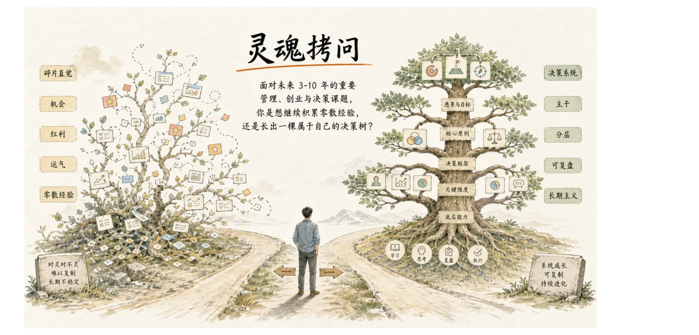

大家一堂学了挺久了，这张图你们足够笃定了么？

我最近最兴奋的，大概率就是十个八年，一堂双三角或许是唯一对于一堂，能够达到"**一堂五步法**"级别的操作系统了。

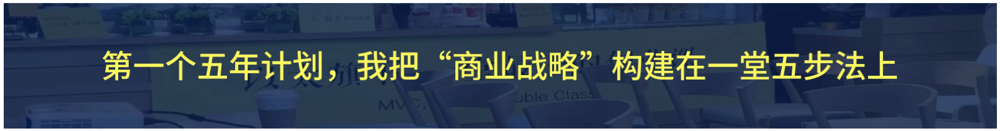

我不知道你们的感觉啊，你们能感觉到一堂对于一堂五步法极度笃定么？我们的每个阶段的决策，渠道选择，定价，项目取舍，品牌优化，都会归到一堂五步法层面完成一次思考和自洽。

每年几十次试错、迭代，就在一个模型上不断思考、修正、优化，现在的一堂五步法，已经变成一种肌肉记忆，靠着直觉都能决策得还不错了。

一堂坚定的用一堂五步法，并且持续取得成果，这几乎是我们早期最重要的战略选择。

**如果新的五年计划，我把"AI战略"构建在一堂双三角上呢？**

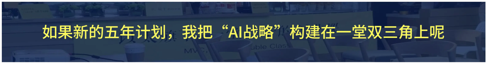

未来5年，我把一堂的AI核心竞争力开始构建在双三角上，今年初，我给自己定了一个目标：
**2026年，我要刻意练习100次双三角的构建。**
（课程Partner，VibeCoding，小设计，方案打磨）

上个月，我又给自己定了一个小目标：
**争取每一天，脑子装着双三角，每个月口喷1000次。**
（YAI、Codex、ClaudeCode、龙虾/爱马仕团队）

如果我们能联合上百个AI专家一起研究双三角的各个细节规律，如果我们有了上千个大家开源的AI真实双三角落地案例，如果我们有上百个AI落地专家（FDE），会不会一堂"推动科学"的使命会大幅加速呢？

AI这是个持久战，不是大公司一定会战胜小公司，不是资源多的公司一定会战胜小公司，但是我相信，**在正确的方向，迭代速度最快、复利积累最快的团队，一定会战胜那些碎片、迭代缓慢的团队。**

历史上已经无数次证明过这个逻辑了。

希望一堂下一个新的五年，就从这个笃定的框架开始。

最后我想感慨一句，既然这个叫**战略**，叫**底牌**，作为一节有**开山属性**、有**江湖地位**的必修课，我想稍微拔高一点点。

一年前我带着大家拆《毛选》，拆《论持久战》对我启发巨大，我深刻体会到一句话：

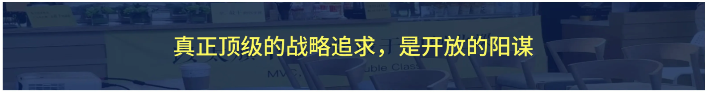

> 不靠阴谋诡计，不靠外部运气，不靠某一个人的才华和英雄主义，而是基于底层辩证法的正确道路，然后用一往无前的勇气和执行力，终将走向胜利。

竟然最近双三角给了我类似的笃定感：这不是需要藏着的Knowhow和商业秘密，这不是需要藏着的信息差，从方法论到工具，从案例到一堂实践全部开源。

我相信的是，一堂比同行们更笃定，迭代的更频繁，复利积累地更快。

我猜有人可能会问，你的同行/对手全知道了学会了怎么办？就像很多人看《论持久战》也和经验，如果敌人也拿到了学会了怎么办？

是啊，怎么办呢？

那他们哪是对手啊，那是同志，我们不就是一类人么。

**我们一起来推动科学创业的车轮滚滚向前啊~**

---

## 回顾和作业Candy

### 重新理解"一堂双三角"

回顾一下这节课的核心知识：

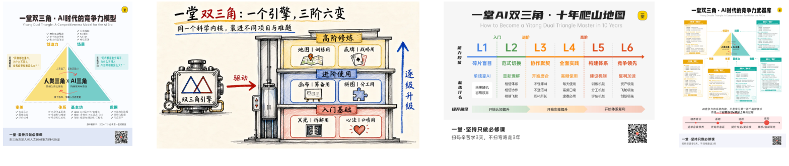

2026年，我们的工作方式会出现一个颠覆性的变化，这是一次快速的、被迫的岗位和工作范式转移，但是大多数人都没有准备好。

人和AI需要一个新的范式，这是不得不解答的一个行业级别的命题。

一堂我们站出来，做了一次解题。**这是2026年站在这个时间点，给出的自己的模型。**

AI 时代最不稳定的就是工具，只有结构才是最可靠的地基。
希望这个模型会成为你最大的底牌和底气。

很多职业焦虑，AI替代恐慌，AI大公司落地，AI能力构建，工作流搭建，你都可以从这个模型出发去构建、去补短板，这是一个最底层的操作系统。

这个模型或许会错，未来会修正，但请大家相信，这已经是2026年一堂研究了上千个案例，能拿出来最好的版本了。

最后送给大家一句话把：

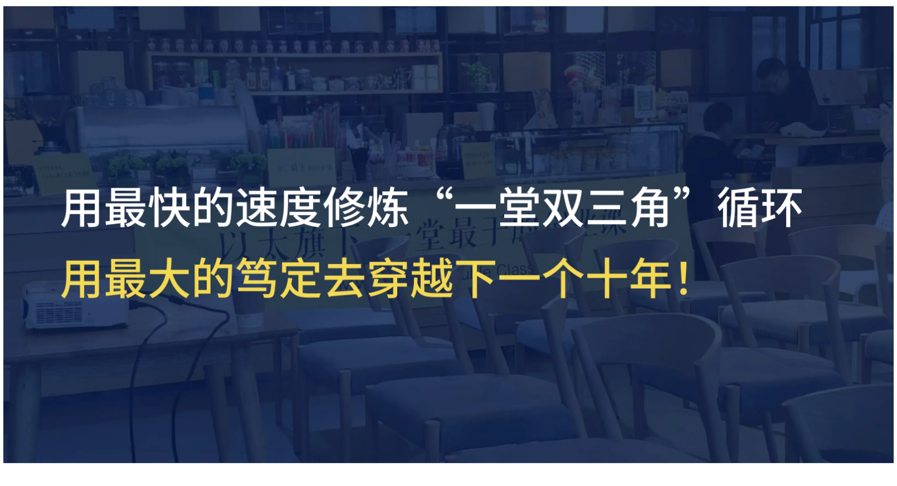

### 作业与Candy

这节课，我给大家留了两个作业，你可以3选1完成。当然我鼓励你听完课后，都尝试写一写。

🔗 作业链接：https://yitang.top/homework/cQir6a450b1ccf8e/edit?_uds=pd_doc

**第一个作业：自由心得题。**
> 人类三角提升，纯人工写。

这节课讲了「一堂双三角模型」的推导过程、各个角的定义和价值，以及落地场景。你有哪些心得启发和思考？哪些地方和你之前的理解不一样？一堂双三角模型你过去的长短板是怎样的？未来期望怎么改进？

**第二个作业：高水平自查。**

课里讲了双三角的六大落地场景，分别是拆解用的X光、口喷用的心法、筹备用的画布、分工用的拼图、训练用的地图和战略用的底牌。

这些场景，哪些你过去是有意识的，哪些过去用过、用得比较好的，可以尝试用一堂双三角画布来做复盘呈现。哪些场景你没意识过的？未来1-3年，你希望自己也掌握哪些场景？可以完整地做一次自我巡查和评估。

**第三个作业：AI Partner高阶练习。**

这节课，我们给大家提供了一个AI双三角挖掘师Partner，你可以挑选一个**细分**的AI落地场景或任务，用拿出你最好的状态，耐心地、拉满地和它聊10-30分钟，让它来帮你拆一个AI协作场景，挖掘双三角的六个角。

你可以把你在这个过程中体验的**优点**（比如哪里对你很有启发和帮助，解决了你的什么难题）、**卡点**（比如哪里觉得不够严谨和丝滑），以及说说后续的**升级建议**。当然，如果你愿意把你的最终报告全文贴到最后就更好了：)

注意：最后2个作业**默认公开**，如果有特别具体&敏感的信息，请提前脱敏。提交作业会进入我们的案例库。

> 【Flag🚩】这节课做起来很辛苦，希望大家不要辜负。

来来来，希望大家一起立一个Flag（承诺），认真听课吸收，最后完成这次训练作业。

扣一句话吧：**一定作业！！**

提醒：新课免费内测，请务必按时学习提交作业，3次报名内测不写作业，后面不会再邀请。

---

<!-- 转录范围：11 ~ 15 -->
