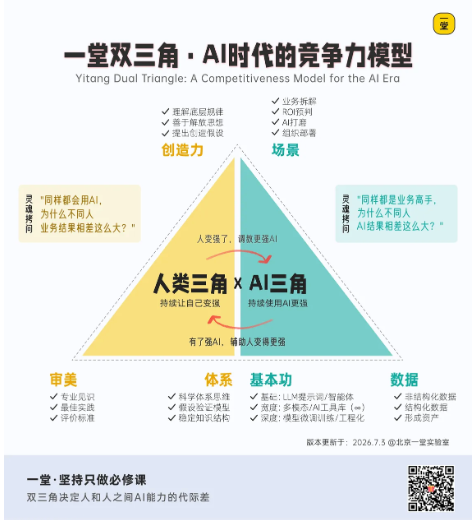
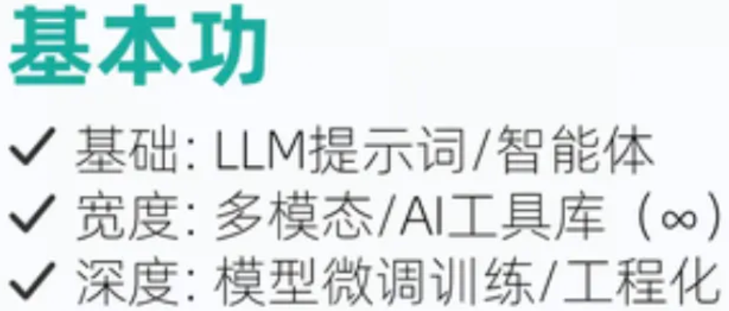
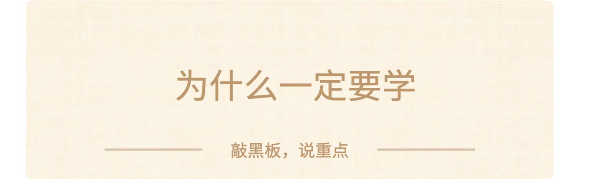
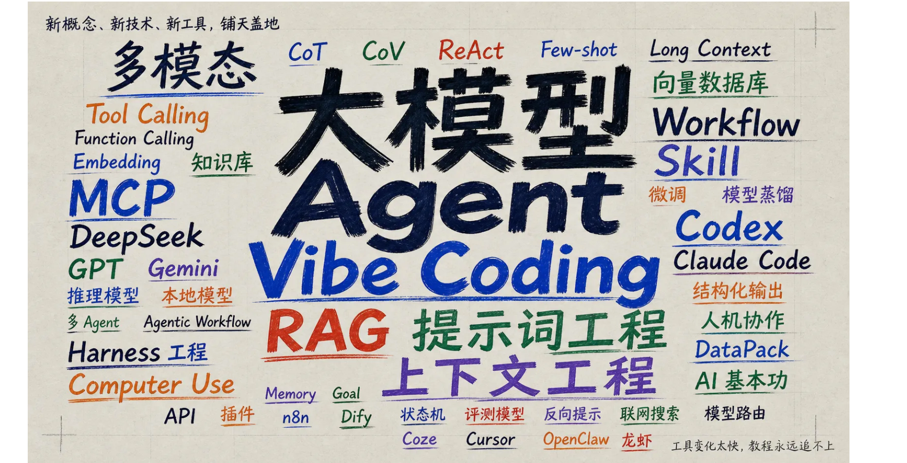
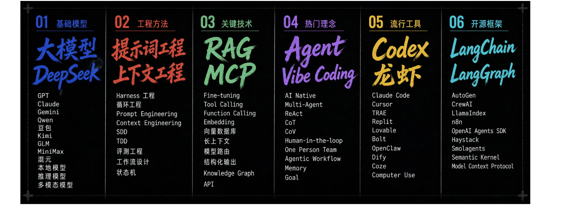
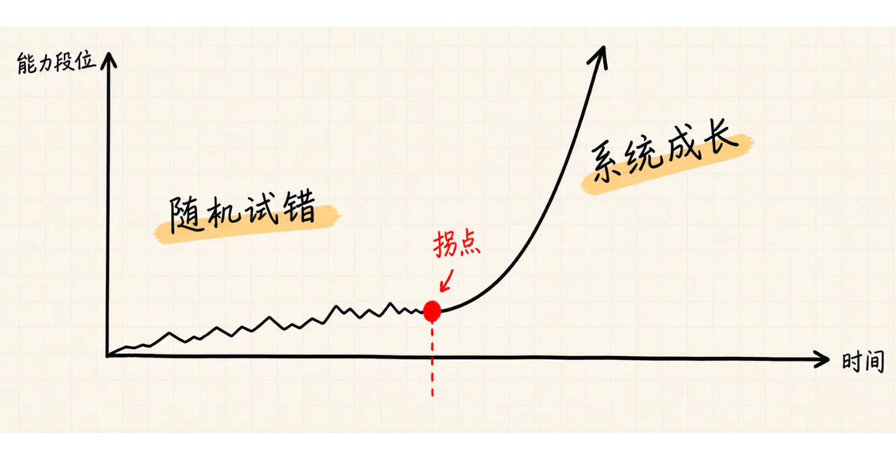
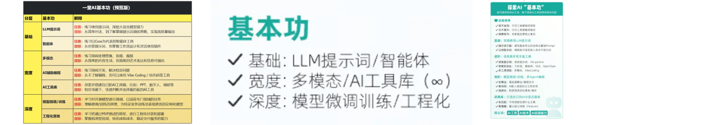
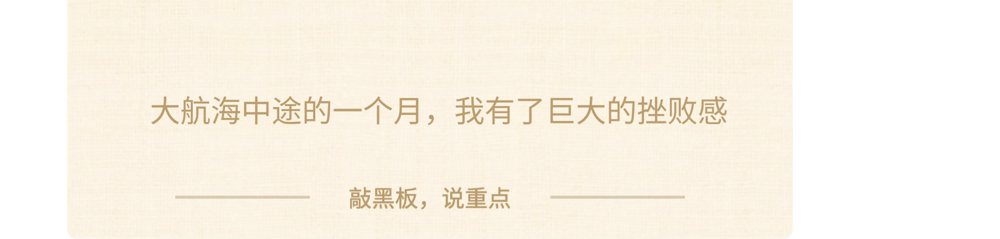

# AI 基本功 · 课程文档（01-04）

> 本文档由课程截图转录整理而成。**文字内容完整保留**，截图中的图片、金句卡片、
> 案例封面等视觉元素已从正文中分离，单独存放于 `images/` 文件夹，并在原位置以引用形式嵌入。
>
> 整理原则：
> - 讲课正文逐字转录，保留原本的口语表达
> - 原文中的红字/黄字强调，用 **加粗** 标示
> - 案例代入、互动等标签保留为引用块
> - 截图中的图片只保留图像本身，alt 文本为简短提示
>
> **本节划分说明**：各节标题一律取自截图中原标题载的真实文字，**不使用截图文件名**。
> - **01 节原文顶部无标题**，截图从【热场🥰】正文直接开始，因此本节不设标题，用分隔线区分。
> - 02/ 03 / 04 节的标题（预热思考题/ 提前划重点 / 建立体感：体系的代差）均为原文顶部真实标题。
> - 原文中的小标题（如「为什么要学」「角色扮演：我当初的痛苦」）按其视觉层级降为二级标题。
> - **03 节底部源截图本身被截断**，最后一句之后的内容不存在于截图中，未作任何补全。
> - **重编号对照**：原材料中`07 建立体感-Fearture思维2` 与 `07 建立体感-Fearture思维3`
>   编号重复，已将后者改为 **07b**，后续 08~13 编号保持不变。该调整不影响本批次（01-04）。

---

## 目录

- [热场](#热场)
- [预热思考题](#预热思考题)
- [提前划重点](#提前划重点)
- [建立体感：体系的代差](#建立体感体系的代差)

---

## 热场

> 【热场🥰】来来来，我们热个身吧哈哈，一堂讲过很多核心课题，比如如何商业分析，如何调研，如何决策，如何人生坐标系构建等等。

市场上有很多流派，风口派，机会派，热点派，传播派，哲学派，玄学派，一堂我们这些年一直坚定地走在了**"科学派"**的道路上。

问题来了：面对一个重要的复杂课题，当我们掌握了一套**"相对科学的体系"**以后，有哪些**真正的变化**呢？欢迎大家互动一下，从心态上，能力上，姿势上，结果上到底有哪些不同。

---

今天我们进入全新课题，这是AI双三角系列课的最硬核的一篇：**AI基本功第一课**。

AI侧的基本功无穷多，从底层的技术原理，到提示词技术，从流行概念（上下文工程、Harness工程）再到热门工具（Coze/龙虾/Codex），各种工具和教程满天飞。

实话实说，面对这些铺天盖地的新东西，大家时常感到跟不上、**焦虑么**？hhh

> 想学吧，实在太多太杂了跟不上。
> 不学吧，又担心自己错过排队了。

我在去年9-11月，有一段时间非常焦虑和痛苦，作为一个不喜欢"随机碎片"的体系派，看到大量的工具和教程，整个人非常痛苦，有一段时间甚至出现了"无能式摆烂"，放弃系统思考了。

直到去年底，我强行建模，摸出了一套框架，终于入门了，后来回到了科学、笃定了，就特别爽。这是一套全新的、科学的AI思考框架，这半年陆续教给了内部教研团队和产品团队，大家状态都好了特别多。

这个具体实在有些晦涩难懂，终于又酝酿了半年，今天给大家第一次交付。

今天，我会给出一套**"科学体系"**的原创重新答案。

这套答案，未来或许能媲美一堂最重要的**"关键假设思维"**，是否切换到这套思维方式，是衡量"新手野路子"和"进阶体系派"最重要的分界线。

> ❤️ **打个预防针：** 对于AI新人有点抽象有点难，大家需要勇敢听完，你们赶上了"历史级别课程首次内测"。但好消息是，一堂可以给大家一套未来3-10年相对稳定的修炼框架，从此安心笃定做事，忘掉那些无意义的焦虑和恐慌。

准备好了么，我们开始热身问题。

---

## 预热思考题

来来，照例，给大家三个预热思考题吧：

**第一题 入门：学习方式回顾。**

大家回顾一下过去一年，你学习过的AI新工具和技术：**提示词，口喷提示词，Vibe Coding，龙虾，Codex，AI内容生产**....等等。

你一般的学习习惯是什么？你有2-20个小时快速入门和进阶，你靠什么快速进步呢？

我猜很多人会说动手、项目制（PBL）。那具体一点，就是你学了很多，练了很多，最后归根结底，你真正学会的是什么呢？

**第二题 进阶：迁移能力回顾。**

上难度了，比如你今天学了"龙虾配置和训练"，终于搞到70分了，下一周你又学习AI做PPT，这两件事看上去毫不相关，你有多少能力和经验可以迁移过去？

如果下下周又带着公司里的某个AI场景落地（比如客服工作流），下下下周又做了一个时间管理小app，你的过往经验有多少能有效迁移过去呢？

对于你来说，你是**"同一件事（迁移>80%）"**"为主？还是**"重新开始（迁移<20%）"**"为主？

**第三题 高难：10年笃定题。**

如果我不想排队，又想成为某个领域的 AI 专家，我有大量的AI工具、技术、框架要学习。

那问题来了，如果把这所有东西合并成一套"做事体系"，来指导各种实践，有可能么？这套体系长什么样呢？

哈哈哈，这三个问题我就讲完了，希望大家可以停下来，做一个头脑实验，想想你的思考结构和答案，希望今天这节课结束，你能有一个体系、系统的提升。

---

## 提前划重点

提前划一下重点，大家不要迷路，今天我会讲4个话题：

**第一部分：场景带入。** 考虑到很多同学没有体感和遭遇难题，我先带大家做一个角色扮演，大家感受一下我和一堂过去经历的痛苦和困扰，然后给出解题基本思路。

**第二部分：统一模型。** 我会给大家一套统一的思维模型，可以抛开AI各种流行工具的表象，给大家一套相对科学的思考模型。

**第三部分：理解价值。** 我会用十层解读的方式，带大家理解一下，当大家慢慢掌握、切换到这种思维以后，你会有哪些显著的进步和飞跃。

**第四部分：超级武器。** 我会给大家一张武器库，包含了过去半年我们带着团队总结的几乎95%+的常见策略，这是一套十万美金级别的小抄。

说明：这节课完全是提升人的水平，没有Partner（暂时），请大家专注在你自己的成长和修炼进步。

对了，同时向大家介绍一下本期磨课研究组的成员，也感谢AI俱乐部参与共建的同学：

[此处截图被截断，后续内容不存在于源截图中]

---

## 建立体感：体系的代差

考虑到有些同学的AI实践还不够多，为了帮所有人理解真正的难题，我还是先帮大家建立一个体感吧，讲一讲过去一年我的痛苦经历和最重要的两次认知飞跃。

大家可以试着站在我的鞋子里，跟我一起角色扮演，想一想你有经历过这些困扰么？你过去是怎么解决的？

### 角色扮演：我当初的痛苦

时间拉回到一年前，大概24-25年中，那时候的我和一堂应该算是个"AI兴趣选手"，和多数人一样，我们也做了很多各种各样的项目和尝试：

- VibeCoding火，我就用TRAE搓了一个"好看沉浸时钟"的小网站。
- Coze火，我就用Coze临摹着教程，试着搭建了做内容的工作流。
- NanoBanana火，我就买了账号，测试做了很多文生图作品。
- AI音乐火，我就学习Suno，创作了一大批作品。
- ......

客观来说，我还是会进步很快的，做了不少小打小志的练习项目，开始的时候进步很快，大概一晚上就能入门，而且会经历几天、几周的兴奋期，然后就发现速度越来越慢，基本上就没办法持续进步了。

时间到了2026年下半年就发现问题了：工具越来越多，理念框架层出不穷：**提示词工程、上下文工程、Harness工程、Skill**等等。

今天学学这个，明天试试那个，每个都有点进展，但彼此关系并不大。
学得越多，越乱套，彼此独立，前后左右乱作一团。

对于人生红点级别的核心能力，我完全无法接受能力长期卡到60 或 70分，无法精进，长期低端执行，这样实在太糟糕，太焦虑了。

你们过去一两年有这样的困扰么？

作为一个坚定的**"科学体系派"**，我一直相信一张图：

一句话解读：**对于一个复杂事物，真正入门的标志是形成了对这个事物的底层的、基本的、朴素的框架性认识。**

如果我想长期刻意练习+积累复利，我得有一个长期稳定的固定套路啊，但是每个工具都很随机、周期很短，我就很难修炼了啊，怎么办？

我们过去总结过几版框架，都不好用啊，无法成为有效红点：

这是一个硬核难题，各种各样的AI技术和领域知识：提示词工程，上下文工程，Agent工程，Agent Infra，MCP，Skills，无边无际的工作和技术工具。

更何况还有LLM每个月都在突破和更新，每天都在发布新的工具和流程：

- 如果不学吧，担心自己感觉很快就落伍了；
- 但是如果学吧，无边无际，而且毫无"刻意练习"的状态了。

更雪上加霜的是，而且还有一堆完全不同的任务：**写提示词，做博客，写文章，写代码，做调研分析**....各种各样的课题。

全部都是变化和一事一议，怎么办呢？
你们遇到过这个困难么？已经找到了解法么？

---

一次转折：爆炸式全量建模

<!-- 转录范围：01 ~ 04 -->