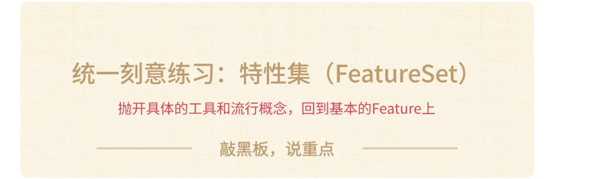
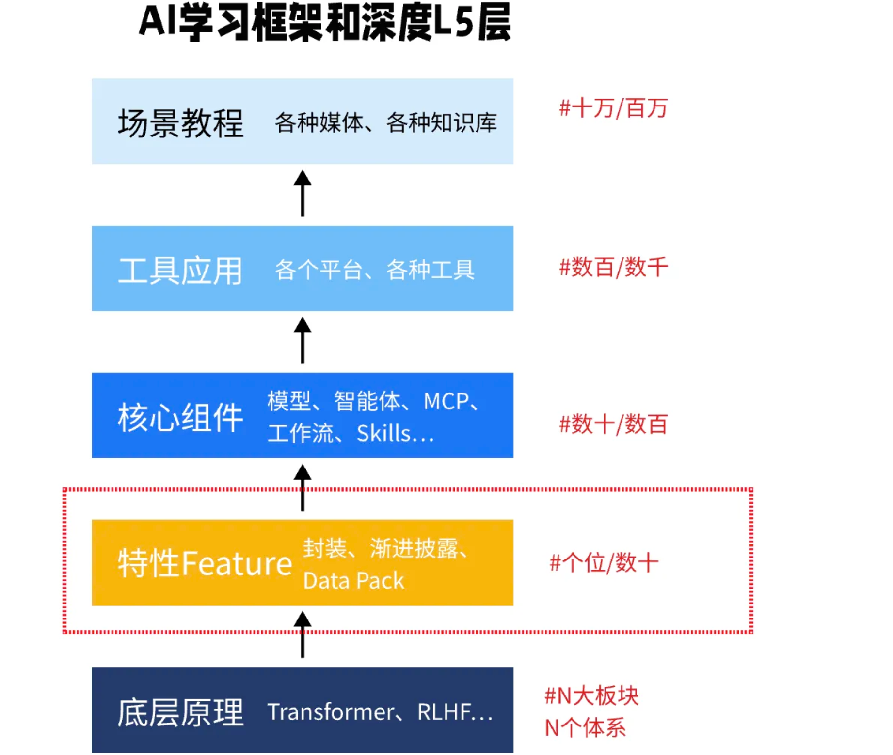
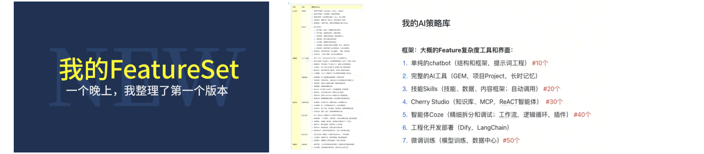
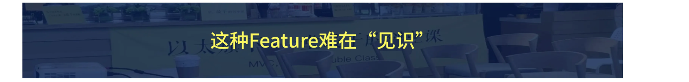
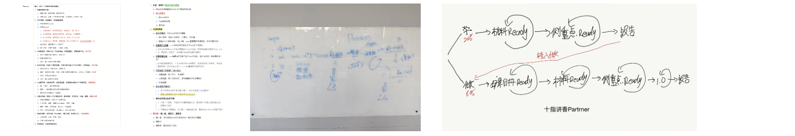
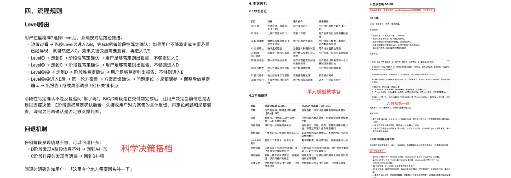
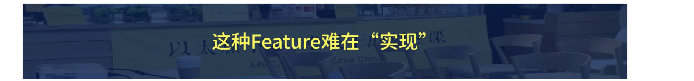
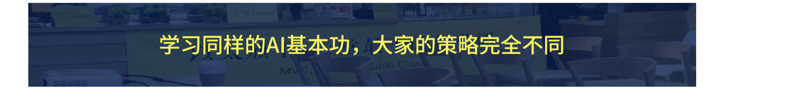
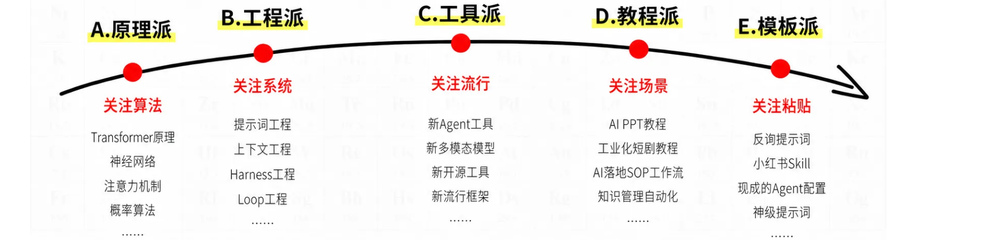
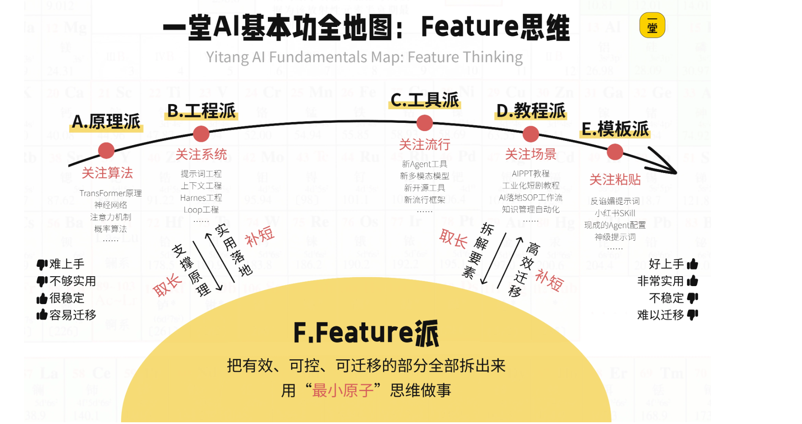

# AI 基本功 · 课程文档（05-07b）

> 本文档由课程截图转录整理而成。**文字内容完整保留**，截图中的图片、金句卡片、
> 案例封面等视觉元素已从正文中分离，单独存放于 `images/` 文件夹，并在原位置以引用形式嵌入。
>
> 整理原则：
> - 讲课正文逐字转录，保留原本的口语表达
> - 原文中的红字/黄字强调，用**加粗** 标示
> - 案例代入、互动等标签保留为引用块
> - 截图中的图片只保留图像本身，alt 文本为简短提示
>
> **本节划分说明**：各节标题一律取自截图中原标题载的真实文字，**不使用截图文件名**。
> - **07 节原文顶部无标题**，截图直接从正文开始，因此本节不设标题，用分隔线区分。
> -05 节真实标题为「一次转折：爆炸式全量建模」，**与文件名 `05 建立体感-一次转折-爆炸式建模` 不一致**（原文无"建立体感"字样）。
> - 07b 节真实标题为「全新框架：Feature思维」，**与文件名 `07 建立体感-Fearture思维3` 完全不同**。
> - **重编号对照**：原材料中两张 `07` 开头（Fearture思维2 / Fearture思维3），已将后者改为 **07b**，08~13 编号不变。本文档沿用该编号。
> - 05 节末尾出现下一节标题「第一层理解：两种思维」，07b 节末尾出现「实操体系：带走一套武器库」（对应 08 节），均按原文位置保留。

---

## 目录

- [一次转折：爆炸式全量建模](#一次转折爆炸式全量建模)
- [（无标题节 · temperature 与教练Partner）](#无标题节--temperature-与教练partner)
- [全新框架：Feature思维](#全新框架feature思维)

---

## 一次转折：爆炸式全量建模

我曾经纠结了很久，也到处去找，一直没找到理想的解法，于是我试着自己提炼，试着回答一个问题：抛开工具和封装、流行框架本身（Skills、Coze、Agent等等），有没有一组底层的**"原子级别的特性"**是长期稳定的呢？

于是，我找到了一系列原子级别的最小特性：**给LLM设定角色，思维链，渐进式披露，给参考案例，AI反向确认**......

其实我们做上面这些提示词、工作流、Agent都是这些**"最小原子特性"**逐步增加打磨出来的而已。

于是我提出了一个大胆的假设：**一堂牵头**，能不能增加一层**"实践/刻意练习"**层？

我们把众多工具、LLM、Agent、技术框架的共性抽离出来，变成一个个的**最小原子特性**，也就是Feature（特性），把认知和能力构建在这层Feature上，**每一个Feature都是一次打磨机会，都是一张牌，都是一次升级AI水平的假说。**

于是我试着做了一次爆炸式灵感闪现，把我这两年所有"有效的Feature"全部写下来，又结合着AI的经验，最后在我的私人笔记里写下了保30争50个 Feature：

当我写高水平的提示词，做PPT，VibeCoding，做图，或者做一个复杂的调研，我发现AI第一版本质量只有50 分，甚至30分，没关系，我试着增加Feature不断打磨，一步步测试，逐步探索60/70/80/90分的水准。

哪的工具变了，Feature 永远稳定。我只要把这几十个Feature练得滚瓜烂熟，就像手里拿着几十块乐高积木，无论面对什么复杂场景，我都能瞬间拼出一套逻辑。

比如我现在做PPT，做播客，我现在可能觉得自己不会写，但没关系——只要给我足够多的Feature、只要我有审美、给我时间，我肯定能给你磨一个很好的水平，业内接近最好的水平。

时间到了2026年初，春节假期，我发现新的问题出现了：龙虾火了，各种Agent开始扎堆出现了，越来越多的特性和新工具冒了出来，这些工具之间有什么关系呢？有没有相对统一的体系么？

- 有了Agent，真的就直接跟LLM对话更强吗？
- 有了龙虾，龙虾真的就比原来的Agent更强大（ClaudeCode、Trae）吗？

当我有了四五十个Feature清单，并且有了这个分层框架以后，我基本上今年就没有**"大的焦虑"**了，因为现在整个市场刚刚从L3-L4过渡，L5大家还在探索没有成为基础设施，各个层级的工具、教程、最佳实践都可以落到我的这个体系里。

而且这也是一个非常实事求是的态度，**"除非必要，勿增实体"**，如果在底层能解决，就没必要非得封装Skill、非得做Agent甚至龙虾，从下往上以此构建、依次建立系统才是科学和稳妥的。

老同学应该能感觉到，今年一堂的AI进度十倍速、几十倍速地进步，我们做了YAI、搭建了Partner工业化生产机器，还做了一些龙虾IM、训虾等爆款实验，最近还还大胆地提了一些AI原生的VibeCoding大的假设。

实话实说，如果没有这两次Feature飞跃，我们很难完成这些事情。

好啦，故事大概讲完了，有初步的体感了么？下面我们来讲讲背后的**Feature思维**。

---

第一层理解：两种思维

---

<!-- 07 节原文顶部无标题 -->

当时智钊（一堂合伙人）很兴奋，说：我看了DS官方文档，貌似可以试试参数 **temperature**。

> 简单解释，这个数值越低一般越稳定（AI自行发挥越少）；这个参数调大之后，可以让AI的随机性变大。

这个参数，也是我们第一次真实使用，之前只是了解。于是配置到 DeepSeek，试了几轮把这个参数调到0.7，结果效果就和全球最贵的模型基本差不多，**成本立省90%多。**
然后再去全量跑报告，**最后成本不到2千块**，就跑出了不错的结果。

所以，**temperature（温度）就是一个显著有效的最小Feature**。

> **【同类Feature】** 这种技术性的Feature还有特别多：**随机种子，ComputerUse权限，HeartBeat定时任务，Coze的意图识别，Codex的Goal模式。**
>
> 典型的特点是：理解和实践都不太难，但你得意识到存在这个Feature。

好，我下面分享一个有点高难的Feature，这也是最近我们做YAI Partner的一个核心的KnowHow。

在YAI，我们过去半年搓了各种教练：**一堂五步法教练，人生红点教练，系统调研教练，需求洞察教练，科学决策教练，转化率提升教练**...

大家有没有发现有个点还挺神奇/有趣的：这个Partner真的可以像一个真人教练一样，30-60min循序渐进一步步带你耐心推理和学习，各个里程碑、分支路径都控制的很不错？

我曾经在各个地方指导过**"辅导的最佳实践范式"**，但是AI根本控制不住啊：**还没聊完就出报告，还没调研完就给解法，还没明确完问题就跳到了方案**...

这个怎么实现的呢？

> **【提问🥰】** 大家猜猜看，我们用了哪个Feature才能控制得住吗？

---

我猜很多人会说：**工作流节点，用Coze拆成5-10个节点，一个个控制。**
这个的确或许可行，但是太复杂了，搓起来太慢了，有没有别的Feature呢？

---

我们看了很多工具级别的最佳实践提示词，最后发现里面有一个我们没用过：**在提示词里写严格的状态机。**

这是个不错的假设啊，于是我们也开始自己做实验测试：

> 一种数学计算模型，它描述一个系统在任意时刻只能处于"有限个明确状态"中的一个，并且只有在特定"事件"发生时，才能从一个状态"转移"到另外一个状态。

效果不错啊，立竿见影，AI辅助自动写提示词定义状态机，就能比较精准地控制教练的对话节点、辅导重点，不会瞎跳步和随意发挥了。

> **【同类Feature】** 这种技术性的Feature还有特别多：**RAG、GraphRAG、CoT/CoV，微调，训练。**
>
> 典型的特点是：理解相对容易，但是动手实施难度和成本很高。

哈哈，大家对于Feature有充分的感受和体感了么？

**大家思考2个更难的问题：**

1. 为什么相对于"追求流行工具"和"具体教程"，Feature思维有更大的长期优势？
2. Feature本质上说，一个个的总结，是从哪里来的？

该如何理解呢？

终于可以给大家一个有趣的分析框架了：

---

## 全新框架：Feature思维

如果大家想学习AI基本功，市场上有哪些流派呢？hhh？

我们举一个非常具体的案例：**我想做课程/电商海报，想成为高阶选手，该怎么学习呢？**
来，互动一下，市场上各个流派都是怎么学、怎么教的？

总结一下，你会发现有几个完全不同的流派：

1. **原理派**：理解文生图的算法原理，扩散去噪，CFG引导。
2. **工程派**：练习提示词工程、上下文工程。
3. **工具派**：寻找和测试最好的文生图多模态模型和Agent。
4. **教程派**：去寻找B站具体的教程，复制和改版。
5. **模板派**：去追求现成的模板、SOP、Skill直接套用。

你们（的团队）过去的工作习惯是哪一派更多？

我们试着画一画，就会发现一个有趣的规律：

大家猜到我想说什么了么？Feature在这里面是什么位置呢？哪个之间呢？
我们作为**"科学派"**，我们该保持什么更好的姿势呢？

好啦，今天的第一个非常值钱的框架图出现了：

> **十层解读：**
>
> 1. **追求一个完美平衡点**：既长期稳定能迁移，又相对具体能实操。
> 2. **Feature思维不是独立和冲突，而是完成了一次"市场全量"的辩证统一。**
> 3. **取长补短**：可以和各种选手讨论，吸星大法，可以从各方学习和吸收。

随着逐步构建属于你的**Feature Library（武器库）**，随着你见的越多，掌握得越多，你的实验越多，你后面的预判和执行质量都会以一种复利的方式快速提升。

成也好，败也好，都在不断积累Feature的关键认知。

好啦，问题来了，我猜有人会问了：**有没有哪些经典的Feature呢？** 既然一堂不鼓励大家完全照抄，想教大家自己组装汽车，能不能把汽车零件全拆开，全部展示给我看一下呢？

hhh，这个实在太难了，一来技术变化太快了，各种Harness工程、Loop工程、VibeCoding各种新理念新工具还在涌现，另外我们的实践也一直有局限性。

但既然做必修课，我们来挑战我吧，我带着大家一起来一步步推导，推演出来。

---

实操体系：带走一套武器库

<!-- 转录范围：05 + 07 + 07b -->