# 十指讲香模型 · 课程文档（12-17）

> 本文档由课程截图转录整理而成。**文字内容完整保留**，截图中的图片、金句卡片、案例封面等视觉元素已从正文中分离，单独存放于 `images/` 文件夹，并在原位置以引用形式嵌入。
>
> 整理原则：
> - 讲课正文逐字转录，保留原本的口语表达
> - 原文中的红字/黄字强调，用 **加粗** 标示
> - 案例代入、互动等标签保留为引用块
> - 截图中的图片只保留图像本身，alt 文本为简短提示

---

## 目录

- [12 场景化](#12-场景化)
- [13 口语化](#13-口语化)
- [14 数字化](#14-数字化)
- [15 故事化](#15-故事化)
- [16 素材化](#16-素材化)
- [17 比喻化](#17-比喻化)

---

## 12 场景化

好，我们进入第一个方法：**场景化**。

我先问大家一个问题：

**你们觉得，一个东西什么时候最值钱？**

我以前有个学员，做了十几年的建材生意。

他说他卖了十几年建材，从来没觉得这个产品有什么价值。

**直到他有一天去客户家里做安装。**

他去的时候，客户正在陪小孩在阳台上玩。

那个小孩三岁，站在栏杆边上。

**客户当时说了一句话**："我每天最怕的，就是他在阳台上。"

【互动🎯】大家听明白了吗？

**同一个产品，在不同的场景里，价格是不一样的。**

产品没有变，**场景变了，价格就变了。**

这就是场景化的本质：

> **场景不是包装，场景是价格。**

---

## 13 口语化

好，第二个方法：**口语化**。

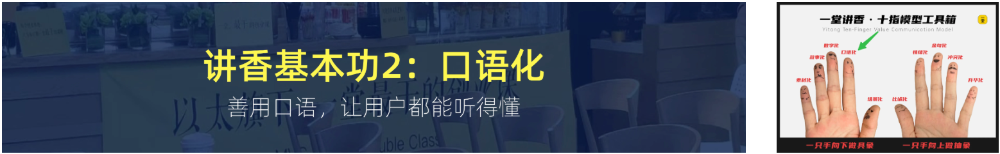

这一节我要讲的东西，可能有点颠覆你们的认知。

我先问大家一个问题：

**你们觉得，一个专业人士和一个专业博主，讲同一个东西，哪个更有人听？**

答案很意外：**是专业博主。**

为什么？

我先给大家看一组数据。

这是我们一堂内部做的测试。

同一份内容，一个用**专业语言**写，一个用**口语**写。

发给用户看结果：

- 专业语言版本：**打开率 34%，读完率 12%**
- 口语版本：**打开率 71%，读完率 43%**

**差了将近四倍。**

【互动🎯】但这里有一个特别有意思的现象。

**读完率高，不代表他记住了。**

我让读完的人复述一遍，**专业语言版本的内容，复述率只有 8%。**

**口语版本的复述率，是 41%。**

也就是说，**口语化不只是让人愿意读，还让人记得住。**

---

那么问题来了，**为什么口语化会有这么大的威力？**

我的答案是三个原因。

**第一个原因，人是用耳朵思考的，不是用眼睛思考的。**

眼睛看到的是"字"，耳朵听到的是"声音"。

**声音的记忆强度，是文字的 3 倍。**

**第二个原因，人的大脑不处理"抽象名词"。**

"赋能"、"闭环"、"抓手"——这些词，大脑直接跳过。

但是"帮你少开三次会"，大脑**立刻能懂**。

**第三个原因，口语天然带有情绪。**

文字是死的，**声音是活的**。

---

那问题又来了，**怎么把书面语变成口语？**

我给大家四个方法，**我称之为"四步降维"**。

**第一步：把长句拆成短句。**

书面语喜欢写："为了能够帮助客户更好地理解产品的核心价值，我们进行了系统的梳理。"

口语应该是：**"我把产品理了一遍，帮你看清楚它到底值钱在哪。"**

**第二步：把被动改主动。**

书面语："这个问题可以被解决。"

口语：**"这个问题，我们能解决。"**

**第三步：把抽象换具体。**

书面语："提升客户体验。"

口语：**"让你少填三张表。"**

**第四步：把书面词换口语词。**

我给大家一张对照表。

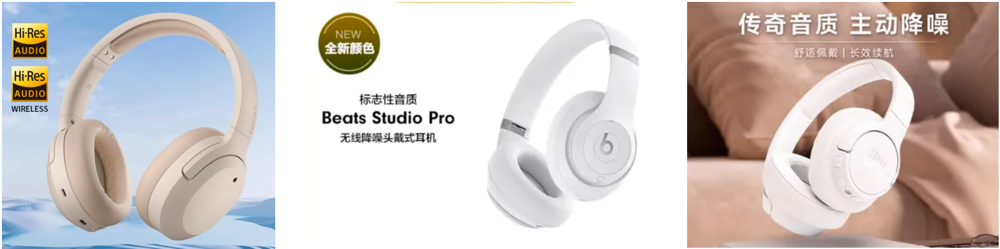

| 书面语 | 口语 |
|---|---|
| 赋能 | 帮上忙 |
| 闭环 | 从头做完 |
| 抓手 | 关键一招 |
| 颗粒度 | 细致程度 |
| 打法 | 做法 |
| 心智 | 印象 |
| 强需求 | 特别想要 |
| 差异化 | 不一样的地方 |

【互动🎯】大家看这张表，**其实就是一个字一个字的替换。**

**听起来很简单对不对？**

**但是90% 的人做不好。**

为什么？

因为**你写了十年书面语，你的肌肉记忆已经固化了**。

你要练。

---

**【练习】** 现在，请大家拿出你最近写的一份文案。

**逐句检查，问自己三个问题：**

1. 这句话，**读出来**别扭吗？
2. 这句话里的词，**能换成口语吗**？
3. 这句话，**能不能拆短**？

**改一遍，你会明显感觉到区别。**

---

好，口语化讲完了。

【互动🎯】我再多说一句。

**口语化不是"说话随便"。**

**口语化是"切换到对方的耳朵"。**

**你要想着：对方是一个普通人，坐在你对面，他在听你说话。**

**不是在读一份文档。**

---

## 14 数字化

好，第三个方法：**数字化**。

这一节，我讲一个很多人都有误解的东西。

我先问大家一个问题：

**"提升效率"这个说法，够不够具体？**

**不够。**

为什么？

因为"效率"这个词，**每个人脑子里的刻度不一样**。

有人以为是快 10%，有人以为是快一倍。

**所以客户听不懂。**

数字化的核心就一句话：

> **把形容词，换成数字。**

---

我给大家看一组对比。

- 说法一：**"我们的课程非常系统"** → 客户："有多系统？"
- 说法二：**"36 个模块，从底层到实战"** → 客户："哦，那我能学到。"

- 说法一：**"我们的服务很用心"** → 客户："怎么个用心法？"
- 说法二：**"7×24 小时响应，平均 3 分钟回复"** → 客户："这个可以。"

- 说法一：**"这个课程质量很高"** → 客户："怎么个高法？"
- 说法二：**"每节课平均 22 分钟，累计 41 小时"** → 客户："哇，这么多。"

【互动🎯】你看，同一件事，**只是把形容词换成了数字，客户的反应完全不一样。**

数字化的作用就是——

> **数字让客户不用猜。**

---

那问题来了，**去哪里找数字？**

我给大家三个来源。

**第一个来源：你的产品里本来就有的数字。**

这个最多人忽略。

你产品的价格、时长、数量、次数、覆盖范围——**这些全是数字。**

**第二个来源：你的客户调研。**

用户访谈、问卷、评论区——**里面全是数字。**

**第三个来源：你自己的测试。**

你做了一个动作，这个动作耗时多久？这个你自己能测。

【互动🎯】**数字化的难点不是"想数字"，是"去收集数字"。**

**大部分人不是没数字，是懒得找。**

---

**【练习】**

现在，请打开你的产品介绍或者销售话术。

**找出里面所有的形容词。**

- 优质
- 专业
- 高效
- 全面
- 领先

**然后问自己：这个形容词，有没有一个数字可以替代？**

**能替代的，全部替代掉。**

改完之后你会发现，**文档突然变短了，但信息量反而变大了。**

这，就是数字化的力量。

---

## 15 故事化

好，第四个方法：**故事化**。

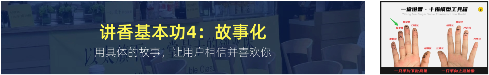

这一节，我要讲一个我观察了很多年的现象。

**同样一个道理，讲故事的人，别人记得住；讲概念的人，别人记不住。**

我先给大家看一个测试结果。

我们做了一个实验，让两组人听同一个道理。

- **A 组**：听概念讲解
- **B 组**：听故事版本

一天后，问他们还记得什么。

- **A 组留存率：18%**
- **B 组留存率：72%**

**四倍差距。**

【互动🎯】为什么？

因为人的大脑，**存不住抽象概念，但存得住故事**。

故事有**人物、有冲突、有转折、有结局**。

而概念只有**结论**。

---

那怎么把一个道理，讲成一个故事？

我给大家一个公式，**叫"STAR 四段"**。

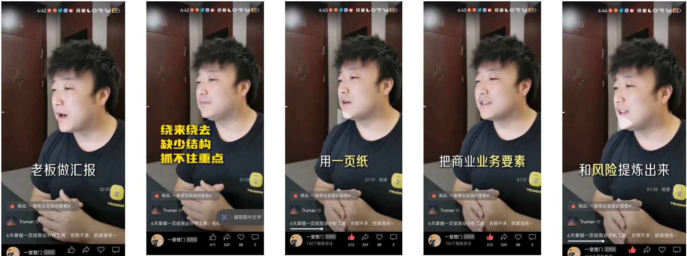

**S — Situation（情境）**：当时是什么情况？

**T — Task（任务）**：你要解决什么问题？

**A — Action（行动）**：你做了什么？

**R — Result（结果）**：最后结果如何？

我们拿天幕阳台的例子来套一下。

**S（情境）**：5 年前，我在杭州买了一套大平层，客厅连着一个巨大的阳台，窗外就是西湖。

**T（任务）**：我想把这个阳台改造一下，但第一个报价 5 万，我犹豫了。

**A（行动）**：我去问了三个做天幕阳台的师傅，他们跟我说了一句话，让我下定了决心——"你这个阳台，改造完之后，每天早上睁开眼，看到的是整个西湖。"

**R（结果）**：我现在每天早上睁开眼，看到的是整个西湖。这个决定，我做了五年。

你看，**这里面没有一个抽象概念，全是具体的事。**

但听完之后，**"视野"这个价值，你自己就懂了。**

---

**但是，故事化有一个很大的坑，我要提醒大家。**

【互动🎯】这个坑就是——**你讲的故事，客户不关心。**

我见过很多人，讲自己的故事讲得眉飞色舞，客户在对面已经走神了。

**判断标准很简单：你的故事里，主角是谁？**

- **主角是你** → 客户不关心，因为你没提客户
- **主角是客户** → 客户才会听下去

**所以 STAR 里面的 S 和 T，主角必须是客户。**

**A 和 R 才是你。**

---

**【练习】**

现在，用 STAR 四段，写一个你自己的故事。

要求：

1. **S 和 T 的主角必须是客户**
2. **A 里要有具体的动作**
3. **R 要有一个客户能感知的结果**

**写完之后，念一遍。**

**如果念着像在背课文，就重写。**

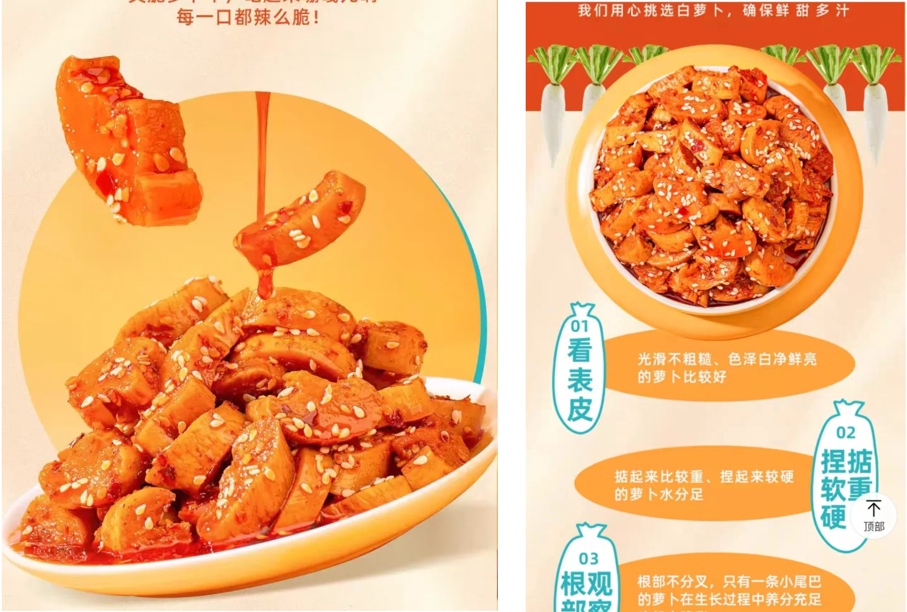

---

【互动🎯】好，我再补充一个技巧。

**故事讲完之后，一定要有一句"回扣"。**

什么叫回扣？

**就是用一句话，把故事和你的产品价值连起来。**

比如天幕阳台那个故事的回扣是：

> **"所以我把这个故事，写在了我们的产品册上。后来很多客户来问：你们的门窗凭什么卖 5 万？我都会讲这个故事。"**

**有了这句回扣，客户才知道这个故事对他有什么用。**

**没有这句回扣，客户听完就忘了。**

---

好，故事化讲完了。

【互动🎯】最后一个提醒。

**故事不要超过 3 分钟。**

**超过 3 分钟，客户就忘了你产品叫什么。**

**故事是用来记住的，不是用来占领时间的。**

---

**【练习】** 现在回去，用 STAR 写一个你自己的故事。

**写完发到群里，我们下节课挑几个点评。**

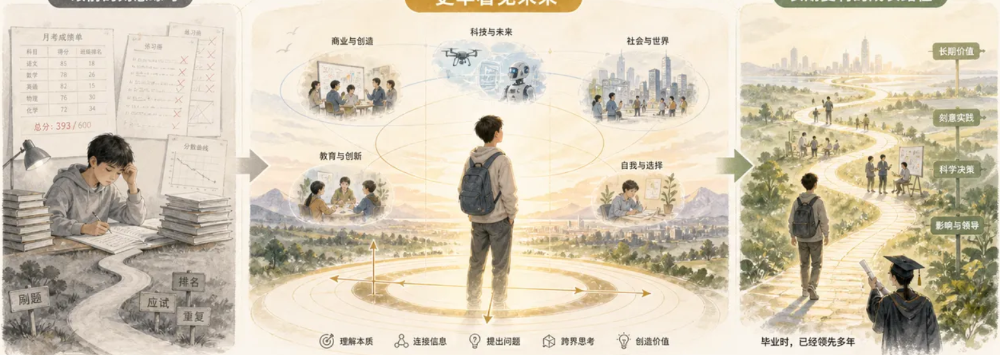

---

好，我们进入下一个方法。

---

## 16 素材化

好，第五个方法：**素材化**。

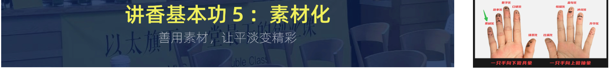

我先问大家一个问题：

**你讲一个产品的时候，有没有觉得"没什么可讲的"？**

如果有，**问题不在产品，在素材。**

我先讲个数据。

我们统计过一堂同学的情况：

**素材储备超过 30 条的同学**，讲出来的产品，客户接受度平均 **84%**。

**素材储备 10~30 条的**，接受度 **61%**。

**素材储备 10 条以下的**，接受度 **28%**。

【互动🎯】差距有多大？

**3 倍。**

而"素材储备"的门槛，**只是 30 条**。

**30 条，不是很多。**

---

那什么是"素材"？

我给大家分四类。

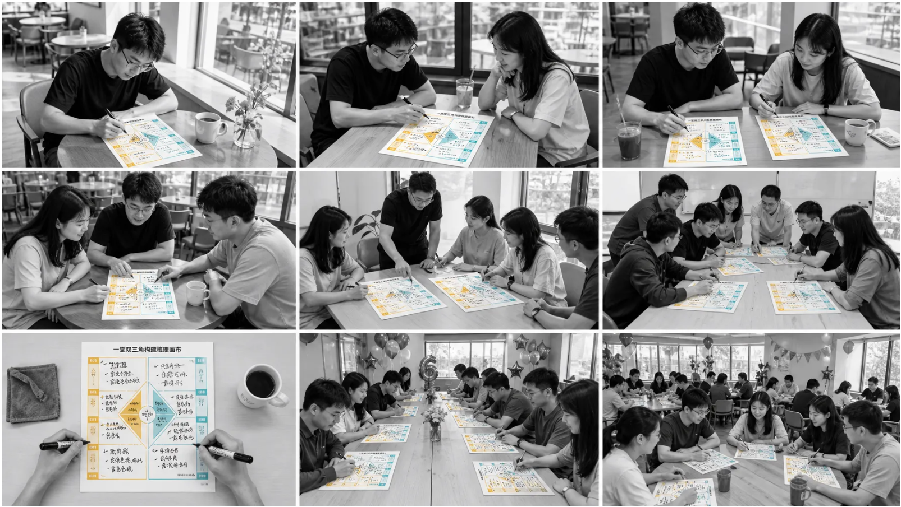

**第一类：用户的原话。**

客户在评论区、客服对话、群里说的每一句话——**都是素材。**

客户说"我怕孩子掉下去"，这就是**一条顶级素材**。

**第二类：具体的数据。**

用户用了多久、节省了多少、增长了多少——**这是硬素材。**

**第三类：真实的场景照片。**

用户发来的使用截图、现场照片——**这是视觉素材。**

**第四类：别人的评价。**

客户好评、媒体报道、第三方评测——**这是信任素材。**

【互动🎯】注意，**这四类素材，大部分人只在第一类里挖。**

**客户原话挖得最多，其他三类基本空白。**

---

那素材怎么收集？

我给大家三个渠道。

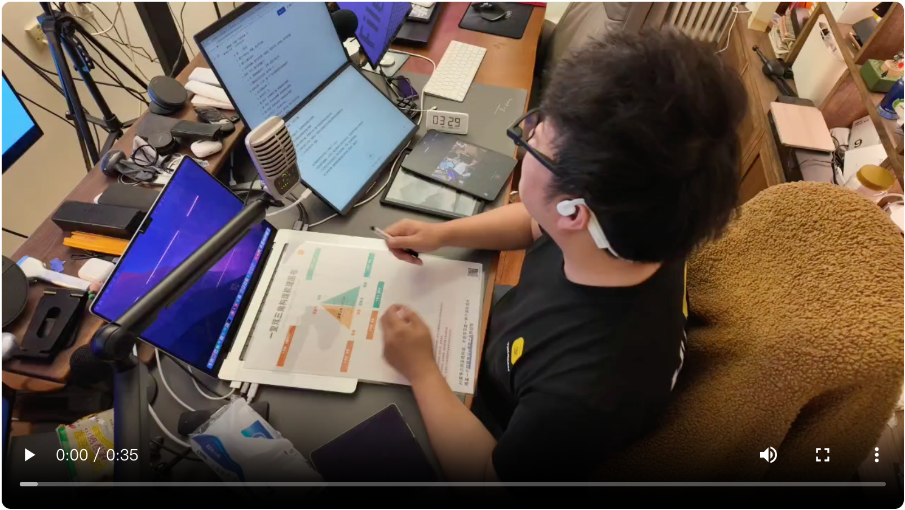

**渠道一：客服记录。**

你的客服每天在处理问题，**那些重复问的问题，就是用户最关心的点。**

**渠道二：退货原因。**

用户为什么退货？**每一条都是最真实的价值缺口。**

**渠道三：竞品评论区。**

用户去竞品那里骂的、夸的，**都是你要打的靶子。**

【互动🎯】我特别强调一下**渠道三**。

很多同学不敢看竞品评论区。

**但那是信息密度最高的地方。**

用户在竞品那里说的每一句抱怨，**都是你产品的卖点。**

---

【互动🎯】好，收集到素材之后呢？

**不要直接用。**

**要先分类。**

我用的分类方法是**"按场景分类"**，不是按内容分类。

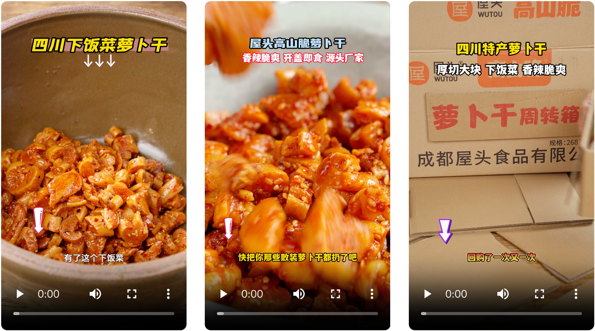

因为客户不会按内容分类，客户只会在**某个场景下**想起来。

所以你的素材表应该是这样：

| 场景 | 素材 |
|---|---|
| 客户害怕的时候 | "我怕孩子掉下去" |
| 客户比较的时候 | "比 A 家便宜 300，但耐用度高 3 倍" |
| 客户犹豫的时候 | "第一个月不满意，全额退款" |
| 客户炫耀的时候 | "我妈来我家都问这窗户哪儿买的" |

【互动🎯】这样一整理，你就有了一个**素材库**。

**讲的时候，按场景取用。**

**不用再临时想。**

---

**【练习】**

现在，请你做一件事：

**去你的客服记录或者评论区，找出 10 句客户的原话。**

**然后按上面四个场景分类。**

**你会发现，光这 10 句，就比你原来写的所有文案都有说服力。**

---

好，素材化讲完了。

【互动🎯】最后说一句。

**素材的价值，不在于多，在于"用得准"。**

**30 条素材，按场景取用，能打 30 场不同的仗。**

**但如果你只是把素材堆在文档里，一条都不取用，那等于零。**

---

**【互动🎯】** 课后作业：**整理你的 30 条素材，按四个场景分类。**

**下周我们请三位同学来讲讲自己的素材库。**

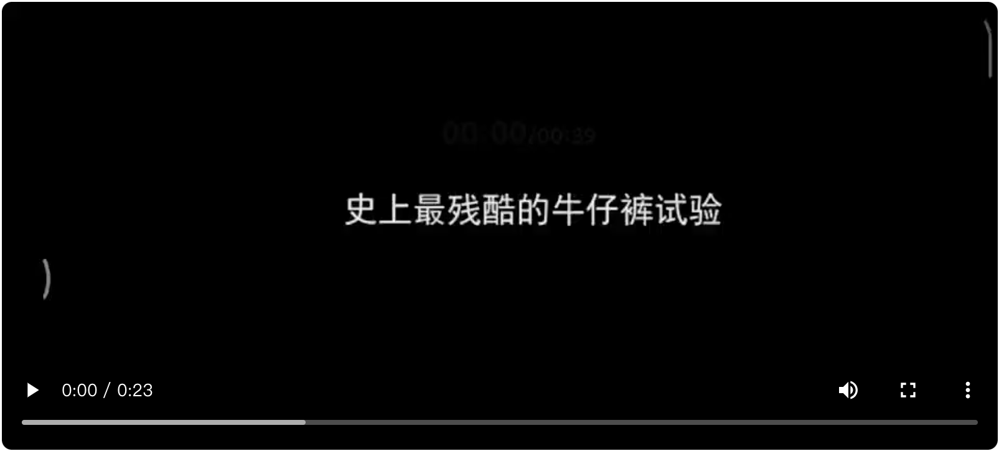

---

好，我们进入下一个方法。

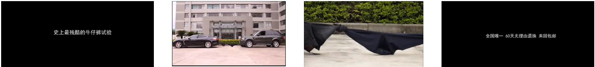

---

## 17 比喻化

好，第六个方法：**比喻化**。

这是我个人认为**性价比最高**的一个方法。

为什么？

因为**比喻不需要你重新思考，只需要你重新联想。**

我先给大家看数据。

同样一段产品说明：

- **不用比喻**：理解度 **43%**
- **用比喻**：理解度 **89%**

**而且用比喻的版本，用户认为"更专业"。**

【互动🎯】这一点很反直觉，对不对？

**用户觉得"你用了比喻"，说明你想清楚了。**

**没用比喻，他会觉得你还没想清楚。**

---

那比喻该怎么找？

我给大家三个方向。

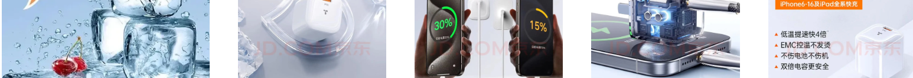

**方向一：从你的产品里找"结构类比"。**

你的产品结构，像什么？

比如天幕阳台——它的结构像一个**"横向打开的画框"**，把整面墙变成了一幅画。

这就是一个比喻。

**方向二：从客户的生活里找"体验类比"。**

客户使用你的产品，体验像什么？

比如 CLI——客户用它的体验，像**"和一个很聪明的助手聊天"**。

**方向三：从客户最熟悉的东西里找。**

这是最好的比喻来源，因为**客户不用想就懂**。

比如一个理财产品，客户问你"这个会不会亏"——

你别说"我们采用分层配置策略"。

**你可以说："这就像你把零钱放在 different 口袋里，随时能拿，但不会一下子全没了。"**

**这句话，没有任何金融知识的人，都听懂了。**

---

【互动🎯】这里我要提醒一个陷阱。

**比喻用错了，比不用还糟。**

我见过一个案例。

有个同学给工业设备做比喻，说："**它就像一个温柔的小姐姐，安静地陪在你身边。**"

客户听完说："**那我要的是功率，不是女朋友。**"

哈哈，这就是**比喻的边界**。

比喻要满足三个条件：

1. **相似的是"核心体验"，不是"外形"**
2. **听众不用解释就能懂**
3. **这个比喻，不会引出误解**

---

**【练习】**

现在，请你为你负责的产品，**写 3 个比喻**。

要求：

1. 必须是**客户生活里**的东西
2. **不用解释**客户就能懂
3. 写完之后，念给一个不懂你产品的人听

**如果他懂了，这个比喻就是好的。**

**如果他反问你"什么意思"，这个比喻就是失败的，重写。**

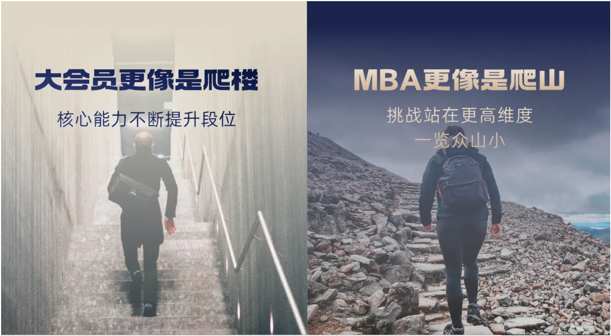

---

好，比喻化讲完了。

【互动🎯】我再多说一个**使用比喻的时机**。

**比喻不要一上来就用。**

**先讲清楚事实，再用比喻收尾。**

顺序是：

> **先给事实 → 再给比喻**

**反过来讲，会显得你在逃避事实。**

---

**【互动🎯】** 课后作业：**给你的产品写 3 个比喻，并标注每个比喻适合用在哪一段话里。**

---

好，我们进入下一个方法。

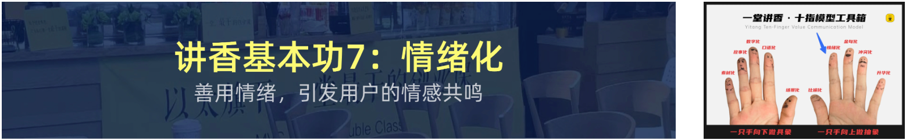

---

<!-- 转录范围：12 ~ 17 -->
