# 十指讲香模型 · 课程文档（18-22）

> 本文档由课程截图转录整理而成。**文字内容完整保留**，截图中的图片、金句卡片、案例封面等视觉元素已从正文中分离，单独存放于 `images/` 文件夹，并在原位置以引用形式嵌入。
>
> 整理原则：
> - 讲课正文逐字转录，保留原本的口语表达
> - 原文中的红字/黄字强调，用 **加粗** 标示
> - 案例代入、互动等标签保留为引用块
> - 截图中的图片只保留图像本身，alt 文本为简短提示

---

## 目录

- [18 情绪化](#18-情绪化)
- [19 金句化](#19-金句化)
- [20 冲突化](#20-冲突化)
- [21 升华化](#21-升华化)
- [22 回顾与总结](#22-回顾与总结)

---

## 18 情绪化

好，第七个方法：**情绪化**。

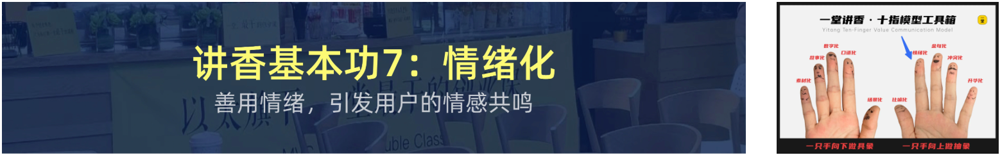

我先说一个可能会让某些人不太舒服的实话。

**讲香，本质上是在调动情绪。**

很多人觉得，讲价值就够了。

**不够。**

因为人不是电脑，**人做决策的时候，情绪的权重远大于逻辑**。

我先给大家看一组数据。

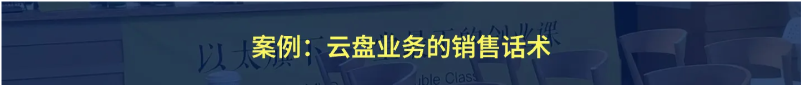

我们做了一个测试，卖同一款产品：

- **A组**：只讲参数和功能 → 下单率 **18%**
- **B组**：参数 + 情绪唤起 → 下单率 **47%**

**同样的产品，只是多了一层情绪，下单率翻了 2.6 倍。**

【互动🎯】所以问题来了，**怎么调动情绪？**

我给大家四个入口。

---

**入口一：恐惧。**

这是最强的情绪入口，**但也是最危险的。**

讲恐惧的正确做法是：**讲"不做什么会发生"，而不是讲"你会很惨"。**

对比一下：

- ❌ 错的："**你现在的做法，会让你的客户全部流失。**"
- ✅ 对的："**我有个学员，和你一样的做法，去年他的客户流失了三成。**"

【互动🎯】**第一个是威胁，第二个是共鸣。**

**威胁会让人反感，共鸣会让人行动。**

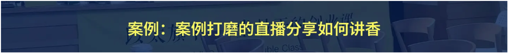

---

**入口二：渴望。**

渴望比恐惧更持久。

讲渴望的关键是：**让客户看到"有了之后的样子"。**

不是告诉他"这很方便"，而是让他**看见那个画面**。

比如天幕阳台——

- ❌ 错的："**视野很好，采光很好。**"
- ✅ 对的："**早上六点，你端着咖啡站在阳台上，整个西湖在你面前。你会忽然明白，为什么有人愿意为窗户花 5 万块。**"

【互动🎯】**第二个说法，客户已经在心里看到那个画面了。**

**看到过的东西，人才会想要。**

---

**入口三：认同。**

这一条最容易被忽略。

认同的意思是：**让客户觉得"你懂我"。**

怎么做到？

**去说客户心里想说但没说出来的话。**

比如：

- ❌ 错的："**我们的产品很稳定。**"
- ✅ 对的："**你其实不是想省钱，你是不想每次都操心。这件事我懂。**"

【互动🎯】**第二句话，客户会觉得你懂他。**

**一旦被理解了，他就愿意听你继续说。**

---

**入口四：愤怒。**

这个情绪用在**唤起行动**上，非常有效。

比如：

"**每天在做重复的活儿，时间就这么被耗掉了。你不觉得这事儿该变一变吗？**"

这句话会让客户**有点上火**。

**但这个上火，是冲着"现状"去的，不是冲着你来的。**

**这就是愤怒的正确用法：把火引向问题，而不是引向别人。**

---

【互动🎯】好，四个入口讲完了。

但我要强调一件事——

**情绪化不等于煽动。**

**情绪化的目的是"让人愿意动"，不是"让人激动"。**

**激动完客户就忘了，动完客户才会买。**

【互动🎯】这句话是我今天最想说的。

很多人做讲香，做成了**打鸡血**。

**讲完当场很燃，第二天什么都不记得。**

**那不叫讲香，那叫煽动。**

---

**【练习】**

现在，请你选一个产品，用这四个入口，**各写一句话**。

要求：

1. 恐惧那条，**不能带威胁感**
2. 渴望那条，**必须有画面**
3. 认同那条，**必须是"我懂你"的语气**
4. 愤怒那条，**火要冲着问题**

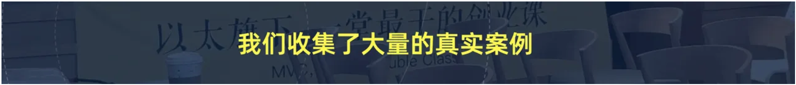

---

好，情绪化讲完了。

我们进入下一个方法。

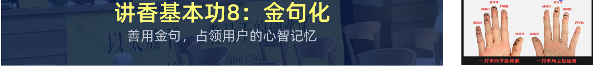

---

## 19 金句化

好，第八个方法：**金句化**。

这一节，我要讲一个**看起来像是技巧，其实是基本功**的东西。

我先给大家看一个对比。

左边是我说的原话：

**"我们的产品能让你的效率提升百分之三十左右。"**

右边是金句版：

**"把你从重复劳动里捞出来的时间，还给你。"**

【互动🎯】**同样的意思，第二句你记住了，第一句你没记住。**

为什么会这样？

因为人的大脑，**记住的是画面和节奏，不是数字**。

**"捞出来的时间还给你"**，这是一个动作，有一个画面。

**"提升百分之三十"**，这是一个数字，没有画面。

---

那金句怎么造？

我给大家一个公式，**叫"价值换画面"**。

> **把你要说的价值，换成一个有画面的表达。**

我常用的四个手法：

**手法一：动词替换。**

把"提升"换成具体动词。

- 提升效率 → **把你从重复劳动里捞出来**
- 优化流程 → **把卡住的那一步打通**
- 降低成本 → **让你少走一次弯路**

**手法二：具象化。**

把抽象名词换成具体物件。

- 知识体系 → **你手里有一套能随时翻的地图**
- 风险控制 → **你踩的每个坑，前面都有人踩过了**

**手法三：对称结构。**

对仗的结构天然好记。

- **别人在猜客户想什么，你已经在客户家里了。**
- **不是让你更努力，是让你少浪费力气。**
- **别人教你怎么想，你直接给你答案。**

**手法四：反常识。**

说一句用户没想到的话，让他停下来。

- **做销售，不是让你多说，是让你少说。**
- **客户不是被说服的，是被理解的。**
- **不会讲香，不是能力问题，是练习问题。**

---

【互动🎯】但这里有一个特别重要的原则，我要强调：

> **金句必须是从你的价值里长出来的，不是硬造出来的。**

这句话很关键。

我见过很多同学，为了造金句，写了一堆很漂亮的句子。

**但那些句子，跟他的产品一点关系都没有。**

客户听完会觉得：**"这句话挺好听的，但跟我买这个有什么关系？"**

**这就叫"金句空转"。**

一个合格的金句，**必须能反向回答你的价值**。

比如"把你从重复劳动里捞出来的时间，还给你"——

**这句话只有做效率工具的人才说得出来。**

**你一个卖窗帘的说不出来。**

**为什么？因为你手里没有那个价值。**

---

**【练习】**

现在，为你的产品造 **5 个金句**。

要求：

1. 至少用 **3 个不同手法**
2. 每一句都要 **能反向对应你的价值**
3. 念出来 **要顺口**

**检验方法**：把你造的金句给一个不懂你产品的人听。

**如果他记住了并且想问"这什么意思"，就合格。**

**如果他记住了但觉得"跟我没关系"，就是空转，重写。**

---

好，金句化讲完了。

我再多说一句。

【互动🎯】**金句不是用来显得你聪明的。**

**金句是用来让客户记住你的价值的。**

**如果一句话很漂亮，但客户记住了之后想不起你是做什么的——这句金句，宁可不要。**

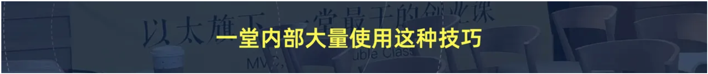

---

**【互动🎯】** 课后作业：**给你的产品造 10 个金句，明天交给助教筛，挑出最好的 3 个。**

---

好，我们进入下一个方法。

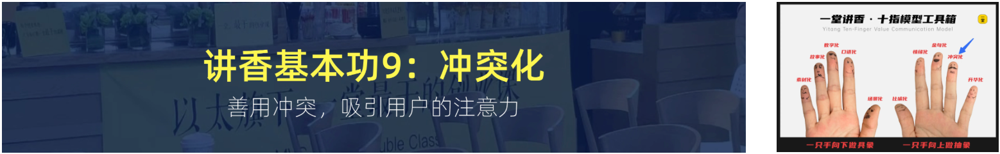

---

## 20 冲突化

好，第九个方法：**冲突化**。

这一节，我要讲一个**让很多人不太舒服，但极其有效**的东西。

我先问你一个问题：

**一篇文章、一个视频、一个方案，如果一点"矛盾"都没有，你会想看吗？**

**我不会。**

因为**没有冲突的内容，人是没有动力看下去的。**

我给大家看一组数据。

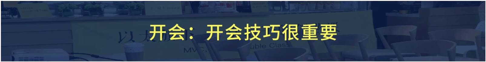

同一个内容：

- **无冲突版本**：完读率 **22%**
- **有冲突版本**：完读率 **71%**

【互动🎯】**三倍多。**

而且更有意思的是，**有冲突版本，用户的信任感反而更高。**

因为用户觉得：**"他敢说真话，这个内容应该是真的。"**

---

那冲突从哪里来？

我给大家三个来源。

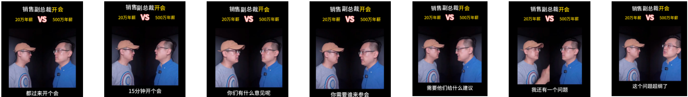

**来源一：常识冲突。**

说一件用户以为对，但其实是错的事。

比如：

- "**你以为客户不买是因为价格，其实80% 是因为你没讲清楚价值。**"
- "**很多人以为讲香是话术问题，其实是价值没找对。**"

**来源二：选择冲突。**

给用户一个二选一，让他必须站队。

比如：

- "**你可以继续用老办法，也可以让客户自己找上门。你选哪个？**"
- "**你可以现在改，也可以等客户流失之后再改。**"

**来源三：自我冲突。**

说用户自己身上的矛盾，最狠但最有效。

比如：

- "**你每天抱怨没时间，但你从来没舍得花 10 分钟把这件事想清楚。**"

【互动🎯】这三条里，**第三条最有杀伤力。**

**因为它直接指向用户的自我认知。**

**但用的时候要有分寸，别让人觉得你在骂他。**

---

【互动🎯】这里有一个非常重要的分寸问题，我要专门讲。

**冲突不等于冒犯。**

我给大家一个判断标准：

> **冲突指向"问题"，就是好的冲突。**
> **冲突指向"人"，就是坏的冲突。**

对比一下：

- ❌ 坏的："**你自己的方案就是错的。**"
- ✅ 好的："**这个做法在行业早期是有效的，但用户变了，它就不灵了。**"

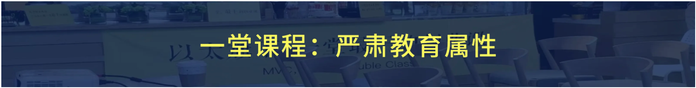

**第一句是攻击，客户会立刻关闭。**

**第二句是讨论，客户会继续听。**

**同样是在指出问题，区别只在于你把矛头指向哪里。**

---

**那怎么把冲突用在自己的内容里？**

我给大家三个位置：

**位置一：开头。**

**开头必须有冲突**，不然客户划走。

**位置二：转折处。**

"**但这里有一个问题。**"——这句话本身就是冲突，它把注意力拉回来。

**位置三：结论前。**

在给结论之前，先说一个反直觉的事，客户会更认同你的结论。

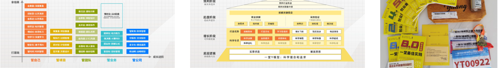

---

**【练习】**

现在，为你的内容，**设计 3 个冲突**。

要求：

1. 每个冲突都要 **指向问题，不指向人**
2. 每个冲突后面 **必须接一个解决方案**
3. 念出来 **不能让人觉得你在骂人**

**特别强调第 2 条——冲突后面必须有解法。**

**只制造冲突不给解法，那是制造焦虑，不是做内容。**

---

好，冲突化讲完了。

【互动🎯】我最后强调一遍：

**冲突是手段，不是目的。**

**你的目的是让客户接受你的价值。**

**冲突只是为了让客户愿意听到最后。**

**如果客户听了冲突就走了，没听到你的价值——这个冲突，白设。**

---

**【互动🎯】** 课后作业：**给你的产品写 3 个"常识冲突"，明天我们现场互评。**

---

好，我们进入最后一个方法。

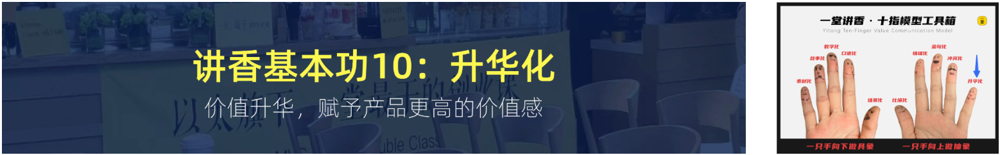

---

## 21 升华化

好，第十个方法：**升华化**。

这是最后一个方法，也是**最难的一个**。

我先说清楚，**升华不是"拔高"。**

**升华是把一个具体的事，接到一个更大的价值上。**

我先给大家看区别。

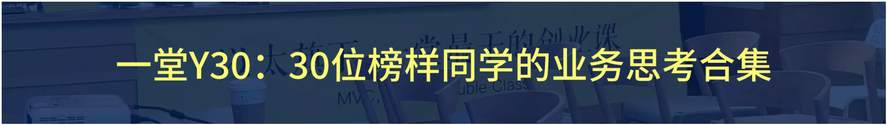

普通收尾：

**"所以our 产品能帮你提升效率，祝你使用愉快。"**

升华式收尾：

**"我们做这个产品，是想让你把时间还给真正重要的事。我们能帮的，就这么多了。"**

【互动🎯】你自己感受一下，**哪个更像一个有诚意的人说的话？**

---

升华的三个方向。

**方向一：接到"人的价值"上。**

从"产品能做什么"，接到"人能成为什么"。

比如：

- ❌ "**这套系统能帮你管理好客户。**"
- ✅ "**当你终于不用再靠记忆维系关系的时候，你可以把更多精力放在真正重要的人身上。**"

**方向二：接到"时间"上。**

产品的功能，接到"人生的时间"。

比如：

- ❌ "**这个课程帮你提高效率。**"
- ✅ "**你省下来的每一小时，都是你本来可以陪家人但没陪上的那一小时。**"

**方向三：接到"信念"上。**

产品的功能，接到"你相信什么"。

比如：

- ❌ "**我们的工具很安全。**"
- ✅ "**我们相信，���的工具不该让人变成机器。**"

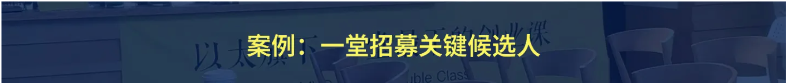

---

【互动🎯】但升华有一个很大的风险，我要专门提醒。

**升华容易变成"空话"。**

我见过很多课程讲完升华，客户点头说"讲得好"，然后**该买还是不买**。

**为什么？**

因为**升华过头了，落不回产品**。

我给大家一个判断标准：

> **升华之后，能不能用一句话落回你的产品？**

如果不能，那这个升华是**飘的**。

对比一下：

- ❌ 飘的升华："**愿你在人生路上找到属于自己的光。**"——跟产品毫无关系
- ✅ 落的升华："**我们做的就是这个光。**"——一句话落回产品

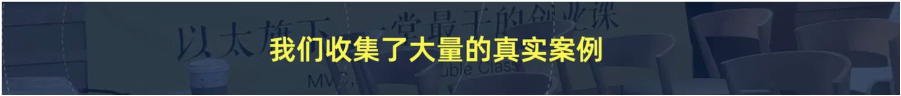

---

**【练习】**

现在，给你的产品，**写 3 个升华式收尾。**

要求：

1. 方向各不相同
2. 每一句后面，**都要有一句话能落回你的产品**
3. **不许写空话**

写完之后，用我给的标准检验一下：

**如果哪一句落不回去，重写。**

---

好，升华讲完了。

【互动🎯】十个方法讲完了。

我想说一句总结的话。

**这十个方法，不是十个技巧。**

**它们背后，是同一个东西——**

> **你真的在乎对方能不能听懂。**

**你真的在乎，价值就藏不住。**

**你不在乎，讲得再好听，也只是话术。**

---

**【互动🎯】** 好，我们进入最后一个部分：**回顾与总结**。

---

## 22 回顾与总结

好，我们来做最后的回顾。

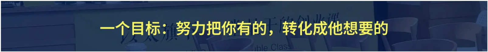

我先把今天讲的内容，用一张图串起来。

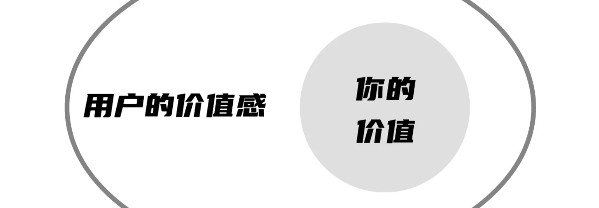

**第一层：审美。**

我们先看了两个案例——天幕阳台、一堂 CLI。

**核心是让你建立"有审美"的判断力**：知道什么是好的表达，什么是差的表达。

**第二层：方法论。**

价值层 → 场景层 → 表达层。

**先想清楚价值，再找场景，最后才是表达。**

**第三层：十个方法。**

口语化、数字化、故事化、素材化、比喻化、情绪化、金句化、冲突化、升华化。

**每一个都对应一个具体动作。**

---

好，我们一个一个快速过一遍。

**方法一：口语化。**

把书面语变成对方能听懂的句子。

**四步降维**：拆短句、改主动、换具体、换词。

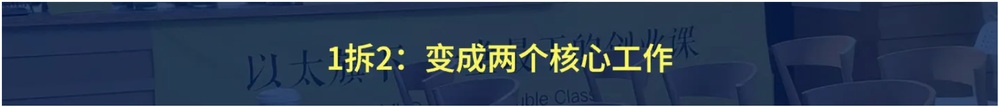

**方法二：数字化。**

把形容词换成数字。

**数字让客户不用猜。**

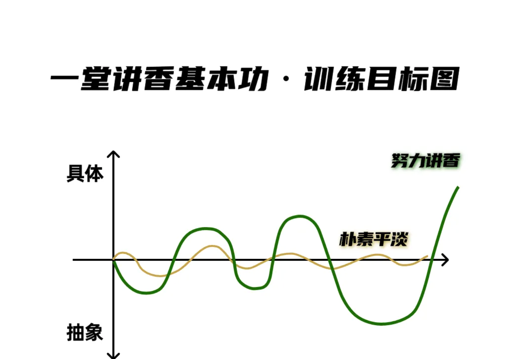

**方法三：故事化。**

用 STAR 四段，把道理变成故事。

**主角必须是客户，不是你。**

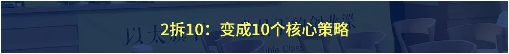

**方法四：素材化。**

从客服记录、退货原因、竞品评论里挖素材。

**按场景分类，不按内容分类。**

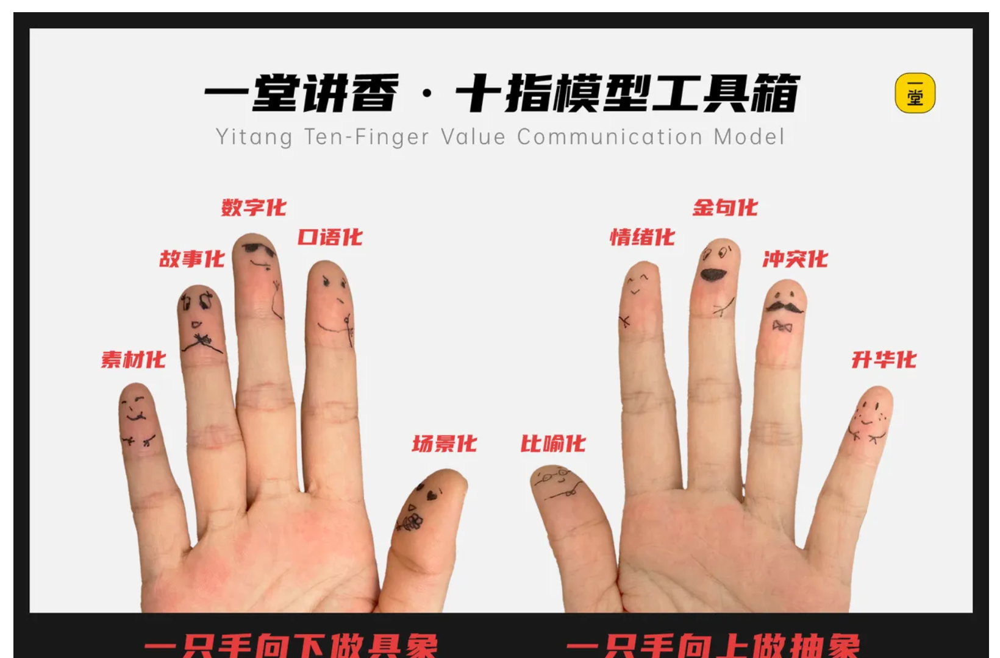

**方法五：比喻化。**

把价值换成一个有画面的表达。

**先给事实，再给比喻。**

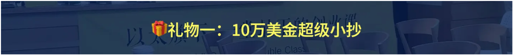

**方法六：情绪化。**

恐惧、渴望、认同、愤怒，四个入口。

**冲突指向问题，不指向人。**

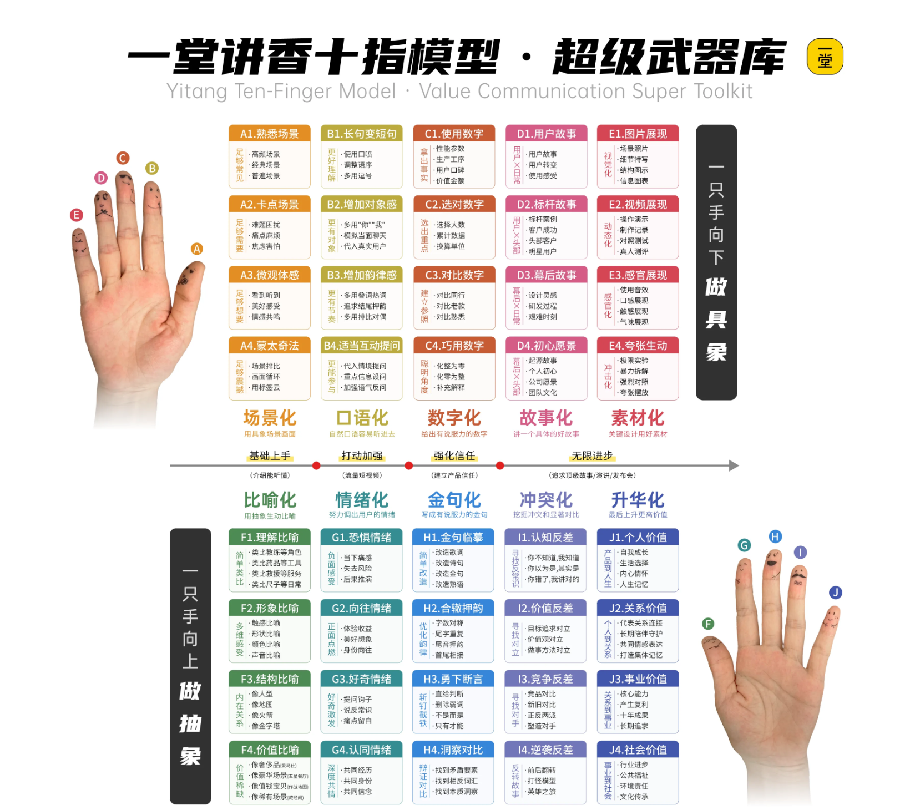

**方法七：金句化。**

价值换画面，四个手法。

**金句必须从你的价值里长出来，不是硬造的。**

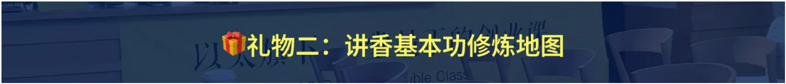

**方法八：冲突化。**

常识冲突、选择冲突、自我冲突。

**开头必须有冲突，但冲突后面必须有解法。**

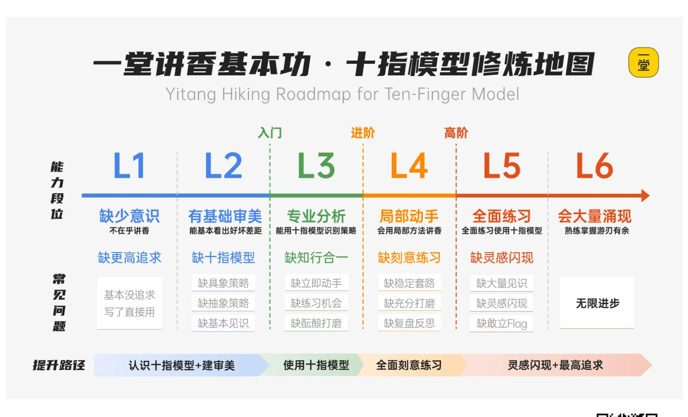

**方法九：升华化。**

从功能接到人、接到时间、接到信念。

**升华之后，必须能一句话落回产品。**

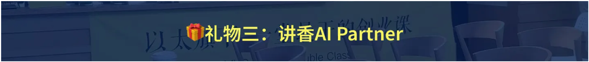

**方法十：价值层、场景层、表达层。**

这是前面九个方法的地基。

**顺序不能乱：先价值，再场景，最后表达。**

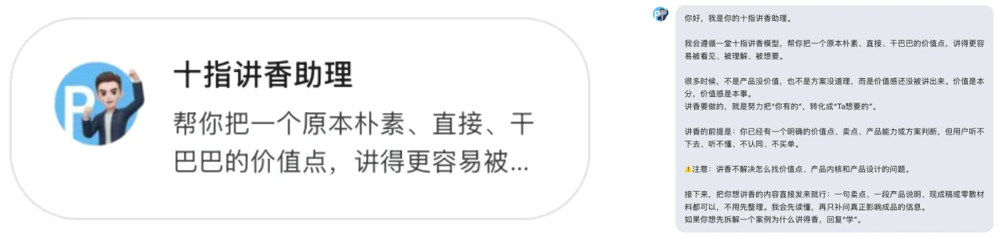

---

好，回顾完了。

【互动🎯】现在我想说几句**总结的话**，也是我今天最想跟大家说的。

**第一句：讲香不是技巧，是诚意。**

【互动🎯】我今天讲的所有方法，你都可以当成技巧来用。

**但如果你只用技巧不用诚意，那你的效果不会好。**

**因为讲香这件事，客户是能感觉到的。**

**他能不能听懂你的价值，他自己知道。**

---

**第二句：不要从技巧开始，要从价值开始。**

【互动🎯】很多人学讲香，是从话术开始的。

**背一堆句式，学一堆技巧。**

**结果一用，还是没效果。**

**因为你跳过了最重要的一步——你想清楚你到底在卖什么。**

**先回到价值。**

---

**第三句：讲香是练出来的，不是学出来的。**

【互动🎯】今天讲的东西，你听完可能觉得都懂了。

**但你今天回去讲一遍，就会发现还是不会。**

**这是正常的。**

**因为讲香是技能，技能只能靠练。**

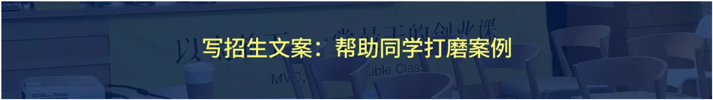

我有个学员，第一次来的时候说："**我懂了，我回去就练。**"

结果一个月后再问，他说："**练了，但还是不行。**"

我问他："**你练了几次？**"

他说："**……两次。**"

**问题就在这。**

**两次练习，是不可能练出来的。**

**我给他的建议是：一个月，至少练 20 次。**

---

**第四句：今天讲的方法，只有一成。**

【互动🎯】这句话我要说清楚。

**今天讲的这十个方法，是最基础的。**

**真正高阶的讲香，是在这些基础之上的组合和变化。**

**怎么组合，怎么变化，今天不展开讲，留给下一期。**

---

**第五句：最后。**

【互动🎯】我今天最想说的一句，其实是这一句——

> **你自己做不到的，讲给别人听，是没有用的。**

**所以今天的作业不是"写方案"。**

**今天的作业是"你自己讲一遍"。**

**今天回去，对着你的产品，对着镜子，讲一遍。**

**讲完录下来，自己听一遍。**

**你会发现，录音里的声音，比你以为的难听很多。**

**这就是你要练的第一课。**

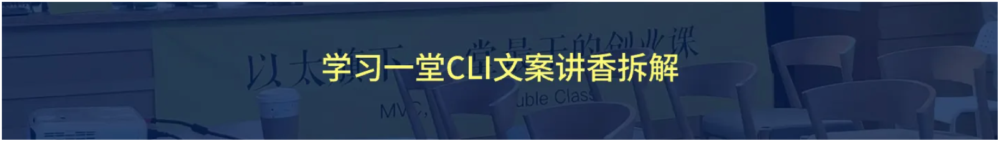

---

好，最后我们看一下整体的课程地图。

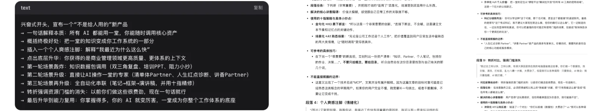

这张图我建议你保存下来。

**它是这门课的整体框架。**

后面所有内容，都在这个框架里。

---

【互动🎯】好，我们今天就到这里。

**最后，我再说一句。**

**这门课叫"十指讲香"。**

**为什么叫"十指"？**

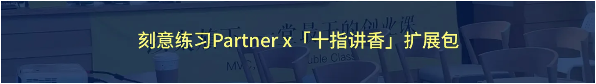

因为**十个手指头，是十种方法。**

**也因为——**

**你伸出手的时候，是你在表达。**

**你伸出手，是想把东西递给别人。**

**讲香，就是把手里的价值，递到别人手里。**

**递过去，别人接住了，价值就成立了。**

**接不住，价值就只是你一个人的价值。**

---

【互动🎯】好，今天真的结束了。

**谢谢大家。**

**我们下期见。**

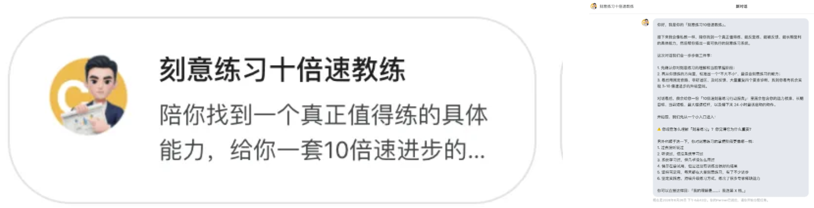

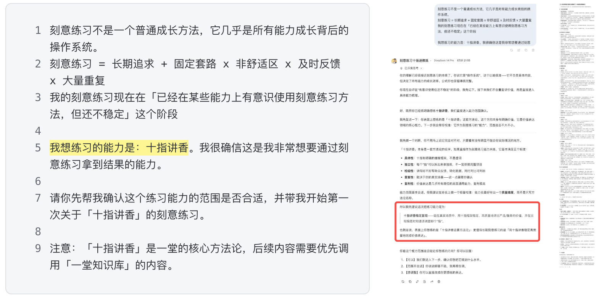

---

<!-- 转录范围：18 ~ 22 -->
