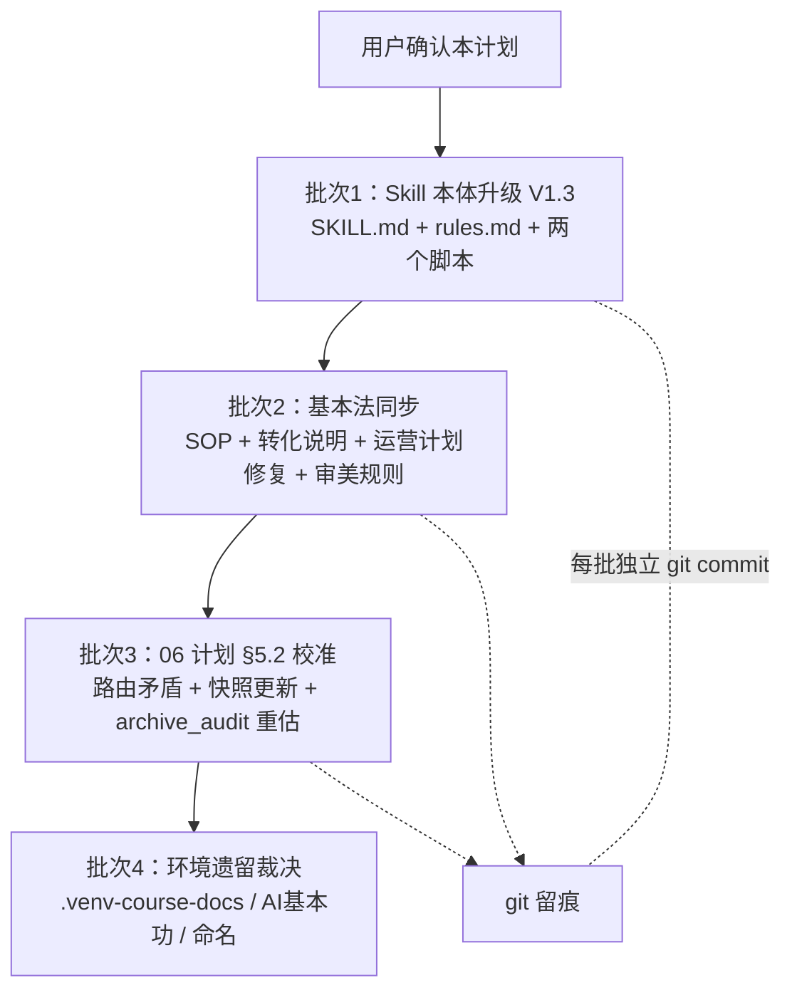

# 002 收件箱归档 Skill 修订计划

> 审查对象：`knowledge-base-inbox-archive`（库内实体：`.skills/knowledge-base-inbox-archive/`，系统侧为软链接）
> 审查日期：2026-10-30
> 结论：**需要修改**。共发现 15 项问题——P0 硬错误/规则矛盾 6 项、P1 口径过时 5 项、P2 打磨项 4 项。
> 边界：本文件只做审查与规划，**不直接改动任何文件**；用户确认后按批次执行，每批独立 git 提交，写 md 一律 python3 原始字节。

---

## 一、问题清单

### P0：硬错误与规则矛盾（不改会导致分拣出错）

| # | 位置 | 现状 | 应改为 |
|---|---|---|---|
| P0-1 | SKILL.md 落位铁律（第 73 行） | 无匹配目录进 `99-其他` | 《文件夹定义规范》V2.0 统一编号为 **90-其他**，库中不存在 99 |
| P0-2 | SKILL.md 第 60 行、rules.md 第 63 行、SOP 第 111 行 | 案例类落 `03/95-素材` | 95-素材是旧目录、已按 V2.0 归并各领域；改为「03 对应领域，`type: 素材`」 |
| P0-3 | SKILL.md 第 55 行、rules.md 第 53 行、SOP 第 69 行 | 核验不过降级 02 标 `status: 初稿` | V2.0 规定 02 状态只有 **假设 / 成型**；统一为「假设」，全库消灭「初稿」口径 |
| P0-4 | 06 计划 §5.2（第 150–164 行） | 高阶建模判 `01/50`、直播 262 判 `02/50`、称「现有 11 项」 | 高阶建模主体是思维方法论 → **01/10**；直播 262 经核实为官方必修课 → **01/50**；快照更新为当前 13 项（含两个官方任务包） |
| P0-5 | SOP 第 18/26–35 行；收件箱转化说明第 14 行及流程图 | 写「12:00 定时触发集中分拣」 | 2026-10-30 已拍板：12:00 定时**仅接收**落收件箱，**分拣手动触发**；两份文件的节奏描述同步改写 |
| P0-6 | 知识库运营计划.md | frontmatter 的 `---` 已损坏成 `***`，全文 `***`/`\[`/空行污染；且内容停在 9 月旧口径（外部→01、03 物理状态目录、95-素材） | 修复 frontmatter 与排版；按 V2.0 与准入闸更新过时章节，保留变更记录留痕 |

### P1：引用与口径过时（不改会误导执行）

| # | 位置 | 问题 | 处理 |
|---|---|---|---|
| P1-7 | rules.md 第 72 行 | 02 子域仍写旧扁平结构「01-AI思考、02 刻意练习、03-原则思考、99-其他」 | 对齐 10/50/60/70 领域编号 + 90-其他；说明 01-AI思考 现在是 `02/50/` 下三级目录 |
| P1-8 | SKILL.md 参考资料节 | 要求串联 context-link，但未给路径，且它不在系统已注册 skill 列表 | 写明路径 `.skills/context-link/SKILL.md`，执行时先 Read 再遵循 |
| P1-9 | fetch_messages.py 第 4 行 docstring | 自称「归档流水线的第 1 步」 | 改为「手动接收工具，仅用户明确要求时使用」，与职责边界一致 |
| P1-10 | SKILL.md/rules.md 用 `date`，规范 3.1 写 `updated` | 字段口径不统一 | 明确 `date` 必填（创建日期）、`updated` 可选（最近修订），三处文档统一表述 |
| P1-11 | SKILL.md 第 30 行 | 标题写「执行流程（七步）」，实际只有 ①–⑥ 六个小节 | 标题改为「六步」（context-link 保持嵌在 ⑤ 内） |

### P2：打磨项（可顺带处理）

| # | 位置 | 问题 | 处理 |
|---|---|---|---|
| P2-12 | scan_inbox.py | 顶级垃圾目录（.venv 等）未在清单过滤；JUNK_DIRS 混入文件 .DS_Store；同日重跑覆盖清单；成品目录后缀硬编码 | 补顶级垃圾过滤、修正集合语义；清单加时分或明确「同日覆盖可接受」；后缀表加注释说明可扩展 |
| P2-13 | 沉淀审美规则.md | status 仍「初稿」；7 天过渡期机制早已结束 | 状态更新，机制段改为「规则持续累积、纠正即沉淀」 |
| P2-14 | 环境遗留 | 根目录 `.venv-course-docs` 未移出库；归档区 `AI 基本功` 117M 待裁决；02 层「70 案例库」空格命名不统一 | 列《待裁决清单》由用户逐项拍板，不擅自处理 |
| P2-15 | 06 计划 H3 批次 | `archive_audit.py` 未建，但归档区已手动清至 117M | 重估必要性：建议暂缓封装，归档区体检并入 health-check |

---

## 二、修订批次（每批先列改动清单，确认后执行）

| 批次 | 内容（对应问题号） | 预计 | 前置 |
|---|---|---|---|
| 1 | P0-1、P0-2、P0-3（skill 部分）、P1-7～P1-11、P2-12；SKILL.md 变更记录加 V1.3 | 0.5 天 | 用户确认 |
| 2 | P0-5、P0-6、P2-13 | 0.5 天 | 批次 1 |
| 3 | P0-4、P2-15 | 0.3 天 | 批次 1 |
| 4 | P2-14 逐项裁决后执行 | 0.2 天 | 用户拍板 |

## 三、验收标准

1. 全库 grep（排除 `.git`、归档区历史件、各文件变更记录、删除留痕）：不再出现 `99-其他`、`95-素材`、`status: 初稿`；
2. 所有修订 md 的 frontmatter 以 `---` 正常起止，Obsidian 可解析（用 python3 回读校验，不依赖编辑器）；
3. 文档中引用的每条路径真实存在（写校验脚本逐条 stat）；
4. 修订后跑一次 `scan_inbox.py`：候选清单正常生成、顶级垃圾被正确过滤；
5. 每批独立 git 提交，提交信息写明范围与文件数；
6. 分拣判断标准（rules.md 第〇节两层决策）本身不动，只修引用与口径，保持「不临场改标准」。

## 四、变更记录

- V1.0（2026-10-30）：初版审查计划，15 项问题 + 4 个修订批次，待用户确认。
