## 徐剑：从无意识做对，到有意识迭代

### 开始上课

Hello，大家好，我是徐剑。

很开心收到一堂邀请，来给大家做这次Y模型解读之夜的分享，和大家分享我眼中的Y模型和我的实践。

先花一分钟，把我的来路交代清楚，因为今天这个分享，跟我这个人是谁，关系很大。

我是数族科技（南京）股份有限公司的创始人，做了二十多年To B业务，国企待过，上市公司待过，也做过投资。

2016年，我从解决发票的“开票难、开票烦”问题为出发点，开始创业。

直播间里应该有不少同学听过我在一堂的案例课**《ToB案例：发票SaaS头部企业拆解》**，没听过的、感兴趣的同学也可以去选课听一听。

那里面有不少我曾经踩过的坑、烧过的钱，我从五步法的角度复盘了：

我是怎么**通过调研挖到核心需求**，怎么在**同质化竞争中找到产品内核**，在思考保用户数量还是保业务收入的两难中、最终**找到一条规模化之路**，用5年时间做到**发票SaaS行业的Top3**。

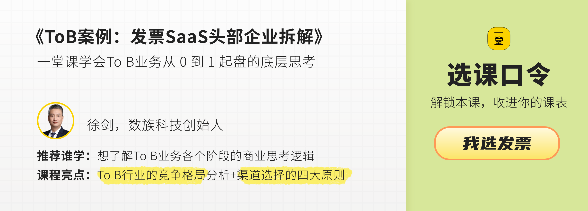

今年，是我创业的第十个年头了。数族科技的发票数字化服务已经覆盖**500万+**家经营主体，一年处理大概**10亿张**发票，我们的业务也走到了第三阶段——**企业级AI原生服务**。

而和一堂的结缘呢，是在2022年9月1号，正好是个开学日，我正式加入一堂，拿下了当期（第117期）复盘营的MVP。

后来，我在一堂经历了许多故事、创下了不少记录，我是一堂的第一位八年级学员，江苏学习中心主理人，S级私董会骨灰级NPC，拿过三次马拉松的“榜一大哥”。

简单总结一下我的三个身份：
1. 一个曾经在业务上拿到过一点点结果的人
2. 一个在一堂泡得比较久、扎得比较深的学员
3. 一个天天跟数据打交道、正在攻读人工智能博士的AI从业者

这些标签并不重要，主要是让大家形成一个印象——**我是个ToB行业的老炮儿、对一堂的理解挺深的**。Truman说，这也是为什么邀请我今天在直播间里，代表一堂解读Y模型这个课题。

过去一段时间，我在一堂听到的有关Y模型的最多的一句话是：**“Y模型太难了，太抽象了，听着很对，但是好像跟我关系不大，我也用不起来。”**

我特别理解这句话。理论这东西，一听好像都会，一用基本全废。尤其是你正忙着打仗的时候，谁有空去研究一张画着三个叉的图？

所以今天，我不是来讲理论的——Truman已经讲得很透了，我再讲一遍，是浪费大家时间。

我今天就干一件事：**把我身上发生过的两件真事，摊开给大家看。每一件，我都当场告诉你，它背后的那个“科学”是什么。**

开始之前，先问大家三个问题。不用回答我，回答你自己。

第一个问题：

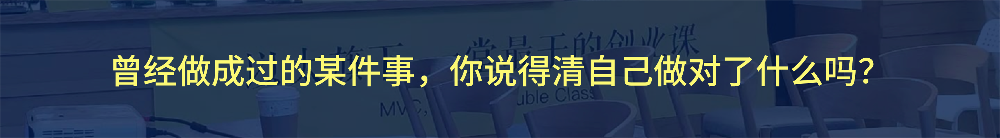

——————

第二个问题：

——————

第三个问题：

——————

这三个问题，背后其实是同一个问题：**你追不追求，持续提高自己成事的概率？**

如果你有这个追求，那今天这一小时，就值得你听完。因为，今天的两个案例，就是我自己对这个问题的回答。

好，我们开始。

### 有意识 vs 无意识

#### 大白话说说"Y模型"

Y模型长什么样？——一个大写的Y。

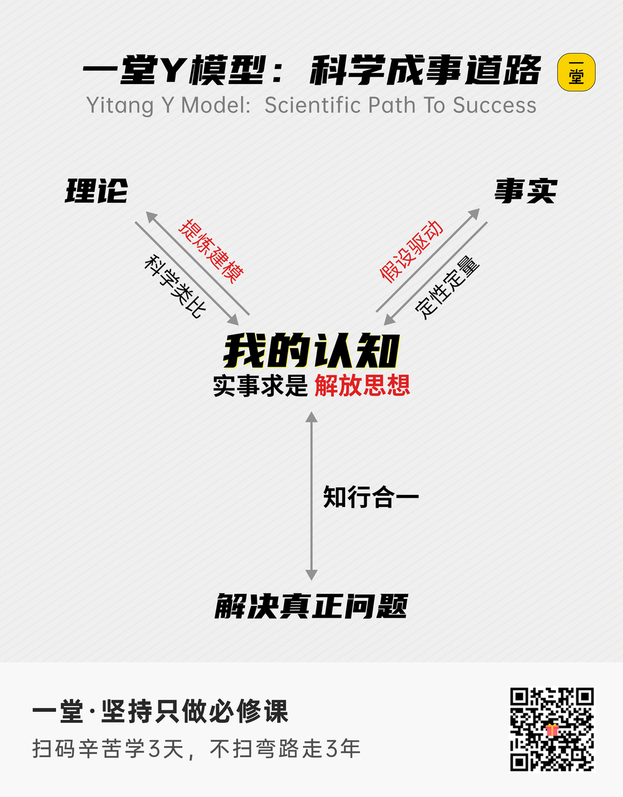

左边这一叉，叫**理论**——别人已经验证过的规律、总结好的方法；

右边这一叉，叫**事实**——你自己亲眼看到的、亲手做出来的真实情况；

中间交汇的那一点，叫**认知**——你拿理论和事实互相印证之后，长出来的那个判断；

再往下，这个判断必须回到真实世界里去解决问题，再拿结果回来，校正你的认知，也就是“**知行合一**”。

就这么简单。

**《Y模型实操：框架篇》**这节课里，Truman进一步把它拆成了“12345”的落地口诀：

- **一个核心**：相信客观因果规律，追求客观因果规律。
- **两个基本点**：理论一叉、事实一叉。
- **三大必备原则**：知行合一、实事求是、解放思想。
- **四种迭代方式**：科学类比、定性定量、假设驱动、提炼建模。
- **五步推理里程碑**：范围、目标、框架、预判、配套。

更详细的内容在**《全员必修：重新理解「科学理念」》和《Y模型实操：框架篇》**这两节课里，没听过的可以去选课，选过课的可以去复习。

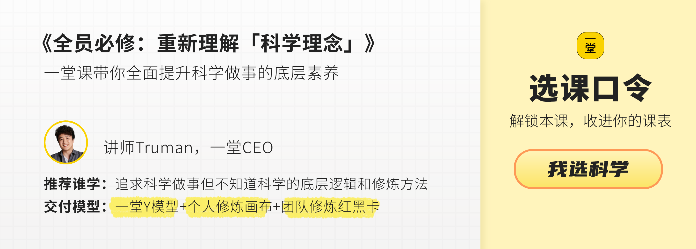

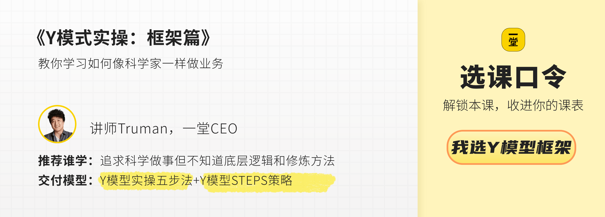

这些内容不需要在今天逐条背下来，你只要记住：

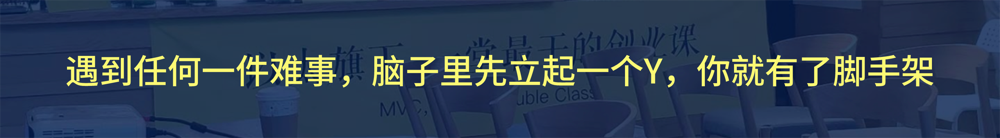

对我来说，Y 模型更像一张思考地图，帮助我把几个问题摆在一起看：

- 我现在要解决的是什么问题，范围和目标是什么？
- 我手里有什么事实？哪些只是猜测？
- 有什么理论或经验可以参考？它适用的条件是什么？
- 我由此形成了什么判断？这个判断可以怎样验证？
- 结果回来以后，我需要更新哪一部分？

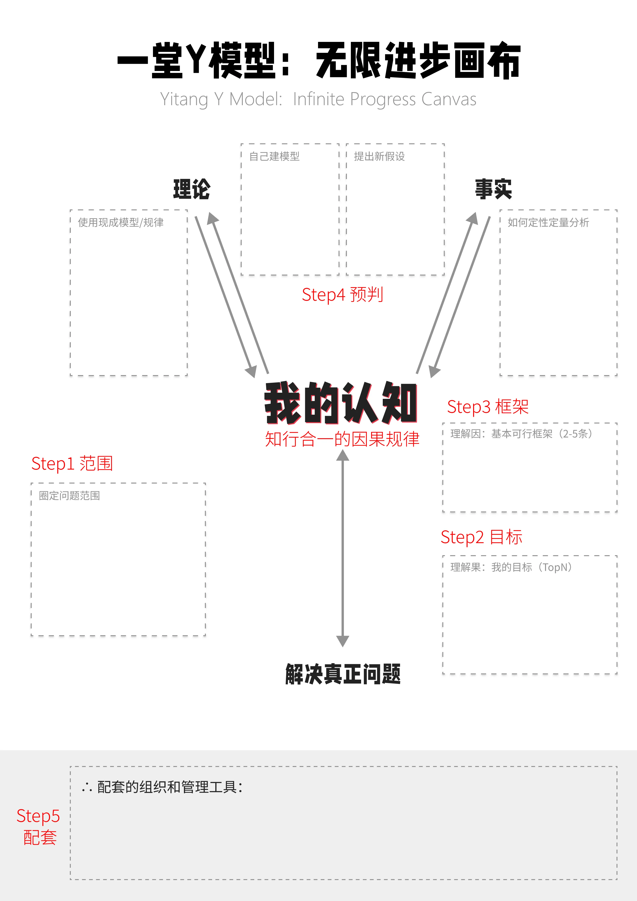

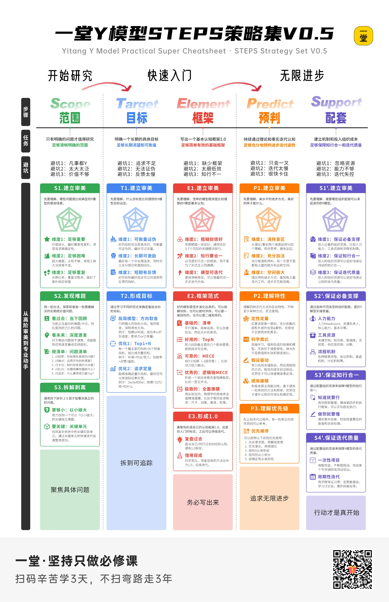

#### 你一定科学过

很多人会问：如果过去我没有有意识地学 Y 模型，难道我就没有科学地做过事吗？当然不是。

举个大家熟悉的例子：**上学**。

你从小学到大学，整个学习过程，本质上就是Y模型：

- 老师讲公式、定理，这是理论；
- 我们做作业、做实验、做题，这是接触事实和练习；
- 做完题之后，我们形成“我会了”的判断；考试成绩又给我们新的反馈。

这个过程里已经包含了理论、实践和反馈。但我们小时候不一定会把它叫作 Y 模型，也未必会主动说出每一步的作用。我们可能就是按老师的安排学习、做题、考试，直到某次考试成绩不理想，才发现自己以为的“会了”其实不牢靠。

所以，我相信大家一定都科学过，**只是我们无意识做了科学的一些动作，却不一定有意识地把它们作为一套推理过程来调用。**

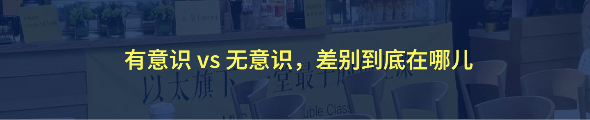

我这里说的“无意识”，不是说人没有思考、没有经验，也不是说无意识做成的事就是碰巧。

一个经验丰富的人，往往能够在熟悉场景里迅速做出正确判断。只是这个判断过程可能沉淀在手感里：**做对了，但自己说不清当时依赖了什么条件；结果不好时，也不容易定位是事实变了、方法不适用了，还是目标本身没定义清楚。**

**那什么叫有意识？**

不是每做一件小事就要画完整的 Y，它更像是：**当问题值得认真解决时，我能够主动把可用的理论、看到的事实、形成的判断和提出的验证摆出来，知道自己的判断从哪里来，接下来打算用什么结果检查它、迭代它。**

这中间其实是一个光谱，我把它分三档。我们用一堂经典的爬山地图来看一看。

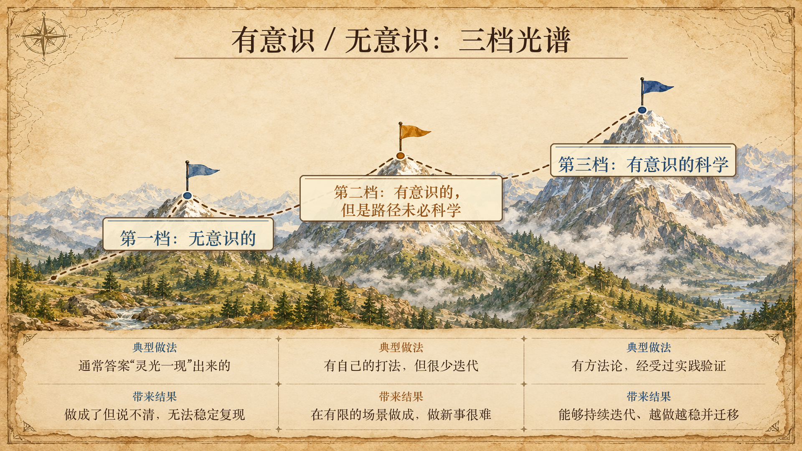

大多数人都停在一档，少数人停在二档，真正站上三档的，凤毛麟角。

所以，今天我说的“有意识”，指的是：**让原本可能靠直觉完成的科学动作变得可察觉、可检查、可迭代。**

而今天课里我的这一个小时，如果你只带走一句话，我希望是这句：

顺便说说我自己在哪个位置。一堂的**《建立追求：高阶建模导入篇》**的课里，Truman给过一张“一堂建模高手·十年爬山地图”，六个段位。

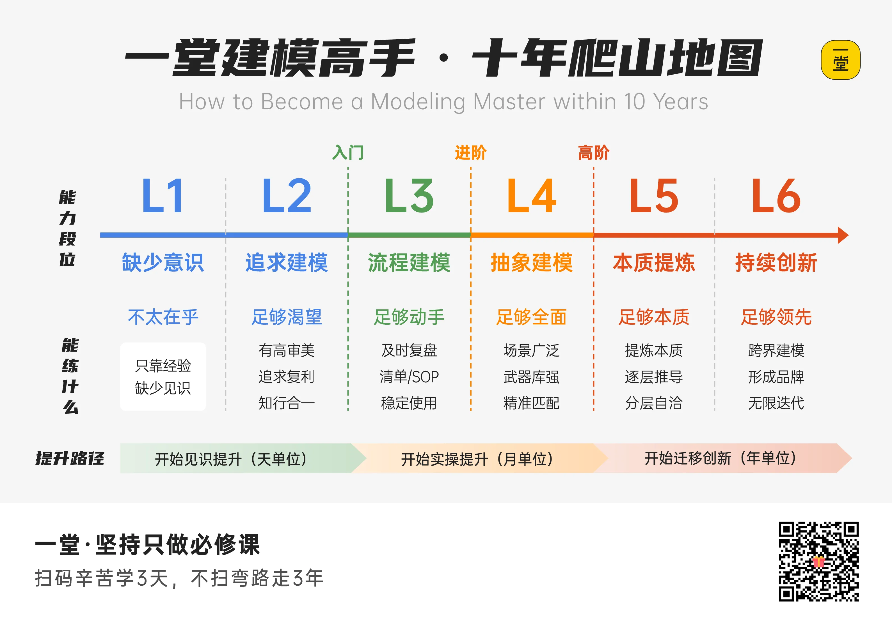

这张段位图，跟刚才那个三档光谱，是同一件事的两种说法。

L1到L2是“无意识”，L3到L4是从“有意识”往“科学”过渡，L5到L6才是真正站住。

我自己认真对照过：

- 十年前，我在L1，**缺少意识**——只知道做事，不知道建模；
- 现在，我大概在L5，**本质提炼**——能提炼本质、指导实践、跨领域迁移，正在往L6持续创新走。

2024年初，我在一堂年度直播分享里给自己做过一次复盘，原话是：**“看了那么多、干了那么多、想了那么多年，却极少进行有意识的主动建模。”**

这不是谦虚。这是事实：**经验和知识我并不少，但过去很少主动把它们连起来，系统地看清“我为什么这样判断”。**

所以，今天我不是站在岸上教大家游泳。我是从水里爬出来，站在这块石头上，跟你讲讲刚才那几口呛的水，是怎么呛的。

**你不是不懂科学，你只是还没意识到，自己曾经科学过；**

**Y模型不是天外来客，它只是把你熟悉的东西，起了个名字。**

### 我理解的Y模型

#### 为什么是"Y模型"

一堂的方法论太多了：五步法、关键假设ABCD、单元模型、双三角、时间管理、个人课程地图……每一门都很硬，每一门都值钱。

于是很多同学会产生一个非常自然的念头：我学会其中两三个，够用了吧？

我的答案是：行，学会其中一两套具体方法，当然能帮助我们解决对应的问题，但它们各有自己的问题范围和适用场景。

你看：

- 五步法解决的是“一个业务机会值不值得做、怎么做”
- 关键假设解决的是“这件事成立与否，最关键的假设是哪几个、怎么验证”
- 单元模型解决的是“这门生意的单元经济模型怎么算”。

它们全都是极好的东西。但它们的共同点是：**每一门，都只解决某一类问题，都只覆盖一段因果。**

我现在的理解是，**Y 模型和具体方法论不是互相替代的关系。**

- **具体方法论像是不同用途的工具**，告诉我们某一类问题可以怎么分析、怎么行动；
- **Y模型更像是一种思考结构，**让我们判断“现在要解决什么问题、手里的工具是否合适、结果怎样检查”的思考结构。

工具本身有它的价值，思考结构也有它的价值。具体情况不同，两者可以配合使用。当问题超出某一个方法的范围，或者几种方法需要组合时，我们需要能看清它们之间的因果和前提。Y 模型可以在这个时候提供一个共同的检查框架。

所以我把它们的关系说成这样一句话：

| 层次 | 它回答的问题 |
| --- | --- |
| **具体方法论**（五步法、关键假设、单元模型） | 这一类事，应该怎么做 |
| **Y模型** | 我凭什么相信，我这样做是对的；以及，当它不对时，我该改哪一格 |

打个比方：

- 五步法是一把趁手的厨刀——标准化，拿到就用
- 关键假设是一把锋利的解剖刀——专盯成败，精准到毫厘。

——两把都是好刀。一堂还有很多这样好用的刀。

手里有合适的刀时，你不会琢磨这事：

能切就行，谁关心刀怎么来的？

但遇到没切过的料子、没见过的切口需求——现成的刀不那么管用了，怎么办？

这个时候，你就会用到Y模型。

**Y模型不是第三把刀。它是造刀、选刀、磨出合适刀型的那套手艺 。**

有手艺的人，十五分钟磨出新刀；没手艺的人，在那几把现成刀里翻来覆去，要么切不动，要么切出来全是毛刺。

#### Y模型的独特价值

在我的实践里，Y 模型特别有帮助的一点，是提醒我**别停在单个结果上，而是继续往前看它可能由什么造成，往后看它又可能成为哪个新问题的起点**。

比如看到一次成功，

- **我们可以向前问：**是什么条件促成了它？其中哪些是客户的特定情况，哪些可能是可复用的方法？
- **也可以向后问：**既然这个结果发生了，下一步有哪些目标或假设值得检查？ 

所以，如果只允许我说一条Y模型区别于其他方法论的独特价值，我会说：**它处理的是多层嵌套的因果，而不是单点因果。**

这里面有两个动作，我反复用，今天先教给大家：
1. **因果互换。**每一个因，其实都是上一层果；每一个果，又都是下一层的因。拿到一个结果，立刻做两个动作：**向前**，问“这个果的因是什么”——做归因；**向后**，问“这个果是谁的因”——定下一层目标。
2. **因果分层。**把一堆事摆成一条链：哪一层是能力之因，哪一层是资源之因，哪一层是变现之果。摆完之后你会发现，很多“互不相干”的事，其实是一条链上的不同位置。

这就是Y模型真正发挥价值的时刻——**当一件事的因果不止一层的时候。**

如果一件事只有单一因果，一个理论就够了，真不一定需要Y模型。

那些科学的理论，哪个不是用来解释因果的？

时间ROI解释时间与产出的因果，五步法解释业务机会与成败的因果。

你手里已经有一把钥匙的时候，不需要再造一把万能钥匙。

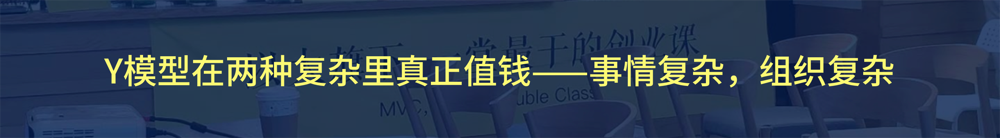

这句话我要说得很重，因为它是今天最容易被误用的一条边界：**Y模型在两种复杂里真正值钱——事情复杂，组织复杂。**

**第一种，事情复杂。**

因果不止一层，你拆到第三层才发现真正的因；或者几个因果互相咬合，你解决A的时候，动了B。

这种时候，Y模型是唯一能让你不迷路的图。

**第二种，组织复杂。**

一屋子人，每个人可能拿着不同的信息和假设，各说各话，谁也说服不了谁：有人认为这是客户不需要，有人认为是销售没讲清，有人认为是产品不够成熟。

这时候你把Y往白板上一画：什么是事实？什么是理论依据？我们卡在哪一格？

——如果大家能一起区分什么是事实、什么是推断、各自用了什么理论，讨论就更容易从争论立场转向检查依据。五分钟，大家就能对上话。

它不是在推演一件难事，它是在一个复杂环境里，给大家一套共同语言。

反过来说，**如果一件事既不需要多层拆解，也不涉及多人对齐，那就别生搬硬套。**

我听过一个特别真实的例子。

有位同学学完Y模型，回去拿它解决“**合租室友总不清理卫生间**”这个问题。

这件事的本质，是一次假设验证：我做了什么，室友可能会收拾；再做一次，他不收拾。**它连一个稳定的、可迁移的认知都长不出来**——因为换个室友，人的因素全变了。

你硬要把它画成一个Y，最后得到的不是科学，是一个“为了证明Y模型有用”的表演。而且这么干还有一个更深的坏处：**你会把Y模型，从一种思考结构，降格成一个工具。**

凡事都往Y里一丢，它在你手里就只是一把锤子。锤子只会让你看什么都像钉子。

#### Y模型应该放在第一课

MBA山顶营三天两夜的时候，Truman提了一个假设，现场众说纷纭。这个问题大家也可以思考一下：

**【🙋‍♂️思考】**要不要在复盘营的时候就给新同学讲Y模型？

- 扣 1——要，越早学越好
- 扣 2——不要，Y模型太难了，还是放到后面比较好

————

我现场表的态度，是坚决支持甚至叫拥护这个假设的。

Truman和教研就问我：为什么你觉得Y模型重要，甚至应该在课程体系里排在最前面？

我的理由很朴素：**因为它是所有课的语法。**

- 你学五步法，是在学一个句型
- 你学关键假设，是在学另一个句型
- 你学双三角，是学第三个句型。

**但语法不通，句型背得再多，写出来的还是病句。**

先把Y模型装进脑子，后面每一门课、每一个案例，你都会自动去做一个动作：**这门课，补的是我左边那一叉，还是右边那一叉？提升了我的什么认知？**

山顶营回来之后，我再写一堂作业，最大的变化就是这个：

- 以前，我把自己的实践跟课程结合一下，就觉得挺好了，大概率也能拿个满分；
- 而现在，我是有意识地把Y模型当镜子，照每一门课的方法论——解决的是什么问题，依赖哪些事实和前提，它跟Y对不对得进去？我的哪个格子是空的？

有时候，Y模型这面镜子，会照出我的盲区，可能是发现自己的理论或者事实还不够；有时也会发现，课程方法放到新的业务环境里还需要调整。

**这个过程，让我感觉学习和业务之间接得更紧了，而我自己的认知提升速度，比之前至少快了3倍。**

### 我的Y模型实践

下面，我就具体来说说，我的Y模型实践。

#### 案例1：一份迟到的作业

第一个案例来自一份我最近补交的一堂作业。要理解这份作业，先得知道它背后的业务问题。

创业十年，数族科技走了三段路：

- **第一阶段，臻票云。**2016年开始，做发票SaaS。这一段的销售路径，主要是经销制——我们把产品交给经销商，经销商去卖。因为产品相对标准，开箱即用，不需要专业交付，卖出去就能用。
- **第二阶段，臻企云。**2021年到2025年，我们做的是数据要素业务，主要给银行、政府、龙头企业等“机构类”客户提供场景化的数据解决方案——底层生产资料是企业的各类经营数据，交付物的形态是信息化系统。这一段，我们的经营模式是直销或者代理销售。
- **第三阶段，计然臻智。**2025年下半年开始，我们发布企业经营大模型和智能体集群。有意思的是——**我们又回到了经销制。**

先把“计然臻智”这个产品给你掰明白。目前，我们对外提供的是1.0版本，我称之为“你问我答”，实质是出口式咨询服务为主。

**老板看到的、用上的，就是一个页面、最下面有个对话框**（跟所有的大模型一样）——遇到跟经营有关的问题了（我们定义为“省钱”“赚钱”“找钱”三个最朴素的本质诉求），就在对话框里讲出来，然后我们就会告诉他：你现在是什么样子、你该怎么做——就这，拿到就用，没什么门槛。

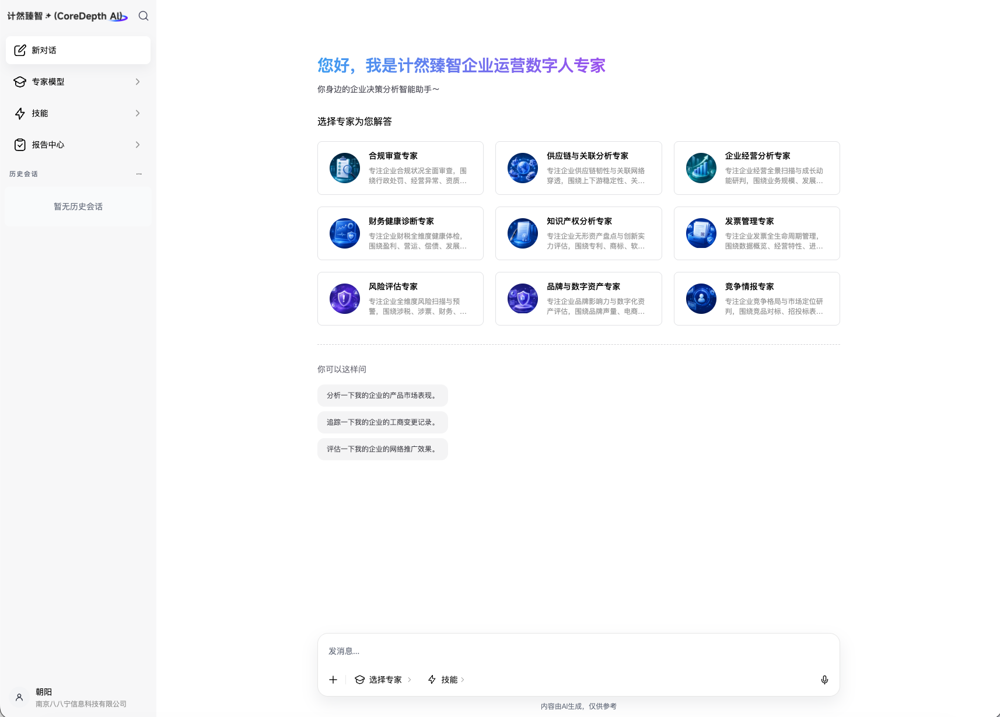

至于我们的系统设计逻辑，大家可以想象成医院。

- **第一层，数据核验**——把经营数据里的确定逻辑用"本体"推出来，答案唯一、可校验，如果简单类比，就是类似你去医院做检查，检查会被拆成不同的类目，数值和标准。
- **第二层，医生诊断**——检验报告是死的，怎么解读、给什么建议、语气轻重拿捏，这是医生的活。我们的AI专家也是干同样的活——风险客户怎么处理、银行贷款怎么申请……相对灵活，但不能胡说八道。
- **第三层，医院的病例库**——这是最值钱的。我们手里有500万家企业主动授权、持续给我们的发票和税务明细 ，加上全国5000万+家经营主体的公开数据。同行要么有公开数据、没真实票税数据（相当于只能查别人的公开体检记录，没有自己的真实化验单），要么有少量客户的数据、撑不起全行业对比。我们两边都占了——所以我们能告诉你"你开票额降了15%，同行才降5%"，这是真对比，不是瞎猜。

这样，可能大家就好理解我们为什么说，这个阶段，我们又采取的经销制。虽然设计分了3层，但是这个产品形式比较轻量，老板拿到就能用，手机上就能随时操作——跟“臻票云”是同一个用户体验逻辑。

对了，顺带解读一下“计然臻智”这个名字：计然是范蠡的老师，范蠡功成身退做生意三致千金，靠的就是计然教的「商业因果规律」——我们给这套产品起这名，就是想让亘古不变的商业规律在AI时代更容易被发现、被运用，帮助企业干好经营。

说回来，这个产品采用经销制一推，立刻撞上一个硬卡点。

我们的产品很清楚，但经销商到客户现场，往往最佳动销时间只有三分钟。三分钟讲不清价值，客户就不会继续往下听。

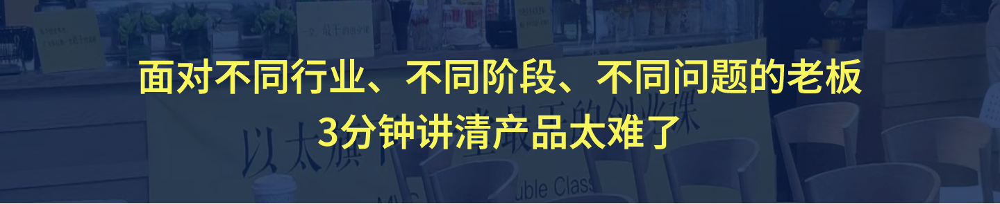

让经销商面向**不同行业、不同阶段、存在不同问题的不同老板**，在客户现场**用三分钟讲清"我们这东西到底能给你带来什么"，太难了：**

- 要么讲成"这是AI大模型"，太飘。
- 要么讲成"这里有个数据看板"，太窄。
- 要么讲成"不上就落后了"，太烦。

不知道怎么把底下那堆东西，拆成老板听懂的三分钟 。

**讲不清，就卖不动。**这卡了我们很久。

我们试过给经销商培训、给他们一页纸，但作用都不明显。

- 经销商要么说：这么多的东西学起来太费劲
- 要么说：这一页纸换个对象就不管用了。

怎么办？

还是经销商给了我启发，有个经销商说：大聖，我现在也会用AI，每次出门前我都会问问AI，我今天去见谁，该怎么说，但它给我的答案总感觉不那么给力。

我忽然间就有了个想法，**我能不能自己动手用AI写一写动销话术，拿出一份好的话术范例，给他们打个样？**

2024年，我听过一堂的一节课《人工智能入门：提示词必修课》。

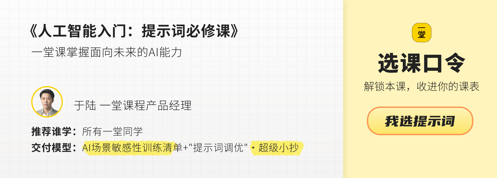

听完了，很认同，然后——没有然后了。

我之前没有系统学过提示词工程，后来也没有按课里的方法刻意练习过。甚至当时，连作业都没有写。

作为你们心目中的“学霸大师兄”，是不是有点打脸？

更打脸的是：我干了二十多年To B、十年数据，天天跟AI对话、给AI布置任务——**我其实一直在写提示词，但我从来没有“有意识”地往“提示词”这三个字上套过，更没拿任何框架校验过自己。**

所以，在有了用AI写动销话术这个念头之后，我回到一堂补上了这一份“提示词”的作业，这也是我人生第一次，有意识地按提示词的逻辑写提示词。

注意这个说法：不是“我以前没写过”，是“以前是无意识地写，这次是有意识地写”。

而我干的第一件事，是**先定了一把尺子**。

我让AI帮“一段好的三分钟价值陈述”设计了一张评分表，六个维度，每个维度有及格线和优秀线，合计100分。

| 维度 | 权重 | 及格线 | 优秀线 |
| --- | --- | --- | --- |
| 客户视角 | 25 | 全程说“你”，不说“我们” | 第一句就是客户自己的话 |
| 具体性 | 20 | 有客户所在行业的具体场景 | 细到客户会说“对，就是这样” |
| 可验证 | 20 | 有一个客户能自己核对的点 | 给出当场能做的验证动作 |
| 无术语 | 15 | 不出现内部术语 | 连“AI”“模型”都换成客户的话 |
| 下一步 | 10 | 结尾有明确的问题或动作 | 客户会主动往下问 |
| 时长控制 | 10 | 300字左右，念完不超3分钟 | 前30秒能抓住人 |

这张表花了大概七分钟。但它决定了后面所有迭代的方向。

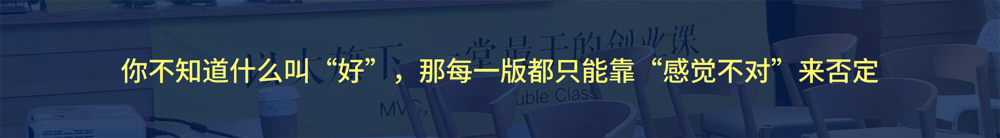

为什么先定尺子？这是我做工程交了无数学费换来的铁律：**先定验收，再开工。**

装修不先定验收标准，最后一定扯皮；软件不先定验收用例，最后一定返工。

写提示词也一样。**你不知道什么叫“好”，那每一版都只能靠“感觉不对”来否定**——而感觉，是所有标准里最不稳定的那一个。

这也是后来我在整个执行过程中，觉得方法论可以优化的部分，课程把“进行评估”放在12条优化策略的最后一位。而我的实践告诉我：**它应该排在第一位。**

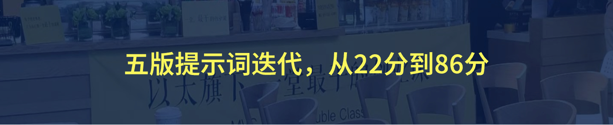

接下来，我用几轮提示词做实验，**我要比较的是：在这次实验里，逐步增加信息和约束后，输出发生了什么变化。**

**第一版，我故意模拟了我最早写提示词的真实形态，也是我们的经销商当下最常见的样子。**就一句话扔过去：

> “帮我写一段话，给客户介绍我们的产品，要专业一点，让客户能听懂，三分钟左右。”

这样的要求并非完全没有方向，但“专业”“听懂”都很宽泛，AI 不知道客户是谁、产品如何解决问题，也不知道怎样判断结果是否合格。

但AI还给我的，是“尊敬的客户您好，在当前数字化转型的大背景下……”——拿尺子一量，**22分**。

接下来，我没换模型、没换工具、没施任何魔法。我只做一件事：按照课程里的优化策略，一道一道地往里面加约束。

**第二版，**只做两件事：**把目标说清楚，把任务拆开**——“说出客户自己的处境，指出最疼的那一下，一句话说清怎么解决，给一个当场能验证的点，留一个他想追问的问题”。

这样一来，AI 不只是被要求“介绍产品”，而是要完成一个更明确的沟通任务。但AI给的答案——**41分**。

**第三版，**钉住“谁在说、怎么说”——**给角色，给语气**：“你是一个在制造业跑了十二年客户的经销商老板，四十多岁，说话直，不爱用书面语。你不是讲师，你是同行。”

角色设定单独使用并不会自动解决问题，但和任务、语气、目标一起提供时，可能会让输出更贴近需要。——输出从讲师腔变成了人话，**58分**。

**第四版，给结构化上下文**——把客户的行业、规模、他的原话、他最近的焦虑，一条一条列进去；再给一个“真实讲过、客户当场追问过”的标杆示例；把整段散文改成标签结构。

没有这些信息，模型只能根据常见模式想象客户情况，答案可能流畅，却未必准确——这一版，**76分**。

**第五版，整理输出结构和反例，**加了两样东西：反例——“出现‘赋能’‘抓手’‘闭环’任何一个词，整段作废重写”；再加一个自检评估器——让AI按那张六维表给自己打分，低于75分，自己重写。

——**86分，基本可用。**

| 版本 | 加上的约束 | 六维总分 | 致命问题 |
| --- | --- | --- | --- |
| V1 | 只有一句模糊目标 | 22 | 讲我们，不讲客户 |
| V2 | 明确目标、拆解任务、限定条件 | 41 | 场景是AI想象的 |
| V3 | 角色、能力、语气 | 58 | 没有可验证点，腔调还在 |
| V4 | 上下文、示例、标签结构、输出格式 | 76 | 像稿子，不像现场 |
| V5 | 词语强调、反例、评估器 | 86 | 个别行业仍需人工补背景 |

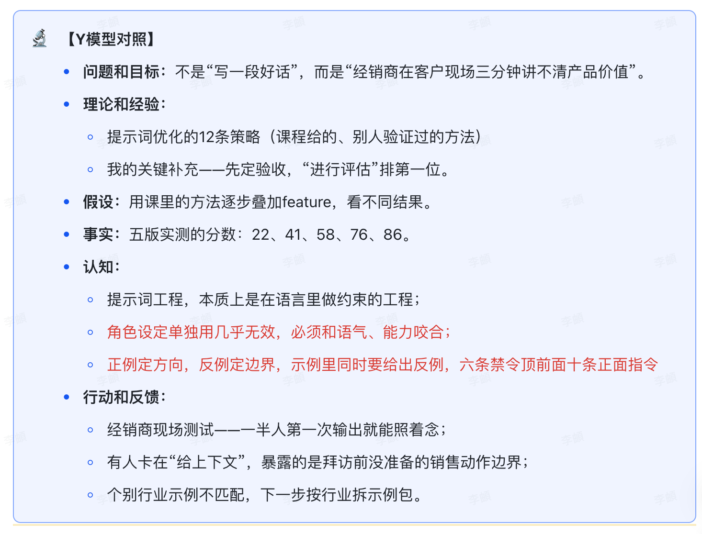

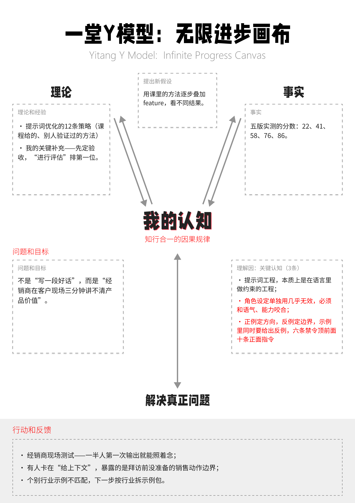

讲到这里，我要停下来做一个对比。

因为这是今天最重要的地方——**同样是我，同样一个AI，有意识和无意识，差别到底在哪。**

**如果我是无意识的，**我会怎么做？我会打开AI，写一句“帮我写段话介绍产品”，拿到一段看着还行的话，觉得“差不多能用”，发给经销商，结束。

结果是：经销商拿到一段正确但没用的话，该讲不清还是讲不清。而我甚至不知道自己错在哪——因为没有尺子，你连“错”都量不出来。

**如果我是有意识的，**我会先问自己：真正的问题是什么？不是“写一段好话”，是“经销商三分钟讲不清产品价值”。这个问题一换，尺子就有了：客户视角、具体性、可验证、无术语、下一步、时长。

然后每一版修改，都是可归因的——22分到41分，是因为目标清楚了；41分到58分，是因为角色和语气钉住了；58分到76分，是因为上下文和示例到位了；76分到86分，是因为加了反例和自检。

**同一件事，无意识给你一次结果；有意识给你一条可复现的曲线。**

这里还有一个我自己都**意外的收获。**

写到第四版的时候，我突然发现，我在写的提示词，跟我们正在干的本体工程，本质上是同一件事：

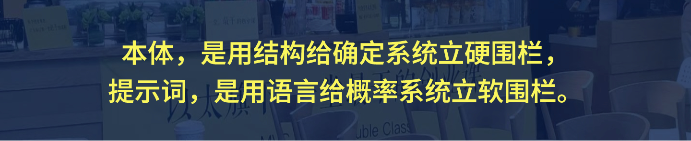

这就是**科学类比。**我把一个我已经研究得极透的理论——本体论，搬到了一个新场景里。忽然发现，我的提示词水平一下子拔高了很多。

这也是我今天想反复说的一句话：**你缺的往往不是新知识，而是把老知识搬个地方用的那一下。**

这份作业最后落地成了什么？不是一个“标准话术”。

标准话术是死的。经销商今天见制造业老板，明天见连锁餐饮，你给他一段固定的话，他念出来就是背课文。

我给经销商的，是一套**工程**——最后把它做成了一个**“动销话术Partner”**。

他怎么用？出门前，把今天要见的人是什么类型、什么行业、最近在愁什么，往里面一填；30秒，300字，一份贴着这个人说的话就出来了。

他不需要研究“我今天该说什么”。他只需要知道“我今天去见谁”。

最终，在真实的经销商身上测试发现：

- 一半人第一次输出就能照着念；
- 有人卡在“给上下文”，暴露的是拜访前没准备的销售动作边界；
- 个别行业示例不匹配，下一步按行业拆示例包。

你看，这就又给这个动销话术Partner的边界、迭代提出了新的方向。

这就是“有意识”和“无意识”在组织层面的差别：**不只是把个人手感说出来，还要把它变成能传递、能检验、能根据反馈修正的工作方式**。

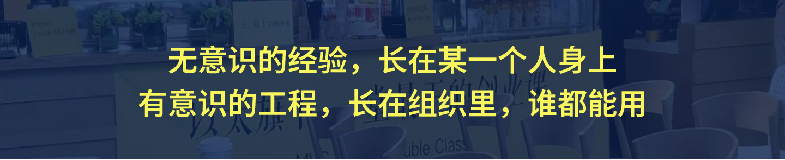

把一个人的手感，变成一套谁都能调用的工程——这才叫升级。

#### 案例2：1次结果到1组业务假设

第一个案例，是我们怎么把“讲清楚”这件事工程化。

第二个案例，尺度大一点：**我们怎么把一门不好卖的生意，重新定义了一遍。**

回到数族科技的第二阶段——臻企云。其中一类客户是金融机构，比如银行。银行要服务它的企业客户，需要企业经营数据做风控、做授信——我们的数据体系正好干这个。

听起来天作之合，对吧？

——但真实情况是：太难卖了。

难在哪？

银行是一个决策极其复杂的组织。一个信息系统的采购，要立项、要预算、要走流程、要过安全审查、要过合规审查，甚至交付时还有和原有内部系统对接。

就算是接触的第一时间，客户就认可服务价值，从接触到最终闭环也得**9个月**。

9个月是什么概念？

一个创业公司，干一个9个月才能回款的生意，现金流、团队士气、市场节奏，全被它拖住。

更要命的是，中间任何一个环节出一点岔子——一个人离职、一次组织调整、一轮预算冻结……结果大概率是前功尽弃。

说到这，我要坦白一个我自己的盲区。

我在一堂讲过**《领域专项：一堂五步法企业服务篇》**，这是一节方法论级别的课（建议没听过的同学、尤其是做ToB的同学务必选来听一听）。

课里有一条我自己贡献的、自认为执行得很到位的原则：

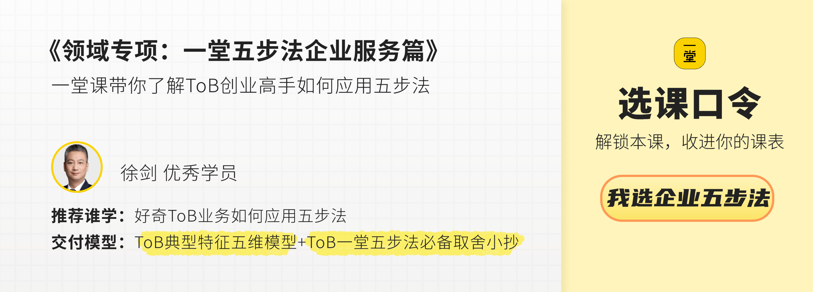

这个理论我有。我一直在用。

但我在臻企云这个业务里，用的方式是：**我只盯着“信息化系统”这一个预算科目。**

我天天想的是，怎么在这个科目里把预算占得多一点、把决策链跑得快一点。我曾经做到的最好结果，就是9个月。

我一度认为我的问题是“销售效率不高”。但其实就算把每个销售环节的效率都做到极致吧，6个月是客观上的极限。

后来，我发现的真正问题是：**我根本没有意识到，客户的预算，是分好几个抽屉的。**

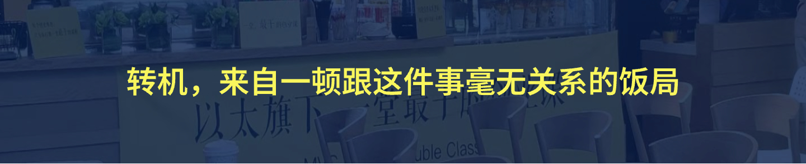

有一次我在北京出差，跟一个高中同学吃饭。他是做银行礼品生意的——就是你们逢年过节收到的那些银行送的杯子、伞、小家电。这个生意其实是个很大的产业。

吃这顿饭的初衷，联络感情当然是首要的，就算是归到业务上也特别朴素：相互介绍几个银行的领导，看看能不能帮彼此对接点商机。

你看，出发点还是老办法——找人、托关系。

但聊着聊着，我脑子里“咔”的一声。

他卖的东西跟我卖的，一个在天上，一个在地下：一个是杯子雨伞，一个是数据系统。但它们在最底层，共享同一个对象——银行；共享同一个机制——**银行的组织采购**。

而他的东西，为什么能进得那么快？因为礼品不立项、不进IT采购流程、不走安全审查——它走的是银行的**营销费用、客户关系费用**。

**预算科目不一样，决策链路完全不一样，速度快到以天计。**

这段对话并没有让我当场就得出“我们的产品也可以当礼品卖”的结论。一个业务能通过礼品渠道成交，不代表另一个产品也能复制。

它只是让我开始看到：银行可能有多个预算入口和组织流程；我们一直盯着的信息系统采购，可能不是唯一值得研究的路径。

回南京的高铁上，我一直在想这件事。这里可以把几件事分开：

- **理论：**To B要先占客户预算、要在预算对应的决策链上做功；不同采购目的可能对应不同的采购机制。
- **事实**：同学讲述的他接触的银行礼品业务和采购方式；
- **认知**：银行采购有不同预算路径，产品价值和决策流程需要一起考虑；原来我要把信息化系统卖给银行，而银行为什么买系统？因为他们要的本质上是**企业经营画像，我只要想办法把这个给到银行就行了。**
- **假设**：我们是不是可以不再做信息化项目，而是把企业经营画像通过一个更轻的合作方式卖给银行？

我再进一步解释一下，我们的假设在逻辑上可行的原因：

- 银行需要了解企业的经营情况数据，便于后续的授信和管理；
- 我们把面向企业的产品包装成礼品让银行采购，给企业使用；
- 企业免费用这个服务，在用的那一刻，数据授权顺手就完成了。

银行拿到了他要的企业画像，企业白得一份有价值的服务，我拿到了业务闭环。

注意，这是一个假设，不是结论。它需要验证。

而验证来得比我想象中的更快。

我从北京回到南京的当天下午，某银行的行长到我办公室来——她约了我很久，要做我们公司的授信业务。不出意外，她给我带了份伴手礼：他们行定制的保温杯，品牌挺好，价格不便宜。

我谢绝了。然后，颇有点煞风景地说了一段话：

> “杯子我这儿太多了，你看，柜子里光各家银行送的就有一排。这个杯子对我真没啥用，你也别花冤枉钱了。

> 但如果你送我一份跟我们企业经营有关的服务，那就不一样了——最坏的情况，是我不用，那跟你现在送我一个杯子我不用，结果是一样的；理想的情况是我用了，对我价值很大，对你价值更大。

> 你说，同等价位，该送什么？”

行长愣了一下，很快就当场决定：8个业务经理，每人开一个臻企云的代理商账号，预存一笔费用，生成给企业自用的账号送给企业，用完了，再充值。

9天后，第一笔款项到账。

**一个保温杯，变成了8个账号。9个月，变成了9天。**

这里面同样藏着一次**“科学类比”**，两层：

第一层——高端信用卡给个人送体检，天经地义；那给企业送体检，为什么不行？

第二层——“最坏情况对齐”。最坏无非跟你送我杯子一样，我不用；而剩下的，全是上行空间。

当一个人的收益下限，被抬到跟现状一样、而收益上限被打开的时候，这个决定不需要勇气，只需要算账。

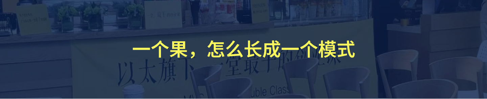

到这里，大家是不是觉着还挺有意思的？9个月变9天，而且似乎在银行这类客户群体中可以广泛复制了。

**但Y模型真正值钱的地方，恰恰是从这里才刚刚开始。**

因为，**9天这个果，马上变成了下一个因。**

这就是因果互换：向前归因，向后立目标。

向后，我问了自己几个问题：

> - 既然有一个机构愿意为企业经营服务付费或开放使用机会，哪些其他机构也可能有类似需求？

> - 不同机构的目标是否相同？

> - 它们是客户，还是也可能帮助产品触达企业？

我顺着这个因，重新抽象了三层认知：

- **第一层，需求的本质。**这些机构，不管是银行、政府还是龙头企业，为什么愿意花钱买我的东西？本质只有一个：**它需要掌握它覆盖的那些企业的真实经营情况。**不是要一套软件，是要一张画像。
- **第二层，实现路径。**拿数据的本质，是企业授权。而授权这个动作，可以在机构的系统端发生，也可以在“企业直接使用一份服务”的那一刻发生。
- **第三层，预算出口。**机构的预算不只是一个抽屉，是好几个抽屉，每个抽屉的决策链长度完全不同。你选哪个抽屉，决定了你是9个月，还是9天。再往上抽象一层，本质上，这是把需要复杂决策的一笔大预算拆成了简单算账的多笔小预算。那么，我又形成一个新的假设，站在另外一端，如果把机构的一笔大预算转变为多家中小微企业的小预算，在产品很能打的前提下，是不是也同样成立？

重新抽象之后，这件事就不再是“卖给银行一个礼品”了。它变成了一个模式：

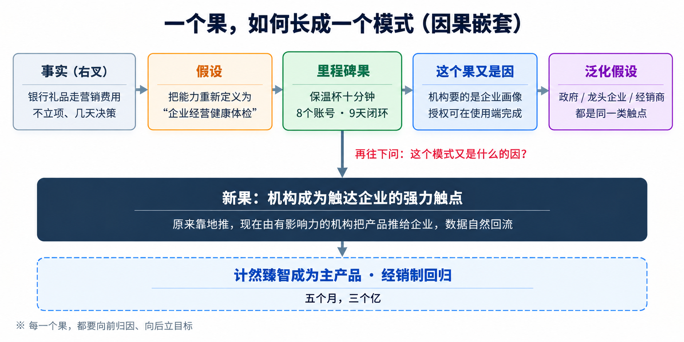

于是我们做了三件事：

- **第一，把机构当成渠道，而不只是客户。**银行、政府、龙头企业，它们对企业有真实的影响力，它们把产品推给关联的中小微企业，企业用起来，数据自然回流。
- **第二，把付费方解放出来。**不一定是机构付钱。尤其是龙头企业，完全有条件不需要为自己的诉求（比如应对穿透式监管）直接付费——推动它的上下游关联企业直接付一笔小钱订阅我们的服务就行。谁得到更大的价值，谁付钱。
- **第三，全面定义中小微企业作为用户的AI产品。**当下对企业侧产生直接价值的，是我们的数据系统可以帮他们在资源控制方那儿证明自己；但从未来看，只要产品能力重构到可以帮中小微企业提升自己的经营管理水平，就能更加全面的帮助他们更好的“省钱”“赚钱”“找钱”。这一步，直接推动我们进入了业务发展的第三个阶段。

**大家发现没有，案例一和案例二，在这里接上了。**

- 案例一解决的是“前端怎么讲清楚”；
- 案例二解决的是“后端模式怎么改”。

一个是嘴上的工程，一个是账上的结构。

合起来，就是一个完整的因果链。

结果呢？

2026年5月19日，我们正式发布“计然臻智”产品，到今天，**五个月的时间，营收三个亿。公司估值，半年涨了六倍。**

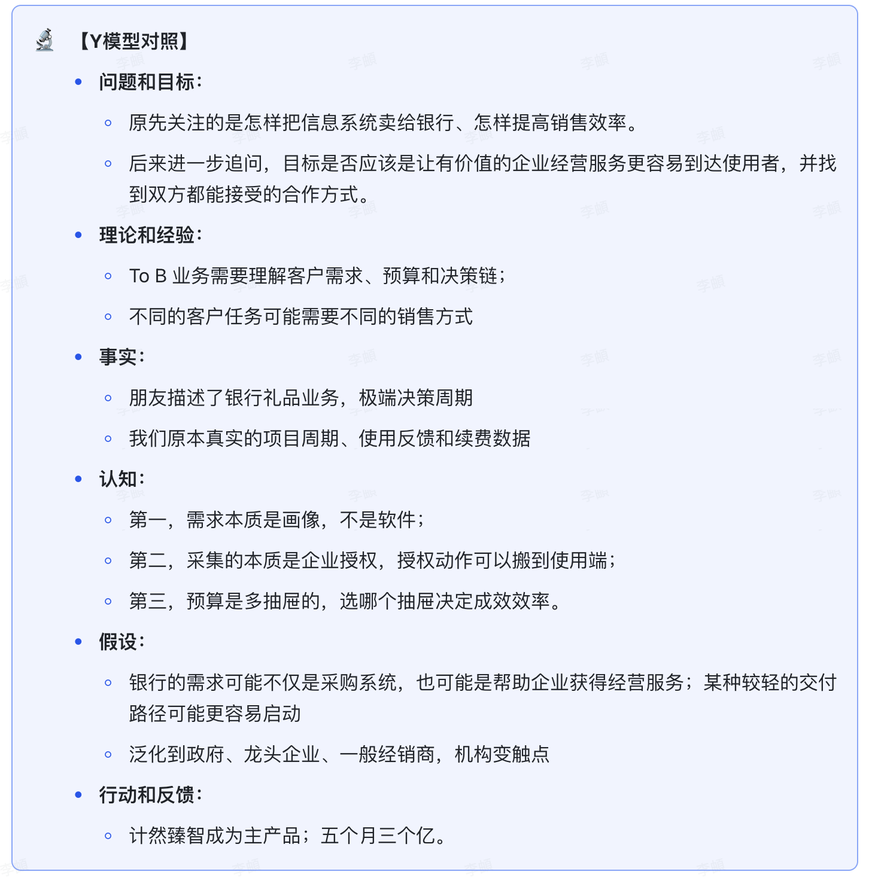

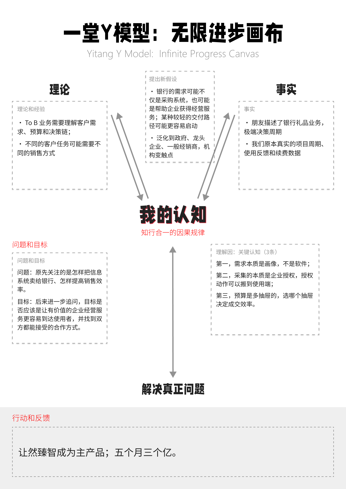

如果，我还是“无意识”，会停在哪？

这一段，是我今天最想让你们记住的对比。

**无意识版本：**我靠一个灵光一现，把某个银行客户拿下来了。很厉害，很爽。然后呢？

然后我会把它当成一个“销售技巧”，讲给团队听：下次见到行长，跟他聊聊他的礼品。**它能解决一个银行，甚至一类银行。但它只会停留在销售模式。**

因为我根本说不清我刚才做对了什么——是预算科目？是决策链？是重新定义产品？还是那个“最坏情况对齐”的话术？说不清，就复制不了，也无法教给别人。

**有意识版本：**我知道自己动了哪一格。我知道右叉补进来的是一个“预算抽屉”的事实，我知道我改的是“认知”而不是“问题”，我知道这个果要向后立下一层目标。

所以我敢往下推三步：泛化客户类型、换付费方、换主产品。

如果验证失败，我们能回头看是需求假设、付费路径、产品价值还是执行方式需要调整。

当然，最终的结果是，三步都推出来了，才有营收的三个亿、才有估值上涨的70多个亿。

**一个灵光一现，和一个模式之间，隔着的就是Y模型。**

我不会说“无意识只能解决一个客户，有意识就一定带来一个新模式”，但更准确地说，有意识建模给了我们一套继续追问和组织验证的方式，让一次成功有机会成为下一轮业务探索的起点。

这就是“10倍差距”的真实来源。不是有意识的人更聪明，是他把一次偶然，变成了一条可以反复跑的因果链。

### 写在最后：给大家的建议

讲到这里，我要回到又一个同学们更经常问我的问题：AI都这么强了，理论事实都是唾手可得，给出来的逻辑链也越来越清晰，我们为什么还要自己练Y模型？

我的理解是，AI 越能参与工作，人越需要知道自己在解决什么问题、给它什么事实、用什么标准判断输出，以及现实结果是否支持这个判断。

AI 可以帮我们处理信息、提出候选方案，但它给出的内容仍可能遗漏条件、混淆事实和推断，或者把不适用的方法说得很确定。

#### AI越强，人越要保住自己的下限

所以，我要送给大家的第一句话，也是我的答案：

AI在“知识”这件事上太擅长了，但在“判断”这件事上不太靠谱。

它是概率系统，它只会把你拖向平均水平。

你让它写方案，它给你“最像方案的东西”；你让它做判断，它给你“最像多数人判断的判断”。

而商业世界里，恰恰是那个“不像多数人”的判断，才有超额收益。

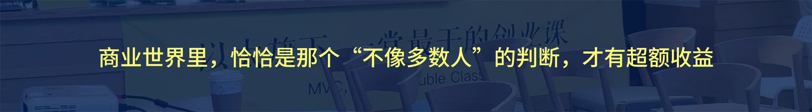

一堂的《重新理解「一堂双三角」》课里有一句话，我印象极深：**双三角决定人和人之间AI能力的代际差。**

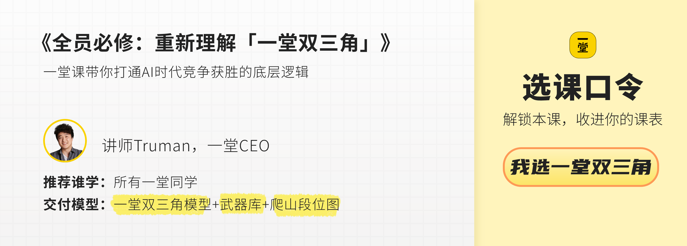

人类三角是审美、体系、创造力；AI三角是数据、场景、基本功。

而审美，换个说法就是判断力，我更愿意把“判断力”理解为：**在信息不完整时，界定问题、识别关键事实和条件、选择行动，并根据反馈调整的能力。**可能说的更直白一些，就是同一件事值不值得做、为谁做、做到什么程度、卖什么价。

**无论从伦理角度，还是从价值角度，这是人类唯一不能让渡给AI的部分。**

#### Y模型就是判断力最好的训练器

判断力这个东西看不见摸不着，怎么练？

我送给大家的第二句话，也是我对这个问题的答案：

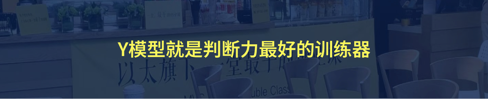

判断力高的人，脑子里装着更多、更准的因果结构。Y模型的每一次练习，都是在给脑子里装一根新的因果梁。

三个抓手，都很具体：

**第一，把能力长在底层，不要长在工作层。**

经验、流程和 SOP 在稳定环境里很有用；环境一变，我们还需要理解它为什么有效、适用于什么条件。能界定问题、找事实、提出假设并验证，通常比只记一条操作顺序更有机会迁移到新场景。

长在工作层，行业一换，技能清零；长在“怎么定义问题、怎么找规律、怎么验证假设”上，换十个行业都带得走。

**第二，接触任何一条信息，先问一句：这是理论，还是事实？**

别人总结的经验可能是理论，也可能只是个人观点；自己看到的数据是事实的一部分，但不一定完整；由这些材料得出的结论则是判断。把三者区分开来，能减少把猜测当事实、把经验当规律的情况。

该调用事实的时候不空谈理论，该本质思考的时候不堆砌事实。这个分类动作本身，就是每天的Y模型训练。

**第三，用AI练判断，不要用AI替判断。**

可以让 AI 整理资料、生成不同方案、按标准自查，也可以让它指出可能遗漏的条件。但关键事实要核对，评价标准要和真实目标一致，最后是否采用以及如何验证，仍需要人承担责任。

就像我的第一个案例那样：让AI分东西、给尺子、做自检；最后定验收、拍板“这版行不行”的，永远是我自己。

**AI是你的思考镜像，不是你的思考替身。**

你交给AI的越多，你自己身上剩下的那部分，就越要是判断力。

#### 回应开场的三个问题

好，一个小时，我讲了两件事，一个内核，一个答案。

内核是：**Y模型，是把你的“科学”，从“无意识”变成“有意识”最有效的训练器。**

今天我讲了两段实践：

- 第一段是我怎么把写提示词从凭感觉，推进到有目标、有标准、有反馈的过程，从无意识到有意识，同一件事，从22分到86分，质量连跳四级。
- 第二段是我怎么从一条具体业务结果出发，继续追问事实、判断和新的业务假设，无意识做对了一次快速销售，有意识把业务变成了一个新范式，最后走到五个月三个亿。

这些故事里有一些可以观察的变化：**把问题说得更具体，把依据和推断分开，提出可以验证的判断，再把行动结果放回来更新。**

最后，回到开场那三个问题，我们再走一遍：
1. 第一个，曾经做成过的某件事，你说得清自己做对了什么吗？
2. 第二个，类似的事再来一次，这套做法还管用吗？失效时你知道原因吗？
3. 第三个，遇到没做过的事，你知道先从哪里入手、怎样边做边调整吗？

如果你现在，能比开场时多答出哪怕一个——这一小时，你就没白听，我也没白讲。

而这三个问题，背后指向的，仍然是同一个问题：**你追不追求，持续提高成事的概率？**

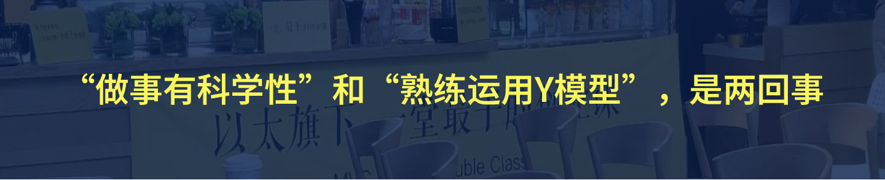

大家一定要分清楚两件事：**“做事有科学性”和“熟练运用Y模型”，是两回事。**

- 你可能无意识地做对过很多事——这时候你有的只是"一次结果"
- 但有意识地用Y模型，**你得到的是一套能追问原因、安排下一步、根据反馈更新的办法。**

Y模型的独特贡献就在这里：它把原本零散、时用时不用的科学动作，放进了同一套可调用的框架里。尤其在以下三种时刻，它的价值会特别凸显：
1. **遇到不熟悉的问题时**——你不知道该从哪儿下手，Y模型帮你把问题拆成理论、事实、认知三个格子，逼着你从已知的东西开始搭；
2. **原办法失灵时**——过去管用的套路不管用了，Y模型帮你检查是理论一叉错了（规律不适用了），还是事实一叉变了（环境改了），还是认知该更新了；
3. **需要带别人一起做时**——你自己能成，但说不清，别人就学不会。Y模型把你脑子里的隐性动作显性化，让它可以被传递、被检查、被共同改进。

Y模型让这些动作变得**可察觉、可检查、可主动调用。**

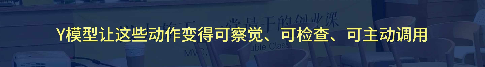

——这就是"有意识"和"无意识"最本质的差别。

它不让你的成事变成运气，不让你的努力变成玄学。它让你每一次做对都能追问一句“为什么”，每一次做砸都能修正一格判断，每一次面对未知，都有一套可调用的脚手架。

这也是为什么，我把今天的主题定为——**把无意识的科学，变成有意识的科学。**

**科学从不辜负相信因果的人。它不依赖运气，只依赖时间。**

最后，给你留一件今晚就能做的小事，也是今天这节课的作业之一：

**今晚的作业：写一张“我的无意识科学清单”。**

列出三件你做成过、但一直说不清自己是怎么做成的事。然后给每一件，试着写出左叉是什么，右叉是什么，认知是什么，回到现实又是什么。

你写出来的那一刻，就是你的第一次“有意识”。

谢谢大家，欢迎大家和我多多交流~

下面把麦克风交给莫非老师~