## 莫非：从凭感觉带人，到科学地修炼领导力

### 开始上课

大家好吖，我是莫非。

我在2021年加入一堂学习，目前加入一堂59个月，学分是1845，合伙人指数2234。已经看到直播间里有很多老朋友啦，也有很多新朋友第一次见~

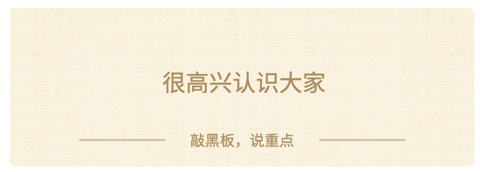

现场应该很多都是老朋友了，下面是我的个人介绍，就不仔细给大家读啦，有兴趣的同学可以再了解一下。
> 1. ICF认证PCC教练
> 2. 前WPP、京东集团某BU总经理
> 3. 企业教练时数超5000小时
> 4. ICF台湾教练协会联合创始人

作为从2006年开始，到美国接受系统性的教练培训，同时拿到ICF的PCC认证，到今年正好20年的一名资深教练。做过京东、凯度、WPP 的高管，带过团队，也做过大量团队教练与一对一教练。

这么长的时间我观察下来，发现大家对教练有很多误解，觉得教练有点玄乎，很难讲清楚；但其实教练是可以科学的一种能力，也是一种提升领导力的必经之路。

所以从我过去辅导超过100个团队，总计5000小时以上刻意练习的教练经验，今天晚上就斗胆来跟大家交流一下我们怎么从学会用工具，到科学地把领导力长在自己身上，变成解决真实问题的一种能力。

**【预告一下💡】**今天晚上就讲三个点，从我们为什么总是容易吵架一个特别特别小的点，到你带那么几个下属，带你的减一，怎么带？然后再后面就是你怎么形成大面积的领导力？

### 预热思考题

正式开始前，我也给大家几个思考题：

**第一个题目：共识回忆题。**

回想最近自己参加过的一次会议，散会时大家都点头，但大家到底定下了什么共识，你能一句话说清吗？

**第二个题目：领导力定义题。**

在MBA专属课里，我们有一个"领导力探索营"，课里我们又给领导力做一个定义。但是假设你没有听过，你理解的领导力是什么？是人格魅力？是业务能力？还是什么？你能用一句话说清吗？

**第三个题目：方法工具落地题。**

大家在工作、生活中学了很多工具方法，结果用到自己的业务或生活场景里好像总是差口气，你有没有过这样的经验？为什么呢？

这几个问题，都和我今天要讲的几件事有非常大的关系。

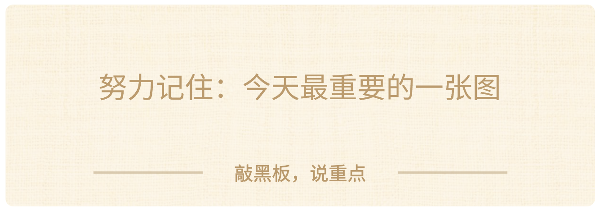

这张图大家都见过啦，今晚不细讲，但我们会不断回到它上面；你记不记都行，今晚我们大概会回来五六次

**但是用它来看领导力和不用它来看领导力，你会发现自己的心态会完全不同。**

想知道为什么，请大家努力跟着我听到最后。

### 一、冲突的开始：观点还是事实？

开始之前，先跟大家汇报一下这次我参加完MBA山顶营之后最大的收获啊。

这次山顶营是我第一次大规模的见到，有那么多同学在短短24小时之内，被Y模型打通之后出现的那种爽感和通透感，好像一下子就打通了学习一堂和做业务解决问题的任督二脉一样。

我自己最大的收获就是一句话：

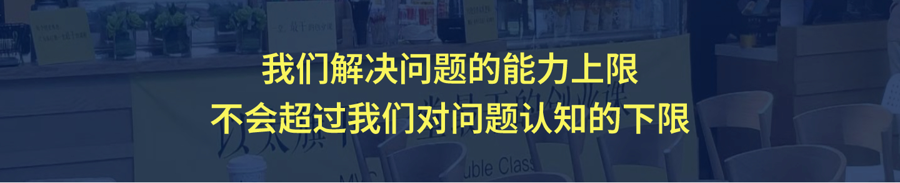

最最简单而又每天出现在我们日常业务场景里的，就是关于事实和观点的认知。

#### 如何区分事实和观点

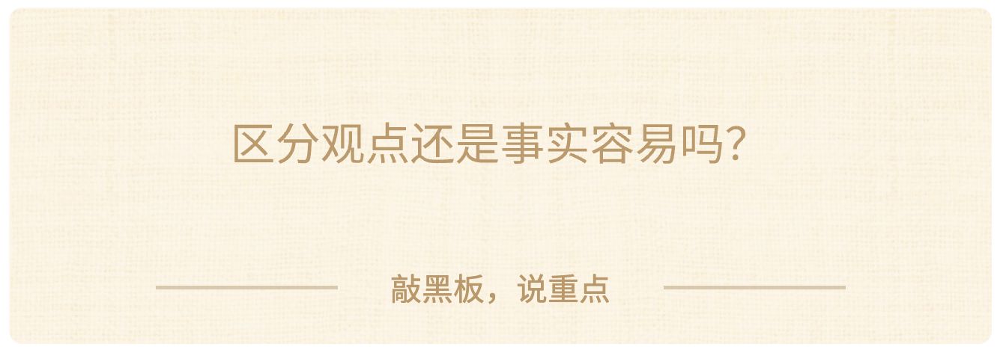

先问大家一个问题啊，你们觉得什么算事实、什么算观点，好不好区分？难吗？

如果这个事都区分不好，你们后面再做重大决策，就很容易吵架，很容易分歧。不管是决策质量还是决策速度，是不是都会受到很大的影响？

区分什么是事实，什么是观点，这件事大家是不是觉得很小，挺简单的？

你们过去有真的刻意练习过吗？

————

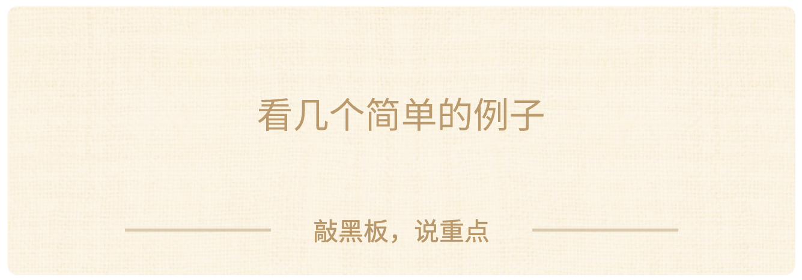

下面咱们来看几个简单的例子，热热脑子。

为了这次的分享，我写到第三版的稿子，然后跟教研碰了一下，然后教研第一句话就说：「这版做得不行」。

**【互动🙋🏻‍♀️】**你们觉得这是事实还是观点？

————

「这版做得不行」这句话是个判断、是个结论，但是支持判断支持结论的事实被省略掉了，你就会发现如果略过了事实谈观点，甚至直接给结论，大家吵架的概率就被无限提高，甚至可能被升级到人身攻击去了，这还怎么讨论事情呢？

大概率接下来就不是磨课，而是磨人了，哈哈。

某一次教练式领导力训战营培训结束，晓莉跟我说：「莫非老师你太棒了，学员都感觉收获很大，NPS满意度都超过9.0了！」

**【互动🙋🏻‍♀️】**你们觉得这是事实还是观点？

————

听着是挺爽挺开心的，但是对于后续的教学有什么实质性的帮助呢？

晓莉的后半句定义了指标、定义了参考系，所以是事实，是可以证伪的；但是她的前半句是个人观点。还要再追问下：**我们到底图的是不是NPS这个指标？**

**如果是，9.0是跟过去的领导力训战营比？还是跟所有的训战营比？还是跟一堂所有课程的NPS比？**

事实是事实，观点是观点，我们得把它分开。

有了事实，我们再去讨论观点，事实不清的情况下，不要老瞎讨论观点，事实可以证伪，但观点不行，它是用来在事实的基础上做讨论的，没有事实为基础的观点讨论，很容易就打起来了。

不信，你们再看看下面的例子。

儿子准备要上初中了，有一次老婆突然跟我说：「儿子要上哪个初中这个事情弄的我有点紧张，晚上都没办法睡觉了」。

我回答：「上哪儿都行，这有什么好焦虑的？」

老婆生气的瞪着我说：「我是紧张，不是焦虑！你到底有没有在听我说话！！？？」

你们觉得我为什么被骂了？

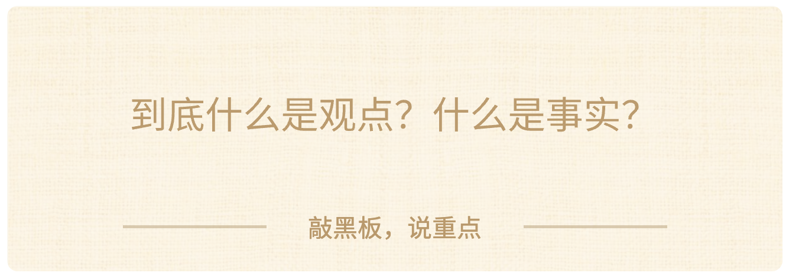

所以什么是事实？什么是观点呢？

**【划重点💡】**这里给大家一个参考定义：

- **事实**＝相对客观、稳定、可衡量甚至可验证的事件或描述；
- **观点**＝带有人自己隐藏的立场或假设，对于事实所做的解读。

**事实与观点之间没有对错**——不是「你说错了」，是两边没有意识到差异、也没把心里那层假设讲出来，所以观点才谈不下去。

**【划重点💡】**一般我们在教练式沟通的时候，大概有三个简单的原则：

① 只听事实部分，观点部分不必较真；

② 一句判断要拆出三样东西——指标、参考系、可证伪性，三样齐了才算事实；

③ **事实不清的时候不要讨论观点**，事实要去伪存真。

**事实要保证真，观点可以争。**

接下来我们做一个小的动作，看看哪些是事实，哪些是观点甚至判断：

> 领导力案例

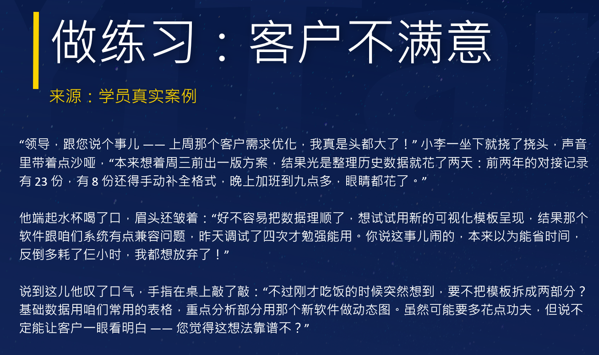

来！小小练习一下，这里面哪些是事实？

好，那么哪些是他自己的观点呢？

#### 回到Y模型：实事求是是起点

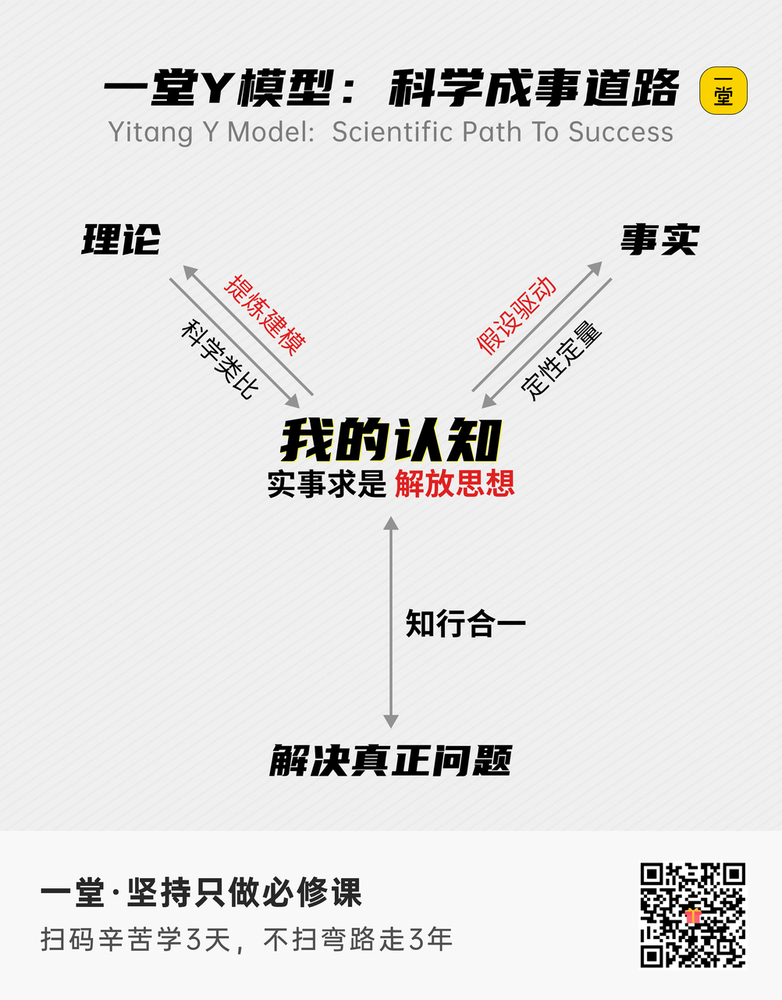

大家觉得，到底事实和观点的本质是什么？

本质上其实是你理解你这个信息，它在Y模型的哪一叉上。

**只有剥离清楚了事实跟观点的区别，我们才知道哪些要去调研、哪些是个人的假设、哪些需要要做实验**。

回到Y模型那张图上。你去判断这句话是事实还是观点，判完还不算完，还要再问一句：**它落在图上的哪一叉？**

**你要说这是事实，**它就落在最右边那一叉——调研那一叉，定性定量那一叉。事实得保证真，所以它只能去调研、去证伪，去伪存真。

**你要说「我有一个假设」**，它就落在假设那一叉。假设没法分真假，假设只能分它对结构影响的概率和好坏，那就拿实验去验。

**你要说「这事背后其实就是一个 ROI」**，那更像左边科学类比、理论那一叉——你在讲一套逻辑，那我们就得聊它的边界。

所以剥离这件事很重要，我们不能全混到一团。哪些事是要调研的？哪些事是要做实验的？哪些事只是聊边界的？只有把它剥离清楚了，咱们才能往下聊，才有机会谈共识。

### 二、领导团队的痛点：团队共识

先问大家一个问题啊，你们觉得团队共识重要吗？为什么？

**什么是团队？什么又是共识？**

团队就是为了共同达成目标所形成的组织，没有目标，就只是个兴趣爱好团体。

那么“共识”，就是团队成型的最小集合。

没有共识，你带领一群人做事就会格外费劲。

好的，那问题来了，**在你过去的经验里，带领团队达成共识容易吗？**

#### 团队达成共识难在什么地方？

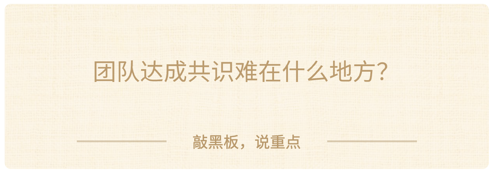

依据过去大家自己的经历和经验，你们觉得团队要达成共识，最困难的地方在哪里？

通常，一对一能沟通，我们能一句话一句话拆观点和事实，但是一进会议室就不灵了——会上不是两个人在说话，是一群人在同时输出判断，而且没有人会说「这是我的观点」，更没有人会说「这是我的假设」。

怎么整？是不是干脆就不要共识了？

岔开来问大家一句啊，你们认为有领导力的人和缺乏领导力的人，在达成团队共识上有什么区别？

或者说，领导力段位不同的人，在达成团队共识上可能有什么不同？

我给大家举个例子啊，来自于几年前我服务的一个客户的案例，有些敏感，还请大家帮忙保密好不？

不然下次分享我就不太好再拿以前的案例给大家学习了哈，感谢！

事情的开头并不复杂，甚至有些同学说不定还会感到有种莫名的熟悉。

这个客户是全球Top3的润滑油品牌，他们内部有个事业部专门负责品牌消费者运营的工作。

比大家熟悉的私域运营又复杂一点，既要跟外面的线上线下渠道合作，也要跟品牌、市场部、甚至IT部门合作，同时兼顾公域和私域的消费者关系提升。

内部又有自媒体运营、小程序运营、会员权益体系、活动策划、礼品供应链等等不同的部门。

问题来了，他们要跟总部汇报在中国这个国际互联网渗透率最高的国家，是怎么通过消费者运营来提高品牌和销售成绩的？

你们觉得呢？难吗？

两年时间，CMO换了两任了，这个问题还在那里。

正好当时我服务的公司作为他们消费者运营的小程序技术与活动策划合作方。

我们公司的CEO以前是我的团队教练客户，找我做过很多次的策略共识工作坊，于是这个事情就找到我这里来了。

这个合作最后，他们把事业部里关键的部门负责人召集在一起，在我们的支持之下开了四个小时的会议，解决了这个老大难，在Q3的年度战略汇报上获得了总部CMO的支持，还进一步增加了隔年的预算支持。

我们CEO也很支持这个客户，只收了7.5W的友情价。

想知道我怎么做的嘛？举个手？

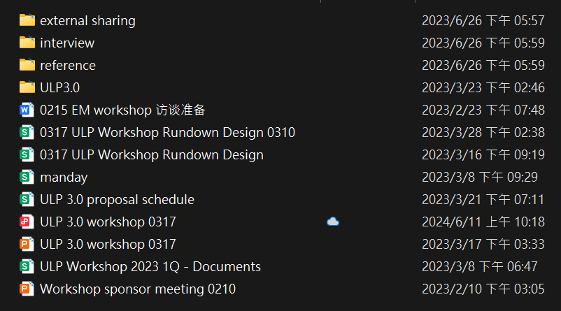

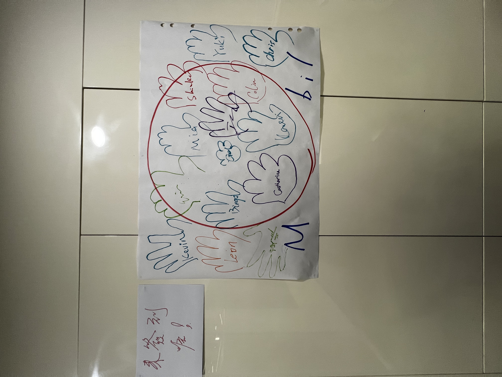

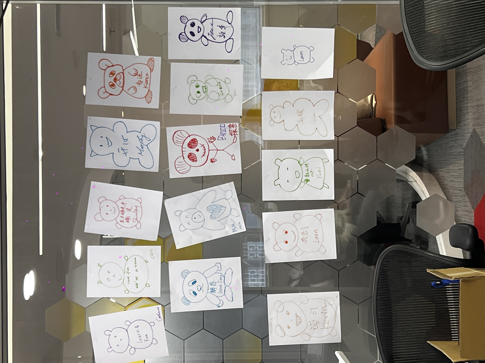

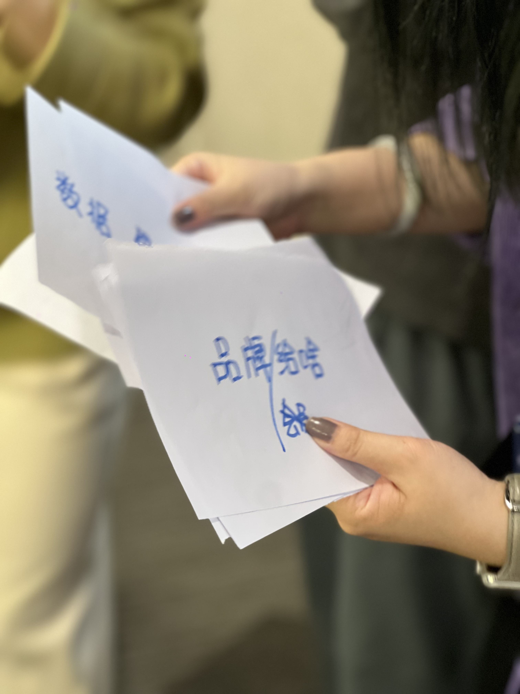

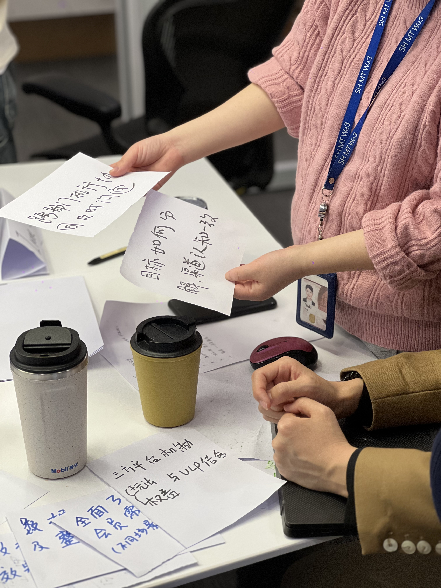

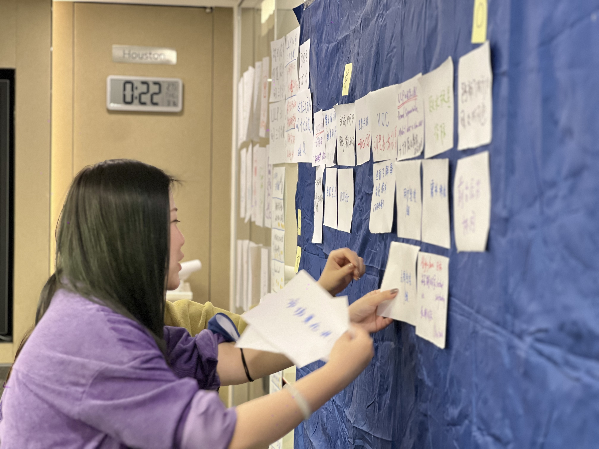

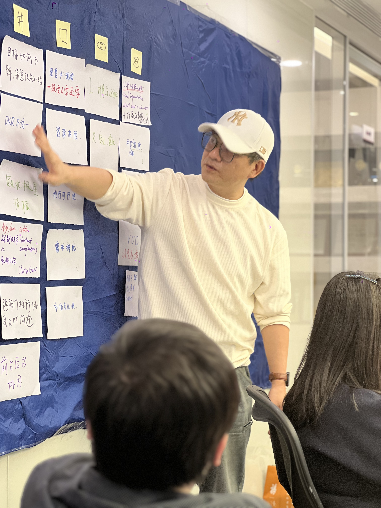

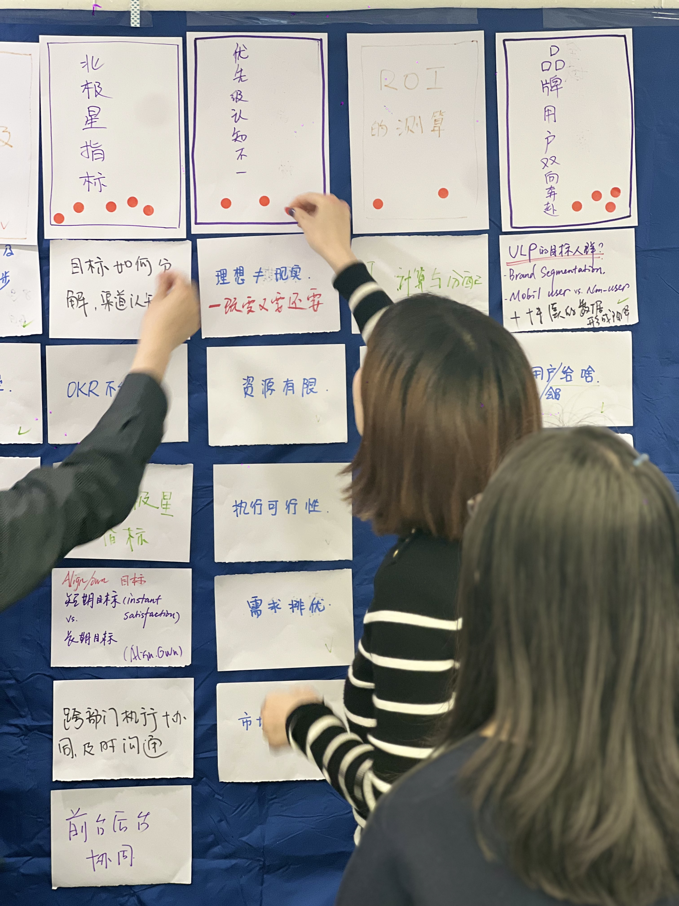

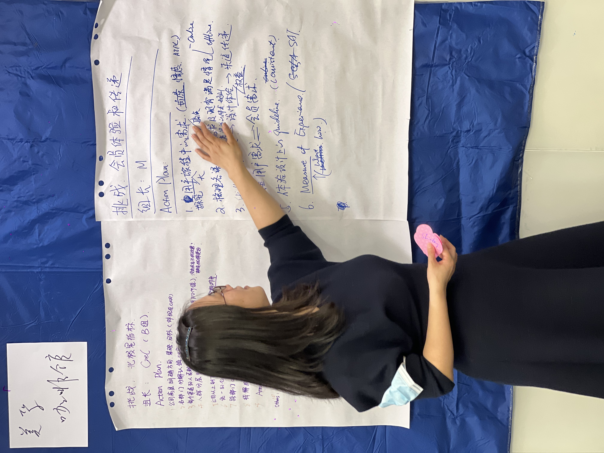

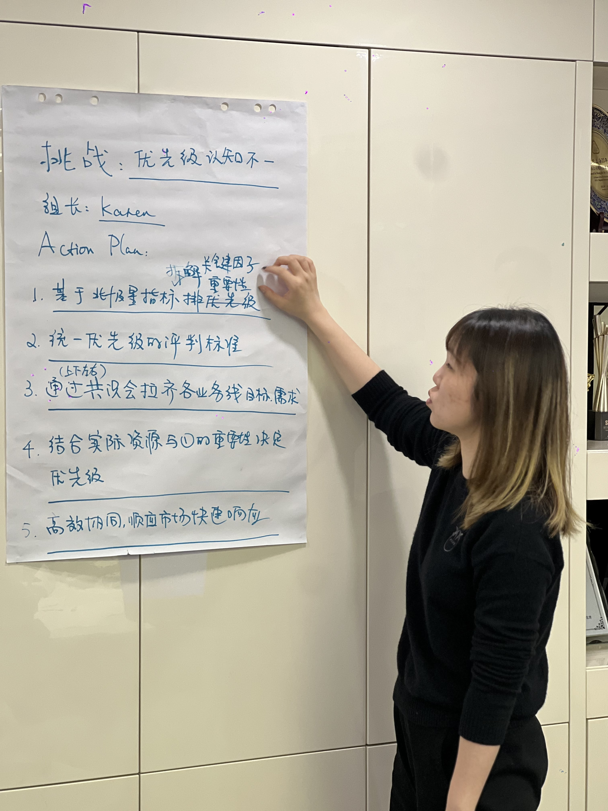

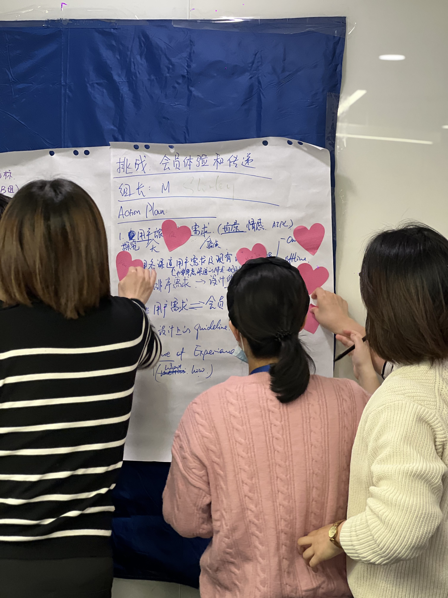

#### 团队教练的五步法

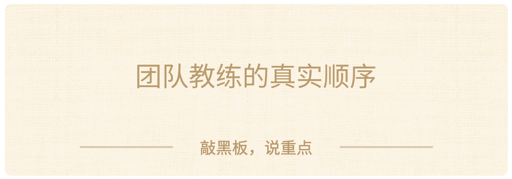

我们不做太多的延伸或是教学啊，就简单的跟大家汇报一下我这种工作，其实总结起来就是五个步骤：
1. **第一步——与 sponsor 对齐：这次要达成的长期目标是什么；**

1. 框定范围：这次谈什么、不谈什么；
2. 界定结果：谈完之后要拿出一个什么决定；
3. 目标再减一层：把"目标"压到这次会议真能承载的颗粒度；
4. **第二步——访谈利害相关人：定性 + 定量，**

1. 有时全访谈，有时抽样，了解他们对目标和问题的真实看法、以及客观事实是什么；
2. **第三步——带着偏差与 sponsor 再收敛一次范围、问题、目标**；然后才开始设计会议流程——因为这时才知道该讨论什么、怎么讨论、需要拿到什么结果、需要什么组织配套。
3. **第四步——举办共识会议**

1. 会议目标与范围
2. 事实基础
3. 关键假设观点讨论
4. 解决方案（从加法到减法）
5. 最后共识与行动计划
6. **第五步——复盘并撰写组织沉淀报告**

**事实上，光是前三步就花掉了我们80%时间，真正开会那天，只是把前面想清楚的东西摆到桌面上，开始对话**。而大多数人做的，是跳过前三步直接开会。

#### 回到Y模型：团队教练核心就是STEPS

讲到这儿，我得把"共识"这件事翻出来说一下，因为上面两条链最后都要落到它身上。

我在团队教练里干的活，核心就五步。

这五步听着像流程，其实是共识一层一层落下来的顺序。

**第一层，共识范围。**大家连"今天聊哪一块"都不共识，后面全是白聊。

**第二层，共识目标。**范围一样、目标不一样，那就是一边开会一边各算自己的账。

**第三层，共识事实。**这一层最难，因为大部分人上来讲的不是事实，是自己的判断。

**第四层，共识怎么定。**谁来定、按什么定、定不了怎么办——不谈清楚，会开完也没有结论。

**第五层，才是共识认知的复盘：**我们对这件事的理解，到底哪些有效、哪些被证伪了？把他们沉淀萃取作为后续的组织资产。

你会发现，这五层跟我上面讲的正好对上。范围不清，是范围没共识；

目标不对齐，是目标没共识；目标跟你或团队没关系，是我们跟团队的现况认知没共识。

所以共识不是会上磨出来的。它是这五层一层层给下来的；

会上只做最后那一下解决问题的发散和收敛，再落地行动共识。

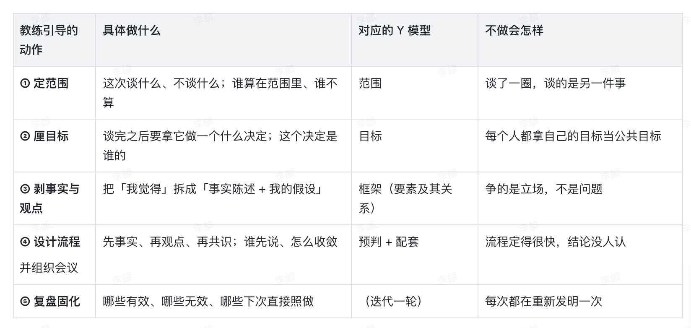

现在我们再看这五步，跟Y模型的STEPS策略集的关系。你会发现，它们基本就是一回事。

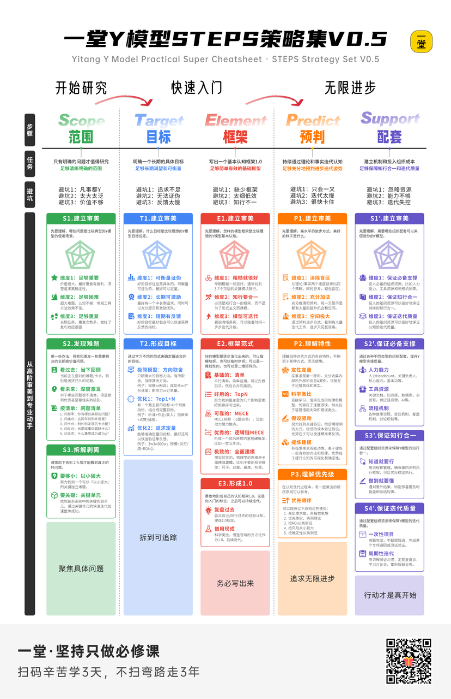

### 三、长期成事的必经之路：修炼领导力

这一段开始之前，我想问问大家：领导力，对你重要吗？是你的长期追求吗？

你觉得领导力是什么？想提升领导力，难吗？

#### 领导力是可以修炼的吗？

你去问十个人什么是领导力，八个会给你抽象词：**影响力、人格魅力、气场**。

你听到「这个人有气场」，你能拿它去做什么？

你听到「格局要大」，你明天早上起来，第一步做什么？

人格魅力听着像天生的，一想到要练，人就先泄气了——你总不能说，积累人格魅力，从穿好看衣服开始。

还不如直接选择砍掉重练吧，开个玩笑。

所以当去年我跟Truman，在磨教练式领导力这堂课的时候，这就成为阻碍在我们前面的第一道巨大的山。

**【互动🙋🏻‍♀️】**哪一种领导力你觉得有希望去挑战？
1. 个人禀赋（一个人在中间然后有层层光芒外扩）
2. 领导力的五角星雷达图
3. 领导力的爬山或段位图

#### 一堂的教练式领导力是怎么来的

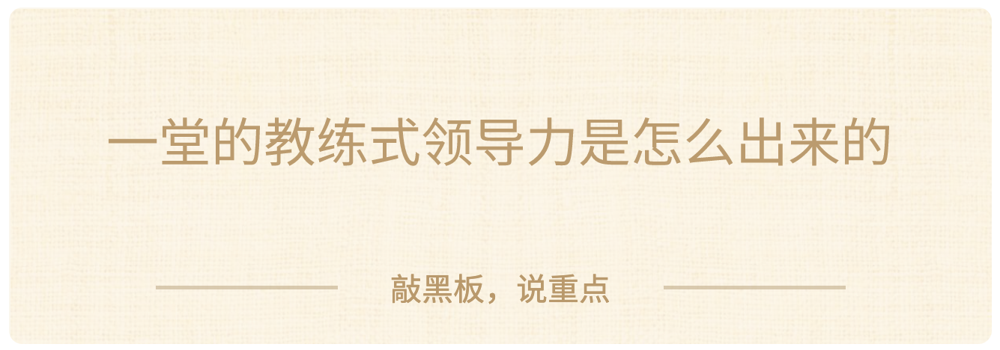

**一堂其实做了两件事，一件事叫科研，一个叫科普。**

科研解决的问题是它尽量科学，科普解决的问题是大家能一起讨论，科学形成共同体之后，才能发挥价值，才能改造世界嘛，光认识世界是不够的。

这件事，就是我在去年跟一堂做“教练式领导力”磨课的时候，领悟到的。

磨课当时，其实市场上不缺领导力的定义，缺的是一套上千人能坐在一起讨论的工作方法；**定义之所以要重新写，不是为了更准，是为了让它能被讨论、能被验证、能被练。**

当时我们大概花了几个小时的时间，包含路禹事前做了大量的调研，把全世界的领导力理论和论文书籍都调研了一圈，发现都没有一个统一的定义。

经过十几轮的讨论，我们从调研、理论模型和我与Truman过去自己的实践经验，总结验证出了今天大家在教练式领导力课程上大家看到的那句话：领导力就是

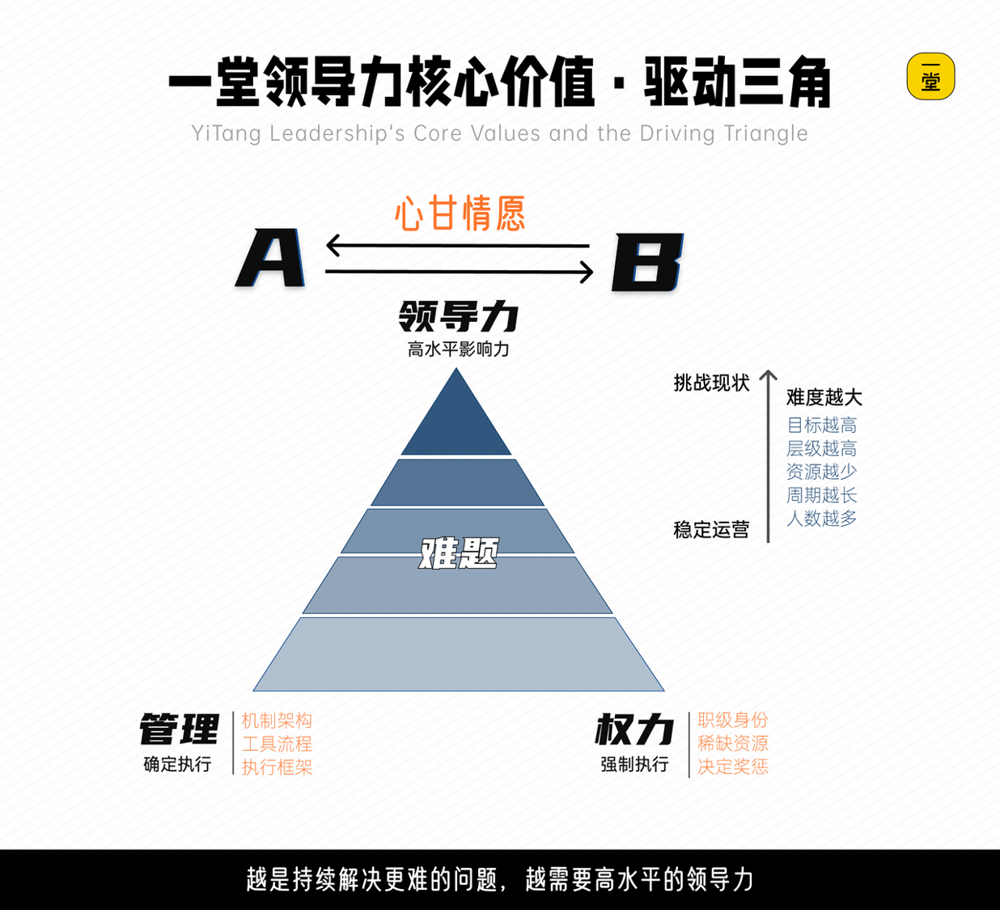

**在这里，最重要的是，我们把领导力的本质定义为一种能力**

领导力不是人格魅力，跟管理或权力用来驱使他人做事的方式不同，它是**信任的积累与消耗**。

人格魅力不可定义、不可拆解、不可训练——练到死也练不出来；那怎么办？去投胎吗？

这些都不是错，但它们没法讨论、没法实验

而信任是可以观察、可以记录、可以归因、可以练习的。

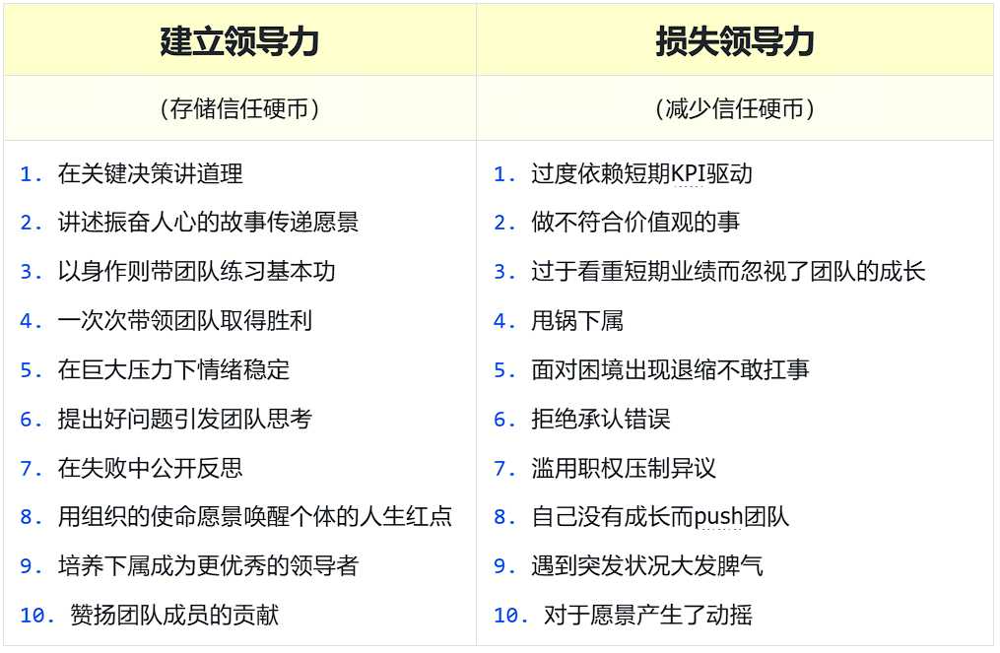

**领导他人，心甘情愿，解决难题。**

这句话里最要紧的是「心甘情愿」四个字。你靠职权也能让别人干活，那不算；别人是不情愿地干、还是心甘情愿地跟，这里面差的就是你攒了多少信任的硬币。

然后，我们就有机会开始学习、开始练习、开始进步了。

**定义给完，接下来是：它凭什么能积累？**

最底层其实特别简单，就是两枚硬币——攒一枚，掉一枚。

但只讲这个太抽象了，你听完还是不知道该干什么。所以当年把它展开了，展开成五层：

- 第一层，认同。他先认你这个人，愿意跟你干。没有这一层，后面全都是空转。
- 第二层，打胜仗。带着他赢一次。人不会因为你讲得好就信你，人是因为你带他赢过一次才信你。
- 第三层，共识。开始能在重大决策上，跟他真的达成一致。这一层最难，因为它要求先共识事实。
- 第四层，带人成长。你开始让他变得更强，而不只是让他把活干完。
- 第五层，希望。他跟着你，能看见一个比现在更好的未来。

这五层是依赖关系，不是并列关系。后面那层要靠前面那层撑着，跳不过去。

这五层，本来是讲带下属的路径——你带你的减一，一层一层往上。可领导力不只发生在上对下。

你要说服你的上司批一件事，那是向上；你要跟平行部门推动一件事，那是平行；你对客户、甚至对家里人，也是同一件事。这五层里的「共识」「打胜仗」「带人成长」，换个方向一样能用——你照样得先让他认你，照样得带他赢一次，照样得让他在这个关系里变得更好。

只是路径的方向变了，攒硬币这件事没变。

**最后一层：它凭什么能练。**

因为攒硬币和掉硬币，都是具体动作。你会发现动作是可以提假设的。

我举两个动作，都是实际掉过坑的。

第一个是Truman贡献的例子，他发现在团队面前坦诚承认错误。这个动作是攒硬币的。

尤其在「讲道理」那一层，只有你不装，人才愿意跟你说真话。反过来，一个人梗着脖子非说自己没错，那是掉硬币，掉得还特别快。

第二个是我自己几十年教练的发现：每个人身上都有一块不能碰的地方，你要特别留意。

别去碰。以前碰过、掉过他那枚硬币，那你得赶紧去想办法收回来——不是嘴上说一句「我不是那个意思」，是真去找他，把话说清。

这两个例子讲完，你大概会发现「可观察、可归因」这两个词的意思了。

你做了这个动作，他那枚硬币动了；你没做，它没动。它不是玄的，它是能看见的。

既然能看见，就能提假设。这就是可练的路径：一套科学框架，加一条假设，加一次实践验证，加一次迭代总结。

我做这件事，团队会不会多攒一枚信任？做那件事，会不会掉一枚？

能提这个假设，就能做实验，就能验证，就能改。这就是它为什么能科学。

而信任，就是团队能一起达成共识的基石。

回到那场四个小时的会。会前我花了五倍时间，那五倍时间本质上不是在准备材料，其实是在存信任。

我一个部门一个部门去访谈，把客观事实先跟对方同步并且厘清他们的观点与假设，再回头与一号位老板做沟通。

等到所有人在会议室坐下来的时候，他们就不是来接受老板说教或说服的，是来确认一件已经聊过的问题，怎么能够一起解决。

反过来，如果会前什么都不做，会上靠说服硬推——那不是共识，那是消耗。

也许会上你赢了，输掉的是团队对你的信任、解决问题的决心、甚至对这份工作、对公司的认同与心气。

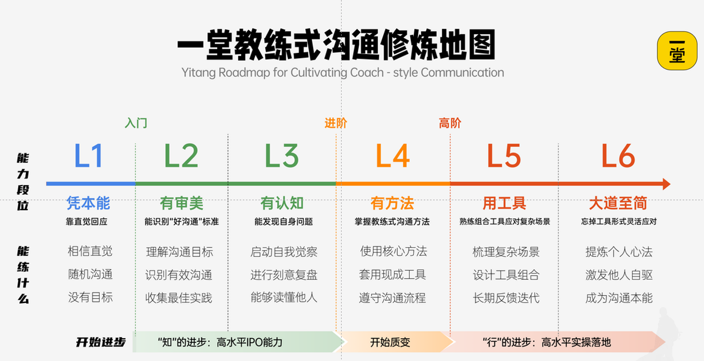

#### 回到Y模型：修炼长期能力的路径

发现了吗？

如果你认为领导力是个雷达图，你大概率会觉得自己不行。而且也不知道怎么改。

你如果用 Y 模型思考领导力，你就会有一种极大的心气。就是积累着五层嘛：认同、打胜仗、共识、带人成长、希望。一层比一层高，后面那层要靠前面那层撑着。

这一步做完，领导力就变成一件能提假设的事了：我做这件事，团队会不会多攒一枚？做那件事，会不会掉一枚？能提假设，就能做实验，就能验证。这就是它为什么能科学。

然后你再看那张图，感觉完全不一样。你要是拿它当雷达图，量一量自己哪一格弱，大概率量完就觉得自己不行，也不知道从哪儿改。

你要是拿它当一条可以一天天攒的路，你就知道自己现在在第几层，明天该往哪儿加一枚硬币。这两种心态差的不是方法，而是我们那种追求无限进步的心气！

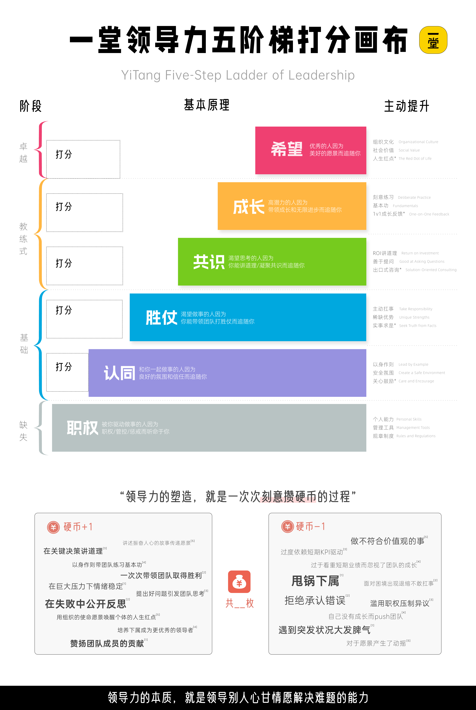

### 四、最后的升华

关于今天分享的内容，到这里就算讲完了，有些心里话倒是想跟大家唠一唠。

我不是学商科的。我从小是生物和理工科出来的。理工科的人做任何一件事，顺序是固定的，而且是被训练出来的。

第一步，先定义我要解决的问题，范围有多大。

第二步，在这个范围里，我要解决的问题到底是什么。

第三步，为了让这个问题算解决，我这次要达成哪几个目标。

第四步，前三步都讲清了，我才开始动手——查文献、做类比、做田野调查、做定量。

第五步，根据观察提假设，把假设交给实验，拿结果回来，定性定量再修正，最后变成我自己的东西。

这个顺序不是我发明的，是实验室里几百年来都在干的事。

所以我自己学习Y模型的体感其实是：

**Y模型不是一堂的发明，一堂只是总结了科学做事背后的规律，**

**不是你先学了 Y 模型才会科学做事，**

**任何受过科学训练的人，大概率早就在用 Y 模型了，只是它没被叫这个名字。**

一堂做了那么多方法论，看起来都是用科学的、大规模的样本、辩证讨论、然后形成的方法论，你可能会想：
**我为什么要学？我学了那些方法论，为什么还要学 Y 模型？**

我的答案是两层。

**第一层，Y 模型不是"又一个方法论"，它是那些方法论的底座。**

一堂给你的业务公式、五步法、259、各种清单，每一个都有它自己的适用范围和前提条件；那你怎么知道哪个工具该用在哪？

答案不在工具里，在你对范围、对目标、对这件事的思路有没有想清楚。

**想清楚了，工具自己会挑；没想清楚，你只能靠猜，猜错了还以为是工具不行，更糟心的还以为是自己不行。**

**第二层，它管的正是所有方法论都覆盖不到的那块地方。**

方法论都长得很像：给你一个框架、几个格子、一套话术，然后告诉你照着填。可现实里最多的情形是——**这件事没有现成的格子可填。**新产品、新人群、新渠道，你去翻笔记，翻不到对应的那一页。

这时候你能依靠的，只有那套最原始的动作：

先把范围划出来，把问题问清楚，把目标定下来，然后提着假设去验证。

这套动作不高级，但它是所有方法论退场之后，唯一还在场的那个东西。

一堂没有发明这套东西。科学工作的原则是公共的，实验的规矩是公共的，把范围、问题、目标、假设、验证串成一条链——这是几百年来所有实验室里都在干的事。

一堂做的事，是把它整理成一套创业能用的顺序，并且给它起了名字。

最后的最后，是这次参加山顶营，Truman的本体帮他写的“五百年一条河”那首歌里，我特别喜欢也特别感动的一段话，趁这个机会借花献佛送给大家：

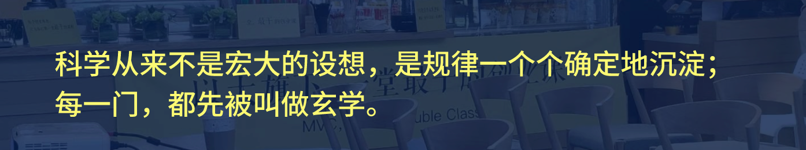

希望我们大家一起一点点地把玄学变成科学。

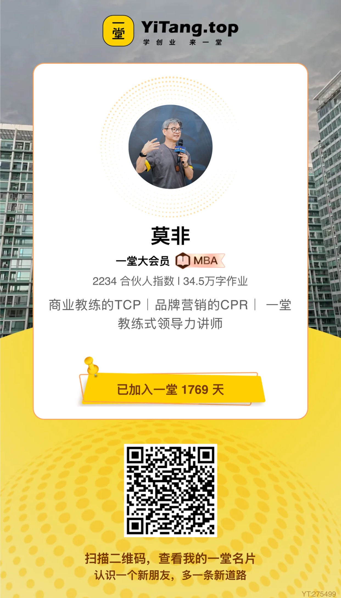

后面的时间，就交给花总啦，我们作业里见！