## 花辣子米：从会用AI，到和AI一起解决未知问题

### 开始上课

Hello！直播间里的朋友们，晚上好！我们又见面了！

感谢一堂的邀请，如果有新同学还不认识我，简单介绍一下，我叫陈炎康，很多同学比较熟悉我的微信的 ID 花辣子米。是一堂的老朋友了。第一次见的新同学欢迎看一下我的个人介绍，交个朋友。
> 1. **密苏里大学从事计算神经科学的研究：**用 AI 技术研究人脑的底层电生理，和生化结构，以及情绪记忆的产生与存储机制
> 2. **微软负责 AI 产品技术研发：**曾在微软总部负责智能设备产品 AI 技术研发，跨 Skype，Azure，Windows Shell 等部门协作
> 3. **合肥爻和智能科技有限公司 CEO：**2018年回国成立 toB AI 研发与咨询服务公司
> 1. 服务华为、中航工业、上海建工、金地集团、微软、NXTComm、ElloSat、Bertolini 等
> 2. 提供在互联网、建筑、航空、航海等行业的 AI 落地产品研发与咨询服务
> 3. **导科百尔医疗(上海/苏州)科技 CTO：**致力于提高心脑血管手术的安全性、准确性、便捷性
> 4. **金日创智能CEO兼CTO：**用工业AI世界模型做下一代的工业设备，为制造业做懂工艺的AI
> 5. **加入一堂：**86个月，1340学分，合伙人指数1477

我从事AI相关的研究和工作已经16年，一直在做 AI 的研发和落地，从企业应用，到航空航天，到医疗设备，再到工业AI，做着做着，要解决的问题就越来越不像原来自己熟悉的那些题了。

面向新的领域，新的场景，我如何持续用AI去解题，今天我给大家分享一下，**这个过程里我对 AI 的三次认知变化，以及 Y 模型是怎么一直贯穿我的学习和实践的。**

#### 预热思考题

正式开始前，还是给大家几个思考题，应该是大家都很熟悉的场景。

**第一个场景：观察你的孩子。**

有孩子的同学，在辅导孩子做题的时候有没有遇到过这种情况：一道数学题，公式记住了，老师讲的例题也会了。

你觉得，这回应该没问题了吧？结果换了一道题，孩子又不会了。这是为什么？

**第二个场景：回看你的学习。**

无论是新同学还是老同学，一堂的课程方法多少都学过了一些。比如一堂五步法、一堂双三角、等等，也能把一些方法说出来。

但是今天公司里真有一个问题，往自己面前一放的时候，从哪里下手？应该先用哪个方法？需要什么资料？经常还是觉得很难用起来。

**第三个场景：AI的学习和落地。**

用AI的方法学了很多，工具也试了很多。听的时候都懂，别人做的案例也很好，可一旦落到自己的业务里，就总感觉还差点什么？

我想在公司做AI落地，但是要做的事超出了我原来熟悉的专业的业务范围。我还敢不敢碰？我凭什么觉得，自己有可能把他做好？

**【互动🙋🏻‍♀️】**有过这些困扰的同学，可以在弹幕里扣一下1、2、3。

————

这些问题其实都是同一个问题：

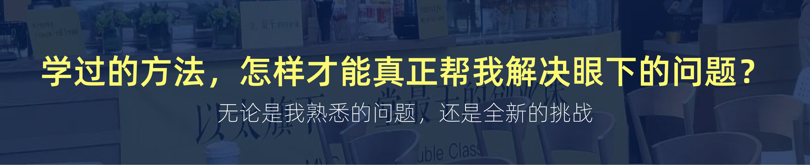

 这就是我今天想跟大家聊的主题。

#### 提前划重点

我很早就一直在鼓励和建议 Truman，一堂要重视 Y 模型，要多讲 Y 模型。为什么？今天我想用自己的经历，当着大家的面和Truman把我的理由说清楚。

一些比较熟悉的同学可能知道，我是做算法做软件做技术出身的。我从软件开发，到跨行业AI落地，到医疗器械创新，到业务管理，再到现在在做的产线工艺优化，**我每次跨行业出去，都带着上一段实践中形成的认知，每次新学到的东西，又会成为下一次的起点。**

说到当前在做的产线工艺优化。我没有学过自动化没有学过工艺，以前遇到制造工艺这种我不懂的问题，我很难下手。现在有了 AI，我就可以拉着老师傅和AI，一起把这个问题往前推进。

我的整个这里面一直贯穿着 Y 模型。就这样，一段一段地往前走，一个个问题去解决，就开始对业务对AI都有了更多可以迁移的认知。

所以，今天大家可以带着一个问题来听：**面对自己没做过、甚至暂时不懂的问题，Y 模型到底怎样给我们跨界迁移的底气？**

我今天的分享，对应着自己对AI的三次认知变化。
1. AI可以做什么？
2. 如何让AI做得更好？
3. 如何和AI一起学习？

好，来来来，我们直接上案例。先回到几年前，从一张设计图开始聊。

### 第一次认知变化

#### 案例一：把设计图变成软件代码

时间回到 2019 年。那时候，还没有过去几年里可以帮我们写代码的AI。我们就在尝试解决一件问题：**能不能把设计师画好的任何的软件界面，自动变成软件代码？**

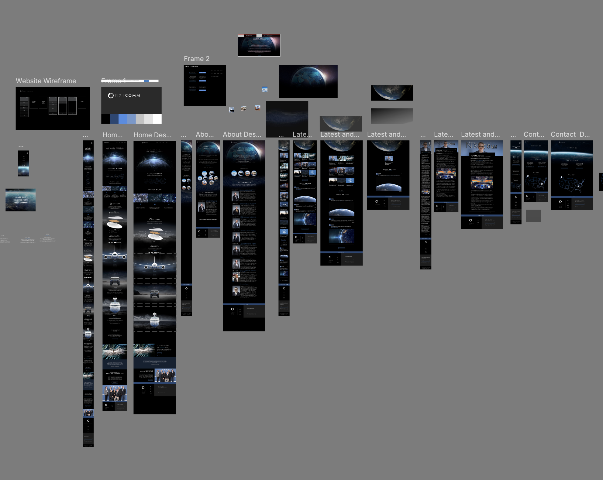

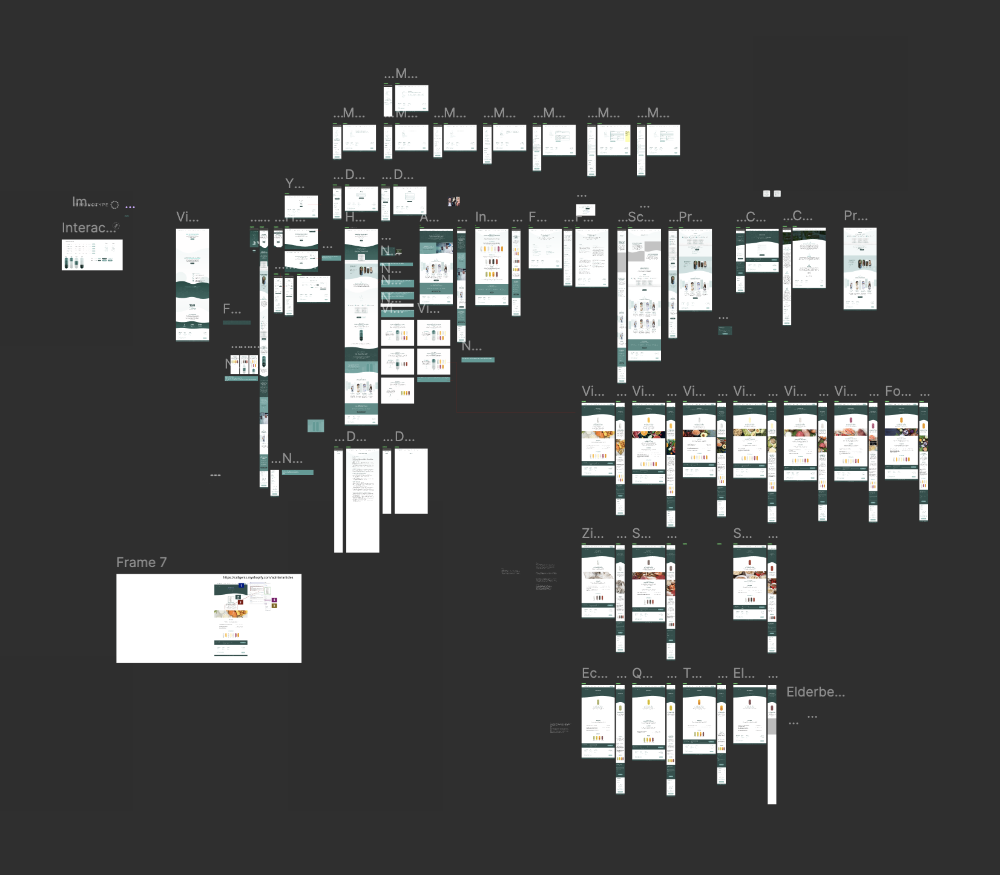

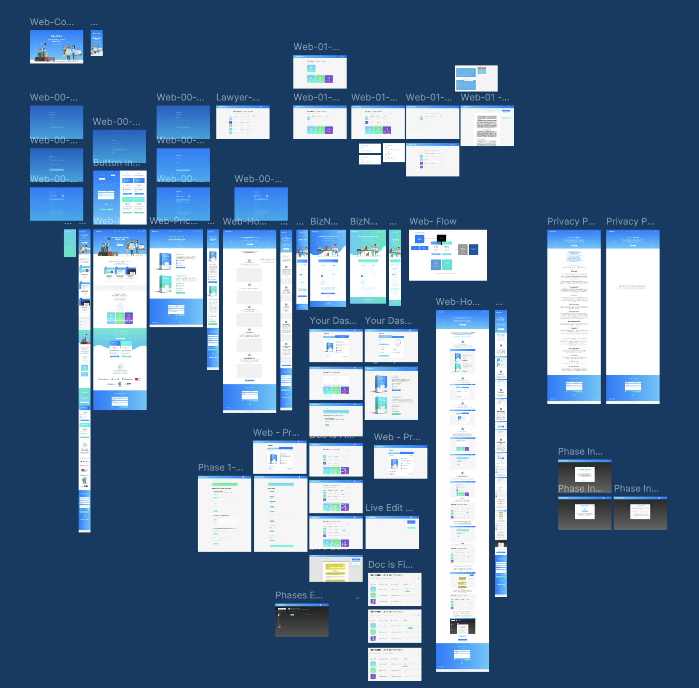

平时大家用一个软件，看到的是文字、图片、按钮、输入框、菜单……设计师先把这些东西在例如Figma这样的设计软件里画出来，再交给工程师把它用代码实现出来。

这里有一个很麻烦的地方。**界面千变万化，同一个页面放在电脑、平板、手机上，呈现方式还不一样。如果每次都让工程师照着图一点点写，里面就有大量的看似定制化其实很重复的工作。**

所以我们当时就在想，这中间有没有可能自动化？

**【互动🙋🏻‍♀️】** 在2019年，没有AI的时候，大家觉得这个事情我们做成了吗？
1. 做成了
2. 没有做成

————

我们做成了。

**【思考🤔】** 无论你是不是技术出身，都一起思考一下，如果让你来解决这个问题你会怎么去思考？从哪里开始思考？

————

很多人可能很自然就会想到，先让机器看懂这张图，认出这里是按钮，那里是输入框，再把它还原出来。是不是？

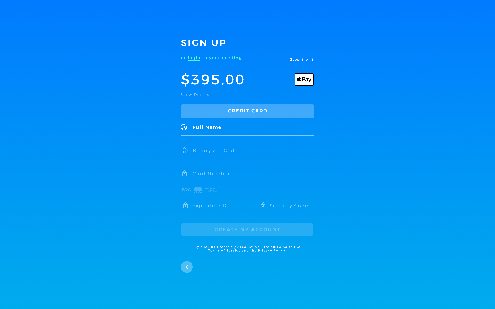

但我们接着往下问了一步：**设计师是在什么地方画这张图的？**

是在 Figma 这样的设计软件里画的。

那屏幕上看到的是一张图，**Figma这个软件里面存的又是什么呢？**

你在软件里把一个按钮往右挪一挪，软件得记住它的位置变了；把按钮拉宽一点，它得记住尺寸变了。也就是说，**你看到的是一张图，软件里存的，其实是一份清单：这里有个按钮，上面写什么字，摆在哪个位置，多大多宽。**

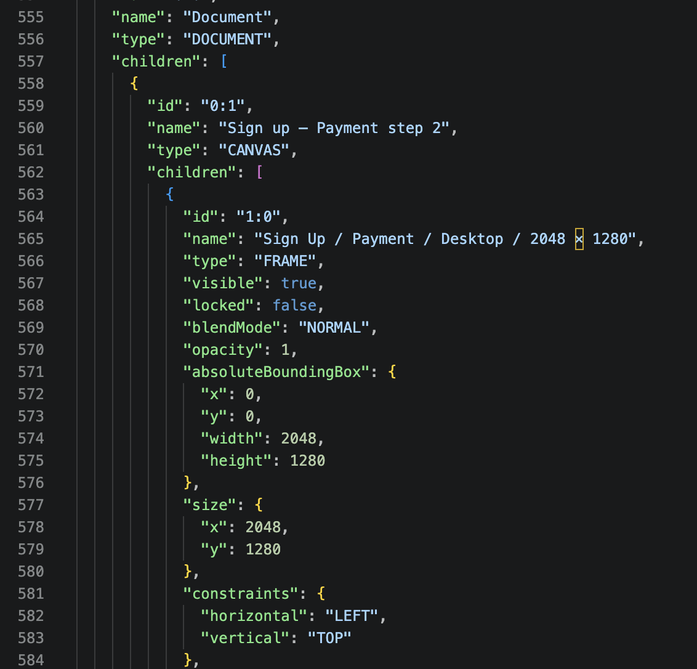

也就是说，**这张图背后，本来就有一组描述它的数据**。

随着这个认知出现，我们提出了一个假设：

我们当时的想法就是：既然这份清单已经在软件里了，能不能直接把它拿出来，交给程序，再按事先写好的规则，自动写出一部分界面代码？

这条路径当时真的跑通了。当然，规则要一条一条手写，很辛苦，但确实省掉了大量重复劳动。

好，接下来事情就有意思了。AI 出来了，会写代码了。

我们之前费很大功夫做的自动生成界面代码的规则系统里，**很多的规则不再需要人，AI就已经能帮忙做了。**

**【互动🙋🏻‍♀️】** 之前那些工作，是不是白费了？欢迎在评论区猜一下。
1. 白费了。
2. 没白费。

————

这事儿，乍一看还挺让人心疼的。规则一条一条写了那么久，现在 AI 会写了。那还剩下什么？

剩下的东西，价值很大。我们已经理解了，界面可以被表达成数据，数据可以再被转成代码。**具体实现的价值可能变小，但这个认识，还可以继续用。**

2022 年，我们开始用 Copilot 辅助生成界面代码。**当时的 Copilot 还不能直接读懂设计图，它只认文字。那怎么办？**

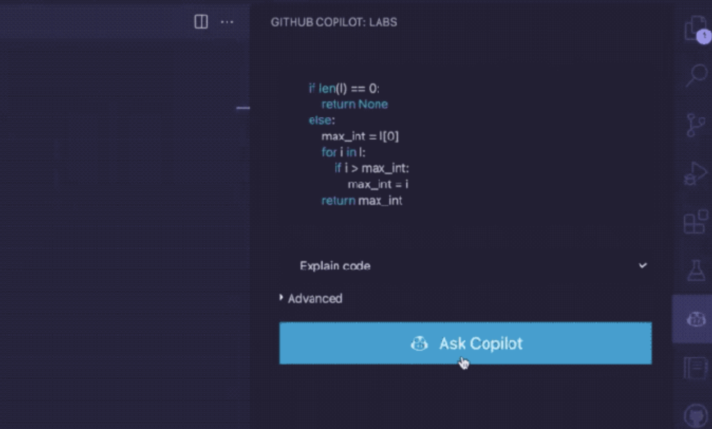

好在我们知道怎么把设计稿变成一段清楚的文字描述，把这份描述交给它，它就能照着写代码。

你看，工具换了，**前面形成的认识，直接就成为了这一次尝试的起点**。

这件事后来还继续往前走。我们原来做软件开发的时候，团队会用 UML 这样的方式统一明确软件里的业务逻辑。这个名字大家记不记得都没关系，**你把它理解成一种可以用文档和代码画流程图架构图的工具就可以了。**

比如用户选了某一个选项，后面应该出现哪些字段；点了一个按钮，接下来触发什么动作；当前处在什么状态，什么情况下才能进入下一个状态。

原来我们把这些东西写清楚，是为了团队内部沟通和协作，让大家脑子里想的是同一件事。后来发现，这些东西同样可以给到 AI。在当时还不能理解图片的AI来看，用 UML 描述的架构图就是一个文档，这个AI完全可以理解。

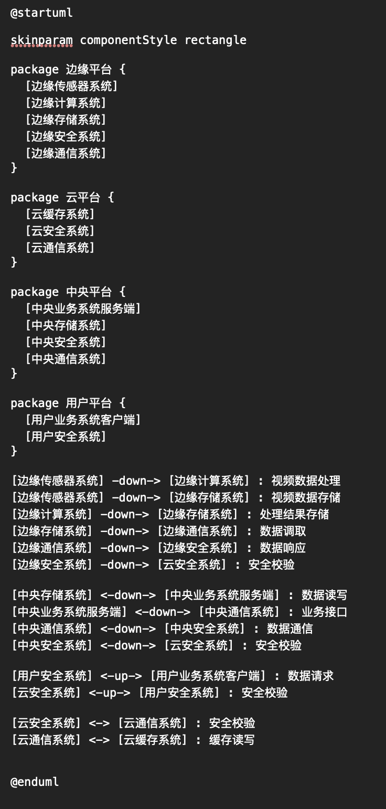

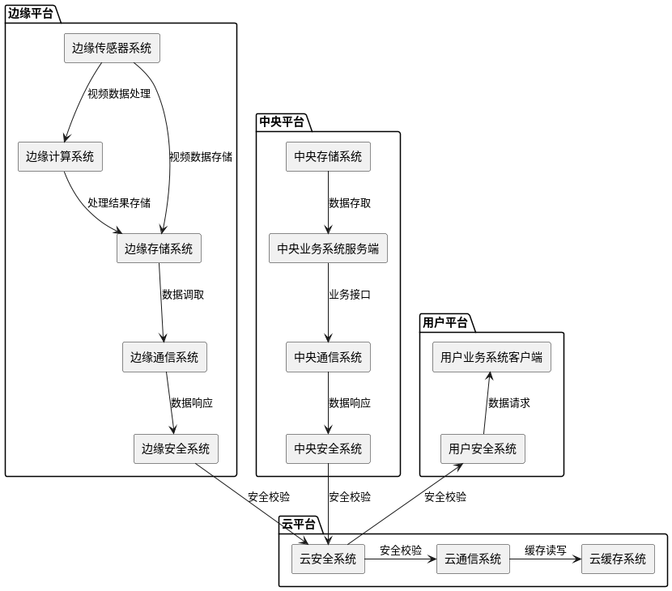

因为我们已经把脑子里的逻辑，变成了别人能够读取、检查的描述。人可以读，AI 也可以读。这套原来用于团队协作的方法，又找到了一个新的用处。

我的认知，也就在2022年的这个过程中发生了第一次的变化。我开始想，**AI 能输出什么？哪些工具能够接住它的输出，然后自动去完成一部分工作？**

这个问题一出来，后面的路就多了。**AI 能写文字，能写代码，那文字和代码能送到哪里去？能驱动什么？能做什么？能解决软件开发之外的工作吗？**

在我们2022年用AI写用户界面代码的实践的过程中发现，不但我们可以从Figma获取设计的数据，还可以把数据给到Figma 去创建新的设计图或修改现有的设计图。

也就是说，**如果一个工具可以被一段代码或者一段数据文档控制，AI就可能能控制它。**

接下来，就真的遇到一个看起来离软件开发挺远的问题了。

#### 案例二：用AI做工业设计

2023 年到 2024 年，我的上一个创业项目里，我们在做血管内的导航系统。这个东西大家可以想象成微创介入手术中血管里面的 GPS系统。如果有2024年底参加过初阶营的MBA同学，可能听过我线下分享这个案例早期的精益的过程。

做医疗设备时，我们需要先画出一个有具体尺寸的三维设计，再拿它跟代工厂讨论。团队没有专职工业设计人员，我就想：**能不能先用文字说清楚形状、尺寸和部件之间的位置，再让工具照着这些要求画出三维模型？**

我们当然也希望继续精益，控制试错成本，于是就想让AI来做。

**【互动🙋🏻‍♀️】** 如果回到2023年，大家觉得，AI能帮忙做CAD吗？
3. 可以。
4. 不可以。
5. 不确定。

先把自己放回当时2023年那个时间，别拿今天AI的能力看啊，哈哈哈。

————

前面已经形成了一个认识：如果一个工具能接收文字、数据或者代码，AI 就有机会通过输出这些内容，让工具去自动执行。

所以我当时就把问题换了一个方式来思考：

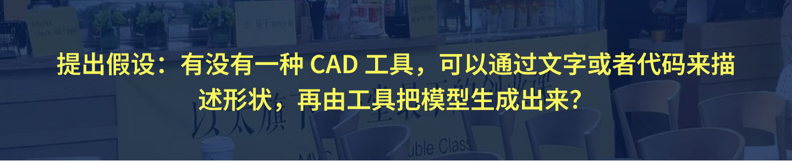

后来我们找到了一个工具叫OpenSCAD，它能根据代码生成三维模型。

我们请 AI 帮忙写这段代码，工具负责画出来。

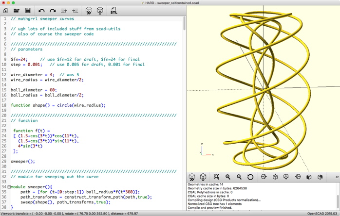

画出来以后，还得由人检查尺寸、位置和实际要求；哪里不对，就把差距说清楚，再改一轮。我们验证的是一条起步路径，不是说 AI 已经替代了工业设计和生产验证。

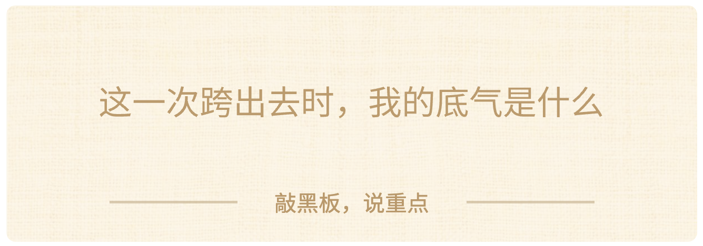

**前面用AI帮我们开发软件的认知，就这样迁移到了解决工业设计中的一些问题。**

大家注意，我带到工业设计里的，是前面对于**「表达 — 生成 — 执行 — 检查」**这一过程的理解。

但是至于这个 CAD 工具的支持情况，生成的模型对不对，能不能满足眼前的要求，这些都得重新验证。

尽管我还是需要学习原来不知道的工业设计的认知。但在开始的时候，我已经有一个有依据的可以动手的假设，知道可以先往哪里走一步。

以后遇到类似的新的复杂的问题，可以先思考：
1. 我想要的结果，我能不能描述清楚？
2. AI能生成什么？有没有工具可以接住这些输出，并且去执行？
3. 做出来以后，谁能判断对不对、好不好？

这些问题看上去很朴素，但它会**让你从一个很大的「这个我不会」，走出可以动手并且验证的一小步。**

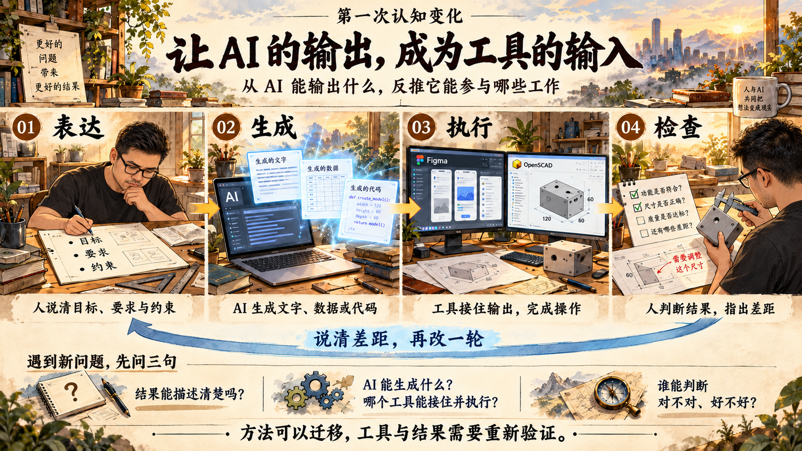

回头看，**我第一次对 AI 的认知，就是这样长出来的。**我开始从 AI 的输出能力，反推它可能参与哪些工作，也开始有了如何用将 AI 跳出对话框去现实中完成工作的固定套路。

### 第二次认知变化

不过，敢开始新事情之后，我又遇到一个问题，怎么让团队的人都可以用好？

**同样的 AI，同样的工具，为什么有的人用出来很好，有的人用出来就很一般？**

大家应该都见过这种情况吧？别人演示的时候非常好，自己回去一试，怎么差这么多？

这个问题把我带到了第二次认知的变化。

我们还是从做界面这件事说起。大家可以和我们一起来做个思考：

**【思考🤔】**假设让一个 **UI 设计师**和一个**工程师**，用同样的 AI、同样的 Figma 工具，来设计一个软件的用户界面。大家觉得，他们给 AI 提出来的要求会一样吗？他们判断好坏的标准，会一样吗？

————

大概率是不一样的：

- **设计师更关注用户的需求和体验**：会想，用户要完成什么任务，操作顺不顺，做完一步应该收到什么反馈。
- **工程师更关注用户的交互什么样：**界面都会有哪些状态，怎么控制这些状态，哪里容易出错，怎样保持稳定。

同样面对一个界面，**两个人注意到的东西不一样，能讲清楚的东西不一样，给 AI 的要求和反馈也就不一样**。

这件事让我开始继续往下想。AI 的输出，跟我们给进去的东西，到底是什么关系？人的专业能力，又是怎样进入 AI 工作过程的？

**【互动🙋🏻‍♀️】** AI帮我们干活，如果把过程拆开，它在做什么？

————

学过《重新理解「科学学习」》这节课的同学，应该很熟悉 IPO 模型：

- I（Input）是输入
- P（Process）是处理
- O（Output）是输出

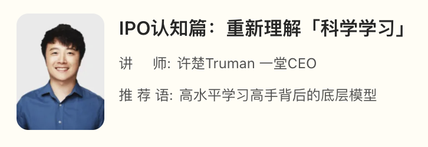

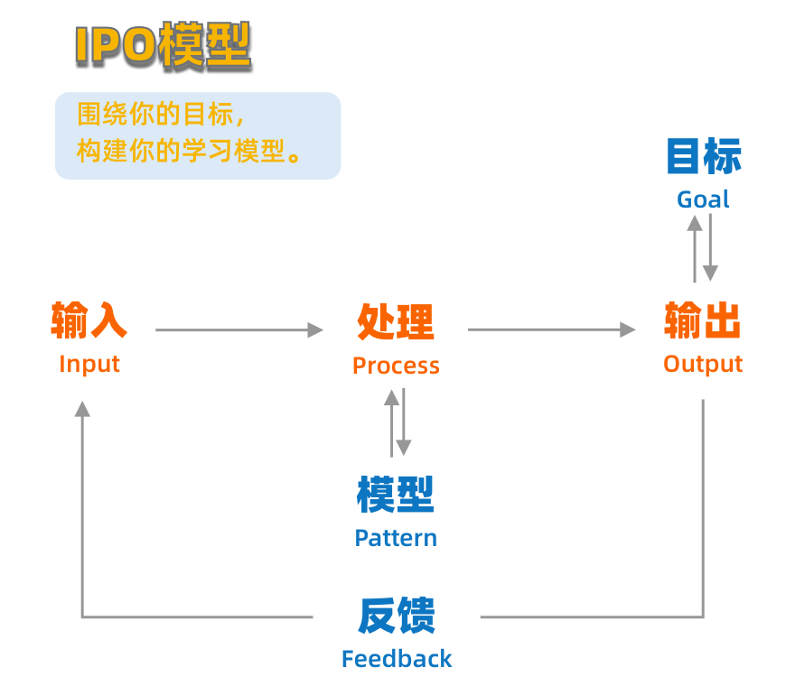

我们学习一件事，也要有输入，自己进行理解、加工，再形成输出。

**我们可以用同样的视角，去研究 AI 接收了什么，怎样处理，又给出了什么。**

这样一看，AI 本质上也是在做 IPO。**如果我们需要AI有更好的输出：**

- 要不就选择更好处理能力的AI（模型、智能体工具、……）
- 要不就给 AI 更好的输入。

所以，在2023年开始我的关注点，主要就统一在：**如何拉平团队的人使用AI的差异。**我开始研究，输入和处理过程怎样影响输出，怎样才能把人的方法提炼出来，让团队能用起来。

#### 案例三：用 AI 辅助做项目管理

**【互动🙋🏻‍♀️】** 如果你手下有两个项目经理，一个有PMP证书已经交付过十几个项目，另一个是大四刚毕业充满激情但是第一次从事相关工作从没有交付过任何项目。

如何让他们可以以同样的质量完成项目管理的工作？

————

我的答案是：把项目管理的工作标准化。

这两张图之前在几次开放麦分享过。这正是在2023-2024年间，我拉着那个交付过十几个项目的项目经理，把PMP体系的项目管理工作，根据我们AI应用创业公司的实际情况进行了大量的精简，最终形成的我们自己的项目质量管理标准化**体系**。

覆盖了从线索需求分析，到方案研讨，到报价合同，到UI/UX设计，到研发，到测试，到发布，到部署，到运营迭代，项目全生命周期中，要做什么，要落到什么文档，要给客户交付什么。

在2024年的时候，就在内部沉淀出了一套提示词库
1. 用AI辅助**项目线索-商机-意向-订单转化**
2. 用AI辅助**项目需求文档梳理**
3. 用AI辅助**项目方案加减法**
4. 用AI辅助**项目方案功能点和报价评估**
5. 用AI辅助**项目评审交付**
6. 用AI辅助**项目反馈迭代**
7. 用AI辅助**客户复购转化**

**【互动🙋🏻‍♀️】** 有同学有项目管理的经验吗？有发现这里面少了什么吗？

————
少了一个非常重要的环节：**AI 辅助项目进度管理，尤其是研发进度和风险管理**。

**【互动🙋🏻‍♀️】** 欢迎有项目管理经验的同学在评论区说一下：进度管理可以有哪些工具？

————

表格、甘特图、看板、……

我们习惯用的是**看板**。

**【抢答🙋🏻‍♀️】** 我们想要用 AI 去帮着做项目看板管理，顺着之前的认知，我们需要什么样的看板？

————

我们需要可以被 AI 通过输出代码或数据直接去操作的看板工具。

于是我们用 AI 去做全网调研，直接找到几个开源备选的看板工具。

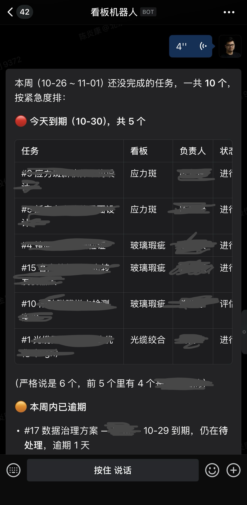

这套看板工具，**至今我带着团队在做制造业AI设备仍然在用这套看板工具，并且开始加入了企微机器人、AI自动领取工作、提交进度、分析风险等功能。**

在使用 AI 做看板管理的过程中，我们获得了一个新的认知：**什么是给 AI 的好的输入？**

之前，我们的项目经理们习惯用文档作为给 AI 的输入。文档可以很灵活地用文字、表格等形式组织给AI的上下文，但是很难直接体现出一些高度复杂的关系问题：
1. 某个研发同事在两周前有什么工作？
2. 当时是否按期完成了？
3. 当时遇到了什么卡点？
4. 后来谁帮助解决了？
5. 这一次延期耽搁了其他多少个相关任务的排期？

尽管文档不擅长组织和维护这些信息，但是这些都是看板擅长的。

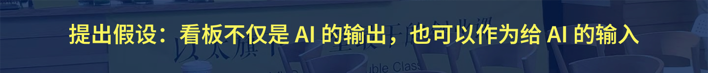

有没有一种可能，我们不仅可以用 AI 去协助看板中那些日常琐碎的维护工作，还可以洞察隐藏在看板背后的项目风险、关键假设、等等？

一份项目文档能讲清一件事，但如果我要问「哪些任务延期了、又影响了谁」，就得从很多文档里反复找。看板把每项任务的负责人、进度、前后依赖放在固定位置，团队也会持续更新。

只要 AI 能读取这些记录，就可以帮我们找出可能延期的地方，提示值得进一步核查的风险。

以前我们想让 AI 帮忙更新看板；后来发现，看板里整理好的事实，也能成为 AI 分析项目的材料。至于它提示的原因和下一步做法，仍要由项目经理对照现场确认。

**所以，看板不仅仅是 AI 的输出，也可以反过来作为给 AI 的输入。**

效果超出预期的好。AI 不但可以知道当前所有项目的具体进展，还能推理出当前从执行层到管理层的工作状态，当前公司的技术债务，下一步应当专注在哪儿…… 

**所以，什么是给 AI 最好的输入？**

对于非结构化的数据，文档，尤其是 Obsidian 这类文档管理工具可以很好地组织这些信息。

但是，对于结构化的数据，尤其是实体和关系的表述，如果有专用的工具，无论是数据库还是建立在数据库之上的软件应用，会是最好的组织方式。

哈哈，还不止步于此，这个认知又形成了我新的迁移的起点。

前段时间，现在我们的销售总监和我在吃饭的时候问我：

“现在全国的各个销售手上大量的线索和销售推进的事情我都需要去管理，我如何让 AI 来帮我？我试了 workbuddy 等等工具，给了它大量的文档、会议记录等等，但是感觉他给我的都很散。”

接下来就是我今天要讲的第四个案例了。

#### 案例四：用销售 CRM 提升 AI 的能力

我问了他一个问题：“我们现在用的哪个 CRM？” 

我看了一下他用的 CRM，没有 MCP，没有 skill，没有 API，没有 CLI。也就是说，无法让 AI 去对接输入和输出。

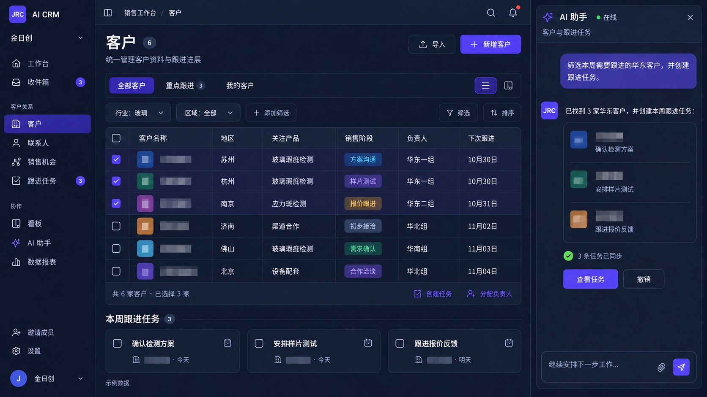

于是，当天晚上我就给他部署了一个支持 MCP 的 CRM 系统，同时配套接入了 workbuddy。现在他可以：
1. 直接在 workbuddy 里把大量的文档和会议的语音转文字直接给到 AI 输出到 CRM。
2. 让 AI 从当前的 CRM 中分析每个客户的销售和验收的进展情况。客户签设备验收回款的阻力是什么？多少客户有同样的阻力？是销售的问题，还是产品的问题？
3. 让 AI 直接给每个地区销售的下一步的跟进策略。
4. …… 还有很多的能力，我们也在探索中。

一个项目现在是什么状态，谁在负责，哪里卡住了？

一个客户有什么需求，已经沟通过什么，推进到哪一步，当前的销售障碍是什么？

这些信息在公司里往往是分散的。有人知道进度，有人知道技术难点，有人知道客户真实的顾虑。你要让 AI 参与，就得先把这些东西组织起来。

组织成什么样呢？**先看我们在讨论哪些实体。项目、任务、客户、需求，都是实体。每个实体有什么属性？它们之间有什么关系？哪些状态在变化？**

比如一个任务归属于哪个项目，谁负责，依赖谁的结果。一个客户的需求，对应什么方案，有什么尚未确认的条件。**把这些关系讲清楚，AI 才有机会理解某条信息放在整个业务里意味着什么。**

所以，上面提到的一个看板或者 CRM 的价值，在于它能不能把这些信息和联系表达清楚。将原来在人脑子里的体系，逐步变成了 AI 可以使用的数据。

大家可能会想到：这是不是现在经常听到的本体、上下文工程，还有 Harness？

对，这些内容我们可以放在这里理解。

我去年在一堂分享过上下文工程。上下文六要素，是在提醒我们，哪些事情要给 AI 说清楚。但我们还可以继续往下问，为什么要说这些？它们怎样影响 AI 的工作？遗漏了某一部分，结果可能会差在哪里？

**本体是在帮助我们组织业务知识。**

而 Harness 则把 AI 跟现有的体系、数据和工具接起来。

大家先抓住它们在解决什么问题，再去理解这些名词，就容易多了。其实，在这些名词成为热点之前，我们就在考虑相应的问题了。可能当时我们没有起这个名字，但我们确实已经在问，怎样组织背景，怎样把业务关系表达清楚，怎样让 AI 使用已有工具。

同样，在一堂还没有提出双三角这个模型的时候，我们也已经在这六个角上，一点一点地探索。

这就是我看重 Y 模型的地方：

我们可以从现实的问题出发，去发现其中的客观规律。等一个新名字出现的时候，你能把它跟自己经历过的问题联系起来，知道它在帮助解决什么。

再回到这次跨界。研发和销售，各有各的专业知识。进入销售业务，我仍然有很多东西需要学习。但我可以沿着同一条思路，找到需要的体系、数据和评价者，再让 AI 参与。

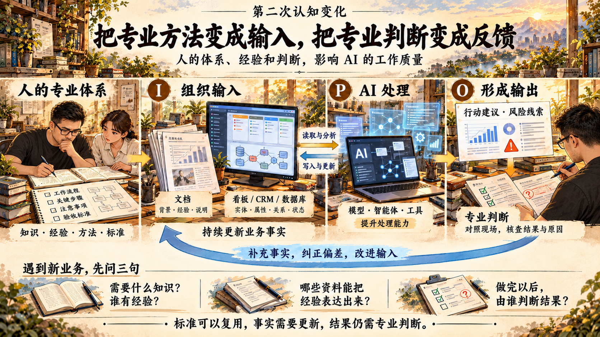

这是我的第二次认知：**人的体系、经验和判断，能够通过输入和反馈，影响 AI 的工作质量。**

所以，面对一个新业务，我就知道可以先去找什么。
1. 这个问题需要什么知识？谁有经验？
2. 哪些资料可以把经验表达出来？
3. 做完以后，由谁判断结果？

**我知道了这些，就更敢开始。因为我能把已有的专业能力组织起来，一起往前解题。具体知识可以继续补，开始时也可以请别人帮忙判断。**

### 第三次认知：和AI一起学习

但是接下来，还有一道边界。

假如连我自己也没有完整的体系呢？老师傅很有经验，可他的经验又不容易说清楚，怎么办？

**我和 AI，有没有可能一起把缺的认识补起来？**

好，这次我们再跨远一点，进到工厂的现场。

工业工艺不是我的专业。大家别看我现在在做这些事，就觉得，我是不是原来系统学过这些工艺。并没有。

很多问题我第一次碰到的时候，也是不会，也不知道从哪里下手。

#### 案例五：钢化玻璃生产工艺优化

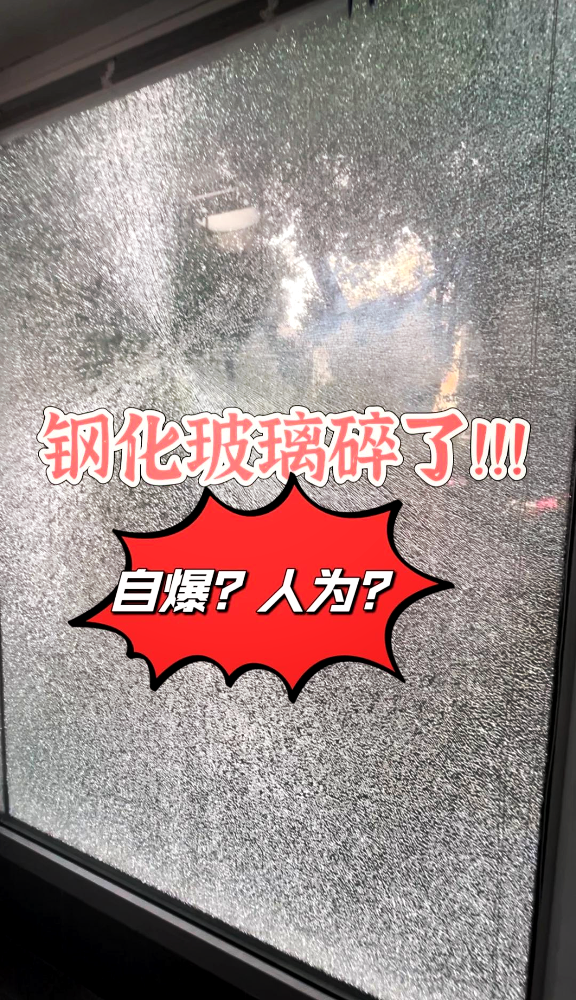

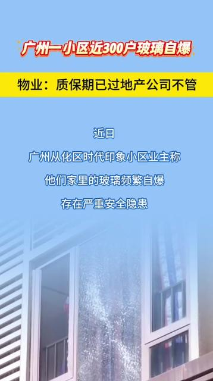

现在大家家里的窗户、卫浴的玻璃都是钢化玻璃。行业上有个不是很严谨的数据，千分之三概率的钢化玻璃会发生自爆。一千块玻璃里就有三块，这个比例还是挺大的。玻璃加工厂也一直想解决这个问题。其中的一个方法就是在特定的光线条件下看钢化后玻璃里的斑纹。

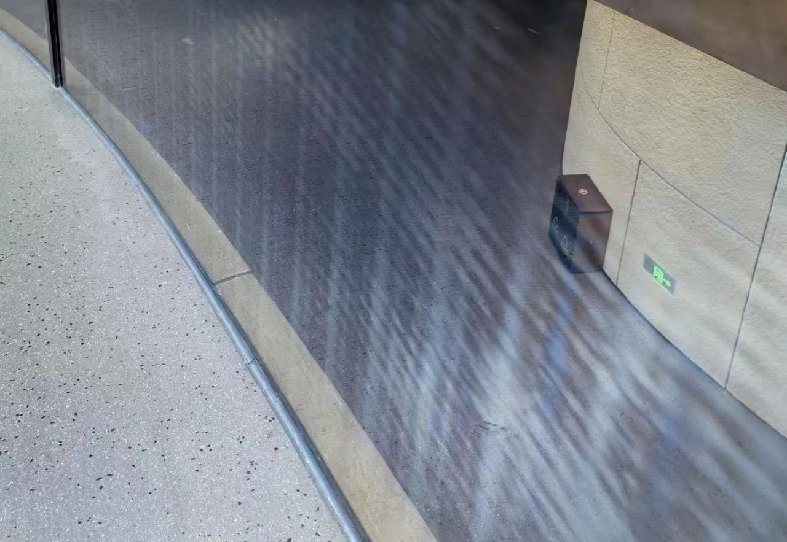

老师傅看到玻璃上的一些斑纹，能够推测，钢化炉里面哪些环节或者参数设置可能出了问题。

有经验的老师傅，看一眼，心里可能已经有结论了。可你让他把判断过程完整地讲出来，哪些因素产生了什么影响，什么条件下成立，往往很难讲成一套清清楚楚的方法。

那我怎么办？我不是这个专业，老师傅又很难把经验完整地交给我。光站在旁边听，我也不一定能听明白。

**【思考】** 如果是你，下一步会先做什么？

————

我当时提了一个假设。老师傅会不会像是在脑子里，跑了一个粗略的模拟？过去见过很多现场情况，尝试过不同的处理方式，也得到过很多反馈。这些东西慢慢积累起来，看到一个现象，就能想起它可能跟什么有关。

注意，这里是我的假设啊。我们接下来要找东西去验证它。

如果沿着这个方向继续想，**他脑子里的那部分判断，有没有可能逐步变成一个可以讨论、可以检查的模型？**

我就开始往下拆：

> 钢化炉怎样加热玻璃，又怎样冷却玻璃？

> 玻璃在这个过程中发生了什么变化？

> 这些变化，跟我们最后看到的光学现象，有什么关系？

> 哪些已有的规律能帮助解释？这些规律适用的条件是什么？

> 如果要把它们用到眼前这条产线上，还缺哪些参数？

大家看，到这一步，“我不懂工艺”这件事，开始变得具体了。我知道接下来可以去研究哪些问题了。

有了 AI 以后，我们就可以让它先围绕这些问题调研，找到相关的知识，梳理规律和公式。再尝试让 AI 把关系表达成物理模型，再把物理模型变成代码，做成仿真。

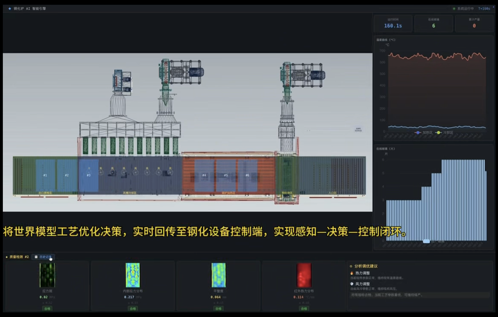

做出仿真以后，再请老师傅看。哪些地方像现场，哪些地方不像？还漏了什么条件？然后回到真实产线，用实际情况核对，再去修改。

这里面的技术细节，今天我们不展开，否则就真要窜台到 AI 技术课了，哈哈哈。大家先跟着我看这条解题的路，它是怎么走出来的。

以前遇到这种问题，我缺知识，也缺一个起步的方法。现在我能把它拆成一些可以继续研究的问题，再借助 AI、老师傅，以及现场事实，一点一点往前走。我还没有因此变成什么都懂的工艺专家。但我已经可以参与解决问题了，而且在解决的过程中，继续学习。

这件事对我很重要。我们终于走到了第三次认知：**如果我现在也不会，AI 有没有可能参与我的学习，让我和它一起变得更有能力？**

我们把刚才那个过程放慢一点，一轮一轮地看。

第一轮，我手里有什么？有现场看到的现象，有老师傅的经验，还有我自己一大堆没弄明白的问题。

这时候我先做一件事，把这些东西整理一下。哪些是已经发生的事实，哪些是我们现在的猜测，哪些地方还没有信息。再用前面的认识去追问，先形成一组研究方向，交给 AI。

AI 围绕这些问题调研，找资料，解释相关规律，梳理公式及其适用条件，把结果交回来。AI 把资料给我，这件事还没结束。我得读，我得理解，我还得继续问。

原来我只是知道，玻璃出来以后有问题。看过这些资料，我开始能够区分，这里可能涉及哪些变量，哪些关系还需要核对。原来很笼统的一个问题，也开始能问得更具体了。比如，我可以继续追问，当前解释里用了什么假设？它对应的是哪一种工况？这个参数，在我们现场能不能拿到？如果拿不到，下一步应该请谁帮忙？

这个时候，我再去跟老师傅讨论，讨论的内容也变了。我更清楚该请他判断什么，该补什么现场信息。得到新的认识以后，再交给 AI。AI 收到的，也就跟第一轮不一样了。它拿到了更具体的条件，更多现场事实，也知道哪些地方还没有解释通。接下来，它可以继续修改模型、参数、公式的用法，或者实现的代码。

模型和仿真做出来，又交回给人检查。我会请老师傅看，哪些现象它能解释，哪些地方还有差距。有些判断还需要回到现场，用实际结果来核对。核对以后，我们再决定，下一轮到底改什么。

所以，这条路是这样往前走的：

- 最初的疑问交给 AI，AI 给出资料和尝试；
- 我从中学到东西，再结合老师傅的判断和现场反馈，形成更具体的问题，
- 继续交给 AI。

**每一轮过后，我对问题的理解在变化，AI 拿到的输入也在变化。**我们逐步知道了，接下来应该查什么、试什么、验证什么。

**【思考】** 刚才这个过程中，我和 AI 的关系是什么？

————

我和 AI 互相在 IPO。一边是我的 IPO，一边是 AI 的 IPO。
1. 人的IPO：输入的是现场事实、AI给出的内容、老师傅的经验和评价；经过自己的理解、推演和判断，再输出新的认识、新的问题和新的任务。
2. AI的IPO：输入的是人的问题、知识、数据和反馈；经过调研、分析、建模，再输出新的资料和结果。

人的输出，成了 AI 的输入；AI 的输出，又成了人的新输入。这样，两边就接起来了。

**这就是我认知中的双 IPO：人的 IPO + AI 的 IPO。**

- 人更强，问题问得更清楚，提供的数据更有用，评价和反馈更具体，就能让 AI 更强。
- AI 的 IPO 更强，能给我更好的资料、解释和可检查的结果，又反过来让人的 IPO 更强。

哈哈哈，听着有没有点儿耳熟？是不是有一张很熟悉的图，已经在大家脑子里了？一堂双三角。

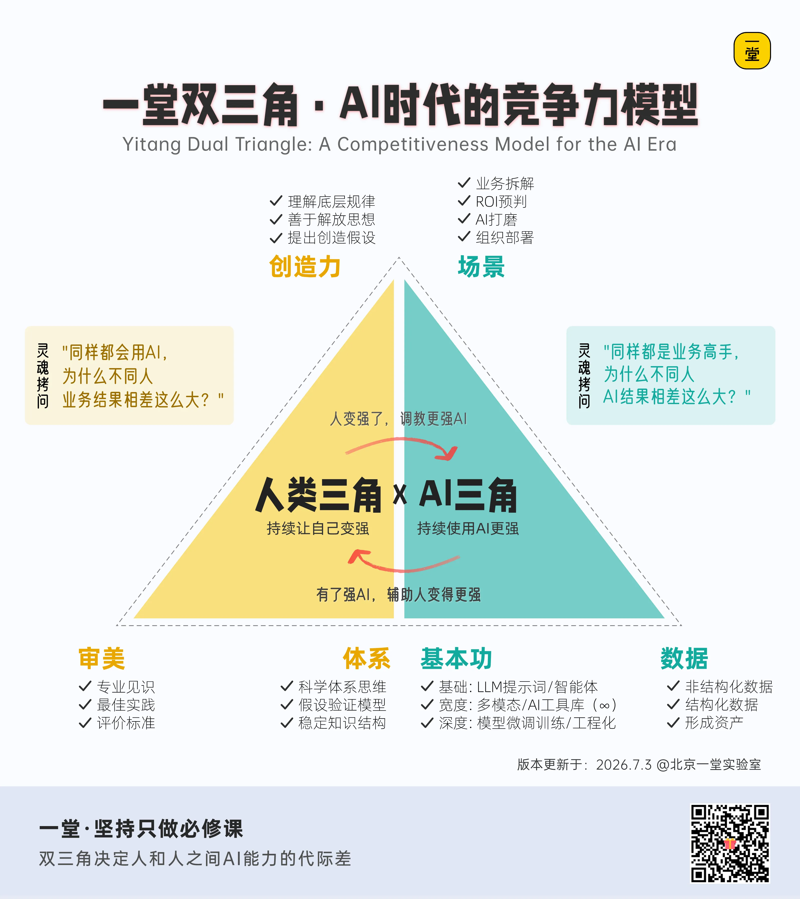

前面两次的认知变化，是我在接触一堂双三角之前，就已经在摸索了。

但是第三次双IPO的认知是在接触一堂双三角之后，算是我用 Y 模型对双三角在真实场景中的解读。

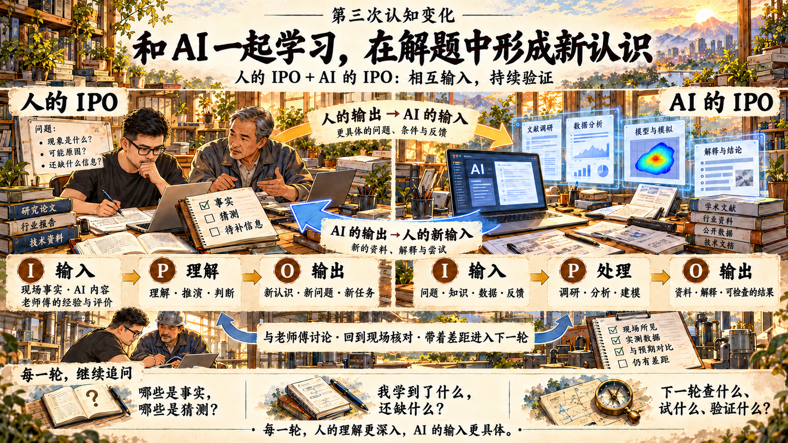

再大家可以回顾一下，我的第二次认知跟第三次认知，中间发生了什么。

第二次，我已经有一些体系了，我去想，怎样把它表达清楚，交给 AI，提升 AI 的输出。

到了第三次，连我的体系也不完整。我可以借助 AI 补充输入，理解已有知识，再借助老师傅的判断和现场事实，逐步形成自己原来没有的认识。

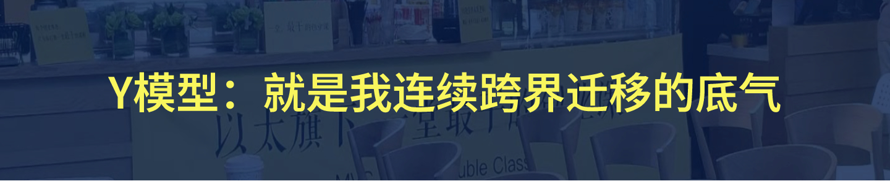

### 最后总结和升华

#### 复盘三次认知

不知道大家听完我这三次认知的变化，有没有感受到 Y 模型在这里是在什么位置？

我们回顾一下刚才三次认知是怎样长出来的。

**第一次：**我们从 AI 能输出什么，去研究它与工具执行的关系。这让软件开发里的认识，能够帮我们开始尝试工业设计。

**第二次：**我们往前追问，输入和处理过程怎样影响输出。这让我们知道，可以把人的专业体系变成数据，帮助 AI 理解新的业务。

**第三次：**连自己也缺少体系的时候，我们把人的 IPO 和 AI 的 IPO 接起来，借助专家与事实，边解题，边形成新的认识。

这一路，我都在做同一件事。

遇到具体问题，去追问背后的规律，弄清它的适用条件，提出一个可以尝试的假设，再用事实去检验和修正。我们能从已有的理论和方法里找启发，也能到现场去拿事实。两边不断对照，再把形成的认识带回工作，解决眼前的问题。

这就是我理解的 Y 模型。

有时候，一件事做通了，我们很高兴，接着去忙下一件。但如果能多停一下，问一问，这次为什么有效，什么条件起了作用，换一个场景还能不能成立，就有机会留下更多东西。

拿到新场景以后，也得再分清楚，哪些认识能借用，哪些条件已经变了，哪些专业知识还要补。我们可以带着过去的积累跨出去，然后在新的事实面前，继续调整。

所以我看双三角，会继续追问这六个角为什么有效，它们在眼前这个问题里具体怎么起作用。这样，到了下一道陌生的题，我还能继续用 Y 模型和双三角，去学习、探索、解题。

工具会换，场景会变，但我们在每一轮实践里形成的认识，还能继续积累。这个复利，会一点点长出来。

#### 建议多讲Y模型

我为什么很早就在鼓励、建议 Truman，多讲 Y 模型？

因为我自己受益很深。我知道，理解了一个方法为什么有效，弄清背后的规律以后，它是有机会迁移的。而且到了没有现成方法的地方，我还可以继续探索。

我希望更多同学也有这种体会。方法学完以后，自己能够接着往前走。遇到一个新问题，能用学过的东西，也能借助 AI 和其他人，逐步形成自己的解法。

所以我希望一堂多讲：
1. 一个方法是怎么形成的，为什么有效，有哪些适用条件。
2. 到了自己的业务里，应该怎样调整，怎样检查，怎样继续迭代。

这件事，对我来说非常重要。因为实际工作里的问题，不会等课程把它讲完才出现。客户今天有一个新需求，现场今天有一个新情况，我可能今天立刻就要开始新的研究。

这个时候，能不能把学习和解题接起来，就会影响我到底敢不敢一直往前走。

#### 尽早练、反复练

一堂有这么多课，为什么我会把 Y 模型放在这么重要的位置？

我自己的理解是，它关系到，我们学过的这些东西，怎样真正成为自己的能力，又怎样用来面对新的问题。

比如听一门具体的课，它会帮我们建立某个领域的专业体系。我们可以学到一组方法，一套分析框架，一些很好的案例。这些都很有价值。

然后，用 Y 模型继续往下问。我为什么要这样拆问题？每一个判断依据是什么？哪些事实支持这个方法？它在什么条件下有效？

我们就开始把课里的方法，跟自己对问题的理解联系起来了。等拿到自己的业务里，课程案例跟我的情况肯定有差别。如果我理解了依据，就能去判断，哪些地方可以借用，哪些地方得改，改完之后应该怎么验证。

这时候，一门课的收获，就有机会延伸到更多的问题里。

再往前一步，遇到一个没有现成课程、没有完整方法的问题，我还能不能做？也可以开始。先看清楚问题，找已有知识，提假设，借助 AI 和专业的人做尝试，再拿事实回来检查。

新的方法，可以在这个过程中一点一点形成。

大家能感受到这层价值了吗？**Y 模型贯穿了我们怎样学习一门课，怎样把课用到工作里，也贯穿了怎样继续探索课上还没讲过的问题。**

所以，对我来说，它值得更早练，反复练。

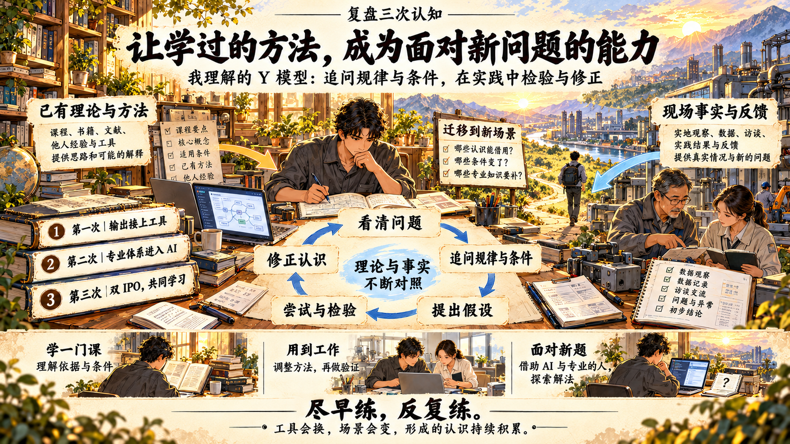

#### 最后的话

上次TCP-R开放麦的分享中关于Y模型我说过一句话，今天还是想再次送给大家：

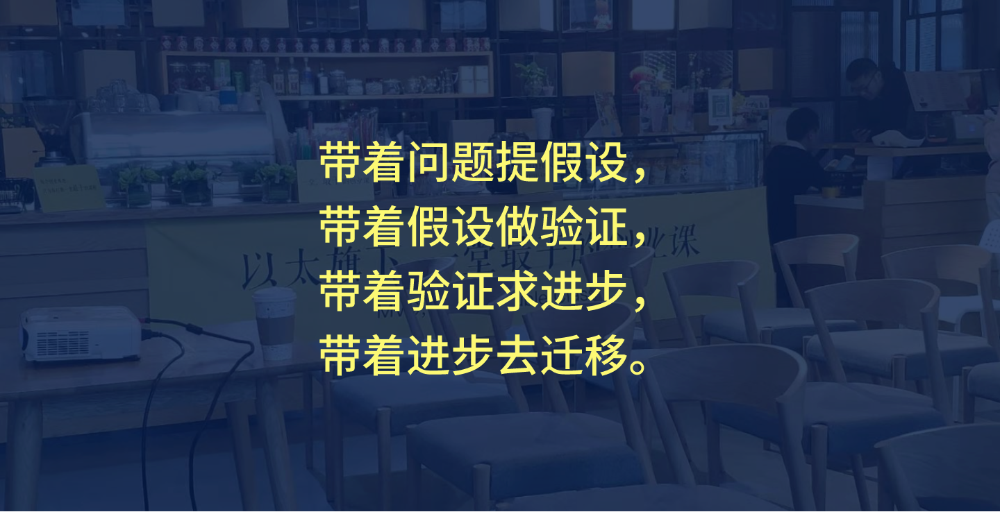

走到一个陌生问题面前，我当然可能还不会，也可能一开始就碰壁。但我已经知道，可以先学什么，找谁帮忙，怎样做一个尝试，再用事实验证自己提的假设和之前学的理论。在一次又一次的认知变化中积累起跨行业解题的底层能力。

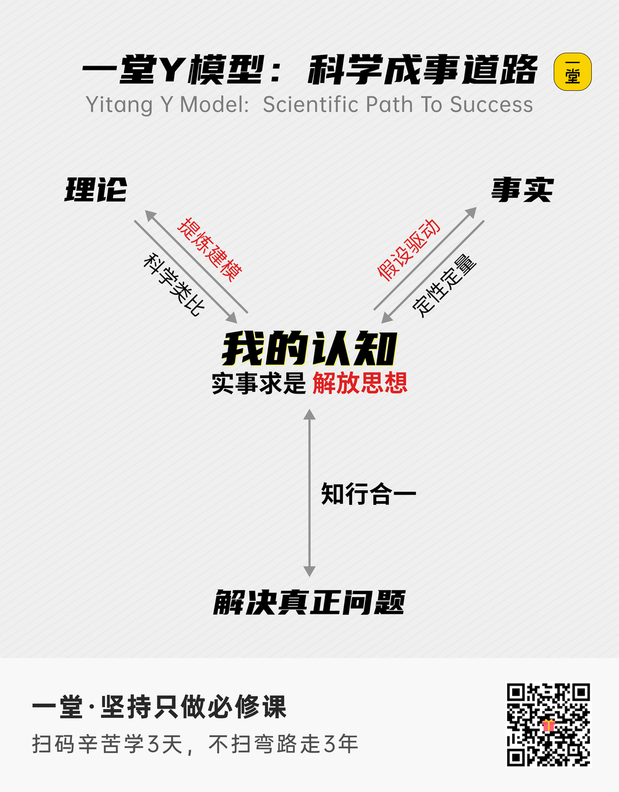

希望我今天的分享，可以给大家带来一些启发和帮助！

欢迎大家和我聊 AI，聊产品，聊业务。也欢迎大家带着自己正在解的题一起交流，一起用Y模型去探索更多未知的星辰和大海。

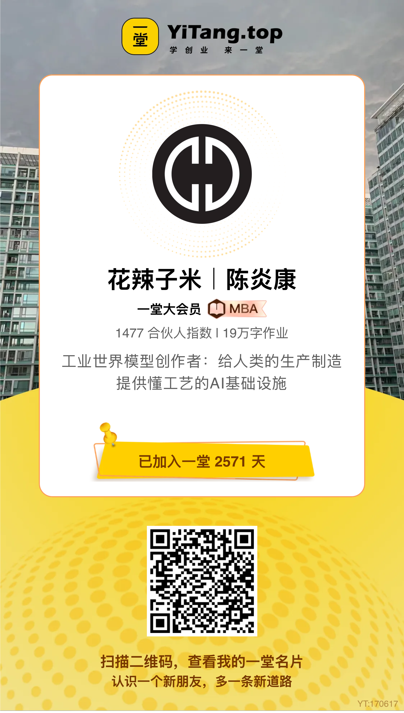