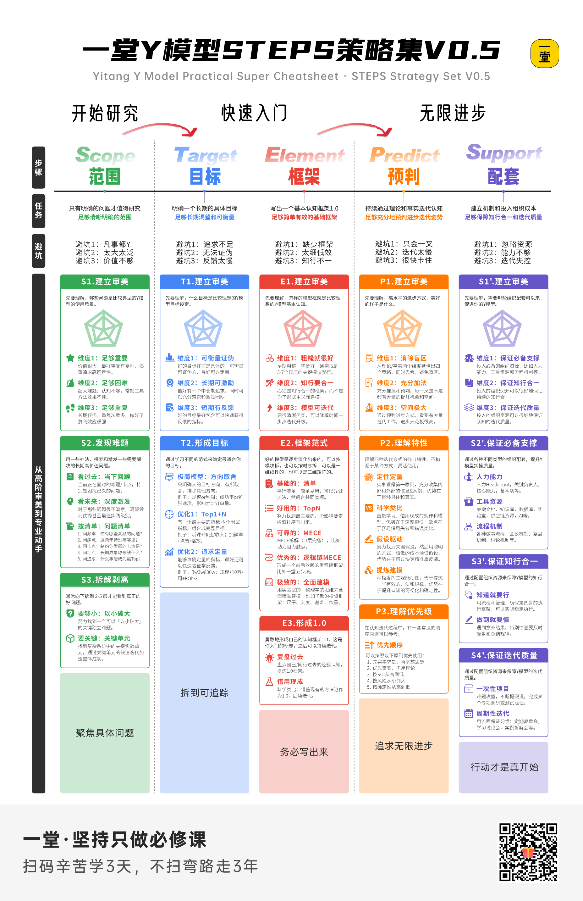
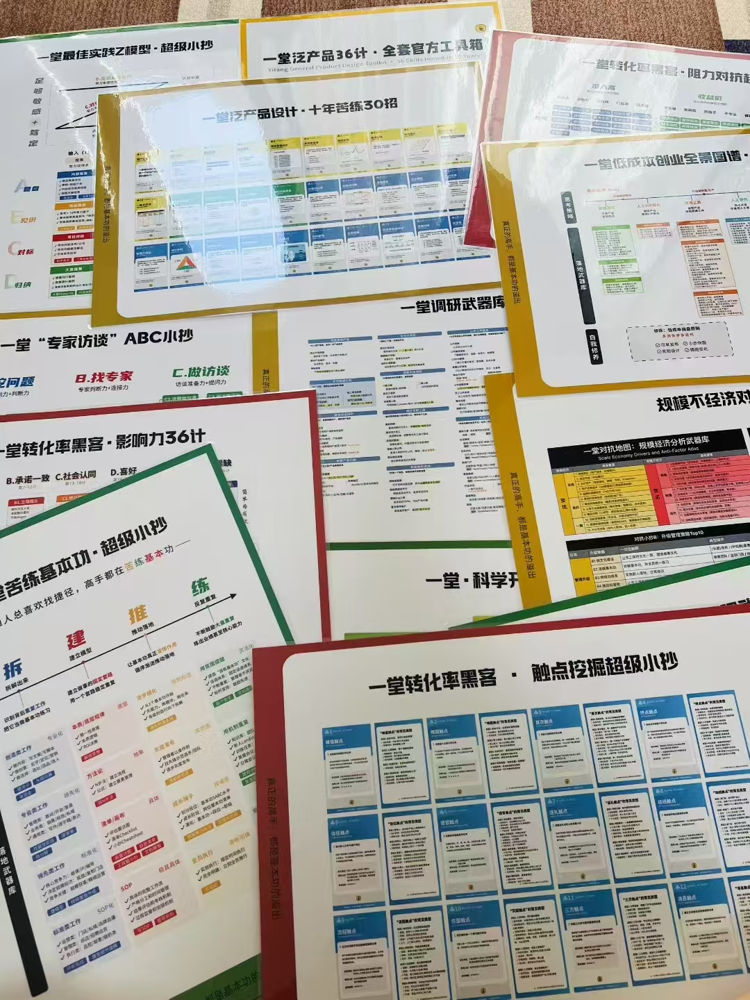
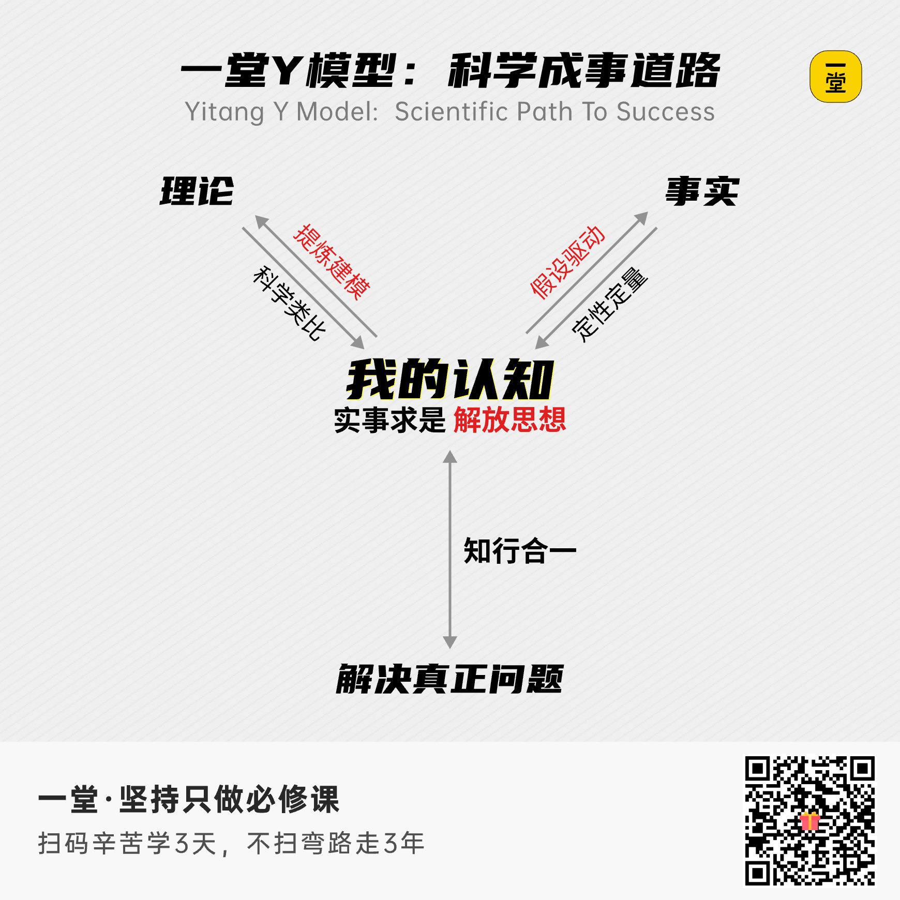
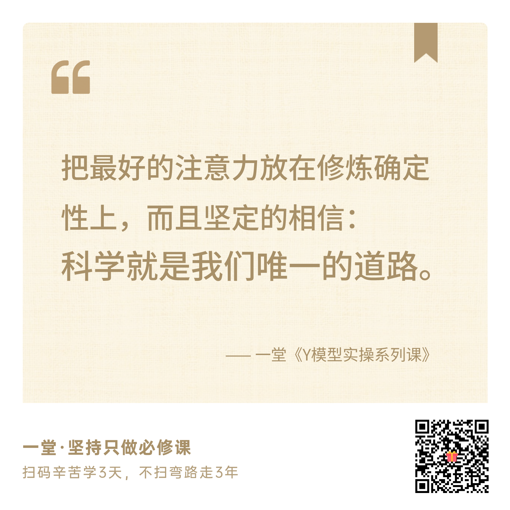
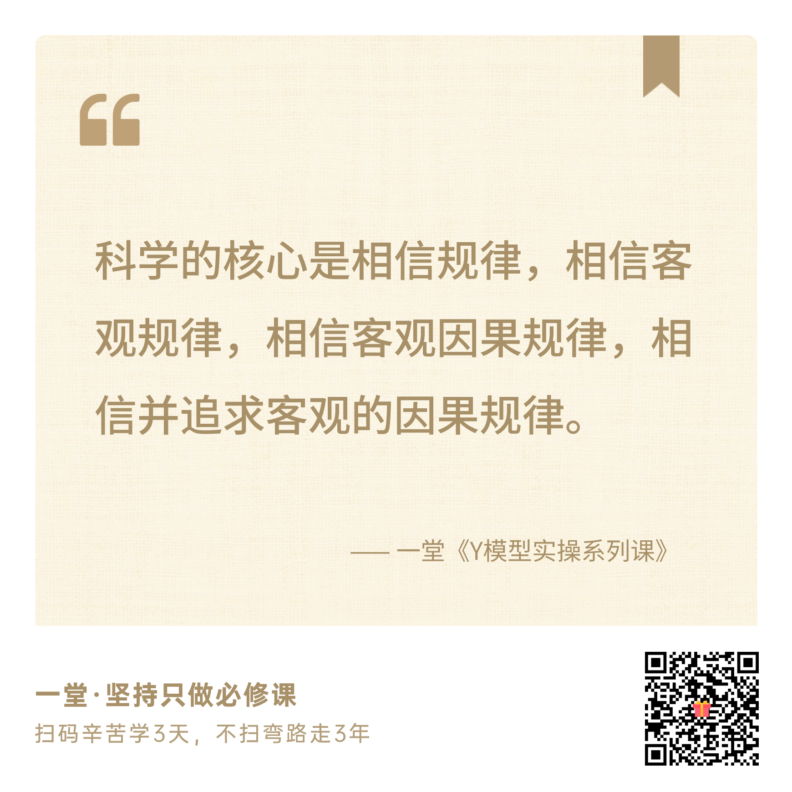

## 作业与Candy

这节课，我给大家留了三个作业，你可以3选1完成。当然我鼓励你听完课后，都尝试写一写。

> 🔗作业链接

> https://yitang.top/homework/Xlmx6ae1cf86d9c1/edit?_uds=pd_doc

**第一个作业：我的学习心得。**

这节课我们请来了业务高手徐剑、教练高手莫非、AI高手花总，分享了他们眼中的Y模型，以及他们在真实业务中的落地。

听完之后，你有哪些新的理解和启发？哪些内容让你印象最深？请挑选其中的1～3个点，结合自己的经历，聊聊你的想法和收获。

**第二个作业：我的无意识科学清单。**

尝试用Y模型去组织你的无意识科学清单，列出你做成过、但一直说不清自己是怎么做成的事。然后给每一件，试着写出左叉是什么，右叉是什么，认知是什么，回到现实又是什么。

**附加题：Y模型教学的大胆假设。**

Y模型这个课题非常底层，也非常抽象。一堂想要把他作为战略级课题在新人阶段就推出来。假设现在让你穿越回过去的新人视角，你觉得学习这节课的卡点是什么？你认为一堂该怎么教你，更容易让你接受？

注意：最后2个作业**默认公开**，如果有特别具体&敏感的信息，请提前脱敏。提交作业会进入我们的案例库。

**【Flag🙋】**这节课做起来很辛苦，希望大家不要辜负。

来来来，希望大家一起立一个Flag（承诺），认真听课吸收，最后完成这次训练作业。

扣一句话吧：**一定作业！！ **

提醒：新课免费内测，请务必按时学习提交作业，3次报名内测不写作业，后面不会再邀请。

**🎁 作业奖励Candy**：
1. **徐剑Y模型重构作业合集：**精选5份用Y模型思路重写的作业，帮助大家偷窥大师兄如何练Y模型
2. **莫非NPC领导力培训的PPT：**S级私董会NPC专项的「Y模型x出口式咨询」3小时培训ppt
3. **花总使用频率非常高的skill：**AI和人协作写笔记的skill 「Notes to done」

### 奖励任务环节：特别礼物

最后，这次教研组的大家派我给大家送礼物，大家可以直接扣口令**「我请客」**完成小任务，就可以领这次的特别礼物了。

这次我们给大家准备了1个礼物，是Y模型实操落地工具：**《一堂Y模型STEPS策略集V0.5》**。

这张小抄最大的价值，就是帮你把一个“我想长期做好的课题”，一步步变成**有明确目标、有基本框架、有迭代方向，也有行动配套的科学实操方案**，真正找到“快速入门、无限进步”的路径。

拿到之后，你可以放在办公桌上，或者带到团队讨论里。每次研究一个新课题，或者一个老问题迟迟没有进展，就对照着看一看：问题是不是定得太大了？目标有没有判断好坏的标准？下一步还有哪些值得验证的机会？

你可以从眼前一个具体问题开始，一次次练习，把积累下来的认知和能力带到更多课题里。**这是一套值得以十年为单位反复修炼的科学做事基本功。**

那怎么领呢？任务在这儿：）

截止**周三中午12点**：你只要**成功邀请1个人及以上**，就可以获得A3硬膜塑封版的**《一堂Y模型STEPS策略集V0.5》**。

**【报名🙋‍♂️】**评论区扣一个口令：**我请客**。班班会在**当日/次日下午**把下面这组图片发给你，图片上的二维码换成你的ID定制版，分享图片、邀请同学即可，记得查收。

> 注意：观看录播回放的同学也可以扣「我请客」，领取任务，触发卡片~

你邀请来的同学，可以**免费免审**，绿色通道直接上课；而且朋友写作业可以**永久计入你的合伙人指数**。

再次感谢一堂的邀请！感谢一起参与分享的徐剑大哥和莫非老师，感谢今晚在直播间、之后听回放的各位同学，感谢今晚在直播间幕后工作的一堂的工作人员！

江湖再见！