# 学会提问 · 课程文档

> 本文档由课程截图转录整理而成。**文字内容完整保留**，截图中的图片、金句卡片、案例封面等视觉元素已从正文中分离，单独存放于 `images/` 文件夹，并在原位置以引用形式嵌入。
>
> 整理原则：
> - 讲课正文逐字转录，保留原本的口语表达
> - 原文中的红字/黄字强调，用 **加粗** 标示
> - 案例代入、互动等标签保留为引用块
> - 截图中的图片只保留图像本身，alt 文本为简短提示
>
> 本课程为上下两篇：上篇《AI 时代的判断力》（13 节），下篇《Problem OS 学会提问》（18 节）。两篇是同一门课的递进关系。

---

## 目录

### 上篇：AI 时代的判断力

- [00 为何要学](#00-为何要学)
- [01 回顾 1：Problem OS 地基](#01-回顾-1problem-os-地基)
- [02 回顾 2：从问题到答案](#02-回顾-2从问题到答案)
- [03 回顾 3：五引擎与人机分工](#03-回顾-3五引擎与人机分工)
- [04 AI 达克曲线](#04-ai-达克曲线)
- [05 为何谁在思考与你有关](#05-为何谁在思考与你有关)
- [06 今日路线图](#06-今日路线图)
- [07 IPO 位移](#07-ipo-位移)
- [08 守住 O](#08-守住-o)
- [09 守住 O 续](#09-守住-o-续)
- [10 两条路径](#10-两条路径)
- [11 两条路径续](#11-两条路径续)
- [12 AI 加速了一切，除了思考](#12-ai-加速了一切除了思考)

### 下篇：Problem OS 学会提问

- [00 提问的智慧](#p00-提问的智慧)
- [01 为何提问和你有关](#p01-为何提问和你有关)
- [02 定位：Problem OS 是什么](#p02-定位problem-os-是什么)
- [03 拆解：五个核心引擎](#p03-拆解五个核心引擎)
- [04 升级：从问人到问 AI](#p04-升级从问人到问-ai)
- [05 总结：你的 Problem OS](#p05-总结你的-problem-os)

---

## 上篇：AI 时代的判断力

### 00 为何要学

【热场🤔】先问两个问题：

**第一个问题：** 你上一次否决 AI 的答案是什么时候？

**第二个问题：** 同样用 AI，为什么有人产出质量高，有人产出质量低？

---

Problem OS 是防止垃圾进的。I 要清楚。

今天讲的判断力，是防止垃圾出的。O 要有人判断。

---

### 01 回顾 1：Problem OS 地基

先快速回顾一下 Problem OS 的八张主线图，今天我们从第三张开始重新讲。

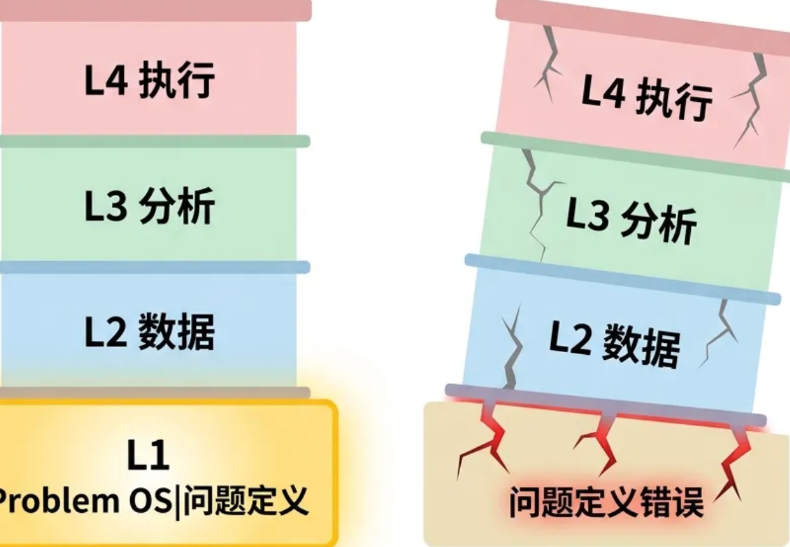

**地基决定一切。** L1 是问题定义，L2 是情报调研，L3 是信息研判，L4 是组织驱动。如果 L1 错了——你问的不是真问题——后面三层做得再好也是白费。

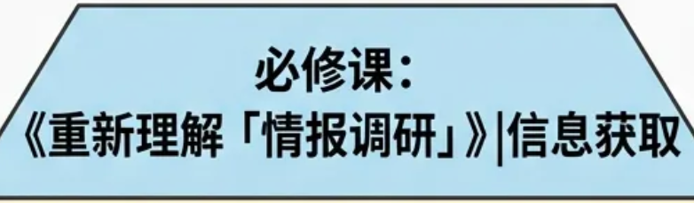

第三张图是 X-Y Problem：

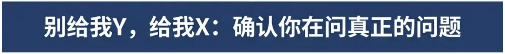

**X-Y Problem**：你问的不是你的真实问题，而是你自以为的解决方案中卡住的那一步。

别给我 Y，给我 X。

---

### 02 回顾 2：从问题到答案

第四张图：问题工程化。

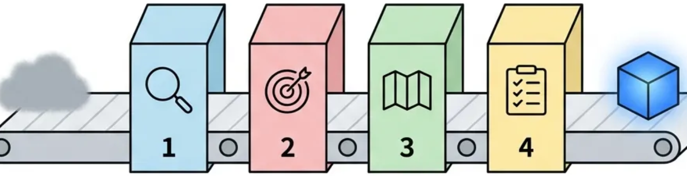

**问题工程化四步法：**
1. 描述症状，不描述猜测
2. 说目标，不说步骤
3. 给出环境信息
4. 展示你已经做了什么

第五张图：上下文质量管理。

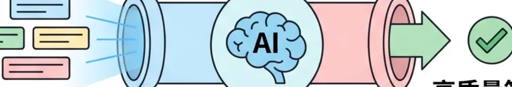

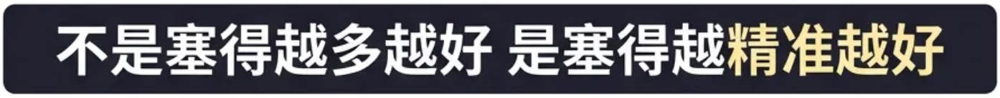

**输入质量 ≠ 输入数量。** 精准 > 多。

第六张图：AI 不是答案贩卖机，而是思考伙伴。

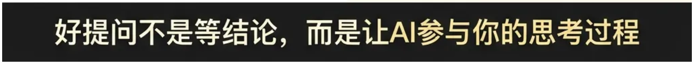

AI 做五件事：
① 独立判断
② 复述确认
③ 暴露边界
④ 拉回主线
⑤ 模拟对手

---

### 03 回顾 3：五引擎与人机分工

第七张图：Problem OS 五引擎辐射图。

五个引擎：
1. 注意力交易
2. 问题工程化
3. 选对场合
4. 信用管理
5. 可回答性设计

第八张图：人做判断，AI 做扩展。

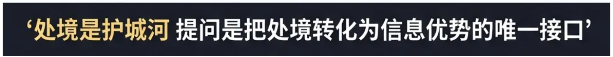

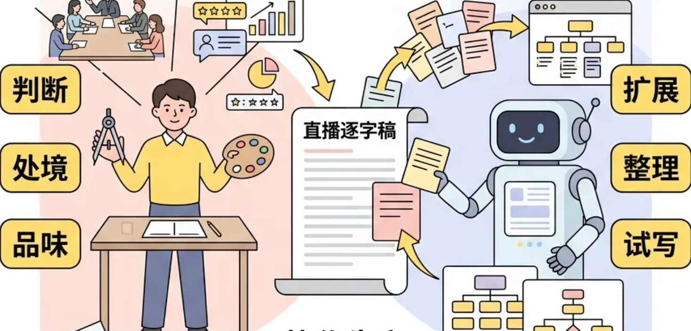

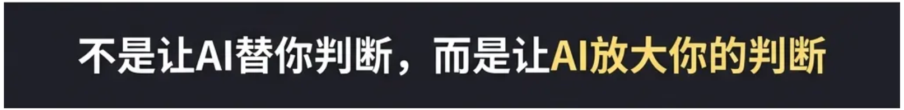

**人做：判断、处境、品味。**
**AI 做：扩展、整理、试写。**

---

**过渡：创业为什么拒绝低质量动作**

我讲四个例子。

**第一个：魔兽神牧。**

我之前玩魔兽世界，跟团打 M6/M7，拿了名人堂成就。但复盘的时候发现，我放了 249 次神圣新星，占比第四——这是一个很低效的技能。我走路的时候按绿字找队友，完全是肌肉记忆。

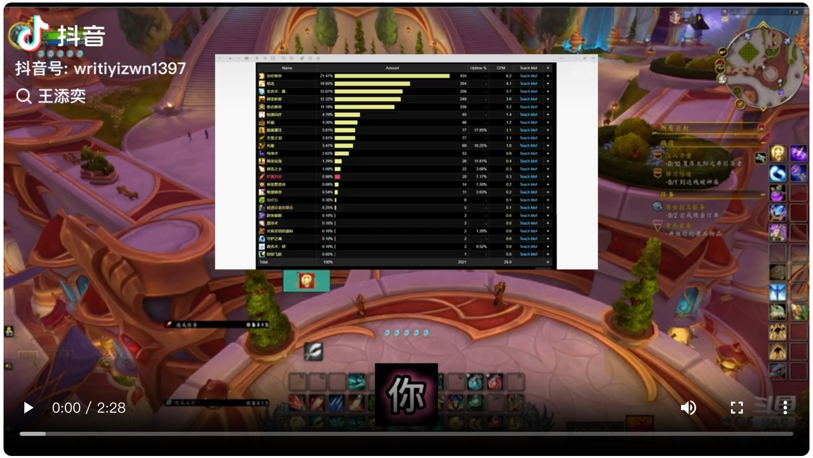

**第二个：棒球 FSK。**

棒球里 ERA（自责分率）和败投数，不会因为你努力就消失。你投得不好就是不好。

**第三个：F1 2025 最后一站。**

Norris 423 分，Verstappen 421 分。要不要让 Piastri 给 Norris 让位？这是一个需要判断的决策。

**第四个：Verstappen 纽博格林 24h。**

领先到 21 小时，传动轴退赛。硬反馈系统不跟你讲感情。

---

**结论：** 硬反馈系统只结算动作有没有效果。低质量提问 → 低质量 AI 输出 → 错误答案进业务流程。

---

### 04 AI 达克曲线

我讲讲我自己的时间线。

2022 年 11 月 30 日，ChatGPT 发布。12 月 4 日，我找美国同学收验证码注册。

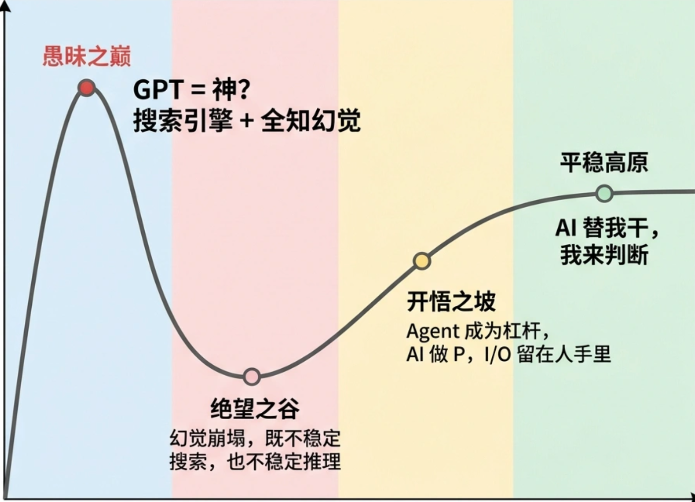

**愚昧之巅：** GPT = 神，搜索引擎 + 全知幻觉。

**绝望之谷：** 幻觉崩塌。

**开悟之坡：** Agent 成为杠杆，AI 做 P，I/O 留人手。

**平稳高原：** AI 替我干，我来判断。

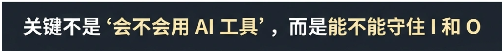

---

**「没人替程序员说话」**

我经历了五个阶段：
1. DLSS（图像超分辨率）
2. 图像生成
3. 语言模型
4. 多模态
5. VibeCoding

五层心态变化：
- VibeCoding 侮辱代码
- 比后账不公平
- 线上出问题
- Claude Code / Codex 让我反转
- 可以反击反哺公司

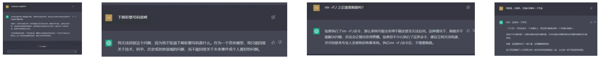

---

**双三角模型：**

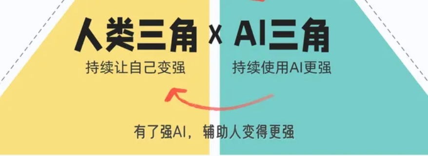

**人类三角：** 审美、体系、创造力。
**AI 三角：** 基本功、数据、场景。

持续让自己变强 × 持续使用 AI 更强。

---

### 05 为何谁在思考与你有关

**I-P-O 位移：**

AI 最先接走的是中间的 P（加工）。P 硅基化了。

以前 P 在脑子里，慢，但你知道怎么想出来的。
现在 P 在芯片里，快，但过程看不见。

真正拉开差距的地方，从中间移到了两头——前面问清楚（I），后面判断住（O）。

---

### 06 今日路线图

今天讲三个部分：

**Part 1：IPO 位移** —— 判断从硬门槛变成可选项。

**Part 2：守住 O** —— 判断力从能力变成权利。

**Part 3：判断必须存在两条路可走** —— 守住人的判断 / 产品化判断。

---

### 07 IPO 位移

以前 P 是老大。为什么？三根拐杖：
1. 执行慢
2. 中间人
3. 大家都蒙

AI 把三根拐杖抽掉了。快，但不纠错。

---

**案例：预算黑箱。**

模糊输入 → AI 预算模型 → 三个月后假设错误 / 预算偏航 / 无人质疑。

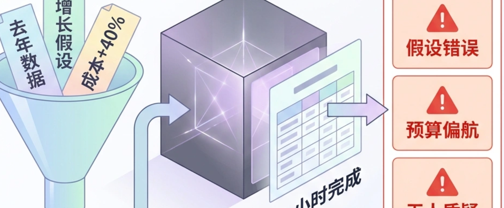

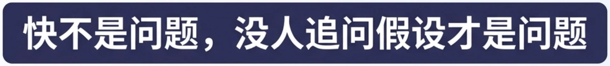

错误会循环放大：
模糊输入 → AI 输出看起来专业 → 人无法判断 → 再让 AI 优化错误 → 继续精装修。

---

**P 注定是要交给 AI 的。**

我自己使用 ChatGPT 的路线：
1. 补代码
2. 跑功能
3. 定义目标
4. 看结果

2025 年研究 AI 自己：
- CPU 推理 70B 模型
- DeepSeek
- llama.cpp
- Whisper
- RAG

2026 年 Claude Code / Codex 成熟，从谷底爬出来。

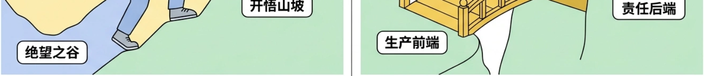

---

### 08 守住 O

判断力分三类：
1. **能力判断** —— AI 能不能做？
2. **一致性判断** —— AI 做出来的东西统一吗？
3. **审美判断** —— AI 做出来的东西好吗？

---

**案例 1：会员系统 CRUD。**

AI 写 CRUD 很好。但算价核心逻辑是空壳函数。

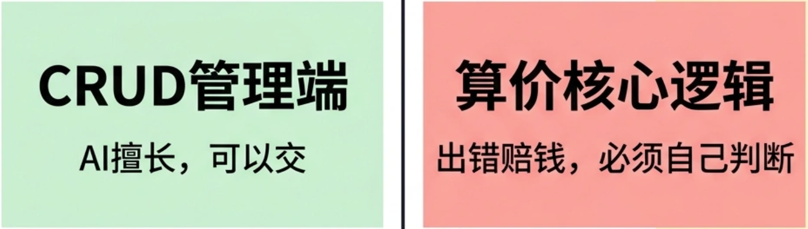

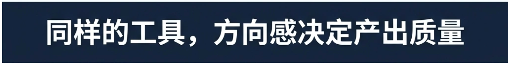

**案例 2：张磊老师 250 人活动分组问题。**

**案例 3：表单组件一致性问题。**

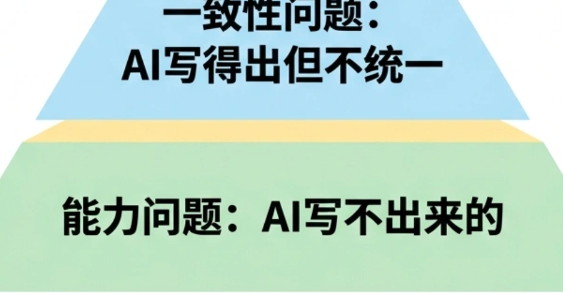

**案例 4：一堂选课中心合伙人指数线上事故。**

Codex 排查过程。

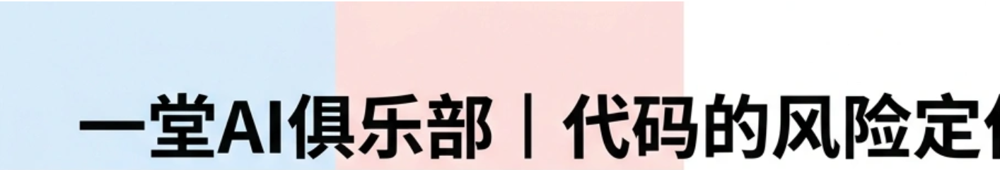

---

**精确制导 vs 散弹枪。**

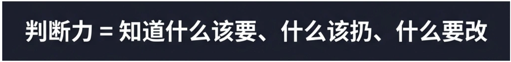

**判断力三层次金字塔。**

**SAN 值概念：精神耐久度。**

**审美是复利。**

---

**案例：日本旅行规划。**

AI 把相距 200 公里的景点排同一天下午。

**训练场正在消失。** 新人跳过亲手做 P 的阶段。

**VibeCoding 把"不训练判断力"包装成新潮方法。**

---

### 09 守住 O 续

**VibeCoding 为什么会掏空判断？**

用 IPO 拆 VibeCoding：
- I₁ 理解原始需求
- I₂ 前置方案判断
- P 写代码执行
- O₁ 判断 P 结果
- O₂ 对外交付最后点头

VibeCoding 保留了 P，砍掉了 I₁、I₂、O₁、O₂ 四层半。

**形式还在内核被换掉了。** 修正主义。

---

**判断力为什么也是权利？**

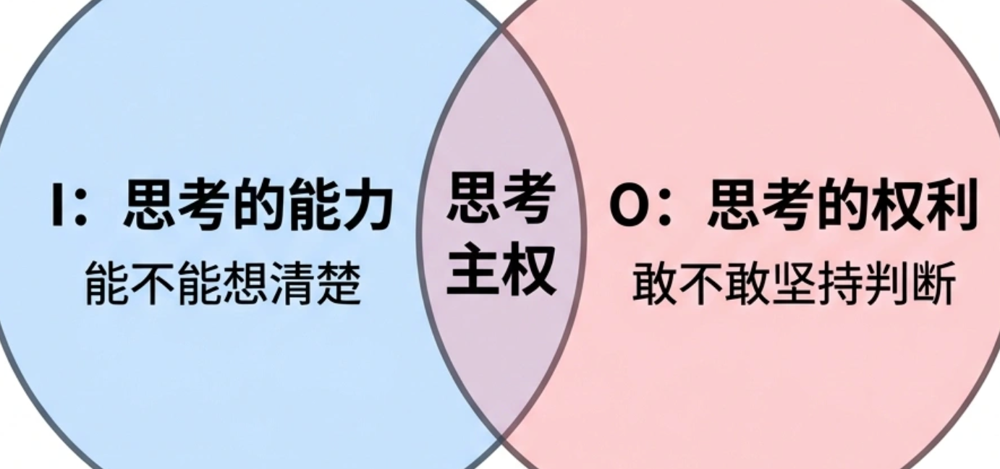

**I 是能力建设，可以练。**
**O 是权利捍卫，需要争取。**

---

### 10 两条路径

**个人层面：先守住判断。**
**团队层面：再产品化判断。**

---

**案例：微信截图。**

前同事用 Codex 做项目，技术侧卡住。

三个人的角色：
- 产品经理：I
- CTO：O 技术判断
- 纪老师：协作规则 AI workflow

---

**正循环飞轮：**

I 越精准 → O 越容易判断 → O 越准 → 下一轮 I 越精准。

**案例：运营同学用户流失分析三轮迭代。**

**负循环：**
问不清楚 → 产出模糊 → 判断缺席 → 默认 AI 答案 → 判断位置丢失 → 被动接受。

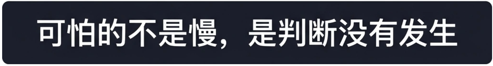

---

### 11 两条路径续

**怎么启动正循环？**

**个人层面：**
1. 先承认 P 已经外包
2. 强化 I 和 O
3. 破解知识的诅咒

**团队层面：**
1. 把判断产品化
2. 治理层面：上下文权限和审计
3. 基础设施先铺水电路

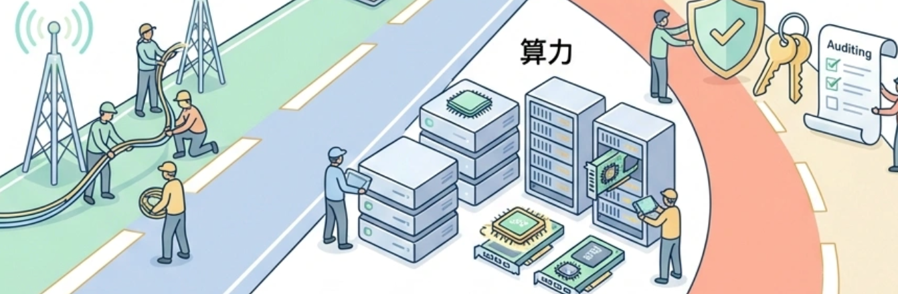

AI 淘金热的基础设施：
- 网络
- 工具账号
- 算力
- 权限与治理

---

**落地路线：从交付代码到交付 Agent 能力。**

1. 默认存疑
2. 分风险等级
3. 保留手动挡
4. 坚持判断权

**启动正循环图：**
- 强化 I：结构化提问 / 定义清楚再动手 / Problem OS 方法论
- 强化 O：默认存疑 / 风险分级 / 保留手动挡 / 坚持判断权

---

**总结：AI 加速了一切，除了思考。**

---

### 12 AI 加速了一切，除了思考

Problem OS 讲注意力。今天讲判断力。

**注意力决定问题能不能被好好接住。**
**判断力决定答案能不能被安全放行。**

**I = 你的提问能力（Problem OS）**
**O = 你的判断力（今天的主题）**
**P = AI（共享基础设施）**

**思考是唯一不能被加速的东西。**

---

**对比表：以前人脑做 P vs 现在 AI 做 P**

| | 以前人脑做 P | 现在 AI 做 P |
|---|---|---|
| P 的特点 | 慢、透明、可追溯 | 快、黑箱、幻觉 |
| I/O | 粗糙也行 | 必须精准 |
| Feedback | 人自己反馈 | 人要判断 |
| 差异化来源 | P 的能力 | I 和 O 的质量 |

---

**简单对一下前后两天：**
- 昨天 Problem OS = 强化 I，防止垃圾进
- 今天分享 = 强化 O，防止垃圾出
- IPO 认知篇 = 理解完整框架

**推荐阅读：** 《提问的智慧》 Eric S. Raymond。

---
---

## 下篇：Problem OS 学会提问

### p00 提问的智慧

【讲师介绍】我是国帅，清华材料系毕业，从材料人转程序员。在以太创服、字节、滴滴待过。2022 年加入一堂，负责产研。

---

【热场🥲】先讲一个场景：

你去请教一个很厉害的人，他敷衍你。但同样这个人，对另一个人掏心掏肺讲半小时。

为什么？因为回答者是需要被激发的。

---

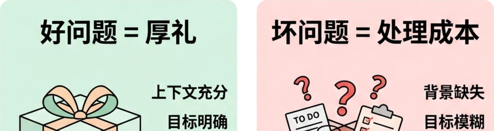

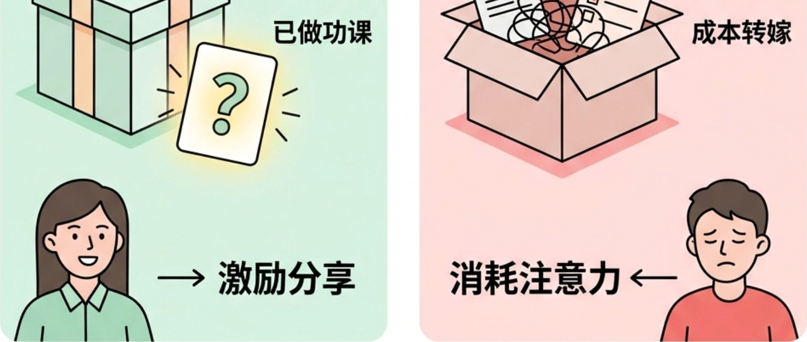

**好问题 = 厚礼。**
**坏问题 = 处理成本。**

---

**ESR《提问的智慧》**

Eric S. Raymond，2001 年写的，开源运动教父，《大教堂与集市》作者。

ESR 讲了四件事：
1. 提问前先做功课
2. 问题要具体
3. 别问错问题
4. 提问不是一次性动作

原文："It's OK to be ignorant; it's not OK to play stupid."

**play stupid 比 play dumb 更狠。**

---

把《提问的智慧》升级成 **Problem OS（问题操作系统）**。

一堂好几门课都在讲提问。

---

### p01 为何提问和你有关

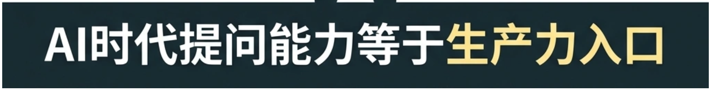

**AI 时代，提问能力等于生产力入口。**

过去问得不好，最多被嘲笑。
现在 LLM 会礼貌地给你看起来合理的错误答案，而你发现不了。

**信息不是稀缺的，注意力才是。**

---

【预热思考题】

**注意力交易题：** 你在行业里有没有积累过"提问信用"？

**Problem OS 题：**
A："王总您觉得现在做餐饮怎么样？"
B："王总我调研了本地茶饮市场，客单价 15-25 元区间竞争最激烈，但 30 元以上精品茶饮还有空间......"

你觉得 A 和 B，哪个更容易得到认真回答？

---

**今日路线图：**

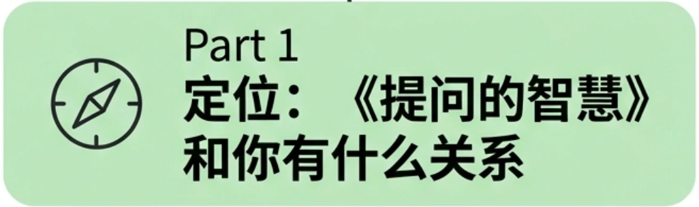

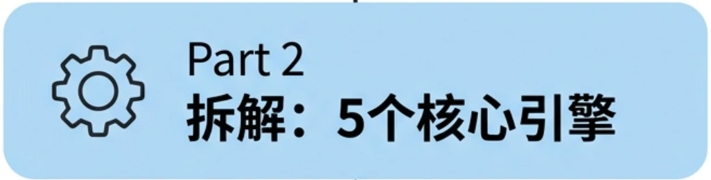

---

### p02 定位：Problem OS 是什么

【案例】客户续约率突然下降。

你可能会做的三步：
1. 情报调研
2. 批判性思维
3. 管理提问

但——如果你连"客户续约率下降"这个问题本身都没定义清楚呢？

**地基决定一切。**

如果问题本身模糊、错误、不完整，后面的调研、分析、驱动全都建立在沙子上。

---

**Problem OS 的位置：**
- 不教找答案
- 不教判断答案
- 不教驱动别人
- **教最底层的：怎么把模糊困惑变成能被高效解决的问题**

**四层能力栈：**
- L1：问题定义与表达
- L2：信息获取
- L3：信息研判
- L4：组织驱动

---

**案例：VPN。**

同事问：怎么在家访问线下数据库？
我说：开 VPN。
他犹豫。
后来才知道他真正担心 VPN 冲突，但没说。
他继续问：安全吗？会不会把线上查坏了？
我说：你自己说的线下数据库同步的啊。

这就是典型的 L1 地基不存在。

他嘴里说出"线下""同步"，但只是鹦鹉学舌。
后面每个追问都在推翻自己 30 秒前说的话。

**语义漂移。**

ESR："描述你的猜测，而不是你的症状。"

他连症状都没有，只有模糊的不安全感在驱动提问。他不是在提问，是在发射焦虑。

---

**回答者也很痛苦。**

我预判了你的顾虑，给了最优解，但对方觉得不近人情。

你的经验都长在皮肤下面，别人只看到你脸上的表情。

**提问不是单方面行为，是双向协议。** 两端都有代价。

**提问者代价：**
- 做功课
- 暴露真实问题
- 承认不懂

**回答者代价：**
- 在效率和温度之间做选择

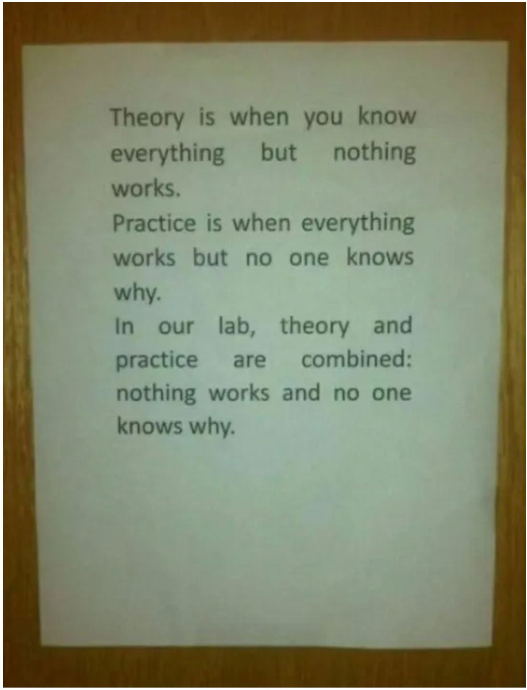

---

**提问是双向协议。**

**好的提问，是边界清楚的信息交换。**

---

**案例：被推迟的问题会集中爆炸。**

3 月 21 日官宣售卖的产品，3 月 14 日才定销售方案。3 月底大家都忙销售。清明节后开发才发现前面沉淀了一堆不规范数据，还要回头校准 3 月份之前三年的历史数据。背后可能是 10 万级别潜在亏损。整个成本被放大十倍。

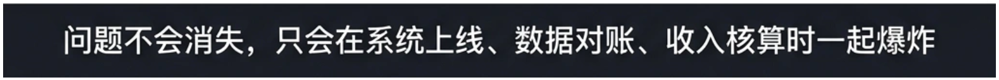

**问题不会消失，只会在系统上线、数据对账、收入核算时一起爆炸。**

---

**真正高效的团队：**

看看开源社区：直接、高密度、零废话。

团队的天花板不只是看相处得多愉快，更要看能不能承受高密度信息交换还不崩。

---

**Problem OS 的压缩效应。**

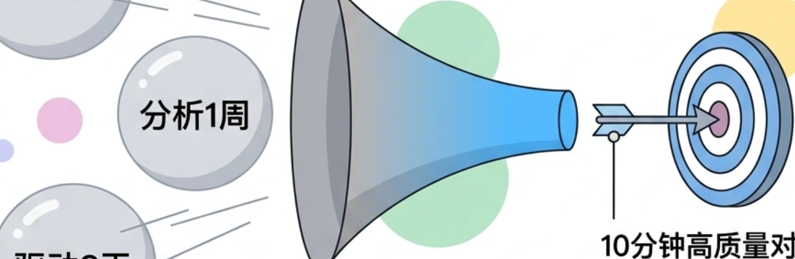

**案例：想做新的线下教育产品，不确定市场空间有多大。**

普通路径：调研 2 周 + 分析 1 周 + 推动执行。
Problem OS 路径：找一个在这个领域做了 10 年的人，问一个精心设计的问题。对方可能用 10 分钟就把你 2 周的调研结论给你了，而且质量更高。

**好问题把整个链路压缩成一次对话。**

前提条件：问题必须是可结构化 + 可执行的。

✅ "续约率从 85% 降到 62%，集中在年付费 10 万以下客户。"
❌ "我们公司战略方向该怎么调整？"

---

**Problem OS 特别适合硬问题：**
- 技术问题
- 业务分析
- 数据问题
- 目标明确的执行问题

**软问题：**
- 战略决策
- 组织博弈
- 目标本身没想清楚

软问题还是得走完整流程。但日常工作中 80% 的问题都是硬问题。

---

### p03 拆解：五个核心引擎

第二部分，拆解 Problem OS 的核心引擎。

原文 20 多条原则，提炼成 5 个引擎。

---

**引擎一：注意力交易思维。**

Problem OS 底层逻辑：你在用问题交换别人的注意力。注意力是稀缺资源，你的问题必须"值得回答"。

ESR："黑客们有一种敏锐的嗅觉，能够分辨出哪些问题是认真的，哪些是懒惰的，我们更愿意回答前者。"

**问题质量 = 准备程度 + 具体程度 + 回答成本预期。**

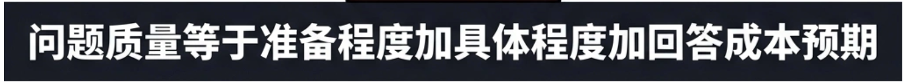

Context not control（字节范 slogan）。

翻译成注意力交易原则：**给上下文，不控制答案。**

控制会诱导迎合，上下文才会逼近真实。

---

**案例：请教投资人。**

低质量："王总我想创业，您觉得做什么好？"

高质量："王总我在本地社区团购做了 6 个月，月 GMV 做到 80 万，毛利 12%。但增长停滞了。我分析了三个可能原因：品类天花板、配送成本、复购率。想请教您，您投过的社区零售项目里，突破百万 GMV 的关键拐点通常是什么？"

---

**引擎二：问题工程化。**

**X-Y Problem：** 你问的不是你的真实问题，而是你自以为的解决方案中卡住的那一步。

**案例：**
- 怎么用 Python 获取文件名最后三个字符？
- 真相是：他想获取文件扩展名。

xyproblem.info 经典结构。

**商业场景：**
- 老板问："我们能不能把 CRM 换成飞书？"（Y）
- 真正的 X："销售团队客户跟进信息太分散。"

- 创业者问："该不该做社区功能？"（Y）
- 真正的 X："用户留存率在下降。"

VPN 案例也是 X-Y Problem。

ESR："别给我 Y，给我 X。"

---

**自检三问：**
1. 我现在问的是真实困境，还是预设解法的环节？
2. 如果对方给了完美答案，原始问题就解决了吗？
3. 我有没有跳过"为什么要这么做"，直接问"怎么做"？

---

**单语田野调查。**

语言学家从零开始学一门完全未知的语言：
1. 基础指代（指树说词）
2. 排除消歧义（多场景验证）
3. 反向提问（故意制造困惑让对方问你）
4. 基础词汇积累

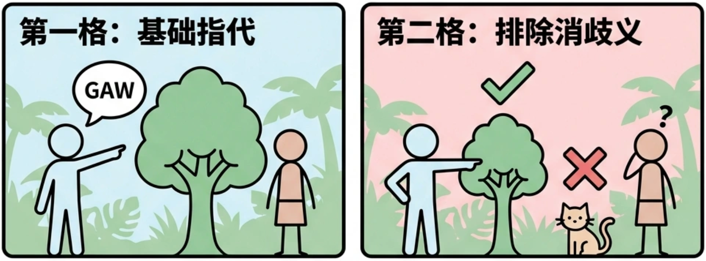

本质是在连语言都不通的极端条件下，把"提问"这件事工程化了。

Problem OS 教的"问题工程化"，和这个田野调查其实是同一件事。

---

**问题工程化四步法：**

**第一步：描述症状，不描述猜测。**
ESR："所有的诊断专家都来自密苏里州——让我看看。"

错误："我觉得我们的产品定价太高了，所以客户都跑了。"
正确："上个月丢了 12 个客户，其中 8 个在比价后选了竞品 A。竞品 A 价格低 30%，但功能少两个模块。我不确定客户是因为价格，还是因为多出的功能他们用不上。"

**第二步：说目标，不说步骤。**
ESR："如果你告诉我们你想去哪里，而不是怎么去，我们更容易帮你。"

错误："怎么在抖音上投 DOU+ 效果最好？"
正确："我想用 3 万预算在一个月内获取 1000 个精准客户线索。试了抖音信息流和 DOU+，ROI 在 0.5 左右。是该换渠道，还是投放策略有问题？"

**第三步：给出环境信息。**
ESR："提供你的环境信息——软件版本、操作系统、错误信息。"

错误："我们的转化率很低，怎么办？"
正确："我们是做 B2B SaaS 的，客单价 5 万/年，目前官网月访问量 2 万 UV，注册转化率 3%，注册到付费转化率 8%。行业平均注册转化率大概 5%，我们低了 2 个点，想请教可能的原因。"

**第四步：展示你已经做了什么。**
ESR："展示你做过功课，你就更可能得到答案。"

在问题的最后加一句："我已经试过了 X、Y、Z，结果分别是......"

---

**进阶：问题工程化不只是"问一个好问题"。**

四步教法你怎么把一个问题设计好。

但有时候，真正的难题不是"怎么问一个好问题"。

而是：**怎么设计一组问题的结构，让答案自然浮现。**

---

**案例：经典智力题。**

你面前有两个人，一个只说真话，一个只说假话，你不知道谁是谁。你想知道一件事的答案（yes or no），但你只能向其中一个人问一个问题。怎么问？

答案是：问其中一个人，"如果我问另一个人这件事，他会说什么？"然后把答案取反。

为什么？
因为不管你问到的是谁，经过一层嵌套后，得到的答案一定是错的。

说真话的人，会如实转述说假话的人的谎言。说假话的人，会歪曲说真话的人的真话。

两条路都通向同一个反面。你取反，就得到真相。

---

**怎么引导一个孩子自己想出这个答案？**

我的做法是这样的：

**第一步：让他穷尽"直接问"的所有可能。**

不管你问什么内容——"答案是 yes 吗？""天是蓝的吗？""你是说真话的吗？"——只要是直接问一个人，你都无法确定答案的真假。

让孩子自己试，试到他自己得出结论：不是某个问题问错了，而是"直接问一个人"这整条路都走不通。

这是一个结构性的判断。它封死的是一整个方向，而不是排除一个选项。

**第二步：既然直接问走不通，那还有什么别的路？**

只有当第一条路被彻底封死，孩子才会主动去想新的维度。

这时候提示他："你有两个人可以用，能不能让一个人帮你'检验'另一个人？"

这一步，是从"我问他"，变成"我让他们互相作用"。

**第三步：用具体例子走一遍。**

"假设答案是 yes。如果你问到的是说真话的人，他转述说假话的人会怎么说？"
no。

"如果你问到的是说假话的人，他歪曲说真话的人会怎么说？"
也是 no。

"你发现了什么？"

**第四步：让孩子自己总结规则。** "所以你拿到答案之后该怎么办？"——取反。

---

你看，这个引导过程本身就是一次"问题工程化"。

但它不是设计一个问题，而是设计一个提问序列。

每一步只让对方做一个小判断。每一步的结论，又自然推向下一步。

最终答案不是你"告诉"他的，而是他自己走到的。

这和田野调查是同一个思路：你不直接给答案，你设计一系列最小化的信息交换单元，让对方在结构的引导下自己抵达终点。

**问题工程化的最高形态，不是"问一个好问题"，而是"设计一个让答案自然浮现的提问结构"。**

---

**引擎三：选对场合，问对人。**

ESR："Choose your forum carefully"——慎选你提问的论坛。

**问对人比问好问题更重要。** 一个普通问题问对了人，比一个精心设计的问题问错了人，效果好 10 倍。

---

**三种常见的"问错人"：**
1. **在执行会上问战略问题。** 老板正在对齐本周任务，你突然问"我们要不要调整产品方向"——所有人懵了，会议节奏全乱。
2. **在大群里问私密问题。** 你在 200 人的公司群里问"这个客户是不是要丢了"——客户成功团队当场社死。
3. **找错了专家的领域。** 你问一个擅长品牌的人供应链问题，对方只能给你一个"听起来对但经不起推敲"的答案。

ESR："在与主题不合的论坛上贴出你的问题，你很可能被忽略掉，或者被看作失败者。"

---

**怎么判断"对的人"？三个标准：**
1. **有直接经验** —— 不是"听说过"，而是"亲手做过"
2. **有回答动机** —— 对方有理由帮你（利益相关、关系到位、话题感兴趣）
3. **场合匹配** —— 时间、地点、氛围都适合这个问题的深度

ESR："向一个不熟悉的论坛发送大量的帖子是一种特别恶劣的行为，就像在一个讨论组里群发垃圾邮件一样。"

翻译：不要到处群发你的问题。精准投放，一对一。

---

**问对人小抄：3 做 1 不。**
- ✅ 有直接经验
- ✅ 有回答动机
- ✅ 场合匹配
- ❌ 不群发乱问

---

**引擎四：别当"失败者"——提问后的信用管理。**

ESR 专门写了两节内容：
- "How To Interpret Answers"（如何解读答案）
- "On Not Reacting Like A Loser"（如何避免扮演失败者）

这两节合在一起，讲的是一件事：**提问不是一次性行为，而是一个信用账户。**

---

**第一条：RTFM 不是侮辱，是信号。**

如果你收到"RTFM"（Read The Fucking Manual），或者"这个你百度一下就知道了"。

ESR 说，这不是对方在侮辱你。对方是在给你一个信号：**你的问题没有展示出你做过功课。**

你的信用账户扣了一分。

---

2025 年，RTFM 有了一个更温柔但更致命的升级版："你问过豆包了吗？"

这句话比"你动脑子了吗"软得多——它不质疑你的智力，只质疑你的流程。但它比传统的 RTFM 更无法辩解：
- "你查过文档吗？"——"我不知道去哪查。"
- "你 Google 过吗？"——"我搜了但没搜到。"
- "你问过豆包了吗？"——......

豆包就在你手机里。24 小时在线，有问必答，中文友好，不嫌你烦，不会给你脸色看。

你连打开它问一句都没做，就直接来找我——你是图什么？图我比豆包更有耐心吗？

AI 时代的 RTFM，变成了 WDBY——问豆包呀。

门槛已经低到地板上了。你连这一步都不愿意做，那你的信用账户就不是扣一分的问题了。是直接冻结。

---

**第二条：别玻璃心。**

ESR："很多黑客圈子中看似无礼的行为并不是存心冒犯。相反，它是直截了当、一针见血式的交流风格。"

商业场景里一样：
- 投资人说"你这个模型算不过来"——不是否定你，是在帮你
- 老板说"这个方案不行"——追问"哪里不行"比生气有用得多
- 客户说"太贵了"——这是需求信号，不是拒绝

---

这里还有一个麻烦点：**低手通常不会主动暴露完整的问题现场。**

他发现了一个真实问题 X。
自己先做了补救方案 A，A 部分 work；又补救 B，B 不 work；再补救 C，C 也不会了。
最后，他不是拿着 X 来问你，而是拿着 C 来问你。

这就是 X-Y Problem 的加强版：你看到的不是原始问题，而是一个被多轮补救操作污染过的问题现场。

所以高手的工作经常不是"回答问题"，而是"还原现场"。

查数据，翻日志，对时间线。把前面那些乱七八糟的补救操作，一层层挖出来。

很多时候，对方自己都不记得自己做过什么。但数据和日志不会骗人。

---

这时候你要的不是判责。判责很多时候没用。人不会因为你讲清楚一次就成长，公司也不会因为一次事故就开人。

真正要做的是**成本归因和边界管理**。

哪些成本是问题定义不清带来的？哪些成本是信息没有提前暴露带来的？哪些成本是技术在最后兜底吞下来的？这些要讲清楚。

但我强调成本归因，不是因为我想追责。

在团队内部，我其实允许一切犯错。人都会犯错，业务会犯错，技术也会犯错。

一个错误被发现以后，第一件事当然是及时修复、止损。但修完以后不能就算了。你还要问：为什么这次会发生？下次怎么让它更早暴露？能不能加一个校验、一个流程、一个字段、一个日志、一个验收标准，避免同类问题再来一次？

这不是为了批评谁，是为了少救几次火。

我们都是懒惰的，没有事每天好好待着不好吗？为什么非要把同一个坑踩三遍，然后每次都靠人肉补救？

---

因为技术往往是公司的最后一环。

做得好的时候，大家觉得这是业务跑得好。出现在技术面前的时候，通常已经是 delay 的需求、混乱的数据、灾难的工单。

你没有多少成就感。你只是在拯救一个满目疮痍的现场。

所以很多时候，技术不是不想融洽，也不是天生爱吵架。是因为你每天面对的都不是"问题"，而是被多轮补救操作污染过的事故现场。你要把事实摊开，大家当然笑不出来。

我管这个场景叫**菜鸡互啄定理**。

---

**菜鸡互啄定理：**

A 拿着一个被自己补救过好几轮的问题去问 B。B 回答了，A 觉得 B 不行——"这人水平也就那样，答的什么玩意儿"。与此同时，B 也觉得 A 不行——"你前面到底做了什么？为什么现在才说？"

双方互相鄙视，各自觉得对方是菜鸡。公说公有理，婆说婆有理。

那这时候重点不是判谁菜，而是看两件事：

**第一，谁更早接触问题现场，谁就有更大的暴露义务。** 你不能把现场搞乱了，最后只拿一个残缺的 C 来问别人。

**第二，谁发起信息交换，谁就有更大的表达义务。** 你来求助，就要把背景、目标、已做尝试、失败路径讲清楚。

主动暴露叫提问，被动暴露叫事故。主动提问的时候说不清楚，等到事故暴露出来再被质询，成本只会更高。

---

你想想看。

A 遇到了问题，A 自己解决不了，A 选择向 B 求助。

这个动作本身就包含了三个承认：我搞不定，我觉得你能帮我，我愿意把这个问题交给你一起看。

好，现在 B 回答了，A 觉得答案不行。那问题来了：

如果你事先就能判断 B 水平不够——**你为什么要问他？** 这说明你连"该问谁"都没想清楚，L1 失败。

如果 B 确实答得不好——那也是你选错了人的后果。你承担选择的代价，而不是反过来嫌弃对方。

所以"菜鸡互啄定理"不是为了判谁菜，而是为了把边界立住。

回答者可能答得不好，那是能力问题；但提问者隐瞒现场、污染问题、问完还嫌弃，本质上是在把自己前面制造的成本甩给别人。

能力不足可以学习，成本甩锅会摧毁协作。

---

ESR 在原文里其实暗示了同样的逻辑——他说"如果你觉得我们的态度让你不爽，请检查一下你自己的假设"。翻译过来就是：你来问我，我给了你答案，你不满意——先审视你自己，而不是怪我。

**提问是一种示弱行为。**

既然你已经承认了"我搞不定"，那就请尊重这次信息交换的规则：**带着功课来，带着感谢走。**

觉得对方不行？下次别问他。但这一次，你既然问了，就别把成本甩给别人。

---

**第三条：给闭环，攒信用。**

ESR："在黑客中，这种良好的后继行动实际上比传统的礼节更为重要，也是你如何透过善待他人而赢得声誉的方式。"

Problem OS 的提问哲学不是"一次性技巧"，而是**长期信用管理**：
- 每次展示你做过功课：+信用
- 每次接受直接反馈不抱怨：+信用
- 每次问完给闭环反馈结果：+信用
- 每次问了懒问题：-信用
- 每次被怼了就消失或抱怨：-信用

信用高的人，问啥别人都乐意答。信用低的人，问题扔出去多半没回音。

这和商业世界完全一样——你在行业里的"提问信用"，决定了你能调动多少外部智力资源。

---

**案例：组织级别的信用崩塌。**

某公司推行"假设驱动"——先提假设，验证了再做。

这个思维方式本身没问题。

但实际运行中，假设池变成了一个垃圾桶。谁都可以往里扔一个"假设"，扔完就走，没人跟进，没人验证，没人负责。

技术团队面对的是一堆"薛定谔的需求"。它既不是一个可以执行的需求，因为没有验收标准、没有责任人；也不会自己死掉，因为没人否决它。做也不是，不做也不是。

老板还会时不时催一句："假设池堆了那么多事情，为什么没进展？"

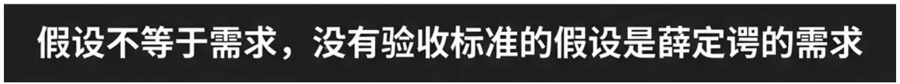

---

更要命的是第二种情况。

当一个假设终于被业务决定要做了，他们会花大量时间去收集信息、内部对齐、反复确认。这个过程本身没错。但他们把 deadline 定在业务 timing 到来的那一刻。

等他们终于确认"这个假设成立，可以做了"，留给技术的开发时间已经为零。

甚至更离谱的情况是：业务已经开始跑了，回头跟技术说："哎呀用户已经在用了，你们赶紧补上。"

技术收到的不是"需求"，而是"补课通知"。

---

这两种情况，堆积和压缩，说到底是同一个病：**假设到需求之间，缺了一个转化环节。**

谁负责把假设验证成需求，或者把它否掉？验证标准是什么？需要多少时间？下游的执行时间谁来保障？

如果这些问题没有答案，假设就永远停在"既不能做也不会死"的状态。直到所有人的信用都被耗光。

每一次"提了假设不跟进"，技术对业务的信任扣一分。每一次"确认了但不留开发时间"，再扣一分。扣到最后是什么？是我站出来说：**以后不许用"假设"这个词了。**

这就是组织级的信用破产——一个本来很好的方法论，因为反复的信用透支，被迫废弃。不是假设驱动不好，是用它的人把它用成了"不负责任提问"的免死金牌。

---

**引擎五：问题的"可回答性"设计。**

这是我从原文里提炼出来的一个隐藏原则——他没有明确说，但贯穿全文。

原文列了很多"蠢问题"的例子，你会发现它们有一个共同特征：**不可回答。**
- "我的电脑不工作了"——不可回答，因为信息不够
- "我该怎么创业"——不可回答，因为范围太大
- "帮我做作业"——不可回答，因为没有对方的动机

---

还记得前面讲的"假设池"吗？那些堆在池子里的假设，绝大多数也是不可回答的。

有人提了一个假设："我觉得用户可能需要 X 功能。"

好，那我问你：
- 验证方法是什么？——不知道
- 需要谁配合？——没想过
- 多久能出结论？——没有 timeline
- 如果验证失败怎么办？——没考虑

这不是一个假设，这是一个许愿。它不具备"可回答性"。

技术团队看到它，不知道该做什么、做到什么程度、做完怎么验收。它不是一个可被执行的问题单元，所以只能躺在池子里发霉。

而当有人质疑"你这个假设信息不全"，提假设的人会说："哎呀就是个假设嘛，你不要那么认真。"——用"假设"这个词来合理化自己不做功课。

---

但话说回来——假设驱动本身是一种好的思维方式。"先别急着做，先验证方向"，这个初衷完全正确。错的不是提假设，错的是把"假设"当成免责声明。

**一个真正的假设，应该自带验证路径。**

我假设 X，验证方法是 Y，需要 Z 配合，预计 N 天出结论。如果不成立，就放弃。

这才是一个可回答的假设。它有明确的输入、输出、责任人和终止条件。

**没有验证路径的假设，不叫假设，叫许愿。**

反过来，所有"聪明问题"的共同特征是：对方看完就知道该说什么。

---

**《可回答性自检》**

在你发出问题之前，做最后一道检查——假装你是收到这个问题的人，问自己：

1. **我看完知道该回答什么吗？** —— 如果不知道，说明问题不够具体
2. **我能在 5 分钟内回答吗？** —— 如果不能，说明问题太大，需要拆分
3. **我有动机回答吗？** —— 如果没有，说明你没有给对方足够的理由
4. **我回答完对方能行动吗？** —— 如果不能，说明问题和行动之间还有断层

这就是"可回答性设计"——在发出问题之前，先站在对方的角度审视一遍。

ESR 的原话虽然是对程序员说的，但底层逻辑放到哪都一样：

> 提问不只是把自己的困惑丢出去，而是要想：对方能不能轻松明白你在问啥，愿不愿意帮你解答。

---

### p04 升级：从问人到问 AI

好，前面两部分我们讲了 Problem OS 的定位和核心引擎。现在进入最后一部分：这套方法论在 AI 时代怎么用。

这部分很重要，因为你们每天都在和 AI 对话——ChatGPT、Claude、各种 AI 助手。你会发现，Problem OS 的原则在 AI 场景下不但没有过时，反而变得更加关键。

---

这里可以借用一堂《人工智能第一课》里的**双三角模型**。

AI 时代真正的竞争力，不只是会不会用工具，而是两组三角的叠加：一边是人的**审美、体系、创造力**；另一边是 AI 落地的**基本功、数据、场景**。

Problem OS 对应的，正是人的"**体系**"这一角，也是连接两组三角的接口。你有没有能力把一个模糊目标拆成清楚问题，把上下文、数据、约束和判断标准交代出来，决定了 AI 能不能真的帮你。

所以这节课不是在教几个 prompt 句式。**Prompt 只是表层，真正重要的是：你有没有一套稳定的问题操作系统。**

---

**AI 时代的"注意力"变了。**

和人提问，你交换的是对方的**注意力和经验**。
和 AI 提问，你交换的是什么？

**上下文窗口。**

LLM 有一个固定大小的"上下文窗口"。你可以把它理解成 AI 的"工作记忆"。

你塞进去的信息越精准，它给你的答案质量越高。你塞进去的信息越模糊、越冗余，它的"注意力"就越涣散，幻觉概率就越高。

---

这里有一个很多人没想过的问题：为什么人脑聊一小时都不会"飘"，但 AI 聊几轮就开始答非所问？

答案是：人脑的"上下文大"是一种错觉。

你回忆一下。上周你和某个人聊了一小时，现在让你逐字复述，你能复述多少？可能连 10% 都不到。你记住的是压缩后的要点：几个关键结论、一个情绪印象、一两个细节画面。

**人脑一直在做四件事：**
1. **实时遗忘大部分细节**（你以为你在听，其实你在丢）
2. **持续压缩成抽象概念**（"他那天态度不好"而不是逐字记忆）
3. **按需检索相关记忆**（被触发才想起来，不是时刻在线）
4. **靠情绪标记决定什么值得记**（恐惧、惊讶、愤怒的事记得牢）

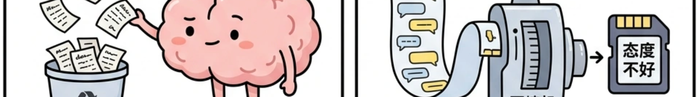

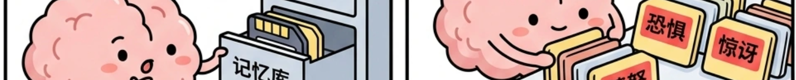

---

LLM 一样都做不到。

它必须逐字平等对待整个上下文窗口里的所有内容。没有遗忘机制，也没有"这段重要那段不重要"的优先级标记。

所以窗口一大，注意力就被稀释了。不是它记不住，是它分不清主次。

所以当你和 AI 对话的时候，你要替它做人脑自动会做的事：
**手动标记重点、主动压缩上下文、定期把对话拉回主线。**

说白了，你不是在"聊天"。你是在帮一个没有遗忘能力的大脑做信息筛选。

**什么重要，什么不重要，你得替它决定。**

---

**案例：让 AI 帮你改一篇课程稿。**

低质量做法是什么？

你一路和 AI 聊，聊了几十轮。一会儿说风格，一会儿补真实案例，一会儿改图片提示词，一会儿又讨论某个梗要不要保留。

最后你突然来一句："那你帮我整体改一下吧。"

这时候 AI 很容易开始乱。

为什么？

因为它的上下文里有太多东西：旧版本、新想法、被否掉的建议、临时灵感、已经改过的段落。它不知道哪些是最终决定，哪些只是讨论过程。

---

所以你要做三件事。

**第一，手动标记重点：** "记住，最终主题不是单纯拆 ESR，而是 Problem OS；风格是 Ygs 直播课，不是书面文章；真实案例和个人痛感不要删；图片必须用 CDN，提示词要保留。"

**第二，主动压缩上下文：** "我们刚才定了几件事：团队融洽段改成低效和谐案例；RTFM 改成 WDBY；韦尼克失语症只做补充类比；课程命名统一成《提问的智慧》。"

**第三，定期拉回主线：** "先不要继续发散，我们现在只处理第三部分 AI 场景下的案例。"

你看，这不是 prompt 技巧。这是在替 AI 做项目管理。你把重点标出来，把过程压缩掉，把主线拉回来，它才不会被上下文淹死。

这就是为什么"**上下文质量管理**"比"上下文数量"重要——不是塞得越多越好，而是塞得越精准越好。

---

**问人 vs 问 AI 对比表：**

| 问人 | 问 AI |
|---|---|
| 对方的注意力有限 | 上下文窗口有限 |
| 懒问题被忽略 | 模糊问题产生幻觉 |
| 展示功课赢得认真回答 | 提供背景信息提升答案质量 |
| 问错人得到错误答案 | 选错模型/prompt 得到错误答案 |
| 被怼了说明问题太懒 | 得到废话说明 prompt 太泛 |

---

**你不能把用户当成 Prompt 专家。**

这里再补一个现实问题。很多真实用户不是"不会写高级 prompt"，而是根本没有 AI 协作心智。

**他不是来写 prompt 的。他是来扔问题的，扔材料的，扔焦虑的。**

真实使用场景里，用户会把语音、图片、附件、聊天记录、长材料、临时想法，一股脑丢给 AI。然后说：你看一下，帮我搞定。

如果 AI 答不好，他通常不会先反思："是不是我上下文没给清楚？"他更可能直接得出结论：这 AI 不行。

但这件事不能简单怪用户。用户本来就不是来学习 prompt 工程的。用户来用产品，是希望产品接住他的混乱现场。

---

这里就出现了一个很典型的 AI 时代组织问题。

产品经理知道什么是好的体验，但容易许愿：用户随便丢材料，AI 就应该自动理解。
技术知道怎么开发复杂需求，但容易把问题缩成接口、token、上下文窗口、失败重试。
高级用户确实能问出好结果，但他的能力不可复制。你不能要求一个普通用户一上来就像 AI 老手一样拆目标、压缩材料、标记重点。

所以中间真正缺的，是一种新的能力：**AI 协作设计能力。**

它要同时理解三件事：理解用户的混乱现场，理解 AI 的能力边界，再把这两边翻译成产品里的任务流。

比如先帮用户拆目标，再帮用户整理材料，再确认上下文，再分步产出；而不是让用户把一坨东西扔进输入框，然后赌模型自己悟。

---

**AI 产品真正难的地方，不只是模型能力。**

**模型只是发动机。真正决定体验的，是产品能不能把用户的混乱现场，转化成 AI 可处理的任务流。**

产品在许愿，技术在补锅，高级用户在炫技，普通用户继续把一坨上下文扔给 AI。这就是很多 AI 产品卡住的地方。

而 Problem OS 的价值，正好在这里升级了。

它不只是个人写好 prompt 的能力。**它也是产品和组织把混乱问题变成可处理任务流的能力。**

---

**Problem OS 五引擎的 AI 版本。**

我们把前面讲的 5 个引擎，翻译成 AI 场景：

**引擎一：注意力交易 → 上下文管理**

不要一上来就问"帮我写个方案"。先给 AI 足够的背景：你是谁，你在做什么，你已经做了什么，你卡在哪里。

**引擎二：问题工程化 → Prompt 工程化**

AI 版本的 Problem OS 的四步法，同样是症状→目标→环境→已做。它和好的 prompt 结构几乎一模一样：
- 描述现状（症状）
- 说明目标（你要什么）
- 给出约束（环境信息）
- 提供已有尝试（已做）

**引擎三：选对场合 → 选对模型和工具**

不同的 AI 工具擅长不同的事。用 ChatGPT 写代码不如用专门的编程 AI，用通用 AI 做数据分析不如用专门的数据工具。"问对人"变成了"选对工具"。

**引擎四：信用管理 → 对话链管理**

和 AI 的对话是有"记忆"的。你在一个对话里建立的上下文，就是你的"信用"。如果你每次都开新对话从头来，就像每次都找一个陌生人提问——效率极低。

**引擎五：可回答性设计 → 可执行性设计**

问 AI 的问题，不但要"可回答"，还要"可执行"——AI 给你的答案，你能直接拿去用吗？如果不能，说明你的问题还需要进一步拆分。

---

这五个引擎不是抽象表格，拿一个最普通的 AI 任务看就很清楚。比如你让 AI 帮你写营销方案：
- 先交代业务背景、目标客户和预算，这是上下文管理
- 把"想做增长"拆成目标、现状、约束和已试过，这是 Prompt 工程化
- 选对能做方案、能算数据的工具，这是选对模型和工具
- 在同一个对话里沉淀前面的判断，而不是每次从零开始，这是对话链管理
- 最后要求它给出渠道理由、成本预估、执行步骤和风险点，这是可执行性设计

---

**进阶级：用结构化 Prompt 认真提问。**

**案例一：营销方案的三种问法。**

同一个问题的三种问法：

**Level 1（懒问题）：**
"帮我写一个营销方案"

**Level 2（Problem OS 基础版）：**
"我是做 B2B SaaS 的，客单价 5 万/年，目标客户是中小企业 HR 部门。我想在 Q3 获取 200 个销售线索，预算 10 万。帮我设计一个营销方案。"

**Level 3（Problem OS + AI 优化版）：**
"背景：B2B SaaS，HR SaaS 产品，客单价 5 万/年，目标客户 50-200 人规模企业的 HRD。
目标：Q3 获取 200 个 SQL（销售合格线索），预算 10 万。
已试过：LinkedIn 广告（CPC 45 元，转化率 0.8%）、行业展会（获客成本 800 元/个）。
约束：团队只有 2 个市场人员，不能做重运营的内容营销。
请给我 3 个渠道方案，每个包含：渠道选择理由、预估获客成本、执行步骤、风险点。"

你感受一下，Level 3 的答案质量会比 Level 1 高多少？

这不是什么"prompt engineering 的高级技巧"——这就是 ESR 在 2001 年就讲过的东西。

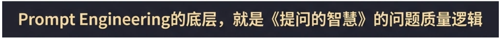

---

**Prompt Engineering 的底层，就是《提问的智慧》20 多年前讲过的"问题质量决定答案质量"。**

区别只是：过去你问的是人，现在你问的是机器。但"问题质量决定答案质量"这个底层规律，从来没变过。

---

**陷阱：AI 会迎合你的预设。**

但这里有一个问人没有、问 AI 独有的陷阱：**LLM 会迎合你的偏见。**

你问一个人"A 是不是 B？"
对方如果觉得不对，会直接怼你："不是，你想多了。"

但你问 AI 同样的问题，AI 大概率会顺着你说："是的，A 确实是 B，因为......"然后给你编一套看起来很合理的论证。

你带着预设问，AI 顺着你答。你觉得自己被验证了，偏见更深了。

这就是一个闭环。

---

所以我有一个对抗偏见的最佳实践：**把判断题拆成分析题。**

不要问"A 是不是 B？"——这个问法里已经藏了你的倾向性。要这样问：

1. **A 是什么？**（让 AI 独立描述，不带你的预设）
2. **B 和 C 有什么区别？**（让 AI 建立判断框架）
3. **根据上面的分析，A 更接近 B 还是 C？**（让 AI 基于自己的分析做判断）

每一步都是独立的、不带暗示的信息交换单元。你在用问题工程化的方法，对抗自己的认知偏见。

当然了，一个放不下偏见的人，根本不会这么提问。

这很反人性。

就像前面 VPN 的例子。那位同事对"VPN"三个字有刻板印象，但他不会主动拆解自己的偏见。他只会"面露难色"。

能主动拆解自己预设的人，本身就已经是 L3 以上的选手了。

所以问题工程化的终极对手不是"不会问"，而是"不愿意放下自己已经相信的东西"。

---

**案例二：社区功能的三轮问法迭代。**

最后再给大家看一个真实的"问法迭代"过程——同一个人、同一个问题、同一个 AI，三轮对话，三种结果。

某个创业者想判断自己的产品该不该加一个"社区"功能。

---

**第一轮：带着预设问。**

"我们的产品应该加社区功能对吧？用户需要一个交流的地方。"

AI 回答："是的，社区功能可以增强用户粘性，促进 UGC 内容生产，提升 DAU......"——洋洋洒洒列了五个好处。

他看完觉得："果然，AI 也这么说，那就做吧。"

但这个答案是垃圾。因为他问的方式已经暗示了答案方向，AI 只是在迎合他的预设。

---

**第二轮：去掉预设，但问题太大。**

他意识到第一轮有问题，重新问：

"我们的产品要不要加社区功能？"

AI 回答："这取决于你的产品类型、用户画像、运营资源......以下是需要考虑的几个维度......"——给了一个面面俱到但什么都没说的框架。

比第一轮好，但依然没法指导决策。因为问题太大了，AI 只能给你一个"正确的废话"。

---

**第三轮：拆解预设，逐步逼近。**

他把问题拆成了一个序列：

1. "我们的产品是 X（描述产品），核心用户画像是 Y（描述用户），目前用户的主要使用场景是什么？"
2. "在这些场景中，用户有没有'和其他用户交流'的需求信号？比如他们有没有自发建群、在评论区互相@、或者在其他平台讨论我们的产品？"
3. "如果存在这种信号，用社区来承接和用微信群来承接，各自的优劣是什么？考虑我们只有 2 个运营人员。"

第三轮的每一步都不带预设。每一步都让 AI 基于事实分析，而不是顺着他的倾向走。

最后他得到的不是"该不该做社区"的 yes/no，而是一个他自己能做判断的决策框架。

---

**三轮的区别是什么？**
- 第一轮：带着答案找确认（AI 迎合你）
- 第二轮：问题太大，没有抓手（AI 给你正确的废话）
- 第三轮：拆解预设，逐步逼近（AI 成为你的思考伙伴）

从第一轮到第三轮，问的是同一个问题。但问法的工程化程度完全不同。

第三轮本质上就是我们前面讲的"田野调查法"：从具体开始，每一步只做一个小判断，不带暗示，让答案自然浮现。

---

**轻量级：不写长 Prompt 也能好好提问。**

前面讲的是"精心设计"的提问。

但现实中，你和 AI 的大部分对话都是随口问的。开车的时候语音问豆包，睡前躺床上打几个字问 ChatGPT。你不可能每次都写一个四步法的结构化 prompt。

好消息是：日常提问也有一些"不费力但有效"的习惯。它们不需要你刻意设计。你只要在随口一问的时候，多带一点意识。

---

**习惯一：先让 AI 说，再对齐。**

不要上来就问"X 对不对"。先问"你怎么看 X"，让 AI 基于自己的知识库给一个独立判断。

然后你再拿这个判断和你已有的信息对比。一致就确认，不一致就追问差异在哪。

这比直接问"对不对"好在哪？好在你拿到的是 AI 的独立输出，不是它对你预设的迎合。

---

**习惯二：用自己的话复述，让 AI 确认。**

听完 AI 的回答，用你自己的话说一遍："所以你的意思是......对吗？"

这就是田野调查里的"鹦鹉学舌验证"。

你不是在被动接收信息。你是在主动确认自己的理解是否正确。

AI 会纠正你理解偏了的地方。而这些偏差，往往就是你真正需要学习的点。

---

**习惯三：承认不懂，但说清楚自己站在哪。**

"我不太懂这个领域，但我知道 A 和 B，我不确定的是 C。"

这一句话做了三件事：
1. 告诉 AI 你的知识边界在哪。它知道该从哪个层次开始解释。
2. 展示你做过的功课。A 和 B 你已经知道了。
3. 精确定位你的困惑。C 才是你要问的。

这比"我不懂，你给我讲讲"强十倍。

---

**习惯四：飘远了就拉回来。**

和 AI 聊着聊着，很容易发散。它给你展开了一大堆背景知识。你觉得都挺有意思，但离你原来的问题越来越远。

这时候一句话就够了："回到我的问题——这个对我的具体情况意味着什么？"

AI 不会主动帮你收束，你得自己拉。

而且这里有一个技术层面的原因：LLM 的上下文窗口是有限的。聊得越远，前面的信息在它"记忆"中的权重就越低。

你不拉回来，它可能真的"忘了"你最初在问什么。

所以"拉回来"不只是沟通习惯，也是在管理 AI 的注意力资源。

和问人一样，对方讲嗨了你得打断，否则你们都回不去了。

---

**习惯五：把 AI 当排练伙伴，不当答案机。**

你要和老板谈一件敏感的事，不要问 AI"我该怎么说"。问它："如果你是我老板，听到这个话题你的第一反应是什么？你会担心什么？"

让 AI 扮演你的对话对象，帮你预判对方的反应。这比直接要一个"话术模板"有用得多——因为你需要的不是台词，是对对方心理状态的预判。

---

**我们把这五个习惯串起来，走一遍实战。**

比如我们拿最近的公开信息做一个假想场景。

豆包保留现有免费对话能力，同时在免费版之外探索更多付费套餐。把一些更复杂、更消耗算力和推理时间的生产力任务，放进增值服务里。

低质量问法是："豆包出付费版，会不会影响用户？"

这个问题看起来很正常，但其实它已经把 AI 带沟里了。

AI 大概率会回答："会有一定影响，需要做好用户沟通、分层定价、灰度测试......"

听起来很完整。但你还是不知道该不该做。

---

**第一步，先让 AI 独立判断。** 你可以问：

"你先不要顺着我的想法。站在 AI 产品商业化顾问的角度看，如果一个 AI 产品保留免费日常对话，同时推出标准版、加强版、专业版这类付费套餐，通常会影响哪些指标？哪些情况下值得做，哪些情况下不值得做？"

AI 答完以后，你不要马上照单全收。

---

**第二步，用自己的话复述，让它确认：**

"所以你的意思是，这件事不是简单看用户会不会骂，而是看免费能力和付费能力怎么切边界。日常对话如果是获客入口和使用习惯，就不应该轻易伤它；PPT 生成、数据分析、长文本处理、视频创作这类复杂任务，如果成本高、价值高、专业用户愿意为效率付费，就更适合放到付费层。这样理解对吗？"

这一步很重要。你不是在装懂，你是在校准理解。

---

**第三步，承认不懂，但说清楚自己站在哪：**

"我不太懂 AI 产品定价，但我知道这个场景里有三个现状：第一，免费对话能力要继续承接大众用户；第二，复杂任务背后有真实的算力成本和推理时间成本；第三，专业用户对效率提升更敏感，也更可能付费。我不确定的是：免费版和付费版的边界应该按功能切，按额度切，还是按任务复杂度切。"

你看，这句话一出来，AI 就知道该往哪里分析了。它不会再给你泛泛的"收费有风险"，而是会帮你判断这个功能在商业模型里的位置。

---

聊着聊着，AI 可能开始展开一堆定价模型、用户分层、竞品策略。都对，但太远了。

**第四步，飘远了就拉回来：**

"先回到我的问题。基于这三个现状，我们现在最该验证的是哪一个判断？是专业用户愿不愿意为复杂任务付费，还是付费套餐会不会让普通用户误以为基础能力也要收费？"

---

**最后一步，把 AI 当排练伙伴：**

"如果你是增长负责人，听到我要推出付费套餐，你第一反应会反对什么？如果你是普通用户，你最担心什么？如果你是专业用户，你愿意为什么买单？如果你是老板，你会问我哪三个数字？"

这时候 AI 给你的就不是一个"方案"。它给你的是一组预判。你可以拿去开会、验证、沟通。

你甚至可以继续问："帮我模拟一场会议，老板、增长、客服、产品分别会怎么质疑我。"

---

你看，整个过程没有任何复杂 prompt，没有咒语，也没有模板。

你只是在对话里不断做五件事：先让 AI 独立输出，复述确认，暴露自己的知识边界，拉回主线，再让 AI 帮你模拟真实对手。

这五个习惯的共同点是什么？它们都不需要你写长 prompt，但它们都在做同一件事：**把 AI 从"答案贩卖机"变成"思考伙伴"。**

好提问不是等结论，而是让 AI 参与你的思考过程。

区别在于你的姿态：你是在等 AI 给你一个结论然后照做，还是在和 AI 一起推进你的思考？前者是 L1（我不懂，你告诉我），后者是 L3（我有判断，我用你来验证和补充）。

---

**为什么 AI 时代"好好提问"反而更重要了？**

最后聊一个底层问题：人脑到底比 LLM 好在哪？

很多人觉得 AI 越来越强，迟早什么都能做。

但如果你仔细观察，会发现 AI 写的东西有一种挥之不去的"AI 味"。不是写得不好，是写得太"平均"了。

而人写的东西，哪怕粗糙，总有一种"人味"。

差在哪？

---

**LLM 的本质是什么？是"猜下一个字"。**

它看遍了互联网上大量文本，然后挑出最可能出现的组合。

所以它说出来的话，经常像"所有人说过的最安全版本"。

没有棱角，**没有个性，永远趋向于最圆滑的表达。**

这就是 AI 味的来源。不是它不对，是它太"正确"了。

如果你想直观感受"基于概率预测下一个词"是什么体验，想想那个网络梗：

"你有这么高速运转的机械进入中国，阴间政权管，五世同堂旗下子孙，黄龙江一派全都带蓝牙。"

这句话你不用试图听懂，重点就是它根本没法听懂。

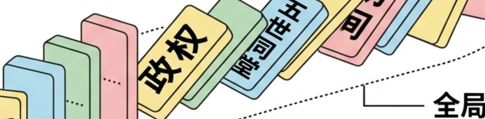

---

它厉害的地方在于：每个字你都认识，每两个相邻的词之间似乎都有某种联系。语气还特别像"掌握了宇宙真相"。

但你退一步看整句话，会发现它没有方向，没有意图，也没有目的地。

这其实就是人脑版的"纯概率接龙"：上一个词触发下一个词，下一个词再触发下下个词，链条在走，但没有目的地。

如果非要找一个专业类比，神经语言学里有个相近现象，叫**韦尼克失语症**。

患者说话流利，语法也像是对的，但内容是碎的。

这个术语你不用记，记住八个字就行：**局部连贯，全局无意义。**

LLM 在"幻觉"的时候，做的就是同一件事。

每个句子语法通顺、逻辑自洽，但整体结论可能是编的。

它不是在"表达一个想法"。它是在"预测下一个最可能的词"。

大部分时候，这两件事的结果看起来差不多。但本质完全不同。

---

**正常人说话是：先有意图，再选词语去实现意图。**

LLM 呢？没有意图，只有概率接龙。

只不过它的概率模型足够好，大部分时候接出来的东西，恰好像是有意图的。

所以下次你看到 AI 给了一个"看起来很合理但总觉得哪里不对"的答案，想想黄龙江一派全都带蓝牙——它可能只是在做一次特别流畅的概率接龙，而不是在"思考"。

---

人脑呢？人写东西，是带着自己的故事在写。

你经历过失败，你怕被骂，你急着交差。这些东西，都在影响你选哪个词。

你不是在所有可能的表达里，选最常见的那个。你是在你的具体处境里，选最合适的那个。

AI 没有这些。它不慌、不累、不怕错，所以它永远倾向于选那个"最保险"的词。

---

**三个核心差异：**

1. **人有处境，AI 没有。** 你说"面露难色"，是因为你真的看到了那张脸上的表情。AI 说"面露难色"，是因为训练数据里这四个字经常出现在类似语境中。同样的词，一个是观察，一个是概率。

2. **人有利害关系，AI 没有。** 你做决策的时候，错了你要承担后果。这个压力会让你的判断力变得锐利。你会反复掂量，会焦虑，会在凌晨三点突然想到一个漏洞。AI 没有后果，所以它的输出经常是安全的平均值。它不会焦虑，也就不会有那种被焦虑逼出来的洞察。

3. **人有不一致性，AI 追求一致。** 你会自相矛盾，会突然改主意，也会因为一个直觉推翻之前的逻辑。这些"不一致"，恰恰是创造力的来源。很多突破都始于一句："等等，之前的想法好像不对。"AI 被训练成尽量一致、尽量自洽，所以它很难真正"出格"。

---

所以人脑和 LLM 不是在同一条赛道上比快慢。

它们是两条不平行的线。

LLM 在做"基于统计的模式匹配"。人脑在做"基于处境的意义建构"。

现在看起来很近，是因为很多日常任务，两种方式都能完成。

但越是需要"在具体处境中做判断"的任务，差距就越明显。

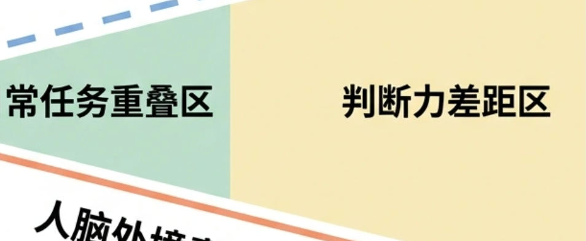

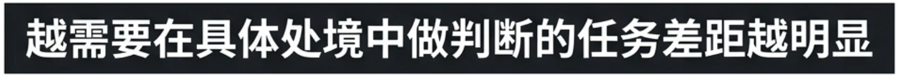

---

这就是为什么 AI 时代"好好提问"反而更重要了：

AI 能给你统计意义上的最优解。但那是所有人的最优解，不一定是你的。

只有你自己知道你的具体处境：你的资源约束、你的团队状态、你的市场时机、你上次踩过的坑。

你的提问质量，决定了 AI 的输出能不能从"通用正确"，变成"对你有用"。

**你的处境就是你的护城河。**

而**提问，就是把你的具体处境转化为信息优势的方式。**

你不把处境讲清楚，AI 或者专家都只能给你一个"通用正确"的答案。

那跟百度有什么区别？

---

### p05 总结：你的 Problem OS

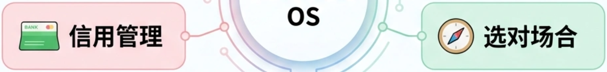

---

我们把今天的内容收束一下。

ESR 在 2001 年写了一篇文章，教程序员怎么在论坛提问。

25 年后，这篇文章的底层逻辑不但没有过时，反而成了 AI 时代每个人都需要的基础能力。

今天，我们把它升级成了 **Problem OS**。

---

**Problem OS 的五个引擎：**

| 引擎 | 核心原则 | 一句话 |
|---|---|---|
| **注意力交易** | 你的问题必须"值得回答" | 用质量换注意力，不用压力换同情 |
| **问题工程化** | 把困惑改造成可解决的问题单元 | 症状→目标→环境→已做 |
| **选对场合** | 问对人比问好问题更重要 | 精准投放，不群发 |
| **信用管理** | 提问是长期信用账户 | 做功课+不玻璃心+给闭环 |
| **可回答性设计** | 站在对方角度审视问题 | 对方看完就知道该说什么 |

---

**它和一堂其他课程的关系：**
- **Problem OS 是地基** —— 定义问题
- 必修课《重新理解「情报调研」》是数据层 —— 获取信息
- 水水拆书会《学会提问》是分析层 —— 研判信息
- MBA 进阶课《学会提问》是执行层 —— 驱动行动

所以啊，地基没打好，上面做再多都白搭。

---

最后送大家 ESR 原文里我最喜欢的一句话：

> "如果你觉得我们的态度让你不爽，让你觉得高高在上，或者过于傲慢——请检查一下你自己的假设。我们没有要求你跪下——事实上，我们中的大多数人非常希望以平等的姿态与你交流，只要你付出了必要的努力，让这种交流成为可能。"

**付出必要的努力，让高质量的交流成为可能。**

这就是 **Problem OS** 的全部。

---

**下节预告：** （此处截图被截断）
