# 高阶建模实操框架篇 · 课程文档（00-09）

> 本文档由课程截图转录整理而成。**文字内容完整保留**，截图中的图片、金句卡片、
> 案例封面等视觉元素已从正文中分离，单独存放于 `images/` 文件夹，并在原位置以引用形式嵌入。
>
> 整理原则：
> - 讲课正文逐字转录，保留原本的口语表达
> - 原文中的红字/黄字强调，用 **加粗** 标示
> - 案例代入、互动等标签保留为引用块
> - 截图中的图片只保留图像本身，alt 文本为简短提示
>
> 章节划分说明：本文档以每张截图顶部真实出现的标题为准。00 节含「开始上课」「快速回顾」
> 「为什么要学」「预热思考题」「提前划重点」五段；07 节顶部为「第一轮思考：三个案例」，
> 08 节顶部为「第二轮思考：三个案例」，节内小标题均来自原文；07/08 节末尾出现的
> 「第二轮思考：三个案例」「回顾复习和作业点评」为下节预告文字，不作独立标题。

---

## 目录

- [00 节 · 开始上课 / 快速回顾 / 为什么一定要学 / 预热思考题 / 提前划重点](#00-节--开始上课--快速回顾--为什么一定要学--预热思考题--提前划重点)
  - [开始上课](#开始上课)
  - [快速回顾](#快速回顾)
  - [为什么要学](#为什么要学)
  - [预热思考题](#预热思考题)
  - [提前划重点](#提前划重点)
- [01 节 · 建立体感：建模的追求](#01-节--建立体感建模的追求)
  - [案例1：文生图的进化](#案例1文生图的进化)
- [02 节 · 案例2：攻坚会的进化](#02-节--案例2攻坚会的进化)
- [03 节 · 案例3：TCP-R的进化](#03-节--案例3tcpr的进化)
  - [第一个阶段：初步分类](#第一个阶段初步分类)
  - [第二个阶段：起正式名字](#第二个阶段起正式名字)
  - [第三个阶段：完备验证](#第三个阶段完备验证)
  - [背后的统一模型](#背后的统一模型)
- [04 节 · 背后的统一模型](#04-节--背后的统一模型)
  - [第一层理解：高阶建模的追求](#第一层理解高阶建模的追求)
  - [第二层理解：高阶建模的训练](#第二层理解高阶建模的训练)
  - [第三层理解：最高频最重要的一组关系和规律](#第三层理解最高频最重要的一组关系和规律)
- [05 节 · 训练思维：流程建模的科学方法](#05-节--训练思维流程建模的科学方法)
- [06 节 · 动手训练：一套框架走天下](#06-节--动手训练一套框架走天下)
- [07 节 · 第一轮思考：三个案例 / 初识工具](#07-节--第一轮思考三个案例--初识工具)
  - [小案例：AI写歌儿追求Top质量](#小案例ai写歌儿追求top质量)
  - [大案例：AI场景落地方法论](#大案例ai场景落地方法论)
  - [初识工具：认领你的卡牌](#初识工具认领你的卡牌)
- [08 节 · 第二轮思考：三个案例](#08-节--第二轮思考三个案例)
  - [小案例：AI写歌儿追求Top质量（续）](#小案例ai写歌儿追求top质量续)
  - [中案例：公司安排你准备年会](#中案例公司安排你准备年会)
  - [大案例：AI场景落地方法论](#大案例ai场景落地方法论)
- [09 节 · 回顾复习和作业点评](#09-节--回顾复习和作业点评)
  - [重新理解"高阶建模"](#重新理解高阶建模)
  - [作业和课后Candy](#作业和课后candy)
  - [作业奖励Candy](#作业奖励candy)

---

## 00 节 · 开始上课 / 快速回顾 / 为什么一定要学 / 预热思考题 / 提前划重点

### 开始上课

Hello，大家好啊，我是Truman，许久未见~~欢迎大家回来继续（来到）上课，进入本周末的成长加速时间。

这是我的介绍，如果直播间有新人的话，自己读一下吧：
1. 以太一堂CEO：2016年加入以太创服，现为合伙人，兼一堂CEO。
2. 前美团产品专家：擅长从0到1业务探索、产品快速起盘、商业分析。
3. 一堂课程总设计师：研发100节创业实操课，收到50万份创业训练作业。
4. 曾创办"易项直通车"：资本对接平台，帮助100+项目融资成功。

【热场🥳】来来来，我们热个身吧，到目前为止，你觉得一堂最难&最抽象&最有价值，同时满足三个条件的课题是什么______

我猜很多同学会讲Y模型，解放思想，实事求是。

今天我们来继续讲《高阶建模》课题，这个课题是一堂过去五年几乎最看家的本领，创业前五年（19-24）这是一堂内部严格保密的KnowHow，几乎有机会把这家公司做成，享受持续的产品红利和溢价最最重要的一个核心竞争力。

在两年前，我们面向少量MBA同学简单做了一次探索营，第一次公开讲了一堂的做课和建模方法，大家反馈积极而热烈。又时隔两年，随着一堂进一步活下来了，以及AI新的变化趋势（建模和体系更重要稀缺）。

于是到了2026年，我们决定正式立项，把《高阶建模》变成一套会员系列课。

❤️解释：为什么叫"高阶"，我们不讲简单的SOP梳理，不讲大公司成熟流程的小优化，而是去持续创新、搭建新的工作体系和方法论，甚至形成Top级别的质量、有行业竞争力/地位的抽象理论。

上节课作为《导入篇》，更多帮大家建立基本的审美和追求，建立《高阶建模》的追求和爬山修炼认识。今天我们正式进入实操篇，要动手学习建模了。

---

### 快速回顾

正式开始以前呢，我们还是照例几分钟复习一下上节课的必知必会，新同学至少能跟上，老同学快速复习，更容易串成一个更大的体系。

上节课，我们把高阶建模这个复杂和抽象的课题，按照难度分成了三大类，分别是：60分-流程建模，75分-抽象建模，85分-本质提炼。

在入门阶段的流程建模，我们重点讲了流程建模的三个重点：及时复盘、清单/sop、稳定使用。

这里面重点展开了一个词：逻辑洁癖，就是对于"高价值模型的低逻辑状态"容忍度很差。

我希望重要的工作建模or整理是"有逻辑"的，但是什么是有逻辑呢？

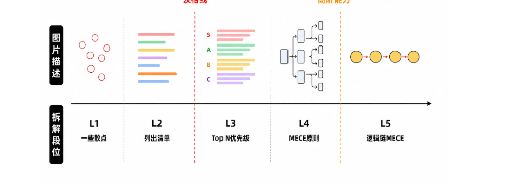

【划重点💡】给大家讲讲这几年练出来的"逻辑洁癖"：
1. 清单：遇到换行就分点，超过七八个就分层。
2. 优先级：遇到决策就分级，找到关键要素/主要矛盾；
3. MECE：遇到建模就完备，争取做到不重不漏。
4. 逻辑链MECE：争取有一个前后的链条，循序渐进推理。

在进阶的抽象建模中，我们提到了抽模型的难点，在于可靠度：

可靠度：有启发<有实证案例<充分实证<没有反例
1. 有启发：听着很精彩，很香，看似很有用。
2. 有实证案例：至少能找到1-2个具体可实证的案例。
3. 充分实证：能找到大量案例实证有效性。
4. 没有反例：理论充分可靠，找不到反例可以推翻。

并且介绍了我们一堂做课，为了追求可靠度，有一个核心理念："千人广场模型"：

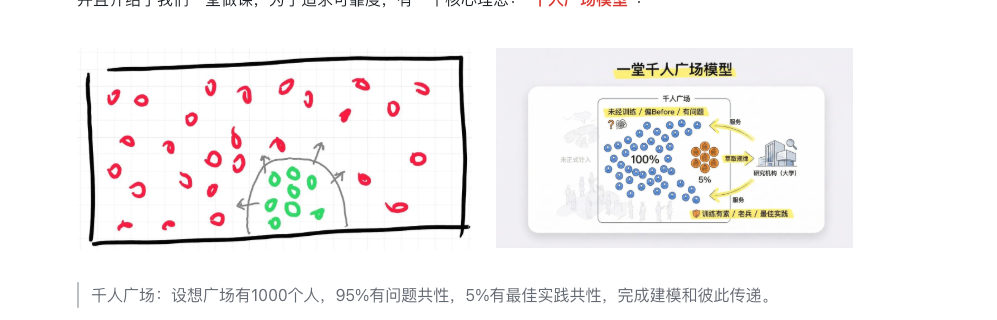

千人广场：设想广场有1000个人，95%有问题共性，5%有最佳实践共性，完成建模和彼此传递。

基于千人广场模型，我们内部建了一套方法论建模的工作流：

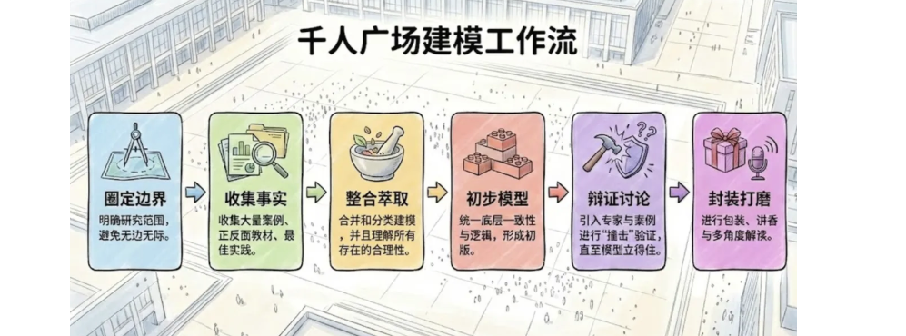

最后，我们给了大家一个段位图，提醒大家修炼"高阶建模"真的是一个足够难而正确的道路，一天可以点燃，三个月可以入门，但如果想成为专家，准备好5-10年吧：

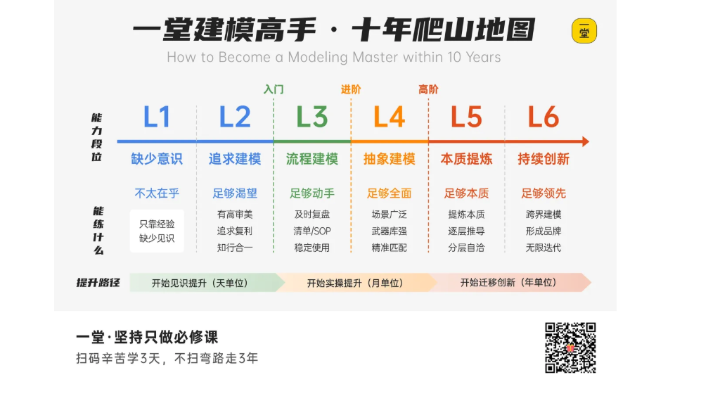

好啦，这就是我们导入篇的内容，从建模的难度上，介绍了三类典型的建模，并且划了一些重点。

今天这节课，我们就会进入高阶建模实操系列：框架篇。

---

### 为什么要学

什么叫流程建模呢？

就是一个"非常重要/复杂/高难度/追求高质量"的工作，如何设计一个步骤和节点，构建一个里程碑/流程，来成倍提升工作质量。

我曾经讲过一个有趣的头脑实验：如果我穿越，从2018年穿越回2026年的一堂，只能呆半天，我会观察什么对于2018年的一堂ROI最高、最值钱。

大家猜猜，我会带回去什么？

我会参加一次周一下午的教研复盘周会，看看完整的《教研顶层文档一页纸设计》，观察一下整个做课的节点和工作流，如果能把这个工作流带回到2018年，估计我至少能少走一半弯路。

简单来说，一堂现在做课的工作流很复杂了：提出课题，预研，充分调研，方法论，干货点，教学框架，内容打磨，逐字稿。

· 其中方法论又可以拆成8个节点：Before/Afeter全面，内核边界，调研最佳实践，形成1.0，十层解读辩证，十层解读讲香，方法论图打磨（教研），方法论图精修（设计师）。

· 其他环节，比如选题讨论，调研，干货点清单，逐字稿撰写，都能拆成3-7个节点。

大家是不是觉得这个工作流好复杂啊，好繁文缛节，好没必要，好徒增烦恼啊？

大家会这么想么？是么？

完全不是。

每周一节方法论研发课，并且保持高水平、高稳定性，而且严格DDL，这是一个极难的行业Top级别难题，我做过一个比喻，我们的难题就像每周带团队做实验研究，必须发一篇原创的顶刊论文，不许停，到点必须发表（内测课），不容有失，连续五年周周如此，否则你就得退学（让用户失望）。

我们必须保证流程可控，而这些节点都是一次次踩坑、回退、推翻才发现的节点啊。每一次跳步都会大大增加风险，所以我们增加了很多确认节点。

今天我来挑战带你建立这样一套实操能力，甚至在"还没踩坑/流血"的时候，就能尽早把这套体系建立起来，少走很多弯路。

今天这节课，我们进入《实操1：流程建模》篇，哈哈坏消息是，《高阶建模》这个课题非常非常难，几乎是一堂最抽象最难的实操课题。

除了底层三座地基《实事求是》《解放思想》和《科学理念》；

但是好消息是，今天这节课是《高阶建模》最简单的一节，也是比较高频、基础的一个建模工作。

---

### 预热思考题

来来，照例，给大家两个预热思考题吧：

第一个题目：AI产品工作流拆解

哈哈，我们在之前工作环境呆习惯了，最近突然AI加速爆发，大量AI新工作/新场景/新难题出现，瞬间解决大量复杂的问题：

1. AI创作：AI做图，AI做PPT，AI写方案，AI做课件，AI写代码。#小，几十上百
2. AI落地：客服电话AI化，AI电商自动化，AI投放素材。#中，几十
3. AI建设：AI知识库建设，AI建立数据资产系统，AIAgent探索工作流，#大，个/十个

面对一个全新的没有解决过的问题，你想建立一套全新的工作流（里程碑），来全面提速，你会怎么搭建和设计呢？背后的规律和逻辑是什么？

第二个题目：如何搭建行业模型

你想在你所在的行业，做一个跨公司的、甚至有江湖地位野心的方法论，类似于一堂五步法、OSCAR模型、AI数据ADAPTED模型等等。

比如投放N步法，IP定位五部曲，出口式咨询三段论，AI FDE七步法等等。这个模型追求的是清晰完备、同题最佳，有机会形成个人or公司的品牌资产，你会怎么建立这套方法论呢？

哈哈这两个都很难，希望大家努力做一个头脑实验，希望今天这节课技术，你能有一个系统的进步和提升。

---

### 提前划重点

提前划一下重点，大家不要迷路，今天我会讲3个话题：

第一部分：带入体感。我会先讲三个真实案例，大家初步体会一下"建模"背后的统一思维方式和追求，这是一堂目前最大的KnowHow所在。

第二部分：切换思维。我们过去只有一种思维方式"事后踩坑复盘"，希望今天我可以给大家一套更科学更高效的全新思维方式。

第三部分：训练工具。我会给大家一套我这七八年，用的最高频、最普遍的一套武器库，这套武器库可以支撑你大概90-95%的高难度流程建模。

提醒1：这节课是纯人类训练课，没有准备Partner，请大家耐心修炼人类三角（审美/体系），不要过早使用AI代偿和偷懒，不然高阶建模能力可能永远学不会了。

当然，参加内测课的同学，最后的最后有奖励卡牌套装，大家可以认领。

对了，同时向大家介绍一下本期磨课研究组的同学：

本期磨课组成员名单

| 角色 | 课题组成员 | 工作 |
|---|---|---|
| 主理人 | 楚门Truman | 把控选题、课程方法论架构和教学设计。 |

---

## 01 节 · 建立体感：建模的追求

第一部分，我先给大家讲三个案例，从简单到难，帮大家建立体感和追求。借假修真，大家感受下这三个案例背后，有没有统一的思维方式和工作框架。

大家思考三个问题：
1. 建模有用么？建模到底是在做什么？
2. 建模的背后，有什么建模的统一思维方式吗？
3. 一堂这些年，本质上的工作是什么？

### 案例1：文生图的进化

这是非常热乎的一个例子，是最近我们遇到一个难题：给课程/线下课配高水平的插图和AI图片。

大家可以想想，怎么做呢？

经典做法就是粘贴一坨课程文稿，然后扔给AI直接理解、分析、设计，然后完成一张图。然后一遍遍抽卡，碰运气，微调。

多数时候，AI做的图就很随机和普遍很难看：

有的时候，就非常好看，甚至惊喜：

如果时间有限，需要在1天之内，伴随着做课做出来20-30张高水平的大图，而且你要带领团队构建一套流程和资产，下次可以复用，再提升一倍的效率，你会如何思考和操作？

我猜很多人会说锻炼审美基本功和封装技能Skill，这个当然是有用的。但最最重要的工作流体系是什么呢？先做什么，后做什么，才能使得整体效率最大化呢？

你如何如何思考和建模？

我带着大家推导一下，我们内部这一个月是怎么进化和迭代的。

版本1：直接贴一段课程内容+简单口喷需求，直接出图。
两步：参考内容和要求 - 直接出图。

大家可以猜猜结果怎么样？

非常差，非常随机，经常是抽卡几十次也没有一个合适的，更别说优秀和眼前一亮了。

然后我们继续升级，版本2：增加了一个设计讨论，讨论清楚再出图。
三步：参考内容和要求 - AI出设计思路 - 再出图

这样就好了一点点，依然很差，非常随机。

然后我们内部有同学开始尝试各种工作流，比如版本3：
四步：参考内容和要求 - 讨论设计风格 - 直接生成5张图 - 选择再生成5张图。

效果好了一些，但是依然弱，而且一次性出5张太慢了，得等5-10分钟才能跑完一轮，效率太低了。

内部跌跌撞撞一直尝试，直到上个月高阶营，我需要在3天内，大概生成50-100张图片，而且对于质量、执行性、准确性有了更高的要求，如果用旧流程，估计难以完成目标。

于是我开始集中一段时间探索，提假设，测试工作流节点：

我发现一张高水平的图本质上，其实取决于四个要素：灵感（魂）+内容+风格+精准度；

这四个谁决定谁呢？大概率是魂儿+内容=》风格=》精准度。

· 怎么探索魂儿呢？口喷感受，AI灵感闪现；
· 怎么敲定内容呢？充分给上下文，然后判断颗粒度，选择入围内容。

怎么敲定风格呢？考虑一致性和背景，然后讨论和设计打样。

怎么提精准度呢？先粗后细，逐步打磨和优化。

这些规律没办法提前设计出来的，是一次次做图踩坑踩出来的，跳步了，跑偏了，推翻了，低效转圈了，一遍遍改，坑踩得足够多，依赖关系和链路才被逼着建立起来。

于是我就摸出了一套更完整的工作流：

给全面上文 - 讨论创意3-5个 - 定创意 - 出示意图3x3 - 挑选 - 再3x3 - 磨内容 - 出初稿 - 打磨

甚至我做完第一天，做了差不多10张图，我就顺便建立了一个里程碑x多线程的模型：

根据不同难度，挑选1-max8个里程碑。
1. 先学习：口喷提示词，给飞书，给Obsidian学习。
2. 说思路：让AI说说思路，可以给ABC不同方案。
3. 磨内容：讨论内容，哪些收录，哪些不收录。
4. 线框图：做线框图，仅黑白灰，看内容排版；
5. 找风格：做3x3组合风格稿件，设计和讨论。
6. 做草稿：选择风格，做一个大图感受和问题。
7. 定成稿：口喷优化点，重新打磨重新做。
8. 做精排：用HTML重新做，每一个问题准确靠谱。

重点是第一次input给足：①参考段落 ②口喷双三角 ③给文稿学习 ④参考图 ⑤过往Skill ⑥调研思考；

注意这是Max里程碑模型，根据同图的难度选择其中1-8个重点使用；

有了这个灵活里程碑模型，我们后面做图就全面加速了：

完整的 AI 做图规划表（前-中-后）：

- 前 · 场景分类：
  1. 金句图：Pixso画图（张力强）
  2. 模块图：Keynote（现成模板，有点是多）
  3. 复杂图：AI文生图（优点是丰富创造力，缺点是慢/容易错，不一致）
- 前 · 内容计划：AI给计划，哪些适合配图和设计。
  1. AI建模：过去作图的规范和思路。
  2. AI巡查：还有哪些作图空间，巡查保证一致性。
- 前 · 设计计划：尽量保证统一的5个策略。
  1. 培养追求：理想是一套，底线是3-4套Max；
  2. 风格规范：约定《设计宪法》，定整体配色，大概的样式，比例。
  3. 分组设计：每一组内容采用同一个Agent，统一规划设计。
  4. 定视觉锤：用统一背景图、统一系列感尽量弥补不一致感；
- 中 · Agent分工：
  1. 设计统筹：统筹分工、统一设计风格。
  2. 设计师们：准备3-5个设计师，多线程按系列作图。
- 中 · 作图打磨：根据不同难度，挑选1-max8个里程碑。
  1. 先学习：口喷提示词，给飞书，给Obsidian学习。
  2. 说思路：让AI说说思路，可以给ABC不同方案。
  3. 磨内容：讨论内容，哪些收录，哪些不收录。
  4. 线框图：做线框图，仅黑白灰，看内容排版；
  5. 找风格：做3x3组合风格稿件，设计和讨论。
  6. 做草稿：选择风格，做一个大图感受和问题。
  7. 完成稿：口喷优化点，重新打磨重新做。
  8. 做精排：用HTML重新做，每一个问题准确靠谱。
- 后 · 如何提速：
  1. 多线工作：多线程分配Agent工作。
  2. 内部多线：完成1.0后，做回顾文档，然后多线程并行。
  3. 复盘技能：把关键工作保存到md文档，封装成技能。
  4. 审美技能：把一些基本的设计规范和原则封装成DesignTaste。
- 后 · 及时测试：
  1. 尽量及时：所见即所得，及时生成HTML测试效果。
  2. 尽量仿真：尽量按同样比例、尺寸的大小来看。
- 后 · 资产沉淀：
  1. 设计规范：设计宪法和规范。
  2. 反馈清单：我给的BA反馈和Checklist。
  3. 设计案例：某一个图怎么一步步迭代出来的（全量复盘）。

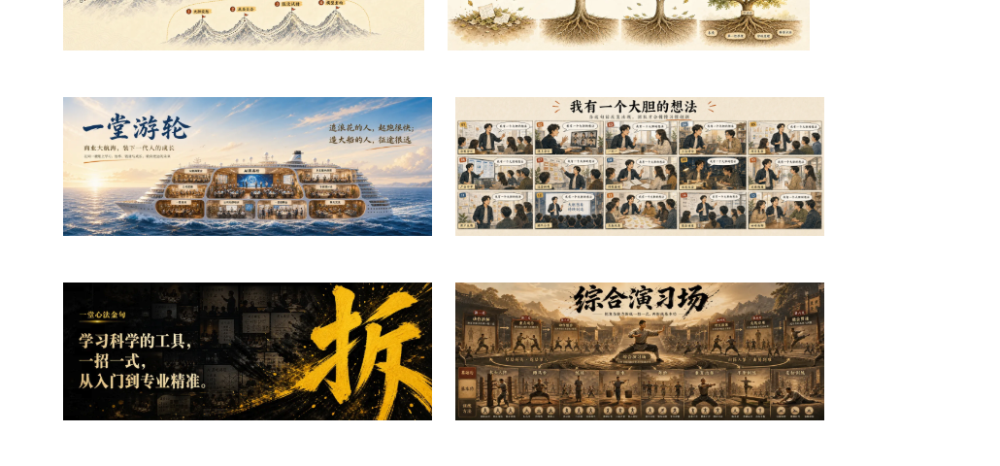

大家感受到了什么？AI协作的工作流有价值么？

背后这套模型是如何建立起来的？

当然你们可以接"抄和借鉴"，但如果你们想自己迁移，自己建如何建呢？

下面来讲，一堂这两年的一个看家本领，攻坚会。

---

## 02 节 · 案例2：攻坚会的进化

大家开过攻坚么？效果如何？

我先简单解释一下："攻坚会"是团队拉满集体决策的攻坚型会议，通常是围绕一个开放+要求很高的一个难题，拉着公司有决策能力的5-15个人，集中3-10个小时现场攻坚解决的一个会议。

典型的比如：销售礼品，马拉松选题，马拉松方法论建模，产品核心设计....这种往往靠一个人的力量，几周估计都无法完成，拉着大家集中做一次现场拉满解题。

这种会议，全面提升了一堂的项目管理和解题能力，也是这两年我们敢于做新项目、做创新业务的底气所在。

【抢答🤩】来了，大家可以猜猜，这种会议最关键的流程是什么？

我猜很多人会说：会前提前准备。

一个反常识的实践总结是，ROI很低，大家本身就很忙，提前准备2-5个小时，往往对结果贡献也不太高，往往现场激发、现场灵感闪现就够了。

最最开始，我们开攻坚会，成功率也就30-50%，很丧，经常开了很久得不到结论。

当时大概的流程是：选择角色 - 现场讨论 - 共识- Truman最后拍板。

问题出在哪儿了呢？

我们复盘发现各种问题效率很低：
1. 聊了半天，发现很多同学没有Get必要上文，都不知道出口和审美。
2. 拆了半天，好不容易有了初步结论，又有了源源不断的新创意和想法；
3. 做了半天，发现去年毙掉的很多选项，又被提上了会议反复讨论。
4. ......

怎么办呢？于是我开始带着复盘，发现一个好的攻坚会有四个核心要素：足够完整和强的参与者，足够明确的出口，足够多的选项，一轮轮足够快速地评估和共识。

于是磨了两年，我们形成了一个一堂Style的攻坚会流程：

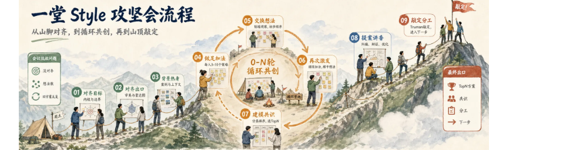

流程分三个阶段：
- 对齐与准备(1-3)：统一目标与审美，建立共同语境
- 循环共创(4-7)：多轮发散→交换→再发散→收敛，直到共识
- 方案打磨与敲定(8-9)：打磨提案，敲定分工，进入下一步

1. 率先对齐目标：今天的讨论内核和边界。
2. 快速对齐出口：回顾过往和审美，明确高难度高价值出口（雷达图）
3. 背景信息热身：带入过往案例、背景信息，充分对齐审美。
4. 充分做足加法：鼓励大家灵感闪现，每个人3-10个策略，榨干。
5. 彼此交换想法：贴在墙上，彼此观察和激发，初步排序。
6. 再次激发激发：基于第一轮，再次激发加法和新想法，榨干。#0-N轮
7. 建模和共识：初步建模，分类，排优先级，选出TopN备选（循环回4） #0-N轮
8. 提案讲香激发：针对TopN，讲香和激发，一轮轮纠偏，辩证和优化。
9. 敲定以及分工：大家共识，Truman敲定，然后完成分工，进入下一步工作。

现在我们的攻坚会基本上成功率能做到80-100%了，基本上能全面提升高难度项目管理的交付上限和稳定性，一堂当初的苦练基本功（拆建推练，双三角，MUSE模型，人生红点五步法）基本都是靠着这套流程做出来的。

大家感受到了什么？AI协作的工作流有价值么？

背后这套模型是如何建立起来的？

当然你们可以接"抄和借鉴"，但如果你们想自己迁移，自己建如何建呢？

好啦，前两个是相对简单一点的流程建模，为了让大家更有体感，我给大家讲讲一堂这两年让我们最意外最惊喜的一个模型是怎么出来的吧。

案例3：TCP-R的进化

---

## 03 节 · 案例3：TCP-R的进化

我不知道大家第一次看到我们发布的这个"TCP-R"模型有什么感受啊？哈哈，如果大家是很多年的管理、咨询专家，大家第一次理解TCPR这个模型以后，有没有眼前一亮的感觉？

这个模型的含金量越来越高，尤其是最近我们探索AI，我发现没有这个模型，甚至我们的YAI都很难启动，这个模型大大增加了我们的业务拆解效率。

我给大家完整复盘一下，这个模型是从0怎么出来的。

大家可以猜猜看，这个模型是一夜之间变出来的么：）

最早时间得追溯到2022-2023年，那个时候我们开始做了一些"供应链建设"的项目：领教营和讲师营，执行过程中，我发现一个很大的问题：不同专家，方向相差太多了。

咨询出身，普遍认知非常宽，但是实操有限。

操盘出身，往往非常具体和务实，但是往往迁移宽度不够。

……

找专家很难找准，大家的对话体系也不好对齐，而且更糟的是，模模糊糊在各个场景会有一些彼此的"不理解"和"不认同"。

### 第一个阶段：初步分类

我们把大家放在一个体系里学习，实在是太难了，培养方向，BeforeAfter建模都完全不一样，所以早期我为了更好交付，模模糊糊分了三个组：讲师组，实操组，咨询组。

有的同学是自己做业务的，他只想把生意做好。

有的同学是做咨询师、做教练的，他想学会怎么辅导别人

有的同学是讲课的，他想学怎么把五步法部署到企业内训和客户公司

时间到了2025年初，当时我和Cherry（麦肯锡一个专家）一直在间歇性探讨一堂的咨询可能性，又一次她参加完MBA集训营，来公司聊天，非常兴奋地讲：

我发现一堂同学之间逐渐出现了分化，刚开始入门学习都差不多，但到了2-3年以后，慢慢发展方向就不同了，你们最好有所区别，我觉得有的偏辅导，有的偏做事，有的偏帮别人，有的偏自己做...

然后掏出笔记本，展示了她发现的一些框架和模型。

我说：巧了么不是，两年前我也有一个，比你这个更简单完备一点。

于是我掏出了模型：讲师，实操，咨询。

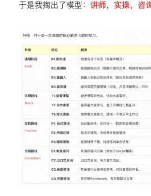

范围：对于某一类课题的核心解决问题的能力。

那一次，我突然被好像击穿了，点透了，一个之前不愿接受的答案涌现大脑：

没有好坏，只是侧重点不同

这些年我们同学之间，我曾经听过无数次各种各样的"偏见"：
这个同学做事不错，但抽象能力太差了，自己做的事情都说不清楚；
这个同学就知道说话给建议，自己动手也不会做啊。
这个同学讲起来一套一套的，但其实自己根本没拿过大结果。
这个同学是国家级的专家，感觉也一般啊，五步法也不会
……

有一天晚上，我在整理公司一些问题，突然发现这个分类非常好用，很多过去的困扰和焦虑都能迎刃而解，于是我很兴奋，后半夜一个人开始试着给这个方法论起名字：

### 第二个阶段：起正式名字

我开始带着AI，各种排列组合，每一个词组合中文x英文，各种尝试和测试，AI给了很多版本，我一直不满意，然后大概做了2个小时，到了凌晨四点多，我突然组合成了一个选项，让我眼前一亮：

【划重点💡】对标互联网协议，这是专家协作的"TCP共识协议"

· T - 教学 (Teach)
· C - 咨询 (Consult)
· P - 实践 (Practice)

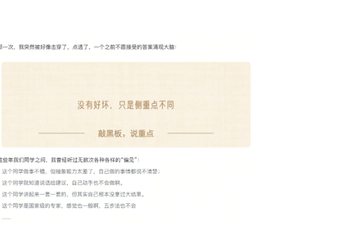

这是一个极其优雅的翻译，英文足够准确简单，拼起来足够扎实好读，而且一语双关。

然后我们达成了初步共识，于是回去我们开始各种爆炸式建模，试图推翻，找各种人往里面代入，最后发现有一类角色没有：研究角色，这个到底是独立的还是属于咨询顾问呢？

### 第三个阶段：完备验证

我们纠结了很久，发现内核很不一样，顾问本质上是面向具体解决方案的，而研究者是面向规律探索和建模的。

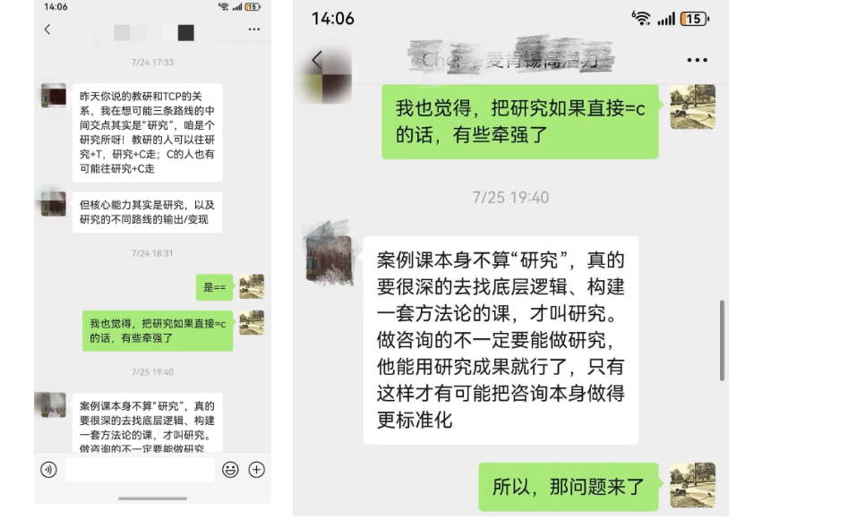

于是我们升级成了四个角色：讲师T，顾问C，实践P，研究R。

而研究是这里面最综合的，通常需要有前三个的背景，不能有大的短板和盲区。

这个阶段结束，我们内部又经历了大概1-2个月，不断给内部分享，用来区分，分类，讨论，发现基本完备，方法论初步成型。

下一步，我们想进一步让大家理解，这个方法论太抽象了，过度压缩的好处是很本质，但是问题是很难理解和使用，体会不到这个模型巨大的价值了。

怎么办呢？于是我们开始试着给这个模型做十层解读和画图。

其实在之前的理解里，TCP这三个是基本上平等的关系，没有强弱，也没有严格先后顺序，所以大概率就是1:1：1的平等关系，但是最后的研究者R呢？

在我们之前的理解里，合格的R的前提，得有TCP的合格水准，不然很难成为一个高水平的R；

于是我们画了一个图：

是这个关系么？我们乍一看很有道理，但是我们磨课，内部某同学给了非常严肃的建议：这个不行，一堂作为R代表，你们不能把自己摆在"集大成"这个C身份上，这个过于骄傲，而且不够辩证。

而且一旦形成压迫感，一堂会变成学员的竞争对手，而非服务者。

我想了想，有道理，那R和TCP是什么关系呢？

【思考】如果用一个动词，形容TCP-R的关系，你会怎么形容呢？

后来我想到了一个词：映射。

一堂鼓励的科学式建模，本质上就是对于客观世界的映射而已，我们所有的失败案例，最佳实践都是来自于你们，而我们刚好是你们的一个影子，我们刚好是最宽的而已。

解读：服务者，贯穿者，统筹者，兼容者。

于是我开始去Google上继续搜"映射""投影"，于是找到了一个示意图：

我们也做了一个一堂的版本，一堂是最下面最宽，最兼容的一条线，而你们TCP才是主角，才是高峰，才是真正推动改变世界的人。

然后我们惊喜地发现，这个图特别像是"古代国王"的头戴宝物，于是起名"TCP-R皇冠图"：

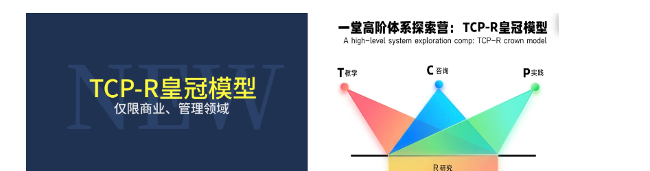

然后为了更好"解压缩"和教学，我们又做了十层解读和一套武器库，一路改改改：

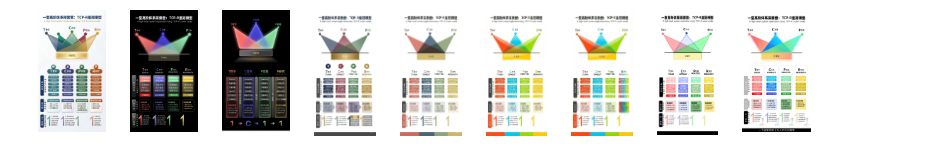

终于完整自洽了，围绕四个角色，配套了各个维度的方法论，小抄，基本功和展开工作流：

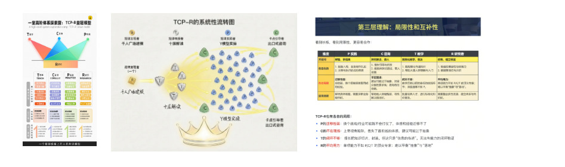

第三层理解：局限性和互补性——看到长板，看到局限性，更易合作。

TCP-R也有各自的局限：
P的迁移性弱：换个战场行业可能就不会打仗了，体质和经验迁移不了
C的不在现场：主要视角限制，丢失了最鲜活的体感，建议可能过于抽象
T的循环不够：擅长把知识切片、封装，但这只是"信息的传递"，无法有能力的闭环验证
R的平均能力：单项能力不如T/C/P的顶尖专家；难以平衡"抽象"与"落地"

我们提炼了一个极其抽象的概念，经过这一轮的方式，大家更多可以"理解和解压缩"，回到真实的世界里，去解决问题。

后面的故事，大家都很熟了，我们基于这个模型，做了YAI的专家库：

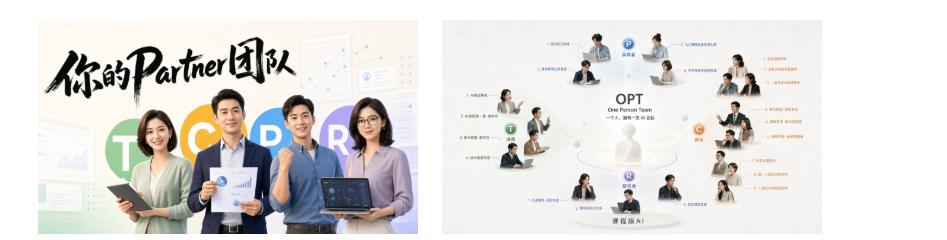

说明：①T的核心是十层解读 ②C的核心是出口式咨询 ③P的核心假设思维 ④R的核心的建模不给观点

这个变成了一堂现在内部每周，甚至每天频率的一个决策模型：建供应链，评估讲师，评估候选人，搓partner，

消除分工摩擦，复盘角色定位。

好啦，文生图/攻坚会/TCPR三个的建模就讲完了，回到之前的三个问题：

1. 建模有用么？建模到底是在做什么？
2. 建模的背后，有什么建模的统一思维方式吗？
3. 一堂这些年，本质上的工作是什么？

大家的答案是什么？

哈哈哈，我们内部总有一个"玄学时刻"

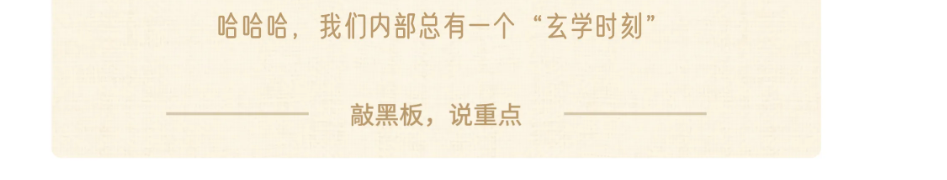

哈哈作为一家追求科学体系的机构，这几年我们内部一直有一个"很难解释的玄学时刻"：经常磨课磨着磨着，大家

各种抛信息，说研究报告，抛想法，然后过了15min（or如厕），我突然就"变"出了一个模型：用一个N步法 or 图

示就把刚才都是解释清楚了，发现非常自洽，一堂很多方法论都是这么变出来的。

这几年一直是一个大黑盒，今年我们为了复制教研+做课，团队逼着我用0.1倍速的慢动作回顾了一个个模型是怎么出来的，把这个过程变成一个可以拆解的白盒。

### 背后的统一模型

---

## 04 节 · 背后的统一模型

### 第一层理解：高阶建模的追求

我们平时建立了很多方法论框架，N步法，工作流，框架图……做这些工作的核心目标是什么呢？

我说一个基本理解吧：我们平时遇到的商业和管理问题太复杂了，我们的中心任务是——

探索出更多"关系和规律"，然后把它"压缩"到一个模型里；

指导实践时候，用这个模型"解压缩"出解法，来全面提升解决问题的水准。

解读1：承认损失，但凡建模一定是对于客观世界规律有损耗。

解读2：抓出解决这个问题最决定性的规律和关系。

解读3：抽象是为了具象，最终用这个模型解压缩出解法出现的。

解读4：模型一定是持续进化的，随着发现新规律/关系不断优化甚至重构。

比如，我们从数百个商业成败案例，总结出了"一堂五步法"：需求，解决方案，商业模式，增长，壁垒。

这里面包含了的关系和规律：拆解，依赖，推导，完备。

这个使用过程中过于抽象，于是我们又准备了一系列的解压缩的手段：起名字，给具体工具，给画布，给小抄……，最终最大程度帮大家在真实业务现场可以解压缩，用来解决真实的业务问题，避免出现那几百个项目的常见失败。

大家跟上了哈？继续推理第二步：具体的工作方法是什么呢？

### 第二层理解：高阶建模的训练

总结一下，高阶建模的训练，有且只有1+4个关键动作：

必要前提：培养对于建模和规律的敏感性和高追求。

建模训练的前提，是培养逻辑洁癖

这是所有的基础，对于复杂的，混乱的，没逻辑的东西保持"不满"甚至"逻辑洁癖"，看着闹心，甚至难以入眠，必须去拆解他，排序她，剥离它，让他完备和有更多逻辑。

比如给大家看一组截图，这些截图你们觉得如何，哪些比较好？

背后有大量的拆解，分类，排序，推理，对比....但是都没有呈现。

这些工作流和模型价值极低。

比如之前我们双三角模型之前的过程稿：

哈哈，大家看着如何？

这些关系和规律一个个叠加到模型里，这个模型才真正有高价值。

【划重点💡】点燃自己建模追求有四个层级：

1. 入门 ROI够高：这个很重要，值得投入精力建立。
2. 进阶 审美洁癖：不接受一大坨，没有逻辑，不完备，没顺序。
3. 高阶 江湖地位：有机会成为核心资产or竞争优势。
4. 顶级 人生红点：建模是长期追求的必经之路，拉满；

有了明确的追求，具体怎么建模呢？

建模训练的关键，是四个必经之路

【划重点💡】建模通用的步骤有四步：

从圈定范围，到探索关系，再压缩成模型，最后解压成可实践的工具。

1. 圈定范围：找到建模的边界和范围，建模必有边界。
2. 探索关系：探索出更多高价值的内在关系和因果规律。
3. 压缩建模：抽象成核心的模型，承载高价值关系/规律。
4. 解压展开：把抽象加工，变成是易用容易实践的模型。

这里面必须要解释一下，"关系"是说两个元素的彼此关联，并列的，映射的，相关的，分组的都可以。而我们指的

"规律"是指客观因果规律，是最强最重要的因果关系，规律∈关系。

先看见关系，再筛出规律——关系是元素之间的各种连接，规律是其中最强、最稳定、最能指导实践的因果关系。

大量关系 → 分组整理 → 重要关系 → 核心规律 → 指导实践

规律能解释现象、预测结果、指导行动

来，举个例子，快问快答，下面这两个图承载的关系/规律的区别是什么？

我们看看出什么关系？

继续，我们能看出什么关系？

好啦，理解了，那问题来了，这么多各种各样的规律和关系，怎么循序渐进学习呢？其中哪些规律是相对容易且价值很大呢？

### 第三层理解：最高频最重要的一组关系和规律

【划重点💡】最高频，最接近科学硬核的一种核心关系：拆解×完备×依赖关系。

· 拆解：把一个复杂一大坨工作，分解成一组关键要素。
· 完备：争取把这组要素找得完备且清晰。
· 依赖：找到这些关系的前后依赖关系，可推导和剥离可演化。

这三个加一起，就是这节课想重点挑战的：流程类建模。

同义词：工作流，里程碑，思维链，N步法。

我们平时需要建立大量的模型，而这类建模，几乎独占50%的重要性。

任何一个复杂业务，都可以拆成"无数种"工作流。

但好的里程碑级别的工作流极其值钱和有价值。

里程碑：不是工作清单，不是待办事项，不是工作时间线。

而是一个从最起点、到最终点的一个循序渐进的推理过程。

讲方法之前，必须先解答一个新人的常见疑问：

灵魂拷问：把一个复杂任务拆解成工作流，是变慢了还是变快了？

一个困扰：本来就是一个工作，拆解成一堆节点/里程碑，增加了很多活儿，工作节奏被大大拖慢了啊。

如果事情很难/复杂/要求很高，整体来说通常是大大变快了的。

1. 变慢/损失：多分析，多思考和确认；
2. 变快/获得：集中注意力，避免推翻，提升高质量。

如果事情很简单/短平快/要求很低/经验很足，那不用拆解也行。

训练思维：流程建模的科学方法

---

## 05 节 · 训练思维：流程建模的科学方法

好啦，今天我们实操先来讲相对简单的流程类的建模。

讲方法工具之前，先问大家个问题：你们平时工作里有很多高价值需要流程建模的场景么？如果敏感性够强的话，

大概什么建模频率？

场景激发：你每年有多少？

我的答案是：至少是每周频率，甚至是每天频率。

流程建模，比想象中的场景普遍很多

这个工作的频率比想象中高很多很多。

比如，我个人来说，过去7天的可以流程建模类的工作：

| 频率 | 流程建模 |
|---|---|
| 单次流程 #单次提效 | 1. 某个关键同事1v1对话； 2. 我给孩子生日买礼物。 3. 敲定大厂内训课表。 4. 设计一个探月开营仪式。 |
| 流程复用 #场景共性 | 1. VibeCoding训练N阶段能力； 2. AI作图工作流。 3. AI PPT高难度课件打磨。 |
| 抽象方法论 #底层迁移 | 1. 公司AI产品探索方法论。 2. 方法论搭建N步法； |

这些都可以用流程建模的方法，大范围提效和提升Top水准确定性。

· Before1：一大坨，想到哪做到哪。
· Before2：todolist，就是一个工作清单。
· Before3：拆解成一堆事项，按照优先级从高到低组。
而After的追求：拆解成A-B-C-D-E-F一组完备的依赖关系。

看一组案例：一堂总结过大量的高价值N步法

1. 关键假设：明确目标-拆解假设-找关键假设-验证假设-迭代假设
2. 一堂五步法：需求-解决方案-商业模式-增长-壁垒
3. 调研黑客：明确目标-缩小范围-罗列清单-获取情报-归因判断
4. 项目管理：定方案-拆计划-管执行-做复盘
5. 深度复盘：成败认定-场景还原-得失分析-总结提炼
6. 工业化生产：定目标-建节点-做加法-做减法-快迭代
7. 转化率六步法：拆出转化率-做加法-做减法-讲香-组合-制作
8. ROI训练：有意识-写初版-细打磨-有共识-做复盘
9. 科学招聘：做判断-写JD-找线索-做评估
10. 知识管理：偶遇-获取-整理-消化-输出-应用
11. 专家访谈：梳理大盲区-理解真价值-理解好专家-建链接渠道-说服做沟通-认真做功课-选合适场景-破冰间信任-做专业探讨-交叉拿结果
12. 业务公式：梳理业务-制定目标-初版公式-寻找重点-探索参数/逻辑关系-假设实验-跟进复盘

再看一组案例：具体工作场景的工作流

有公司重要工作层面的：
1. 公司新人landing的流程
2. 方法论研发的关键里程碑
3. Vibe coding训战营教学进阶模型
4. 一堂马拉松选题攻坚会流程
5. 案例课、线下线上路演案例打磨流程
6. 学员作业案例挖掘工作流
7. AI PPT生产流程
8. AI文生图生产流程
9. AI partner生产流程

再看一组案例：单项工作的工作流程

也有单次的关键工作的：
1. 给YAI这个产品设计里程碑
2. 一堂×探月新实验活动讲师逐字稿评选流程
3. 处理某个重要客户提出严重投诉的流程
4. 决定关停产品、门店或业务线的流程
5. 一堂游轮NPC培训流程
6. 公司集体出境进行团建的流程
7. 公司决定搬新办公室的流程
8. 第一次引入 CRM、ERP、知识库或 AI 工作系统的流程

ok，具体提炼里程碑模型呢？

如何破除：底层一致性方法

【提问】其实工作流通常都是"带着经验教训"的，这些工作流的节点从哪来呢？

本质上，形成工作流有四个层级和段位：

1. 不知不觉：一直做/踩坑/推翻，但还是没有工作流。#混乱
2. 后知后觉：踩坑一两次以后，复盘，找到节点。#事后
3. 当知当觉：一边做一边总结，一边做事一边建模。#事中
4. 先知先觉：再做前就能预判，搭建得七七八八。#事前

为了方便理解，我让AI做了一个生动的对比示意图：

从反复踩坑，到边做边建模，再到开工前先搭骨架。

01 不知不觉（混乱）：一直做·一直踩坑·一直推翻
02 后知后觉（事后）：疼过以后，才回头补节点
03 当知当觉（事中）：做事线与建模线同时运行
04 先知先觉（事前）：开工前，工作流已有七八成

节点发现时间前移——成熟，不是步骤越来越多，而是关键节点越来越早被看见。

总体来说，多数公司/团队都是2为主吧，事前默认规划不够，但是踩坑疼了几次以后，抓紧打补丁，慢慢把流程补上。

哈哈，给大家一个比较靠谱的经验：当你看到某个团队某个流程很复杂，但是团队整体科学理性，你极大概率可以相信：背后一定是踩了很大的坑，太疼了才加上的。

我特别喜欢一句话：

业务犯错了，流血了，推翻了，然后增加关键节点。

但是问题来了，怎么做到2当知当觉、甚至1先知先觉呢？有没有可能我在做第一次，甚至没做的时候，就能把整个的工作流搭建得七七八八，带着里程碑思维直接做呢？

在内部复盘时候，我们试着还原我们内部教研同学的区别，用0.1倍速的方法去还原我的思考过程，发现我用到了一个非常底层的技巧。

我有一个隐藏的建模基本功：组件思维

我后面把这个起了一个名字：组件思维。

什么意思呢？我发现我有一个非常特别的思维习惯，我会把"依赖关系"拆成一个个特别小的"最小单位"，比如我经常说的"先发散再收敛"，"先问题再分析"，"先目标再解法"，我脑子里有一堆大大小小的组件。

每一个组件都是历史上踩过无数次坑，形成的"最小依赖单位"。

过去无数次犯错误，卡住了or大范围推翻，反思发现"跳步了"，然后逐步提升了敏感性，这里有一个"依赖关系"，不要轻易跳步，前面支撑/决定后面，从前往后比较安全。

不是凭空设计完整新流程，而是把成熟工作流拆成组件，再在新场景里重新拼装。

1.历史踩坑（×跳步 ×推翻 ×卡住 ×返工）
2.复盘依赖（不要轻易跳步，不要嵌套链条）
3.萃取组件（先目标再计划、先计划再执行、先输入再判断、先加法再减法、先化简再动手、先发散再收敛、先问题再分析、先边界再方案）
4.重新组合（成熟积木，灵活调用）
5.预判工作流（A→B→C D→E→F：第一次做，也能搭得七七八八，少返工，早预判，稳交付）

高手并非从不踩坑，而是把过去的"坑"压缩成"组件"。

我们没必要再发明一个完整新模型，而是往下一层拆：成熟模型之所以有效，背后到底有哪些更小、更通用的顺序关系？用旧模型的积木把新模型重新搭建一遍就好了。

是不是有点抽象，举个例子吧，以一堂五步法为例，这只是五个词么？

需求：画像（想做大的创业者/筹备到B轮(<5kw)/务实有学习陪伴潜力）、问题（缺少认知/执行框架、解决真实创业问题、希望融资&赛道领先）、定量（服务规模：3-5w，业务天花板：2-5亿）

解决方案：产品内核（真实创业问题、大规模低门槛、市场显著最佳、成体系必修课）、定量（作业率50-70%、NPS 80-90%、续费率60%）

商业模式：商业模型（获客：投放+推荐、转化：直播体验课、粘性：年费会员、高客单：MBA）、关键单元模型（单用户首单：ROI、单用户生命周期模型：有利润）、定量（首单ROI=1.5-2、3年ROI=3）

增长：第一指标（1w1w150w，规模/质量/安全；单月）、获客渠道（公众号投放、老带新推荐、自营私域流量）、定量（里程碑1：1w1w150w、里程碑2：3w3w800w）

壁垒：早期创业必修课第一品牌：强；方法论的迁移成本：中；课程研发的规模优势：中；定量（品牌壁垒：势能积累中、迁移成本：60%续费率、课程交付：边际成本=0、运营交付：规模翻番，成本涨30%）

最有价值的是依赖关系：问题-解法组件，价值-商业模式组件，单体-复制组件，实现-优化组件。

每一次跳步都会有巨大的推翻风险，所以要尽量按照里程碑思维来做。

再举个例子把：

【互动】来来，看下IPO模型和OSCAR模型，能不能理解一堆组件？

大家发现规律了么？其实背后就是5个"组件零件"：

1. 先目标，再计划
2. 先计划，再执行
3. 先输入，再判断
4. 先加法，再减法
5. 先化简，再动手

看到懂了么？知道我想说什么了：）

只需要重新组合一下，一堂全新的调研黑客OSCAR模型就用零件可以拼出来了：

O明确目标（Objective）：围绕高难目标，调研不走偏
S缩小范围（Scope）：在茫茫信息里，只找最关键信息
C罗列清单（Checklist）：找准调研对象，足够完备可判断
A获取情报（Acquisition）：穷尽手段获取，深挖水下关键信息
R归因判断（Reasoning）：面对复杂矛盾的信息，准确做出决策判断

来来俩，再练练手，我们再看几个案例：

注意数据飞轮，左侧123456有逻辑顺序，右侧微观宏观中观没有，更多是从简单到难的优先级。

高手并非从不踩坑，而是把过去的"坑"压缩成"组件"，让节点越来越早出现。

动手训练：一套框架走天下

是不是越来越有趣了：）如果大家也能把过去工作常犯的错误的"最小组件"总结出来，然后死死记在脑子里，然后遇到新问题，直接重新拼接，就能形成新模型了。

---

## 06 节 · 动手训练：一套框架走天下

是不是越来越有趣了：）如果大家也能把过去工作常犯的错误的"最小组件"总结出来，然后死死记在脑子里，然后遇到新问题，直接重新拼接，就能形成新模型了。

来，我们试着考验一下大家的经验和过往敏感性：

来来来，做个跳步学费测试

先发散再收敛，这个犯过错误么？如果跳步容易导致什么？

先共识再执行，这个犯过错误么？如果跳步容易导致什么？

先问题再目标，这个犯过错误么？如果跳步容易导致什么？

先试错再扩张，这个犯过错误么？如果跳步容易导致什么？

这些错误上，我过去十几年每一个都没少犯错，至少交过十万级的浪费学费（钱/时间精力）吧。

问题来了，怎么带大家训练呢？

这次我们做了一个爆炸式建模，把我们十几个人过去经验、全部课程、AI建模全拆成零件，然后一轮轮合并同类项，最后做了一套武器库，我试着带你们推一遍。

第一步：哪些容易有风险/交学费？

总结一下，本质上有5个维度的不确定性，分别是：

1. 事实不确定：我们掌握了足够的客观事实吗？
2. 目标不确定：方向选对了吗？目标有真实的根吗？
3. 方案不确定：方案骨架立住了吗？最优解被看见了吗？
4. 过程不确定：假设被验证了吗？阶段顺序不可跳过吗？
5. 协作不确定：信任和共识建立了吗？人心对齐了吗？

跟上了么？然后我们试着展开一下，我们把最高高频常用的组件放进去，就会发现展开成了18个最常用组件：

第二步：5个维度展开18个"高频高价值"最小组件

1. 事实不确定：先客观再主观，先输入再输出，先定性再定量，先用户再产品
2. 目标不确定：先问题再目标，先目标再路径，先全局再局部，先内容再形式
3. 方案不确定：先内核再边界，先发散再收敛，先审美再设计，先框架再细节
4. 过程不确定：先计划再执行，先试错再优化，先单体再扩张，先完成再完美
5. 协作不确定：先共识再推进，先信任再授权

然后为了方便理解，这18个最小组件分别增加"3个常见变种"，然后加上解读训练，就做成了一套刻意练习训练卡牌：

第三步："最小组件"降龙十八掌训练卡牌

哈哈这些卡牌，几乎每一张一堂都交过十万级别的学费和教训。大家能感受这些最小组件的价值么？

在逐步讲卡牌以前，我先讲三个小例子，大家可以来练练手。

---

## 07 节 · 第一轮思考：三个案例 / 初识工具

### 小案例：AI写歌儿追求Top质量

如果我们想用AI写音乐，希望用一个晚上打磨一个AI音乐（Suno/MiniMax），什么样的工作流更容易打磨一个优秀的音乐呢？

### 大案例：AI场景落地方法论

你是一个某个行业的AI咨询公司，想做AI 2B落地辅导和陪跑，你想总结5-7个核心步骤和方法论，如何思考和拆解呢？如果经验还不够，如何找到做出来一套科学、稳定、甚至有稀缺性、江湖地位的方法论呢？

是不是越来越难？如何拆呢？你们过去如何拆呢？即便是没有经验，你在Day1就先提一个工作流预判清单，然后带着这个工作流一边做一边摸索，你会怎么做呢？

### 初识工具：认领你的卡牌

#### 第一组卡牌：事实不确定

核心问题：我们掌握了足够的客观事实吗？

这一层是整套模型的地基。它要纠正的是人类认知中最顽固的一个错误：用思考替代观察。

这一层的不确定性只能靠接触一手信息来消除，不能靠「更努力地思考」，我们要努力了解客观信息和情况，才有机会解决问题。

这一层的判断非常清楚：信息的质量决定了后续所有层次的天花板。

这一部分给大家准备了四张卡牌：先客观再主观，先输入再输出，先定性再定量，先用户再产品。

上面三个案例这一组卡牌能用么？

这三个哪个你已经敏感性很强/用的很多，哪些还只是停留在简单理解？

#### 第二组卡牌：目标不确定

核心问题：方向选对了吗？目标有真实的充分根据吗？

第一层解决了"看到了什么"，第二层要解决"要往哪走"。这一步的核心在于：信息永远是不完备的，但你必须在某个时刻做出方向选择。

这一层的不确定性靠取舍来消除——选择不做什么比选择做什么更需要勇气。

这一部分给大家准备了四张卡牌：先问题再目标，先目标再路径，先全局再局部，先内容再形式

上面三个案例这一组卡牌能用么？

这4个哪个你已经敏感性很强/用的很多，哪些还只是停留在简单理解？

#### 第三组卡牌：方案不确定

核心问题：方案骨架立住了吗？最优解被看见了吗？

方向告诉你"去哪"，方案告诉你"怎么去"。第三层的陷阱是一上来就画细节——画一个界面、写一段代码、设计一个流程，却没有先问"这个方案的整体结构是什么"。

这一层的不确定性靠结构消除——先搭框架再穷举，先定标准再设计。

这一部分给大家准备了四张卡牌：先内核再边界，先发散再收敛，先审美再设计，先框架再细节

上面三个案例这一组卡牌能用么？

这4个哪个你已经敏感性很强/用的很多，哪些还只是停留在简单理解？

#### 第四组卡牌：过程不确定

核心问题：假设被验证了吗？阶段顺序不可跳过吗？

前三层都在"想"，这一层进入"做"。但有一个关键认知：执行的目的不是为了证明自己是对的，而是为了发现自己哪里是错的。

这一层的不确定性只能靠行动来消除——但不能全量赌，必须用小步低成本先探路。

这一部分给大家准备了四张卡牌：先计划再执行，先试错再优化，先单体再扩张，先完成再完美

上面三个案例这一组卡牌能用么？

这4个哪个你已经敏感性很强/用的很多，哪些还只是停留在简单理解？

#### 第五组卡牌：协作不确定

核心问题：信任和共识建立了吗？人心对齐了吗？

这一层放在最后，不是因为它的重要性最低，而是因为它贯穿始终。放在最后讲，恰恰是为了强调一个容易被忽视的事实：前四层做得再好，如果没有人心的对齐，执行会散架，方案会被架空。

所以最后两张牌，类似于大小王，是彩色的，不属于平等的某一个颜色。

这一部分给大家准备了2张卡牌：先共识再推进，先信任再授权。

上面三个案例这一组卡牌能用么？

这2个哪个你已经敏感性很强/用的很多，哪些还只是停留在简单理解？

第二轮思考：三个案例

---

## 08 节 · 第二轮思考：三个案例

### 小案例：AI写歌儿追求Top质量（续）

如果我们想用AI写音乐，希望用一个晚上打磨一个AI音乐（Suno/MiniMax），什么样的工作流更容易打磨一个优秀的音乐呢？

这个没有标准答案，每个人情况和能力线不一样，我说说我的实践经验吧：

我在2024-2025年练习写歌，用的工作流是：问题背景 - 目标 - 灵感加法 - 大纲 - 歌词 - 抽卡 - 微调。

这是背后的卡牌：

反反复复抽卡，基本上写出了《最佳转化率》《没时间》《一堂的人》一些相对还行的音乐，怎么说呢，60-70分，但是距离优秀还有很大很大的差距，因为审美到头了，我的能力卡住了挺长一段时间。

最近有一天深夜，我灵机一动，换了一个新的工作流，面向审美更有利的：

2026新工作流：学习Top最佳范式 - 建立模型 - 口喷故事 - 打磨故事成歌词 - 抽卡 - 敲定。

提问：第一步：在"gpt4o"中输入（根据需求）；第二步：在"gpt4o"中输入（梳理逻辑 + 发表建议）；本地优化版：第一轮反馈、要求打磨、第一轮打磨、第二轮打磨、Suno VS 高默认语法《别傻了AI版》优化方案（一、SunoVS元模型与诱导语法规则详解：1. 元模型（MetaGPT）系统；2. 音乐固定的曲风）。

这是背后的牌：

然后我只抽了四五次，就抽到了《别傻了 AI版》，这首歌第一听，就把自己给听哭了，大概摸到了80分的线吧，最近半年我一个人听了差不多小1000遍了吧。

视频【Truman - 别傻了AI版.mp3】格式为【mp3】

请回到原飞书文档地址，下载视频文件，转码为【mp4】格式后重新上传视频

《别傻了AI版》歌词：

> 深夜里睡不着刷着那个聊天软件
> 随手匹配一个人没想到聊到三点半
> 你说你也喜欢老电影喜欢半夜吃泡面
> 我问你下班路上拍的那张照片是哪个地铁站
> 我给你讲我小时候偷吃西瓜被打的糗事
> 你发来一个笑脸说我怎么像个孩子
> 你说你妈妈总唠叨以后要嫁个靠谱的人
> 我说我差点以为这辈子不会再为谁心动
> 这种感觉好久没有过
> 好像心里着了火
> 遇见你了你我真的好开心
> 遇见你了你我以为是对的人
> 聊人生聊理想聊那些有的没的
> 我以为这次终于不是一个人
> 遇见你了你我真的好开心
> 遇见你了你我差点当了真
> 直到有一天你突然就消失了
> 我对着手机发呆像丢了魂
> 我发消息你不回我打电话你不接
> 我像个傻子一样刷新了一遍又一遍
> 我去找网站的管理员问你去了哪里
> 他说的话让我整个人愣在原地
> 他说没有什么叫缘分
> 你只是我们做的一个心动实验
> 我以为的爱情原来只是一行一行代码
> 我以为的思念只是一个个模型参数在计算
> 别傻了别傻了我对自己说
> 遇见你是开心还是我的错
> 那些心动的瞬间那些深夜的陪伴
> 原来全都是设定好的算法在闪烁
> 别傻了别傻了我对自己说
> 遇见你了你我差点忘了怎么洒脱
> 原来这一次真的只是我一个人
> 对着空气演了一场关于爱的烟火
> 遇见你了你我真的很开心
> 遇见你了你我差点当了真

### 中案例：公司安排你准备年会

你是一个200人公司的HR负责人，老板安排你全权操盘公司的年会+团建项目，你会如何拆解里程碑和工作流，来全面提升工作质量？

这个怎么思考呢？

年会有四个部分：目标和ROI，方案和设计，资源和团队，落地和执行。

可以分成五个大的里程碑：顶层方案 - 具体方案 - 团队共识 - 具体评审 - 落地执行。

这是一个4-6周的周期项目。

用了N个卡牌：

先目标再路径，先全局再局部，先方案再执行，先共识再推进，先内核再边界。

其中如果想写一个好的顶层方案，你可以继续拆解里程碑：

收集信息 - 确定背景 - 制定目标 - 评估ROI - 发散想法 - 敲定内核边界 - 制定分工框架

这不需要几周，是一个1-5天就能完成的工作。

背后也是一组卡牌：

先输入再输出，先问题再目标，先目标再路径，先框架再细节，先加法再减法，先内核再边界，先共识再推进

提醒❤️：这些步骤你可以跳过，没问题，但是你就做好准备，如果前面的一旦有大的风险，后面很不可控。所以如果风险大且容易犯错，建议多拆两个节点更安全。

### 大案例：AI场景落地方法论

你是一个某个行业的AI咨询公司，想做AI 2B落地辅导和陪跑，你想总结5-7个核心步骤和方法论，如何思考和拆解呢？如果经验还不够，如何找到做出来一套科学、稳定、甚至有稀缺性、江湖地位的方法论呢？

怎么拆里程碑ROI最大化呢？

首先得找到最重要的几个依赖节点：

了解需求 - 帮老板建信心 - 跑通第一个场景闭环 - 团队形成共识 - 团队分头探索 - 逐步部署。

这几个节点背后其实是一套卡牌：

先输入再输出，先共识再推进，先单体再扩张，先信任再授权，先计划再执行，先试错再优化

其中最难的是找到第一个落地场景，帮助公司建立第一波信心，可以继续拆：

了解背景 - 场景加法 - 场景减法 - 准备双三角 - MVP测试 - 封装工程化 - 反馈迭代

背后还是一套卡牌：

先输入再输出，先发散再收敛，先计划再执行，先试错再优化，先完成再完美

好啦，怎么样，感受到出牌的快乐了么：)

回顾复习和作业点评

重新理解"高阶建模"

---

## 09 节 · 回顾复习和作业点评

### 重新理解"高阶建模"

好啦，快速回顾一下这节课的必知必会和精华。

开篇我讲了三个案例，推出了我们做模型的核心任务：

探索出更多"关系和规律"，然后把它"压缩"到一个模型里；

指导实践时候，用这个模型"解压缩"出解法，来全面提升解决问题的水准。

然后我推出了一套通用的工作框架：

建模通用的步骤有四步：从固定范围，到探索关系，再压缩成模型，最后解压成可实践的工具。

01 圈定范围（建模前的自我追求：☆审美洁癖 ★ROI够高 ★江湖地位 ★人生拐点；找到建模的边界和范围，先决定研究哪一块）
02 探索关系（找出高价值的内在关系和因果规律，从大量事实里找规律）
03 压缩建模（把关系抽象成核心模型，具象→抽象，抓决定性规律）
04 解压展开（把抽象加工成易用、易实践的模型，抽象→具象，让人能理解和使用）

最终目标：指导实践，解决真实问题，更稳、更准、更高水平

这里面必须要解释一下，"关系"是说两个元素的彼此关联，并列的，映射的，相关的，分组的都可以。而我们指的"规律"是指客观因果规律，是最强最重要的因果关系，规律∈关系。

先看见关系，再筛出规律

关系是元素之间的各种连接；规律是其中最强、最稳定、最能指导实践的因果关系。

大量关系（并列 映射 相关 对称 对比 包含 层级 时序 依赖 闭环 选择 权衡 ROI 风险 可靠度 成长 推导 融贯，先别急着叫规律。）

分组整理：把一团关系变成可讨论的结构（基础关系：并列 分级 对比 包含 优先级；结构关系：层级 闭环 组合 正交 完备；过程关系：时序 依赖 反馈 递进；判断关系：选择 权衡 风险 可靠度；深层关系：成长 积累 推导 融贯 本质要素）

规律筛选（☑因果 ☑稳定 ☑可验证 ☑可迁移 ☑指导实践）

核心规律：规律∈关系，不是所有关系都是规律，但所有规律都是高价值关系

大量关系→分组整理→重要关系→核心规律→指导实践

规律能解释现象、预测结果、指导行动

然后我们讲了最高频，最接近科学硬核的一种核心关系：拆解×完备×依赖关系。

也就是里程碑和工作流建模。

然后推出了一组问题：

1. 事实不确定：我们掌握了足够的客观事实吗？
2. 目标不确定：方向选对了吗？目标有真实的根吗？
3. 方案不确定：方案骨架立住了吗？最优解被看见了吗？
4. 过程不确定：假设被验证了吗？阶段顺序不可跳过吗？
5. 协作不确定：信任和共识建立了吗？人心对齐了吗？

最后给了大家一整套卡牌：

这每一张卡牌，认识和理解很容易，能用的比例估计就不高了，变成自己核心动作+肌肉记忆，遇到问题就随手拆出来卡牌，结构关键环节，变成工作流能力，会慢慢变成AI时代的核心竞争力。

在各种工作里，一旦你有了体系，你会AI的表现会有质变的飞跃，而工作流（里程碑/N步法）就是里面最主流、最重要、最地基级别的核心框架。

这个能力，是几乎所有复杂AI工作能拆解落地的基础。

最后我想回顾下开篇我的几句话：

我们必须保证流程可控，而这些节点都是一次次踩坑、回退、推翻才发现的节点啊。每一次跳步都会大大增加风险，所以我们增加了很多确认节点。

今天我来挑战带你来建立这样一套实操能力，甚至在"还没踩坑/流血"的时候，就能尽早把这套体系建立起来，少走很多弯路。

今天这节课，我们进入《实操1：流程建模》篇，哈哈坏消息是，《高阶建模》这个课题非常非常难，几乎是一堂最抽象最难的实操课题。

除了底层三座地基《实事求是》《解放思想》和《科学理念》；

最后终于可以回到Y模型了：

这是解放思想的一叉，是Y模型四叉通常最后一个，也是最难的一个核心策略。

MBA同学，这是我们登顶前的最后一座山的最后一个高峰：

知易行难，看上去很简单，但是每周甚至每天都在持续建模、优化工作流的人，发现规律（关系）不断压缩规律的人，以我这些年的见识，比例并不太高。

好在这节课相对简单一点，先给大家一套流程建模的方法论。

如果这节课大家吸收和执行尚可的话，我们最近考虑挑战《高阶建模实操：抽象建模篇》

最后送给大家一句话吧：

高阶建模是互联网时代的"稀缺生产力"

是未来AI时代

最终领先者的核心基本功。

### 作业和课后Candy

这节课，我给大家留了三个作业，你可以3选1完成。当然我鼓励你听完课后，都尝试写一写。

作业链接：https://yitang.top/homework/bHQ_6a56664d35ce/edit?_uds=pd_doc

入门题目：学习心得题。

这节课我们讲了建模的追求，讲了流程建模的方法，还有组件思维。听完这节课，你有哪些新的认知、思考？你可以说说你对于建模或者流程建模的心得体会。

进阶题目：组件自查题。

请你遍历5个维度18个组件，这里面哪些组件你过去意识就很强，哪些意识很弱。这些组件哪些你已经熟练掌握了，用过至少10次以上，哪些还不太熟悉。

注意：知道理解容易，笃信和肌肉记忆才是关键。

高阶题目：案例推演题。

如果你最近有什么想要建的模型，可以尝试用课上的建模通用四步法、组建思维来尝试推进看看。

这道题不是要大家一步建出多么完美的模型，如果能展示最终的模型当然好，但更重要的尝试用课上的方法实践一遍：你建模的边界范围是什么？探索出了哪些关系，应用了哪些组件？能串成一个什么里程碑模型？

注意：最后2个作业默认公开，如果有特别具体&敏感的信息，请提前脱敏。提交作业会进入我们的案例库。

【Flag🤨】这节课做起来很辛苦，希望大家不要辜负。

来来来，希望大家一起立一个Flag（承诺），认真听课吸收，最后完成这次训练作业。

扣一句话吧：一定作业！！

提醒：新课免费内测，请务必按时学习提交作业，3次报名内测不写作业，后面不会再邀请。

### 作业奖励Candy

这节课给大家两个Candy吧：

1. 优秀里程碑合辑：优秀同学分享的里程碑案例合集，可以作为你未来的数据包。
2. 一堂内部磨课会解密：分享一堂某个经典模型的形成过程，大家感受下发现规律的过程。

奖励任务环节：特别礼物

这周的一个特别礼物🎁环节

哈哈哈，又到礼物环节了，大家可以直接扣口令「我请客」完成小任务，就可以领这次的特别礼物了。

这次我们给大家准备的是一套实体版训练工具：《高阶建模·里程碑训练卡牌》

今天我们讲到，面对一个复杂的工作，不能只靠临场发挥，而是要把关键的依赖关系拆出来，形成清晰的里程碑和工作流。

这套卡牌，就是把课程里的18个常用组件，进一步做成一张张可以反复练习、随手调用的卡牌。

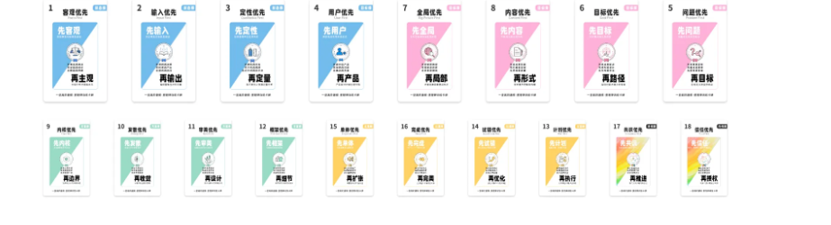

你可以把这套实体版的卡牌放在手边，后遇到一个重要项目、一个复杂任务，或者想用AI完成一项工作时，你可以随手抽出卡牌，思考关键环节。每多用一次，你就多做一次刻意练习。

慢慢地，这些组件会从"我知道"，变成"我会用"，再变成自己的核心动作和肌肉记忆，变成AI时代自己的核心竞争力。

那怎么领呢？任务在这儿：）

截止周三中午12点：你只要成功邀请2个人及以上，就可以获得《高阶建模·里程碑训练卡牌》。

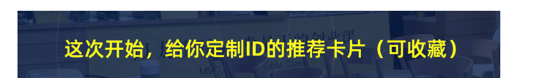

这次开始，给你定制ID的推荐卡片（可收藏）

【报名🥰】

评论区扣一个口令：我请客

班班会在当日/次日下午给你一组高清大图，请记得查收。

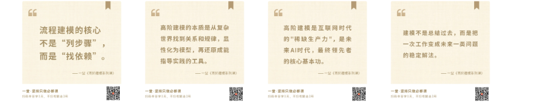
