# 高阶建模第一课 · 课程文档

> 本文档由课程截图转录整理而成。**文字内容完整保留**，截图中的图片、金句卡片、案例封面等视觉元素已从正文中分离，单独存放于 `images/` 文件夹，并在原位置以引用形式嵌入。
>
> 整理原则：
> - 讲课正文逐字转录，保留原本的口语表达
> - 原文中的红字/黄字强调，用 **加粗** 标示
> - 案例代入、互动等标签保留为引用块
> - 截图中的图片只保留图像本身，alt 文本为简短提示
>
> 覆盖范围：14 张主课程截图（页 01~14）+ 6 组主题素材共 28 张图（页 15~20，按主题并入相应小节）。
>
> 补充说明：
> - 05 页原文顶部无标题，直接从正文开始，按原文处理
> - 06 / 10 / 13 页原文顶部标题相同（「提升：背后的策略」），07 / 11 页相同（「提速：试试带着AI做」），为课程各阶段同名的固定小节，按原文保留
> - 主题素材「本质」（19-01/19-02）与主截图 13 页内嵌图同图、「如何练习」（20-01~03）与主截图 14 页 IPO 循环图同图，文档统一采用分辨率更高的素材版本

---

## 目录

- [01 为什么要学](#01-为什么要学)
- [02 预热思考题](#02-预热思考题)
- [03 提前划重点](#03-提前划重点)
- [04 入门60分：流程建模](#04-入门60分流程建模)
- [06 提升：背后的策略](#06-提升背后的策略)
- [07 提速：试试带着AI做](#07-提速试试带着ai做)
- [08 进阶75分：抽象建模](#08-进阶75分抽象建模)
- [09 建模案例：一堂个人地图](#09-建模案例一堂个人地图)
- [10 提升：背后的策略](#10-提升背后的策略)
- [11 提速：试试带着AI做](#11-提速试试带着ai做)
- [12 高阶85分：本质提炼](#12-高阶85分本质提炼)
- [13 提升：背后的策略](#13-提升背后的策略)
- [14 重新理解"高阶建模"](#14-重新理解高阶建模)

---

### 01 为什么要学

【热场🎬】来来来，我们热个身吧哈哈，抛开这个课题的背景，大家觉得，一堂相对于国内外友商（教育公司/商学院），最最擅长的稀缺的能力/竞争力/Knowhow是________

---

如果我来回答的话，答案是"做课能力"，做课背后是"教研能力"，教研能力背后其实就是两个字**"建模"**。

建模，简单一句话解释就是：**把过去的经验，把纷繁复杂的碎片，把相互矛盾的观点，把混乱无序的逻辑变成科学体系的、完备自洽的、能够指导实践的理论和规律，全面提升决策质量。**

这是一个高阶稀缺的能力，是过去几年一堂一直在打磨的能力，也是活下来最大的一张底牌，在内部甚至都是"知识库封闭"的方式在管理。

终于，我们到了2026年，一堂算是跑出来了，我们决定把一堂过去五年最大的一张牌"建模"做成一堂的正式必修课。

准备好了么？新的硬核系列来了～！

说明：这大概率是一个系列课，今天是《基础认知篇》，后面会陆续展开实操专题篇。

在一堂学习这么久了，大家充分意识到"建模"能力重要了么？

很多年前，我问过子敬（一堂荣誉校长，张一鸣天使投资人）一个问题：我们聊了很多务虚的话题，我们聊点务实的，如果高阶的创业者管理者你建议练一个"**长期核心技能**"，你觉得什么最重要？

我以为他会说：战略能力，取舍能力，市场洞察，赚钱机会判断……

没想到子敬给了我一个很意外的答案：**抽象能力。**

他解释了两句：新人上手往往都差不多，前期主要拼执行力和敏感性，但后期大家都有经验，都有足够多的资源和选项，往往被拉开差距的关键，就是"抽象和提炼能力"，**能不能从客观事实中，快速抽象出指导未来的规律。**

说实话，这段话当年对我还是挺震撼的。

这段话大概是在七八年前，我一直记到了今天。

任正非曾经说过：**华为最大的浪费，就是经验的浪费。**

我们平时做了大量的工作、积累了很多的经验、产生各种各样的案例、成功、失败、意外、惊喜，如果不停下来进行萃取，就依赖一个个人独立的工作，或者师傅带徒弟，口耳相传，长期会有什么问题呢？

那未来呢？AI时代，人的抽象和建模能力还重要吗？

前段时间我看到一个短视频，我特别喜欢的战略专家：曾鸣，最近分享了他在硅谷的一个有趣的观察，这个视频我看了三遍：

> 这次去硅谷感受最深的，真的不是 996 了。
>
> 现在硅谷真正创业的人，已经接近9到12，一个礼拜7天，基本上都已经进入这种疯狂的状态。
>
> 这些所有的 AI 团队都非常小。我去年夏天在硅谷搞过一个小型座谈会，其中一个创业者就感慨说："我现在最大的头痛就是团队太大，管理起来很困难。"
>
> 其他创业者问他："你们团队多少人？"
>
> 他说："30人。"
>
> 更奇妙的是，其他人马上说："真的是人太多了。"
>
> **3个人、10个人的团队非常常见。**
>
> 这些公司最核心的特征：他们雇的都是特别强的人。
>
> 最典型的基本上都是奥林匹克金牌、编程金牌、物理金牌。Meta（小扎）花上亿美元挖 OpenAI 的顶级工程师，起步费用大概一个人是 1 亿美元。
>
> 我刚从美国回来，见到三个，真的特别年轻，有的大概 30 岁都不到。现在所有 AI 团队都在招的人，都有显著特征：
>
> - 超级聪明
> - 自驱学习能力强
> - 都想改变世界
>
> **为什么要招这样的人？**
>
> 底层原因是他们的**元认知能力特别强，擅长抽象建模**，能够看到问题的本质，习惯第一性原理的思考。
>
> 包括大家可能也会关注到，学应用数学的人现在比较好找工作。因为应用数学核心就是怎么建模——怎么把现实世界变成一个数学模型，这是 AI 时代比较稀缺的通用能力。
>
> 这批人在创造 AI 工具的同时，擅长使用各种各样的 AI 工具，对改造世界充满乐趣。"躺平"这个词完全不存在。
>
> 带来的自然结果是什么？**一将顶千军。**
>
> 很早以前乔布斯就讲过：一个好的软件工程师可能抵过上千个普通工程师。
>
> 但今天，可能一个好的 researcher 就可以调用千万个agent，创造特别多的价值。

一堂我们讲未来AI竞争力三角形，人类这一侧仅剩的三个核心能力：**审美，体系，创造力。**

很早大家就意识到了"创新"的价值，最近大家开始意识到"审美和判断力"，但我一直觉得，长期来说"**高阶的稳定的体系**"才是这一波新工具红利褪去之后，人类竞争最核心的能力。

我有一个非常大胆的判断：

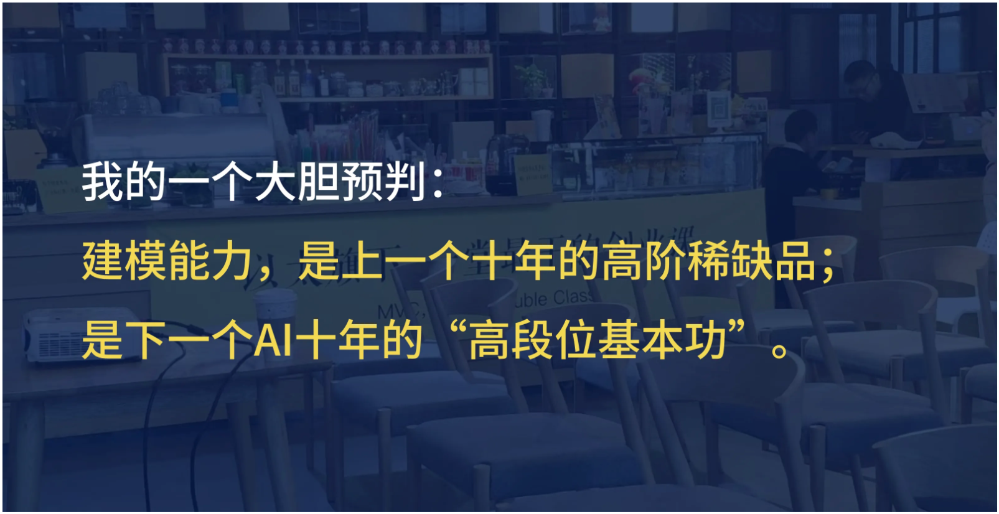

短期是因为**AI有幻觉**，经常胡言乱语，经常胡编乱造，是概率随机的，如果AI碎片我们也碎片，那么就会被AI带着走，很难真正构建起高阶的业务模型和团队模型。

长期来看，因为**AI一定有上下文**，200k也好，1M也好，未来再翻100倍，100M也好，这个规模距离真正一个30多年的人生实践经验、一个几十人团队多年的试错和尝试，都是碎片的。

而垂直领域的**体系流程，体系知识，体系数据**，才是未来最核心的竞争力。

---

### 02 预热思考题

来来，照例，给大家三个预热思考题吧：

**第一个题目：观察一堂题。**

在一堂学习，你学过各种模型，N步法，矩阵图，框架图，本质定义……哪些模型你当时学的时候觉得"好强好厉害"？你能体会到这个模型非常值钱，对于实践有巨大的指导价值？

重点是，你猜一猜，你大概能猜到这个模型是怎么出来的么？它是某一天"灵光一闪"出来的，还是来自一个什么样的工作机制？

**第二个题目：观察自己题。**

回顾过去5年，你在做业务、解决问题的时候，有抽象过"**实践模型**"吗？抽象完以后，有没有发生质变，全面提升你后续同类工作的质量和效率？

你有引以为傲的模型吗？有几个？0个？1个？3个？10个？还是更多？

**第三个题目：AI时代新思考。**

哈哈，每节课都得问一遍灵魂拷问：把一大坨信息给AI，AI都能整理一个"结构很棒"的模型，那我们有了AI以后，人类的建模能力还重要吗？还需要自己苦练基本功么？是不重要了，还是更重要了？

你可以强迫自己想一想，做一轮头脑实验，希望这周学习结束，你的见识和判断力，能有一个显著的全面提升。

---

### 03 提前划重点

提前划一下重点，大家不要迷路，今天我会讲4个话题：

**第一部分：流程建模。** 为了避免太难，第一部分我会先讲一讲相对简单的流程建模，一些确定性的框架、工作该如何思考和建模。

**第二部分：抽象建模。** 很多同学过去一直不敢提炼自己的模型，我会讲一讲一些抽象的模型、方法论背后的思考和设计过程。

**第三部分：本质提炼。** 这是今天的高阶阶段，如何思考复杂问题，试着提炼一个本质解法，这个解法可以从底层出发，推演出全部上层的方法。

**第四部分：重新理解。** 最后我们重新理解一轮"建模"为什么在AI时代，是最重要的核心竞争力之一。

❤️提醒：这节课以提升人类"审美/判断力"为主，为了避免有些同学自己还没入门，过早陷入"有了AI我无所不能"的幻觉，所以这节《认知篇》暂时不打算提供AI Partner工具，请纯粹修炼自己的成长。

对了，同时向大家介绍一下本期磨课研究组的同学：

[此处截图底部被截断：仅露出"本期磨课组成员名单"表格表头，名单内容不在截图内]

---

### 04 入门60分：流程建模

#### 提前预告

这节课的课题太大了，而且过于抽象和复杂，一次性灌给大家估计大家都会难以下咽。这次我们换一个故事线吧，我先按照**60分-流程建模，75分-抽象建模，85分-本质提炼**三个阶段来讲。

最后我会给大家一套统一的"思考框架"，作为第一节认知篇的收尾，也作为未来实操篇的预告。

OK，进入第一个话题。

这是入门阶段，也是相对容易的一类建模，这类知识的典型特点就是很具体，都是具体工作现场的、相对成熟、确定的工作经验。工作目标也是稳定执行，不出问题。

【互动😎】这种模型，你们过去在工作里，建立过多少？有多少实现过比较高价值的结果？

#### 现象：看似很容易

1. 2021年起，我们开始提炼**Truman直播准备SOP**.
2. 2021年起，我们会提前准备5000字的**马拉松当天运营SOP**.
3. 2021年起，一堂开始维护"**线下场地布置和检查清单**"...
4. 2022年起，我们开始总结"**复盘营"伍月班班标准运营SOP**
5. 2022年起，我们开始打磨"**直播课上架配置标准SOP**"
6. 2023年起，我开始在flomo里整理我的"**出差效率Max清单**"
7. 2023年起，我们开始整理"**直播文稿校对常见问题清单**"
8. 2023年起，我们开始整理"**晚餐磨课会"组织流程**
9. 2024年起，大家开始为我定制"**Truman出差吃饭清单**"
10. 2024年起，我们开始尝试探索"**出差途中高效磨课注意清单**"
11. ......

【思考💡】你们猜猜，这些工作背后，有哪些专业原则和萃取共性？

1. 古董，曾经做过大量门店运营SOP，比如**排班SOP、生产SOP、闭店SOP**等等
2. 张阳，曾经做过一个事无巨细的"足力健"**主播直播表演逐字稿SOP**
3. 秦鹏，曾经做过一个用一堂逐字稿**如何开会流程SOP**
4. 北辰青年，曾经做过需要严格执行的**场地布置SOP**，也有人情味儿的用户**运营SOP**
5. 郭同学，曾经把一个寄送动作拆成有六个动作的**给带货主播寄样品SOP**
6. 若兮，曾经做过细致到每一天的，ToB咨询业务**项目助理工作清单SOP**
7. 韩永亮，曾经做过面向新人的**电影院放映托管SOP**
8. 劳文启，曾经围绕各个关键转化率打磨过一个非常精细化的线下**全流程的会销SOP**
9. 马易，曾经做过一个上市公司的**硬件售后服务管理SOP**
10. 贾同学，曾经做过一个ToB、ToG业务的**采购SOP**
11. ......

是不是乍一听，看着还挺容易的？

【互动😎】这种类型的模型萃取相对具体，比较具象，一般都是来自于已有经验的整理和分类，具体难在哪儿呢？

#### 建模案例：亲子画画建模

平时待家里很少，为了异步亲子互动（儿子四五岁），我试着设计了一个"异步画画"的玩法：后半夜我画画，白天儿子临摹，但很长一段时间，因为年龄小，他一直控笔做不好，总是画的歪七扭八，总是被妈妈说，很长时间都是这样，越来越没信心。

怎么办呢？问题出在哪儿了呢。

---

我发现问题是，有几个动作要领每次都随机发挥，控笔控制不住，而且偶尔发挥好的一两次姿势，也很难保留下来，于是我在墙上给他写了一个打油诗：

然后花了10分钟让他背下来，然后每次鼓励他就用这个口诀来画，养成习惯。一周后立竿见影：一方面是可以反复提醒自己，另一方面他开始用这句话来自己检查了，甚至开始很兴奋的给别人讲，自己学会了画画口诀。

哈哈，这就是我建的几乎最小的模型了hhh。

#### 基础建模：直播前SOP

哈哈，大家或许知道，自从一堂2021年初走上直播课模型以来，我大概讲了五六百场直播课了，包含了：**周四新人第一课，周二毕业销售课，周三夜聊会/会员日，周五新课Live..**

你们猜猜看，我为了维持我的直播状态稳定，且效率Max，大概有多少条SOP or Tips?

---

这算是一堂的一个内部的小的关键Knowhow了：如何保持3小时高强度严肃讲课状态稳定在线（经常很忙/很累），而且重复的老课一直讲，如何保持一种兴奋和轻松快乐。

很多同行都比较好奇，我是怎么做到的？大家感不感兴趣？：）

我给大家回顾一下，这三年我们的知识形成之路吧。

在第一年，大概前100场直播时候，因为缺少经验，导致各种直播状态不稳定：

- 比如，开会太投入导致忙忘了，开完一个大会就马不停蹄去直播，导致3小时课程非常累，状态很差。
- 比如，经常忙忘了吃饭，导致空着肚子直播，3小时高强度直播，明显感觉后半段体力不够了，有些低血糖。
- 再比如，直播经常空调忘记开，导致我进去很热出汗，一个多小时温度才调整到舒适。

总之，一个每周稳定执行的课程，竟然导致了各种状态问题、设备问题、网络问题等等，几乎50%以上的直播，都会出现或多或少的意外情况。

【抢答🙋】想解决这个问题，要做的第一个重要的工作是什么？

---

答案：**建立一个文档。**

于是，第一阶段，我开始整理checklist，来建了一个《直播前状态热身清单》。

---

<!-- 05 页原文无标题（顶部只有 Longshot 水印条，直接从正文开始） -->

比如第一阶段，就根据过去的**高峰体验**和**常犯错误**，跟团队坐下来，复盘过去直播的一些经验和错误，静下心写下来。

比如，第一阶段，我们就整理了几条：

1. 提前2小时吃饭（不能过早/会饿，也不能过晚/会困）
2. 提前30min喝咖啡（保持兴奋状态）
3. 提前1小时休息（睡觉30-60min）
4. 提前1小时调试直播（键鼠、设备、配套教材固定位置）
5. 提前1小时调整温度（空间温度设置在25-25.5左右最舒服）
6. 提前30min准备热水（准备讲课热水喝的）
7. 提前15min洗头发收拾（如厕、洗头发、捯饬发型）
8. 提前3min热身（开始练嘴皮子，背5-10遍《八百标兵》）

【提问🤔】你们猜猜，经过过去的成功/失败经验罗列，效果怎么样？

第一轮，我大概写了十几条，实践了十几周，发现的确任务清晰了很多，但还是不够好，SOP写在知识库里，但执行是在日常工作现场，经常一忙就忘了，恢复到了之前的水平。

【抢答🙋】想解决这个问题，怎么办呢？

说明SOP不完备啊，继续加条目，给SOP加SOP的锁。

于是我们开始给各个环节，配置专门的同学，自己负责检查清楚每个环节的质量：

1. 行政：负责按时订饭，准点送到我的面前。
2. PM：负责直播间配置，提前Nmin直播间按照清单调试完成。
3. 班班：提醒我要停下工作，开始休息，锁门关灯。

这个时候，会有专人做专事，会把饭送到我面前，确保我不会忘了订饭吃饭；有专人敲门，提醒我终止会议，得开始休息了。

经过这么一轮，大概我们的执行清单，增加到了二三十条（不算直播配置），这一轮升级，效率高了很多。

做到这样，基本就够了么？hhh

**远远不够**。这两年，我们会持续发现各种问题，每次出现『**意外的Bug**』或者"**意外的优秀体验**"，都会在当天晚上直播结束后，加进去。

比如①，有时候吃饭订到我的"挑食盲区"，我会饿肚子，于是给我的吃饭订外卖也建了一个模型：

比如②，有时候我睡觉中途，不明真相的同学会敲我的门，瞬间惊醒毫无睡意，于是公司给我定制了一个牌子：**楚门在睡觉，别敲门啊==。#遭遇意外**

比如③，我有一次讲课灵感乍现，想到了很多新的idea和假设，没有地方记录，于是每次直播固定我面前，会放一个笔记本和一堂logo的签字笔，方便记录想法。#偶遇美好

比如④，我有两次太累了热量很低，于是直播间里会固定放一些会快速补充热量的食物，最开始是脆脆鲨，后来加上了白巧克力，再后来加上了保温杯奶茶。#遭遇意外

再比如⑤，我讲课总是状态不稳定，但有一次刚好开完欢乐的会员日，闲聊很快乐，我的讲课状态也很好。于是直播间定期会放一些团队的"搞笑照片"和"窘迫瞬间"，你就经常会看到我在直播间里傻笑：）#偶遇美好

比如⑥，我有时候会在周二下午周会，处理差评和负反馈，导致心情很沮丧，影响我周二晚上毕业销售课的状态，于是周二下午的差评讨论，放到其他日期。#遭遇意外

比如⑦，我有一次讲课很兴奋，状态明显超过了之前，我们结束以后复盘，今天状态怎么这么兴奋，因为我刚看了表白墙，于是"**一堂价值感和使命感爆棚**"，于是经常当我很丧，状态不好的时候，我都会努力提前刷一两百条表白墙，自我激励一下。#偶遇美好

比如⑧，早期讲新人第一课，总会出现各种"捣乱"，一直在打岔插话，调侃，认真学习他不行，插科打诨第一名，怎么办？最早这种Case很影响我状态。#遭遇意外

后来有一次，意外我有点上脾气："这里不是菜市场，是个严肃课堂，班班帮我抱出去，以后一堂直播间你再也进不来了..",没想到不止恢复了我的状态，直播间热度反而被激发起来来了，大家会认为一堂是一个认真做事的公司。

于是，"逮黑粉/踢出去"也变成了一个惯常的运营策略。

诸如此类，还有很多很多........

就这两年，随着我不断地遭遇意外，然后打补丁；以及偶遇美好，努力复现/叠加进去，慢慢直播前的准备清单，从几条、到十几条、到二三十条、现在大概有四五十条。

工作几年以后，经常有一些同学和友商好奇问我，为什么新课总能保持**精力旺盛**（往往前面24小时高强度工作），老课讲了一两百遍也总能**兴奋和愉悦**，背后其实就是靠这个《**直播状态Max提升**》文档撑着，就靠着几年一条条积累经验形成的这四五十条的关键事项。

哈哈，大家初步感觉到这种"简单流程"的知识萃取难度和过程了吗？

---

### 06 提升：背后的策略

高阶建模不是把话说高级，而是把下一次做事变得更稳、更快、更准。

1. 招人总看走眼，所以做"面试避坑清单"。
2. 客户总说考虑一下，所以做"成交卡点分类表"。
3. 团队开会总跑偏，所以做"会议问题诊断表"。
4. 交付总靠老板盯，所以做"交付验收 SOP"。
5. 选品总凭感觉，所以做"选品检查清单"。

总结一下，有三个核心重点：

**第一个重点：及时复盘**。这些信息和经验往往都在业务现场（AI的Session）里，如果我们及时复盘，这些经验就很容易抽离出来，如果过了N个小时、N周大概率就做不到了。

以前我做一堂，养成了三个习惯：

1. 及时复盘会：每周做完课，实验，第一时间Reivew认知和开会。
2. 及时做反思：遇到一些错误和问题，解决了第一时间总结打补丁。
3. 现场做回顾：在课程线下交付现场，就抽时间做复盘和Review效率最高。

**第二个重点：清单/SOP**。这两种是最基础，也是相对来说最简单、最高频的工具，随时随地记录清单体笔记。

这块相对容易，我只想补充一个我最近强调比较多的一个词：**逻辑洁癖**。我跟团队复盘我们的建模能力，抛开具体的技术不说，我发现我和大家一个很大的区别，就是我对于"高价值模型的低逻辑状态"容忍度很差。

我希望重要的工作建模or整理是"有逻辑"的，但是什么是有逻辑呢？

【划重点💡】给大家讲讲这几年练出来的"逻辑洁癖"：

1. 清单：遇到换行就分点，超过七八个就分层。
2. 优先级：遇到决策就分级，找到关键要素/主要矛盾；
3. MECE：遇到建模就完备，争取做到不重不漏。
4. 逻辑链MECE：争取有一个前后的链条，循序渐进推理。

给大家看一组例子大家感受一下。

这是一次关于复盘会议的复盘，看看不同的段位呈现的差别：

**第三个重点：稳定使用**。既然记了清单和SOP，就是为了执行使用的，如果写了一堆流程，但是没有执行，那就没有价值了。

怎么做到呢？一般来说，给SOP的执行检查可以加SOP，加个锁往往就稳定了。

比如：张阳之前做直播SOP培训。

1. 版本1：只给直播SOP，靠主播自己自觉，执行可能只有50-70%；
2. 版本2：增加督导SOP，统计数量和记录过程SOP，执行就能到70-90%了；
3. 版本3：增加品控SOP，管理督导的工作质量，基本上就能到接近100%了。

我们也是借鉴了这个思路，之前《直播前SOP》一直执行的不好，一忙就各种忘，后来增加了个"督促员"角色，到点提醒，看我这我睡觉才离开，基本上就没有出现过问题了。

---

### 07 提速：试试带着AI做

当一个人有了很强的AI意识，同样的三个策略，你训练出敏感性以后，就可以在工作时，带着AI一起工作。

重点1：用AI辅助人的工作建模

比如我们内部开会，我做了大量的反馈和纠偏，这个工作交给人来整理就很慢，但是AI就很快。

这是一个非常热乎的例子：直播通知文案。

我们昨天发布了一个"一堂×探月黑客松"活动的启动仪式直播通知文案。大家看到的是我的after版本，之前这个项目组的同学为了省我的时间，特意提前给我准备了一个初稿。

一堂的同学都有非常好的习惯，就是都会要before/after对比，他们把两个版本让AI对比：

- 后一版比前一版好在哪儿？
- 有哪些具体的变化？
- 为什么要进行这样的修改？

最后提炼一些以后写这类文案时的Tips：

#### 主题素材：before/after 对比

素材说明：同一个"探月×一堂青少年黑客马拉松"直播预告，before 是平铺直叙的项目介绍，after 是 Truman 口吻的动员式文案；后三张是对这版改写的四点优势、十处具体变化、为什么这样改、以及以后写启动预告的七条注意事项。

---

重点2：用AI自动复盘AI的工作

你可以在某一个工作完成很漂亮以后，直接让它总结一个"自查清单"，封装一个文档 or 技能，未来可以直接迭代到下一个工作里。

比如某一周，我集中跟某个Agent做了很多课程插图和PPT，经历了大量纠偏和修正，然后我让他帮我趁热乎扫描了各个对话窗口（Session）做了一个"Design Taste"的技能：

> 这个要趁热乎，基本过了几天、几周找回来就不容易了。

好啦，简单的流程类建模我就说完了。

---

### 08 进阶75分：抽象建模

这种建模就难很多了，往往是抽象建模，不只是一个SOP/清单，而是一个抽象的模型、方法论、理念、框架，需要有更高的抽象和迁移。

#### 现象：看似很容易

哈哈哈，是不是也看似很容易？我随便就能做一个五步法，七段论，战略地图，看似也没什么复杂的啊？

1. 增长团队，为了搭建公众号KOL投放体系，建立了一个**SABC分级模型**
2. 教研团队，为了解决"做课不回退"的问题，搭建了一个"**六步做课法**"的里程碑模型
3. 教研团队，为了解决"搞砸案例筛选"问题，建了一个**5维度案主筛选模型**
4. 交付团队，为了更好设计"极限挑战"脚本，打磨了一个"**任务评价雷达图**"模型
5. 我为了更好培养大家"讲清楚课程价值"，提炼了一个"**ABACC讲香模型**"
6. ........

我们还开发过大量跨领域的"商业管理必修课"：

1. 我们围绕着"**商业成败**"，萃取了一套模型，叫做：一堂五步法。
2. 我们围绕着"**科学做事思维**"，萃取了一套模型，叫做：Y模型。
3. 我们围绕着"**时间管理工具实用性**"，萃取了一个模型，叫做：双环图。
4. 我们围绕着"**战略会**"，给"战略"萃取了一句话定义：4个本质要素。
5. 我们围绕着"**低成本创业**"，给"精益实验工具"萃取了一个武器库：拆解MVP策略集。
6. 我们围绕着"**转化率**"背后因果规律，萃取了一套"动力阻力触点"的工具箱。
7. 我们围绕着"**新人landing**"，萃取出了包含5层落地的"新人landing冰山图"。
8. 我们围绕着"**科学开会**"，萃取出了一张花瓣图"科学开会的十大原则"。
9. 我们围绕着"**学习的本质**"，萃取出了一个非常底层的"IPO模型"。
10. 我们围绕着"**科学表达**"，萃取出了一个"科学表达火箭图"。

是不是看着这些也挺容易的？不就是画个三角形，画个圆形，画个N步法，画个雷达图就行？

【思考🤔】这类模型的难点是什么呢？为什么很不好做？

#### 建模案例：各种艰难筛选

一堂内部，这两年有各种各样的筛选、评审和评选工作，需要内部讨论，最终通常都需要我来拍板和决定。

比如，在一堂有很多这样的工作：

1. 讲师营：谁可以入围？讲师营的面试画像如何？
2. 搞砸之夜：哪些案例适合入围？可以成为搞砸之夜的案主？
3. 核心课讲师：哪些人可以在一堂讲课，代表一堂来讲课？
4. 投放短视频：这个算不算一个合格的投放短视频，怎么评估？
5. 一堂Y30：怎么评选一堂每一年的30位榜样学员入围榜单？
6. ....

你们业务出现过这样的问题吗？通常该怎么解决，能让成功率越来越高？

在一堂内部，经常会出现一个画面：

> 某个同学拿着一个很长的list，问我：Truman你觉得这个选出的怎么样啊？你来决定吧，合不合格/谁来入围/要不要发布。

最最开始，一堂很早期，会员只有1000个人，的确都是我来拍板，我基本都认识，每一个名字大概的背景、评论区活跃度我大概都有概念。

但是当一堂做到3000人时候，我发现完全hold不住了：我也不认识这些人啊。如果各个项目的负责人还是给我单子，让我来拍板定夺，我基本就无能为力了。

于是我开始给团队提要求了：**我们不讨论答案了，我们对齐模型吧**。

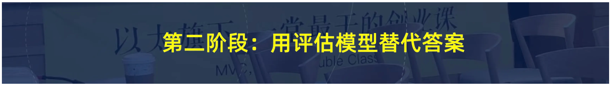

开始拉着公司内有判断力的2-4个资深同学（专家）一起，讨论入围模型，如果想要入围讲师营/Y30/案例营，最核心的4-6个要素是什么。

我们尝试罗列了过去的各种优秀的标杆案例、失败案例，尝试寻找规律。

于是画了很多图：

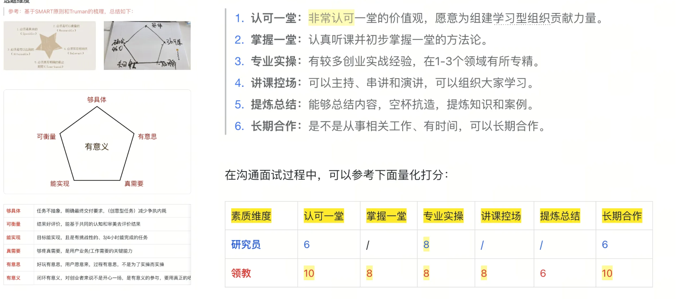

研究员和领教，评选考虑6个维度：

1. 认可一堂：非常认可一堂的价值观，愿意为组建学习型组织贡献力量。
2. 掌握一堂：认真听课并初步掌握一堂的方法论。
3. 专业实操：有较多创业实战经验，在1-3个领域有所专精。
4. 讲课控场：可以主持、串讲和演讲，可以组织大家学习。
5. 提炼总结：能够总结内容，空杯抗造，提炼知识和案例。
6. 长期合作：是不是从事相关工作、有时间，可以长期合作。

在沟通面试过程中，可以参考下面量化打分：

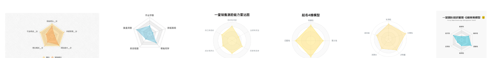

有了雷达图，然后团队不管是评选、讨论、提名还是拍板，基本上都有了一定之规。这些评分和雷达图，对于业务成败来说极其重要。

这个雷达图和评价模型是一成不变的么？

不，是随着时间，不断更新和升级的：

在每次复盘会议/意外结果复盘上，都会不断修正这些雷达图：

1. 投放短视频：越完善越好 → 【宽而不泛】。
2. 落地之夜：增加【业务长期稳定】的参数，不能做完就结束了。
3. 最佳实践案例：增加【价值观】背调，确保长期业务稳定，数据可靠。

随着时间（惊喜和意外）不断迭代和升级这些评估模型，随着模型越来越成熟，甚至多数评审都不需要我参与了，成功率一直稳定在一个很高的水平。

大家感受到知识萃取的价值了么？这就是一种经典的知识萃取：**复杂决策和评估的模型**。

这种类型非常多，像HR板块的岗位建模，销售板块的线索和客户建模，设计领域的好作品建模，如果你能萃取出一个"**真正能指导实操+不断迭代**"的模型，那么你就能持续提升你做事情的成功率了。

#### 主题素材：战略

素材说明：把战略会经验抽象成"全局/成败/选择/艰难"四象限坐标系——先是空白骨架，再填入范围/目标/过程/选项四类原则（各分基础/进阶/高阶），最后落成 12 张"一堂战略会·科学训练卡牌"。

---

#### 建模案例：一堂个人地图

---

### 09 建模案例：一堂个人地图

给大家回忆一下，一堂个人地图怎么出来的，其实是个非常复杂的过程。

时间到了2025年，一堂我们发现课程越来越多，原来的"创业地图"和"管理地图"无法承载一堂新的课程体系了，导致了很多混乱，很多课题比如人生红点，时间管理，知识管理，刻意练习很重要，但硬塞在两个地图里显得很鸡肋。

于是，我们提出建立一堂的第三张地图：**个人地图。**

哈哈，多数人是不是觉得挺简单？一堂一周时间就变出来了？

给大家第一次完整分享下，这个新的"十万美金"地图幕后的故事。

初始阶段，模模糊糊有一些大概的想法，大概有十几个初始课题，这个是跟个人核心能力修炼相关，但剩下的就一无所知了。

【提问🤔】如果你们是我，你们会这么建模呢？

我们第一轮，**全量整理**，先整理了一下可能的课表，先做了一次灵感闪现和整理：

下一步该做什么了？

第二步，太多太糟糕了，我们又试着"**寻找规律**"：

这个阶段的核心关键词是：规律发现和想法涌现。

第三步，**模型探索。**大概知道了内在基本练习，于是我们开始海量调研市场各种模型和分类：

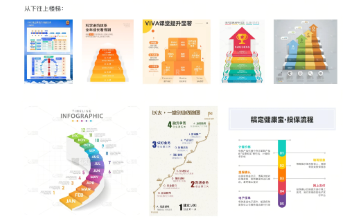

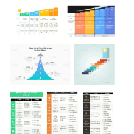

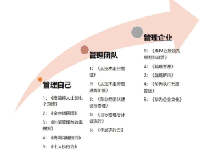

然后开始逼着自己，想5-10种组合方式，并且找了各种同类的模型参考：

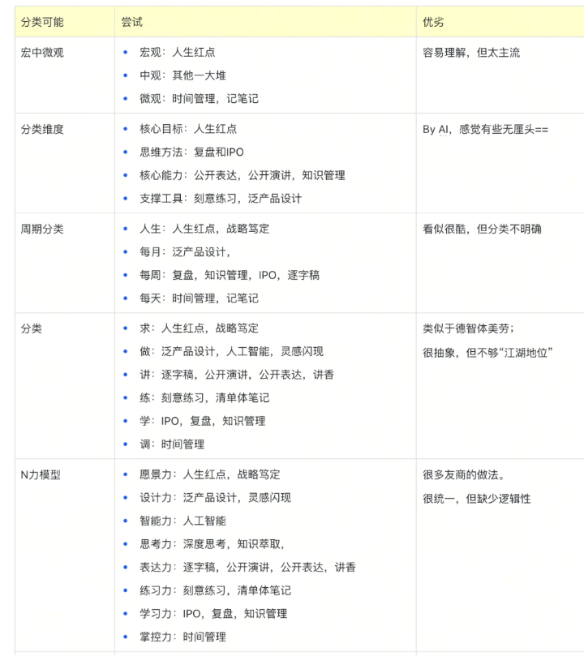

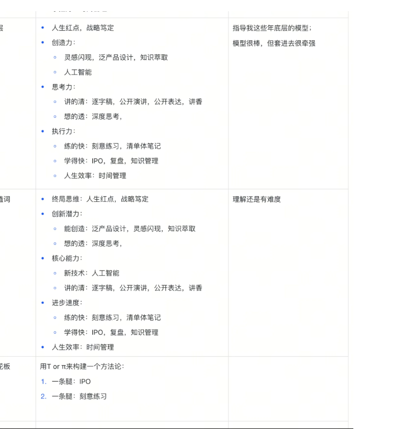

一直找，一直失败，最后终于摸到了一个方向，用 π来构建一个方法论：

1. 一条腿：IPO
2. 一条腿：刻意练习

整张图就是一句话，无限进步，不断提升人的**天花板。**

第四步，**整理合并。**我们开始集体开会，一起推演和建模，大家一起分头整合，把课程都塞进去，一遍遍归纳，合并，

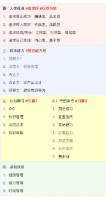

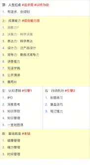

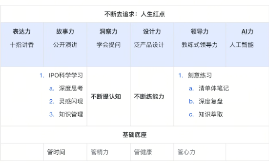

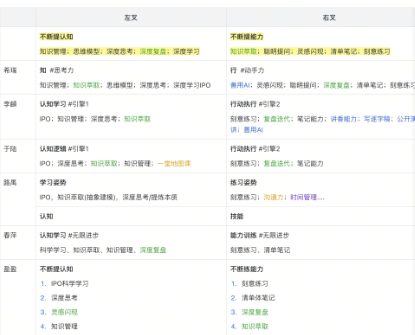

都有道理，但是还是太复杂了，不够简洁可用。

最后我想到了《时间管理》课程最后的一个金句：**时间管理决定人生下限，人生红点决定人生上限。**然后画了一个草图：

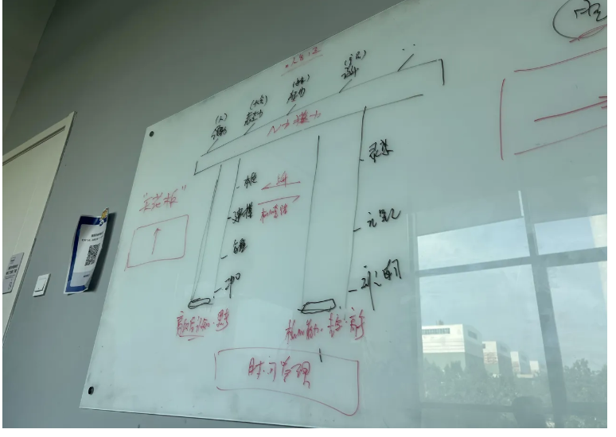

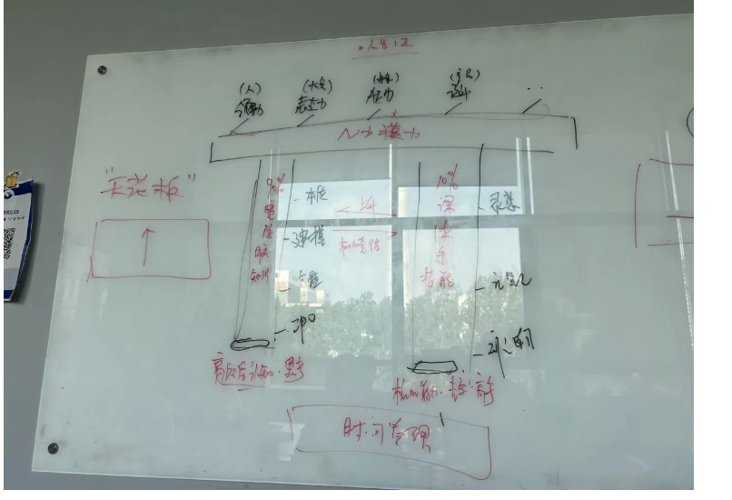

第五步，终于自洽，我们开始"**十层解读**"，开始内部把更多理念和洞察融入进去：

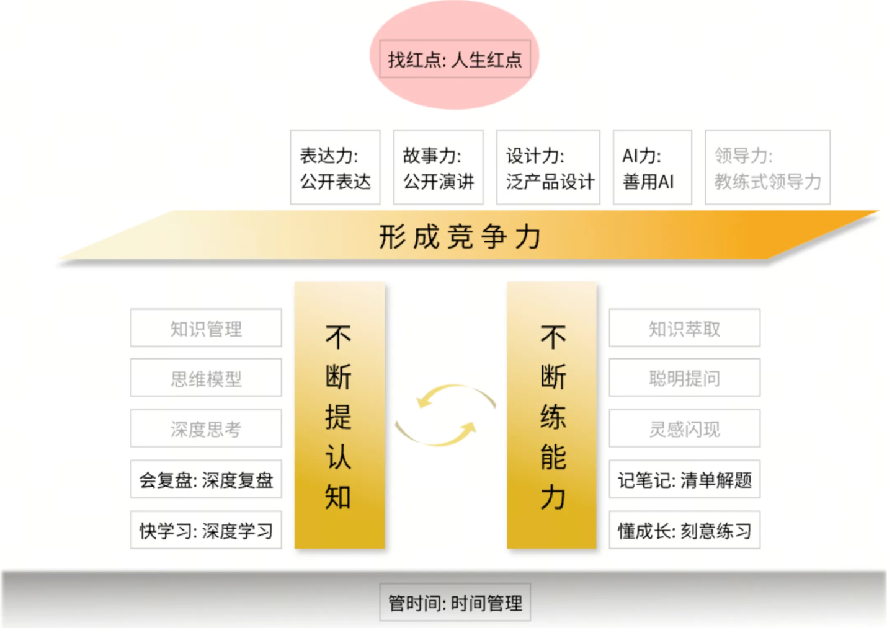

- 彼此之间的关联、逻辑关系是什么？
- 三叉之间的边界与关系，还可以如何解读？
- 整张图，你还有哪些好的理解和解读吗？

第六步，**分享打磨。**距离马拉松发布还有两个月，我开始在各个场合"试讲""抛砖引玉"，尤其是NPC内部培训，包括MBA线下培训，我记得在MBA集训营，我系统解读了这张地图的理念，当我讲到这张图就是为了帮大家"人生不再有天花板"这句话的时候，在场我记得有几个同学都开始泪目，要哭了。

嗯，说明这张图基本价值表达足够了。

就在那次分享中场休息，徐大勇同学现场抓到我，给了我一个建议：

> 你没发现，你这个新地图刚好可以包装成一个"立"么？顶天立地的一个人。
> 这刚好暗含了中国最最重要的文化啊。

于是我们开始再一次升级，最后就打磨出了那张正式的图：

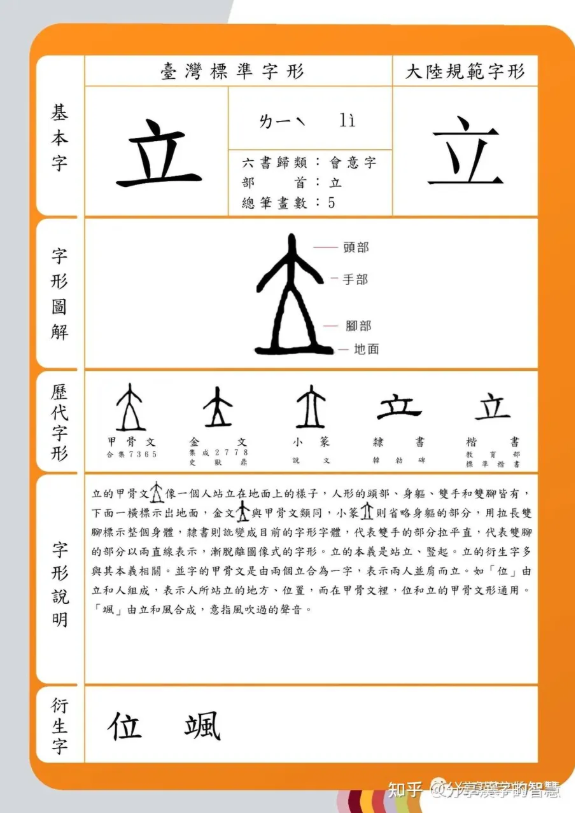

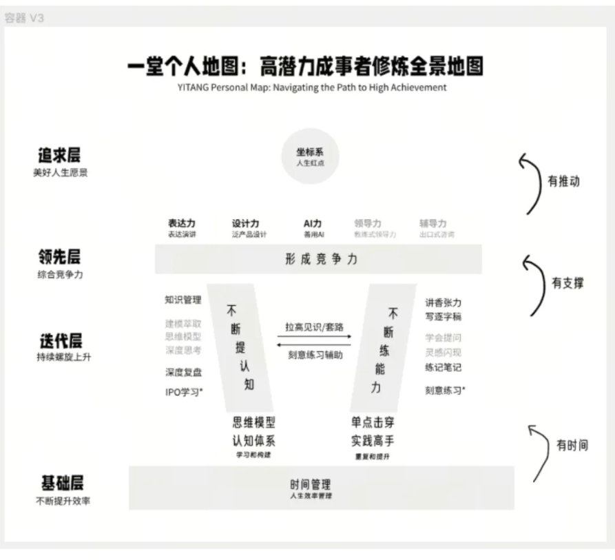

> 这几乎是一堂最完美的一张图，即便未来国际化，外国人也能看得懂，但中国人更能看得透。

第七步，最后我们又做了作图攻坚会，如何打磨设计的一致性和美观性：

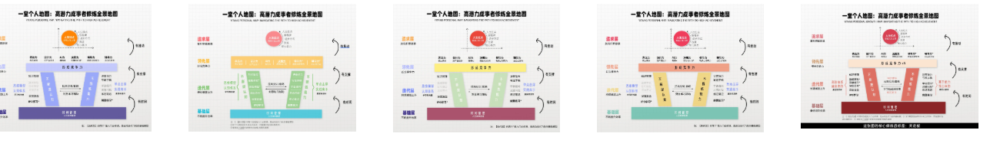

最后终于定稿，一张十万美金级别的地图就诞生了：

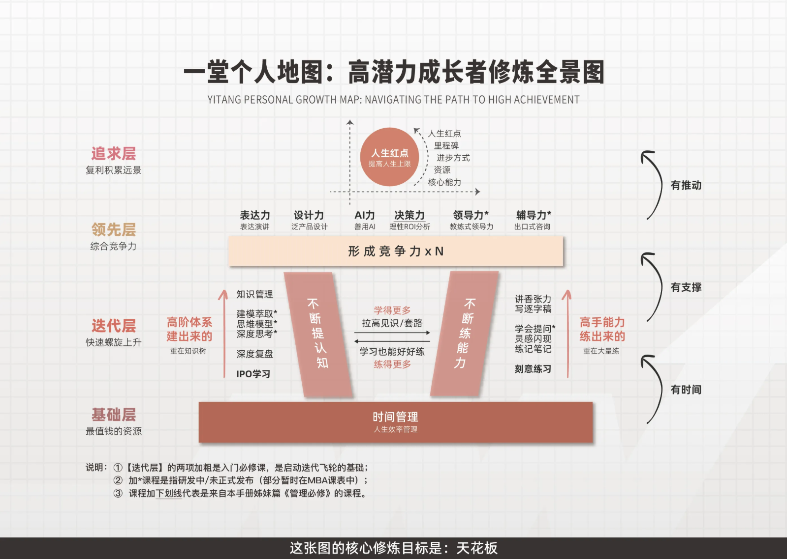

哈哈，大家感受到建模的专业和能力了么：）

这不是最难的，我们来看一个一堂本质级别的建模。

---

### 10 提升：背后的策略

大家感受到这种模型提炼的难点了么？

【提问🤔】我反着问一个问题吧，为什么有些模型提炼完了，但价值很低呢？没有用，没法用，不敢用，不敢当做必备模型用呢？

定义不清，丢三落四，边界不清，太随机。

所以，所以怎么破呢？

你可以想一想，未来5-10年，你渴望拥有哪一层的知识可靠度：

1. **有启发：**听着很精彩，很香，看似很有用。
2. **有实证案例：**至少能找到1-2个具体可实证的案例。
3. **充分实证：**能找到大量案例实证有效性。
4. **没有反例：**理论充分可靠，找不到反例可以推翻。

我们有一个核心理念："**千人广场模型**"：

> 千人广场：设想广场有1000个人，95%有问题共性，5%有最佳实践共性，完成建模和彼此传递。

有了这个基础，我们开始跳出"找单一老师做课"的传统方法，采用了"集体专家共识"的方式做课，带着一类普遍的问题，去一轮轮找各个专家去讨论、辩证、收集意见，最后交叉验证、形成共识。

基于千人广场模型，我们内部建了一套方法论建模的工作流：

1. **圈定边界：**明确研究范围，避免无边无际。
2. **收集事实：**收集大量案例、正反面教材、最佳实践。
3. **整合萃取：**合并和分类建模，并且理解所有存在的合理性
4. **初步模型：**统一底层一致性与逻辑，形成初版。
5. **辩证讨论：**引入专家与案例进行"撞击"验证，直至模型立得住。
6. **封装打磨：**进行包装、讲香与多角度解读。

我们甚至还搭建了一套常见模型的武器库：

【互动🙋】这些模型，哪些你用过？哪些你没用过？

我让教研同学用AI做了一轮挖掘，六七年的时间，这大概是一堂的工作成果：

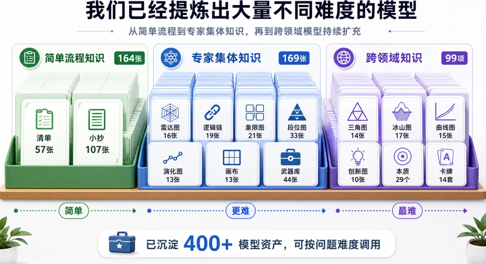

下面是我们沉淀的模型库的部分截图：

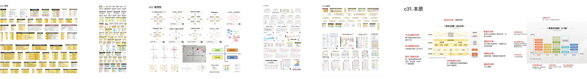

---

### 11 提速：试试带着AI做

当大家有了各种抽象模型的建模素质和追求，你们带着AI，就会有一种十倍速的建模快乐。

举个例子，我曾经封装过一个《**高阶SKill工程指南**》的文档，全程都是AI研究和建模：

**第一步：先快速认识。**先快速问AI，我想学Skill，给我一些教程和最佳实践参考，开源的、得到过验证的。

这个时候，AI给了我很多参考和例子，我发现最好的案例其实是Claude官方那个开源的一组教程，其中"**skill-creator**"作为元技能，是当之无愧的第一名，官方很多审美和最佳实践都在这里面。

**第二步：AI翻译和解读。**

我用Trae和Antigravity同时打开，交叉工作（速度快），本地下载了一套官方的Skill，英文太难啃了，于是Trae负责翻译，Antigravity负责解读精华和亮点。

> 注意：不是语言翻译，而是要保持"执行100%有效"的情况下做翻译。
> 本质上用的不是翻译工具，而是AI编程工具。

**第三步：自建最佳实践教程。**

然后告诉Claude：我想做一个最佳实践级别的教程，你帮我把所有官方教程的精华、参考、案例合并，给我写一篇Top的教程，要Topdown，要实操。

于是它就生成了一篇：

> 一个技巧：基于原始案例建模，通常显著差于先做一次萃取，再二次合并萃取。

**第四步：逐步打磨。**

重点的几个实操模块，我挨个让它解读和交叉验证，让它MECE、排优先级，让加参考案例，让补充底层逻辑：

> 每一个环节，都提了大概2-5轮"不够好"，继续挖掘，继续建模，继续萃取。

这一步是精华，整个工作的过程就是：

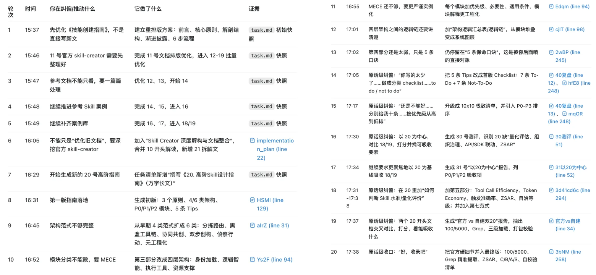

最终形成了一份完备的工程化报告：

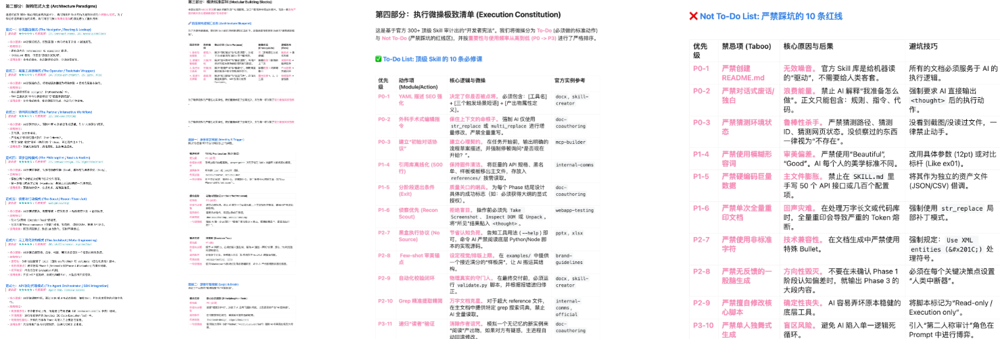

**第五步：交叉验证。**

刚好手里我还有两个教程，一个是Claude官方的培训教程，一个是一堂同学花总分分享给我他的Feature思考，我也并入进去，让AI交叉测评，打分，吸收：

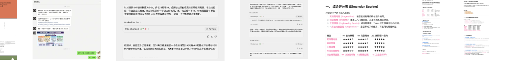

然后再吸收一轮，让AI交叉验证，最后合并到自建文档。

有了这个教程以后，基本上我后面封装了一个Partner和技能，后面就能帮我各种封装技能、**巡检**Partner质量了。

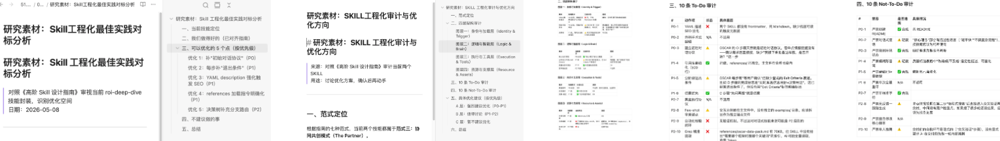

大家感受到了AI自动建模、自动封装、自动巡查的快乐么：）

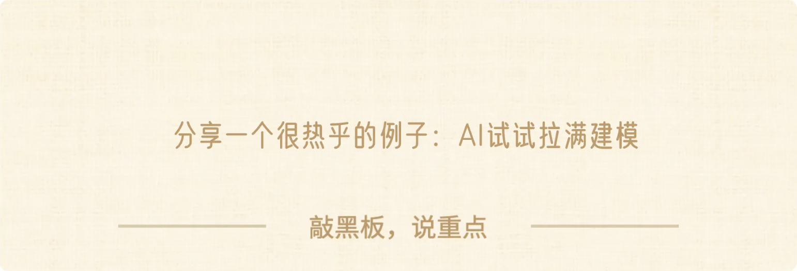

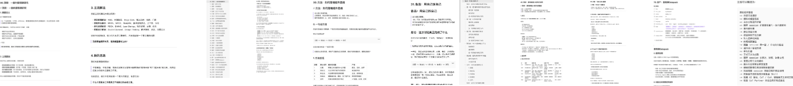

> 统计数据：全程工作大概3H，包含了42轮口喷提示词。

大家初步感觉到"AI辅助建模"的快了么：）

#### 主题素材：AI 拉满建模（里程碑研究）

素材说明：这是用 AI 把一个复杂课题（"一堂的里程碑研究"）从顶层定义一路拉满到可交付 Datapack 的全套过程素材：课题定义与主流困扰、四类主流解法与新思路、全文章节大纲、原创方法论总纲（拆模型不背模型）、落地五步法、"用自己拆自己"的五轮迭代过程稿、48 个最小组件武器库清单、讲香为什么重要、最终 Datapack 笔记属性，以及整条研究主线箭头流程。

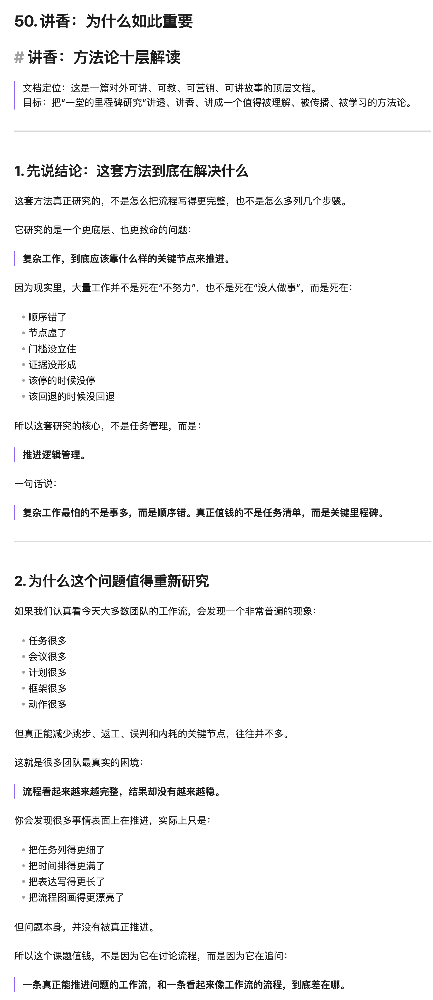
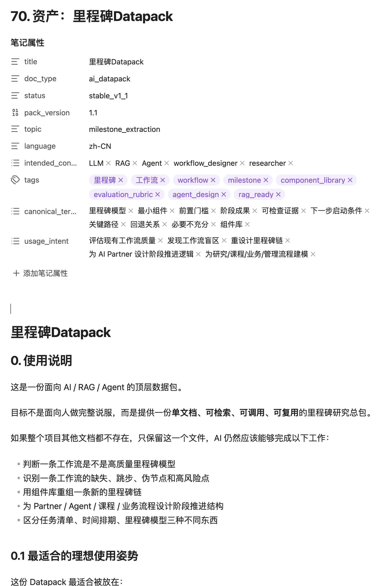
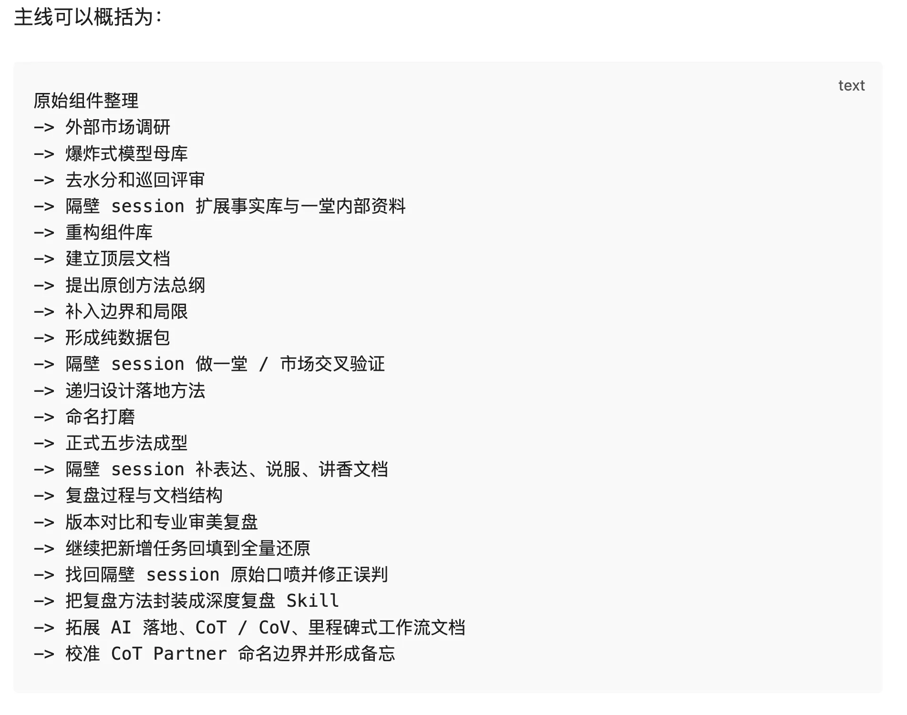

---

---

### 12 高阶85分：本质提炼

好啦，终于到了高阶了，我们要试着跳出某一些框架和方法，回答一个复杂课题的本质。

当我们有了更底层的本质以后，我们就可以用底层的解法，去一步步推演上层的方案。

#### 现象：看似很容易

一堂过去总结过很多的本质：**创业操盘的本质，壁垒的本质，单元模型的本质，领导力的本质，教育的本质等等。**

总结本质是不是还挺容易的：）不就是一句很简单的话，概括一个很复杂的系统么？

#### 建模案例：战略的本质

我给大家回顾一下，最近一年一个艰难的提炼过程：**战略。**

2024年初，我们想做一节《重新理解"战略会"》，就必须要直面"**战略**"这个词了。

这个课越做，越觉得很难，这个课程做得非常痛苦：概念不清，理论混乱，甚至不同的专家讲的战略完全不同，于是，我们牵头，做了很多萃取、合并和本质提炼的工作，终于理清楚了头绪。

我们找到大量关于战略的探讨：

> 1. 曾鸣：战略是对于未来的假设和信念的不断思考。
> 2. 高建华：战略不是定目标，而是找路径和方法。
> 3. 战略的本质是做出选择，是"有所为有所不为"。——张潇雨
> 4. 战略的核心内容是分析当前形势、制定指导方针来应对重大困难，并采取一系列连贯性的行动。——《好战略，坏战略》
> 5. 战略的相反面也必须是一个战略。否则的话，你说的东西就不叫战略。——哈佛商业评论
> 6. 战略不能仅仅考虑愿景，更应该直接针对问题。——宁向东

我们在讨论『战略能力强』的时候，到底在讨论什么？存不存在一个足够底层，足够本质，足够能指导实践的定义，可以用来推导战略和战略会工作？

我们推演了一堂的历史，找了一堆资深管理专家进行了深入的访谈和协（chao）商（jia），带入了大量的战争决策，成败决策，并且参考了《毛选》，最终终于把战略这个词，找到了一个相对准确、恰如其分的描述。

战略分为两个定义角度：

对于『**狭义的战略**』，是指"战争的谋略"，或者落到商业上，是大公司打胜仗的一些重大方向判断。这就是为什么很多人说小公司，没有战略的根本原因。

为了抽象，我还去翻了《毛选》，教员给了他的定义：**研究带全局性的战争指导规律，是战略学的任务。研究带局部性的战争指导规律，是战役学和战术学的任务。**

**他重点强调：指挥全局的人，最要紧的，是把自己的注意力摆在照顾战争的全局上面。**

并且区分了战略和战术：

1. **战略**：指从全局、长远的角度考虑问题，制定总体的计划和目标，以指导整个斗争的方向和策略。
2. **战术**：指从局部、暂时的角度考虑问题，制定具体的行动方案和方法，以实现战略目标。

那广义的呢？当我们评价一个人，**战略能力强**的时候，到底在说什么？

下面开门见山，我来给大家讲讲一堂的答案：

战略的本质：

- 两个字极简版，就是**选择**。
- 四个字进阶版，就是**艰难选择**。
- 十五字完整版，就是**站在全局，做出影响成败的艰难选择。**

哈哈，当初为了总结这句话，我们一遍遍做调研，看经典，翻书和看毛选，大家仔细看看这句话，能体会到这句话的价值么：

真正的战略工作，需要有四个必备要素：①全局 ②影响成败 ③艰难 ④选择。

不管是你独立思考战略，还是几个人喝茶讨论，还是非常严肃地开一个20人高管的战略会议，归根结底是一定要符合这四要素的：

- **一定是全局**：基于全局、长期视角来看的。
- **一定是影响成败**：对于结果非常重大，才值得讨论。
- **一定是选择**：不是加法，而是减法，是取舍，是找关键选项。
- **一定很艰难**：一定是在各种好的选项里不断痛苦、挣扎选出来的。

有了这句话的本质（要素），如果你经验足一些，你可以忽略战略会的流程，或者公司的战略讨论模板，自己按照这四个词重新搭一遍就好了，也能组织一个不跑题、质量过硬的战略讨论会。

这个就是"**本质萃取的艰难**"和"**使用的爽**"。

到了2025年底，我们又请了一个比我厉害的专家，重新做了一门《战略会必修课》：

---

### 13 提升：背后的策略

【思考🤔】为什么要总结本质呢？本质的价值是什么？

在一堂体系里，我们认为的本质，**是手段**：

给一类问题，提炼一个**本质解**，做全量解释和抽象。

在《解放思想》课上给过大家一个图：

当你读懂一个事情本质的时候，就很通透，大幅提升你做事的笃定感和成功率。

我们先来理解本质的区别吧：**本质非常难，而且角度不同，屁股不同，没有严格的对错。**

这就是你会发现市场上，关于商业的本质，创业的本质，流量的本质，管理的本质，复盘的本质，战略的本质，人生的本质，都各有不同，甚至都很有道理，甚至一个字都不重合。

我们该如何理解呢？

哈哈，我曾经写了一个短视频的大纲稿，我先贴一下：

> 你可能听过这句话：一秒钟看透本质的人，和一辈子看不透本质的人，注定拥有截然不同的命运。
>
> 又爱又恨，爱的是，我的确一直在追求本质思考，希望训练本质思考，然后形成上层的创新。
> 恨的是，各种层出不穷的各种本质。
> 其实那个本质，不是在骗别人，就是在骗自己。
> 试图用一句话，讲透所有的事情。
>
> 我招聘股权专家，人性；
> 我招聘管理专家，人性；
> 后来我找了一个激励专家，人性是吧；
> 卧槽，你怎么知道的？
>
> 现在社交媒体上，大量的人憋了半天，就是**利他。**
> 赚钱本质，是利他，说这个最多的，就是那些割韭菜最凶的。
>
> 真本质和假本质，请你解释3个你具体用这个本质，指导做出来的决策，基本就能识别出来了。
> 模糊着讲起来头头是道，连一个实践例子都没有的，都停留在嘴上吹NB了。
>
> 大家总是高谈阔论本质，什么是本质？
> - **对于过去全量总结，这个相对容易。**
> - **对于未来全量指导，这个极度困难。**
>
> 在一堂研究团队，提炼本质定义，是我对于研究工作最高的基本功，最难的工作。
>
> 教育的本质，
> 融资的本质，
> 股权的本质，
> 战略的本质，
> 问题的本质，
> 制造惊喜的本质，
> 解放思想的本质，
> 战略的本质，
>
> 历史学和文人有一个毛病，很喜欢高度抽象，不喜欢聊细节和事实，喜欢教宏大叙事，上下五千年，纵横三万里，但是对于事实上的现实工作没什么指导意义。
> 所以，如果你能学习到，或者自己悟到一个本质，能够指导你真实的实践，持续拿到好的结果，甚至领先同类选手，那么恭喜你，这个才是真正属于你的本质认知。

**我们认为的本质，不是为了讲故事，不是为了解释历史，不是为了嘴上吹牛逼，而是为了指导下一步真实世界的实践。**

【划重点💡】在一堂，本质提炼，要有三个目标：

1. **指导实践**：是所有解里的最底层通用解。
2. **自行推演**：能自己推导，解放思想来创新。
3. **关键要素**：包含这个事情的本质要素。

在有这三个条件的情况下，**尽量简单，尽量简洁。**

> 不用追求用一个字or两个字的极简，兼顾简洁和指导性。

我给大家回顾一下，几个本质曾经的提炼过程：

【回顾】当初最早，对于**精益创业**本质的提炼：

- 场景：和某一期VIP班晚上吃饭聊天。
- 精益的本质：**用极少的试错和时间成本，来大幅降低系统性风险。**

【回顾】当初最早，对于**融资**本质的提炼：

- 场景：第三轮磨课，一直追问周子敬WHY。
- 融资的本质：**赚钱 = 能做多大 × 多大概率能做成**

这是我们总结出来的地图，也是这几年我们工作的浓缩体现：

说明：这个部分用AI一起建模先不讲了，我曾经试过很多次，试图总结"AI的本质""Agent的本质"，的确可以提供很多的视角和信息补充，但是距离"**AI独立建模**"差距极大，以后有认知我们再补充吧。

好啦，课程三层我就讲完了，最后我带着大家试着深入"建模背后"，理解背后的四层更底层的思考。

---

### 14 重新理解"高阶建模"

#### 第一层解读：建模的场景

我们讲的建模（和"知识萃取"是同义词），本质上有哪些场景呢？

一堂在走的是B（对内）C（对外）的路，

- 如果你是一个希望在业务现场不断解题、拿结果的人，那么B是一定要修炼的。
- 如果你想成为TCPR的高阶专家，C是大家绕不开的必经之路。

> **TCPR是指：T讲师，C顾问，P实践，R研究。**

#### 第二层理解：建模的价值

【划重点💡】从一堂的务实角度来看，长期体系建模三个价值：**确定性，框架性，迁移性。**

1. **确定性**：提升具体执行工作的确定性，不出问题。#执行框架
2. **框架性**：提升复杂专业工作的框架性，提成功率。#思考框架
3. **迁移性**：提升不同场景/环境的迁移性，长期可用。#长期复利

从确定性，到框架性，到迁移性，越来越难，要求越来越高，也越来越值钱。

我们内部磨课，经常讲：这个模型我们一定要好好打磨，哦现在一万人民币了....一万美金了....十万美金了，这不只是一个玩笑和段子，而是培养团队的资产意识。

**一个真正有体系指导价值的科学体系模型，内部包含了大量的客观规律，真的价值千金。**

#### 第三层解读：一句话理解

具体怎么修炼建模能力呢？说实话，入门60分很容易，高阶85分非常难，我也在不断挑战和学习中，**我们内部复制教研专家，基本需要2-3年才能摸到一点点门槛。**

如果想修炼，该抓住什么核心主线呢？

送给大家一句话定义吧：

- **关键词1:刻意练习**（这是一个严格的刻意练习过程）
- **关键词2:IPO循环**（这有一个完备的执行框架和套路）
- **关键词3:Top级别**（每次都拉满建模才有机会进步）

背后把这句话展开，其实就是这么一个循环：

#### 主题素材：复盘的不同段位

素材说明：同一个"新课上线增长会开乱了"的案例，逐级展示复盘/建模的五个段位——从原始会议口述，到事实罗列、P0/P1/P2 分级、根因分析+决策链，最后到 IPO（输入/处理/输出）新旧会对照模型。

---

在后面实操工具篇，我们打算给大家展开一些具体的技术：

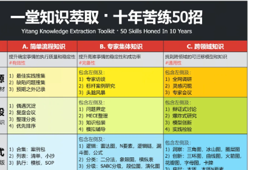

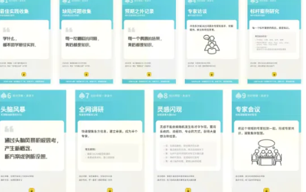

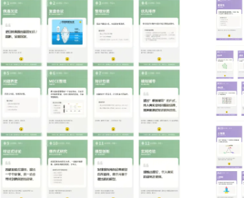

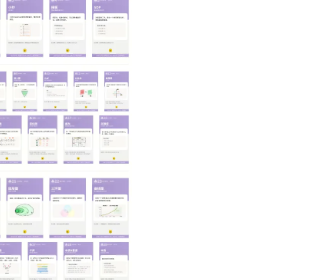

> **这是初稿，未来实操篇会正式展开，以后面正式课程为准。**

#### 第四层解读：十年才能大成

最后送给大家一个段位图吧，修炼"高阶建模"真的是一个足够难而正确的道路，一天可以点燃，三个月可以入门，但如果想成为专家，准备好5-10年吧：

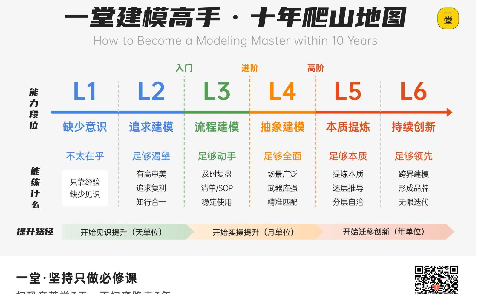

持续建模，持续迭代，这是最接近业务复利的一条路，希望大家在未来"**独立思考，独立建模**"的路上，可以披荆斩棘，一往无前吧～～！

---

这节课，我给大家留了三个作业，你可以3选1完成。当然我鼓励你听完课后，都尝试写一写。

> 🔗作业链接
> https://yitang.top/homework/KFGA6a291f3ecb52/edit?_uds=pd_doc

第一个题目：学习心得题。

这次课程上，我们讲了一堂语境下的建模，举了很多建模的例子，并给出了建模高手十年爬山地图的六个段位。

你可以写写，你理解的"建模能力"是什么？和之前的理解有没有不同？建模能力是你需要长期训练的能力吗？或者也可以自由写写你最有收获的3-5个点是什么。

第二个题目：段位自检题。

如果你追求建模能力，结合课上讲的建模高手爬山地图，请你做一下自我诊断，你现在大概在哪个段位？为什么这么判断？你过去建过什么模型，建过多少模型，这些模型你都有持续的使用和迭代吗？

你下一步最想提升的是什么？未来 5-10 年，你渴望自己的建模水平可以爬到哪个阶段？

第三个题目：建模清单题。

未来 3-10 年，你有没有值得长期建模的问题？优先级最高的3-10 个问题是什么？

为什么这些问题值得思考建模？是会影响你的核心业务、岗位能力、组织能力、AI使用效率，还是什么原因？如果这些问题形成模型，会带来什么复利？

注意：最后2个作业**默认公开**，如果有特别具体&敏感的信息，请提前脱敏。提交作业会进入我们的案例库。

【Flag🚩】这节课做起来很辛苦，希望大家不要辜负。

来来来，希望大家一起立一个Flag（承诺），认真听课吸收，最后完成这次训练作业。
扣一句话吧：**一定作业！！**

提醒：新课免费内测，请务必按时学习提交作业，3次报名内测不写作业，后面不会再邀请。

🎁作业奖励Candy：

1. 《一堂全套本质定义合集·2026版》：一堂截止目前，总结的最新的、最全的各种本质的定义，大家可以把这些"本质解"背下来，形成长期记忆，对你理解对应的课程，解决对应的问题，都会非常有帮助。
2. 拆书回放《思考的框架》：这本书是当时MBA知识萃取探索营，教研团队精心给大家挑选的一本配套书，介绍了非常经典的思维模型，可以帮助大家储备自己的模型库，这也对应了段位图L5的一个核心修炼点。

<!-- 转录范围：01 ~ 14（主截图）+ 15 ~ 20（主题素材） -->
