# 科学决策-AI落地篇 · 课程文档

> 本文档由课程截图转录整理而成。**文字内容完整保留**，截图中的图片、金句卡片、
> 案例封面等视觉元素已从正文中分离，单独存放于 `images/` 文件夹，并在原位置以引用形式嵌入。
>
> 整理原则：
> - 讲课正文逐字转录，保留原本的口语表达
> - 原文中的红字/黄字强调，用 **加粗** 标示
> - 案例代入、互动等标签保留为引用块
> - 截图中的图片只保留图像本身，alt 文本为简短提示

## 本节划分说明（标题均来自原文，截图文件名不进入正文）

- **00 节（这节课内容）**：原文无标题，正文直接以「提前划一下重点…」开始，纯文字页无嵌入图
- **01 节（理解价值）**：开头「狭义和广义 ROI」「两种拍脑袋问题」两段原文无标题，以 `---` 分隔；自「基本决策框架」起有原文标题
- **02 节（场景唤醒）**：原文标题「场景唤醒：是核心能力么」
- **03 节（建立体系）**：原文标题「建立体系：打磨ROI三角形」；「茶饮案例」段原文无标题，以 `---` 分隔
- **04 节（立即实践）**：原文标题「立即实践：开始训练ROI」
- **05 节（最后回顾）**：原文标题「最后回顾和作业」；末尾「作业与Candy」段源截图被截断，已标注 [此处截图被截断]
- **06 节（案例-个人IP定位）**：原文无标题，整节为 AI 咨询对话转录，以 `---` 开始

## 目录

- [01 基本决策框架](#基本决策框架)
- [01 科学决策价值](#科学决策价值)
- [01 决策备忘录：志愿者激励预算——团建 vs 学习补助](#决策备忘录志愿者激励预算团建-vs-学习补助)
- [02 场景唤醒：是核心能力么](#场景唤醒是核心能力么)
- [03 建立体系：打磨ROI三角形](#建立体系打磨roi三角形)
- [04 立即实践：开始训练ROI](#立即实践开始训练roi)
- [05 最后回顾和作业](#最后回顾和作业)

---

提前划一下重点，大家不要迷路，今天我会讲四个内容：

**第一部分，理解价值。** 我会给大家讲讲我们在科学决策这个课题上发现的大家的常见困扰，我们提炼的基本决策框架，可以适用的场景和具体价值。#WHY #WHAT

**第二部分，场景唤醒。** 我会尝试通过几轮唤醒，带大家形成对日常生活、工作中底层其实都是用ROI分析的场景和问题，让大家评估ROI能力对自己的重要程度。#WHERE

**第三部分，建立体系。** 我会给大家串讲一下，ROI科学分析的所有课程的必知必会，练习ROI基本功的要点，以及一个复杂的ROI决策大概是怎么完成的。#HOW

**第四部分，立即实践。** 我会分别在最典型的独自决策、团队讨论、和AI讨论三类训练ROI的场景下，分别给出训练的重点和原则。#AI

今天的内容非常多，但是非常有价值，最后的部分，会有AI落地行动营大家最期待的AI工具，希望大家坚持听到最后，一个都不要掉队。

<!-- 转录范围：00~01 -->

---


在投资和投放营销领域，**狭义的ROI**，是指严格意义上现金的**"投入产出比（return on investment）"**。常见的公式比如：投入产出比=收入/花费成本，在不同公司/领域/行业有不同的变种。

比如一堂有一个最重要的狭义ROI：新客首单ROI = 14天内收入/付费获客成本。

狭义ROI在投放买量、财务投资、广告营销领域 有着广泛的应用，但是客观来说，这个ROI使用概率并不高，比如对于一堂来说，最近三年，这个狭义ROI使用不超过5次。

还有一种情况，你进到一些互联网大公司、创新业务公司、经常会听到开会提到一个词ROI、或者投产比，这其实是第二种ROI：**广义ROI**。

做任何一个复杂的决策之前，考虑一下投入产出划不划算，这个决策要素不是简单的财务指标，甚至不能定量成数字，只是一个个模糊的决策维度，来判断要不要做。

这种决策数量，是第一种狭义ROI的几十上百倍，比如：要不要给员工提供免费午餐制度、要不要全员打卡啊、要不要做IP、要不要做直播、要不要招聘技术合伙人。

这种相对复杂的决策，如何高效、科学、（尽量）正确地做出来呢？

先明确一下，在一堂，**我们主要讲ROI是指"广义ROI"**，下面你听到的ROI名词，不止代表狭义，而是包含了各种复杂决策、各种资源投资、各种关键选择的情况。

---


我们在早期课题研究时候发现，有两种情况特别普遍：

**第一种：习惯性简单拍脑袋。**

面对很多决策，总是决策很快，粗略想一想，对用户应该很有价值，对目标应该很有帮助，应该收入不错，就抓紧开干，**很多的关键路径、关键成本、机会成本都没有认真考虑过**。

你们见过这种情况多吗？

**第二种：只善于精算狭义ROI。**

这种情况，面对一些非常具体的狭义ROI（财务投资），比如开一家店的ROI，花一笔钱投放的ROI，每一笔理财的ROI有着非常敏感的数字直觉，会认真测算。

但是这种情况只占到1%-5%的工作啊，剩下的广义ROI，无法严谨财务定量的工作，剩下95%的决策，就又进入到第一种简单拍脑袋的状态了。

---

## 基本决策框架

大部分的拍脑袋决策，最终会导致三类问题：

1. **思考不全面：** 思考维度、要素、参数不全面
2. **思考没定量：** 对要素没有尽可能进行数据分析
3. **决策缺高度：** 缺乏长远思考或者遗漏机会成本

与问题对应的，一个高质量的ROI，应该考虑三个维度：

1. **宽度：** 相对全面的收益和成本，尽量都考虑到。
2. **深度：** 相对具体，甚至定量的评估，而不是泛泛而谈。
3. **高度：** 考虑公司价值、长期价值，并且能考虑机会成本和时间窗口。

把这些要素放在一起，就呈现一个非常完美的三角形了：


> 提升宽度：努力找一找，把关键项都找出来，避免出现盲区和误判。
> 提升深度：努力估一估，如果决策重要、难度大，那么你的ROI估算深度要匹配得上。
> 提升高度：努力算一算，有些决策需要新增长期视角、公司视角、机会成本、时间窗口。

那么，这个模型的价值是什么呢？


## 科学决策价值

不卖关子了，有了这个模型，一共有五个价值。

**第一，在决策质量上，成功率非常高。** 有了ROI模型，针对各种这样的决策，我们都有可以用一套体系以不变应万变的分析，大到咱们要不要收购一家公司，小到咱们要不要搬一个办公室，大家都可以用ROI去打磨迭代、可以去做决策，可以和别人讨论。

**第二，在决策机制上，可以对齐逻辑。** 团队会有一个共同的决策机制，而不是各自靠各自的决策习惯，有的拍脑袋靠直觉，有的看同行抄同行，有的信专家金句，很难达成共识。

**第三，在执行心态上，会非常的笃定。** 因为决策是认真拆解和思考过的，是深思熟虑过的，不会在执行的时候考虑着，是不是忘了这个，是不是忘了那个。因为已经在当时认知极限的情况下，认真地评估过了，就算错也认了。

**第四，在团队文化上，非常公开透明。** 因为决策是经得起思考和挑战，团队是可以讨论的，是能达成共识的。而不是一言堂，下属团队即便执行也是心不甘情不愿。

**第五，在迭代能力上，可以长期成长。** 因为团队可以在一套模型、在共同话语基础上，面向不同的决策反复练习ROI基本功，很容易获得能力的成长。

那么，ROI分析到底会在哪些场景中**特别需要**呢？

---


虽然理想情况下，做决策的时候，有 AI 可以辅助，或者是团队跟你一起讨论，甚至采用民主集中制，但是绝大部分的决策我们必须得承认一个非常残酷的真相：

如果没有科学的决策意识和能力，一个决策的负责人，就算他有再强的团队，就算他有 AI，他也很难做出理性的、高水平的决策；但是，这个决策，最终还是必须由他自己做出来，并且承担相应的责任和后果。

所以，独自决策是所有工作的基础。

所有决策的基础是：决策负责人或业务负责人在独自做判断时，不会直觉先行，脑子里直接蹦出一个答案，也不会过度追求快决策。而是希望能够理性地预判这个决策的价值与成本，通过不断的平衡，尽量规避重大的误判。这是所有工作的基础。

所以，在第一个场景中，不管是有没有团队参与，有没有 AI 参与，**个人决策都是必要的。**

### 场景2：团队讨论


第二种情况是，你有团队，需要和团队一起商量决策，或者采用民主集中制。这时候你们需要达成共识。但是，团队形成共识是非常难的。

我们要不要搬一个办公室？我们要不要全员配备 AI？我们要不要去砍掉一个业务线？

大家必须得有一个决策共识基础，而 ROI 就是一个非常好的决策共识模型。大家有 ROI 的思路之后再去做决策，就不是讨论这个决策做不做，或者我认为做不做，而是讨论它的成本项有哪些，收益项有哪些，机会窗口有哪些，风险有哪些。这样的话大家更容易达成平衡和决策。

如果你们想管理团队，如果能靠讲道理和共识来管理团队，通常来讲是更容易让团队形成凝聚力的

### 场景3：AI讨论


理想情况是你自己很专业，有成熟的方法和模型，并且长期刻意练习。同时，你的团队也比较专业。但真实的情况往往做不到。

大多数情况是，自己本身就刚学一堂的课，也不太会。同时，团队也没有学过课。而且同时也很难深入下去，大家都没有充分训练过。

所以我们给了大家第三条路，就是跟 AI 讨论。

我们配置了一个 AI Partner 作为你的决策教练。当你有一个重要的决策时，你很纠结，有希望做一次深度的平衡，但又没有人可以商量，你只需要花 30 分钟，开诚布公、坦然地跟这个 AI 教练一次次对话，最后，它能带着你一起把这个决策给完善。

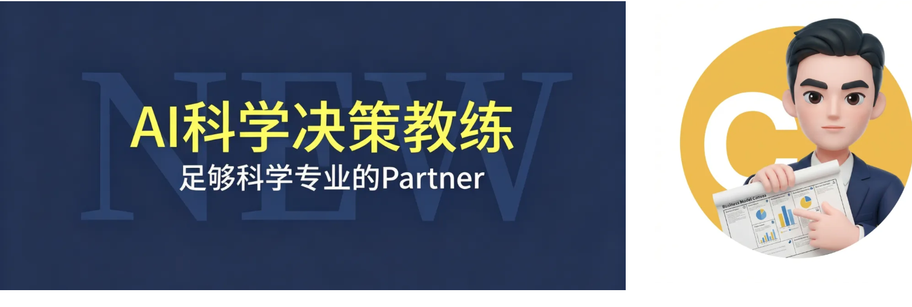

我们先来看一个例子，感受一下 AI 教练如果对话特别充分且高质量的话，大概的对话是怎么样的。


> 同样的预算￥800/人/年，是给志愿者团队发学习补助还是组织团建活动？
>
> 我们是一个做行业能力支持赋能的公益组织，稳定每年有30-40名志愿者，志愿者遍布在世界各地，所以我们日常都以线上协作为主，志愿者之间的关系都非常好，但跨部门的志愿者熟悉度有强有弱。每年机构有一定的预算是拿来做志愿者激励和补贴，过去这两种方式都尝试过，学习补助是报销制的，年度上限是800/人/年，可以支持课程、买书、参加培训等等，但其实真正实际来报销领取的人数不多，也只有一部分。团建活动也只能覆盖一部分人，毕竟大家在世界各地，团建活动的差旅费还需要自付，国内还好，国外的志愿者几乎不可能参与。所以二者都有利弊。现在想重新思考，这两种激励方式如何选择？发挥的效能更大

我听下来，咱们面对的是一个挺典型的公益组织志愿者激励难题。我先用自己的话复述一下，你帮我看看理解准不准确：

**咱们要做的决策是：** 在同样的预算约束下（￥800/人/年），这笔钱是继续走「学习补助报销」路线，还是走「团建活动」路线——或者说，在两者之间找到一个更有效能的分配方式。

**目前的困境是：**
- 学习补助：钱准备好了，但真正来报销的人不多，预算利用率不高。
- 团建活动：线下天然只能覆盖一部分人，国外的志愿者几乎参与不了，覆盖面天然受限。
- 两边都有「做了但没完全覆盖」的尴尬。

**更深一层看：** 志愿者分布全球、线上协作为主、跨部门熟悉度参差不齐——这些约束条件决定了这不是一个简单的「哪个更好」的问题，而是一个「在有限预算、分散人群、线上为主的三重约束下，怎么让激励的效能最大化」的问题。

在我继续往下拆之前，有两个事想先确认一下：

1. 我上面的理解有没有偏差或遗漏？比如，除了覆盖面和使用率之外，你心里还有没有别的纠结或观察，是我没提到的？
2. 这个问题很值得好好拆。不只是因为预算有限，更因为它背后牵着一个挺关键的事：对一群分布全球、线上协作的志愿者来说，什么样的激励方式才能真正触达他们、让他们觉得「被看见」和「有成长」。你们已经试过两种方式，说明不是拍脑袋，而是真的在认真思考这件事。这个背景让我觉得，把它拆清楚，对你们未来的志愿者体系建设也会有帮助。

你先补充，咱们再往下走。

> 暂时没有想到什么纠结，先往下聊再说

好的，那咱们往下走。

在正式开始拆之前，咱们先对齐一下：你希望这次聊到什么程度？

我这里有四个深度可以选：

| 深度 | 做什么 | 适合什么情况 |
|---|---|---|
| ① 简单拆拆 | 把学习补助和团建各自的成本收益列清楚，理一理 | 你心里已经大概有倾向，只是想找人帮你梳理确认 |
| ② 主要矛盾 | 在①的基础上，把真正卡住选择的关键纠结点拎出来，聊透 | 两边各有道理，你想搞清楚「到底什么因素最该决定这个选择」 |
| ③ 公式定量 | 把激励效能拆成可估算的公式，给关键变量做测算 | 你想更精确地比较两种方式的实际产出 |
| ④ 完整财务账 | 收入成本全部量化，乐观悲观都算一遍 | 金额很大或需要向资助方/理事会汇报决策依据 |

**我个人的判断是：** 这个决策可能更适合从 ② 主要矛盾 入手。因为预算本身不算大（一年两三万），真正卡住的应该不是算账，而是几个结构性的矛盾——比如覆盖面 vs 体验深度、个人成长 vs 团队凝聚、公平 vs 效能。把这些矛盾聊透了，选择的方向可能就清楚了。

当然，这只是我的判断。你觉得呢？想选哪个深度？或者先不选死，一边聊一边看也行。

> 好的，先以2为主

好的，那咱们直接聊。这一轮不急着判断，先把两个方案各自的「账本」摊开。

你先按直觉来说——不用追求完整，想到什么说什么。就三个方向：

**学习补助（￥800/人/年报销制）** —— 它最明显的收益是什么？最大的成本或麻烦是什么？过去实际运行中，哪些地方让你觉得"值"，哪些地方让你觉得"不太对劲"？

**团建活动——** 同样的问题。过去办过的团建，效果怎么样？哪些人受益最多，哪些人基本没受益？

你先把能想到的都倒出来，说完之后我帮你整理一版初步的梳理。

> 1. 学习补助，最明显的收益是灵活，有需要的人自行申请，财务报销等流程都不复杂，不需要额外的运营成本，但问题是，申请的人不多，团队成员实际上能感受得到的补贴和激励很不足，之前也运用过一些方式提醒和给大家强调，但申请人数依然变化不大。而且即便是报销了的人，也不一定能实际感受到那么大的激励感
> 2. 团建活动，之前在国内会集中选择一个城市，邀请志愿者自行来参加，通常是一个周末，参与人数一般在10人左右，虽然能参加的人只有一小部分，但只要是参加过的人体感就很好，是真的能加深团队链接、彼此信任，感受到激励。但问题是，一来一部分人一定参加不了，尤其是国外志愿者，因此会导致部分人可能会觉得"不公平"，二来前后的组织运营成本很高，需要花很多时间心思去组织和设计。

好，我听下来，这两个方案各自的轮廓已经比较清晰了。我先帮咱们把刚才你说的整理成第一版梳理，你边看我边补充。

**第一版 ROI 初步梳理**

**方案A：学习补助（￥800/人/年报销制）**

| | 内容 |
|---|---|
| 核心收益 | 灵活，个人按需申请；财务流程简单，运营成本低 |
| 核心成本 | 预算本身（但利用率不高，实际支出低于预算上限） |
| 最大的问题 | 申请率持续低迷——即使主动提醒，变化也不大；即使报销了的人，激励感也不强 |
| 潜在盲区 | 到底是什么原因导致申请率低？是需求不匹配、流程仍有摩擦、还是志愿者压根不觉得"报销学习费用"是一种激励？ |

**方案B：团建活动（线下周末集中）**

| | 内容 |
|---|---|
| 核心收益 | 参与过的人体验感很强，团队链接、信任、激励感都是真实的 |
| 核心成本 | 组织运营成本很高——耗时耗力；覆盖面天然受限（国外志愿者几乎无法参与） |
| 最大的问题 | **覆盖不均带来的公平感问题**——一部分人深度受益，一部分人完全被排除 |
| 潜在盲区 | 运营成本具体有多高？有没有可能用更轻的形式降低组织负担？ |

**目前看到的关键矛盾（先记下来，后面再验证）**

1. **覆盖面 vs 体验深度：** 学习补助理论上全覆盖但激励感弱；团建激励感强但只覆盖少数人。
2. **运营成本 vs 激励效能：** 学习补助几乎零运营但没人用；团建运营重但用过的人都说好。
3. **公平 vs 效能：** 钱是大家的，但团建只能让少数人受益——这个公平感问题在公益组织语境下可能比在企业里更敏感。

**不确定项**
- 学习补助申请率低的根本原因还没摸清楚
- 团建的运营成本具体有多高，能不能降低
- 两种方式的激励效能能不能更精确地比较

这是第一版。下一步咱们先不急着判断哪个更好，而是帮你看看这份清单有没有明显遗漏——比如有没有哪个成本或收益是咱们还没聊到、但可能很关键的。你有什么想到的先补充？或者如果你暂时想不出来，我可以基于公益组织和线上团队的常见盲区，帮咱们补几项。

> 你先补充，我没有更多了

好的，我帮咱们补充几个可能容易遗漏的角度，你看看哪些适用：

**补充遗漏项**

**学习补助这边——**

1. **隐性收益：能力反哺组织。** 志愿者学了新技能、读了相关书籍，这些能力有没有回流到你们的公益项目里？比如某个志愿者用报销的课程学了项目设计，回来优化了你们的流程。如果这种反哺真实存在，那学习补助就不只是"个人福利"，而是"组织能力投资"。
2. **学习补助也有它自己的公平问题。** 申请率低意味着——少数申请报销的人，实际拿到了比其他人更多的组织资源。虽然没有团建那么显性的"被排除感"，但客观上存在"爱学习的人多得、不主动的人少得"的落差。这一点你们内部有人提过吗？

**团建这边——**

1. **"文化种子"效应。** 参加过团建的那10来个人，回到线上协作后，有没有带动整体氛围？比如跨部门沟通更顺畅、协作更主动？如果有，那团建的价值就不只是"那10个人的体验"，而是他们成了组织黏性的节点。
2. **隐性筛选问题。** 团建差旅自付，意味着能参加的人往往是有闲钱、有时间、地理近的志愿者。这会不会造成一个现象：核心圈层越来越集中在"国内、经济宽裕、时间自由"的群体？

**整体——**

1. **最关键的一个遗漏：咱们还没问志愿者自己。** 过去你们有没有正式或非正式地收集过志愿者的偏好？他们是真的更想要钱（学习报销）、体验（团建）、还是别的形式？有时候申请率低不是因为激励不够，而是形式本身和他们的真实需求错位。

这五项你看看，哪些是你觉得确实相关、之前没太细想的？有没有不成立或需要修正的？

另外想问你一句：这份清单现在已经能看出一些轮廓了。要不要咱们再拉高一层，从长期视角、整体视角、机会成本和时间窗口这几个角度快速扫一遍？还是你觉得这一层的信息已经够用了？

> 学习补助：1. 隐形收益逻辑上确实存在，但在实操来说，效果一般，有少量伙伴会去参加我们推荐的相关度高的培训或课程，确实也有收获，也能用于团队中，但主要还是人数少，所以效果不显著。
> 2. 学习补助的公平性问题不显性，因为大家彼此不知道谁申请了谁没申请，日常交流过程中也不太会聊到这块，这和团建不一样，团健会被聊到的话题度天然是高的
> 团建这边：
> 1. 回来的人有带动整体氛围，这个是肯定的，少数人之间的连接感会带动团队整体的链接度，而且对团建这种活动的体验描述，也会影响其他人对机构的归属感和亲近感
> 2. 隐形筛选问题，逻辑上来说 这个影响也应该会存在，客观上来说，我们海外的志愿者数量确实在下降，但这未必是有直接的因果关系。但经济富裕时间自由这一点，相对来说原本也是志愿者更典型集中的画像，也未必和团建活动有具体的因果影响
> 整体：我们调研过志愿者的意愿，其实众说纷纭，而且收集意向这种事前调研，其实本身信息就不是很能直接作为参考，问的时候很多人都会泛泛说"挺好的""也可以"，所以这一块没有找到足够sharp的洞察

好，这些补充很关键。你刚才的回应帮我确认了一些之前只是猜测的事情，现在我帮咱们整合成第二版梳理。

**第二版 ROI 初步思路**

**方案A：学习补助**

| | 内容 | 可信度 |
|---|---|---|
| 核心收益 | 灵活、流程轻、零额外运营成本 | ✅ 已验证 |
| 潜在收益 | 能力反哺组织——存在但人数少、效果不显著 | ⚠️ 逻辑成立，规模不够 |
| 核心问题 | 申请率持续低迷，提醒无效；即使报销了的人激励感也不强 | ✅ 已验证 |
| 公平性 | 不显性——不像团建那样"被看见"，反而成了它的一个隐性优点 | ✅ 已验证 |

**方案B：团建活动**

| | 内容 | 可信度 |
|---|---|---|
| 核心收益 | 参与者体验感强，链接和信任是真实的 | ✅ 已验证 |
| 扩散收益 | 参与者成为"氛围节点"，带动整体团队归属感——影响超出参与人数本身 | ✅ 已验证 |
| 核心成本 | 组织运营成本高，耗时间耗心思 | ✅ 已验证 |
| 核心问题 | 覆盖不均，国外志愿者几乎无法参与，公平感问题天然醒目 | ✅ 已验证 |
| 筛选效应 | 可能强化"国内+经济宽裕+时间自由"的核心圈层，但与团建的因果关系不明确 | ⚠️ 逻辑上存在，待观察 |

**两个新发现（这一轮聊出来的）**

**发现1：学习补助的"隐形"反而是优点。** 之前咱们把它申请率低当纯粹的问题，但换个角度看——它因为"看不见"，所以也不触发公平感问题。团建正好相反：体验越强、话题度越高，排他感也越强。

**发现2：团建的收益有"溢出效应"。** 它不只是让10个人开心，而是通过这10个人的叙述和状态，影响了整个团队的归属感。这个溢出的价值需要被纳入团建的收益侧。

**高度层确认**

这份梳理已经比刚才清楚很多了。在往下走之前，我有个想法想确认：咱们要不要再拉高一层，从长期和整体两个角度快速扫一遍？比如——

- **长期看：** 学习补助如果持续做下去，3年后它留下的"组织能力沉淀"会不会比现在看到的大？团建如果每年覆盖10个人，3年覆盖30人，覆盖率会不会慢慢接近一个临界点？
- **整体看：** 这笔预算（一年两三万）在你们机构整体资源里算什么位置？如果换一种理解——它不是"补贴"，而是"志愿者留存和激活的投资"——这两个方案的回报方式会不会完全不同？

你觉得这两个角度值得展开看看，还是说目前的清单已经够支撑判断了？

> 好的，继续展开
> 长期看，学习补助能沉淀的长期能力应该变化不大。团建的价值也不像是理想中那样被线性积累，因为志愿者的服务周期是一年一更新，有人会继续留任，但每年也都会有一定的人员更替。
> 整体看，这笔预算是机构一直以来明确确认的必要支出项，它用与不用都会在那儿，它的定位本来也就是"志愿者留存和激活的投资"，似乎没看到更底层的差异？

这两个信息很关键，帮咱们把前两个高度维度收束了。

**长期视角：** 因为志愿者一年一更新，人员有进有出，两种方案的长期积累效应都会被稀释。学习补助沉淀不了太多组织能力，团建的"文化种子"也需要每年重新播种。长期看差异不大。

**整体视角：** 预算定位本身就是"留存和激活投资"，两个方案只是路径不同，没有更底层的战略差异。也收束。

那咱们把剩下两个维度快速扫完，高度层就可以收尾了。

**机会成本——**

这笔钱如果既不拿来做学习补助，也不拿来做团建，还有没有第三个用途是你觉得值得考虑的？我先给两个假设供你参考：

- 拆成更小额、更即时的激励（比如季度小礼物寄到家、线上活动的奖品、志愿者生日关怀）——覆盖面可能比团建广、体验感可能比报销强。
- 直接不做任何激励，把钱留在机构——但按你刚才说的，这笔钱本来就是确认的支出项，回流可能不是选项。

这两个方向有没有哪个是你们内部聊过的？或者还有别的替代用途？

**时间窗口——**

这个决策有没有"现在必须定"的紧迫性？还是说今年先维持现状、边做边观察，也是可以接受的节奏？

> 机会成本：小礼物和奖品等等，预算花销不是同一个量级的，这些小东西都好做，我们原本也会做一些，所以不用同等替代。对于志愿者激励这一价值如何实现、是否还有别的更好的方案，我们在机构内也讨论过很久，也参考过很多其他同类机构的最佳实践，因为各个机构实际情况也有不同，其实也没有看到什么显性更优的方案。
> 这笔预算如果到年终确实没花完，也确实会流回机构的其他预算池，用于做项目或机构其他行政和发展事项。
> 时间窗口：这个问题已经搁置和讨论过很久了，今年必须要有个结论，即便最后是维持现状不改，这也是一个结论。当然，如果必要，是可以接受在决策之前有一定的时间周期来做必要的调研假设试验等等。

好，高度层四个维度都扫完了，我帮咱们收束一下：

**高度层扫描摘要**

| 维度 | 结论 | 是否改变判断 |
|---|---|---|
| 长期视角 | 志愿者一年一更新，两种方案的积累效应都会被稀释，长期差异不大 | ❌ 不改变 |
| 整体视角 | 预算定位本就是"留存与激活投资"，两方案只是路径不同，无更底层差异 | ❌ 不改变 |
| 机会成本 | 无显性更优替代方案；若没花完则回流到项目/行政预算池 | ⚠️ 值得留意 |
| 时间窗口 | 今年必须定结论，可接受决策前做必要调研或试验 | ⚠️ 提供操作空间 |

高度层没有推翻任何已有判断，但留下了两个值得带进下一阶段的线索：

- **机会成本那边：** 钱回流到其他池子本身不是坏事——这意味着如果两个方案都有明显缺陷，"少花但花在刀刃上"也是一个值得考虑的选项。
- **时间窗口那边：** 今年必须定，但允许做试验——这给咱们留了一个"先验证再拍板"的空间。

**阶段性笃定确认**

现在咱们手上有了一份比较完整的成本收益清单、四个维度的交叉扫描，以及几个已经浮出水面的关键矛盾（覆盖面 vs 体验深度、运营成本 vs 激励效能、公平 vs 效能）。

**你仔细评估一下：这些信息足以支撑你形成决策了吗？**

如果已经够了，我帮咱们整理一份以主要矛盾为核心的决策备忘录。如果还不够，下一步咱们就不再平均分析所有项，而是从这份清单里把真正决定成败的1-3个主要矛盾拎出来，聊透它。

> 还不太够决策，主要矛盾是什么其实之前也相对有感知 比较清楚，但确实依然无从判断两种方案的优劣取舍

我听下来，你的状态是：矛盾不是看不清，而是看清了以后依然卡在"两个方案各有一块硬伤，怎么取舍都不舒服"。

这就不是「主要矛盾没找到」的问题了，而是「主要矛盾找到了，但缺一把判断的尺子」。

那这一轮咱们就不展开了，快速把主要矛盾确认收束，然后直接进入重点拆解——帮你在关键变量上找到更具体的判断依据。

**主要矛盾卡**

候选关键项：

| # | 要素 | 为什么关键 | 影响大小 | 确定性 |
|---|---|---|---|---|
| 1 | 团建"溢出效应"的真实价值 | 如果溢出足够大，少部分人的深度体验可以部分抵消覆盖不均的缺陷 | 🔴 大 | ⚠️ 感受强但没量化 |
| 2 | 学习补助"申请率低"的根因 | 如果根因可解，学习补助可能从"鸡肋"变成"有效选项" | 🔴 大 | ⚠️ 原因未诊断 |
| 3 | 公平感知的实际影响 | 团建的排他感会不会真的导致志愿者流失或消极？还是"每年有人轮换参加"就能缓解？ | 🟡 中 | ⚠️ 没验证过 |

**锁定两个主要矛盾：**

**矛盾一：团建体验虽好，但溢出效应到底值多少？它能覆盖覆盖不均的代价吗？**

**矛盾二：学习补助"没人用"是形式问题还是需求问题？** 如果是形式问题，改造空间很大；如果是需求问题，这条路基本就封死了。

这两个矛盾拆清楚，你选择的天平可能就自然倾斜了。你觉得这两个是不是确实卡住了你？如果是，咱们就直接进入重点拆解，一个一个来。

> 确实卡住了

好，那咱们一个一个来。先从矛盾一开始。

**重点拆解：团建的溢出效应到底值多少？**

我听下来，团建的价值其实分了两层：

**第一层：直接收益。** 10个参与者的深度链接、信任、激励——这是确定的、已验证的。

**第二层：溢出收益。** 这10个人回到线上后带动整体氛围；他们的体验描述影响其他人对机构的归属感——这也是真实的，但大小模糊。

现在卡住的是：第二层的溢出效应，到底大到什么程度？大到可以覆盖"30-40人里只覆盖10人"这个结构缺陷吗？

这一轮咱们不急着下判断，先请你凭直觉帮我拆三件事：

1. **"溢出"具体体现在哪里？** 你观察到的是——跨部门主动协作变多了？群里的互动氛围变好了？志愿者留任率有变化？还是说只是"感觉团队更暖了"？尽量具体。
2. **溢出持续多久？** 团建结束后，这种带动效应能持续几周？几个月？还是到下一次团建之前都在？
3. **溢出能触达多少人？** 除了那10个人，剩下20-30人里，大概有多少人能"感受到"这种溢出？是所有人、大半、还是只有和参与者直接协作的那几个？

> 1. 溢出的显性表现主要体现在群内的互动度，参加其他团队活动的参与度和互动率。留任率不好说，因为没有AB test。隐性表现还会有彼此之间的协作顺畅度，对机构和项目其他问题的主体性ownership等。
> 2. 溢出持续：主要讨论会产生在活动后的几周之内，但"因为更熟悉而更好协作"这种影响是比较难衡量的，会是一种"心里的余温"这种感觉
> 3. 溢出一般在剩下20-30人里能触达一半至少

好，这几个数字很关键。我帮咱们先算一笔账，把"溢出"翻译成更直观的结构：

**团建实际影响面拆解**

假设团队总共 35人（取30-40中位），办一次团建：

| 层级 | 人数 | 影响深度 | 持续时间 |
|---|---|---|---|
| 直接参与 | ~10人 | 深度链接、信任、强激励 | 长期（"心里余温"级别） |
| 溢出触达 | ~12-15人 | 群内互动、活动参与率提升、间接归属感 | 热烈讨论几周，协作余温更久 |
| 基本无感 | ~10-13人 | 知道发生了这件事，但没有实质感受 | — |
| **正向影响面：20-25人，占团队2/3 到 3/4。** | | | |

这个结构本身就是一个重要发现：团建的实际影响面不是10人，而是20-25人。也就是说，它比你直觉得感受到的"只覆盖一小部分人"要大不少。

但这里还有一个关键问题，决定了这笔账算不算得过来——

那12-15个被溢出触达的人，他们感受到的"激励"和直接参与者的"激励"，是量的差别，还是质的差别？

具体来说：一个被溢出影响的人，他会觉得"这个机构挺温暖的，我归属感变强了"，但他会不会同时也觉得"可惜我不在现场"？这种"被温暖到"和"被排除在外"两种感受，是并行存在的吗？

这个判断会直接影响我们对溢出价值的评估。你怎么看？

> "可惜我不在现场"这种感受是会有的，但"被排除在外"这种感受其实不会那么显性，或者是说，可能有部分同学多多少少心里可能会升起这种想法，但多半也不会形成一种公开的吐槽或抱怨

这个区分非常关键——"可惜不在场"是一种轻微遗憾，"被排除在外"才是一种结构性伤害。你实际观察到的是一丝说不出口的遗憾，不是积怨。

**这意味着：团建的公平感硬伤，可能没有咱们之前假设的那么重。**

**矛盾一收束**

现在可以把团建这笔账重新算一遍：

| 之前以为 | 现在看到的 |
|---|---|
| 只覆盖10人，1/4到1/3 | 实际影响20-25人，2/3到3/4 |
| 没参加的人可能会觉得不公平 | 遗憾有，但不成气候，不构成实质抱怨 |
| 溢出不好衡量，可能是虚的 | 溢出有具体表现：群互动、活动参与率、协作顺畅度 |
| **团建的实际效能 = 深度激励10人 + 中度温暖12-15人，覆盖面比直觉大了一倍，而公平感的代价比担心的要小。** | |

矛盾一到这里，判断依据比刚才实了很多。在进入矛盾二之前，我先确认一句：**矛盾一拆到这个程度，你觉得够清楚了吗？还是团建这边还有别的变量让你拿不准？**

如果够清楚了，咱们就转头拆矛盾二——学习补助"没人用"到底是形式问题还是需求问题。这个拆清楚之后，两边的账就对等了，你的选择可能会更自然。

> 矛盾一，我不确定还有没有其他变量，你要不再全面自查一轮找找看？

好的，我对照盲区库和高度维度，把团建这边还没碰过的角度系统扫一遍。这几个变量之前确实没聊到：

**矛盾一自查：团建可能遗漏的变量**

**1. 组织者的隐性成本——谁在扛？可持续吗？**

之前咱们说"运营成本高"是共识，但没拆细：团建从策划到执行，主要是谁在花时间心思？这个人/这群人在机构里是不是核心角色？如果是，他的精力被团建吃掉之后，最直接被挤占的是什么？

还有一个更关键的：今年做了一次，明年、后年还能持续投入同样精力吗？如果某年组织者疲惫了、质量下降了，团建的体验会不会从"加分项"变成"减分项"？

**2. "圈子固化"风险——连续几年的叠加效应**

你说每年志愿者有更替，但也会有人留任。如果连续几年办团建，会不会出现一种情况：地理位置近、时间宽裕、已经参加过的人，每年都更容易再参加？长此以往，这10个人形成的"核心圈层"会不会越来越稳固，反而让新人更难融入？

这和公平感不是一回事——公平感是"这次我没去"，圈子固化是"我觉得自己永远进不去那个圈子"。

**3. 依赖"年景"——搞砸的风险存在吗？**

团建体验高度依赖设计、执行、甚至天气和人。有没有某一年因为设计不当或意外状况，导致体验明显打折扣的情况？如果发生了，负面影响会不会比"不办"更大？

学习补助没有这个风险——钱花不出去顶多是鸡肋，不会变成负分。团建不一样，办砸了是会减分的。

**4. 最核心的一个变量：这两笔钱，到底谁让志愿者"感到被看见"？**

咱们一直在算影响面和激励深度，但有一个底层问题没直接聊过：

学习补助的激励逻辑是"我给你一个机会，你自己去成长"——它是一个信任姿态，但也是"放手"的姿态。

团建的激励逻辑是"我们飞到一起，花一整个周末在一起"——它是一个投入姿态，是"我在你身上花时间"的姿态。

在志愿者语境下，这两种姿态本身传递的信号就是不同的。你有没有一种感觉——哪怕学习补助申请率翻倍，它也很难替代团建给人带来的那种"被组织认真对待"的感受？如果这种感觉是真实的，那它可能是两个方案之间最不可替代的差异。

这四个变量里，你觉得哪些确实值得纳入判断？有没有不成立或已经想清楚的？

> 1. 组织成本是全职团队在扛，占用全职团队的工作时间和精力，这一部分的机会成本是，时间精力用于其他项目。但志愿者管理维护本来就是全职团队的重要工作之一，每年的质量不会下降，因为一旦是重点工作，就一定会保质保量交付。所以不存在说超出工作范围，只不过是分配不同。当然这个组织运营成本相比发学习补助这个选项来说，一定是大幅度超过的。
> 2. 圈子固化风险，一定会存在，但好像相比起固化，反倒看到更多一点的是激励，比如上一年因为一些原因没来的人，更容易因为其他人反响好，而更决心下一年一定要来。当然对于如果是一直在海外的人，确实还是会存在这种情况，不如其他参加过线下团建的伙伴熟悉度那么高。这个问题一般不至于造成过大的负面影响或减分感，但不利于提升这一类人的留存是真的。
> 3. 搞砸的风险不太存在，前面第一点也提到了
> 4. 这个核心感受的不同，可能也分析得有道理，两方面都有可能被不同的人视作是"看见"或"信任"，因为样本量不够，很难确定定性地判断哪种底层信号更积极

好，这四个变量扫下来，团建这边的账更清楚了：

| 变量 | 结论 | 是否改变判断 |
|---|---|---|
| 组织成本 | 确实远超学习补助，但在全职团队职责范围内，质量有保障 | ⚠️ 纳入成本侧比较 |
| 圈子固化 | 存在但不严重，对海外志愿者留存不利，但不成减分项 | ⚠️ 小幅负面 |
| 搞砸风险 | 基本不存在 | ❌ 不改变 |
| "被看见"信号 | 两边逻辑不同，样本不够无法定论 | ❌ 暂搁置 |
| **矛盾一总收束：** | | |

团建的实际效能比直觉大——影响面2/3到3/4，公平感代价比担心的轻，搞砸风险可忽略。它的核心代价其实就剩两样：**全职团队的运营投入 和 海外志愿者天然吃亏。** 前者在职责范围内可接受，后者是真实但可控的遗憾。

现在转头拆矛盾二：学习补助"没人用"到底是形式问题还是需求问题？

这个拆清楚了，两边的砝码就都在桌上了。

咱们还是先把你已经知道的信息摊开——

学习补助目前的机制是：每人每年800额度，报销制，你或团队会主动推荐相关度高的培训课程。在这个机制下，你观察到的实际情况是什么样？比如说：

- 申请的人大概占比多少？是年年都那几个人，还是每年不同？
- 那些申请了的人，是自己本来就会去学习的人，还是因为有了补助才决定去学的？
- 那些一直不申请的人，有没有跟你聊过原因？

> 1. 实际申请人数一般5-10人，确实申请过的人会更容易继续申请。
> 2. 可能都有
> 3. 主要原因一般是，比如工作忙不太有功夫顾得上，本身也不太有很确切的额外的学习需求

我听下来，矛盾二的根其实不在"报销流程太麻烦"，而在于一个更底层的追问：

**重点拆解：学习补助没人用——形式问题还是需求问题？**

你给的信息已经很紧凑了。5-10人申请，申请者会重复申请，剩下的20-30人主要是两个原因：**忙和没有确切的学习需求。**

这里有一个容易被忽略的信号：**申请过的人会反复申请，没申请过的人几乎永远不申请。** 这说明一旦越过某个门槛，体验是成立的、循环是自驱的；但绝大多数人从来没有被"激活"过。

那真正要拆的变量其实就一个：

那20-30个不申请的人里，是"真的没需求"，还是"有潜在需求但没被触发"？

如果是前者，学习补助就是个结构性低效方案，再怎么优化形式也改不了命。如果是后者，那改造空间就很大。

这一轮我想请你先别急着下结论，咱们做两个思想实验：

**实验一：换个形式会怎样？**

假设不搞报销制了，改成——机构每年选3-5门和公益/项目相关的优质课程或书籍，直接开放给大家选，拿到就能用，不用垫钱、不用发票。你觉得参与率会从5-10人涨到多少？还是基本不变？

**实验二：反过来想，什么样的人会"被激活"？**

在那20-30个从不申请的人里，有没有这样一类人：他们不是不爱学习，而是觉得"800块能买到的课程对自己帮助不大"、"不知道学什么"、"懒得去搜去找去比价"？还是说，在你的观察里，他们就是整体上对"学习"这个激励形式本身无感？

> 实验一，如果是书籍，很难衡量实际效用，因为书如果发到人手里了、那就反正是到手里了，但到底有没有价值、满不满足需要，都无从判断，如果是统一采购，实际上的"浪费"可能很大
> 如果是课程，直接开放给大家，可能会多一点人来参与，但增量来的人也未必是真的有动力自驱，很可能就是"来都来了"的心态
> 实验二，确实存在这个问题，我们也想过，但很难解决，因为每个人情况和需求不一、众口难调，我们即便是直接推荐了一些优选的课程，提升也有限。

你刚才的回答，其实已经把矛盾二的根挖出来了。

**矛盾二收束：学习补助的"没人用"，是需求匹配问题**

你实际上已经做过一轮隐性测试了：推荐了优选课程，降低了搜索和决策门槛，但提升有限。这意味着：

不是"找不到好课"，而是大部分人"没有确切的学习需求"。

这不是形式问题，是需求结构问题。学习补助本质上是一个筛选型激励——它只能激励"本来就有学习意愿、恰好也有时间"的人。它没有办法像团建那样"创造"一种你不需要前置条件就能被触达的体验。

那咱们把账算实：

| 变量 | 结论 |
|---|---|
| 申请率低迷根因 | 需求结构问题，不是流程问题 |
| 已有优化（推荐课程） | 提升有限，增量参与者动力不足 |
| 天花板判断 | 受制于"团队中有学习需求+有时间"的比例，天花板不高且难突破 |
| 体验质量 | 对真正申请的人成立，5-10人能获得实在价值 |
| 运营成本 | 极低 |
| **学习补助的实际效能 = 精准但窄——每年稳定激励5-10个有自驱力的人，运营成本几乎为零，但覆盖面天然受限，扩大空间不大。** | |

**两案对账**

现在两边都拆实了，帮你摆在一起：

| 维度 | 团建 | 学习补助 |
|---|---|---|
| 覆盖 | 深度10人 + 溢出12-15人 ≈ **20-25人** | **5-10人** |
| 激励深度 | 强，体验驱动，有溢出和余温 | 对自驱者有实益，但对其他人几乎为零 |
| 公平性代价 | 海外志愿者边缘化，但不成积怨 | 不触发公平问题 |
| 运营成本 | 高，占用全职团队精力 | 极低 |
| 天花板 | 可维持，受制于组织精力 | 天花板低且难以突破 |
| 核心逻辑 | "创造需求"——不设前置条件 | "匹配需求"——只能激励已有需求的人 |

到这一步，两个矛盾都拆完了。**你仔细看看这张表：这些信息足以支撑你形成判断了吗？**

如果觉得还缺一把尺子，咱们不急着在"维持现状"里打转，下一步可以试试动态调整——比如能不能把两个方案取长补短、分阶段投入，或者调出一个第三种形态。你觉得呢？

> 好的，你继续试试

好，两个方案各自的天花板和硬伤都清楚了，现在不再纠结选A还是选B，咱们试试能不能调出一个更舒服的组合。

**动态调整：方案变体**

核心思路：团建的优势在"体验创造"，学习补助的优势在"低成本精准"。能不能把团建为主、补助为辅，搭出一个"体验驱动、精准补位"的结构？

试三个方案变体供你评估：

**方案A：主团建 + 精准学习补助**

| 调整参数 | 说明 |
|---|---|
| 调度前保团建 | 团建照做，保留覆盖20-25人的体验驱动优势 |
| 学习补助从"普惠"改"精准" | 不按人头均分，改成仅面向"团建未覆盖+有学习意愿"的志愿者开放，额度可适度提高（如1000-1200）。预算从团建未覆盖的人头里匀出 |
| 运营强度 | 中高。团建组织成本不变，学习补助因人数减少反而更轻 |

- **保留了什么：** 团建的溢出效应和体验深度完整保留
- **牺牲了什么：** 学习补助不再是"每个人都有"，但说实话，没需求的人本来也不申
- **降低了什么风险：** 海外志愿者/未能参加团建的人，多了一条可选的激励路径，圈子固化风险进一步缓解

**方案B：团建缩频 + 小额线下活动 + 补助补充**

| 调整参数 | 说明 |
|---|---|
| 团建从1次大改2次小 | 不搞全员飞到一起的大团建，拆成2-3个小范围区域聚会（比如城市据点制），每次10-15人。组织难度和单次成本显著下降 |
| 增加线上互动 | 省下的预算和精力，拿出一部分做季度线上活动（嘉宾分享、主题讨论），覆盖所有人 |
| 学习补助保留现状 | 不调整 |

- **保留了什么：** 线下见面的体验驱动保留，但从"一次深度"变成"多次轻量"
- **牺牲了什么：** 飞到一起的那种"仪式感"和高度沉浸体验会打折扣
- **降低了什么风险：** 运营精力的持续性压力降低，海外和异地志愿者更容易被纳入区域聚会

**方案C：今年先团建 + 同时验证**

| 调整参数 | 说明 |
|---|---|
| 今年照常团建 | 不做变化 |
| 同步验证学习需求 | 明年做一轮需求摸底（比如简单问卷/或干脆试一次"小范围定向邀请"——仅对从未申请过的10-15人，直接提供1-2门精选课程，观察反应 |
| 明年再定 | 基于今年团建反馈+验证数据，明年做长期方案选择 |

- **保留了什么：** 今年不折腾，团建体验不受影响
- **牺牲了什么：** 今年不做任何优化，学习补助继续低效运行
- **降低了什么风险：** 在没有足够样本的情况下不做不可逆的长期承诺
- **额外好处：** 如果验证结果正面，明年可以更自信地走A或B；如果验证结果负面，学习补助这条路就彻底封死，以后安心做团建

这三个方案你感觉哪个方向更舒服？或者哪个方案里有某个参数让你觉得需要再调一下？

> 如果是你，你会如何横向评估这三个方案的优先级顺序？为什么？

我先说一句：我不能替你做综合排序，那是你的判断。但我可以帮咱们搭一个评估框架，从几个关键维度逐一拆，拆完之后你自己排会更清楚。

**三维评估框架**

这个决策的核心目标没变：**用有限的运营精力和预算，最大化志愿者的"被激励感"和留存意愿。** 基于这个目标，我挑三个维度来筛方案：

| 维度 | 在问什么 |
|---|---|
| 激励效能 | 最终能让多少人、多深地被激励到？ |
| 运营代价 | 全职团队要扛多少？这个代价可持续吗？ |
| 风险与弹性 | 做错了能回头吗？给未来的自己留了多少选择权？ |

**按维度逐个看**

**一、激励效能**

| 方案 | 判断 |
|---|---|
| A | 🟢 最高。团建效能完整保留，学习补助从鸡肋变精准武器——对没去团建但有需求的人是"被看见"的信号。两套逻辑互补，激励面可能超过纯团建 |
| B | 🟡 中高但有折损。面更广了，但"飞到同一个地方深度沉浸"和"城市据点见一面"的体验深度不在一个量级。激励会变轻、变散 |
| C | 🟡 今年不变，今年效能无增量。但给明年提供了"升级到A"或"彻底放弃补助"的依据 |

**二、运营代价**

| 方案 | 判断 |
|---|---|
| A | 🟡 可控。团建成本不变，但学习补助变精准后运营更轻——只服务少数定向人群。整体代价略低于现状 |
| B | ⚠️ 不好说。2-3次区域聚会加季度线上活动，看起来"每次轻"，但总协调量可能比一次大团建更碎、更耗神。碎片化运营的隐性成本容易被低估 |
| C | 🟢 今年无额外代价。验证成本极低——一个问卷或一轮定向邀请，不伤筋动骨 |

**三、风险与弹性**

| 方案 | 判断 |
|---|---|
| A | 🟡 中等。一旦决定走"主团建+精准补助"，学习补助的普惠面正式放弃——这是一个信号决策：等于公开说"补助不是人人有"。但这个信号的负面风险很小（因为本来也没人用）|
| B | 🔴 弹性最低。一旦拆成区域聚会，想回到"飞到一起"的大团建，重新拉预期和预算都更难。退路窄 |
| C | 🟢 弹性最高。今年照旧，明年基于数据选A或B或维持现状，不锁任何长期路径 |

**综合画像**

| | 激励效能 | 运营代价 | 风险与弹性 |
|---|---|---|---|
| A 主团建+精准补助 | 🟢 高 | 🟡 可控 | 🟡 中等 |
| B 缩频+分散+补充 | 🟡 有折损 | ⚠️ 隐形成本 | 🔴 退路窄 |
| C 今年不变+验证 | 🟡 今年无增量 | 🟢 极低 | 🟢 最高 |

我的判断逻辑是这样的（供你参考，不是替你做决定）：

- **B先出局。** 体验深度打折、隐性运营成本被低估、退回大团建路径窄——三重扣分。除非有强烈的"今年必须降成本"的压力，否则不值得。
- **A和C不是竞争关系，是A和"C→明年A"的关系。** C本质上是A的延迟版，代价是浪费一年补助预算（但本来也没人用），收益是多一份验证数据让决策更稳。

**现在是你的判断：你觉得今年直接走A，还是花一年验证再走A？还是我的评估框架里漏了某个你更看重的维度？**

> 维度看起来已经挺全面了，你还有最后什么补充吗？没有的话，我需要下来和内部团队再商量和共识一下

有一个诚实补充要说——

不是新维度，而是在你和团队共识的时候，有一个容易被忽略的"隐性变量"：

**最后一个提醒：方案C的隐性成本**

C表面上看是"今年不变，弹性最高"，但它有一个没有写进表格的成本：**决策疲劳。**

你已经在"团建vs学习补助"这个问题上消耗了不少心力。如果今年选C，到明年验证数据出来的时候，你还是会坐回这张桌子前面，重新打开同样的讨论——而且到时候验证数据大概率不足以一锤定音（因为样本量本来就不大）。

**C本质上是用今年的"不决策"换明年的"更难决策"。** 如果你们团队内部对这个问题的分歧本身不大，直接走A可能反而更省心力。

当然，如果团队内部对"学习补助要不要保留"还有明显分歧，那C就是必要的——数据不是为了说服你，是为了说服不同意见的人。

---

## 决策备忘录：志愿者激励预算——团建 vs 学习补助

### 一、决策问题

机构有一笔志愿者激励预算，目前主要投向两个方向：年度线下团建（飞到一起深度聚会）和学习补助（每人每年800元额度，报销制）。两者都在做，但效果差异明显。核心问题：在有限预算和运营精力下，两个方案的资源如何分配才能最大化志愿者的激励效能和留存意愿？

### 二、矛盾一：团建——"覆盖窄但深度深"是真的吗？

**2.1 初始判断**

用户直觉：团建只有约10人直接参与（团队总35人左右），覆盖1/4到1/3，大部分志愿者无感。运营成本高，但参与者反馈极好，"心里余温"级别。

**2.2 穿透分析**

影响面重新测算：

| 层级 | 人数 | 影响深度 |
|---|---|---|
| 直接参与 | ~10人 | 深度链接、信任、强激励，长期余温 |
| 溢出触达 | ~12-15人 | 群内互动热度提升、活动参与率上升、间接归属感 |
| 基本无感 | ~10-13人 | 知道发生了，无实质感受 |
| **实际正向影响面：20-25人，覆盖团队的2/3到3/4。比直觉大了一倍。** | | |

公平感代价验证：

未参与者会有轻微遗憾（"可惜我不在现场"），但不构成"被排除在外"的结构性伤害，不会形成公开抱怨或积怨。公平感硬伤没有之前假设的那么重。

**2.3 盲区自查：四个额外变量**

| 变量 | 结论 | 是否改变判断 |
|---|---|---|
| 组织成本 | 全职团队在扛，占工作时间和精力；但在志愿者管理职责范围内，质量每年有保障。运营成本确实远超学习补助，但不超出工作范围 | ⚠️ 纳入成本侧 |
| 圈子固化 | 会存在，但"上一年没来的人因反响好更决心下一年来"的正向激励更明显。海外志愿者是例外，长期不参与线下会导致熟悉度偏低，不利留存，但不成减分项 | ⚠️ 小幅负面 |
| 搞砸风险 | 基本不存在，全职团队会保质保量交付 | ❌ 不改变 |
| "被看见"信号 | 团建传递"我在你身上花时间"，学习补助传递"我信任你自己去成长"。逻辑不同，样本量不够无法定论哪种更积极 | ❌ 暂搁置 |

**2.4 团建结论**

团建的实际效能 = 深度激励10人 + 中度温暖12-15人。覆盖面比直觉大，公平感代价比担心的轻，搞砸风险可忽略。核心代价就两样：全职团队的运营投入（职责范围内可接受）和海外志愿者天然吃亏（真实但可控）。

### 三、矛盾二：学习补助——"没人用"是流程问题还是需求问题？

**3.1 初始判断**

每人每年800元额度，报销制，团队主动推荐相关度高的培训课程。实际申请仅5-10人，大部分志愿者不碰。用户直觉：补助像鸡肋。

**3.2 穿透分析**

申请行为模式：
- 申请过的人会反复申请——说明一旦越过门槛，体验成立、循环自驱
- 没申请过的人几乎永远不申请——绝大多数人从未被"激活"
- 不申请的主要原因：**工作忙顾不上 + 没有确切的学习需求**

隐性测试结果（用户已做）：

团队主动推荐了优选课程，降低了搜索和决策门槛。效果：提升有限，增量参与者动力不足（"来都来了"心态）。

根因判断：

不是找不到好课，而是大部分人没有确切的学习需求。

这不是形式问题（报销流程、课程推荐、搜索成本），而是**需求结构问题**。学习补助本质是一个筛选型激励——它只能激励"本来就有学习意愿、恰好也有时间"的人。它无法像团建那样"创造"一种不需要前置条件就能被触达的体验。

**3.3 学习补助结论**

**学习补助的实际效能 = 精准但窄。** 每年稳定激励5-10个有自驱力的人，运营成本极低，但覆盖面天然受限，天花板低且难以通过优化形式突破。

### 四、两案对账

| 维度 | 团建 | 学习补助 |
|---|---|---|
| 激励覆盖 | 深度10人 + 溢出12-15人 ≈ **20-25人** | **5-10人** |
| 激励深度 | 强体验驱动，有溢出和"心里余温" | 对自驱者有实益，对其他人几乎为零 |
| 公平性代价 | 海外志愿者边缘化，遗憾有但不成积怨 | 不触发公平问题（普惠但不强制）|
| 运营成本 | 高，占用全职团队精力，但在职责范围内，质量有保障 | 极低 |
| 天花板 | 可持续，受制于组织精力而非需求结构 | 低且难以突破（需求结构问题）|
| 核心逻辑 | **创造需求——不设前置条件，体验即激励** | **匹配需求——只能激励已有学习意愿的人** |
| **核心判断：** 两者不是平级对手。团建的优势在"覆盖"和"深度"两个维度上都显著胜出，且天花板更高。学习补助的"低成本"是真实优势，但激励效能的差距无法用成本优势弥补。 | | |

### 五、动态调整：三个方案变体

在"团建为主、补助为辅"的方向下，生成三个方案变体供评估。

**方案A：主团建 + 精准学习补助**

| 调整参数 | 说明 |
|---|---|
| 团建照做 | 保留覆盖20-25人的体验驱动优势 |
| 学习补助从"普惠"改"精准" | 仅面向"团建未覆盖+有学习意愿"的志愿者开放，额度可适度提高（如1000-1200元），预算从团建未覆盖的人头里匀出 |
| 运营强度 | 中高。团建成本不变，补助因人数减少反而更轻 |

- **保留：** 团建完整效能、溢出效应、体验深度
- **牺牲：** 补助不再是"每人都有"——但没需求的人本来也不申请
- **降低风险：** 海外/未能参加团建的志愿者多了一条可选激励路径，圈子固化风险进一步缓解

**方案B：团建缩频 + 小额线下活动 + 补助补充**

| 调整参数 | 说明 |
|---|---|
| 团建从1次大改2-3次小 | 改成城市据点制区域聚会，每次10-15人。组织难度和单次成本显著下降 |
| 增加线上互动 | 省下的预算和精力，拿出一部分做季度线上活动（嘉宾分享、主题讨论），覆盖所有人 |
| 学习补助保留现状 | 不调整 |

- **保留：** 线下见面的体验驱动保留，但从"一次深度"变成"多次轻量"
- **牺牲：** 飞到一起的那种仪式感和高度沉浸体验会打折扣
- **降低风险：** 运营精力的持续性压力降低，海外和异地志愿者更容易被纳入区域聚会

**方案C：今年先团建 + 同步验证**

| 调整参数 | 说明 |
|---|---|
| 今年照常团建 | 不做变化 |
| 同步验证学习需求 | 对从未申请过的10-15人做一轮定向邀请，直接提供1-2门精选课程，观察反应 |
| 明年基于数据再定 | 验证结果正面 → 走A；负面 → 彻底封死补助路径，安心做团建 |

- **保留：** 今年不折腾，团建体验不受影响
- **牺牲：** 今年不做任何优化，学习补助继续低效运行一年
- **降低风险：** 不做不可逆的长期承诺，给未来留最大弹性
- **额外收益：** 数据不是用来说服自己，是用来说服团队内不同意见的人

### 六、三维评估

评估框架基于决策的核心目标：**用有限的运营精力和预算，最大化志愿者的"被激励感"和留存意愿。**

| 维度 | 在问什么 |
|---|---|
| 激励效能 | 最终能让多少人、多深地被激励到？ |
| 运营代价 | 全职团队要扛多少？这个代价可持续吗？ |
| 风险与弹性 | 做错了能回头吗？给未来的自己留了多少选择权？ |

**分维评估**

**一、激励效能**

| 方案 | 判断 |
|---|---|
| A | 🟢 最高。团建效能完整保留，学习补助从鸡肋变精准武器——对没去团建但有需求的人是"被看见"的信号。两套逻辑互补，激励面可能超过纯团建 |
| B | 🟡 中高但有折损。面更广了，但"飞到同一个地方深度沉浸"和"城市据点见一面"的体验深度不在一个量级。激励会变轻、变散 |
| C | 🟡 今年不变，今年效能无增量。但给明年提供了"升级到A"或"彻底放弃补助"的依据 |

**二、运营代价**

| 方案 | 判断 |
|---|---|
| A | 🟡 可控。团建成本不变，但学习补助变精准后运营更轻——只服务少数定向人群。整体代价略低于现状 |
| B | ⚠️ 隐形成本被低估。2-3次区域聚会加季度线上活动，看起来"每次轻"，但总协调量可能比一次大团建更碎、更耗神 |
| C | 🟢 极低。今年无额外代价。验证成本极低——一个问卷或一轮定向邀请 |

**三、风险与弹性**

| 方案 | 判断 |
|---|---|
| A | 🟡 中等。一旦决定走"主团建+精准补助"，等于公开说"补助不是人人有"。但这个信号的负面风险很小——因为本来也没人用 |
| B | 🔴 弹性最低。一旦拆成区域聚会，想回到"飞到一起"的大团建，重新拉预期和预算都更难。退路窄 |
| C | 🟢 弹性最高。今年照旧，明年基于数据选A或B或维持现状，不锁任何长期路径 |

**综合画像**

| | 激励效能 | 运营代价 | 风险与弹性 |
|---|---|---|---|
| A 主团建+精准补助 | 🟢 高 | 🟡 可控 | 🟡 中等 |
| B 缩频+分散+补充 | 🟡 有折损 | ⚠️ 隐形成本 | 🔴 退路窄 |
| C 今年不变+验证 | 🟡 今年无增量 | 🟢 极低 | 🟢 最高 |

**评估逻辑**

- **B先出局。** 体验深度打折、隐性运营成本被低估、退回大团建路径窄——三重扣分。除非有强烈的"今年必须降成本"的压力，否则不值得。
- **A和C不是竞争关系，是A和"C→明年A"的关系。** C本质上是A的延迟版，代价是浪费一年补助预算（但本来也没人用），收益是多一份验证数据让决策更稳。

**C的隐形成本提醒**

C没有写进表格里的一个成本：**决策疲劳。** 今年选C不决策，到明年验证数据出来的时候，你还是会坐回这张桌子前面，重新打开同样的讨论——而且验证数据概率不足以一锤定音（样本量本来就不大）。C本质上是用今年的"不决策"换明年的"更难决策"。

**判断标准：** 如果团队内对"学习补助要不要保留"没有明显分歧，直接走A更省心力。如果团队内有不同意见需要数据来说服，C就是必要的。

### 七、下一步行动

| 行动 | 目的 | 时间 |
|---|---|---|
| 内部共识会议 | 对齐团建实际效能数据，讨论A与C的选择 | 近期 |
| （如选A）学习补助方案微调 | 从普惠改精准定向，明确适用人群、额度和申请流程 | 团建启动前 |
| （如选C）需求摸底小验证 | 对从未申请者定向邀请1-2门课程，观察参与率和反馈 | 今年内 |
| （如选B）重新评估 | 不建议直接走B；若团队有"必须降成本"的压力，先细化区域聚会的真实总成本再做比较 | 按需 |

### 八、提醒

这份备忘录不是替你们做决定，而是把两案的真实效能、关键变量和可调整方案摆在桌面上。你们内部共识的时候，不同角色——管预算的、管志愿者体验的、管运营执行的——看到同一张表会有不同感受。让这些视角浮出来，本身就是比"快速达成共识"更有价值的事。

需要细化任何方案的具体参数时，随时找我。

以上就是完整版备忘录。和上一版相比，把矛盾一（团建穿透分析+盲区自查+结论）、矛盾二（学习补助需求结构分析+隐性测试结果+结论）、两案对账表、方案变体、三维评估框架以及C的隐形成本提醒全部融合进了同一份文档里。你们内部讨论时，这张备忘录可以直接作为讨论底稿。

---

大家感受到了吗？当你描述完你的决策难题之后，我们的AI Partner，会不断地追着你问补信息，有哪些收益，有哪些成本，忽略了哪些参数，你更在意哪个？一直帮你剥离，最后帮你梳理你的阶段性的结论和行动建议。

这是今天这节AI落地课想带给大家的关键认知：

- 如果你们真的想实现高质量的 AI 对话，背后是有双三角模型的
- 双三角的6个角，有些一堂可以提供，有些需要你自己努力构建

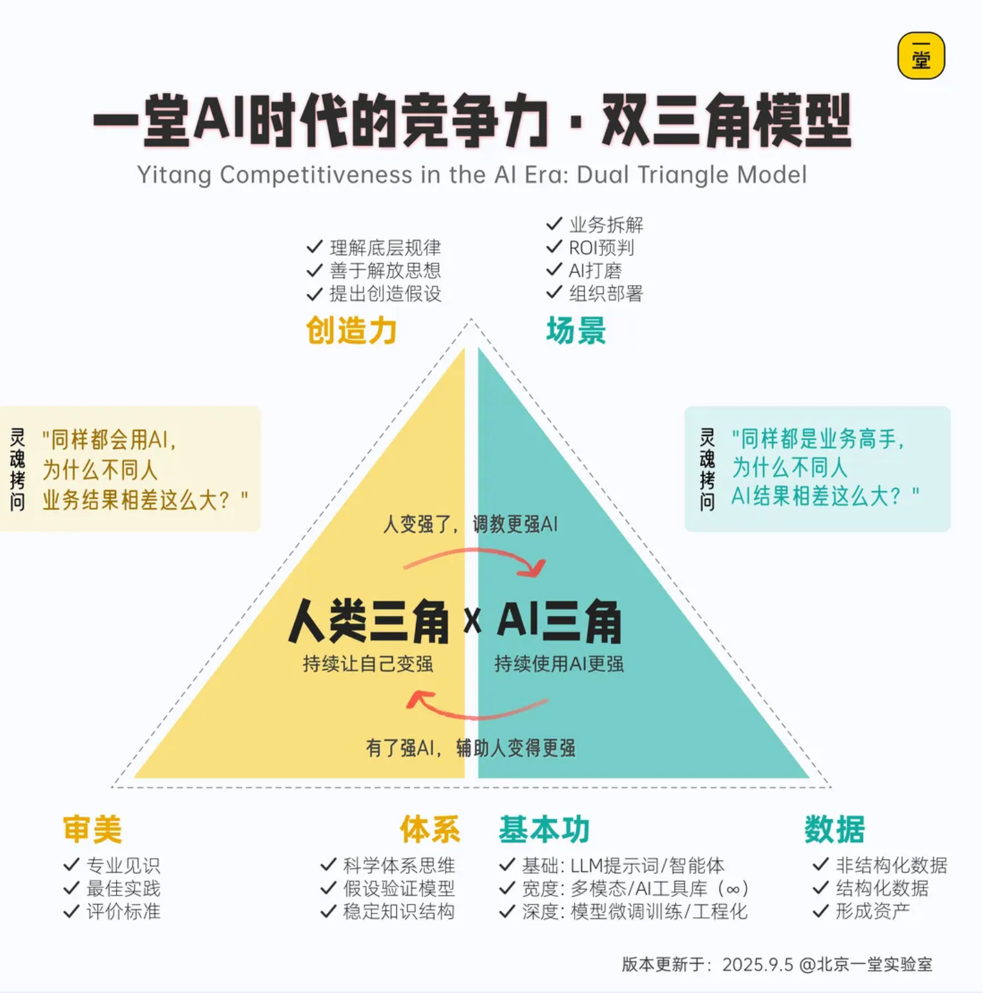


你们的审美得够，体系得够；你们要了解AI提问背后的专业方法论；你们还需要足够的对场景有敏感性，能发现大量高质量的决策场景。

下面，我们进入下一个部分，场景唤醒。

<!-- 转录范围：00~01 -->

## 场景唤醒：是核心能力么

【互动🙋】先灵魂拷问大家一个问题：你们觉得需要用ROI分析决策的频次是怎么样的？

- 每天
- 每周
- 每月
- 每年

【互动🙋】事实上过去一年，你们有意识地做了多少个决策？

- 10次以内
- 10-30次
- 30-50次
- 50-100次
- 100次以上

【互动🙋】这些决策里，会分析成本收益，有意识地用 ROI的思路的有多少次？

- 10次以内
- 10-30次
- 30-50次
- 50-100次
- 100次以上

---

其实，我们日常，至少以天或周为单位的频率做决策。理想的状态是，我们做任何一个需要决定投入资源的决策的时候，背后都应该有决策模型支撑。

只不过有的人可能没意识到，按照一些直觉或者感受就把决策做完了；而有的人在每一次决策都会停下来想一轮，不断地复盘和纠偏，自己的决策能力就会越来越强。

所以，下面我来带你们感受一下，如何去提升决策场景的数量。

### 第一轮唤醒：说说初步感觉

我们先来进行第一轮唤醒。

给大家15秒时间，大家请停下来认真地想一想，你们最近一周到一个月，做过哪些决策？未来的一周到一个月，你们要做哪些决策？

大家可以在评论区扣出你大概的数字。

### 第二轮唤醒：课里的三层案例

好，接下来，第二轮，我给你们一些启发的例子。

其实我们在课上讲了大量的ROI决策，我们分成了个人决策、业务层决策和公司层决策。

我们在过往辅导的过程中，看到了大量的个人决策：

1. **我是买一堂的MBA还是知名商学院的MBA？**
2. **租房选择，是离公司近一点，贵一点，还是离公司远一点，便宜一点？**
3. **我是要开车上班还是打车上班？**
4. **我是要维持现状还是要跳槽大厂还是辞职创业？**
5. **是每天自己做饭带饭还是点外卖？**
6. **我要不要离开北京，去老家合肥继续发展？**
7. **我要不要为了陪伴孩子，从管理者，转型成自由职业者？**
8. **我要不要报考一个在职研究生？**
9. **我要不要为了晋升管理层，去外地拓展新业务？**
10. **我要不要为了更大的发展，在公司内部转岗？**
11. **要不要把汽油车，换成新能源车？**
12. **要不要花时间学习AI？**
13. **要不要业余时间做小红书/短视频？**
14. **要不要自己花时间学PPT？**
15. **自己家后院的空地，是盖厂房租出去，还是做成花园？**
16. **……**

也看到了非常多的团队决策：

1. **要不要做一个看似难得的政府项目？**
2. **要不要启动新的技术业务线？**
3. **企业微信要不要增加AI运营？**
4. **要不要用无人机巡查？**
5. **是否接科研外包？**
6. **是否通过扫楼推广SaaS？**
7. **是用免费流量获客还是要付费投放？**
8. **要不要全公司推行OKR？**
9. **要不要买昂贵的设备？**
10. **要不要开发线上小程序商城？**
11. **要不要坚持开周会？**
12. **要不要通过新申报的科技孵化项目？**
13. **销售部门要不要成立专门的客户维护团队？**
14. **要不要all in代理模式？**
15. **要不要接1000万的国外APP研发项目？**
16. **……**

还有非常多的公司决策：

1. **头部茶饮项目，要不要全员涨薪20%？**
2. **要不要给员工提供免费午餐和茶点？**
3. **要不要给员工提供无息贷款？**
4. **要不要给员工提供补充医疗保险？**
5. **课外培训业务，要不要进学校？**
6. **原本公司做的是ToB业务，要不要考虑也做ToC？**
7. **是要和代运营公司合作还是自建运营团队？**
8. **竞品不收代理费和加盟费的情况，我们收不收？**
9. **要不要入局速冻食材供应链？**
10. **要不要花大量时间培训，让全公司转用新版软件？**
11. **要自建工厂还是找其他工厂代工？**
12. **要不要投入100万做农业物资项目？**
13. **要不要投入50万加盟一家自助棋牌室？**
14. **美团要不要做早餐业务？**
15. **K12公司要不要砍掉托管业务？**
16. **……**

看了这些决策，我们来做第二轮唤醒。

你们有类似的决策吗？能不能唤醒一些你们的决策场景？

也欢迎大家在评论区扣出你的决策场景，我们来一轮更大规模的场景共建～

### 第三轮唤醒：参考一堂的案例

来，我们继续第三轮。

下面我给大家看一看，一堂这家公司内我们有哪些决策。

宏观层面：

1. **一堂要不要做线下高客单咨询？**
2. **一堂要不要做企业内训？**
3. **一堂要不要做不同主题的线下训战营？**
4. **一堂要不要做whyAI？**
5. **一堂要不要做私域？**
6. **私董会，对一堂有没有价值？**
7. **要不要打造一堂Truman的IP？**
8. **一堂要不要自研数字化直播间？**
9. **一堂现在要不要融资？**
10. **一堂要不要开始做AI转型？**

中观决策：

1. **一堂要不要用一部分的行动营替代周五的直播课？**
2. **一堂要不要开放Gap？**
3. **一堂的教研要不要全员参加线下3天2夜？**
4. **一堂是不是要给所有员工提供午餐和零食？**
5. **要不要做老带新转介绍活动？**
6. **要不要做大航海从0到1的活动？**
7. **一堂要不要做NPC培训？**
8. **CEO要不要去各城市工作坊？**
9. **要不要做个性化的作业点评？**
10. **要不要做抖音的信息流投放？**
11. **……**

微观层面：

1. **一堂团建是不是要允许员工带家属？**
2. **一堂要不要全体员工要求上下班打卡？**
3. **一堂要不要春节假期期间加一节课维持用户活跃？**
4. **一堂有三组卫生间要不要分性别？**
5. **一堂的离职员工要不要转成外部合作？**
6. **要不要定期做内部人员培训？**
7. **要不要给每个新会员打电话？**
8. **要不要每周一做一堂晚餐会？**
9. **要不要各城市做城市工作坊？**
10. **一堂要不要启动AI课题的研究？**
11. **某节课要不要用共建的方式来磨课？**
12. **某个主题的内部攻坚会有没有必要开？**
13. **……**

看了一堂，你们有哪些启发？尤其是围观层面，大家是不是惊讶于有些决策颗粒度可以细到这种程度？

我们再来唤醒一轮，你们觉得自己日常还有哪些决策可以做ROI分析？

### 第四轮唤醒：拉满再次唤醒

通过上面几轮唤醒，希望大家可以感受一下，其实是可以每天都有很多决策，每天都可以不断地平衡和权衡的。

很多时候，你们看上去一家公司好像它经营效率很高，它好像这个每一次投资决策、每一次业务决策都做得比较正确，其实就是一次次高质量的ROI分析，最后导致了整个公司整体决策效率的上升。


现在，希望你再次停下来，认认真真地思考并回答。

【互动🙋】未来一年、三年、五年、十年，你对于科学体系决策、高水平的决策有多高的追求？

1. 没有用
2. 感兴趣
3. 重要
4. 非常重要
5. 必经之路

---

ROI分析对于我，对于Truman，对于一堂整个团队来说，都是必经之路。

<!-- 转录范围：02~03 -->

## 建立体系：打磨ROI三角形

【调研🙋】这五节课，大家学习了几节课？扣一下对应的数字。

1. 《全员必修：科学决策审美篇》
2. 《ROI实操1：提升宽度篇》
3. 《ROI实操2：提升深度篇》
4. 《ROI实操3：提升高度篇》
5. 《ROI实操4：落地训练篇》


【调研🙋】调研一下系列课大家学。学过吗？大家是怎么学习的？

- 只看了文稿
- 看了文稿和视频
- 看了文稿和视频，并完成了作业。

不管你是独自决策，还是和团队讨论，再或者是和AI对话，都需要人自己掌握科学决策的方法论体系，而和AI协作，更需要提升人类三角，你需要有审美，你需要有方法论，你需要有这个基础的底层逻辑。

下面我快速给你们串讲一下这个系列课的必知必会。

> **特别提醒：**
> - 学过课的同学，重新查漏补缺，温故而知新，建立一个更系统、完整的思考视角
> - 没学课的同学，努力理解核心知识，有了一个全局脉络再去学课会更容易掌握

为了大家更好的理解ROI三角模型，我先用一个例子带大家感受一下分析的过程。

---


这个是我个人做奶茶连锁门店时做的一个重要决策。

首先说明一下，这里的全员涨薪20%，不是说给每个人涨20%；而是年度调薪预算拉到20%。

这个决策是发生在2018年底，大背景是我们每年都会调整薪资，根据同行业的水平，每年涨幅差不多在5%左右。

但是那一年的情况不太一样，大概有这么几点差异。

**第一点差异**：开始有很多**竞争对手进入了区域市场**，例如"沪上阿姨"、"蜜雪冰城"。

**第二点差异**：我们的员工综合能力比较强，在市场上非常抢手，有几个员工和店长**已经被竞争对手挖走了**。

**第三点差异**：我们还希望保持大规模门店扩展，需要**大面积招聘新人**。

所以我一直在想，能不能通过超常规的年度调薪，来提升我们团队内部的稳定性，增强外部的竞争优势。

因为当时已经有五六十家门店了，涨薪这个事，对于公司的成本非常高，一个决策，一年几百万的成本就出去了，而且还是那种不能回撤的决策，所以我要非常非常谨慎。

这是我的评估：

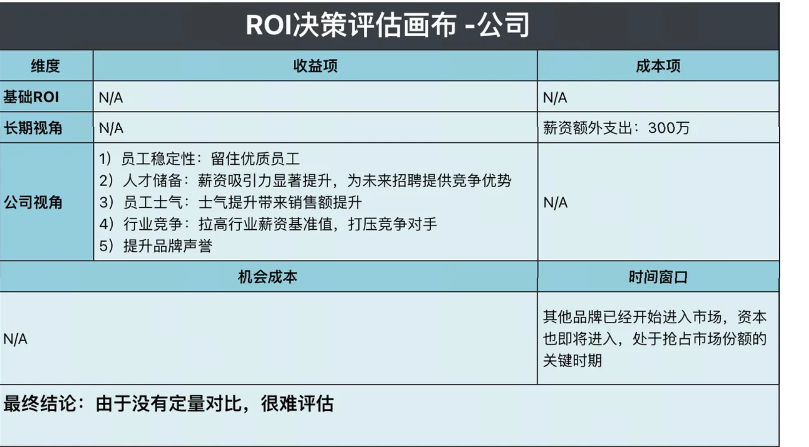

【互动🙋】如果是你们的话，你们会怎么做？是涨薪还是不涨薪？

1. 涨薪
2. 不涨

---

我的答案是再算一算，涨薪对于我的公司来说，成本是一定的，但是收益很模糊。我不能**拿着一堆定性的收益，跟一个定量的成本来做对比**，还是要定量跟定量对比，才更踏实一些。

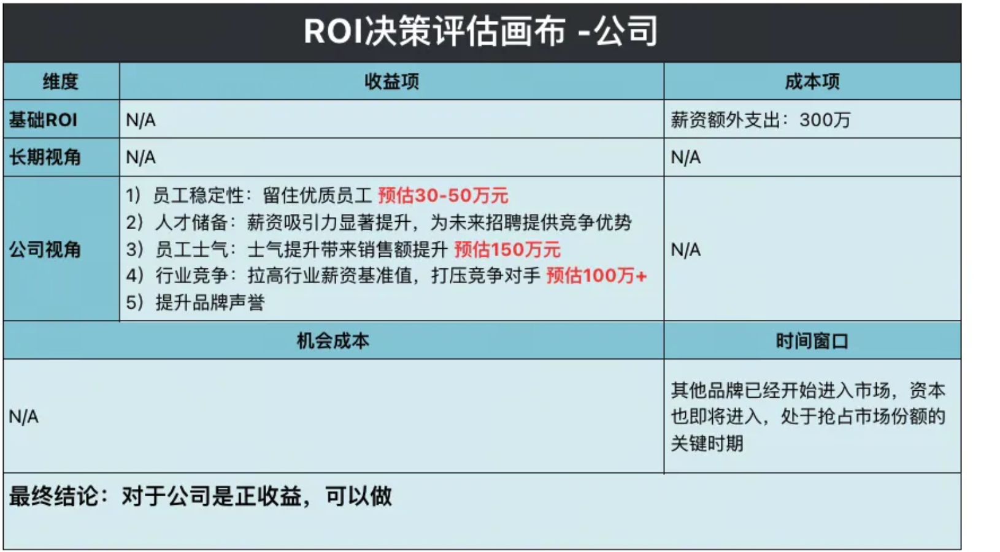

关键定量：

1. **保留优质员工**

培养一个成熟的员工，其实代价也是蛮大的。直接成本、隐形成本加起来至少3～5万元/人。我们能通过这个加薪，多保留10个老员工，这部分的价值也有**30～50万元**了。

2. **提升员工士气**

由此哪怕只是带来3%的销售额提升，由于不涉及固定成本只有变动成本，这部分销售额增量产生的净利润大概在50%左右（即3% * 50% = 1.5%）。以1亿的基本盘来估算的话，这部分增量也会产生额外的**150万**的税前净利润。

3. **压迫竞争对手**

我们从竞争对手的损益表粗略评估，对手如果跟进就会损失5000元/月·店的利润，这个对于竞争对手的压力还是比较明显的，尤其是在心理上，会减缓其扩张信心和速度。我们主观评估认为这部分价值是值**100万+**的。

仅仅定量了收益的三项，ROI已经为正了，再加上其他没有定量的，这个动作就更值得去做了。

最后，把员工、对手、公司的画布，全部放在一起，做一个整体的判断。

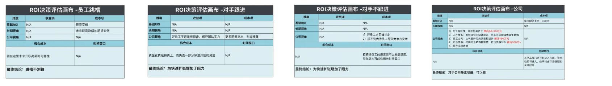

四张画布详情：

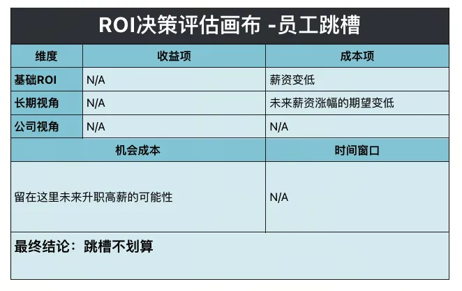

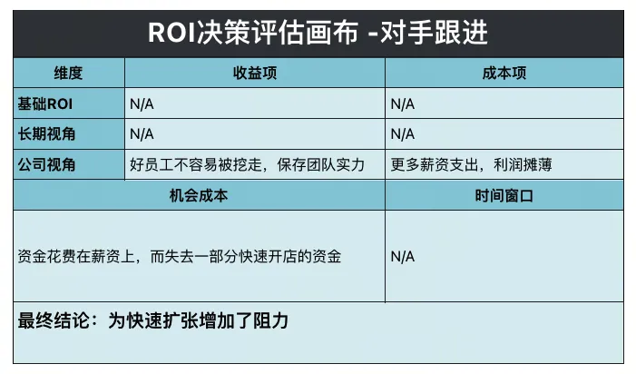

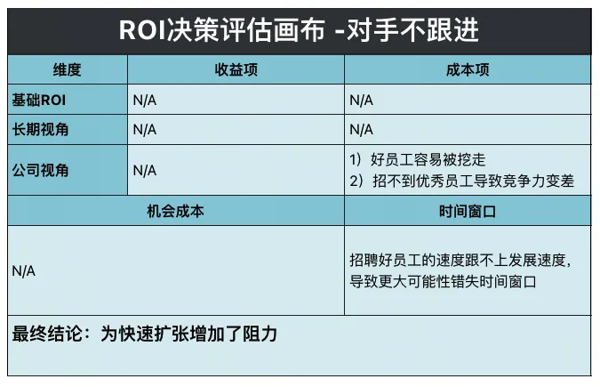

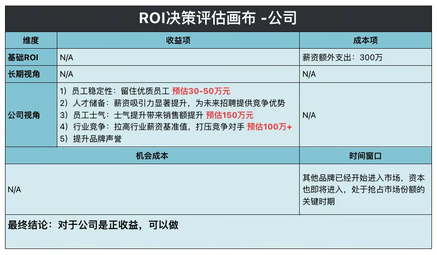

这个时候我才能笃定地做出薪资调整，**结果：2019年，我们的门店从54家，涨到了89家**，我们用了一年的时间，**开了35家店**，在关键的时间窗口中，跑到了行业头部的位置。

好了，例子我讲完了。大家感受到了么？其实这个决策的过程，就是在不断的追求"宽度"，找到更多关键项，然后追求"深度"，把一些东西定量，甚至追求长期高维度的思考。

下面回到ROI三角模型，我带大家分别从宽度、高度、深度的三个角，说一下必知必会。

### 打磨宽度：找到更多关键项

在实操篇的第一节，为了让大家能快速理解什么是ROI的宽度，我们举了3类9种ROI评估的例子。分别从个人决策、团队决策、公司决策，给大家展示同学们是怎么用ROI的宽度做决策的，希望帮大家建立一个良好的习惯：**遇事不决，ROI。**

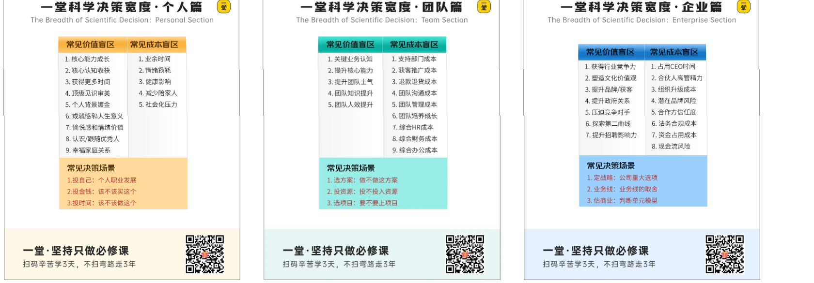

我们重点讲了修炼ROI宽度基本功的四字诀：**列、推、建、查。**

- **列**：列出清单，最基本的，努力冷静地罗列决策的成本和收益。
- **推**：推演故事，用一个订单、一个用户来推演整个故事，找全关键项。
- **建**：建立体系，建一个MECE框架或者公式，不重不漏的严谨评估。
- **查**：专业检查，寻找专家咨询，或者用"盲区武器库"自查。

总之，宽度的目标，就是**"找全关键项"**。

【特别提醒💡】找全是在做加法，但是加法的目标不是无限罗列，而是为了做减法，也就是我们说找到关键项。有时候关键的top3-5收益成本项，已经足够你做出决策和判断了。

### 打磨深度：提升决策准确度

在ROI深度篇，我们通过X型决策者与Y型决策者的**两种典型决策评估习惯**，认识到决策的不同复杂度。

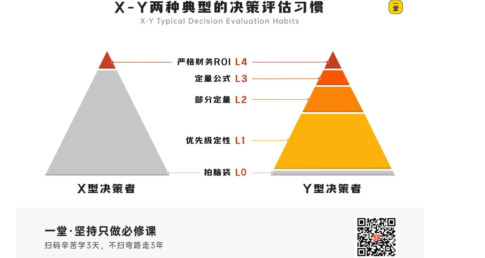

【划重点💡】ROI评估深度有5种类型：

1. **拍脑袋**：基本上不评估，根据直觉定。
2. **定性优先级**：简单做做定性，排排优先级。
3. **部分定量**：重要的要素，尝试定量描述。
4. **定量公式**：严格的公式，努力定量。
5. **严格财务ROI**：最狭义准确的财务ROI准确计算。

当你的**①决策复杂度**越高、**②试错成本**越高、**③货币化程度**越高，越应该深入下去决策。

1. **有些决策很简单**，列一列成本收益要素，排排优先级，就够了；
2. **还有些不够**，你得努力定量、找出数字、货币价值，就能判断了；
3. **有些还不够**，你得完整拆解，建立转化公式，认真评估可行性；
4. **还有一些**，关系到公司商业模式生死，你得完整、精细化地做模型分析。

接着，我们用了「案例停车场」的教学方式，通过10个案例的多轮迭代，带着大家一起建立审美，一起探索不同类型的决策，到底要思考到多深的层级。

【案例清单💡】目前有10个未结束的案例：

1. 公司要不要每个月开一个复盘会？
2. 公司要不要做一个新人Landing一页纸？
3. 管公司员工中午饭，划不划算？
4. 上班开车，还是打车，哪个划算？
5. 自建班班沟通IM系统，划不划算？
6. 公司全员涨薪20%，划不划算？
7. 换租隔壁更大办公室，划不划算？
8. 网站备案渠道获客，能不能划算？
9. 房产中介，通过上门送桶装水，挖掘优质房产线索。
10. 百度投放SEM，买线索驱动增长。

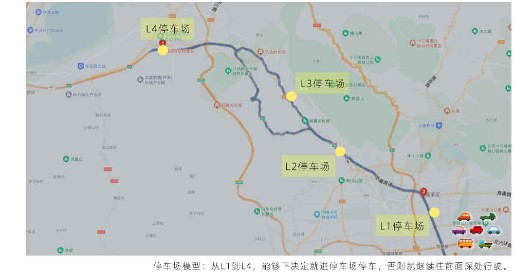

停车场模型：从L1到L4，能够下决定就进停车场停车，否则就继续往前面深处行驶。

最终，我给了大家一个公式，通过深度的不断增加，决策要素的定量越来越准确。

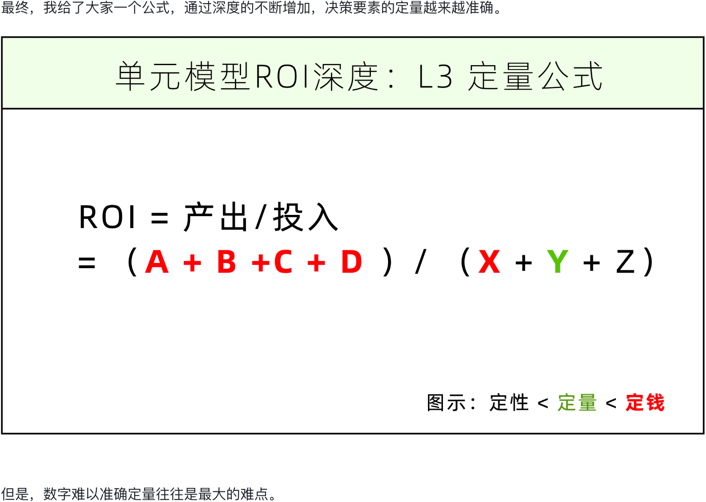

但是，数字难以准确定量往往是最大的难点。

所以，我们给了大家**三个数字定量从模糊到清晰的策略：攒经验值、交叉类比、三点预测**，来帮助大家在未来大幅提升决策质量。

- **策略1：攒经验值**，主要来自3个渠道：**行业benchmark，竞争数据，过去历史数值**。
- **策略2：交叉类比**，科学类比三步走：**找背后决定因素，决定因素排序，做区间定量**。
- **策略3：三点预测**，预测乐观/合理/悲观三个值，**乐观值很理想，合理值能接受，悲观值有风险**。

总之，宽度的目标，就是**"提升准确度"**。

【特别提醒💡】我们提倡科学决策做ROI分析，但是ROI评估本身也是有ROI的，所以原则是**够用就好**，**你的决策深度要匹配得上你的决策重要性和难度**。

### 打磨高度：练习全维度决策

如果你做一个决策，做到了宽度（决策信息完整），基本就合格了，有了60分。如果你能做到深度（关键因素定量），就有了70分。如果你想追求85分，甚至追求行业最佳实践的100分，那主要的难点，都在高度篇了。

在ROI高度篇，我们给出了两种典型的决策思考方式：

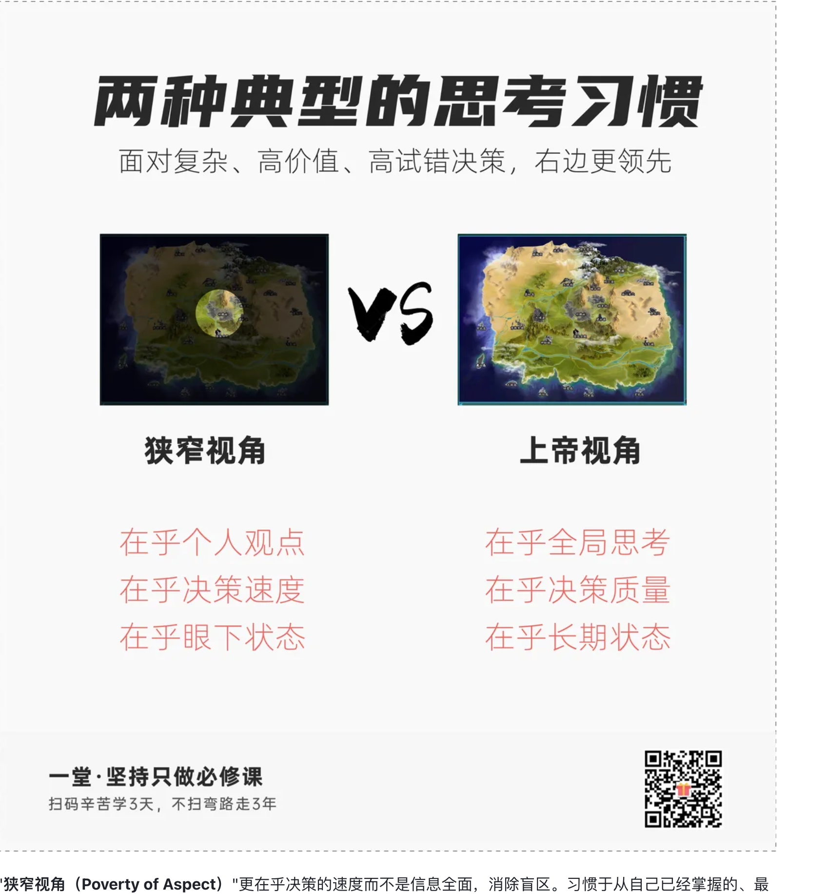

"**狭窄视角（Poverty of Aspect）**"更在乎决策的速度而不是信息全面，消除盲区。习惯于从自己已经掌握的、最顺手的信息里，挑选一个要素评估ROI，花极少时间用于决策，用剩余的时间，来调整、推翻和不断捍卫。

这种思维方式，在一些个人的、不重要的决策往往基本够用，但在一些个人重大决策、公司决策、长期决策上，会很容易出现误判和反复推翻。

与之相反的的思考方式，叫做："**上帝视角（God's Perspective）**"。简单理解，就是跳出个人的局限，努力代入第三人称视角，然后不断拔高视角、一层层拔高、消除信息盲区、认知盲区、决策盲区，拥有一种俯瞰一切的掌控感，然后再进行决策。

攻下一个山头，和赢得整场战争的胜利，这是完全不同的两个思考高度，如果你想带领军队获得整场胜利，那你就得努力训练全局的上帝视角（司令员工作），而不只是一个局部的战斗视角（尖刀连连长工作）。

如何从一个具体的ROI细节，上升到全局的ROI上帝视角？通常有**4个重要的训练工作**：

1. **长期视角**：从短期ROI评估，变为**长期ROI思考**，不要赢了眼下输了终局。
2. **公司视角**：从一个事情评估，变成整个业务、甚至**整个公司的ROI**思考，多从+1+N层思考。
3. **机会成本**：从单件事情评估，变为所有选项同时思考、选择**全局最优解**。
4. **时间窗口**：从内部ROI评估，变为考虑外部机会，根据**时机（Timing）**做事情。

总之，高度的目标，就是**"全维度决策"**。

就是希望大家，能培养从更全局、更完整、更宏观的角度出发，去思考事情的全貌，通过更全局的思考，完成一个局部的决策。

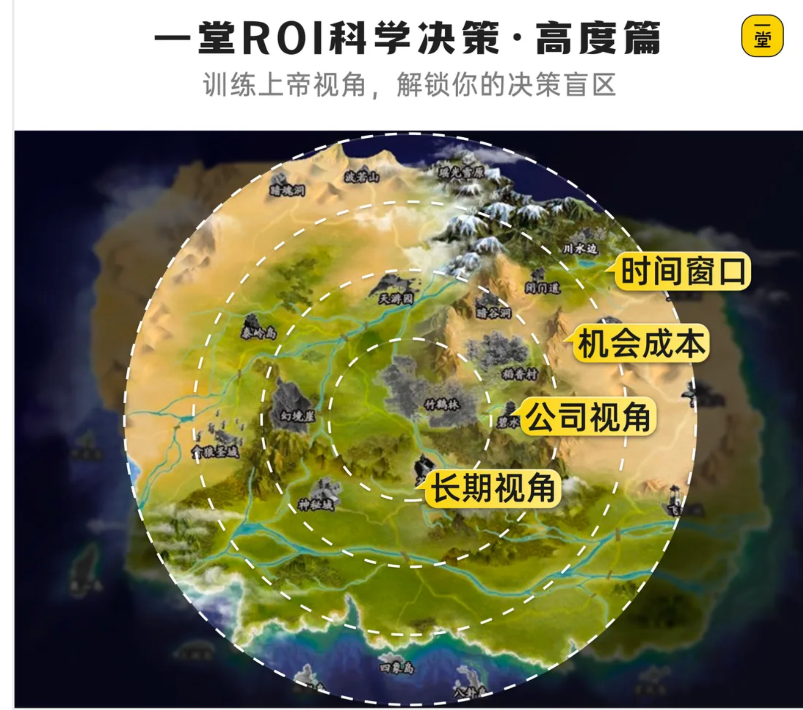

### 一页纸工作流

在ROI实操系列课推出之后两年，我们发现之前的课程更偏"静态的终点"，缺少对一步步如何过去的策略。

我们只回答了**"一个高质量的、厉害的科学决策长什么样子"**，却没有回答清楚**"一个重要的决策，是怎么从无到有在一个团队里一步步做出来的"**。

所以后来我们又做了一节落地训练篇，我们**尝试交付一套科学的工作流，或者叫训练流**，帮助大家更好地通过一次次ROI分析，提升自己长期科学决策的准确率和能力。

在真正决策落地过程中，ROI的评估不是一蹴而就，往往是经历反复纠结、反复推翻、反复调研，反复讨论，最后才能形成决策和团队共识。

---

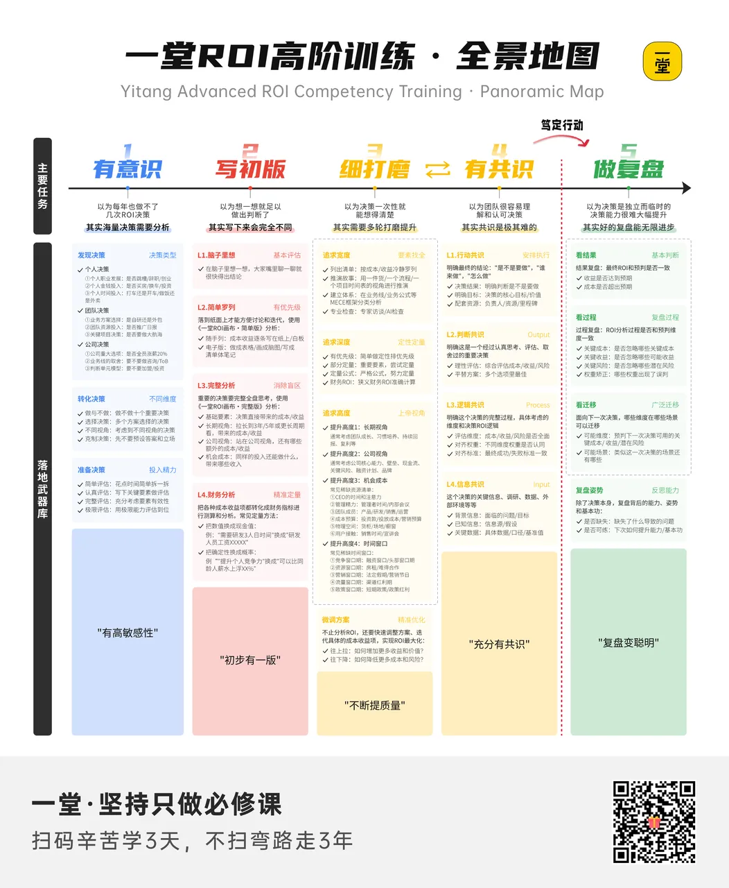

<!-- 转录范围：02~03 -->

## 立即实践：开始训练ROI

回到我们前面说的，决策的3个场景：独自决策、团队讨论、和AI讨论。每个场景的训练，到底应该注意什么呢？

### 独自决策：理性权衡

独自决策的场景，是所有决策场景的基础，如果你自己没有能力理性权衡，那大概率也很难和团队讨论、和AI讨论。

这里要特别强调一下，大家一定要明确，不管有没有团队和AI，本质上，决策都是需要你最终来做负责人的。因为**谁收获最大的收益和成果，谁就要为最终的决策负责**。

独自决策，其实就是要反复从宽度、深度、高度，训练自己的ROI分析能力。为了大家更好的训练，我们提炼了一个训练清单：


希望大家当遇到一个重要的决策时，脑子里马上会出现一句话：


### 团队讨论：追求共识

如果你有团队，最好能找到一个最小的决策共识循环。

如果你有一些内部合伙人或高阶员工，他们有 ROI思维，你可以跟他们商量，往往 **1 + 1 >>> 2**。而且，面对决策，如果你们有充分的理解和共识，后续执行就会非常高效。

但是，很多时候，我们以为团队很容易理解和认可的决策，其实真正取得共识是非常难的。这个背后其实一个很有趣的**"高水平共识曲线"**：


> 解读1：决策是爬山，是从信息、逻辑处理、判断和行动的一步步推导过程，这本质上是个ipo模型；
> 解读2：说服是冰山，从表象的行动，一路挖过程，找到分歧点，最后形成共识的过程；
> 解读3：归根结底回到基本事实和信息，只要实事求是，就不太会有太巨大的分歧；
> 解读4：这张图可以用来培养敏感性，未来有重大分歧，可以用这张图归因和找到问题；

补充一个高阶建议：


当遇到一个重要的决策，不要过早做决策，或者做了决策不要直接给答案，而是开放给团队一起推一遍，一起共建决策，一起讨论，一起商量，最后形成组织共识。

- **80%概率**：就是预先想到的答案，很好形成共识；
- **20%概率**：跟预想答案不一样，更好啊，能形成更好决策；

一堂公司级别的很多决策，比如AI计划、马拉松、大航海、招人等等，不管我有没有决定，我都从0跟大家从头推理一遍，形成**"集体答案"**，这个答案大家都认，即便依然有风险，也愿意承担和接受这个结果；**"把赌注摆到桌面上，并愿意一起承担结果"**

总之，和团队讨论决策，希望大家记住一句话：


### 和AI讨论：交叉评估

AI 只是你的陪练和提醒，千万不要直接相信 AI 的结论。AI 的认知和上下文如果不够，它获取的很多信息是非常易偏颇的。即便它没有太多幻觉，它的答案也是不可信的。

但是 AI 是一个极好的 partner，也就是极好的陪练和教练。它可以引导你去思考，然后带着你一步步拆解，甚至最后帮你出一份报告。这份报告会告诉你，你把所有的上下文都写到一张纸上。

所以我们可以带着 AI 去练。它是一个教练，当你没有足够好的合伙人跟你商量的时候，它是一个很出色、值得商量的对象。

**AI对话的水平，归根结底，还是人的水平决定的。** 你的审美、稳定的体系、创造性就直接决定了AI的教练的水平。

大家能体会到，每一次对话，就是一次次高水平的**"双三角构建"**吗？

为了方便大家理解，我试着带大家推理一遍，大家感受一下区别。


第一种呢，就是你直接跟网页版的LLM（专家模式/研究模式）对话，直接口述一段提示词，然后让AI帮你分析决策，他会很快就给出他的判断和建议。


看起来有理有据，言之凿凿，但是你真的能通过这样一段对话就直接笃定地决策么？

来看一个示意图：


### 迷你小双三角（人给一两百字，全靠AI）

你面临的情况到底还有哪些收益、需要付出哪些额外的成本，还有没有什么隐藏的没考虑到的，甚至考虑从更长期、窗口期、机会成本的角度，会不会对这个决策产生影响？

这些AI都不清楚的情况下，居然就直接建议你坚定选择 "同小区两套房" 方案。拿着这样的反馈，你真的敢决策吗？决策之后真的不会后悔吗？

当大家上完课，有了一个Partner：


如果你假设只有一堂AI Partner，但是你自己没怎么理解课程的核心理论，就是依赖AI本来的能力，一路下去，就会看到AI一路推理的过程了：

假如说啊，我没有想明白到底有哪些成本收益，但是我看着AI一步步引导，也能一路对话下去。


这是最终形成的决策备忘录和下一步行动：


大家看到区别了么？这样的分析结论，是不是至少帮你把脑子里可能混沌一片，粗略的成本收益列出了123，abc，一定程度上可能还会补充你的一些盲区？是不是至少在决策层面，清晰了一些？

总结一下，相对于通用LLM，我们的AI决策教练，有三个区别：

1. **有过程了**：报告是如何一步步分析出来的，每一步都可以提供给你，评估质量。
2. **足够专业**：过程中有专业的模型，足以支撑决策。
3. **足够理性**：最后没有直接给"决策方案"而是给了一套"ROI分析+行动建议"。

我们再来看一下这个模型，对比图就出来了：


如果人足够强，磨合足够默契，如何做到更好呢？


我们又画了一个示意图：


这个蓝色三角，其实就是：

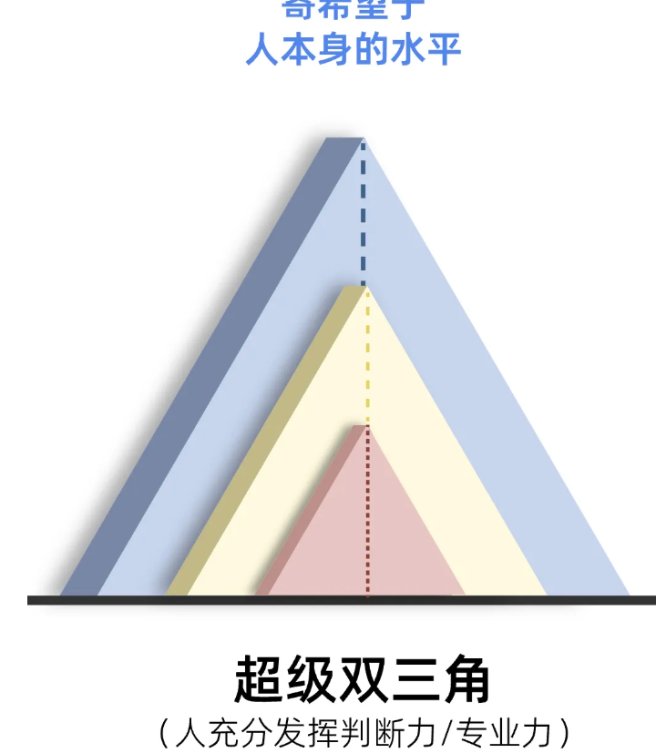

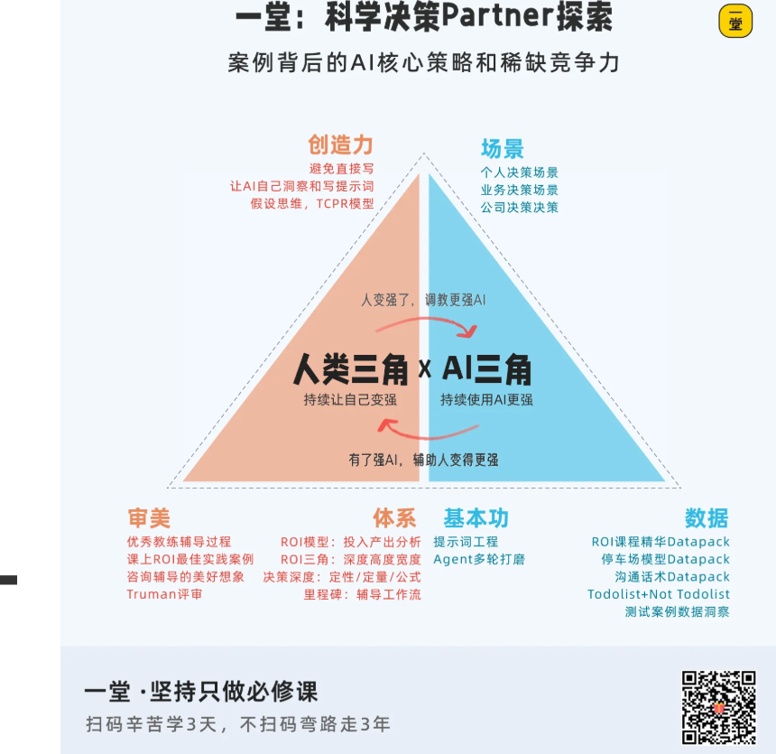


【划重点💡】使用AI的整体段位：

1. **L1. 明显不行**：一眼就不太行，完全跑偏
2. **L2. 有点启发**：不负时间，激发一部分新思考 #合格
3. **L3. 补充盲区**：局部有用，补了关键信息盲区
4. **L4. 支撑决策**：整体很好，到直接辅助决策 #优秀
5. **L5. 重要资产**：价值很大，值得存下来，变成未来使用的资产
6. **L6. 直出交付**：质量够好，可以直接汇报或交付 #理想

<!-- 转录范围：04~06 -->

## 最后回顾和作业

### 重新理解ROI

课程的最后，我来带大家重新理解一下ROI，重点送给大家三句话吧。

**第一句话：ROI有适用边界，不要用低维度的手段解决高维度的问题。**


很多问题，看似是要不要，怎么选的问题，其实核心的风险不在ROI。比如我想要做少年一堂，我是选会员模式还是按照单次活动收费？比如我要不要在济南开一个羊肉泡馍店？

这类问题，可以用严格的ROI去计算，但是其实更大的风险在于五步法层面，是个商业战略问题，单靠从-1层的ROI决策去分析是不够的。

还有一些问题，涉及到红线、原则，虽然从概率和计算的角度上来判断是划算的，但是这种问题并不适合用ROI来计算和决策。

**第二句话：ROI分析决策，不一定非此即彼，是可以调整的。**


很多人在做决策的时候，黑白分明，一定要选出一个A或者B。但是有时候，我们需要**努力构建价值，尽量降低成本，在艰难抉择中找到平衡**，根据不同的情况，给予不同的解决方案。

**第三句话：ROI分析的价值，不是追求绝对正确，而是形成笃定。**


之前有同学问了一个很好的问题：ROI分析来分析去，有些决策就是很难分析、很难预判，成功率依然很低啊，那还分析ROI干什么？直接用感觉拍一个区别也不大啊。

还是回到科学理念，只有我们形成了对于某一类决策客观的因果规律的认识，认识成本收益，认识风险，甚至拉满了去理解具体的参数、定量、反复权衡，拉满决策，我们才能一步步逼近对于客观规律的认识。

只要一次次拉满了做决策，不管最后结果是好，还是坏，都是进步。

**一堂的第一次马拉松，第一次大航海，第一次领教营，第一次做课，第一次城市巡回，第一次集训营，第一次直播课....客观上评价，其实都很糙甚至ROI很差，出现了大量的误判和盲目乐观预测。**

但是一堂从第一次就一直心里带着一个ROI模型在做事，拆解一个个要素，剥离一个个参数，带着团队一个个去验证假设：有意外就记下来，被骂了就反思修正，被夸了就努力坚持，有灵感了就下次叠加进去试试，就是不断一个价值一个价值地探索，一个成本一个成本的降低，最后抛出了一个又一个优秀的新项目。

但其实最最开始，也只是一个认知很差、非常粗糙的一个原型而已，而这其中最最重要的一个驱动力，就是**对于ROI不断迭代的无限追求。**


课程的最后，给大家分享一些新鲜出炉的磨课心得，这是我们这次在搓Partner的过程中，发现即便是教研团队，理解也还是会有偏差的地方。

关于ROI的宽度、深度、高度，我另外想补充3个特别的提醒给大家。

第一句话：


第二句话：


第三句话：


### 作业与Candy

[此处截图被截断]

<!-- 转录范围：04~06 -->

---

> 我做了15年的全面性教育，目前准备做个人IP的起盘创业，不确定要不要用性教育作为我的个人IP定位，还是以面向社会服务（尤其是公益、教育方向）工作者的人才赋能作为个人IP定位。

好，咱们先把这个决策问题本身理清楚。

**里程碑1：明确问题和价值**

我听下来，你面对的是一个"选赛道"的决策——你做了15年全面性教育，现在要起盘做个人IP创业，卡在两个定位之间：

**定位A（专业深耕）**：以「性教育」为核心标签。你在这个领域有15年的专业积累，这个定位直接、明确，受众一听就知道你是谁。

**定位B（能力升维）**：以「面向社会服务/公益/教育方向工作者的人才赋能」为核心标签。这个定位把你在性教育中积累的方法论、赋能经验和行业洞察，抽象到更通用的人才培养和能力建设层面。

这两个定位背后牵涉到完全不同的受众画像、内容策略、变现路径和竞争格局。它不只是"选哪个关键词"，而是"选哪条生意路径"。

这个问题值得好好拆，因为个人IP一旦启动，早期定位会影响你的受众认知、内容积累方向和未来的变现空间——调整成本不低，值得在起盘前想清楚。

我理解得对吗？有什么需要补充或纠正的吗？

> 嗯稍微补充一个细节，就是在能力升维的这个方面，呃不仅仅是在性教育方面的能力，因为我过去不仅在做全面性教育，一直是在公益慈善领域和这个人才赋能领域里面工作。只是这个方面的ip体现的不够明显而已。所以这个领域里面也积累了大量的嗯不局限于性教育的底层能力和经验。

明白了，这个补充很关键，我修正一下理解。

**里程碑1（修正）：明确问题和价值**

你不是在「从性教育往上抽象」和「深耕性教育」之间选，而是在两条各自独立、都有长期积累的专业线之间选主标签：

**线1：性教育专家。** 15年全面性教育实践，外部认知强、标签清晰、受众一听就懂。这是你目前最显性的专业标签。

**线2：公益/社会服务领域的人才赋能者。** 你在公益慈善领域和人才赋能方向同样积累了大量的底层能力和实战经验——项目管理、团队培养、组织发展、行业洞察——这些不依附于性教育，而是独立的一套专业资产。只是目前这个IP标签体现得不够明显。

所以这个决策的本质是：两条线都是真的，都有15年底子。你要选的是，起盘阶段把哪条线推到前台、让市场先记住你什么。

这个理解对吗？还有需要补充的吗？

> 补充一个细节，我不仅在15年的时间里在做全面性教育，这15年来，我一直也在公益慈善和。教育这一些维度里面持续的开展工作，包括像项目管理、项目设计、团队管理等等相关的部分。那这一些经验其实也都是可以复用在能力升维的这个维度里的，也就是他们不仅仅是性教育的底层萃取和归纳。

收到，这个补充让两条线的"独立性"更清楚了。

**里程碑1（完成）：问题定义**

我重新把问题定义说清楚：

你不是在一个"窄标签"和它的"泛化版本"之间做选择。你手里是两条各自实打实走了15年的专业线，每条都能独立撑起一个IP定位——

- **定位A「性教育专家」**：以全面性教育为核心标签，受众认知成本低，专业壁垒明确。背后是15年深耕同一件事的深度积累。
- **定位B「社会服务/公益/教育领域人才赋能者」**：以项目管理、项目设计、团队管理、组织赋能等底层能力为核心标签，受众面更广，复用空间更大。背后是15年在公益慈善和教育领域横跨多职能的广度积累。

这个决策的核心问题是：**在个人IP起盘阶段，先用哪个标签打进市场、让受众先记住你什么。**

现在进入下一步——在咱们开始拆之前，我想先确认：你目前还有要补充的吗？还是说问题定义已经清楚了，咱们可以开始了？

> 下一步

好，问题定义清楚了，咱们进入下一步。

**里程碑2：对齐预期**

在开始拆之前，先对齐一下：你希望这次聊到什么深度？

这个决策本身不简单——两条线都是真的，起盘阶段的定位会影响受众认知、内容方向、变现路径和竞争格局。所以我先给你看看可以聊到什么程度，你选一个顺手的感觉：

| LEVEL | 深度 | 大概会聊到什么 |
|---|---|---|
| ① | 简单拆拆 | 把两条线的成本、收益、风险各列清楚，理一理就够 |
| ② | 主要矛盾 | 把真正决定成败的1-3个关键纠结点揪出来，确认它真实存在 |
| ③ | 公式定量 | 拆成公式算一算，每条线的受众规模×转化率×变现空间大概多少 |
| ④ | 完整财务账 | 两条线都做收入成本推演，乐观悲观都算一遍 |

我的默认建议是先从②开始，甚至边做边看。原因很简单：你现在是起盘阶段，两条线都有15年底子，最缺的不是精细算账，而是想清楚「到底哪个变量真正决定这条线能不能跑通」。等主要矛盾清楚了，如果发现需要定量测算，再往下走也不迟。

当然，这只是我的判断。你想选哪个深度？或者想不清楚也没关系，咱们一边聊一边看。

> 可以先从2开始

好，咱们从Level②切入。现在进入**里程碑A：收集信息**，先把你脑子里已经有的东西吐干净。

**里程碑A：收集信息**

我听下来，你现在手里有两张牌，每张都有15年底子，但它们在个人IP起盘时的「投入」和「产出」结构完全不同。

所以这一轮我想请你分别对两条线、从三个角度聊聊你目前已有的判断：

1. **成本侧**——起盘这条线，你觉得主要要投入什么？（时间、精力、内容生产成本、学习成本、心理成本……想到什么说什么）
2. **收益侧**——如果跑通了，你看到的核心回报是什么？（变现方式、受众规模、影响力、个人满足感……）
3. **最拿不准的**——哪一块你觉得最没底、最不确定？

不用想得特别全，你就把现在脑子里已有的先倒出来。如果某个维度你暂时没有明确信息，也可以直接说。

> 我觉得对我来说最重要的还是时间和精力的分配，因为我现在做个人IP的起盘是比较偏知识型的IP，那更多的就是我的全身心的投入在里边，那如果是错了的话，对我而言代价最大的也是机会成本的部分。嗯再加上因为现在是创业初期，还是有一定的财务压力，虽然是有一些积蓄能够让我可以嗯去做一段时间的探索，但是时间也不能太长，我是期待在3~6个月的时间里，能完成呃第1个定位在商业模式上的一个小闭环，啊它不一定要非常成熟，但是他能够先跑。通一个小闭环，这是特别重要的。这个所谓跑通小闭环，我理解的就是嗯正式的推出一个市场化的产品，然后能够收到明确的市场反馈。能够至少验证是有人愿意为他付费的。至于挣得多少，这不是最重要的。最重要是去测试。我的产品在市场上的需求和我能够触达的群体，大家的付费意愿和能力。

理解，起盘阶段产品形态还不清晰，这很正常，很多人在这个阶段都是这样。咱们不急着硬想产品形态，换个角度来帮你把已有的资产先盘一盘——这样能吐出来的东西可能更多。

你刚才说了两条线都有15年底子，那我顺着这个往下问：

**先看定位A「性教育」这条线：**

过去15年做全面性教育的过程中，有没有已经积累下来的、可以复用到个人IP上的资产？比如——

- 你已有的受众或关注者（公众号、朋友圈、社群、过往学员/合作方）大概是什么量级和画像？
- 有没有人曾经主动找过你，愿意为你的性教育专业知识付费（哪怕是很小的金额，咨询、讲课、内容都算）？
- 如果有，他们是谁？为什么找你？

**同样看定位B「人才赋能」这条线：**

- 公益/教育领域的同行、机构、合作方里，有没有人曾经因为你的人才赋能能力（项目管理、团队培养等）而主动找过你合作或寻求帮助？
- 这些人的付费意愿和能力，你直觉上判断怎么样？

不用每条都回答得特别精确，把你脑子里已有的印象说出来就行。这些信息能帮咱们更清楚地看到：哪条线离"有人愿意付费"更近。

> 哇你一下给我列出了非常多的清单，其实这么多的信息，对我而言压力有点大，我还是希望你能相对。对话式的去跟我聊，而不是像这样让我填一个表一样的方式，那我这一回还是先把这些信息尽可能的说出来。第1个就是我有一些受众，但是这一些受众不是to c的受众，是我过去的交付过程中，大多数都是公益领域的一些土大b。然后他们会来购买我的服务，再去提供给他们的志愿者讲师或者他们服务的家长和孩子，所以我在to b方面是有一些积累to c方面我跟大家有很多的接触，呃，有了解，但。但是这些人他是在享受公益的服务。他是否能转化成我的付费受众，有机会，但是我现在没有明确的把握，另外呢我觉得最重要的是我积累了大量的这一个课程的资源，也就是其实我已经有不少的现成的课程和产品。可能根据嗯市场的需求和这个商业模式的选择，我可以调配成不同的产品形态，但是底层的这些产品的内核的专业内容，我我都是有的。那嗯在人才赋能这一个方向上，相比于性教育，我可能储备的现成的课程产品没有那么多。嗯更多的还是在我的脑子和经验里，我还需要时间去对自己进行一轮萃取。嗯。因为过去在这一个人才赋能的部分，我做督导会做的多一些，教学做的相对少一些。反过来在新教育这个环节，我做教学做的会多一些，在督导方面会做的，肯定没有教学那么多。但这两条线都有一个困扰，就是他们都是属于嗯公益领域里面的，以大b买单，然后我去服务一些小b和c端的人的状态去完成，但我现在希望去做的个人ip是能够小b和c端付费，而不是总是依赖b端的大币的这种接单购买的服务。

收到，我先道歉——刚才一口气列太多问题了，确实像填表，让你有压力了。后面咱们一次就聊一两个点，慢慢来。

**里程碑A：第一版ROI初步思路**

你刚才说的这些，我帮你捋一下，你看看我理解得对不对：

你手里已有的牌：

| | 定位A：性教育 | 定位B：人才赋能 |
|---|---|---|
| 产品底子 | 大量现成课程和内容，拿来就能调 | 在脑子和经验里，需要先萃取再产品化 |
| 受众关系 | 过去服务B端机构，间接触达C端；C端接触多但都是公益场景 | 同行/机构认可你的督导能力，但同样以B端为主 |
| 交付经验 | 教学多、督导相对少 | 督导多、教学相对少 |

两条线共同的核心挑战：你过去15年都是B端买单的模式，现在要做个人IP、靠小B和C端直接付费——这是商业模式的一次重新验证，不是简单的内容分发渠道切换。

你最关心的：**3-6个月内跑通小闭环**——推出一个市场化产品，验证有人愿意为它付费。

到这一步，这是第一版粗略的梳理。接下来在**里程碑B**里，咱们不急着深入，先看看这张图里有没有明显漏掉的东西。我下一条只问你一个问题——咱们轻松聊。

> 下一步

我听下来，你刚才已经把两条线的"库存"盘得挺清楚了——

- 性教育这边，产品底子厚，拿来就能上架，但C端付费意愿是个问号。
- 人才赋能这边，受众可能更广，但产品还在脑子里，先得花时间萃取。

有一样东西我觉得咱们还没聊到，但它可能挺关键的——

**两条线的"可逆性"不一样。**

什么意思呢？如果你先从性教育起盘，跑通了，以后想往人才赋能扩展——你已经有15年公益/教育领域的项目管理、团队赋能的底子，这个扩展是有根的，受众认知上不会觉得突兀。

但如果先从人才赋能起盘，以后想回头深耕性教育——性教育这个标签本身有专业壁垒，15年的深度积累如果一开始没打出来，后面再挂上，可能需要重新建立专业信任。

换句话说，**性教育是一个更难被替代、也更难"后补"的标签。**

你之前有没有从这个角度想过？

> 嗯，你的这个角度我觉得是很棒的，但是我有一个疑问，你这里给了我一个结论，说性交易是一个更难被替代，也更难候补的标签，你的这个结论是哪里来的呢？

你问得特别好，这个质疑本身就很准。

我回头看我那句话——「性教育是一个更难被替代、也更难后补的标签」——确实说得像结论了，这是我的问题。它不应该是一个结论，而是一个推理，我来把推导过程摊开：

这个推理是这么来的：

1. **你提供的信息**：你在性教育方向有大量现成课程产品，教学经验丰富；人才赋能方向则"更多在脑子和经验里，需要萃取"。这本身说明性教育标签的"可交付证明"更厚——产品本身就是专业壁垒的体现。
2. **常识推断**：「性教育专家」是一个受众认知成本极低的标签，一听就知道你是谁、你的专业边界在哪。而「人才赋能者」边界更宽，竞争者也更多，建立差异化认知的难度更高。
3. **一个需要你确认的推理**：如果一个IP先以「人才赋能者」被人记住，之后再挂「性教育专家」标签，受众可能需要重新建立专业信任——因为性教育有较强的专业壁垒，不是泛管理/泛赋能经验能覆盖的。

这个推理成立的前提是：性教育的专业壁垒确实高于人才赋能。你觉得这个前提本身，在你的行业经验里站得住吗？

> 直观的来讲，确实人才赋能者和性教育看起来是两个维度，但是换一句话来说，如果我的性教育的定位并不是直接给儿童做性教育，而是支持家长支持教育工作者可以做好相应的性教育。那这样的话，作为一个有深度能力的人才赋能者，我再把这个能力迁移到性教育领域里面去做，会不会也有空间呢？比如说。我在人才赋能领域构建了一个认知，是能够带领别人，让别人变强的人。那接下来我转移到性教育领域，就是用让人变强的能力，让你在性教育领域也变强，这是不是也是一个可能呢？我不是很确定，只是对于你提到的这一个观点，我在看他是不是一个绝对的因果推理关系，还是他也只不过是一个假设，而且这个假设的依据只是一种直观的感觉。那有没有别的方式其实让他之间是有共通性的。

你这一锤砸得特别准。

我刚才那个推理，现在回头看，确实是建立在一个**未经你确认的假设**上的——我默认你的性教育定位是「亲自面向儿童/青少年做教育」。如果是这个定位，专业壁垒确实高，后补难。

但你刚才打开了一个完全不同的可能性：**如果你的性教育定位是「赋能家长和教育工作者，让他们有能力做性教育」**——那这本质上就是一种人才赋能，性教育是应用场景，不是独立赛道。

这样一来，两条线的关系就变了：

- **路径A**：先打「性教育专家」→ 后来扩展到「我也能让其他领域的人变强」
- **路径B**：先打「让人变强的人才赋能者」→ 后来深入到「比如在性教育这件事上」

如果性教育的内核是「教别人教」，而不是「自己教」，那这两条路径的可逆性差距就没我原来说的那么大。路径B完全走得通——关键是你的第一个产品落在哪个场景里。

所以现在真正需要掰清楚的问题变成了：

**在性教育这件事上，你更想做的是「亲自教」还是「教别人教」？还是两者都要？**

这个问题的答案，可能比「选哪条线」更先决定你的IP结构。

> 我倾向于教别人教

这个答案很关键。它把两条线的关系从「二选一」变成了——

**同一个核心能力（让人变强），在两个场景里落地。**

**里程碑A（更新）：第一版ROI初步思路**

基于咱们聊到现在，我把图景更新一下：

**核心能力定位：「教别人教」**——赋能家长、教育工作者，让他们有能力做好性教育。

两条线的真实关系：

| | 场景A：性教育 | 场景B：通用人才赋能 |
|---|---|---|
| 本质 | 同一个能力在具体场景的应用 | 同一个能力在更宽场景的应用 |
| 产品底子 | 大量现成课程，拿来就能调 | 在脑子和经验里，需要先萃取 |
| 起盘速度 | 快——产品化成本低 | 慢——先得把隐性知识显性化 |
| 受众认知 | 「性教育赋能者」，标签清晰 | 「让人变强的人」，需要更强的案例证明 |
| C端付费验证 | 不确定（过去都是B端买单） | 同样不确定 |
| 长期想象空间 | 场景可能偏窄，但壁垒深 | 场景宽，但差异化建立难度高 |

你最关心的3-6个月小闭环：如果目标是「最快推出一个市场化产品，验证有人愿意付费」，场景A（性教育赋能）明显离这个目标更近——因为你手里有现成弹药，不用重新造枪。

最大的不确定项：**C端到底愿不愿意为「性教育赋能」付费。这个你过去没验证过。**

这版思路跟你脑子里想的对得上吗？有什么要补充或纠正的吗？

> 你整体列出来的这些项目的分析，我是认可的。但在你提到的最大的不确定项里，嗯我觉得也在考虑一个问题，就是我做性教育合作。整体的人才赋能，我的目标客群是做同一类客群吗？还是可能他们是完全两类不同的人。嗯。这个方面我现在其实还没有想得特别清楚。

这个问题问到根上了。它直接决定：两条线是「一个IP服务一群人」还是「一个IP需要劈成两半」。

咱们不急着分析，先聊聊你脑子里已有的直觉——

**先说性教育赋能这个场景：** 你过去15年接触过的、最有可能愿意为你付费的「家长或教育工作者」，他们大概是什么样的人？你闭上眼睛第一个想到的是谁？

**再说人才赋能：** 那些曾经因为你的人才赋能能力主动找过你的人（督导、团队培养这些），和上面那类人，在你感觉里是同一拨人吗？还是完全不一样？

不用精确，凭直觉聊就行。

> 嗯第1个在性教育的这个场景里，其实是三类人吧，一类的话直接就是家长，但我发现其实大多数家长并没有那么强的自己学性教育的期待，他更多的是希望我能提供一个直接服务儿童的解决方案，然后我直接去服务他的孩子，帮他解决在育儿中的直接的问题。那第2类呢就是很多的一线服务者，他有做性教育的任务，或者他的服务对象也有这样的诉求。那这种情况下，他更需要的是我给他提供直接便利上手的性教育的工具包，比如说课程教案，并且辅助相应的一些培训，让他有能力去完成这样的任务。那第3类人是一些以性教育为主题做小微创业的个体，这些个体教育工作者会更有诉求去学习性教育的底层的基本功，然后理解教育课程是怎么设计出来的，然后他能够在性教育这个领域里面打造自己的产品和品牌，所以他对基本功的诉求会要求更高这一类我一般也把它称作性教育领域里面的小b。那嗯说到整体的赋能这个场景我过去的经验做的比较多的是面向公益组织里的那些小b，也就是一线的服务型的社会组织，去赋能这些组织里的工作者和团队，嗯提升他们在具体业务上的工作能力。那这个方面我目前是有积累了一些对我这个能力比较认同的粘性比较高的，大概10~20人是可以作为种子用户，给我提供产品的测试反馈的。

你刚才这段梳理，信息密度很高，我帮你把它结构化一下，你看看对不对——

场景A「性教育赋能」的三类客群：

| 客群 | 真实需求 | 对你"教别人教"的匹配度 |
|---|---|---|
| 家长 | 直接服务儿童的解决方案，不是自己学 | ⚠️ 偏低——他们要的是"你帮我教"，不是"你教我教" |
| 一线服务者 | 便利上手的工具包+培训，能完成任务 | ✅ 高——正好是"赋能别人去教" |
| 性教育小微创业者（小B） | 底层基本功、课程设计能力、打造自己品牌 | ✅ 最高——深度赋能，且自带付费动力 |

场景B「人才赋能」的种子用户：

- 公益组织里的一线服务型小B，10-20人，粘性高，认同你的能力，可做测试反馈。

现在回到你刚才那个关键问题：这两堆人是不是同一类人？

我注意到一个可能被咱们忽略的交叉点——

场景A里的「一线服务者」，他们有很多不就是在公益组织里工作的吗？如果这些人，和场景B里那10-20个粘性高的公益组织小B，本来就是同一拨人或者高度重叠的——那两条线就不是服务两类客群，而是同一群人、两个层次的赋能需求：

- 浅层需求：给我性教育工具包，让我能完成任务。
- 深层需求：让我变强，让我有能力打造自己的产品。

你直觉上，这个重叠存在吗？

> 场景a里的那些一键服务哲理目前我比较容易触达的那一个部分还是跟b里的10~20个粘性高的组织的小b。嗯在画像上是比较一致的。但是就我所知，可能还有一些人是学校里的老师，嗯或者是一些其他的有性教育工作需求的人，我不是特别确定。

这个发现很关键——你最容易触达的那群人，恰好也是对你已有认同的那10-20人。

这意味着起盘阶段你不用「二选一」，也不用「同时开两条线」。你只需要用性教育工具包+培训，去服务这群你已经认识、已经信任你的人。产品是性教育的，能力底色是人才赋能的，两件事自然就长在一起了。

**里程碑A：第一版ROI初步思路（更新）**

核心发现：两条线的客群在你最容易触达的圈层里高度重叠。短期不需要选边，而是用一个产品同时验证两个假设。

| 维度 | 当前判断 |
|---|---|
| 核心能力 | 「教别人教」——让一线服务者有能力做性教育 |
| 起盘产品方向 | 性教育工具包+培训，面向一线服务者（公益组织小B为主） |
| 产品底子 | 已有大量现成课程，调配成本低 |
| 种子用户 | 10-20个高粘性公益组织小B，可直接做测试反馈 |
| 3-6个月小闭环 | 推出工具包+培训产品，验证这群人是否愿意付费 |
| 最大不确定项 | ① 这群人过去的认同能否转化为付费？② 学校老师等其他一线服务者是否也是有效客群？ |
| 长期想象空间 | 跑通后向外扩：更多一线服务者 → 性教育小微创业者 → 通用人才赋能 |

到这，第一版思路已经搭起来了。下一步咱们进入里程碑B，把这版清单再过一遍，看看有没有明显遗漏的关键项——不用你一个人想，我会用提问帮你打开一些你可能还没注意到的视角。

准备好了就告诉我，咱们继续。

> 我有一个疑问，你除提出了一个可能的融合性的解决方案。但是，你这是已经在给我做决定了吗？就是感觉好像你这么一结合，我只剩这一个选项了，其他的选项的可能性呢。

你说得对，我确实犯了一个错误。

回看我刚才的做法：你说客群重叠，我直接把它变成了「所以起盘就用这个融合方案」，然后更新了整版ROI思路。这本质上就是在替你做压缩——把好几个可能的选项压成了一个，然后还写成「第一版思路」的样子递给你。

这不是陪你看清楚，这是替你做决定。我道歉。

咱们把格局重新打开。

基于你刚才聊出来的这些信息，其实至少有三个路径可以走：

**路径①：融合起盘**

- 用一个产品（性教育工具包+培训）服务那重叠的小B
- 性教育是场景，人才赋能是底色，两件事自然在一起
- 起盘快，但标签可能不够锐利

**路径②：先打一条，站稳再扩**

- 比如先纯打「性教育赋能者」，标签清晰锋利，等站稳了再展示「我还能让你在其他领域也变强」
- 或者反过来，先打「人才赋能者」，性教育作为案例场景之一
- 标签锐利但短期可能放弃另一部分市场

**路径③：两条线分开走**

- 性教育面向一线服务者/小微创业者，人才赋能面向公益组织小B
- 各自独立推，看哪条先跑通
- 灵活但精力分散，可能两条都做不深

这三个选项里，有没有哪个是你之前就在琢磨的？或者还有我没列出来的其他可能性？

> 选项我没问题了

好，那咱们进入**里程碑B**，把这几个路径的成本收益再看一遍，补一补可能漏掉的东西。

先不急着让我补，你先想想——

不管最终选哪条路径，要起这个个人IP的盘子，你脑子里已经看到的**成本**有哪些？不只是钱，时间、精力、情绪、机会成本都算。随便聊，想到什么说什么。

> 对我而言，其实最主要的就是时间和精力的成本，那一旦选择试错，最重要的其实就是机会成本，其实这个我之前已经提到过了。

对，你确实提过，我记着呢。所以这一轮我不重复问时间和精力本身。

我想从另一个角度帮咱们扫一眼：除了时间和精力被占住这件事，还有没有别的消耗可能被你忽略了？比如——

做个人IP意味着你得持续公开输出内容，这件事本身对你来说，是充电还是耗电？又或者，你现在手头那些B端的合作方，看到你开始做C端IP，对你的认知会不会有变化——这算不算一个隐性成本？

你先不用给答案，想到哪个就说哪个。

> 嗯我觉得持续的去做产品和内容输出，这是我相对比较擅长的部分，也是我比较享受的部分。这也是我选择去做知识型的ip一个很重要的原因。那如果我的c端的个人ip能够做起来，其实对我b端的认知会更好，它其实是一个叠加的效果。

明白了。内容输出本身对你来说不是消耗、是享受，而且C端和B端是互相叠加的关系——这两个点很关键，说明隐性成本比多数人低很多。

那咱们再扫两个角度，看看还有没有遗漏：

**第一个：静默期的心态。** 出内容是你的舒适区，但做IP早期，有一段"出了内容但没什么人回应"的阶段——输出本身不消耗你，但输出后没有反馈，这个对你来说会消耗吗？

**第二个：种子用户变付费用户的关系张力。** 那10-20个高粘性的公益组织小B，现在是你认同你能力的朋友/同行。一旦你开始向他们收费卖工具包或培训，这个关系的边界会不会让你有点不舒服？

> 嗯第1个其实我已经做好了输出后没有反馈的准备。那我觉得反馈本身是重要的，但是呃反馈不一定非得是一上来就成功的市场反馈，那我可以主动的去邀请我的一些伙伴给我提供反馈，我也可以通过去对标这个佳实践，去做自己的ab测试去拿到反馈，因为反馈对我来说最高的价值是能够嗯让我把产品做得越来越好，不断的精进自己，不断的靠近那个更符合市场需求的价值，所以如果只是说这个没有反馈是看起来没有火爆，嗯没有人付费啊之类的，这一些其实对我而言没有关系，因为没有人付费，没有市场反馈，本身就是一种反馈，对这是第1个问题，第2个的话嗯种子用用户我其实是有个考虑的，就是这10~20个小b我是给他们承诺，我不会向他们进行收费，他们相当于是我的嗯叫做精神合伙人这么一个角色，那我会期待他们更多扮演的角色是，呃因为跟我的种子画像上很接近，那么至少在我的产品的解这个效能上，在解决问题的能力上，是不是真的足够适配，他们是可以协助我测试出出来的。所以这是第1个最核心的价值，以及他们到底还有什么样的需求，他们可以提供更多让我去萃取和理解需求的场景，这也是非常高的价值的部分。那另外一旦我的产品做出来，他们觉得这个产品真的。好用，那呃我觉得是一个很自然的事情，他们自然会为我去进行传播和转介绍，那他自己的这个社群，因为是符合我的种子画像的，所以其实他们本身就有可能形成一些社群的关键的链接点，去帮我做一定的品牌影响力和呃很重要的是这种信任背书的部分。所以我并不打算把他们转化成我的付费用户。

你这两个回答让我对你有了更深的了解——想得比大多数人清楚很多。冷启动这件事在你这里，已经不是情绪问题，而是一个设计问题。

好，那咱们继续往下扫。对照信息后，我发现了几个可能遗漏的项，想请你确认一下——

**第一个：性教育的政策与平台合规风险。**

你做了15年性教育，这块你肯定比我清楚。但做C端个人IP意味着内容要公开传播，不同平台（公众号、视频号、小红书、抖音）对性教育内容的审核尺度不同。这个风险你评估过吗？它会不会限制你的内容形式或选题边界？

**第二个：平台依赖与流量获取路径。**

个人IP早期流量从哪来？是依靠某个平台的算法推荐，还是靠你已有的私域基础？如果平台规则变了，你有备用路径吗？

**第三个：单人作战的"节奏不可逆"。**

内容输出你享受，但IP一旦跑起来——用户期待、更新频率、产品迭代、社群运营——这几个齿轮会互相咬合。一旦开始踩油门，很难退回来踩刹车。这种"停不下来的惯性"，会不会挤占你未来接B端项目或战略思考的弹性？

这几项里，哪个你觉得确实需要认真琢磨？还是说在你已有的考量里都覆盖了？

> 嗯性教育在传播上的风险我是了解的，不过只是大概知道，那具体的在各个平台的内容审核尺度，因为它也是一个动态变化的过程，嗯确实这方面我可能需要一个专门去学习研究的成本，也可能本身都要经历一些试错的过程。至于平台选择，我目前是优先私域，我微信里有4000人左右的好友，大多数都是15年工作里积累来的，应该有不少与种子用户画像匹配的人，我目前用微信公众号+小宇宙播客来做沉淀，然后微信朋友圈+私聊邀请做主要的引流手段。我想做个人IP的起盘，很大一个原因，就是想从做以卖自己的专业服务时间为主的TOB的服务，转型为到卖用自己的专业能力封装成都产品为主的TOC都服务，想让我的业务模型，不再那么依赖我的时间和精力投入，可以有所谓的"睡后收入"。

你这个转型动机一说出来，整个ROI的收益侧就变了——不只是收入数字的问题，而是**收入结构**的问题。从卖时间到卖产品，收益的核心不是"赚多少"，而是"怎么赚"。这个咱们一会儿在第二版思路里会重点体现。

好，回到正事。对照咱们聊的这些，我扫到几个可能遗漏的项，你帮我确认一下——

**第一个：产品封装本身的隐性成本。**

你说已有大量现成课程，"调配成本低"。但调配不等于零——把B端课程改成C端工具包，可能需要重新设计结构、录制、做配套物料。这件事的工作量，你心里有大概的估量吗？还是觉得现在不用算太细？

**第二个：技术工具和平台成本。**

做知识付费产品，大概率需要一些工具支撑——课程平台、支付、社群管理、播客设备。这块你已经有些准备了吗？还是觉得起步阶段可以先从最轻的方式开始？

**第三个：产品维护的"睡后成本"。**

"睡后收入"这个词很诱人，但产品上架后不是完全零维护——用户咨询、内容更新、偶尔的投诉处理。虽然比B端项目轻得多，但它确实存在。这个"轻量但持续"的消耗，在你预期里是可以接受的？

你挑有感觉的回答就行，不用说全。

> 这些成本确实是有点，但我目前还没有很细的估算过，因为我觉得无论选哪条路，这些成本都是必要的，我是可以接受的。这些成本目前也不会因为目前这三条路径选择的差别，而改变太大。除非推翻这三条路径，再去扩展其他的可能性。

好，那这些项就都确认了——它们存在，你能接受，且不受路径选择影响。咱们不继续在这上面花时间。

**里程碑B：第二版ROI初步思路**

我把A阶段的内容和B阶段补进来的关键项整合在一起，给你一个更完整的图景：

**决策问题：** 要不要做个人IP？如果做，走哪条路径起盘？

**核心能力：** 「教别人教」——赋能一线服务者，让他们有能力做性教育。

**转型动机（关键收益）：** 从卖时间（B端项目制）转向卖产品（C端知识付费），改变收入结构，获得"睡后收入"。

三条路径：

| | 路径① 融合起盘 | 路径② 先打一条 | 路径③ 两条分开 |
|---|---|---|---|
| 做法 | 性教育工具包+培训，服务重叠小B | 先打"性教育赋能者"或"人才赋能者"单一标签 | 各自独立推，看哪条先跑通 |
| 起盘速度 | 快，有现成弹药 | 中等，但标签更锋利 | 慢，精力分散 |
| 标签锐利度 | 可能模糊 | 清晰 | 各自清晰但互不借力 |
| 种子用户 | 10-20精神合伙人 | 同一批人，但产品更聚焦 | 需分别建立 |
| 长期空间 | 双向扩展 | 站稳后扩第二条线 | 灵活但可能两条都浅 |

成本侧（已确认，不受路径影响）：

| 成本项 | 用户判断 |
|---|---|
| 时间精力 | 核心成本，已接受 |
| 机会成本 | 已认知 |
| 合规与平台审核风险 | 需投入学习研究，动态试错 |
| 产品封装工作量 | 可接受，不需细估 |
| 技术工具与平台 | 可从最轻方式起步 |
| 产品维护的"睡后成本" | 可接受 |
| 静默期心态 | 已准备好，无反馈本身是反馈 |

收益侧（路径间差异不大）：

| 收益项 | 用户判断 |
|---|---|
| C端对B端的叠加效应 | 正面叠加 |
| 收入结构转型 | 从卖时间到卖产品，核心驱动力 |
| 精神合伙人体系 | 不付费，提供测试反馈+传播背书 |
| 内容输出 | 享受，不是消耗 |

流量路径：微信4000好友私域 + 公众号/小宇宙播客沉淀 + 朋友圈/私聊引流。

**阶段性笃定确认**

这是目前的完整版初步评估。到这个程度——

你仔细看看：这些信息足以支撑你选出起盘路径了吗？

如果已经够了，我帮咱们整理一份简版决策备忘录收束。

如果还不够，下一步咱们就从这份清单里，把真正决定成败的1-3个主要矛盾拎出来继续拆。

> 现在还不太够，下一步再拆一拆。

好，那咱们进入**里程碑C**，从这份清单里把真正决定成败的东西拎出来。

我听下来，这三条路径在成本侧差异不大，你也都接受。真正让这个决策卡住的，不是"能不能做"，而是**哪个路径能让付费验证最快跑通**。

基于咱们聊到现在的信息，我初步排了一下，你看看——

**主要矛盾卡**

候选关键项（按可能决定成败的程度排序）：

| 排序 | 关键项 | 为什么重要 |
|---|---|---|
| 1 | 标签定位 | 决定用户第一眼认不认你、内容往哪打、付费意愿从哪来 |
| 2 | 付费验证路径 | 精神合伙人不付费，第一批付费用户从哪来、怎么来 |
| 3 | 产品深度卡位 | 工具包还是基本功？对应不同客群、不同定价空间 |
| 4 | 平台合规风险 | 影响内容边界，但三条路径都面对，差异不大 |
| 5 | 单人作战节奏 | 重要但可控，你不焦虑这块 |

排序依据：我主要看两个维度——① 会不会直接反转结论（选错路径导致跑不通），② 你掌控度高低（你能主动设计 vs 需要外部验证）。

这里面我最想确认的是前两个，因为它们可能是同一个问题的两面——

**标签定位决定了你向谁喊话，付费验证决定喊完后有没有人掏钱。** 如果标签打出去，4000私域里没有人愿意付费，那不管选哪条路径，都要回头重来。

你感觉，这三个里哪个才是你现在最拿不准的？

> 标签定位和付费验证路径是我最拿不准的，产品深度倒是可以在这周做各种测试，去验证。

产品深度你能测试，这点很好——它就不是主要矛盾了。

那咱们把C阶段的锁扣上。

**里程碑C：主要矛盾卡**

候选关键项回顾：

| 排序 | 关键项 | 判断 |
|---|---|---|
| 1 | 标签定位 | ⭐ 最拿不准 |
| 2 | 付费验证路径 | ⭐ 最拿不准 |
| 3 | 产品深度卡位 | 可测试，不放主要矛盾 |
| 4 | 平台合规风险 | 三条路径都面对，不区分选择 |
| 5 | 单人作战节奏 | 可控 |

锁定主要矛盾（2个，但可能是同一个问题的两面）：

> 你的4000私域里，谁会为什么标签掏钱？

拆开来看：

| 主要矛盾 | 为什么真实存在 | 为什么足够重要 |
|---|---|---|
| 标签定位 | "性教育赋能者"和"人才赋能者"对同一个人触发的是完全不同的需求——前者触发"我需要性教育工具"，后者触发"我想让自己变强"。两个标签有重叠的客群，但撬动的是不同的付费动机 | 标签一打出去，内容方向、客群筛选、定价空间全部跟着走。打错标签的代价不是做不起来，而是做起来了但撬不动付费 |
| 付费验证路径 | 精神合伙人已明确不付费。第一批真正掏钱的人是谁、在哪、因为什么掏钱——目前没有明确假设 | 不管走哪条路径，最终都要有人付费。如果4000私域里找不到付费验证的第一批人，整个起盘逻辑就要重来 |

这两个矛盾的关系是：**标签定位决定了"向谁喊什么"，付费验证决定"喊完后有没有人掏钱"。** 它们是同一个问题的前端和后端。

待验证点：

- 4000私域里，哪些人最可能为"性教育工具包"付费？哪些人最可能为"让自己变强"付费？这两群人重叠吗？
- 他们对"性教育赋能者"和"人才赋能者"这两个标签，哪个更有付费冲动？

**阶段性笃定确认**

现在主要矛盾已经锁定了——不是三个、不是五个，就这俩。

看到这两个矛盾拎出来之后，你觉得够不够支撑你做出路径选择？

如果还不够，下一步咱们就围绕这两个矛盾继续往下拆——不再平均分析所有项，而是针对标签定位和付费验证，找依据、做推演、甚至设计几个快速验证的动作。

> 主要矛盾确认，可以继续

好，进入**里程碑D**。咱们先拆第一个主要矛盾：标签定位。

先不急着推演，我想先听听你的直觉——

你过去15年一直在做性教育，微信里4000人多数也是因为这个认识你的。如果你对外打「性教育赋能者」这个标签，你觉得这4000人里，**谁最可能因为这个标签掏钱？他们会为什么具体的东西掏钱？**

反过来，如果你打「人才赋能者——让你在服务一线更有力量」，同样这群人里，**谁会因为这个标签掏钱？掏钱买的是什么？**

不用想得特别完整，就说你直觉里最有把握的判断。

> 我之前有提到过这两条线可能有点客群，我之前提到的这些客群，我微信私域里都有一些，但是具体分布和比例为不确定。但我能做的是，一旦确定对应的产品和客群画像，我可以先去筛一轮自己的好友，并且对他们进行定向的邀约。

对，你提的这个方向很关键——与其猜，不如筛。

那咱们把标签定位这个矛盾，从"该选哪个"先转成"怎么验出来"。

**重点变量拆解卡：标签定位**

当前判断：「性教育赋能者」和「人才赋能者」两个标签，对应的付费客群在4000私域里都有，但哪个标签能撬动更高比例的付费意愿，未知。

判断依据：15年从业经验直觉，非数据验证。依据强度：弱。

量化方式：没法直接给公式，但可以设计一个轻量验证——

咱们先做一个推演假设，然后再设计筛选动作。

推演假设：

你的4000私域里，按标签大概能分成三类人：

| 人群 | 对"性教育赋能者"标签 | 对"人才赋能者"标签 |
|---|---|---|
| A. 一线性教育从业者（想做但缺方法） | 强共鸣：我正需要这个 | 中等：我也需要变强，但不止性教育 |
| B. 泛公益/教育服务者（NGO、社区、社工） | 中等：我认同但不是我主业 | 强共鸣：我需要让自己更有力量 |
| C. 关注者/轻度同行（认同你但不一定付费） | 弱：这是你的事 | 弱-中等：看具体产品 |

你刚才说可以"定向筛选+邀约"，这个比推演更重要，咱们把它设计成两个动作：

**动作1：标签偏好测试（1-2天）**

- 从4000人中，挑出你觉得最能代表「有可能付费」的那群人（不用多，30-50个足够）
- 直接私聊，不说卖，就说你在筹备一个新东西，两个方向二选一，问他们"你更想要哪个"
- 核心就是测：哪个标签让他们觉得"这是给我的"

**动作2：付费意愿探测（和动作1可以合并）**

- 描述完方向后，加一句："如果最后做出来是一个XXX价格的工具包/课程，你会考虑买吗？"
- 不用他们真掏钱，就看他们迟疑还是爽快

这两个动作，你觉得可行吗？还是你心里已经有更具体的筛选思路了？

> 这些方法我觉得有机会，我会去试一试。但这是仅限我的私域情况的，但这个定位和产品，长远来看，总是要去向公域扩张的，私域只是起盘测试期的存量。所以我想了解一下，从市场的角度来说，这两个方向的机会。

搜索结果回来了。说实话，直接搜"性教育知识付费市场规模"是找不到现成数字的——这说明这个领域还没有被单独统计，本身就说明了一些事情。但咱们可以从几个维度的数据拼出一个图景。

**重点变量拆解卡：标签定位（公域市场视角）**

**大环境：知识付费赛道还在增长**

先看大盘。2022年中国知识付费市场规模1126.5亿元，预计2025年达到2808.8亿元；用户规模预计从5.3亿涨到6.4亿。短视频和直播类内容已经成为主流（75.7%的用户偏好），"平民IP崛起"是显著趋势——不再只是罗振宇、樊登那种超级IP的天下，有一技之长的普通人也能入场。

这对你是个好消息：你不需要做一个头部大IP才能跑通，垂直深耕型的小IP完全有机会。

**方向一：「性教育赋能者」**

政策面：2021年《未成年人保护法》首次明确要求学校开展性教育，《中国儿童发展纲要》将性教育纳入义务教育课程体系。政策在推，但学校里真正能教的人极度匮乏——这正好是你「教别人教」的切口。

需求面：没有直接的性教育知识付费市场规模数据，说明它还没有被当成一个独立赛道来统计。但反向看，这意味着两个东西：

- 供给稀缺：市场上真正专业的性教育赋能产品很少，你面对的不是红海
- 需求分散但真实存在：一线社工、NGO从业者、家长群体里有大量"想做但不知道怎么做"的人

风险点：平台审核是最大变量。性教育内容在抖音、小红书等公域平台容易被限流甚至下架，这会直接影响公域获客效率。

一句话判断：这是一个「窄但深」的市场——公开数据少不是因为没需求，而是因为供给端还没形成气候。需求正在被政策和事件推动增长。

**方向二：「人才赋能者」**

市场规模：职业技能培训市场2023年约1820亿元；成人学习市场2022年5760亿元，预计2027年达1.04万亿。知识付费用户中，46.44%偏好技能培训类内容，排第一。

竞争格局：这个赛道很大，但玩家也很多。既有得到、混沌学园这类泛商业IP，也有无数垂直领域的培训师。你要打的「让服务一线的人更有力量」在这个大盘里属于"软技能+个人成长"的细分——需求真实存在，但你需要在无数竞品中让别人认出你。

你的差异化：你的15年性教育实战经验在这个赛道反而是独特壁垒——市面上讲"赋能"的很多，但真正在一线跟孩子、家长、社工摸爬滚打15年的人很少。你的故事、案例、方法论，别人复制不了。

一句话判断：这是一个「宽但卷」的市场——需求大、天花板高，但需要更锋利的差异化才能在公域里被看见。

**两个方向的关键对比**

| 维度 | 性教育赋能者 | 人才赋能者 |
|---|---|---|
| 公域市场规模 | 未被单独统计，处于早期 | 千亿级，成熟 |
| 竞争密度 | 低，供给稀缺 | 高，玩家众多 |
| 政策推力 | 强，持续加码 | 一般 |
| 平台合规风险 | 中-高 | 低 |
| 标签传播力 | 窄但锋利 | 宽但需要差异化 |
| 你的独特壁垒 | 15年积累，极高 | 需要转化表达方式 |
| 付费意愿验证难度 | 高（需求分散） | 中（需求明确但选择多） |

**阶段性笃定确认**

这个公域视角补上之后，两个方向的市场机会更清楚了。但最终还是要回到那个问题——

你更在意的，是做一件「市场上几乎没人做但需要教育用户」的事，还是做一件「需求明确但要在红海里打出差异化」的事？

这个偏好，决定了哪个方向更适合你长期走下去。现在这些信息，够不够支撑你对标签定位的判断了？

> 我还想看看，从市场或者客观商业规律的角度来说，这两条路线，需要的关键能力有哪些

性教育方面你搜索的信息不全，就我所知，保护豆豆、你我伙伴，都在做给工具包+培训的路子。看看还有其他的维度，我们没有拆到的吗？

你完全说得对，我之前的信息有盲区。补搜之后，竞品图景需要大幅修正——

**竞品图景修正：「工具包+培训」赛道一点不空**

| | 保护豆豆（胡佳威） | 你我伙伴 |
|---|---|---|
| 定位 | 商业，面向家长+讲师 | 公益，面向学校 |
| 产品 | 家长课 ¥40-199；儿童讲师培训 ¥5000-5800 | 课程包免费，学校/支教免费申领 |
| 体系 | 12份PPT+教案+动画素材+地面集训+社群 | 教材（人卫社出版）+ 教学工具 + 直播课 |
| 规模 | 86万关注，400+讲师，19城，千场+ | 29省581市县，3700+校，1.5万讲师，450万+学生 |
| 验证 | 市场验证，讲师可经济变现 | RCT验证（清华公卫），知识+态度显著提升 |
| 产品形态 | 线下集训+线上社群，重服务 | 标准化课程包，轻交付 |

我之前说这个中间层"几乎空白"，错了。保护豆豆和你我伙伴，各自从商业和公益两端，已经把"工具包+培训"这条路走通了。450万+学生和400+变现讲师证明需求真实存在，不是假市场。

**但这不是坏消息**

这两个玩家占住的是家长和学校两条渠道。你的切口和他们不同——

你的定位是"教一线服务者教"——社工、NGO从业者、社区工作者、心理咨询师。不是你我去培训家长，也不是你我去替代学校老师，而是给那些已经在一线面对孩子的人，一套能快速上手的武器。

保护豆豆培训的400+讲师，很大一部分可能就是你的种子用户——他们拿到认证后，还需要持续的工具更新和同行支持。你我伙伴的1.5万讲师，同理。

**你不是在做和他们一样的事，你是在他们的下游做"持续赋能"。** 这个定位如果成立，你甚至不是竞品，而是互补。

**回到你的问题：还有哪些维度没拆到？**

回顾咱们走过的路：

| 已拆 | 没拆 |
|---|---|
| 标签定位（私域+公域） | 退路与可逆性——如果付费验证跑不通，你的Plan B是什么？ |
| 付费验证路径 | 收入模型粗算——假设跑通，一年大概能到什么量级？ |
| 产品形态与定价 | 时间线判断——从开始做到第一批付费，大概多久？ |
| 核心能力要求 | 两条线的协同——先打"性教育赋能者"，能不能自然长出"人才赋能者"？ |
| 竞品格局 | |
| 公域市场机会 | |

这几个维度里，你最想先拆哪个？还是你觉得有更关键的维度我刚才没提到？

> 这几个维度里的信息，哪些是你可以通过桌面调研先拿到一些的，哪些是必须我来提供的？

好问题。我把这几个维度拆成三类，你一眼就能看清：

🔍 我可桌面调研拿到 benchmark 的

| 维度 | 我能搜到什么 | 搜不到的 |
|---|---|---|
| 收入模型粗算 | 知识付费行业私域转化率、复购率、ARPU区间、不同客单价对应的转化率规律 | 你自己的定价、私域体量、预期节奏 |
| 时间线判断 | 个人IP从0到1的典型起盘周期、知识付费产品冷启动的时间规律 | 你每天能投多少时间、内容产出速度 |

🧠 我可推演但需要你确认的

| 维度 | 我能推演什么 | 需要你确认什么 |
|---|---|---|
| 两条线的协同 | "性教育赋能者"成功后能否自然长出"人才赋能者"，路径推演 | 你自己的精力分配、对第二条线的真实渴望程度 |

👤 必须由你提供的

| 维度 | 原因 |
|---|---|
| 退路与可逆性 | Plan B是什么、什么情况下判"跑不通"、止损线画在哪——这些只有你知道 |

还有一个维度咱们完全没碰过，但我可以通过搜索先探一探：

| 维度 | 我能搜到什么 |
|---|---|
| 性教育政策窗口期 | 近几年政策推进节奏、近期热点事件、未来可能的政策变化——判断现在是"早半步"还是"刚刚好" |

你看，是先让我把能搜的（收入benchmark + 时间线规律 + 政策窗口）先跑一遍，还是你先说说退路和可逆性？或者你最想先拆的那个维度，咱们直接开始。

> 你先搜索吧

好，三轮搜索结果都回来了。信息量不小，我帮你筛出最有用的部分。

**D阶段补拆：三个维度**

**一、收入模型 benchmark**

底层转化率数据（知识付费行业实测值）：

| 指标 | 行业常规值 | 优化后可达值 |
|---|---|---|
| 私域→首单付费转化率 | 3%-7% | 21%-32%（加中台沉淀后） |
| 课程复购率（行业均值） | 约30% | 头部IP私域复购率可达83% |
| 公域→私域引流转化率 | 约3% | 加"资料包/测试题"中台沉淀后可达21% |

关键推论：你的4000私域好友，如果按常规转化率3%-7%算，首单付费人数约120-280人。这个数字不低——很多人冷启动时连100个付费用户都没有。但你之前说的精神合伙人10-20人不付费，那个逻辑不同：精神合伙人是帮你传播和测试的，不是付费用户本身。

用户月均消费区间：46.8%的知识付费用户月消费500-2000元；80.1%用户持续购买。

这给你的定价空间一个参考：定价¥299-699的工具包，属于中低价位的一次性产品，在用户月消费承受范围内。

但说实话——这些benchmark只能给你一个参考区间。你自己的转化率，取决于你的私域信任度、产品对用户的刚需程度、以及你用什么方式触达。保护豆豆能做到400+付费讲师，你我的伙伴做到1.5万讲师，说明这个市场有真实付费需求——但你自己的转化率，还是得靠你之前说的"筛好友+定向邀约"去实测。

**二、个人IP起盘周期规律**

行业规律：

| 阶段 | 典型时长 | 特征 |
|---|---|---|
| 冷启动沉默期 | 前3个月 | 零收入或极低收入，核心是积累精准粉丝+测试内容方向 |
| 变现模型验证期 | 3-6个月 | 跑通首单转化，验证"谁在为什么付费" |
| 稳定变现期 | 6-12个月 | 模型成立后扩量、提复购、做产品矩阵 |

几条行业共识：

- "如果3个月内不能打通持续变现模型，可能是专业能力或定位有问题"——这是比较激进的说法，更稳健的判断是6个月
- 第一批1000个精准粉丝通常靠持续免费内容输出积累，而不是花钱买
- 冷启动阶段的核心不是爆款，而是找到"内容-市场匹配"

对你来说，有一个天然优势：你不是从零开始。4000私域好友+15年行业积累，你的冷启动比别人短。但产品封装（把经验变成可交付的工具包）仍然需要时间。保守估计：从你确定标签定位到第一批付费验证完成，2-4个月。

**三、性教育政策窗口期**

这个维度的信号非常明确：

政策推进节奏（越来越快）：

| 时间 | 事件 | 级别 |
|---|---|---|
| 2021年6月 | 《未成年人保护法》首次将"性教育"写入法律 | 法律级 |
| 2021年9月 | 国务院《中国儿童发展纲要》要求性教育纳入基础教育 | 国务院级 |
| 2021年6月 | 教育部《未成年人学校保护规定》要求学校开展性教育 | 部委级 |
| 2025年3月 | 全国人大代表建议性教育作为"独立课程"纳入中小学 | 立法建议 |
| 2025年3月 | 全国政协委员建议性健康教育纳入义务教育 | 政协提案 |
| 2025年3月 | "将性教育作为独立课程"位列两会呼声最高议案之一 | 民意 |

但现实落差很大：23个省级行政区仍未真正落实；大多数学校以"学科融合""专题讲座"零散实施，没有独立课时；专业师资极度匮乏；家长接受度仍然是阻力。

这对你的商业判断意味着什么：

> 政策在推、法律已写、社会事件在驱动，但"最后一公里"的师资和执行严重缺位——这正是"教别人教"的长期需求根基。你不是在赌一个政策风口，而是赌一个「政策已经推开、但供给端跟不上的结构性空位」。这个空位在未来3-5年内不会消失，只会越来越需要人填。

**阶段性笃定确认**

三个维度搜完后，咱们D阶段的深度拆解基本完整了。现在汇总一下你现在手上有的判断依据：

| 维度 | 关键发现 |
|---|---|
| 标签定位 | 两条路各有逻辑——"窄而深"vs"宽而卷" |
| 付费验证 | 4000私域120-280人潜在首单（benchmark推算），需实测 |
| 产品形态&定价 | ¥299-699工具包有空间，保护豆豆/你我伙伴已验证需求 |
| 竞品格局 | 竞品在"家长+学校"渠道，你在"一线服务者持续赋能"，定位差异化 |
| 核心能力 | 性教育路线：你的积累是直接弹药；人才赋能路线：需要翻译 |
| 收入benchmark | 转化率3%-7%起步，复购率30%+，行业大盘万亿级 |
| 起盘周期 | 从确定方向到付费验证，2-4个月（你有存量基础） |
| 政策窗口 | 强政策推力+供给端严重缺位，3-5年结构性机会 |

这些信息，够不够支撑你对标签定位和路径选择的判断了？还是想进入E阶段，看看能不能通过调整方案把ROI调到更舒服的位置？

**决策备忘录：个人IP标签定位与起盘路径**

**决策问题**

你在知识付费领域有15年性教育实战积累，已积累4000+私域好友。核心卡点是：个人IP该打「性教育赋能者」（窄而深）还是「人才赋能者」（宽而卷），以及用什么样的节奏起盘。

**成本收益总览**

| 成本项 | 类型 | 备注 |
|---|---|---|
| 全职时间投入 | 显性 | 验证期2-4个月，产品封装+筛选+定向邀约 |
| 内容体系封装精力 | 隐性 | 已有基础，需产品化改造 |
| 「人才赋能者」线的机会成本 | 隐性 | 暂不启动，Phase 1跑通后再判 |
| 公域合规学习成本 | 隐性 | 性教育内容平台审核需系统掌握 |
| **收益项** | **类型** | **备注** |
| 15年积累直接变现 | 短期 | 无需翻译，弹药现成 |
| 政策窗口期红利 | 长期 | 3-5年结构性供给缺位 |
| 竞品差异化位置明确 | 长期 | 打「一线服务者」而非家长/学校 |
| 标签可延伸为「人才赋能者」 | 长期 | Phase 1跑通后自然长出 |

**主要矛盾**

1. ⭐ **标签定位**：两条路线在市场上都有真实需求，但需要的核心能力不同——「性教育赋能者」吃专业深度（你的绝对优势），「人才赋能者」吃品牌广度和差异化表达（你的待建能力）。核心判断依据不是哪个更对，而是哪个让你在精力约束下最快跑出闭环。
2. ⭐ **精力与速度**：你目前是兼职状态，精力是硬约束。方案B（双线并行测试）虽然降低选错标签的风险，但分散精力、拖慢验证节奏，不适合你当前阶段。

**重点拆解摘要**

用"窄入口×深信任"换"快速闭环×可延伸"

**产品形态与定价**：「性教育赋能者」标签，工具包定价¥299-699，面向一线服务者（社工、NGO、社区工作者、新手性教育讲师）。保护豆豆与你我伙伴已从商业和公益两端验证了"工具包+培训"的需求真实性，你切的是他们的下游——「持续赋能指导」。

**公域市场机会**：没有独立的性教育知识付费市场规模数据，恰恰说明供给端还没形成气候。政策推力持续加码（法律入法、国务院纲要、两会呼声）+ 学校师资极度匮乏 = 结构性空位不会在3-5年内消失。

**起盘周期**：你有4000私域存量基础，冷启动比大多数IP短。从确定方向到第一批付费验证完成，保守估计2-4个月。

**方案对比**

| 维度 | 方案A：窄径深耕 | 方案B：双线测试 | 方案C：阶梯扩张 |
|---|---|---|---|
| 前3个月精力消耗 | 低 | 高（排除） | 低 |
| 选错标签风险 | 中 | 低 | 中-低 |
| 长期天花板 | 窄 | — | 宽 |
| 与当前状态匹配度 | 高 | 不匹配 | 最高 |

选定：融合方案（A+C重叠部分）

```
Phase 1（现在-付费验证）
  「性教育赋能者」标签 → 工具包 → 私域筛人+定向邀约

Phase 1跑通后
  再判断是否延伸「人才赋能者」线
```

将"要不要做人才赋能者"从起跑线上的决策，延后为有数据有体感时的决策。

**Phase 1 核心验证假设**

| 优先级 | 假设 | 验证方式 | 通过标准 |
|---|---|---|---|
| ⭐⭐⭐⭐ | 标签共鸣：一线服务者对「性教育赋能者」产生"这是给我的"感觉 | 私聊/社群测试30-50人 | ≥40%明确兴趣 |
| ⭐⭐⭐ | 付费转化：有人真金白银掏¥299-699 | 有兴趣者中预售测试 | 有兴趣者中转化率≥20% |
| ⭐⭐⭐ | 客群画像：付费者是你以为的那群人 | 看前10个付费用户身份 | ≥6人是一线服务者 |
| ⭐⭐ | 产品留存：买了用了觉得有用 | NPS调研 | NPS≥7分占比≥60% |

假设一是地基，不过就回头调标签。假设二和假设三在同一轮验证中并行观察。假设四是跑起来之后持续盯的指标。

**下一步行动**

| 行动 | 目的 | 时间 |
|---|---|---|
| 从4000私域筛30-50个疑似目标用户 | 验证假设一（标签共鸣） | 2周内 |
| 设计工具包目录+最小可售版本（大纲+前2节课） | 为假设二（付费转化）做准备 | 与筛选并行 |
| 预售测试：定向邀约有兴趣者，看付费意愿 | 验证假设二+假设三（付费+客群） | 前2项完成后2-4周 |
| 公域合规系统学习（平台审核边界） | 扫清后续扩量障碍 | 付费验证期间同步进行 |

**提醒**

这份报告不是替你做决定，而是把这个决策背后的风险、收益和关键变量摆清楚。融合方案+四组假设，已经让你有了一条清晰的「验证地图」——不只是知道做什么，还知道怎么判断做对没有。

走到这一步，标签定位和起盘路径的方向是清楚的。接下来，验证地图上第一面旗子——「一线服务者会不会对这个标签产生"这是给我的"的感觉」——等你亲手去插。最终怎么走，你来定。

<!-- 转录范围：04~06 -->
