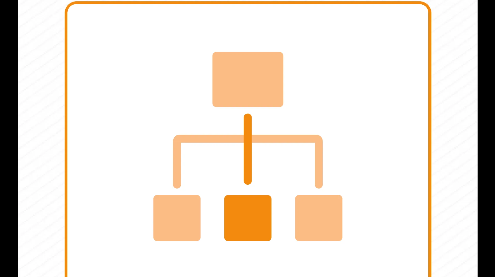

# 调研黑客·实操篇 · 课程文档（样稿）

> 本文档由课程截图转录整理而成。**文字内容完整保留**，截图中的图片、金句卡片、
> 案例封面等视觉元素已从正文中分离，单独存放于 `images/` 文件夹，并在原位置以引用形式嵌入。
>
> 整理原则：
> - 讲课正文逐字转录，保留原本的口语表达
> - 原文中的红字/黄字强调，用 **加粗** 标示
> - 案例代入、互动等标签保留为引用块
> - 截图中的图片只保留图像本身，alt 文本为简短提示
>
> ⚠️ **本文件为首批样稿**（3 张源图），用于确认转录 / 裁图 / 台账风格；
> 用户确认后，按此样式全量转录至正式文档 `005_调研黑客-实操篇-课程文档.md`。

---

## 样稿一 · 主课页「为什么要学」（源图：01 为什么要学.png）

> 标题来自原文：「为什么要学」。
> 本页仅 1 张嵌入横幅图，已裁剪为 `images/01-01.png` 并在原位引用。

【热场🤔】来来来，我们热个身吧，大家目前为止，你觉得作为业务负责人，一堂课程体系里，最重要，使用频率最高的一堂课是________

如果我来回答，我的答案很明确，就是：调研。

我每个月，需要解决几十个大大小小的各种问题，我基本养成了一个习惯：所有高价值问题，不要着急拍脑袋，先从调研开始。

再加上最近我在尝试AI辅助学习，每周十几轮二十轮地让AI帮我写调研报告，调研变成了我使用最高的AI工作场景。

所以今天，我来给大家讲一堂调研系列课里最专业的一节：《调研黑客实操篇》

如果单纯闲聊，调研的质量无需多言，对吧，大家都会认为很重要。

但真正面对高价值的问题，做一个决策，设计一个新产品，验证一个关键假设，大家真正愿意去做调研、并且的确质量还不错的比例往往很低。

为什么呢？

大家往往缺少一套专业的调研工作框架，过去我就出现过，把调研工作交给下属，大家很容易忽略目标、跑偏，收集了大量无效冗余的信息，忙活了很久、甚至花了钱去上了课，最后发现调研的价值微乎其微。

背后，就是缺少一套科学高效的调研训练。

今天我给大家一套完备的调研工作流体系，这是每一个业务负责人的几乎最高频的核心基本功。

---

## 样稿二 · 案例对话（源图：05 一堂 Credential 战略设计 / 还原对话过程 / 1.webp）

> 对话截图逐字转录，用户发言用引用块、AI 发言为正文，不提炼要点。
> 本页无嵌入图，对话界面标注（V0.5 版 OSCAR 专家 / DeepSeek V4 Pro）按原文保留。

你好！我是你的调研顾问。

能想到"先做调研再行动"，这本身就已经比很多人强了——大多数人是直接拍脑袋的。

做调研这件事，说简单也简单，说难也难。难就难在：很多人花了大量时间"到处看看"，最后发现拿回来的信息根本没法支撑那个核心决策，等于白跑了一趟。

咱们接下来一起做一件事：先把你脑子里的问题理清楚，设计一份目标明确、手段精准、直指决策的调研方案——然后我帮你先在网上跑一部分公开信息回来。

你现在最想搞清楚什么？哪怕还很模糊也没关系，说来听听，咱们一起捋。

现在是2026年4月29日 下午1点42分。你的Partner已就位，请你开始分配任务。

> 我想做一个一堂的credential，帮我做一个系统研究吧，一般来说公司的credential ppt最佳实践如何设计。我未来需要出去谈合作或者是融资，所以我需要准备一个非常顶级、一堂最佳实践级别credential

**V0.5版OSCAR专家（DeepSeek V4 Pro）**：这个方向挺值得认真研究的——一份好的credential PPT，在谈合作和融资时确实是"敲门砖"级别的存在。做得好的能帮你在第一次见面就建立信任、讲清楚价值，做得不好的容易变成一个"自说自话"的公司简介，对方翻两页就关了。咱们先把调研目标定清楚，后面的研究才能有的放矢。

在开始之前，我想确认几个关键背景：

1. "一堂"这边你指的是——

- 你是一堂团队内部的人，要给一堂这家公司本身做credential？
- 还是你在用一堂的方法论/品牌对外做咨询或服务，需要以一堂体系为背景做credential？
- 还是其他情况？

2. "credential"在你这次语境里，更偏向哪个用途？

- A：融资用（给投资人看的，重点是市场规模、商业模式、团队、增长数据）
- B：商务合作/BD用（给潜在合作伙伴看的，重点是能力背书、案例、资源、合作模式）
- C：两者都要，需要一份能兼顾融资和合作的通用版本

先帮我厘清这两点，咱们再往下走。

---

## 样稿三 · 卡牌（源图：100 卡牌 / 1.webp）

### 第1招 O目标卡（Objective）

> **选择题**
> 重大选择先做调研，
> 永远不要在信息不足的时候
> 盲目拍脑袋。

卡牌底部：一堂 · 《调研黑客》降龙十八掌 · OSCAR 模型

---

<!-- 样稿转录范围：01 为什么要学 / 05 Credential 还原对话 1 / 100 卡牌 1 -->
