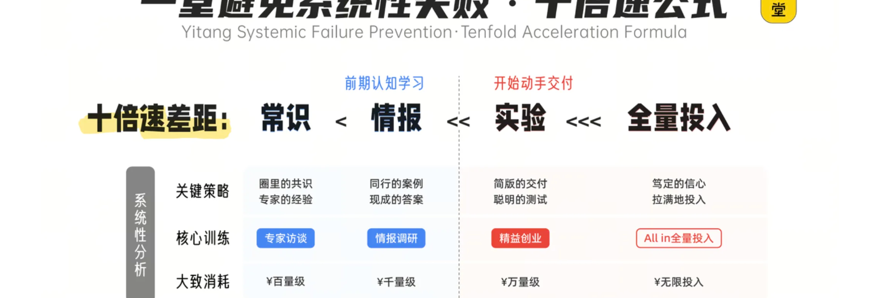
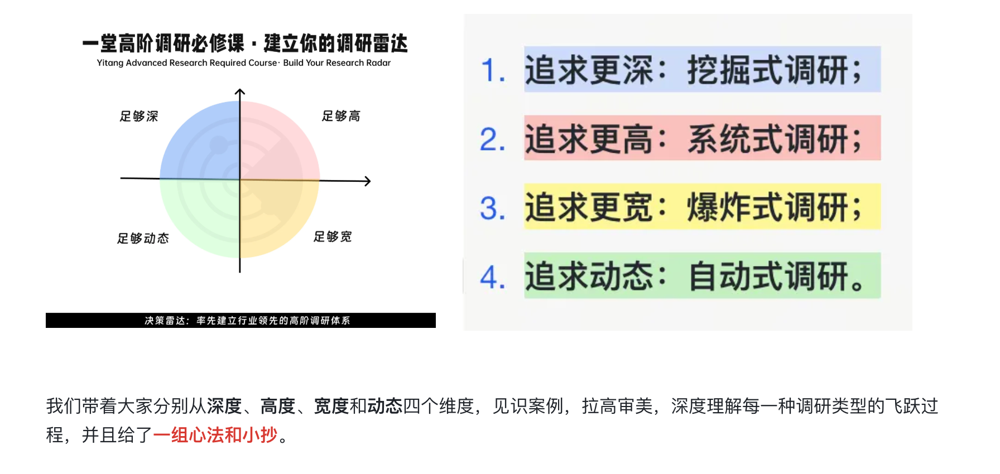
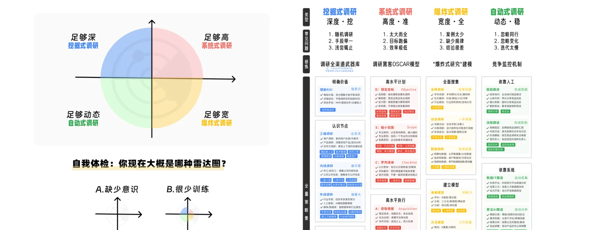
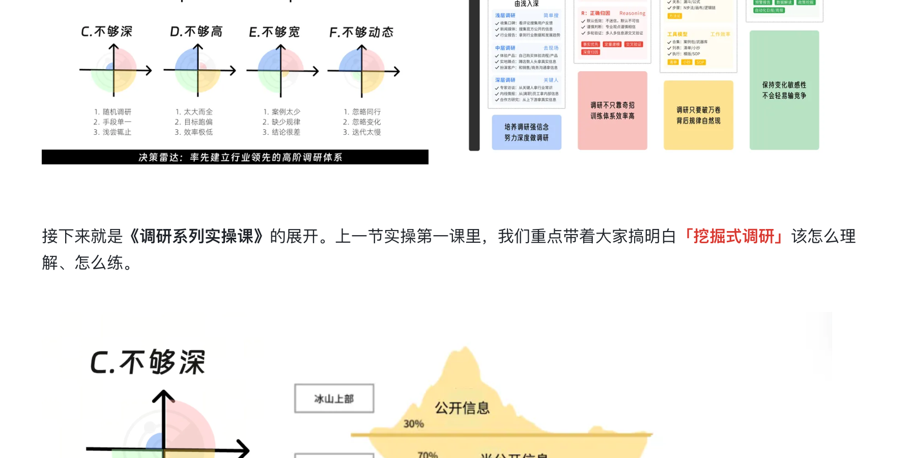
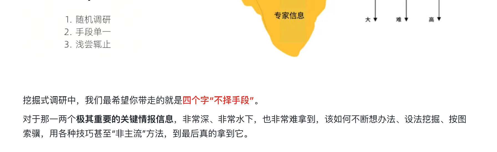
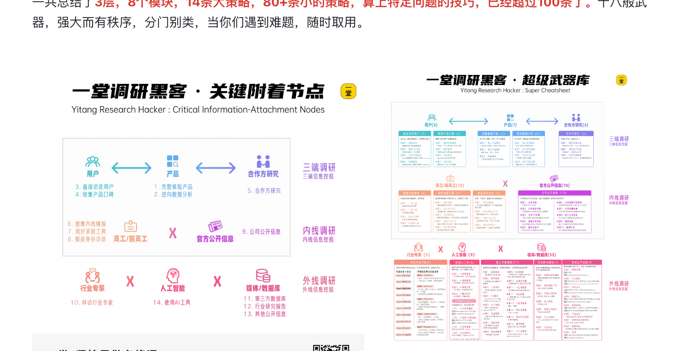
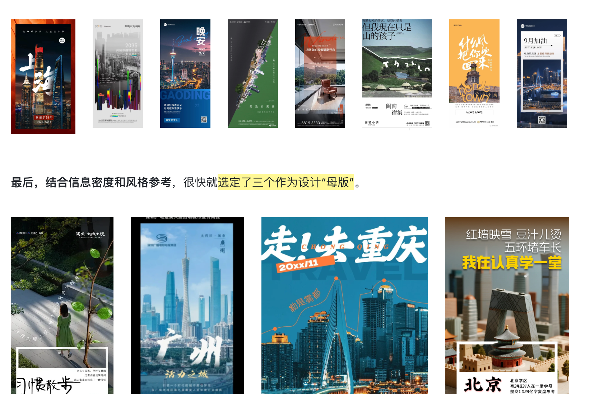
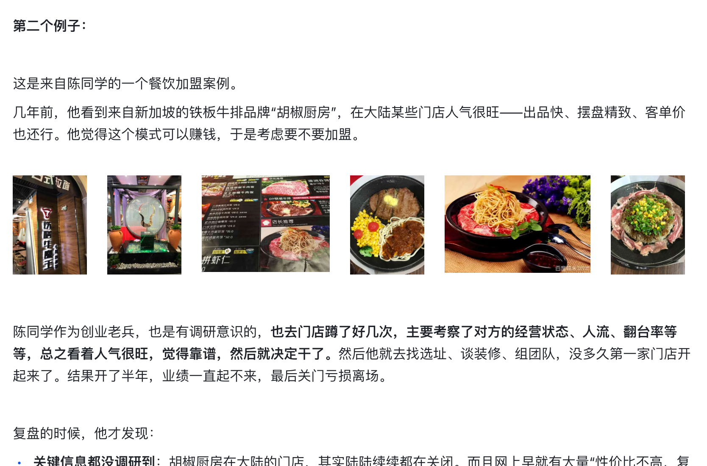
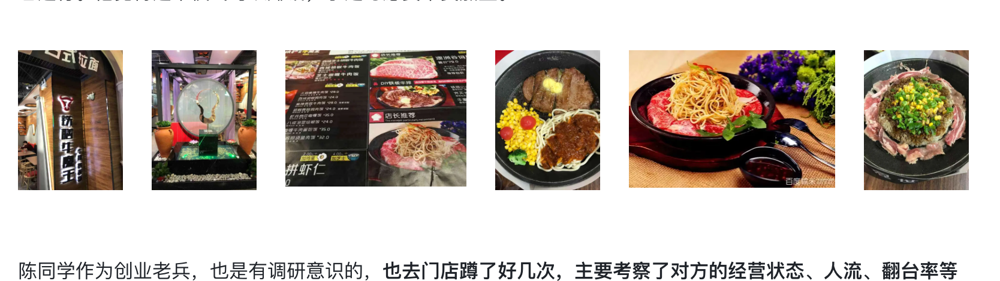

# 调研黑客 5 部曲 · 认知篇

> 本文档由课程截图转录整理而成。**文字内容完整保留**，截图中的图片、金句卡片、
> 案例封面等视觉元素已从正文中分离，单独存放于 `images/` 文件夹，并在原位置以引用形式嵌入。
>
> 整理原则：
> - 讲课正文逐字转录，保留原本的口语表达
> - 原文中的红字/黄字强调，用 **加粗** 标示
> - 案例代入、互动等标签保留为引用块
> - 截图中的图片只保留图像本身，alt 文本为简短提示
>
> **重编号说明**：源文件夹中 `05 科学框架.png` 与 `05 科学框架 1.png` 编号重复，
> 已按出现顺序重编号为 05、06，后续顺延。末尾 `调研 18 掌.webp` 作为 16 号附录。
> 文件名仅用于排序，不写入正文。

---

## 目录

- [01 预热思考题](#01-预热思考题)
- [02 快速回顾](#02-快速回顾)
- [03 案例 1 和 2](#03-案例-1-和-2)

---

## 01 预热思考题

**第一个问题：调研计划题。**

大家应该都负责/参与过一个业务，最近一段时间（±3个月），有哪些很难决策的问题，需要通过调研来完成，你如何制定一个可行的调研计划？

你可以停下来，强迫自己想一想，这个计划每一步有逻辑顺序吗，如何降低回退的风险？

**第二个问题：调研对象题。**

市场上的同行/友商/竞对很多，你都有哪些最值得关注的对手，和你在做的事情有竞争/借鉴关系？如果挑5-10个公司/产品重点研究和学习，你会挑哪些？重点是为什么挑选了这些，你是如何分类的？

建议你停下来，尝试整理一下你脑子中的存货，如果你面对这两个难题，你会怎么处理？

如果你不能很好地回答，那你要认真学习今天的课程了，希望这节课结束，你能掌握一套完整的思考和执行逻辑。

---

提前划重点

为了大家学习不迷路，我们先提前划一下重点。

今天我会重点带大家打通：**一套真正有章法的系统式调研框架，并且彻底击穿对「OSCAR五部曲」的理解。**

- **1套系统调研框架**：一套通用的商业调研模型，调研黑客方法；
- **5个环节**：逐层展开OSCAR模型五个关键环节，并且深入浅出多层击穿；
- **1张画布**：最后会给到大家一张直接上手可用的画布，拿走就可以梳理自己业务；
- **最佳实践案例**：推演案例+我的案例+业内最佳实践案例，一次性带你们见识拉满。

---

## 02 快速回顾

《高阶情报调研》系列课升级的第一课，是认知入门篇《重新理解"情报调研"》，我们带大家初步理解了，为什么大家普遍不调研，或者浅尝辄止；又为什么说，情报调研如此重要，帮大家建立对于高质量调研的敏感性。

对于一个资源和天赋有限的创业者而言，调研能力是决定成败的核心能力之一。

教员说过：**没有调查，就没有发言权。**

创业者若仅凭个人经验或假设行动，极易陷入主观臆断的误区。尤其是到了这两年，随着市场下行/竞争加剧，调研和低成本学习的能力，变成了非常重要的竞争优势之一。

调研是低成本判断可行性的一种极好的方式，比如**不做调研，按照直觉和主观臆断，直接开干，可能一旦踩坑，就是十几万、几十万、上百万的试错**。通过一些科学、系统的手段进行调研，可能只需要花几个小时、几天的时间，就能直接拿到现成的答案。

我们曾经给过大家一个图：前期充分的收集常识和调研情报，会大范围降低业务的试错成本，增加业务做成的成功率。

调研非常重要，但是我们在磨课过程中，发现大家对于调研的训练普遍远远不够，往往有这四大难题。

所以基于大家普遍的调研卡点，我们构建了一个调研雷达图，总结了**调研的4大侧重点**：

我们带着大家分别从深度、高度、宽度和动态四个维度，见识案例，拉高审美，深度理解每一种调研类型的飞跃过程，并且给了**一组心法和小抄**。

接下来就是《调研系列实操课》的展开。上一节实操第一课里，我们重点带着大家搞明白「**挖掘式调研**」该怎么理解、怎么练。

挖掘式调研中，我们最希望你带走的就是**四个字"不择手段"**。

对于那一两个极其重要的关键情报信息，非常深、非常水下，也非常难拿到，该如何不断想办法、设法挖掘、按图索骥，用各种技巧甚至"非主流"方法，到最后真的拿到它。

对此，我们还给大家准备了一个完备的《**超级武器库**》。

一共总结了**3层，8个模块，14条大策略，80+条小的策略**，算上特定问题的技巧，已经超过100条了。十八般武器，强大而有秩序，分门别类，当你们遇到难题，随时取用。

学习了挖掘式调研之后，我们就可以继续修炼升级了，这个时候你要开始面对**更复杂**的商业场景，这些往往不是通过一两个信息的单点调研可以支撑的，单点调研往往解决不了复杂决策。

越是重要的项目，你的调研目标越高，调研过程中跑偏的风险就越大。今天这节课，我们就要带大家真正理解，**为什么系统式调研如此重要，以及怎样完成高质量的系统式调研。**

---

## 03 案例 1 和 2

> 【思考🤔】在介绍套方法之前，我想先问大家一个问题。

你有没有遇到过这种情况，派出去一个同事做调研，或者自己去调研，拿回来一大堆信息，但最后发现，**对真正要做的那个决策，帮助几乎为零？**

---

我见过太多这种情况了。来，我先给大家举几个真实的例子，有体感之后，我们再来分析背后的原因。

**第一个例子：**

大家还记得去年秋季马拉松，我们出过一组很好看的城市出圈海报吗？

简单回顾下，在设计这个海报初期，我们需要先去找一轮参考和对标。负责这个项目的PM雨安最初的做法是：翻了大量的小红书、设计网站，一个帖子一个帖子地翻，结果情况是，一直在划划划。看到一个，觉得不合适就划掉，又找下一个，又划掉，结果到最后找了半天什么也没锁定。

后来Truman和他复盘，为什么这轮调研效率这么低？

其实最主要就因为，**当时他没有想清楚，自己到底要从对标海报里拿什么**。是城市地标的呈现方式？是整体风格的高级感？还是信息密度的设计？... 目标不清楚，看再多也是白看。

后来改进后的做法是，**列出几个关键调研点**，看看别人的海报有没有以下这些亮点——

1. 怎么突出一致性和差异性
2. 怎么突出城市地标和文化
3. 有什么版式显得洋气高级
4. 怎么增加图片的信息密度

然后，打开花瓣网，开始搜索城市海报，有的放矢地一边收集一边排序、分类，也就花了20+分钟看了几百个，大概就整理了几组最佳实践池子：

**组合设计**：用来看一个系列的一致性和差异性。

**大图大字**：感受城市文化符号和大字张力的。

**色块文字，能容纳得更多**：用来设计排版和借鉴格式的。

最后，结合信息密度和风格参考，很快就**选定了三个作为设计"母版"**。

**第二个例子：**

这是来自陈同学的一个餐饮加盟案例。

几年前，他看到来自新加坡的铁板牛排品牌"胡椒厨房"，在大陆某些门店人气很旺——出品快、摆盘精致、客单价也还行。他觉得这个模式可以赚钱，于是考虑要不要加盟。

陈同学作为创业老兵，也是有调研意识的，也去门店蹲了好几次，主要考察了对方的经营状态、人流、翻台率等等，总之看着人气很旺，觉得靠谱，然后就决定干了。然后他就去找选址、谈装修、组团队，没多久第一家门店开起来了。结果开了半年，业绩一直起不来，最后关门亏损离场。

复盘的时候，他才发现：

- **关键信息都没调研到**：胡椒厨房在大陆的门店，其实陆陆续续都在关闭。而且网上早就有大量"性价比不高、复购率低"的评价。
- **调研太浅太表面**：更关键的是，胡椒厨房在新加坡本地，其实只是美食城里的一个小档口品牌，根本不是他想象中的正餐连锁——这个事实，只要他当时飞过去实地看一眼，立刻就清楚了，但他没去。

这就是一个非常典型的调研失误：**只看到了竞对表面的火爆，没有去深挖那些真正重要的信息——人群画像、复购率、真实经营数据，进而判断这个品类适不适合他的城市。**

**看似做了不少调研了，但最后却导致了决策的重大误判。这样的调研，你能看到的，只是你想看到的。**

---

<!-- 转录范围：01 ~ 03（样稿） -->
