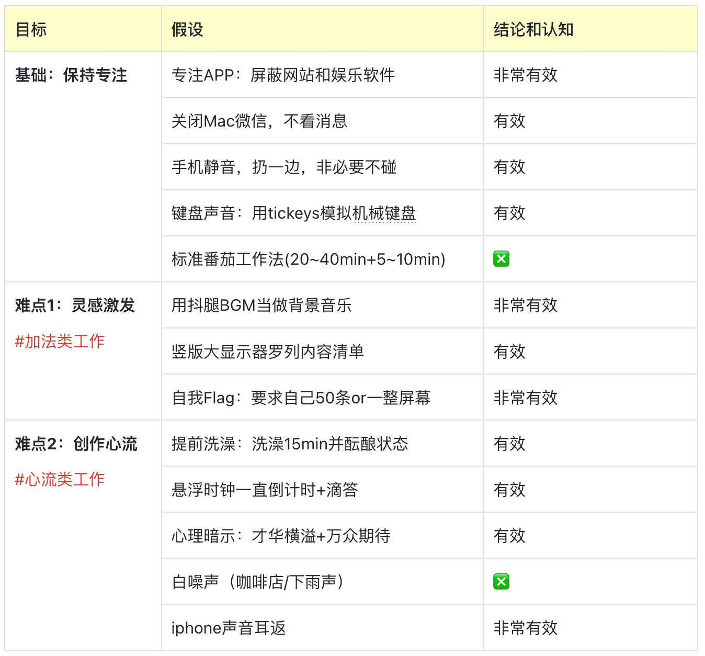
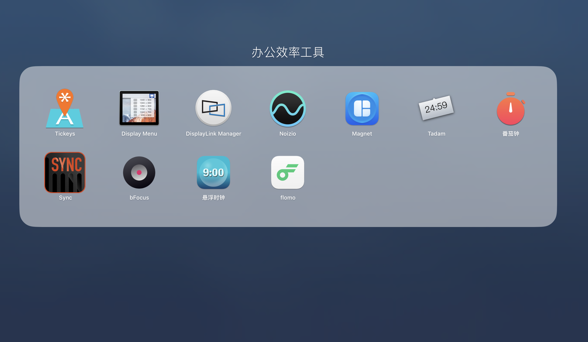
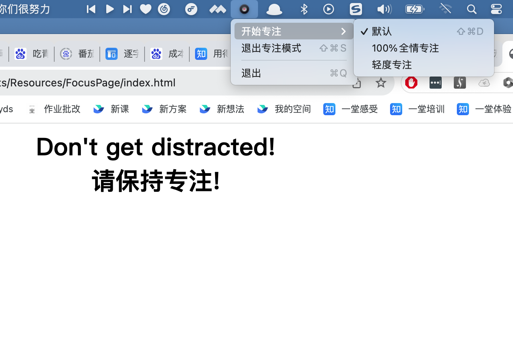
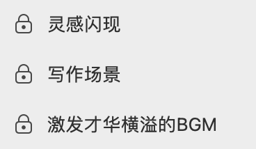
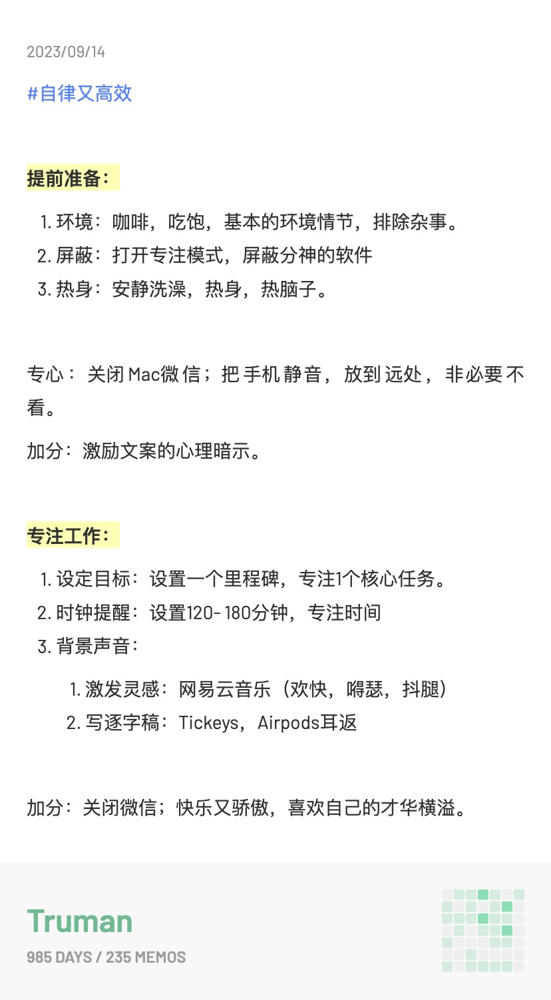

## 建立概念：什么是科学的时间管理

我尝试尽量还原事实和细节，尝试带你走一遍我这几年的时间管理迭代之路。你们也努力带入我的视角，感受一下，是不是正处在哪个阶段，是不是也想拥有这样的状态。

### 第一阶段：很忙且混乱

在三年前，大概是2021年初，一堂开始迎来第一波快速增长，团队从10个人突然变成了三四十个人，各种新人/新难题/新项目需要我来支持和解决。

那个时候的我，算是一个非常典型的"时间管理无助型"选手：

> 一睁开眼，打开手机，就有一堆工作等着；

> 每一个工作似乎都很重要，都很紧急，不知道要先处理哪一个；

> 到了公司之后，一个会议接着一个会议，几乎没有完整的大块时间；

> 刚开始深度思考一个复杂的业务问题，就有人过来找，打断了思路；

> 一天结束的时候，已经精疲力尽，但事情好多还没有做完；

> 晚上回到家，儿子已经睡着了，已经连续三天没有跟他说过话了；

> 准备继续加班，但总容易被新闻，短视频，知乎吸引，一刷几个小时，觉得自己特别不自律……

就这样，一天天一个个晚上，就这样过去了，感觉自己一直没闲着，一直很忙，一直在赶进度，弄得自己疲惫不堪，但总感觉效率提不上去。

大家经历过我这个阶段么？

这个阶段最大的困扰还不是"**效率很低**"，而是"**被动焦虑**"：

**被动焦虑1：事情太多，总被事情推着走。**

我每天会排很多事情，各种会议，各种人来找，各种问题要处理，基本都处于一种被事情推着走的状态。

业务越做事情越多，导致疲于应付各种问题，每天时间被排满了，反而那些需要深度思考、战略选择、顶层设计的重要工作的时间，几乎被全部抢占，少得可怜。

不是我在管理时间，而是时间在管理我，被裹挟着往前走。

**被动焦虑2：随性安排时间，跟着感觉走。**

有很长一段时间，我每天都凭着自己的心情和感觉，安排工作计划。

有会就开会，没会就做做自己的工作，最想做哪个工作就先做哪个工作，或者谁催得急就先做谁的。一天下来，能做多少是多少，反正都没闲着，做不完的明天接着做。

最大的问题在于，做了很多事情，但貌似并不是公司最最重要的事情，而且我的独立工作时间，被挤占的越来越少。

时间到了2022年初，我们开始做管理课，开始正式提出来要好好研究时间管理，事情出现了一些转机。

### 第二阶段：试着用工具

我开始学习一些专业的、流行的时间管理工具，试着用这些知名工具来解决我的问题。

每次学到新工具，尤其是一些畅销书/管理大师的管理很兴奋，惊为天人，开始付费购买APP/书籍和教程，打算全套使用，但试用了一段时间，都感觉不顺手，坚持不下去，就放弃了。

比如我用过GTD工作法，前前后后用过Wunderlist、滴答清单、微软Todo，兴致冲冲地画了一个晚上整理自己的全面任务，但基本上没过3-5天就坚持不下去了。

一方面我很难养成及时记录、定期更新的好习惯，而且我的时间大量属于团队，经常被占用，打乱计划，一次次Delay无法完成，于是悲观地发现：**我就是个很不自律的人。**

我也试着用过番茄工作法，买了不止一个APP，还买了计时硬件，试着让自己的工作保持节奏，最后发现非常困难：我一旦全情专注，计时结束的打断让我非常不爽；我要是状态不行，就算是有番茄钟，我也很难进入状态。

我还试过"清单工作法（TDL）"，"工作周记"，"吃青蛙工作法"，基本上全部都宣告失败了。

> 吃青蛙工作法：“青蛙”代表了那些最艰巨、最需要优先处理的任务。

现在回顾2022年的我，有点可笑：不只是没怎么解决问题，还越管越差，一次次信心满满，一次次失败告终，反而越来越焦虑，越来越怀疑自己是自律不行：**为什么别人都能用的好好的工具，就我用不明白呢？**

### 第三阶段：开始入门了

在2022年后半段，一堂开始加速做管理板块课程，我也正式开始思考如何科学地管理我的时间。我开始希望用**科学的模型和手段**，持续提升自己的时间管理效率，不断提升自己的工作ROI。 

为了终止自己的被动和总是被打断，我开始进行了一系列的变革和调整，开始认真、系统思考我的时间使用问题。 

**第一件事：得找到一个维度，来评价时间管理的好坏。**

如果我们无法评价一个事情，那么我们就很难优化它。所以我开始思考的第一个问题是：时间管理只是一个手段，时间是最重要的资源，到底要**实现的目标**是什么呢？我该如何评价一个人时间管理做得怎么样？

于是定了一个目标：**合理安排时间，不断提升我的时间利用效率，提升一堂经营成果，并努力平衡家庭和健康。**

但是我看了很多时间管理的文章和模型，工具很多，但实用性很弱。

直到有一次，我看到这句话的时候，突然感到被震撼了。

这句话一下就点醒了我，的确很本质啊，这不就是我最擅长的建模么？

**第二件事，试着找到因果关系，开始建立模型。**

我的时间管理效率，我发现一共有三个模型影响：
1. **时间/精力模型：**从早到晚，从周一到周日，其实是一个个切片，有大有小，有强有弱。
2. **事情模型：**给我的事情建模，需要团队协作的、需要独立创作的、需要深度思考的。
3. **匹配模型：**建立一个匹配过程，不断提升匹配效率，来提升时间利用率。

有了这个模型，我就进入一个很好的状态，基本可以持续迭代了。

我发现，我时间管理的水平，就是在这一刻，发生了一个巨大的质变。 

最近我看到了一类观点，我非常认可： 

> 评价一个人有没有真正入门一个东西，不是看他有没有学习经典理论、牛逼方法，而是有没有**形成对这个事情基础的、系统性的认识**。

> 因为有了这个基础框架，后面所有学习/认识，都能迭代和进化了。

当我产生了对于"时间管理"基础性的、系统性的认识以后，我就可以抛开那些流行工具和观点，非常务实地观察自己、调整自己了。

**第三件事：学习一些工具，试着使用起来，不断优化模型。**

这个时候，我开始忽略那些时间管理大的方法（GTD等），去收集和观察一些小的原则和技巧，看看在我身上有没有用。 

比如朋友推荐，读了一本书《深度工作》，里面提到了一个**双峰哲学**的工作方法。

> 双峰哲学的深度工作，这种哲学要求你将个人时间分成两块，将某一段明确的时间用于深度追求，余下的时间做其他所有事情。

> 在深度时间里，双峰工作者会像禁欲主义者一般工作——追求高强度、无干扰的专注。

> 在浮浅时间里，专注并非首要目标。

> 这种划分深度和开放时间的做法可以在多个时间层级上实现。

> 比如，按周划分的话，你可以每周 4 天做深度工作，余下的时间为开放时间。

> 同样的，如果按年划分，你可以选一个季节完成大部分的深度工作（很多做学术的人都在夏季或休假期间完成）。

于是开始尝试划分AB工作：工位上做协作工作（说话），留一个小封闭空间用来做专注工作（角落）。

后来还是效率不够高，于是继续调整**：白天在公司做A类工作（协作），在夜深人静后半夜做B类工作（创作）。**

后来生娃，时间表被打乱，开始重新调整：**周一到周三在公司做A类工作（协作），周四周五在独立车库闭关做B类工作（创作）。**

而且还有很多AB分类，用来平衡工作和家庭：

- 周一到周五all in工作，周六周日陪家人；
- 周六日下午晚上陪家人，晚上10点以后到后半夜凌晨可以工作。

再比如，学习了**番茄工作法**，发现番茄工作法的重点不在25+5分钟，而是在定时专注，时刻保持注意力集中，于是开始尝试创作倒计时，发现效率确实很高。

再比如，我一直很困扰时间排期错乱，总是撞车。后面发现"**公开排期**"是一个很好的工具，可以把我的协作时间完全暴露给团队，大家可以透明协作，就很少撞车了。

随着我有一个匹配模型，随着我的**时间x事情模型**越来越精准，我的时间管理效率也就越来越高了。

基本上到了2023年，我用一年的时间改造自己，找到了大概5-10个的工具组合：公开排期，双峰哲学，独立闭关办公室，计时工具，重要紧急，Flomo...基本上上轨道了。

虽然依然很忙，但最大的好处是"不焦虑"了：有计划，可控制，终于由"**被时间管理**"变成"**主动管理时间**"了。

### 第四阶段：精细化实验

回顾最近一年，我开始用"刻意练习"的心态在管理时间，感觉自己进步还是挺大的：）

因为公司持续增长，带来的时间管理压力更大了，更多难题出现了：之前1-2周一个大方案（新课/新产品/新方案），现在一周1-2个大方案。

为了更好地进一步提升效率，我开始思考一个问题：**如何提出一些新假设，来更好提升我的工作效率呢？**

**比如我的通勤时间（每天90-120min）一直被浪费，我测了一些很有意思的假设：**
1. 上班路上写文案（写短视频脚本，失败❎）
2. 上班路上写课程（心流严肃创作，失败❎）
3. **上班路上做方案（50min，一边写顶层方案，一边给国帅讲✔️）**
4. 下班路上写方案（写一写严肃方案，失败❎）
5. 下班路上做复盘（认真回顾事情的细节和底层逻辑，失败❎）
6. **下班路上磨课程（深度探讨课程的可行性，顺利✔️）**

于是，因为我上下班路上分别的50min更**科学匹配建模**，工作效率又进一步提高。

我清楚地知道，这段时间处理哪些事情不行❎，哪些事情可以，而哪些事情非常好，甚至1个小时的通勤时间，比5个小时的独立办公室时间还好。

> 匹配：重要的有DDL的工作 + 精力尚可，可以做灵感闪现和创意激发。

> 比如：我路上50min写《200期复盘营营销点》比在家里3个小时都有效。

比如最近一年，我在独立闭关工作部分，摸出了一个大致的模型：

这是一些我的应用截图：

这种例子还有很多，我现在还在不断思考如何更好、更精细地使用我的时间，核心就是一个问题：我有非常多高价值高难度的工作，我就这么多时间，如何非常聪明的、精细化的使用我的时间，成倍的增加我的时间效能ROI？

**【案例💡】**举一些例子，都是我这一年摸出来的：
1. 周日晚上的郊区家里时间：做课 << 头脑风暴 < 开会 < 面试。
2. 写重要课程之前：洗一个10-15min的澡，酝酿课程价值感。
3. 线下做教练+听路演：场域里激发关键假设+写复盘 >> 回公司思考。
4. 1小时午夜压马路：适合推演课程故事线和逻辑。
5. 教研磨课时间：一边听PM汇报，一边偷偷整理自己的知识清单。
6. 直播讲课后：虽然很累，但特别适合拍口播短视频。
7. 长时如厕时：很适合围绕今天纠结的卡点，逼自己提1-3个新假设。
8. 磨课时，我突然举手：全员闭嘴给我空间，静置60-90s，重大idea涌现...
9. 磨课分为四种场景：攻坚脑暴式，辅导对话式，方法打磨式，专家打磨式，分别在三个不同风格的办公室（加一个线上飞书），效率最高；如果选错，效率拦腰斩。
10. .....

只要合适的时间场景匹配合适的任务，产出的ROI就会成倍的提升，一次1H简单的遛马路，甚至比一整天的办公室时间产出还高，甚至能提升5-10倍不止。

而且越来越细，影响的同事越来越多，甚至我最近开始思考"喝什么咖啡管用几个小时"，"50分钟可以自我立多少条的Flag效率最高"...这种颗粒度。

这个阶段，甚至我用的不再是5-10个管理工具，而是大量的，几十上百个各种大大小小的idea和假设，去调整和匹配，怎么用自己的时间利用率最高。

从一大坨，到5-10个工具原则，再到几十上百个精细化的匹配和技巧，慢慢我的时间管理获得了非常显著的提升。

虽然还是很忙，虽然睡眠时间还是不足，虽然还是难免经常超出计划，但整体来说，基本上能做到计划可控，焦虑可控，而且我跟身边人分享我的每周工作产出，大家普遍都会"wo~~"地发现效率如此之高。

> 我可以在线下交付大课时，同时提10+优化假设，同时复盘出20-30个要点。

> 我可以在50min的通勤回家路上，写一个关键项目的顶层一页纸方案。

> 我可以在3个小时听PM汇报的同时，顺便完成一个2000字的课程大纲。

> (当然这不是每一次的常态啊，大概是部分的峰值水平==)

大家能感受到么，如果一个22年的我（粗放型选手，抓不住规律/焦虑/被推着走）和24年的我（科学型选手，有模型/持续优化/持续迭代）的人在一个环境里各自独立进步，长此以往，**一年以后，三年以后，十年以后，会拉开多大的差距？**

这个应该就是时间管理大概的体验和意义了吧。

哈哈，怎么样，有初步的体感和渴望了么？下面我来带着你们理解整个思考体系。