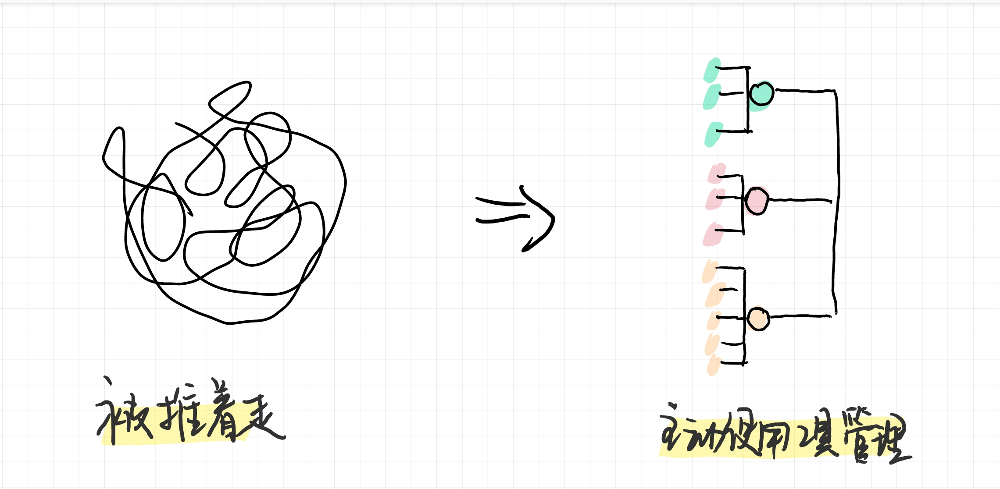

## 第一次跨越：从粗放到工具

这是基础，也是很多人一直还在反复停留的阶段。

### 第一次跨越前后

时间是很多人的最宝贵，也最公平的资产，但很多人陷进了"具体的事情"，很少思考自己时间的利用效率：效率很低，总做不完，长期焦虑，可支配时间不够...

要么是任务太难，要么是可控时间太少，总之就是持续焦虑，对自己不满意。也可能试着解决过，找一些知名的流行工具，试一试套一套，但发现帮助不大。

**不少同学在共建作业里面都表示了显著的混乱和困扰：**
1. 张同学：我的可支配时间一直是0，被事情追着，各种Delay...
2. 王同学：白天各种救火，晚上无休止加班，该做的没做想做的事做不了...
3. 房同学：最早凭脑子记事儿，凭感觉安排时间，事情一多就容易忘记…
4. 穆同学：希望使用番茄钟提升工作专注度，然而越用越慌，手心发汗...
5. 陈同学：计划好的事情总是在拖延，工作中频繁被打断，效率很低...
6. 齐同学：每次总是挑简单任务做，但难的任务排了几天还是无法下手...
7. 杨同学：容易受手机信息干扰，专注度差，事情都堆到一起，特别焦虑...
8. 申同学：学习了很多工具方法，发现时间不可控，重要的事情依旧进展缓慢...
9. .....

这一次跨越，最大的特点是，不再迷信神奇工具，不再奢望一击即中，不再试图用一揽子计划，让自己的时间管理**起飞~**

而是理解全面认识工具，**理解工具背后真正倡导的价值**，按照自己的工作阶段和眼下特点，选择几个有用的工具提升自己。

到了这个阶段，持续要让自己保持在一个"时间可控"的状态。

### 自我修养1：破除工具迷信

所以时间管理的第一步，先破除工具迷信吧：**不要奢望有一个NB的时间管理工具/流程可以完全解救你，不存在的。**

**【提问🙋‍♂️】**你们听说过哪些知名的/重要的时间管理工具/流程/法则？

————

**【提问🙋‍♂️】**你们见过身边多少人，真正坚持在用这个法则，持续拿到非常好的结果？

————

可能你知道我想说什么了：书上的工具都很香，但身边真正普遍在用的往往比例很低，不仅仅是大家不会用，而是多数工具根本在多数场景里，根本没用。

而且默认忘掉那些看似放之四海而皆准的"**时间管理忠告**"：

- 一次只做一件事；
- 要事第一；
- 先处理琐碎的小事；
- 给自己的工作设置时间节奏；
- 把你所有任务都写下来，把大脑清空；
- .....

这些都对，但可能只有5-20%的场景里有效，所以默认忘掉他们吧。

### 自我修养2：善于选择工具

**为什么总想用呢？因为锤子太少了；**

**为什么总没用呢？因为场景不匹配。**

所以第二个优秀时间管理的自我修养，就是你得**相对全面地认识这些管理工具和手段**。

市面上的工具和原则方法太多了，我们找到了大概几十上百个各种表述，尤其是欧美、日本，有大量的管理技巧和原则。

怎么办呢？

**【划重点💡】**自己动手，丰衣足食，我和教研团队看了一圈材料，也统计了上百个同学的共建作业，从高频+务实有用出发，做了一个很有趣的工具地图：

**【划重点💡】**试着理解第一层，为什么错配：**独立/协作 VS. 重点/效率。**

- **左侧独立：**左侧是独立工作，管理自己的时间；右侧管理协作时间，依赖他人。
- **上侧重点：**上侧是重点工作，选择关键事情；下面提升时间使用效率。

∴独立在左侧，协作在右侧；决策在上侧，执行在下侧。

**【划重点💡】**试着理解第二层，为什么没用：**高价值环VS.低价值环。**

- **低价值环：**工具很知名很香，但往往很固化很窄，整体频次和价值并不高。
- **高价值环：**看似很普通，但往往更有用，普适性和价值性更高。

∴ 执行&确定性很高在内环；开放&不确定在外环。

**在磨课过程中，我们发现很多同学都慢慢/习惯用上了一些工具：**

- 张同学，习惯在"写代码"的时候，用**番茄工作法**来提升专注力。
- 蔣同学，使用**晨间日记**，坚持15年早起，在无人打扰的时候，进行工作规划和复盘。
- 廖同学，在**飞书多维表格**中统计时间花费，分析误差，找到迭代点。
- 赵同学，日常应用**GTD方法**，记录所有关注的事情，寻求心静如水的状态。
- 文同学，使用**时间统计法**，进行24h流水记录，进而完成诊断、分析和优化。
- 贾同学，每天提前到公司，列出需要处理的**任务清单**，标出大概时段和**优先级**。
- 李同学，应用aTimeLogger记录时间花销，并坚持做**年月周计划**与时间回顾。
- 徐同学，在公司管理中，广泛应用**重要紧急象限、团队日历和拆里程碑**等方法。
- .....

哈哈，是不是很有趣？如果你能长期使用2-5个专业的时间管理工具，用来优化时间效率，基本上就算还OK，完成了第一次飞跃。

第一次还是属于"简单套用工具"的层次，下面准备好，新的难题出现了：**现有工具+时间，无法支撑你的任务了，你需要继续升阶了。**