## 第二次跨越：从工具到模型

### 第二次跨越前后

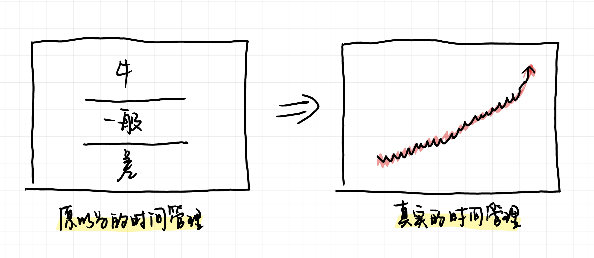

很多人用了很多工具，有些顺手，也有些不顺手，观察别人的时间，往往也都会停留在"使用工具"这个层次上，很容易有二极管思维：工具，有or没有；时间管理，专业or不专业。

这就会导致一个非常大的问题：**无法迭代。**因为工具就那么几个，常年使用而已，无法迭代，无法练习，无法精进。

这一次最大的飞跃，是从使用工具到建模练习。

最近我经常在内部会上，强调一个新的理念：**多看路（价值）少看方向盘（工具）。**

工具不重要，你要把你的90%的注意力，放在你自己真正的改变上，而不是工具用的好不好。

你要尝试回答三个问题：

- 你到底在做什么**任务**？你真的充分理解了吗？
- 你到底拥有什么**时间**？你真的充分理解了吗？
- 你到底如何匹配**最好**？你真的充分理解了吗？

这一次飞跃非常难，忘掉工具，你要从底层的价值去理解时间管理。

这是我随便从一堂内部找的一些复盘文档：

大家能理解区别么？只有记录了时间，才能评估每个部分工作的质量了：**ROI = 入课知识点数量/磨课时间**，就知道**哪些工作特别有用**，**哪些工作毫无价值**了。

在共建作业中，我发现已经有很多同学也有记录时间的习惯：

好啦开始，当我们逐步形成对时间的敏感性，开始大跨越动作~~

### 自我修养3：深刻理解任务

**【敏感性测试🙋‍♂️】**前面都说了，不考虑任务分配和授权出去，那就都得干啊，为什么还得理解任务呢？每天1-10件事，反正也都得是我的，安排时间干呗，理解个啥？

————

**版本1：**我们发现，最糟糕的情况是，事情堆一起，有时间抽一个做一会，再有时间了，再抽出来个做一会。

**版本2：**稍微好一丢丢的，就是给事情分分大小，碎片工作碎片做，大块工作排在一整天来做，这样争取不打断。

**版本3：**再好一些的，会认真思考事情的优先级，哪些要热情饱满做好，哪些一定要做，哪些争取做，哪些可以不做，按照优先级来做。

**版本4：**按照重要紧急原则来做：

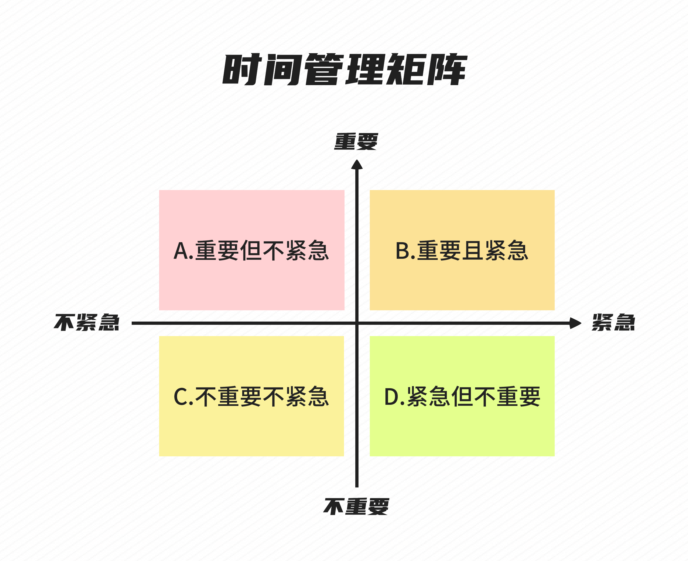

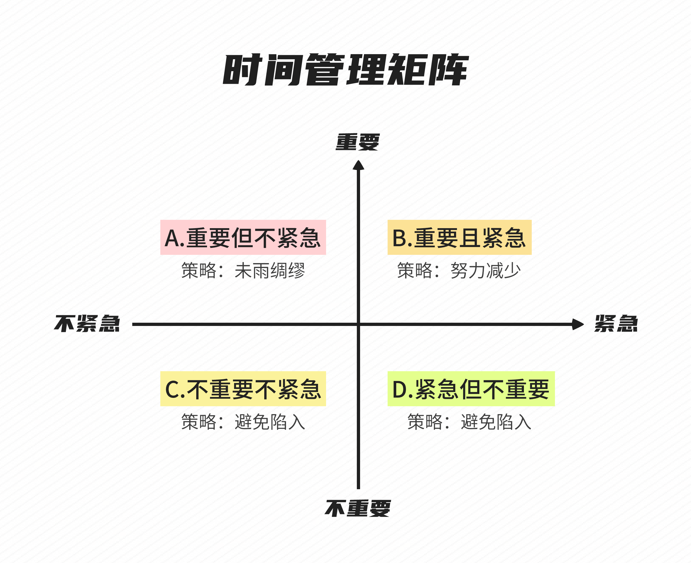

做到这个程度够好了吗？远远不够，这个刚刚只是入门，我们继续。

**版本5：**理解工作所需要的时间属性。

哈哈哈，来上难度了，问3个问题，越来越难，考验一下：

**【提问1🙋‍♂️】**我整理发票1H，和跟团队开复盘会1H，占用我的时间一样吗？

**【提问2🙋‍♂️】**我整理课程知识灵感3H，和写逐字稿3H，需要的时间一样吗?

**【提问3🙋‍♂️】**我第一轮磨课5H（碰撞），和最后一轮磨课5H（定稿），需要的时间一样吗？

————

看似时间长度一样，但背后的深度，可能**相差10倍**。

所以，这节课一个重要的理念要提出来了：**你要理解深度工作的深度，这是时间管理最重要的属性。**

相对于流水线打螺丝的蓝领工人，对于知识工作者来说，工作不是1:1均分的，大家有过这样的体验么：

- 在工位憋了半天的标题想不出来，回到家30分钟洗澡时候文思泉涌。
- 在家憋了1周没想清楚解法，去公园走了1小时路就想明白了。
- 在公司一整天方案被打断断断续续，回到家1小时就想清楚写完了。
- 在一个人想解法脑子闭塞，你就拉了一个讨论会，大家虽然没啥直接贡献，但整个会场就会让你涌现了很多新想法。
- .....

本质上，除了大小、重要、紧急以外，任务有一个非常重要，甚至往往最重要的参数被大家忽略了：**工作深度。**

有些比较简单，而有些需要专注；有些需要独立就行，而有些需要精力充沛；有些需要专心不出错就行，而有些需要深度思考，甚至灵感充沛。

哈哈哈，来，经过内部几个版本的反复修（推）正（翻），终于可以给大家看了：

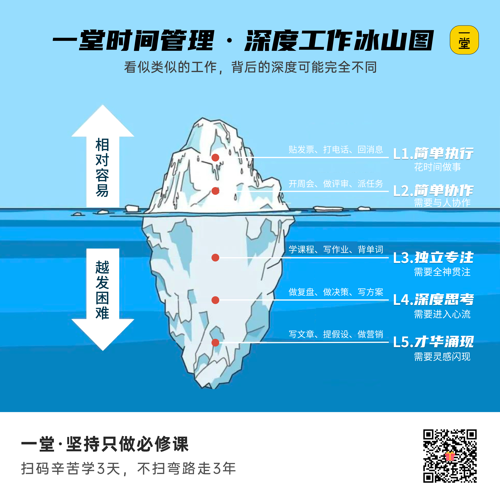

如果你的工作本身，是需要L4甚至L5级别的深度，你就会经常发现，可能你憋在办公室一整天的工作成果，还不如回家路上地铁上深度思考的收获大，这就是背后的原理：）

在磨课时候，我发现很多同学都不约而同提到了一个困扰：

我就是做一个很大的项目，很大的方案，一个完整的课程，一个独立的交付，没办法啊，没办法套进去啊，基本上L1-5都有，怎么办呢？

我给你们讲两个小故事，你们感受一下：

**【故事1💡】**我们教研PM写每周三的招生文案。

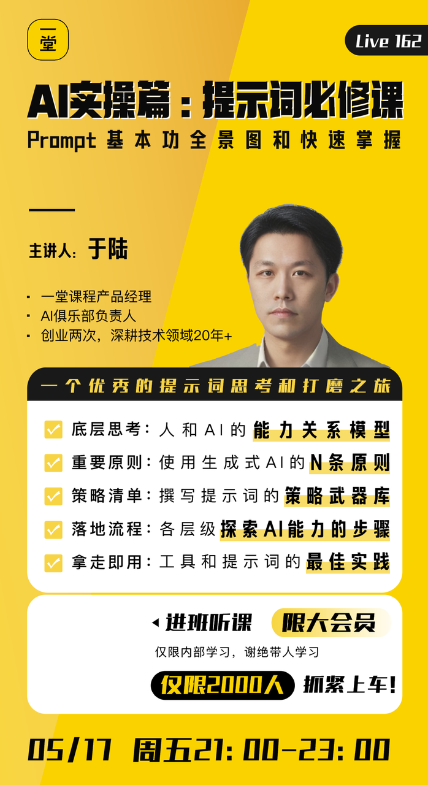

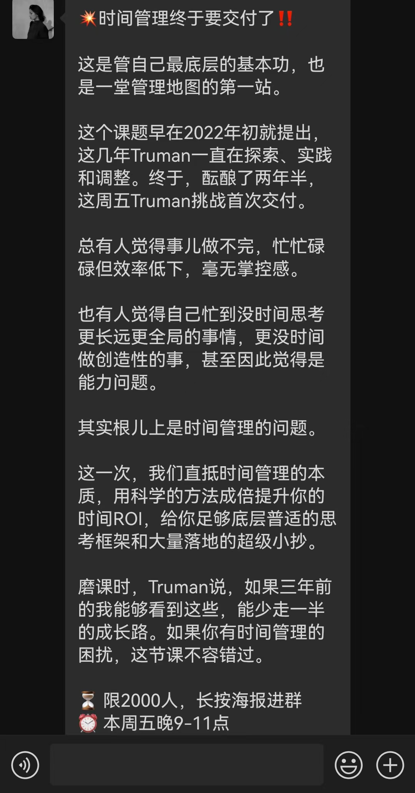

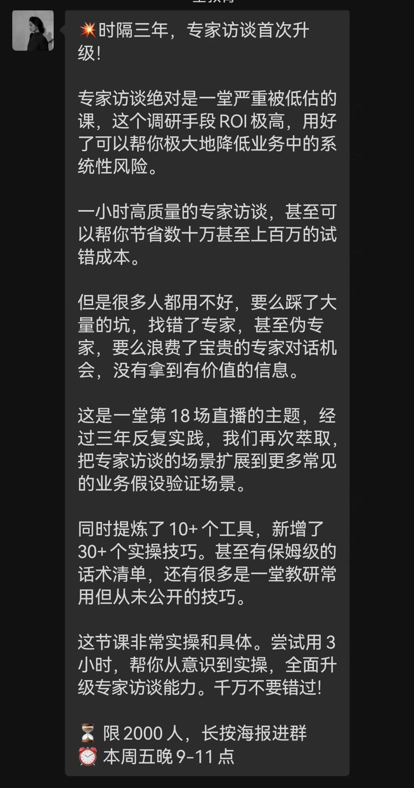

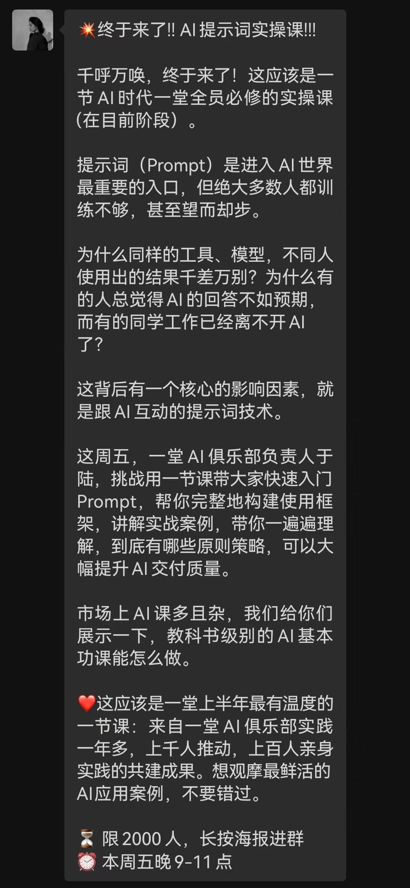

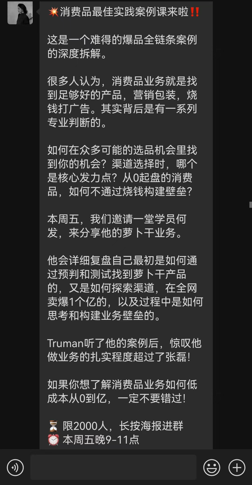

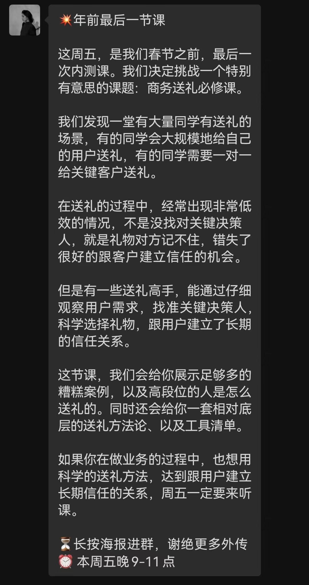

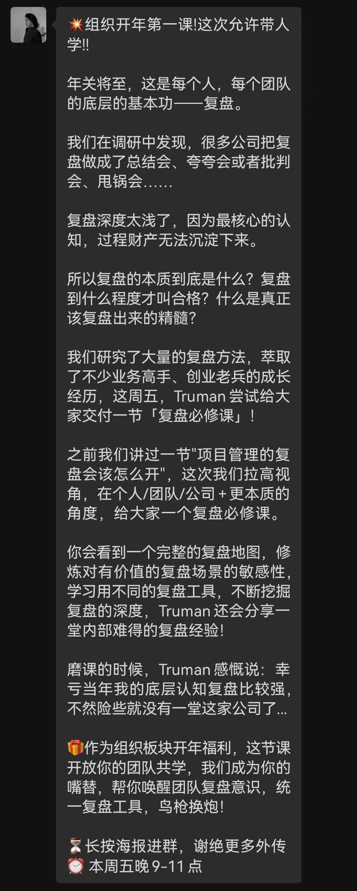

**版本A：3小时工作版本。**

- 每周三上午固定写3个小时，打磨N轮
- 在我这的通过率大概也就50%上下

很痛苦，花了很多时间，效率也很低。

**版本B：30分钟工作版本。**

- 15min：周一周二磨课时候，随手记录课程亮点和金句+稀缺点
- 15min：周三上午串起来，写成一个文案

通过率很高，因为都是深度工作时候激发出来的，通过率80%+。

看懂区别了吗？一个L5级别的高质量15分钟，远远好于3个小时L34的时间投入。

**【故事2💡】**最近我们做了一个火速项目：**200期复盘营校庆。**

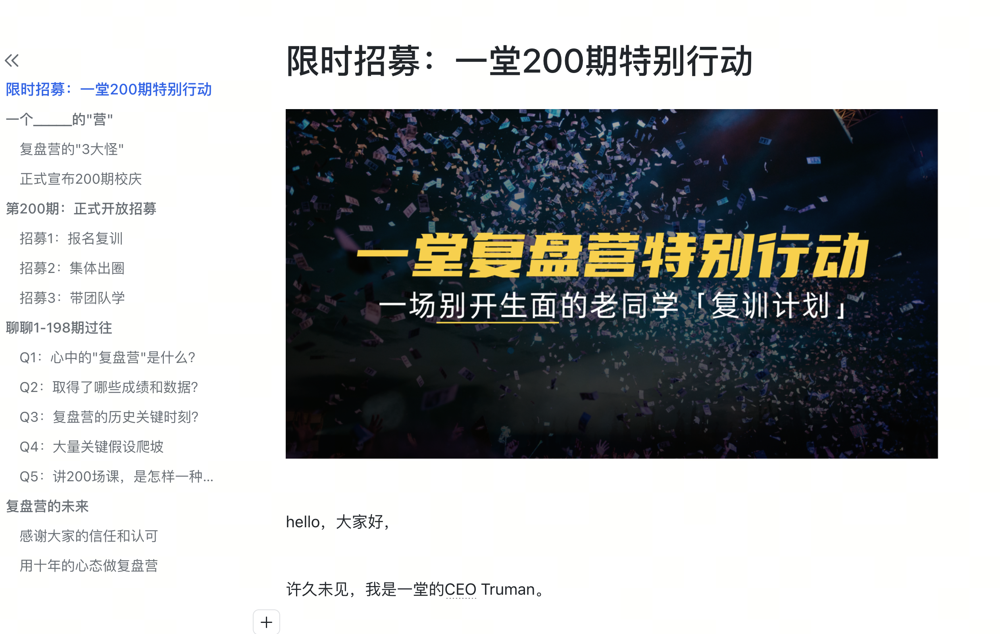

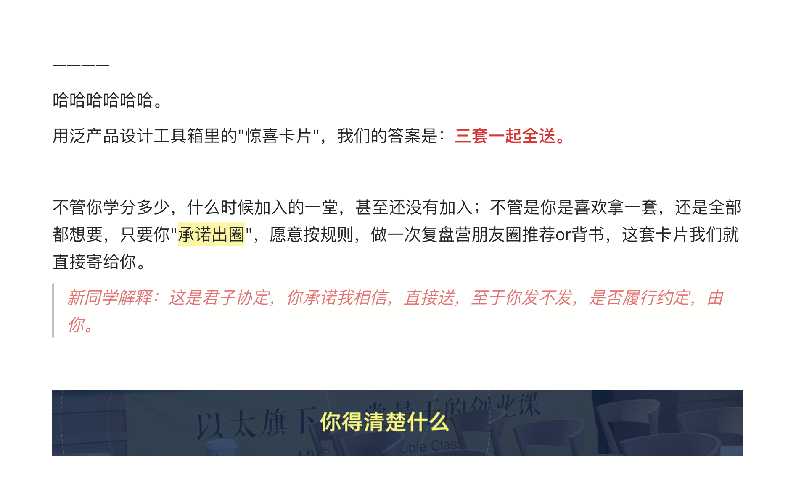

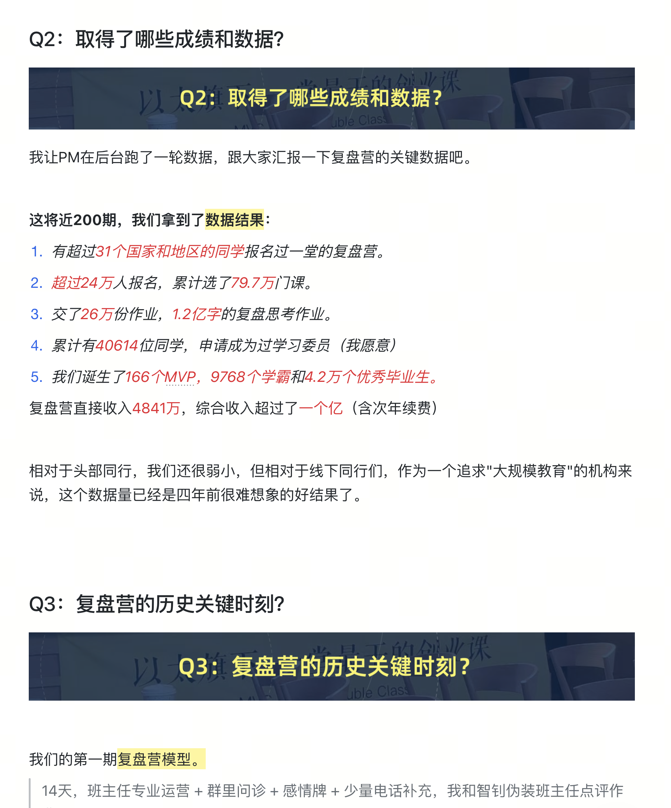

这次宣讲启动内部外部都很开心，我收到了很多"精彩"、"新的最佳实践"的评价。

从立项到筹备启动会，我只有最多10个小时工作时间（周二后半夜2点下班，周三晚上9点宣讲），怎么做呢？

**版本A：回去睡觉，第二天连续10个小时。**

- 上午10点到8点，在独立办公室闭关工作10小时
- 想点子，整理故事线，团队协作，写逐字稿

我猜状态会很差，在DDL面前，大量的想法和创意都出不来（L5）。

**版本B：分成三段工作，效率最高。**

- 回家路上：车上40min，灵感闪现，整理各种创意和营销点
- 回家睡前：整理故事线和大纲，**顺手还拍了10+条口播短视频**
- 第二天下午：7个小时执行，完成稿子，串起来就行

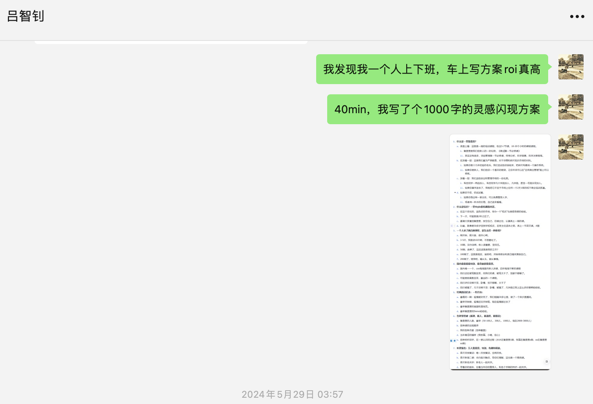

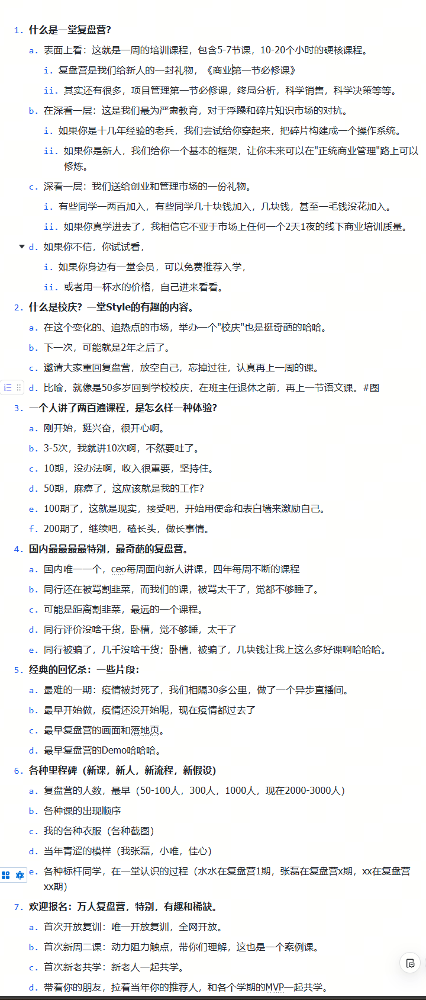

大家体会到区别了吗？一个连续10小时的L12345一大坨，不如分成40分钟L5，加上3个小时L4，再加上7个小时的L123协作/深度工作，整体ROI至少翻倍。

大家体会到了区别么？这就是我说，事情除了大小、重要紧急以外，很重要的一个维度，就是对于**深度**的理解。

好啦，总结一下吧：

**【划重点💡】**第一个关键词，**努力拆解**，我个人常用4种方法拆解任务：
1. **Step12345：**适合划分步骤和里程碑的。
2. **1.0和多版本：**适合持续迭代，先完成再完美的。
3. **大纲和细化：**适合复杂的，系统类的。
4. **酝酿和动手：**适合灵感类，涌现类的。

**【划重点💡】**第二个关键词，**不大不小刚刚好**，本质上还是平衡和**对抗**：
1. 拆的过粗：任务块太大，深度不同，很难准确安排时间。
2. 拆的过细：任务切太碎，切换成本很高，不断被打断。

总之，分解本质上得靠刻意练习，不断寻找手感，去探索这个任务的"**最小可分配单元**"，得逐步寻找那种"**刚好对抗**"的感觉。

### 自我修养4：深刻理解时间

哈哈，这个还有什么可以了解的？是不是觉得特别简单？按时上班，按时下班？或者努力工作，争取全部投进去，有什么可以分析的呢？

**【敏感性测试🙋‍♂️】**来来来，试试看，你如何理解你所拥有的时间和精力？

————

如果深刻理解任务，有30%的人不及格的话，那这个步骤，就有50%以上的人不及格了。

**版本1：**最差的，就是能做多少是多少，反正有时间就做一做，争取多工作，争取多勤奋，不断无限制的增加工作时间。

**版本2：**再好一丢丢的，时间分为按照7X24小时，分成可用的大块小块，比如工作日白天有10个大块，有一堆小块，回家路上啊，中午休息啊，开会间隙啊，课间休息啊，有一堆1-30分钟的碎片时间。

然后大块时间做大事，小块时间做小事儿，争取不打断。

**版本3：**再好一些的，认真分析自己的精力波峰波谷，分析自己是晨型人还是夜型人，哪些是工作的黄金时间，哪些是工作的低谷时间。

然后争取把黄金时间匹配最重要的工作，比如有些人习惯早晨起床写作，有些人习惯睡前复盘，有些人习惯固定上午开会下午编程，自己长期聪明匹配。

这样就够好了吗？

**版本4：理解时间质量。**

这个阶段开始进入高阶阶段，就像刚才说的，你得理解你的时间的质量，哪些可以做到L5级别，那些只能是L123级别。

讲到这，我想讲一个时间管理非常重要的误区：**只看时间，忽略场景。**

什么意思呢? 时间资源的质量和深度，远不是大小，困不困，这么简单，这是一个非常大的误区，**本质上是由一系列场景决定的。**

**举个例子：下面同样我花了3个小时，质量完全不同：**

- 我在工位写课的3个小时
- 我在家里写课的3个小时

差异至少**相差一倍**。

**甚至于再细分一下：**

- 我在家里，有DDL写课的3个小时
- 我在家里，没DDL写课的3个小时

差异至少**相差一倍**。

**甚至再细分一下：**

- 我在家里，有DDL，门外有孩子吵闹的写课的3个小时
- 我在家里，有DDL，后半夜安静独立的写课的3个小时

估计也能**差出一倍**，大家懂我想说什么了吗？

每个人的习惯，抗干扰，生活习惯，氛围，通勤时间都不一样，你得了解你自己。

而且好消息是，当你深刻了解到这一步，你的场景是可以被改变和营造的，你有几十上百种方法去调整你的场景和时间质量。

**最近一年，我摸出来了我的一些关键场景时间：**
1. 听汇报和PM分享故事的时候（2-3个小时）
2. 大半夜出去遛马路的1个小时间（不带手机/不听东西）
3. 有重要项目DDL的路上通勤时间（40-60min深度甚至才华时间）
4. 线下交付在场上观察、辅导的时候（Flomo记录新假设灵感）
5. 在逛街和长途交通时候，思考一些抽离的本质问题（人生和事物）
6. .....

送大家一句话吧：**好的场景，会激发出时间价值。**

好啦，继续，终于讲到匹配了。

### 自我修养5：深刻理解匹配

哈哈，这个是不是又觉得很简单了：事情也理解了，时间也理解了，不就是匹配进去就好了么？

**【敏感性测试🙋‍♂️】**来来来，假设你每周有10-20个大大小小的任务，有5天+周末碎片时间，你如何来尽量完成聪明的匹配呢？

————

你们过去切身感受过，不同的匹配获得的巨大的效率差异么？

哈哈，试着做一个连线题：

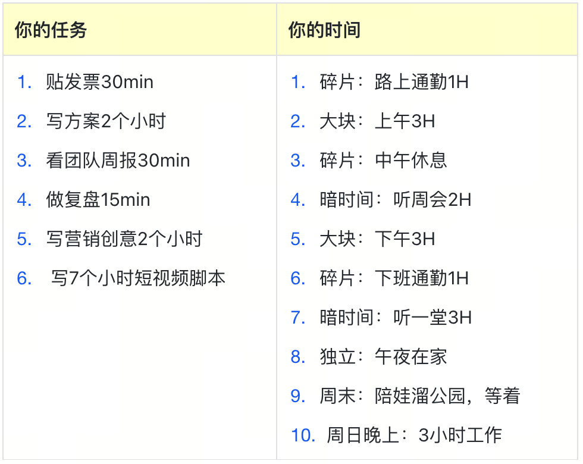

——————

答案不重要，每个人的习惯也都不一样，一般书上会鼓励大家集中安排、串联安排、并联安排、精准安排等等。

**抛开这些概念，总结一下，重要的是思考逻辑有三个：**

- **入门：**大对大，小对小，按类型匹配（可以尽量避免被打断）
- **进阶：**用好双峰哲学（严格独立划分时间，尽量互不干扰）
- **高阶：**寻找被忽视的时间（甚至主动创造）

在上面讲过了，努力把事情和时间拆开，原本可能4块时间+4件事，现在可以做到12块时间+12件事，可以更好地完成聪明的匹配。

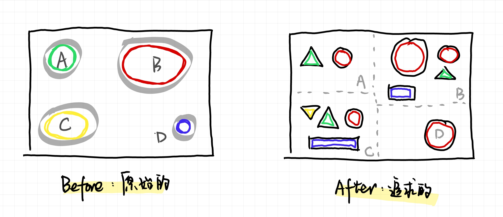

什么意思呢？你可以主动把协作+独立工作拆开；你可以主动把执行和深度思考时间拆开；固定时间做固定的类型的事情，争取避免冲突和撞车。

- **按小时双峰：**在工位上就是协作，写方案就把自己锁起来。
- **按每天双峰：**在公司做协作和执行，回家做思考和复盘。
- **按每周双峰：**周一到周三在公司协作，周四周五在家闭关做东西。
- **按每年双峰：**每年11个月用来经营和商业，固定1个月闭关写作。

既然工作深度不同，就强行把时间切成浅层和深层工作，把最难的工作留下固定的时间来做，避免整个时间全部被低质量的协作频繁打散。

第二个关键建议，也是我正在尝试挑战刻意练习的：**用好暗时间。**

哈哈，什么意思呢？来做一个测试：

**【场景1🙋‍♂️】**来到线下，听别人的路演/毕业汇报，你这3个小时能做什么？

**【场景2🙋‍♂️】**每周周会，2个小时，除了你发言的10分钟以外，你这2小时在做什么？

再问一个灵魂拷问：

**【场景3🙋‍♂️】**每周周五，2-3个小时直播课，除了带着耳朵听，你能在这三个小时做什么？

————

如果把你类比成一个电脑，你的大脑处理速度是CPU，那么做这些事情的时候，你的CPU占有率大概是多少？

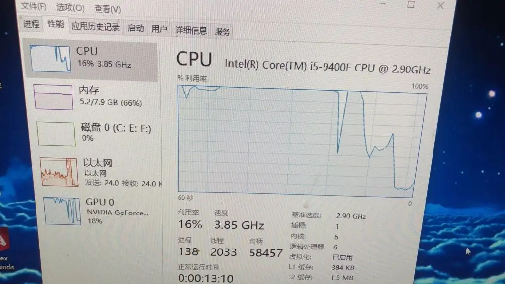

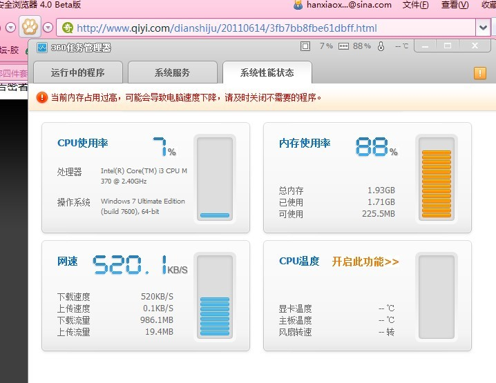

什么叫"**暗时间**"呢？

就是一些时候，看似你是在忙的，但是你的**脑力并不饱和**，你完全可以增加1-2件事，把你的CPU努力占满，而且再加上一个"**场景激发**"的技巧，可能是个超级大杀器。

最早我是什么时候意识到的呢？我在IPO课上讲过当年的一个故事：

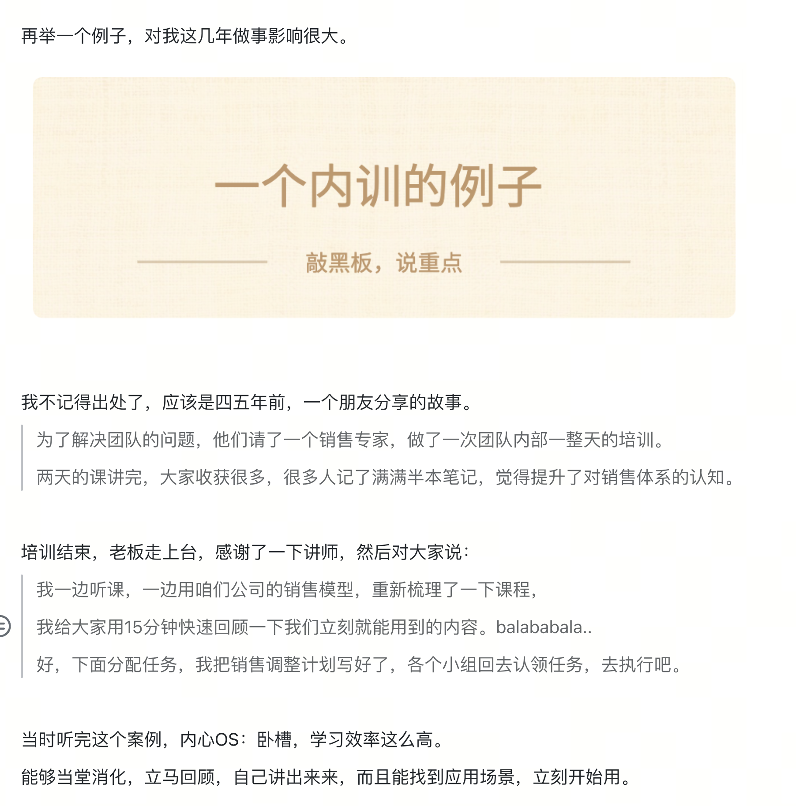

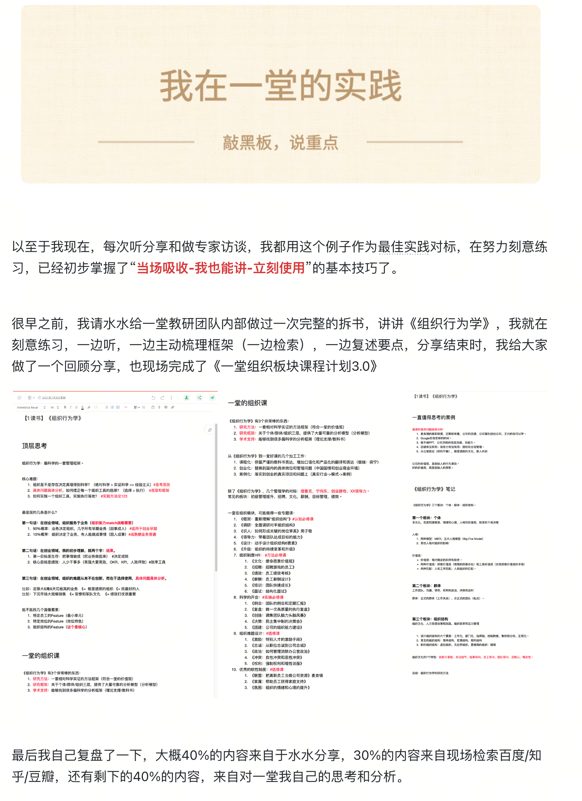

这两年，我在大量实践这个能力：
1. **我做专家访谈，**争取现场就记笔记+理逻辑线+完成课程匹配和故事线。
2. **我拆一个同行的直播最佳实践，**争取顺便记笔记+拆出动力阻力触点模型。
3. **我去听MBA的毕业路演，**可以顺便挖案例+复盘本期得失+提新的优化假设。

你一旦理解了你拥有大量的"暗时间"，尝试用好这些脑力剩余时间，并且不断刻意练习，提升你的CPU频率上限，你能做的事情会越来越多。

好啦，如果你能自己认识自己的任务，时间特点，以及匹配过程，基本上就能达到一个相对可控、可迭代的状态了。

还有下一个阶段吗？哈哈哈，**实事求是以后，要开始解放思想了。**