## 重新理解时间管理

最后送给大家三个词吧：

### 关键词1：实事求是

一堂我们作为业务出身的课程体系，这两年一直在尝试探索管理类课程的产品内核，不知道大家能不能从这节课里看到一些影子。

最近两年，我们陆续做了一些课程：**深度学习IPO、科学成长（刻意练习）、项目管理系列、科学决策ROI系列、科学开会、知识管理、新人Landing**等等。

为什么我们一直坚持在探索"**真正科学体系**"的管理课程的该长什么样子。说实话，每个课题，市场上都有很多课程，甚至是西方已经流行多年的工具和概念。

但是我们在真正深入一线现场调研发现，这些课题普遍远没到"**科学体系**"的水平，还充斥着大量的金句迷信、工具迷信、简单归因、错误类比。

所以希望大家从这节课，可以感受一下一堂试图在反复讲的"实事求是"：**尝试定量，并且理解规律的边界。**

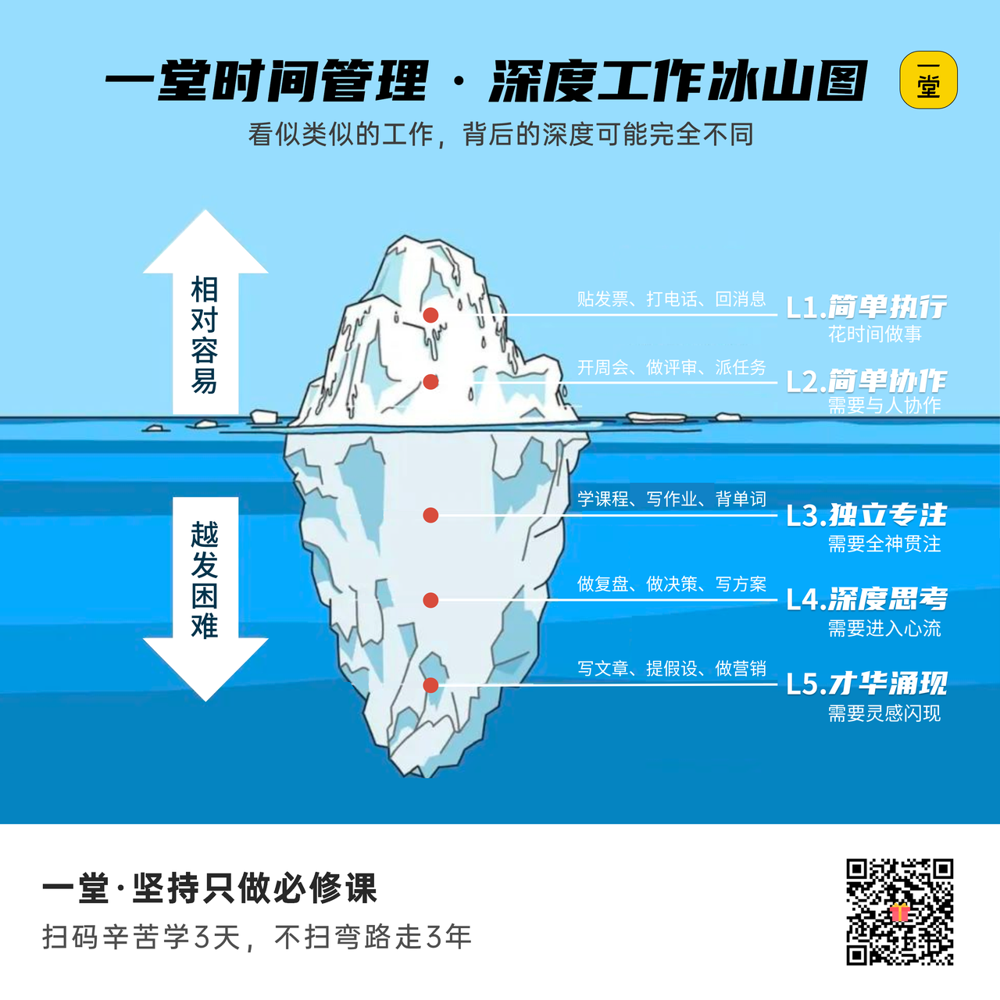

每个人的习惯、时间、工作、阶段不同，注定不能像流水线的工人一样，用一样的时间表和任务计划，大家注定要自己动手构建一套属于自己的时间管理方法。

这是今天我想强调的第一个重点。

### 关键词2：刻意练习

如果大家今天来听课，渴望听到一些时间管理的"小妙招"，"超级技巧"，那可能要让大家失望了。

这次做课，对于一堂团队最大的一个新的收获是，我们开始意识到：**时间管理，原来也是一个值得长期追求的刻意练习的题目。**

你可以用刻意练习的必备要素去调整自己的姿势，让自己不断进步，不断提升时间使用的ROI，最终成为一个高效能的人。

哈哈，来，准备好了么，是时候给大家展示今天的小惊喜了：

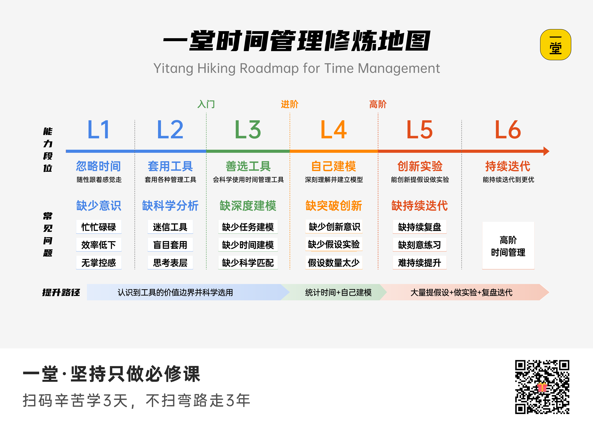

**关联一下《刻意练习》的核心课，你问问自己：**

- **基础是追求：**你真的追求长期时间管理ROI持续提升，甚至提升N倍吗？
- **要素1 套路：**你有尝试给自己建立一个稳定的模型吗？（三模型+原则+清单）
- **要素2 非舒适区：**你有不断对自己不满，盯着L4L5一路突破吗？
- **要素3 重复：**你有意识大量重复，把时间管理当做一个练习任务来做吗？
- **要素4 反馈：**你有不断复盘、不断迭代自己、逼近最佳实践的高段位吗？

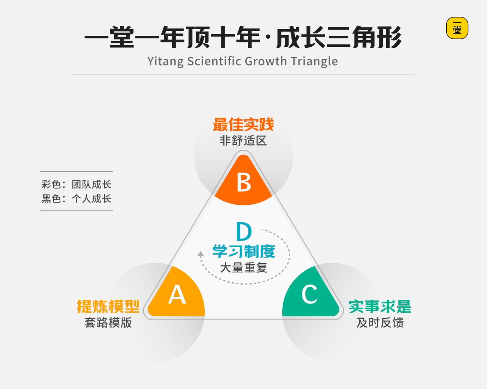

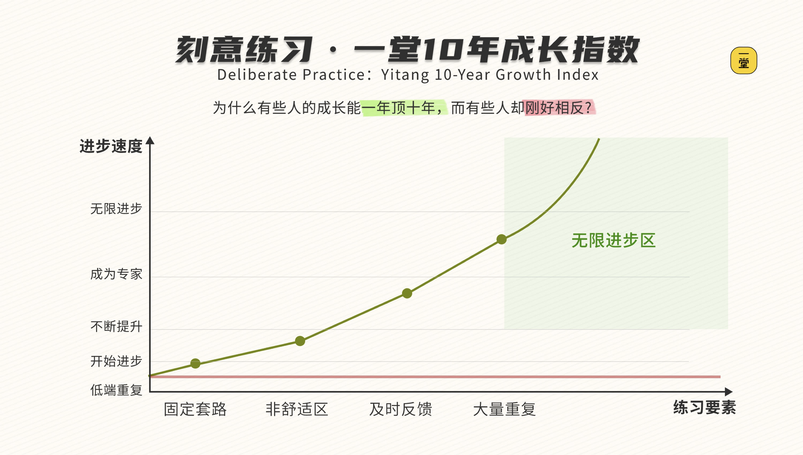

如果自评的话，我现在差不多在L4-L5.5抖动，我在努力练习"碎片时间匹配"、"L4L5深度提升"、"暗时间复用"、"个人专注提升"等等，过去一年我大概提了三五十个假设，未来一年，估计也会有更多的假设来驱动我进步。

努力让自己保持在"无限进步区"，剩下的留个时间，等待一年又一年还给我的复利。

### 关键词3：科学管理

好啦，终于到最后一个词了：科学。

我们在这两年的几轮做课里，聊了很多专家和学员，反复问自己：**到底什么才是科学的时间管理？**

今天终于可以初步给大家交付一轮能拿得出手的课程了，这个就是一堂全部的答案。

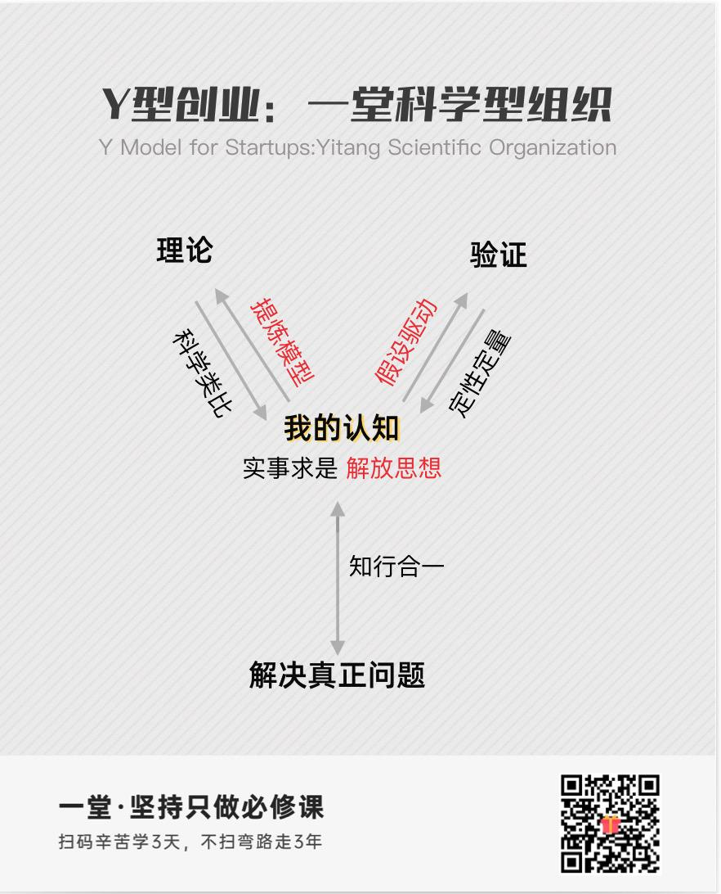

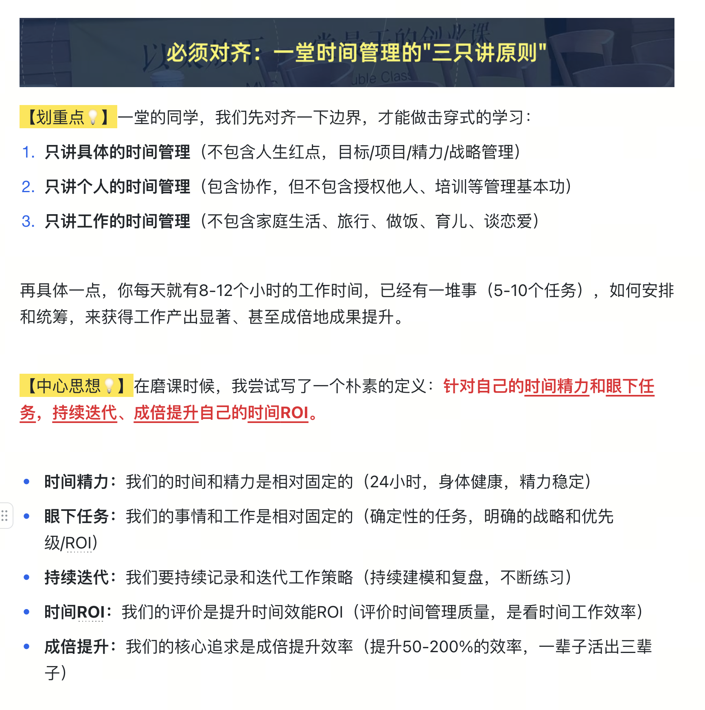

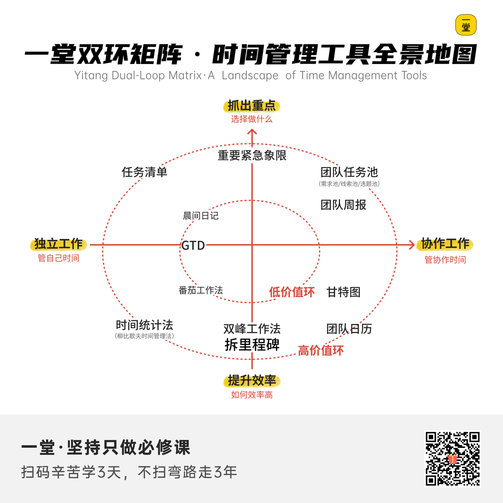

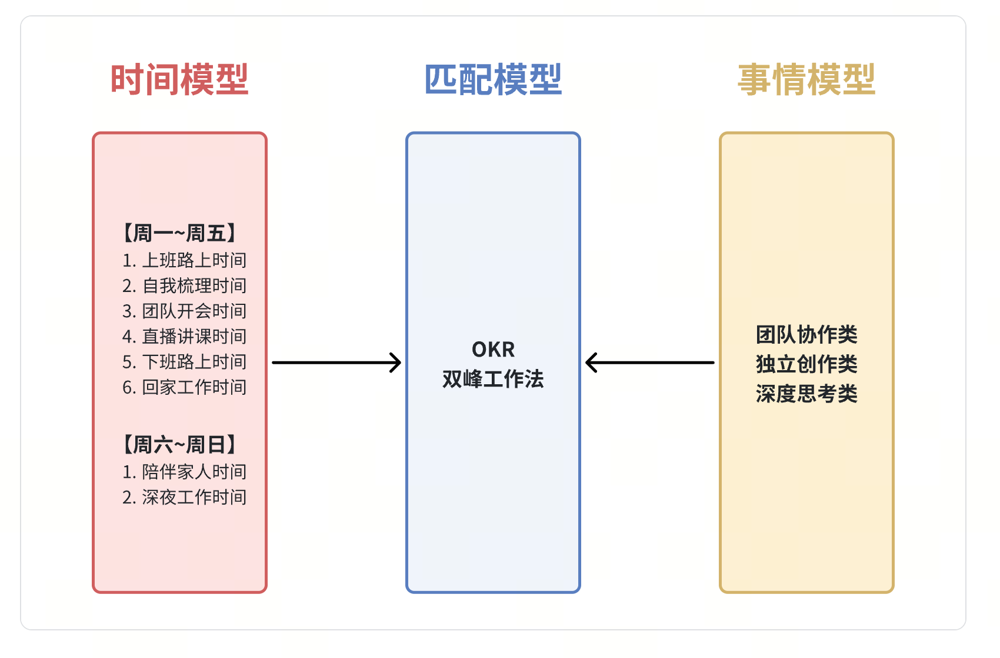

我们警惕不够科学的认知，容易陷入无谓的争论和迷茫：

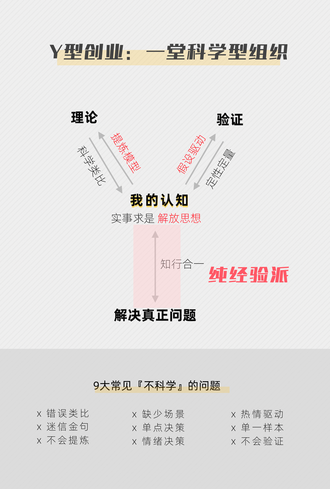

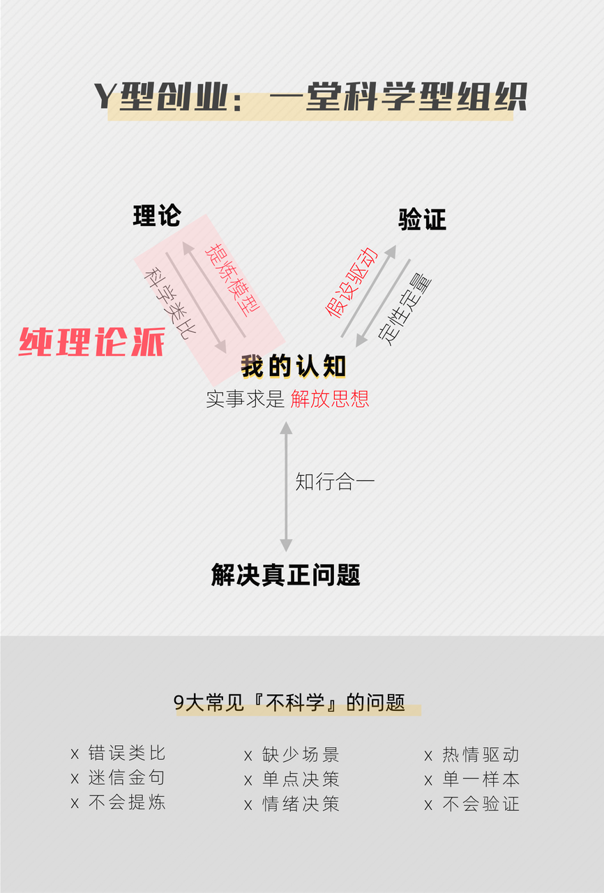

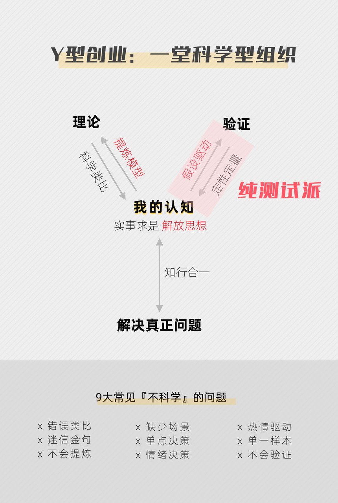

所有科学系列的课程，通常都不那么"高级和性感"，但我们希望它们对你们真实、落地、有效，希望大家通过今天这节课，可以感受一下一堂的理念吧。

最后的最后，课程听到这，不知道大家感觉到《时间管理》的核心价值了吗，在磨课时候，我们感慨了一句话：**人生红点和时间管理刚好是一堂的两端。**

- 人生红点是你的终点，是你最宏大、最远的追求。
- 时间管理是你的起点，是你最微观，最小的单位。

红点是方向，是你对自己"**人生终局**"这个答案的探索；

而时间管理是你"**做事的最小单位**"，你的人生复利最基础的东西，是你每一个小时，每一分钟使用**人生的效率**。

作为一堂听课的同学，大家或许志向不同，但大概率应该都是渴望"**未来成事儿**"的人。但因为时间效能的差距，有些人一辈子蹉跎了半辈子，而有些人，希望用一辈子的时间，做出别人十辈子的事情。

诸君加油~