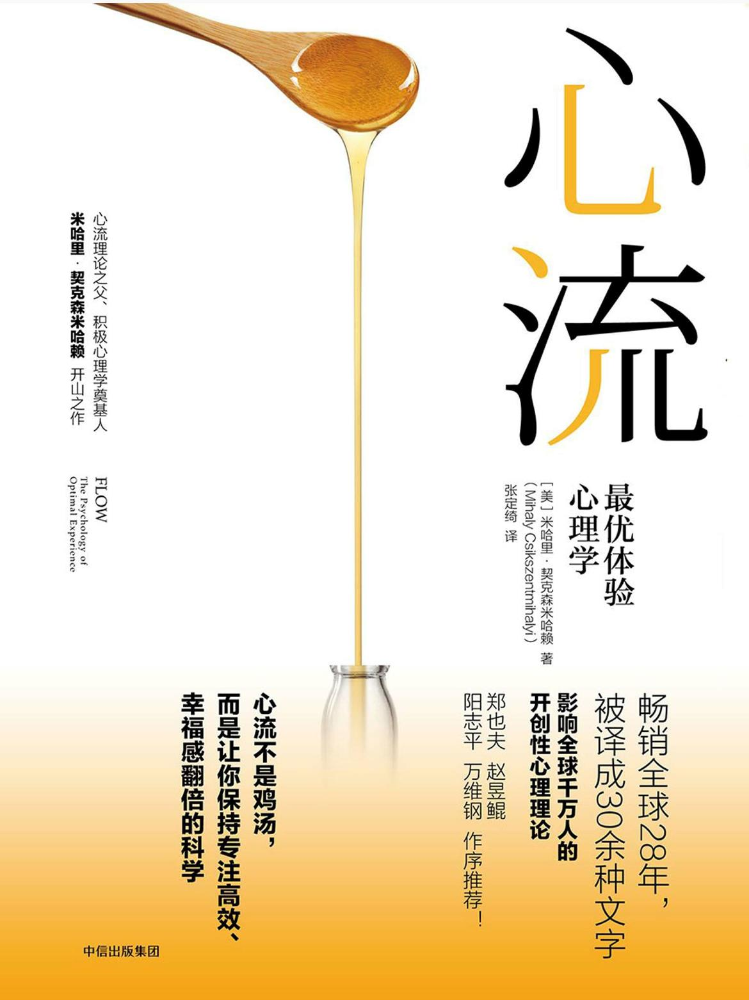

## 作业与Candy

这节课，我给大家留了两个作业，你可以2选1完成。当然我鼓励你听完课后，都尝试写一写。

**第一个作业：学习心得题。**

今天Truman讲了时间管理的科学建模法，讲了做时间管理三次重要的跨越。你有哪些心得和启发？哪些是你印象深刻的，哪些是你已经在尝试的，哪些是你原来从来没有想过的？欢迎写一写你的思考和新的认知，最好写写改进想法。

**第二个作业：大胆假设题。**

时间管理的高阶在于"针对自己的情况"勇敢提出新的假设，欢迎你**勇敢给自己提出1-5个改进的假设**，可以是大到GTD这种工具，也可以是"BGM歌单提神"这种小技巧，欢迎你勇敢写几个，然后试着在课后开始一步步实践测试。

**特别作业：时间管理开源计划**

如果你对时间管理这个课题实践很久，通过科学的方法逐步迭代形成了一套高效的体系，且拿到了很好的结果。邀请你来参加“**时间管理开源计划**”。

可以回顾一下你的时间管理成长历程，你用过哪些工具？是怎么一轮一轮做优化和迭代的？如果有你的工具清单，过程记录，日程表截图就更好了。

一堂的教研同学有可能会联系你，帮你登上一堂的讲台，成为一堂「开源之夜」的船长们！

🎁 特别奖励：认真写这个作业，**全部给优秀作业（6分）**，大家加油。

**【Flag🙋】**这节课做起来很辛苦，希望大家不要辜负。

来来来，希望大家一起立一个Flag（承诺），认真听课吸收，最后完成这次训练作业。

扣一句话吧：**一定作业！！ Or  一定挑战！！！**

提醒：新课免费内测，请务必按时学习提交作业，3次报名内测不写作业，后面不会再邀请。

**🎁 作业奖励Candy**：
1. **一堂《心流》拆书会回放：**这本书，来自心流理论之父、积极心理学奠基人米哈里。他开创性地提出了“心流”的理论，风靡全球，后来有无数心流衍生理论，但**很少有超越**这本书的洞见。听听这个拆书会，希望在这个浮躁的世界，打造更多深度工作的状态吧~
2. 《**Truman私藏提效歌单》：**哈哈，还有个私藏的小Candy。为了快速进入状态，我在做**灵感激发类工作**的时候会把**抖腿歌单**作为BGM，亲测有效！教研的同学对这个也很感兴趣，非让我分享出来。那就作为Candy给到大家，提交作业就可以得到我的「私藏提效歌单」~

