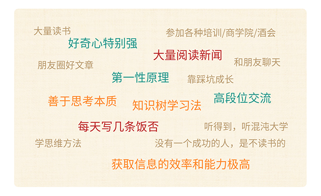

## 基础框架：学习的底层模型

第一个话题，我们先建立一个审美：我们说学习能力强的创业者，究竟什么样？第一部分，咱们先来看三个典型创业者的日常学习习惯，你来评价一下，谁的学习能力更强一些？

### 三个业务负责人

你有三个创业者的朋友，都刚刚开始独立负责一个新业务：

A同学是**实战型**，信奉"**实践是检验真理的唯一方法**"，最好的创业就是来自一线总结。所以全身心投入到工作里，90%的成长，都来自于不断地实践、犯错、反思，用做事来持续获得成长。

B同学是**社交型**，信奉"**社交圈层的力量**"，平时晚上和周末，花大量时间去混圈子，认识各种类型的牛人高手，善于聊天交朋友，积累各种人脉。90%的成长都是从人脉和交流中得到了。

C同学是**读书型**，信奉"**所有的难题，其实书里面早就有答案了**"，除了工作，每周花超过20个小时用来读书，还会买很多课程、专栏，听得到听混沌听一堂，来不断提升自己的信息宽度，90%的成长是从书本中得来。

**【提问🙋‍♂️】**大家觉得，ABC谁的学习能力更强一些？

————

我们分析过很多一堂的创业者，各种类型：听课型，直播互动型，讨论型、分享讲课型等等。大家的习惯、兴趣、偏好都不一样，有可能放在一起比较吗？如何全面评价一个人的学习能力强弱呢？

问题留着，我们来看第二组案例。

### 三个学习型高手

这组案例，来自一堂教研小组的调研，我们目前能找到的、国内外最具代表性的三个学习型创业者：王兴、张一鸣、埃隆马斯克。

我们通过他们的自述和身边人的分享，搜集了他们的日常学习习惯。平时创业这么忙，他们是怎么学习的呢？

**第一位代表：王兴。**
1. 好奇心特别强，特别喜欢跟段位比较高的人，做高水平的交流；

2. 大量阅读，除了读书，平时浏览器常常打开着几十个国内外的新闻界面；

3. 特别喜欢思考事情的本质，遇到商业问题，不断追问为什么。独立思考，就算做士兵，也要做明白为什么要打仗的士兵；

4. 他每天的必修课就是看各种网站，他习惯开上几十个浏览器窗口，看国外的科技网站，看各种项目，了解最新的产品和技术。

**第二位代表：张一鸣。**
1. 有人评价他：获取信息的效率和能力极高；

2. 也有人评价他：可以像机器一样工作，并像驯服算法一样调试自己；

3. 有强烈的目标导向，他不管运营、技术、产品有多忙，都要有时间去学习，去优化自己；

4. 在 2018 年给自己立了一个小目标，把英语学好。然后在内部员工交流会上，他决定要用英语来交流，然后就反复练习，最后果然，很快就可以熟练使用英语了。

**第三位代表：埃隆马斯克。**
1. 从小就酷爱读书，甚至每天读10个小时以上；

2. 极度勤奋，爱学习，他每天都在思考和阅读；

3. 他提倡第一性原理（First Principle Thinking ），站在物理学角度，或者问题的原点来思考复杂的事物；

4. 他提倡「知识树学习法」，要努力理解知识背后的基本原理，把所有知识画成一个体系。

好了，六个故事我就全都讲完了，大家都有各自的学习信息源，都有各自的兴趣点和偏好，我整理了一下，大家能不能发现什么规律？

这么看上去，是不是每个人的学习习惯完全不一样，有什么可以学习的模型呢？

### 背后的模型

直接说答案吧：其实如果你认真看上面的所有学习习惯，分一下类，其实就是前中后，三个环节而已：**输入**、**处理**、**输出**。

这个概念，来自计算机科学，但凡算法，就会涉及三个过程：**Input（输入），Process（处理），Output（输出）。**
1. **输入Input**（做事，阅读，上课，朋友探讨）

2. **处理Process**（方法论，思维模型，认知水平）

3. **输出Output**（做事，文章，分享）

所以，你问我上面ABC三个同学的学习能力谁更强？不好意思，不深入到IPO这一层来看的话，我的答案只能是：**无从判断。**

**光从学习方式和习惯来看，太表层了：**

- **读书多**？但也可能思考很表层，只是知识的搜集者，根本没有深度思考的能力。
- **不读书**？但也可能阅读极少的高品质内容，完成了高质量的思考。
- **实践多**？但也可能执行很表层，没有学习最佳实践，也没有总结复盘，一直原地踏步。
- **不实践**？但也可能做的是投资&战略型工作，大量的信息和案例搜集，就足够了。

**所以，真正重要的是这几个创始人IPO的速度和质量，也就是信息输入、处理和输出的速度和质量，而不是表面上的学习习惯。**  

**【划重点💡】**说的再直接一点：**你的学习能力，其实就是你IPO的速度和质量。**

如果你想成为一个优秀的商业评论作者，你要构建长期的IPO模型；

如果你想成为一个优秀的商业分析教练，你也要构建长期的IPO模型；

做一堂以来，我这几年的工作，就是大量阅读，大量看作业，大量和各种人说话，这个IPO模型，其实是我一直在刻意练习的一个底层工具。

好了，我们再严谨一点，下面这张图，希望大家可以理解：

不管是主动还是被动，积极还是消极，你一定会每天看大量的信息，新闻，课程，短视频，聊很多天。但是这些海量信息，如果转化成你的"核心认知"，学习能力就会有巨大区别了。

学习最重要的就是不断的IPO，不断的输入、处理、输出信息，除了IPO以外，还有三个东西，帮助完成学习的闭环和加强：

**第一个：目标（Goal）**

目标很重要，你要**围绕着你的工作目标**来构建你的学习能力，也就是**学习-做事的统一和闭环。**

比如：
1. 埃隆马斯克，需要做大量的技术创新，所以要回到学科，回到物理学去构建体系。

2. 王兴，需要借鉴国外的商业案例，需要浏览海量的网站，吸收大量前沿的信息（当年）。

3. 张一鸣，做信息分发，本身就很注重信息效率，所以把自己调试成了一个模型。

背后的原因，还是因为业务阶段和公司中长期的目标导致的。

**第二个：模型（Pattern）**

你会处理大量的信息，你脑子里会有模型和范式么？能有一个模板，可以帮你提升做事的速度和效率吗？你需要完成从**思考-沉淀的统一和闭环。**

如果没有范式，收集大量的信息，要么碎片，要么无法处理，导致收集了100个信息，但只能吸收1-10%，导致大量的信息没有办法化为己用。

我们要多学习和总结一些模型和范式，可以学到新知识，可以和自己原有的认知模型构建联系。那么你脑子里有足够多的分析模型吗？

**第三个，反馈（Feedback）**

反馈极其重要，大家有没有发现，当有了反馈之后，这个学习，开始变成一个圈，一个循环了，这时候的核心任务，你需要完成从**输出-输入的统一和闭环。**

很多同学，读了书，懂没懂，不知道；做了事，合不合格，不知道；学了一个思维模型，以为学明白了，会不会用，不知道。其实就是因为没有完成反馈的循环。

**【补充边界💡】IPO模型的使用有三个尺度：**
1. **解决某一个问题：**比如写简历，学习本地部署DeepSeek，学习写年度汇报PPT。#主体是难题
2. **学习某一类课题：**学习商业分析，掌握AI工具，成为选址高手。#主体是课题
3. **培养高阶的习惯：**全面提升商业能力，管理能力，出海创业能力。#主体是自己

我们用IPO主要解决哪个维度的问题呢？你怎么选？

————

答案是有些反直觉：都可以，但是价值是**3 > 2 >> 1。**

解决具体的问题，我们有很多非常具体的方法、技巧模型和工具。

但是如果到了以年、十年为单位，IPO的底层抽象、复利就会带来巨大的迁移价值和复利。

稍微解释一句区别：IPO和刻意练习的区别：

- **IPO：**科学学习，更多是认知进步，每一天都在极高频地处理信息。
- **刻意练习：**科学成长，是极少关键动作的大量练习，概率低且很奢侈。

通常高水平的IPO是刻意练习的基础（套路学习），但是不太一样，前者很宽泛，后者是单点；比如我这些年刻意练习即便很充分，也就20-30个题目，而我这10年IPO学过的东西有几百上千个。

**【划重点💡】**有了这个“3+3”要素，学习使用IPO以后，有三个巨大的价值：
1. **快速上手：**学习一类新课题，可以快速构建IPO模型，获得高质量的学习循环。
2. **体系科学：**面对学习，不再混沌一片，而是一种科学、体系、可迭代、可提假设的模型。
3. **无限进步：**因为足够底层，可以10年维度不断迭代、迁移、创新，长期打磨和螺旋上升。

如果你想复盘自己的学习水平，就用这个模型拆解；

如果你想优化自己的学习效率，就用这个模型迭代；

如果你想长期修炼成学习高手，就用这个模型调优；

这个就是底层模型最大的价值和好处，这是刻意练习的基础（学习套路），这是知识管理的基础（工具认知），当你有了足够强的IPO，才可能是一个刻意练习和知识管理的高手。

> 这就是为什么一堂的成长三部曲：《IPO》+ 《刻意练习》+《知识管理》

好了，基本的框架我就介绍完了，大家觉得这个模型是不是过于抽象了？太理论了对不对？

在之前的课上，我发现很多同学（尤其是毕业没几年）表示：这个IPO模型看着很有道理啊，但是跟我没啥关系，感觉没什么实操价值啊。

所以，这次升级，我们尝试给大家补充几个案例，带大家建立一个体感：**IPO是不是真的很重要，甚至很必要，甚至对于长期做事来说，是不是极度重要、必经之路？**