## 建立体感：几个案例复盘

我先讲两个完整的学习能力的升级过程，大家感受一下背后的IPO模型迭代和发挥作用的过程，试着理解一句话：**学习能力的提升，就是IPO模型的提升。**

诶，为了在一堂做课和以身作则，我已经把自己开源（扒）的七七八八了，从决策，到知识管理，到刻意练习和记笔记，今天我来给大家复盘一下我毕业以后，学习能力的几次进步和飞跃过程吧。

很多同学表示，一堂能一周做一节新课（方法论/模型）简直是一个非常神奇（guiyi）的现象，今天我给大家复盘一下，我们的这个神奇能力，是如何用IPO来一步步驱动进步的。

### 案例1：我和一堂的四次飞跃

从2012年毕业，如果划分阶段的话，我大概的学习水平可以分成四个阶段，从被动到主动，从碎片到体系，从极度焦虑到极度笃定，从平庸到每周一节新课研发，大概13年，完成了几次重大的升级。

下面，我试着回到当年，给大家复盘一下：

从2012年开始，我进入互联网，进入大厂，为了成为一个更好的PM，前面几年展开了大量的学习。

相对于身边的同事，我的学习还是非常"努力"的：
1. **大量读文章**：用RSS订阅了几十个博客，每周阅读、收藏。
2. **大量学知识**：听罗辑思维，听知识小课，学了很多理念和方法。
3. **大量做收藏**：把各种好文章、好书笔记都整理到印象笔记里。

.......

第一阶段重点：文章订阅阅读，读书，罗辑思维（知识付费）。

客观来说，我大概那个时候每个月，都会阅读上百万字的各种文章和书籍，收藏大概几十上百篇高质量的文章，也做了不少笔记，我的知识系统和认知，在以一种极其快速的方式构建着。

大家觉得我的学习水平算强么？

————

看着是不是还不错？但其实当我积累到第三年的时候，就发现不对劲儿了，越来越痛苦：

**困扰1：东西太多。**发现东西越学越多，有无穷无尽的东西需要学。而且都觉得很厉害，很有道理，但不知道这些东西有什么用，用在什么地方。

**困扰2：非常矛盾。**学的东西很多，发现自己还是很焦虑，处于一种脑袋爆炸，但行动纹丝未动的状态，导致学的越多，越焦虑。

- **极度爽：**学了大量的知识、认知和谈资，觉得自己极度NB，什么都懂。
- **极度丧：**做事时候发现非常碎片，彼此矛盾，完全没法用在工作里。

一会冒出来长期主义，一会又冒出来干就完了，活在当下；

一会冒出来要第一性原理，一会又冒出来要二元分析，不能绝对；

一会冒出来要边做边学，一会又冒出来高手都是预判和推演高手；

......

总结一下这个阶段的状态：

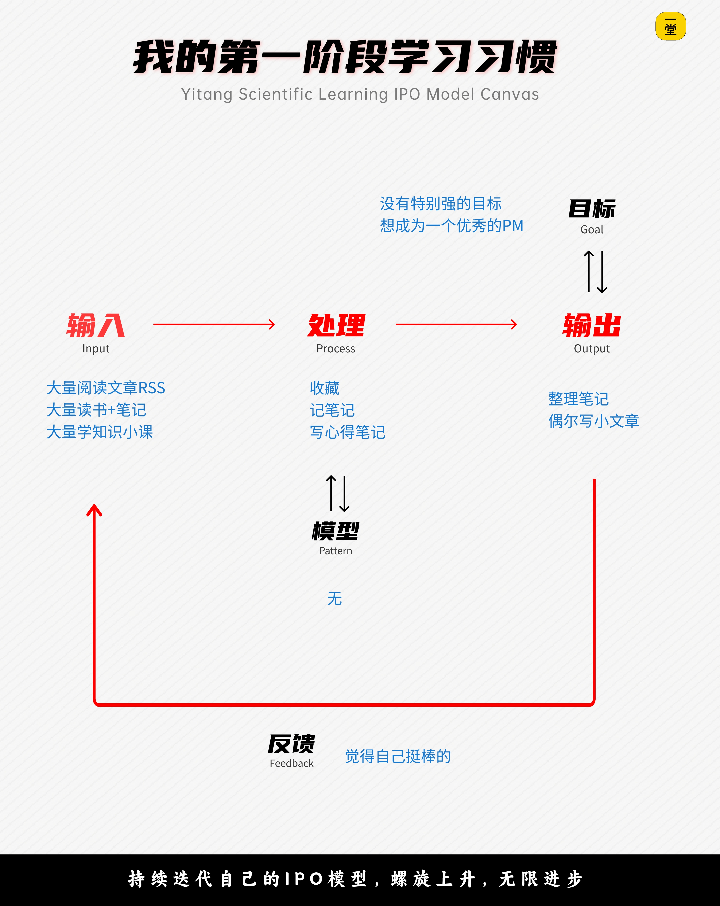

甚至有一段时间，在和高段位的人一起讨论问题，我都很羞于提及我学到的这些理论、概念和金句，我花了大量的时间学习，但是并不能显著提升我和高段位同事平等对话的水平。

当我遇到一个非常具体的难题（做方案/算账/评估可行性），我甚至悲观地发现，我积累了几百万字的知识库，居然连一百个有用的字都没有，甚至一个字都没有。

我第一次明显感觉自己学习能力的飞跃（入门了）大概是到了2016年，我从美团加入以太，加入了一个非常高水平的新业务团队，和一群明显高于我段位的人一起工作，完成了一次蜕变转型。

我忘了是哪一个具体的事件帮我意识到问题，总之2016年这一年，发生了很多让我"意外"的认知：

**契机1：我开始研究Top选手的学习方法。**我试着去收集王兴、埃隆马斯克的学习方法，发现他们都鼓励一种本质的、系统的、第一性的学习方法，而不是碎片的偶遇式的学习。

**契机2：我身边的牛人告诉我可以有体系。**当时我的老板（wyk/我的入行引路人）有一次一起坐地铁，跟我说："我经历了几年，有了知识树体系，终于搭建完整了，基本只有叶子补充和小范围修正，很难推翻了。"

我当时觉得，wocao，吹牛逼呢吧....哈哈，当然几年后，我也大概做到了类似的水平。

**契机3：我开始意识到业务现场学习。**之前把学习就当做读书、阅读，太狭义了，我发现最好的学习模型其实是我自己的做事、身边的聊天和探讨（吵架），这个比读书阅读效率高十倍百倍。

因为这些契机，在2016年，我完成了一次重要的转型和飞跃：

我停下了几乎所有文章阅读和知识付费的学习（保留主动搜索，废掉日常偶遇），开始把80%的精力放在日常工作的复盘、同事讨论，并且开始尝试一种新的笔记类型：**专题笔记。**

我开始在印象笔记里开了一篇笔记《如何讲好一堂课》，我把我各种讲课认知、模型、审美都整理了进去：

那一年，我还开了很多类似的笔记本：
1. 《如何摄影和拍照》
2. 《如何阅读和读书》
3. 《如何拆解一个业务》
4. 《如何讲好一个故事/剧本》

我开始从被动到主动，围绕眼下or未来N年的核心难题，开始建立了一篇又一篇笔记，围绕某一个课题，围绕某一个最佳实践，围绕某一个深度思考，展开了很多深度学习。

我开始避免陷入单纯的"知识收集"的巨大的启发爽感中，开始主动理解知识之间的关系：我做一个教育项目，分析框架和上周聊的O2O项目（比如许鲜）的一致性体现在什么地方？

我开始从关注数量，到关注质量，我开始意识到IPO模型的价值（从一篇国外博客看到这节课的IPO模型理念），我开始意识到，一个底层的模型（树干）比学习100篇小文章（树叶）价值可能还要大。

于是这个阶段，我也开始拼命收集各种底层的模型：精益创业模型，多元思维模型，二八法则，竞争象限模型，壁垒分析模型，单元模型......

大概经历了2年艰苦的转型，我终于再次有了一种学习能力被重启、再次加速的状态，这个阶段，我悟出了我在课上时常跟大家讲的那句话：一个人学习某个课题真正入门的标志，不是学了多少东西，而是形成了对于这个复杂事物最基础、最朴素的框架认识。

因为当一个人的树干形成，大量的碎片叶子才有地方存放，碎片学习才有机会变成体系学习，知识才能产生关联，触类旁通，而不是把自己调试成了一个"**知识碎片收集器**"。

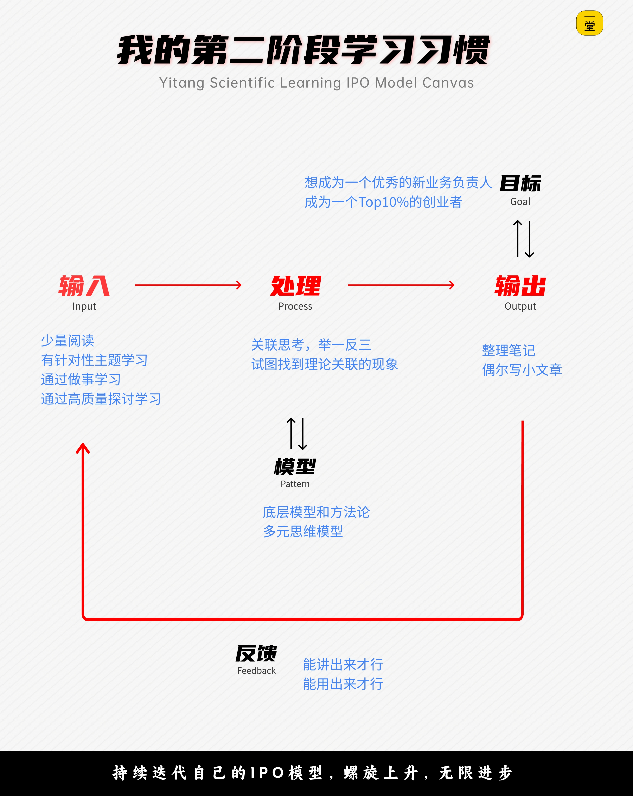

这是我毕业到第五年（2017）的大概水平，学习能力怎么样？

时间到了2018年底，我开始独立牵头，探索"商业管理教育"这个赛道，开始做课了，正是因为有这个基础，后面我才有机会完成了一堂最早的一批课程。

到了2019年，为了做出来最佳实践级别的必修课，我开始试着自己收集大量的案例和经验，来自己动手建模，找到一个稳定的模型（Patten）来解释和指导实践。

于是这个阶段，我总结出了融资六部曲，一堂五步法，调研黑客五步法（OSCAR），精益MVP象限....等等方法论，我试着补齐了一些市场上的模型缺失的问题。

**【抢答🙋🏻‍♀️】**请大家思考一个本质的问题：如何做到Top级别的必修课呢？

————

道理很简单，就是做到行业Top级别的IPO模型（数量/质量），把**准备系数**拉满，如果我处理的数量/质量是同行的5倍，甚至10倍，获得比目前的最佳实践好一倍，很合理、不过分吧？

> 准备系数 = 准备的内容规模/最终交付的内容规模

我开始深刻意识到一个事情：

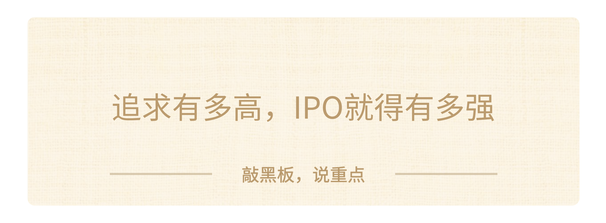

**【案例💡】**我开始刻意用IPO模型做课题研究，发现很香。比如我们做过一节《行业机会预判》的课，我想回答一个核心难题：**如何跳出具体模式和五步法，从行业视角分析变化，预判行业的创业机会点，如何顺势而为？**

市场上正常做课、做一个直播Live怎么做？是不是一两个经典的模型，找一个资深专家/老师/从业者聊一聊就得了？这种方式只会产出中等水平、并不太稀缺的大路货。

而我展开了几周的多轮研究：

- **做了一次全网调研**：非常碎片，大量文章都很短，差异极大。
- **深度访谈周子敬**：收集他过去的创业、投资辅导经验，他的的判断逻辑，一次形成共识。
- **访谈全球最佳实践**：给麦肯锡人讲一遍，然后访谈他们的框架，二次形成共识。
- **进行交叉验证/补充**：给贝恩的人讲一遍，然后交叉验证，三次形成共识。
- **做成内测课**：邀请几百人同学内测，收集作业和NPS，四次达成共识。

> 说明：真实的版本比这个还要复杂得多，我简化了一些流程。

经历了大概3周的工作，我做出了一套应该是市场上最完备、最体系的行业机会分析框架（来自麦肯锡的评价）：行业预判AB模型+行业分析画布，可以用来指导一系列的行业级别的趋势分析工作。

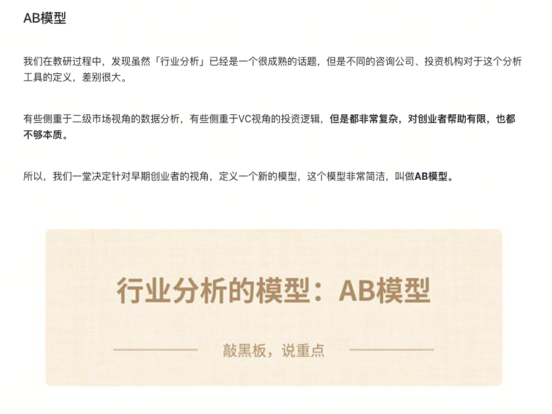

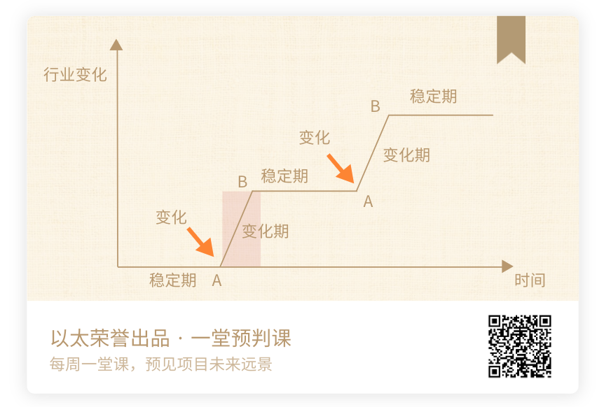

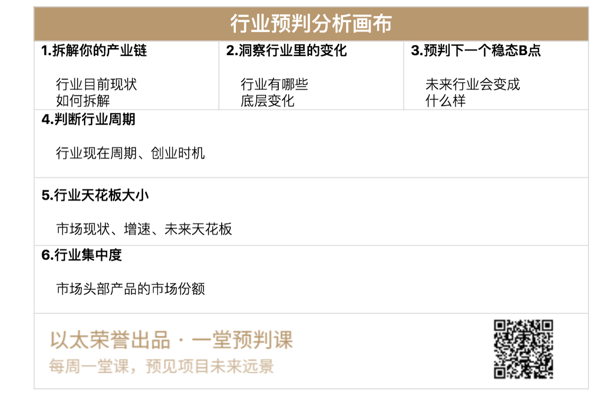

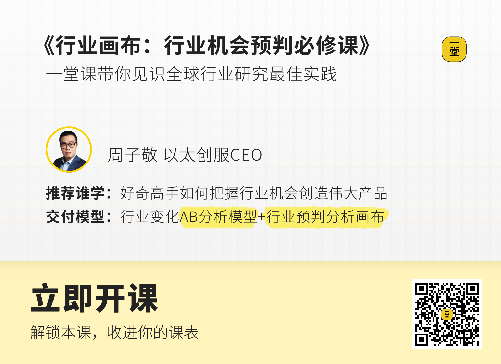

这个阶段，因为开始建模，我开始逐步养成了强迫症式的思维习惯：**MECE（不重不漏）。**

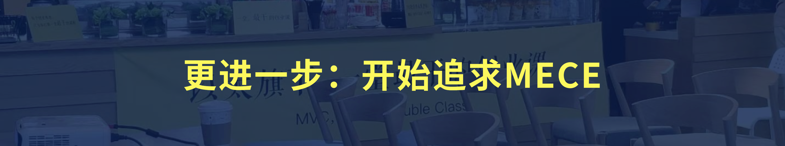

MECE（Mutually Exclusive Collectively Exhaustive）的解释是彼此独立，完全穷尽，对于一个复杂事物，试着结构化和建模，形成一个MECE的状态。

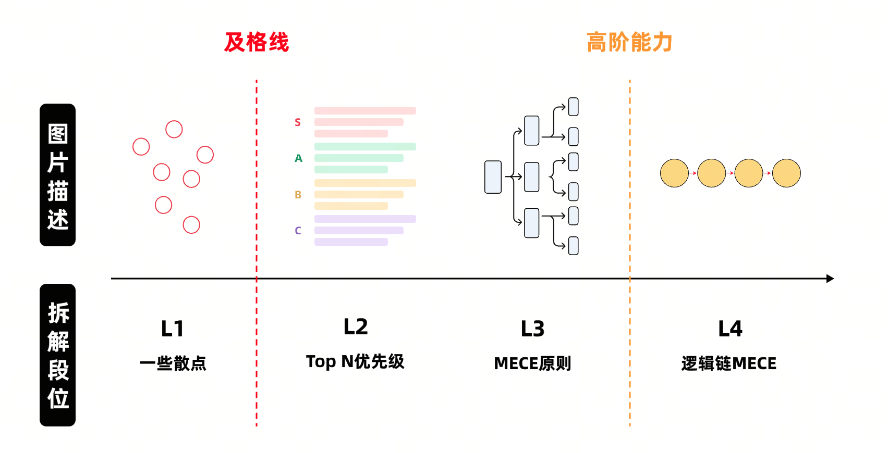

**【抢答🙋🏻‍♀️】**把一个复杂难题整理成MECE，最大的好处是什么？

————

来一堂Gap的C同学（麦肯锡专家）给过一个非常棒的解释：**建立一个充分稳定的结构，未来就算加入再多信息（Input），模型也可以基本稳定，不再轻易变了，这样更方便思考、协作、做出来高水平的决策。**

这个阶段，我大概以一己之力，每3-5周，可以研发一套方法论的创新课程，而且试着开始追求总结本质（概率游戏/融资本质/假设驱动本质/精益本质），试着构建一个树干之下的统一树根，保持整个课程体系的极度稳定和健壮。

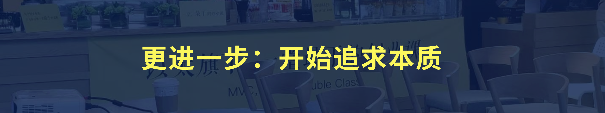

只要想清楚了本质，整个认知体系就会非常稳定，极度健壮。

我开始意识到一个事情：树根（本质），树干（方法论/模型/框架），树叶（案例/现象/技巧），才是一个足够完整的思考结构。

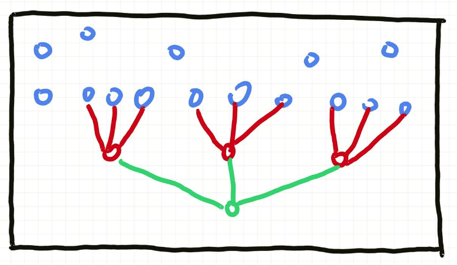

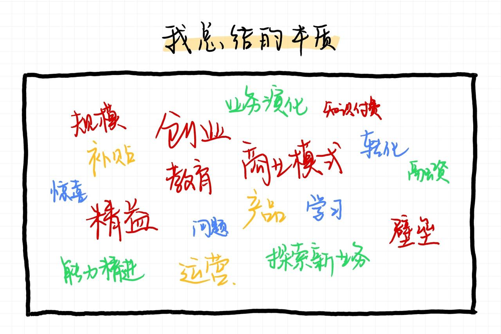

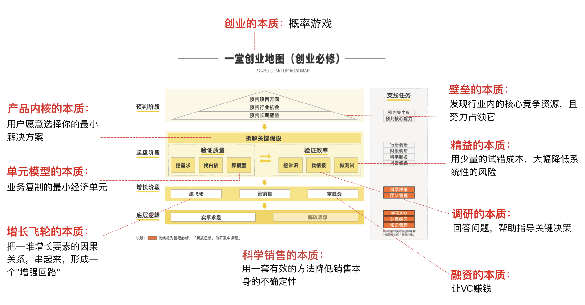

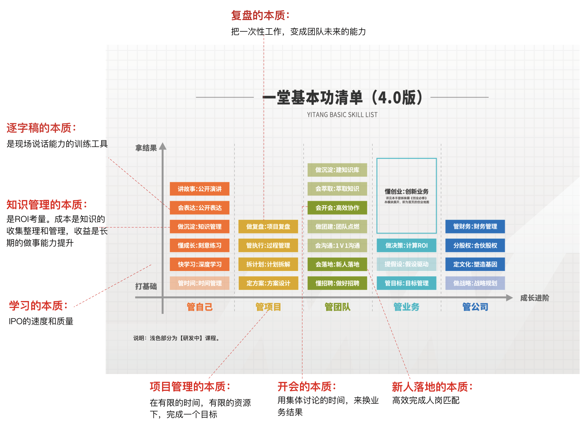

这些年，我们试着总结了很多复杂事物具有指导预测意义的本质定义。

**【往事💡】**甚至我和子敬私下聊过，我们对于提炼本质的工作扎实程度还是很有信心的，我们花了大量的资源和心力。哈哈，如果有谁能推翻or显著修正我们的定义，我们给5万奖金吧（没有真的实行hh）。

不过我们衡量了一下ROI，发现不太可行；提炼本质太难了，难点在于，多数人都不知道自己提炼的东西不够好，这会给我们增加大量无意义的评审和说服成本。

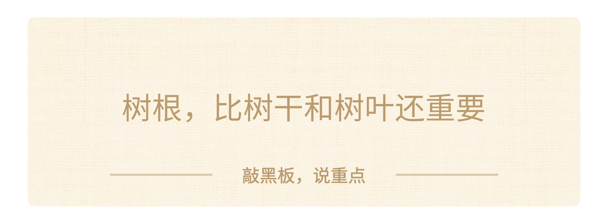

这个阶段，我开始自力更生，总结出了很多的树干甚至树根：

而且大量的课题，我开始拿一堂"试药"，比如一堂五步法，调研精益，产品内核，解放思想，我开始不满足于"解释清楚"、"专家共识"，我要自己动手测试模型好用，才算作罢。

时间到了2021年，靠我一个人做课太慢了，我们开始跑会员模型、做增长，于是我招募了一个教研团队，开始用团队分工的方式来做课。

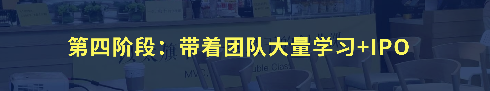

我用IPO的方式，开始分解任务提炼基本功，把一个课题分解成10个小的IPO过程，开始用项目管理+多轮分工的方式，一起完成IPO的过程。

这个阶段，我定了一个看上去不可能完成的目标（Goal）：**在课程质量不显著下滑的情况，从每月一节课，做到每周一节课，甚至极限情况，能够做到每周2-3节课的研发（老课升级&案例课&探索营课&线下课）。**

这个级别的研究工作，国外未知，但在国内的商业公司里，应该没人达到过。

**【抢答🙋🏻‍♀️】**哈哈，请大家思考一个本质的问题：如何有机会带领团队，有机会做到呢？

————

答案是：无他，迎难而上，继续升级IPO模型。

我开始做了几个新的工作：

**工作1：按照IPO模型，把做课过程拆成N个基本功。**

我按照IPO的环节，把一堂的教研拆成了十几个基本动作，比如：**全网调研，专题调研，专家访谈，Truman辅导，GONGJIAN内测，交叉互讲.....等等**

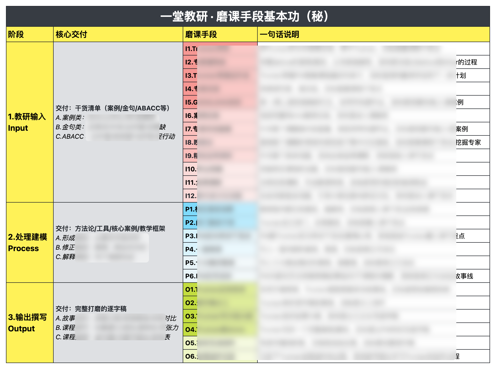

**工作2：拆成基本功，起名字，鼓励团队持续练习。**用基本功的思路，拆解成固定的动作（起名/场景/方法/Case/练习方法），然后开始鼓励团队自动分工，一遍遍大量重复，把能力练出来。

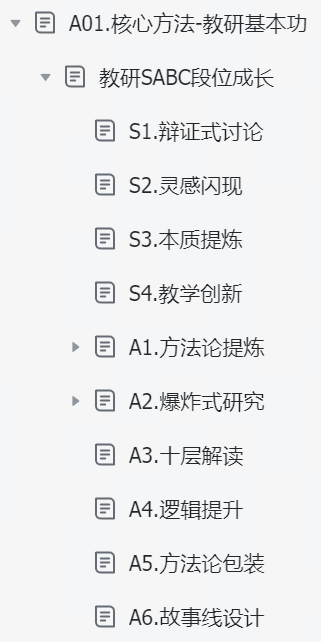

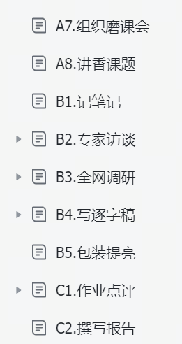

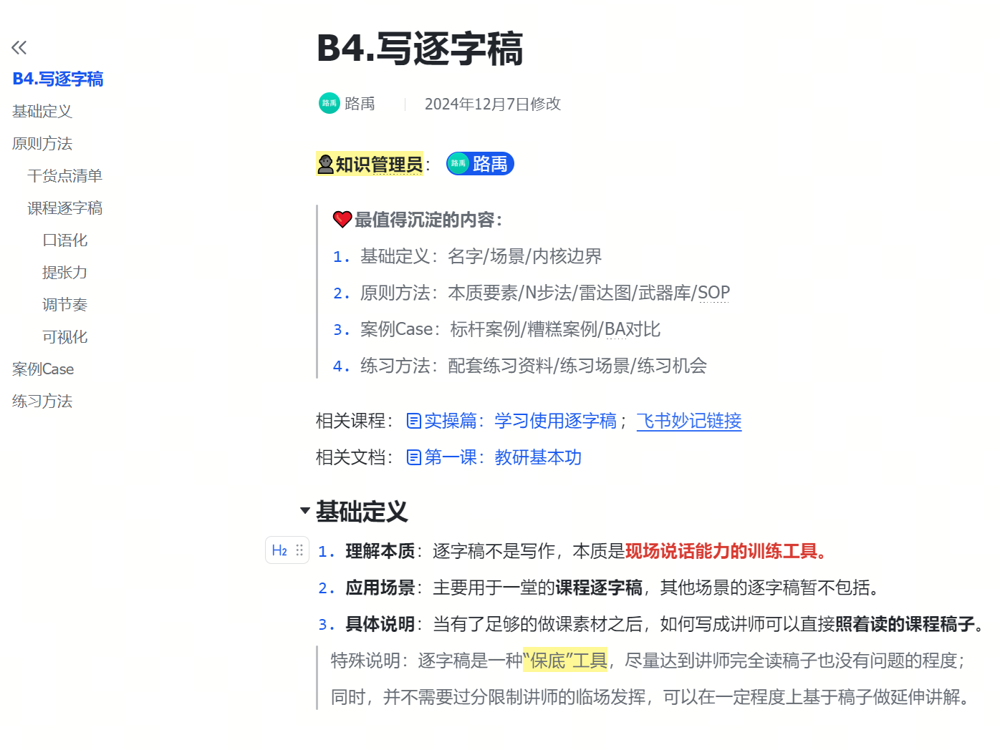

**工作3：每周复盘，不断提升审美+迭代基本功。**每周对上周的课，进行2个小时的复盘，复盘做课过程、时间分配、成败得失，总结新的IPO假设和手段。

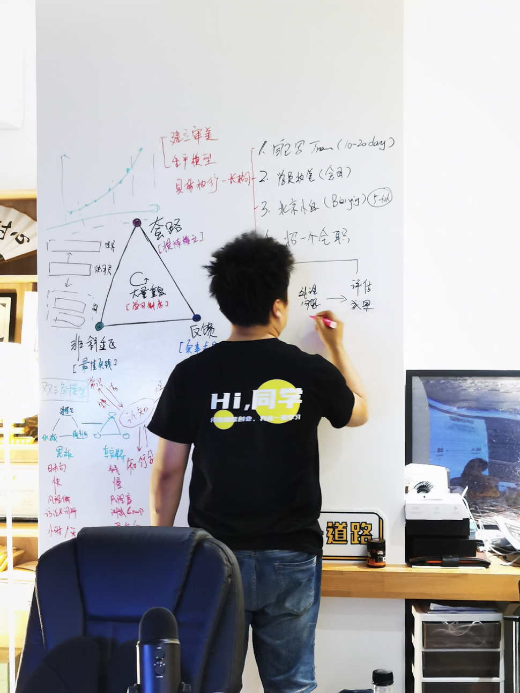

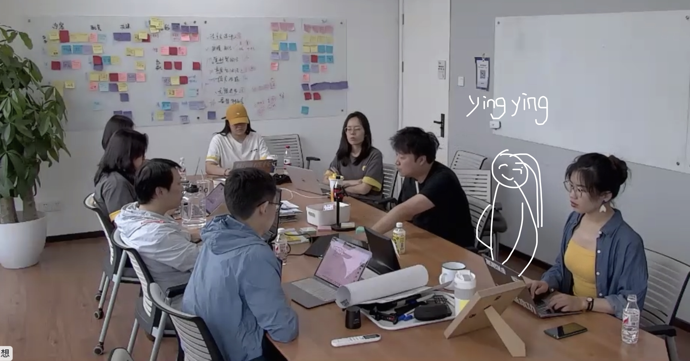

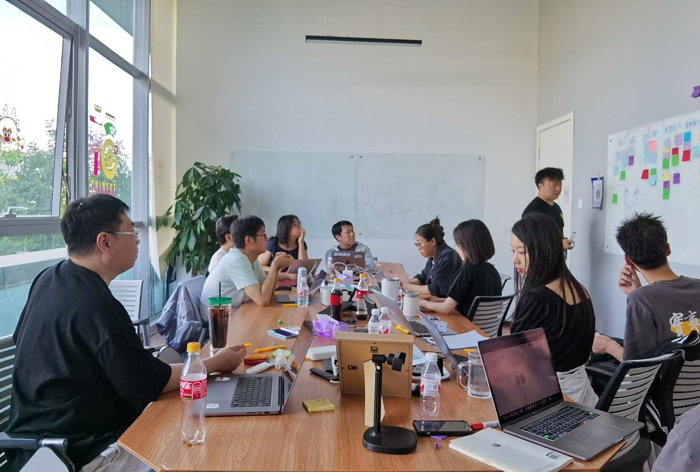

经历过大概2年的加速迭代（2022-2024），我们基本实现了每周稳定一节课的水平，甚至极限情况下，可以做到每周两节课的水平（增长+毛选；案例课+线下课等等），而且课程的深度、体系、工具价值还获得显著提升。

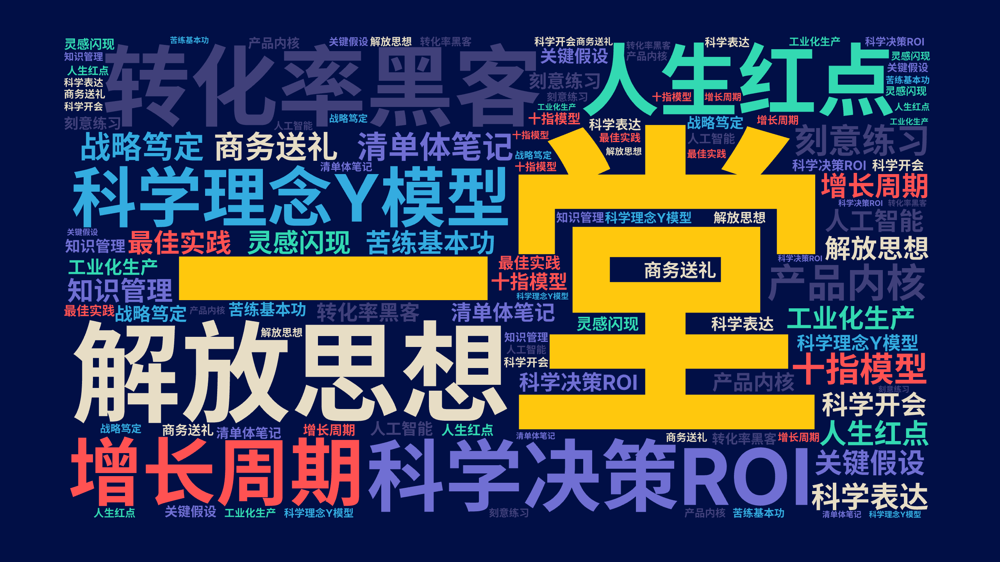

每周平均我们会阅读大概两三百万字的素材（Input），阅读上千篇作业（Input），看几十上百个案例（Input，搞砸/最佳实践），做5-10轮专家访谈（IPO），开5-10场磨课会（P＆O），写1-2万字的正式课程（Output）。

我们这两年，还"创造性"地提出了一些新的IPO学习方法：灵感闪现，爆炸式研究，十层解读，审美拉升会、十万美金小抄、模拟辅导等等。

所以我们能做出很多很底层的、跨越领域的实操方法论。在磨课过程中，屠玉峰大哥说了一句话：**后来我才意识到，一堂的课是操作系统。**

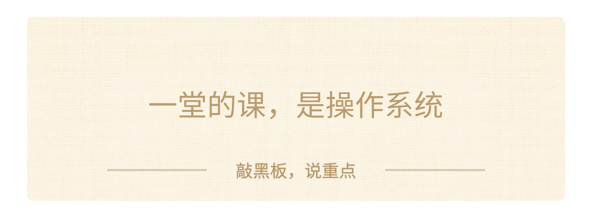

哈哈，这就是我为什么在内部经常开玩笑讲：从某个角度讲，一堂同学付费的价值本质，就是每年花一点点钱，买了一个顶级的研究团队为自己服务，给自己做研究海量案例和素材，输出高价值模型。

甚至2024年底，我们还大着胆子把一堂最核心的研究能力以探索营的方式，给MBA的同学做了两节私密分享课：

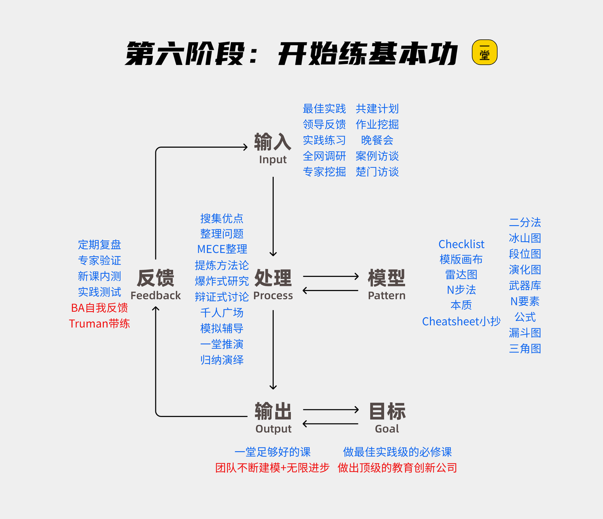

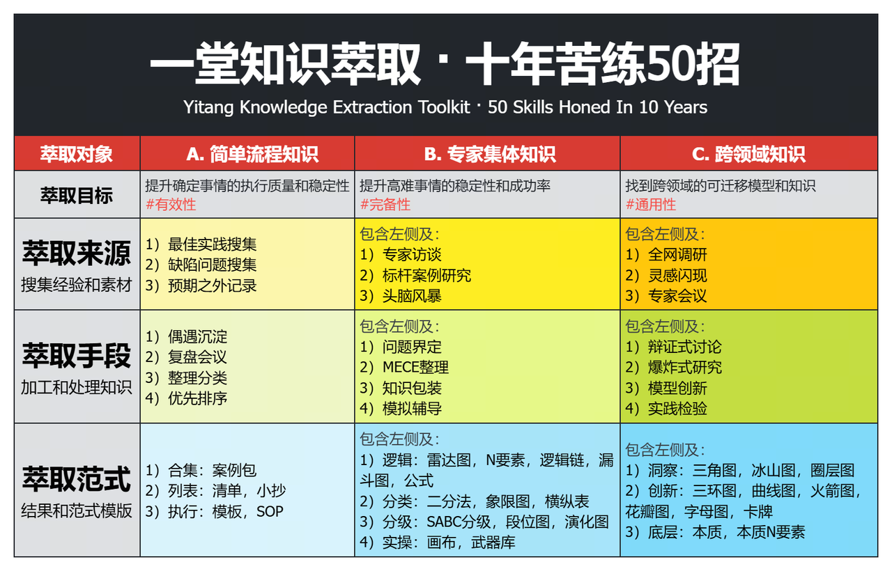

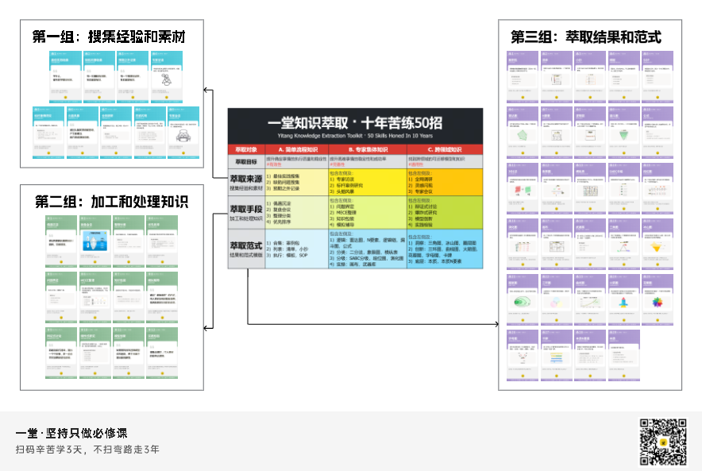

> 解释：作为一堂最大的一张牌和短期核心壁垒，考虑到竞争和系统性风险，目前仅私密分享，下一个里程碑（3w3w800w）后可能会做成基础必修课，希望大家理解，敬请期待。

ok，第一个案例复盘开源完了，这就是我这十几年的四次质变式的飞跃，大家感受到了什么？

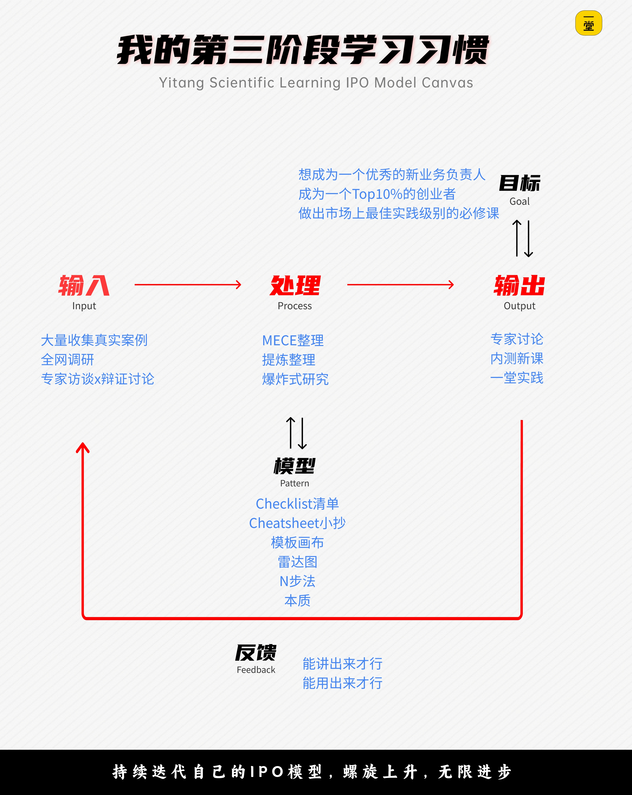

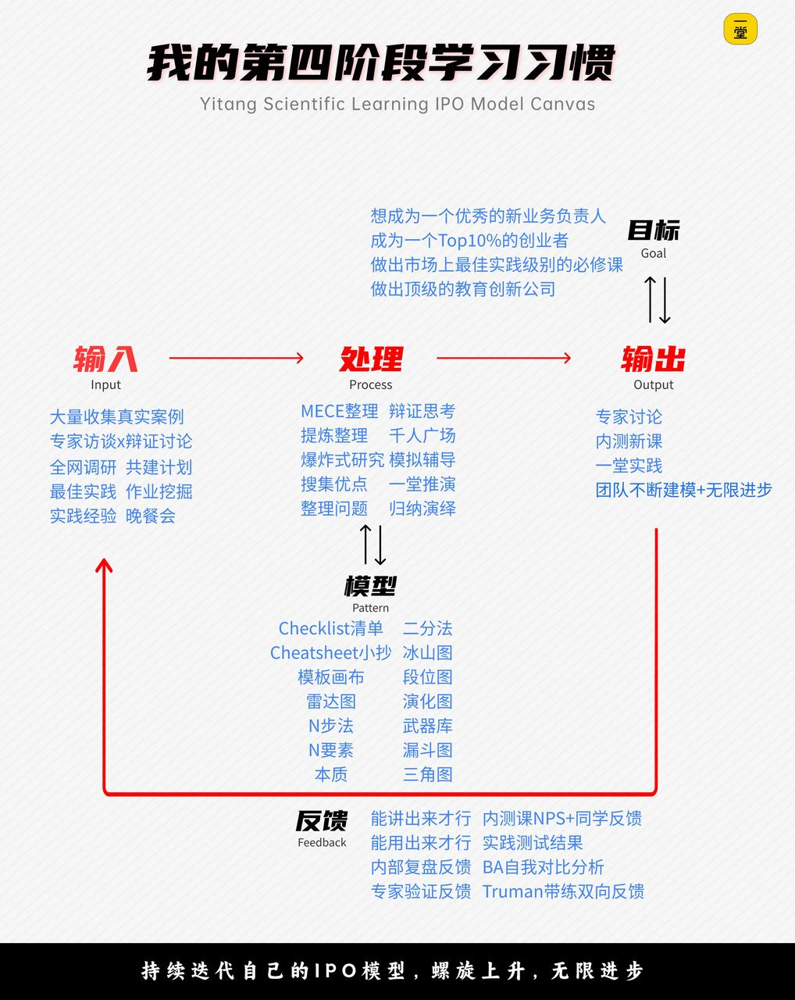

第二个，我来讲一个同学的学习案例，大家感受一下学习者视角的IPO过程。