### 案例2：杜金科的学习三阶段

杜金科是一堂的MBA学员，用一堂的方法论在新起盘的业务上拿到了非常好的结果。不到2年时间，在全国开了上千家自助棋牌室。

之前讲过一节3小时的落地之夜大案例课，复盘了自己的起盘过程。很多同学听完都赞叹同样在一堂学习，为什么他可以拿到这么好的业务结果，很好奇他到底是怎么进行创业学习的。

评论区收到了大量好评，各种：聪明、精彩、真牛、感动、震撼...

所以为了做这节课，我们的教研团队也对他做了一次访谈，他的学习也经过了三个大的阶段：

因为家庭原因，杜金科没有读大学，很早就进入社会工作。也因为行动力强，足够勤奋，所以被百度、阿里破格录取，一直在做销售工作。

相对于身边的同事，他虽然学历没有优势，但**对工作钻研的劲儿却是最足的**。

他希望通过各种努力学习，来解决工作中遇到的销售难题：
1. **自己总结：**创下无人能及的拜访记录，每天都坚持复盘经验和问题；
2. **借鉴同行：**逆向拆解同行的沟通话术，尝试补充自己的话术和技巧；
3. **听课读书：**看到和销售相关的材料和课程，也会收藏或者简单写写笔记。

是不是和很多人的职场早期一样？你们的学习效果怎么样？

————

这种学习状态给他带来的**最大的困扰**就是：

为了解决眼下具体的难题，但是很多时候问题很个性化，自己摸索的经验复盘相对适用性更强，但其他各种途径找到的**技巧都很碎**，直接套用十有八九技巧都**起不到任何作用**。

这种状态一直持续了很长时间，直到后来杜金科开始自己的第一段创业，做酒店情趣用品自助盒子这个业务，虽然担任的是CEO，但是百人团队中八成都是销售，**更多有效的学习方式还是靠自己摸索的经验复盘**。

用IPO模型来总结一下这个阶段：

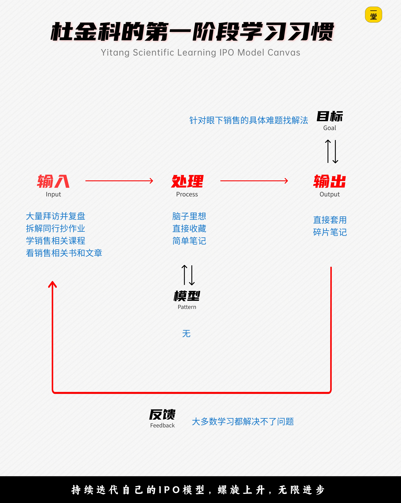

后来因为股权的原因，杜金科退出了第一段创业，也是在这个时间点的前后，之前在阿里的老领导给他推荐了一堂的课程。

因为那个时候时间也比较多，所以抱着试一试的心态就听了一堂的复盘营。结果意外的发现一堂的课程：
1. **问题驱动：**这个特性很符合自己一直以来问题驱动的学习需求
2. **更加体系：**和教技巧的课不一样，视角更高维，方法更底层，适用性更宽

于是在复盘营之后就成为了一堂的会员，也是在这个时候，他的学习进入了第二个阶段：

因为刚退出上一段创业的末期，这个阶段杜金科有非常充足的时间来学习。

又因为从来没有见过一堂这样的课程，所以每一节课都觉得是醍醐灌顶，重塑认知，所以每周的课，只要没有特别的安排，都一定会按时坐在电脑前来听。

而且基本上听完之后，都会写个三五百字的心得体会。有的时候，还忍不住想要把自己听到的好课，转述给身边的人。

访谈的时候，他讲了一个插曲，自当年学了第一版IPO课程之后，真的是打开了自己学习的思路，发现可以学习内容太多了：原来以为只有复盘，读书，听课，但其实还可以**学最佳实践和失败案例、可以做专家访谈，甚至可以穷尽各种手段调研。**

他还翻出了一个自己当时大为震撼之后，为了给别人做分享，自己做的一个ppt，里面还复盘了自己的学习过程。

访谈的时候，杜金科说，这个阶段的学习，因为不是疲于应对眼下的难题，把学习的视角从眼下3个月，拉长到了未来5-10年，反而让自己立刻有了**系统升级**的感觉。

因为一堂一直在讲长期价值，讲长期主义，讲苦练基本功，而他自己又一直坚信，自己始终还是要创业的，这些课程和背后的能力，**自己迟早会用得到**。

再来用IPO模型来总结一下这个阶段：

在加入一堂之后没多久，新的创业机会来了。

有个做过30+年传统线下门店生意的朋友找到了他，向杜金科推荐了**自助棋牌室**这个项目。

那个朋友无意中在网上发现了这个项目，觉得很有意思，就从网上买了一套系统+硬件，尝试开了一家店，发现省心省力，经营数据也不错。

朋友的判断是，这个项目可能是个机会，但是苦于自己没有技术，不会招商，没有运营，而杜金科过去的创业经历刚好弥补了这个短板，所以就天天找他，想拉他合伙。

这个时候，杜金科发现一堂学的课**终于有了用武之地**，就开始把前一段时间学的**行业预判、五步法、调研精益等等**，一股脑儿的用在了这个项目上，经过一轮轮的调研测试，对这个项目的信心也逐步笃定。

最终投入了新的创业，同时也开启了他第三阶段的创业学习：

由于开启了新的业务，需要大量的时间在业务一线，来处理业务中具体的问题，杜金科很难坚持每周五都来听课了。

但是作为一个创业者，他又一直记得一堂课上的一句话，**创始人的认知决定了团队和业务的天花板**，所以学习这件事又不能停。

为了用有限的时间充分学习，他开始**重新构建IPO学习模型**。

前面说了，一堂的课让他意识到除了复盘和读书听课，其实还有很多学习方式。所以，虽然没有时间每周五听课，**但一堂是一个巨大的宝库，用好各种资源，都是很好的输入源。**

他的学习输入**不仅仅局限于每周五的直播课**了：
1. **学有需要的课：**针对自己长期的能力短板和业务眼下难题，有选择的听课
2. **学最佳实践课：**学一堂自己和同学中的最佳实践，代入加深理解一堂模型
3. **参加线下活动：**案例课让他发现同学有很多高手，线下活动可以建立链接
4. **跟身边牛人学：**通过一堂认识了古董、屠玉峰、大表哥、田红玲等高手
5. **跨界专家访谈：**一堂的课教会他如何寻找和鉴别专家，通过他们拿答案
6. **学其他的理论：**有选择地听和业务相关的资料作为输入源补充视角

同时，一向习惯学了就要用的他，因为新的创业，对课程**有了更深度地处理**：
1. **更多关联业务：**不再是简单的心得体会，也会代入业务场景做复盘或推演
2. **更深度的思考：**开始尝试做专题的清单体笔记，做个人的知识管理

访谈的时候杜金科说，虽然忙，但是很多输出也还是非常必要的，所以他会抓住可以输出的机会。

> 比如，他会给身边人讲，在学完动力阻力触点，会给自己的老婆拆解直播间话术；

> 比如，他会带着团队学，自己听完课，自己还会给团队再反复宣讲课程的要点；

> 比如，他在一堂线下讲，不管是MBA的线下活动，还是城市中心的活动，只要有机会就会站上讲台……

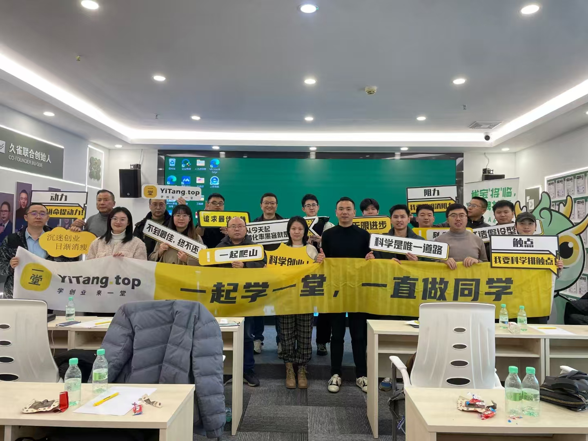

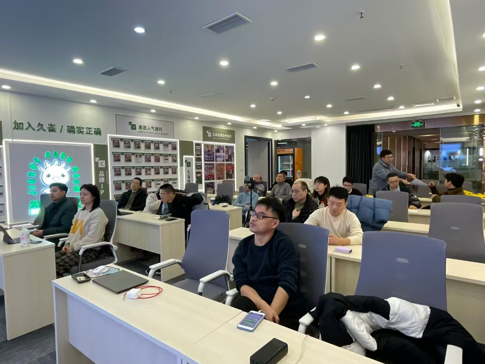

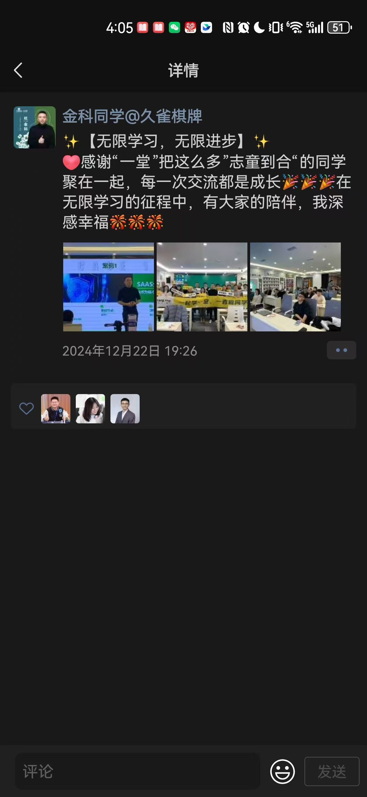

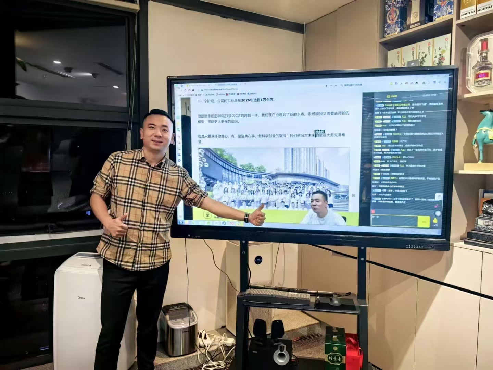

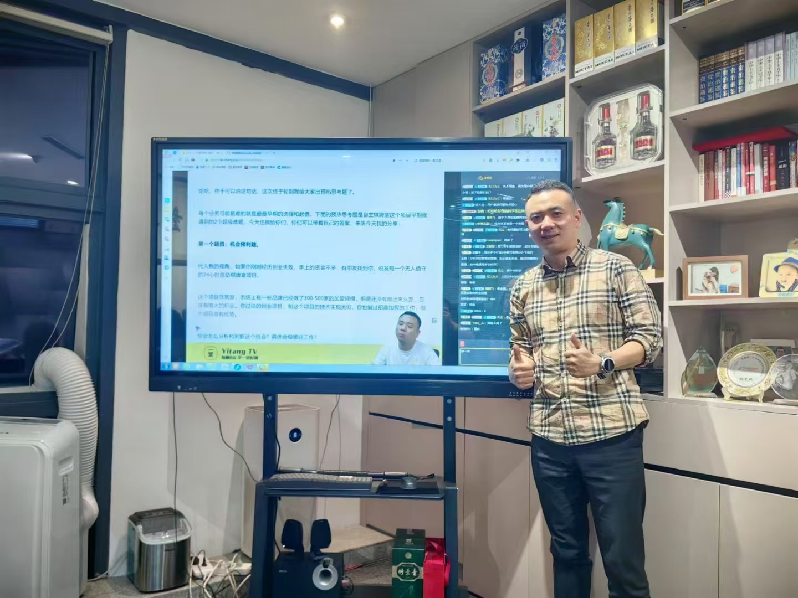

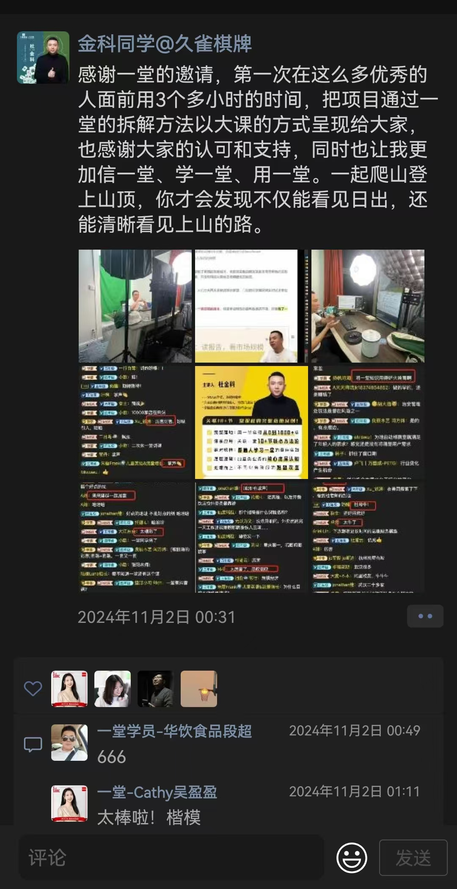

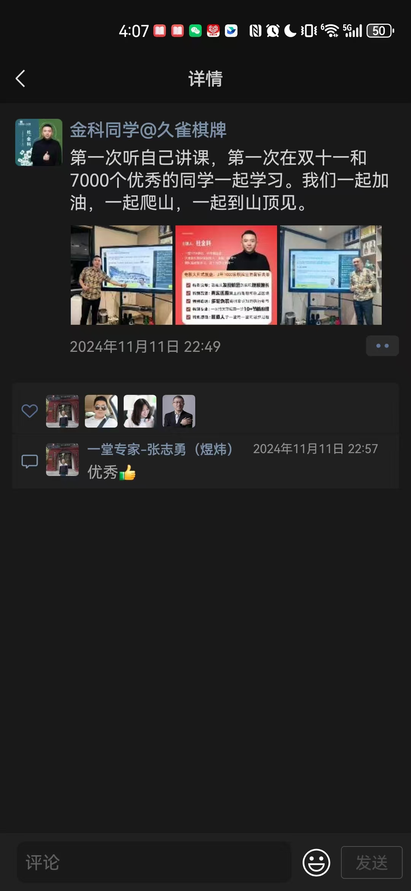

当然，**最深度的输出，就是在真实的业务中去应用一堂的方法**，比如在具体决策的时候用ROI，提升员工积极性，谈加盟商代理商用动力阻力触点等等。

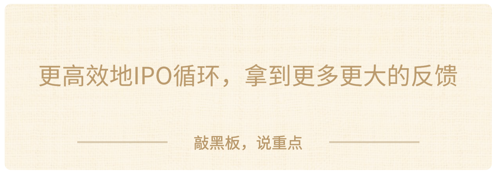

也是因为持续循环迭代的IPO模型，让他得到了非常多的业务正反馈，也拿到了站上一堂讲台，和大家一起分享自己案例的机会，让更多的人认识了他，和更多更优秀的一堂同学建立了链接。

再来用IPO模型来总结一下这个阶段：

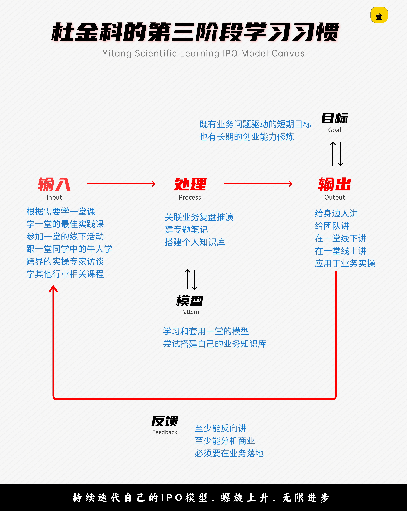

好啦，杜金科的案例我也讲完了，这就是他这些年IPO模型的三次升级，大家感受每次升级带来的变化了吗？

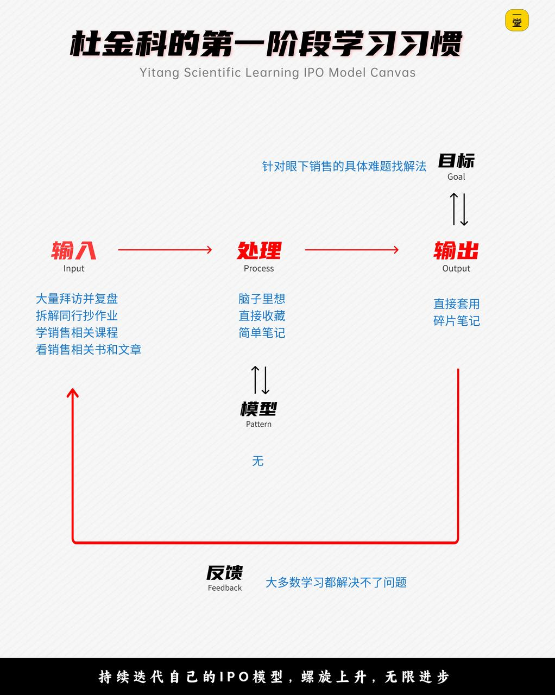

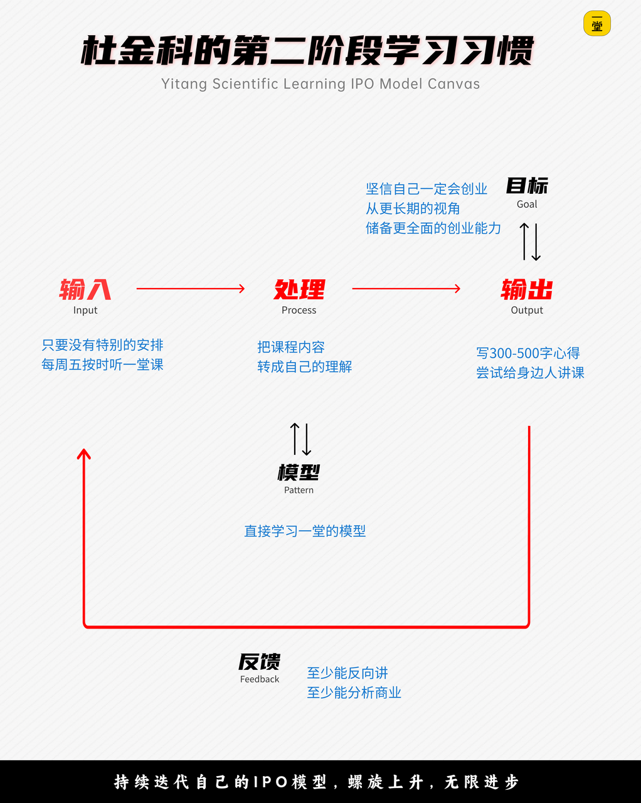

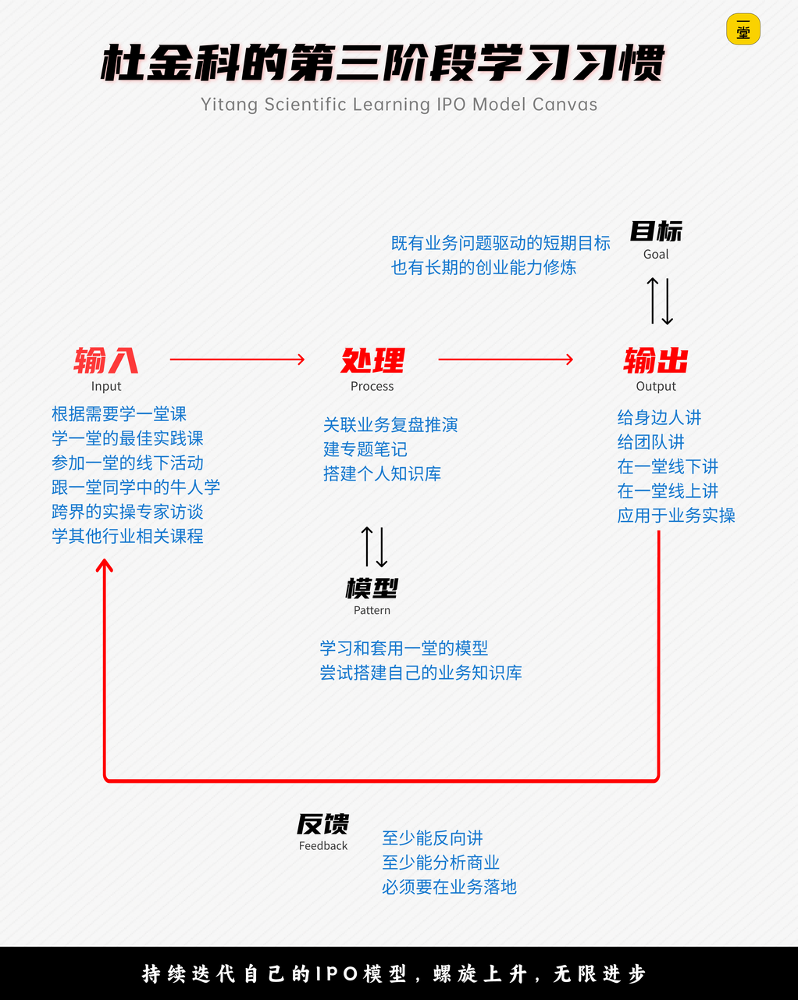

我们再来看看更多同学的案例。