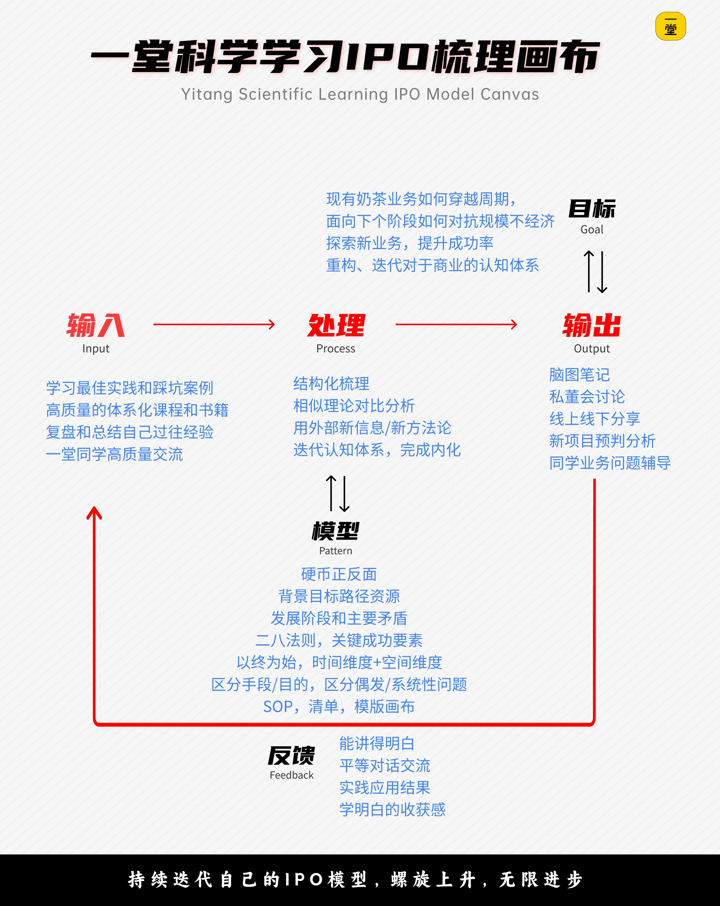
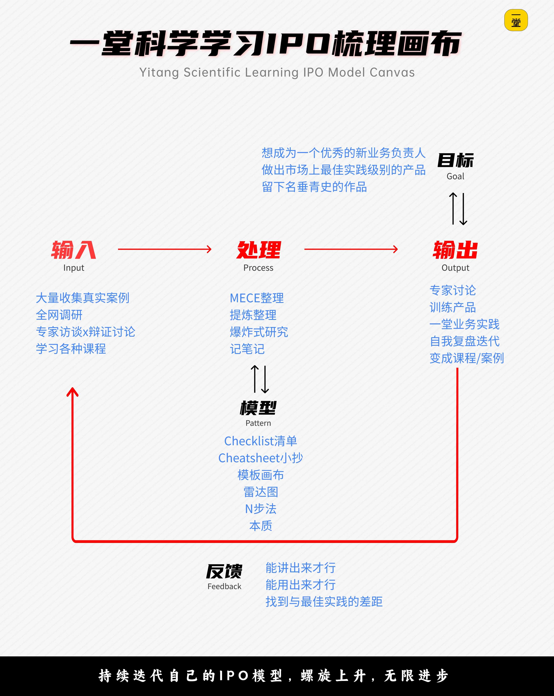
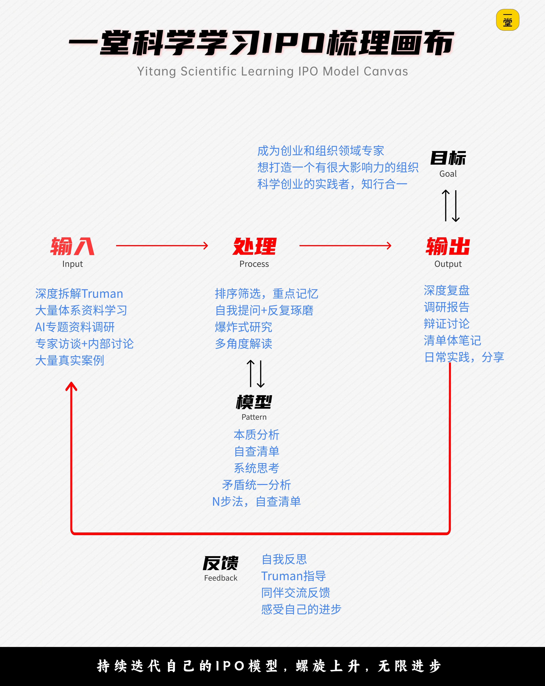
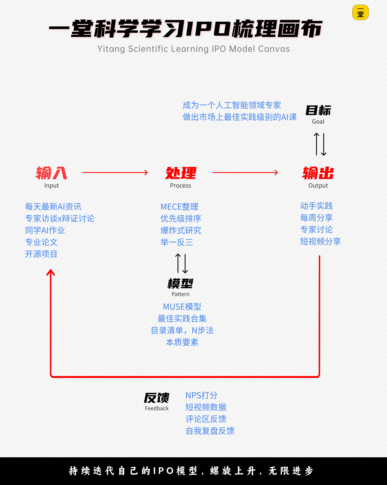
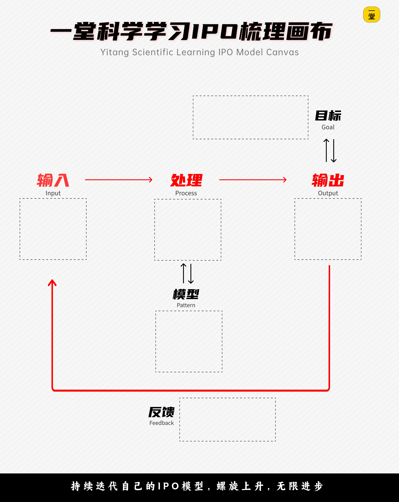

### 更多同学的案例

再来看看一堂的老朋友，古董的案例，古董之前在一堂**讲过6节**特别精彩的案例课，下面是他的一些更详细的介绍~
> 1. **连锁经营专家**，2013年下场创业做连锁奶茶店业务，用了7年半的时间开了100+家直营门店，营收过亿。
> 2. **资深HR背景**，负责过2家美资500强公司中国区的招聘业务，并担任过中国首家A股上市的人力资源服务公司的运营总监。
> 3. **一堂MBA学员**，私董会NPC，2022年3月加入一堂，目前学分1853，合伙人指数4420，也是**一堂山东学习中心**的主理人。
> 4. **一堂课程讲师**，我在一堂超过10次分享，包括6次周五内测课、4次开放麦、1次问诊会，合计超过20小时。
> 5. **一堂GAP同学**，2023年底2024年初在一堂GAP了100天，之后随机出现在一堂办公室参与磨课。

同时，古董也是一名很善于深度学习的创业者，每年学习时间都要**超过1000小时**，我们也来看看他的IPO画布会长成什么样子：

这是经过几年的不断深入打磨，拿到的一个高水平的IPO模型，这个模型决定了他的学习和解决新问题的速度。

还有屠玉峰大哥，他也是很多一堂同学很熟悉和喜爱的师兄，帮过很多同学开私董会，还协助很多一堂同学从0-1的业务起盘。下面是一些更详细的介绍~
> 1. **业务操盘**：国内水处理**龙头企业高级VP**，厦大本科中文系毕业，公司里几乎所有岗位的技能都具备，如研发、生产、人事、IT、财务、营销……
> 2. **一堂身份：目前学分1196，**一年内就已经突破**1000学分**；一堂私董会幕僚天团成员；做过几百场私董会幕僚
> 3. **跨界能力**：心理学、编程、写数据库、直播OBS推流、AI本地部署……，各种跨界技能短期快速上手

屠玉峰也是学习高手，特别善于学习，尤其是很多跨行业，**跨界技能能够快速上手**，并能达到**相对专业**的水平，甚至给业务专家提新假设。

在一堂学习的过程中，也跨领域帮助了很多同学的成长，下面就是他的IPO画布：

哈哈，磨课的过程中，也让一堂内部的教研同学们写了一下自己的IPO画布，持续迭代，无限进步：

### 再看一遍模型

怎么样，大家体会到IPO的价值了么？大家体会到一个足够抽象的底层模型，对于人的核心能力塑造的巨大的决定性影响了么？

我试着给给大家升级一个工具，大家可以不断用来反思和梳理，定期整理，定期升级：

大家体会下，这就是开始我说的那句话：**学习能力的提升，就是IPO模型的提升。**

对比上面的几个相对成熟的IPO模型，如果视作**85分勉强优秀**的话，你们过去的IPO速度和质量可以打多少分？有多大的提升空间？哪个环节最欠缺？