## 深度理解：什么是科学学习

看完了案例，我们来深入理解一下IPO背后的逻辑和模型，大家体会到了什么？为什么IPO如此重要？

### 第一层理解：正确姿势

我先问大家一个直接的问题：**IPO模型每个要素重要吗？必要吗？是必经之路吗？**

————

答案是具体问题具体分析，看你的长期追求和对自己的要求。

如果你对自己长期要求很高，想持续面对新问题，解决新问题，持续突破自己，解决一些新的难题，那么每一个要素都是重要的必不可少的。

**第一种情况：如果输入太差**，会导致你没见识，没有高质量的信息输入。

我们经常说，你读什么书，就会变成什么人；换一个更严谨的说法：

> 你输入什么信息，就会变成什么人。

如果你从来没有重视过你的信息输入源，遇到什么学什么，刷到什么学什么，别人推荐什么学什么，什么容易学就学什么，那么长期你的学习质量一定不会太高。

再或者，可能你会有一种很朴素的认识：平时太忙了啊，我的学习时间太少了，我看书、听课时间太少了，自己不够自驱，不够自律，花在学习上的时间太少了。

**【调研🙋🏻‍♀️】**大家有过这种焦虑和痛苦吗？我们该怎么理解输入？

——————

如果说我为什么喜欢IPO，因为你不必在乎读不读书，听不听课，这些本质上都只是信息输入手段而已。而你在每一天，你看到的广告牌，开过的会，看过的电影，见过的人，聊过的天，都是你的学习输入源。

而且如果你真的善于学习的话，你会发现，很多时候，你看一场电影，聊一次天，做一次深度的辩证讨论，比你读书听课学习有用太多了。

有一次周末我陪家人遛娃，实在有点无所事事，无聊且困顿，于是我突然想：我试试找到一堂长期追求和故宫博物院的10个共性，然后.......**学习一念起，顿觉天地宽**，我度过了一个快乐充实的下午。

> 共性解读角度参考：产品内核，品牌壁垒，体验地图，规模经济，百年基业长青，周边设计...

这几年我回顾，我学习最多的竟然不是在书本里，而是我看到的新闻，路边碰到的广告牌，旁听过的周会，看过的最佳实践电影，这些对我的启发可能价值更大。

> 解释：刚好对应我的几种常见习惯积累，即"深度思考笔记"，"内化笔记"，"手绘建模"，"偶遇备忘"，"截图备忘"。

只要你没睡觉，所有的时间都会有大量的信息涌向你，这些信息，都是你的学习材料啊。为了让大家更好理解记忆，我试着起了一个很洋气的名字：

不管是案例，还是刷短视频，看书听课还是聊天，还是自己做事开会，本质上都是在做信息输入，都可以作为你大脑加工处理的素材。

**第二种情况：如果处理太差**，大量信息涌向你，如果你只是过一遍脑子or收藏，那么很难进步。

如果你没有一定之规，没有构建起属于你的思考结构和体系，当数以千计万计的内容、文章、碎片观点涌向你的话，你会完全消化不良，这时候学的越多，你的做事水平可能越差。

我们不能只是一个存储器，或者一个收藏夹，大量信息来了，只是备忘一下，只是过一遍脑子就过去了，我们要尝试消化和处理，把这些信息和已有的知识结合。

两年前，我面试一个高潜力的员工（MBA学员），大厂背景，业务结果还不错，但是成长一直感觉不够满意，成长速度卡卡的，很热爱学习，大量上下班听某同行知识小课，很自律，同时也努力完成每一个项目的任务。

聊了大概10分钟，我就发现他的卡点所在了，我问了他三个问题：
1. 你做了这么久投放，好的投放渠道选择的3-5个维度是什么？底层逻辑是什么？
2. xx理论和xx理念，这两个方法的区别和使用场景是什么？
3. 你学了这么多东西，举1-3个真实的带到工作场景，有所提升并且解决问题的案例吧。

这三个问题他瞬间就蒙了，这些年往脑子里，往书架上灌了大量的信息和知识，但是这个最重要也最基本的信息，竟然都没有认真花时间想过。

这就是一个非常典型的，输入>>>>>处理，类似我的第一阶段，消化不良的典型情况。

希望大家理解，**真正导致人和人真正差异的，往往不是知识的数量，而是知识之间的联系。**

**我看到了一个理论**：这个理论可以用来解释哪些现象？解决哪些问题？能找出3-5个吗？

**我看到了一个现象**：这个现象可以用哪些逻辑和理论解释？可以解读出3-5层吗？

当你有了100个已有的知识，当你增长一个新知识，如果你善于构建联系的话，你可能增加的不是一个知识，而是五十、一百个知识，如果能善于和他们构建联系的话。

你的进步将不是一个点一个点的进步，而是一片一片的进步。

这里最好的学习策略，是埃隆马斯克一直推崇的学习方法：

不断构建知识之间的联系，并且把某一个课题的知识，串成一个体系和树，甚至鼓励找到最底层的"第一性原理"，这样才能形成系统、稳定的知识结构。

举个例子：

- **树干**：编程的核心原理（如变量、函数、循环、条件判断）。
- **树枝**：具体的编程语言（如Python、Java）或应用领域（如网页开发、数据分析）。
- **树叶**：具体的语法规则、库的使用、项目实践。

再举个例子：

- **树根**：概率游戏，假设思维。
- **树干**：一堂五步法（里程碑模型）。
- **树枝**：具体的分析方法，产品内核，单元模型等等。
- **树叶**：各种搞砸案例，热点新闻，小技巧，商业现象。

一旦你形成稳定的思考结构，那么你的决策质量和速度，都会飞速提升。

**第三种情况，就是输出太差**，学了一大堆，想了一大堆，仅仅在脑子里，没有闭环。

是不是记住了，真正理解了？是不是理解清楚了使用场景和边界？是不是真的会用了？主观上以为自己会了，但实际上，可能完全不会。

好的输出会倒逼输入，会验证处理，会不断增加反馈和正向激励，让自己越学越快。

具体该怎么学呢？有一个经典的学习方式：**费曼学习法。**

什么意思呢：

> 总结四个字，叫做："**以教促学**"

> 总结一句话：用给别人讲，来提升学习效果。

如果真正懂一件事了，应该能用大白话，让对方听明白。

需要简化，简要简单直白，需要降低难度讲给对方听。

从浅到深，从被动学习到主动学习，从学习到吸收到实践，一次深度学习相当于10次浅层学习，同样的时间，深度的输出带来的结果，可能是浅层输出的3-10倍。

ok，讲完了正确的姿势，一个人的学习能力，是怎么一步步提升上来的呢？

### 第二层理解：螺旋上升

这两年，我特别喜欢“**螺旋上升**”这个词，一方面体现了从初级到高手的循序渐进的过程，另一方面也给了一个动态的变化和无限追求。

今天给过大家一个IPO梳理画布：

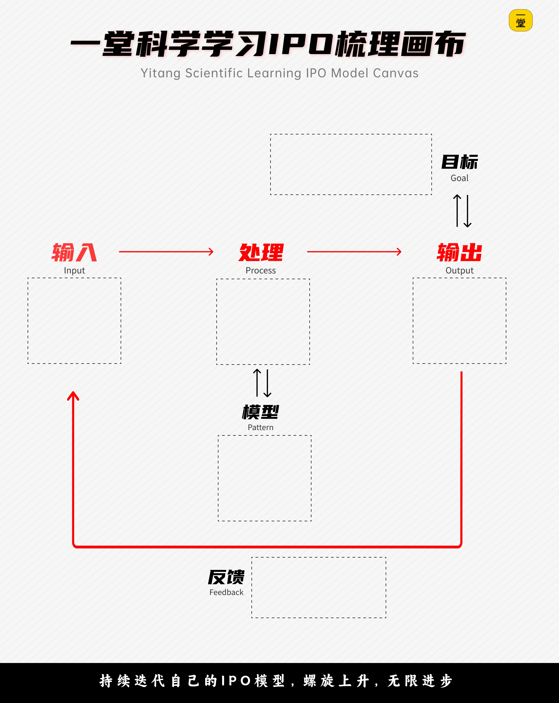

你会发现，学习水平的迭代，都是一步步螺旋上升出来的：

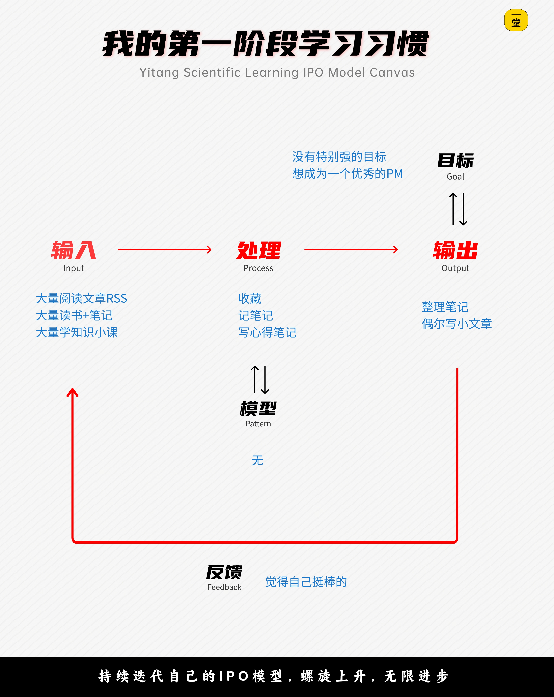

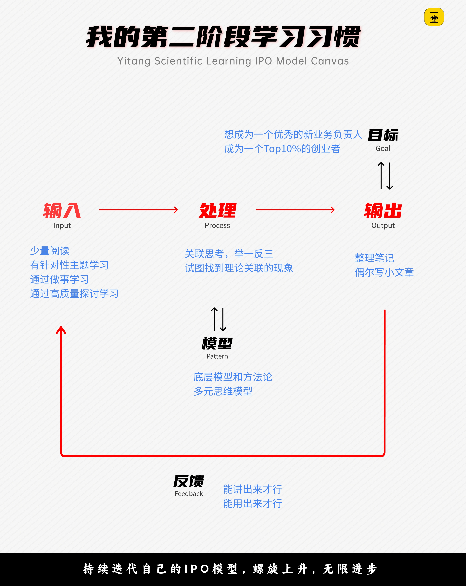

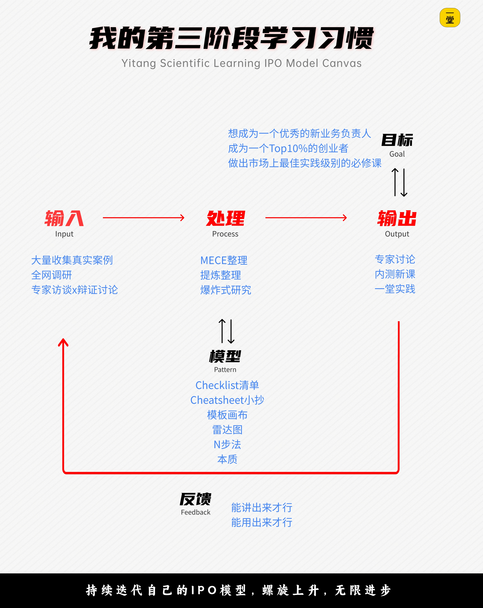

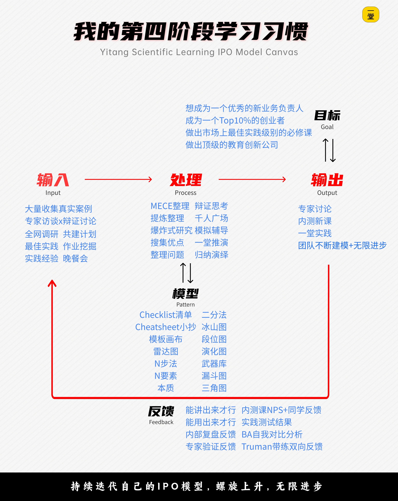

十几年的时间，信心越来越足，目标越来越高，野心越来越大，IPO的能力和工具也在每年进步，不断升级、鸟枪换炮，才有机会不断进步。

那问题来了，如何实操呢？如何进一步不断复盘、反思、训练自己呢？我们给大家准备了一个《一堂科学学习IPO·全景策略图》，我们计划会另开一篇科学学习《实操篇》，给大家系统讲清楚。

今天先给大家热个身，初步看一眼：

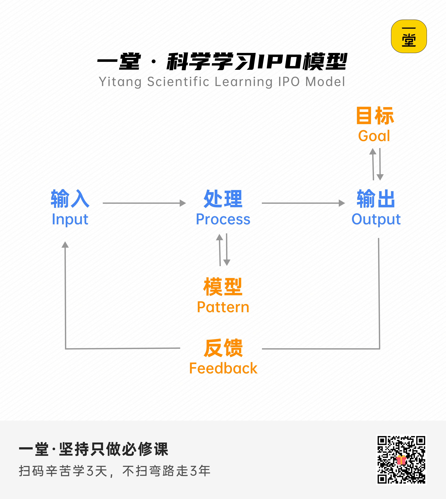

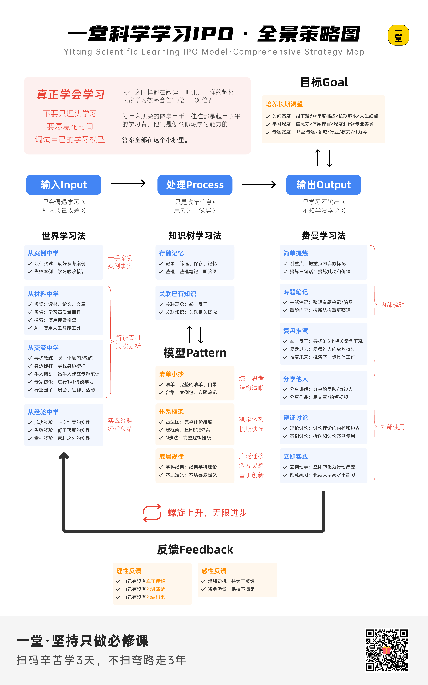

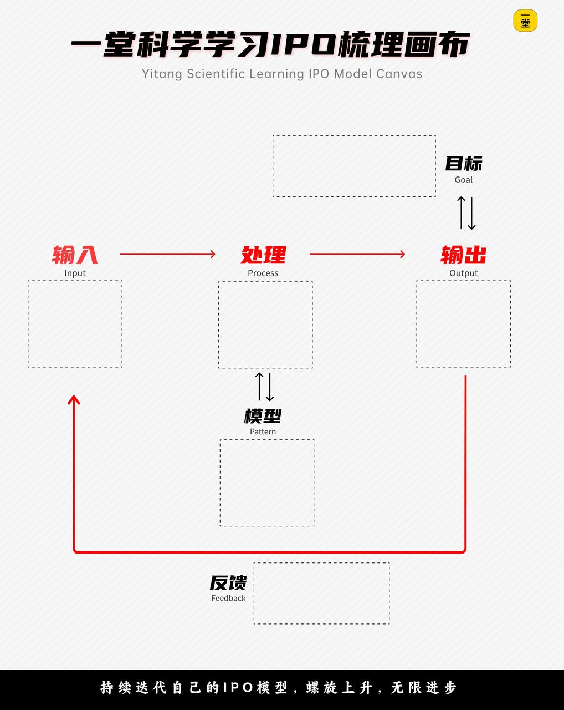

> 注意：这个是初版，如果后续课程有不同，以后续新版本为准。

我们在下节课具体展开，常见的卡点、难题、实操技巧。

### 第三层理解：本质抽象

第三层理解，不知道大家有没有一个困扰：**为什么要学习这么抽象的模型呢？**

太底层，太抽象了，学习很难，真的要到IPO这个层级么？

如果你足够细心会发现，其实在具体的场景里，有很多具体的方法论，比如PDCA、调研黑客OSCAR、方案三段论（背景、目标、关键路径），其实底层的逻辑无外乎都是IPO的环节而已。

> PDCA：计划（Plan）、执行（Do）、检查（Check）和行动（Act），一种常用的管理工具和方法论

> OSCAR：一堂课程《调研黑客2：调研黑客五步曲》当中的调研方法论

**【提问🙋🏻‍♀️】**为什么一堂反复鼓励大家，学习这些底层模型呢？

————

我们讲过一节课叫《解放思想》，底层模型的好处是，会带来极强的**稳定性、迁移性和创新性。**

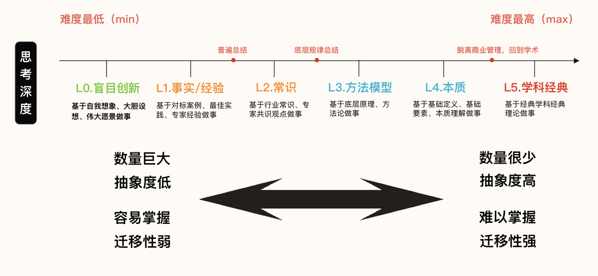

学起来的确有些难，有些抽象，但是好消息是，你把这一点认识到了，理解透了，练习明白了，会带来长期各个方面，各种能力的全面提升。

眼下你或许有各种各样的具体难题，但站在10年的角度看，**你的学习能力，才是最重要的真本事。**

给大家举个热乎的例子，最近春节DeepSeek大火，我们一堂同学们不约而同地都花了十几个、几十个小时学习DeepSeek，那么问题来了，如何科学学习，让学习质量效率最大化Max呢？

> 假设设定范围：学习使用，最大范围使用AI能力为我所用。

这个时候，我们学习一个完全全新的东西，貌似过去很多经验都失效了，这时候就会发现各种各样的学习按照惯性和直觉出现了：

- 同学A：立刻动手用，一遍遍用，找手感，找感觉。
- 同学B：提示词提问，问DeepSeek和GPT的差异，然后根据原理学习。
- 同学C：刷一些新闻和教程，然后跟着动手试试看。

那问题来了，如何最大限度学习呢？在这次磨课时候，我大概推演了一下我的思考过程和学习习惯：

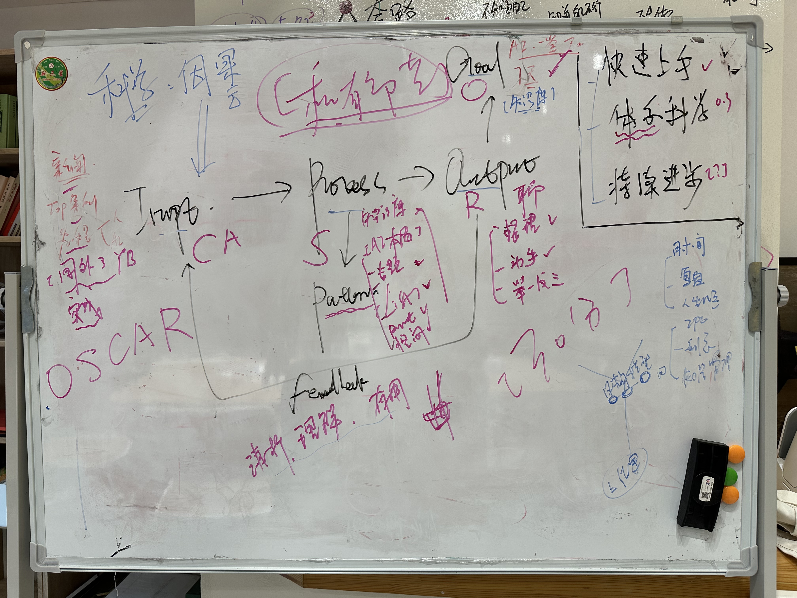

- **IPO的价值**：快速上手，科学体系，持续进步。
- **思考学习**：持续问自己六个关键问题，“3+3”。
- **持续提升**：每个环节的质量，然后获得更好的学习结果。

而且更本质的思考，会激发出很多创新的思考：还有没有哪些地方有最佳实践案例？能不能再建个模型？能不能再试着多输出一轮？这时候，你会激发出很多有趣的、意想不到的假设：小红书搜案例、知乎评论区、DeepSeek自己写教程等等。

大家感受到了思路和区别了么？

### 第四层理解：科学体系

这节课我们的题目做了个升级，叫做重新理解"**科学学习**"，凭什么我敢用科学这个词，到底科学体现在什么地方呢？

————

我们做了一节Y模型的课程，科学的最大基础，就是**客观的因果关系**。

两张图一起看，就会发现一个有趣的一致性：

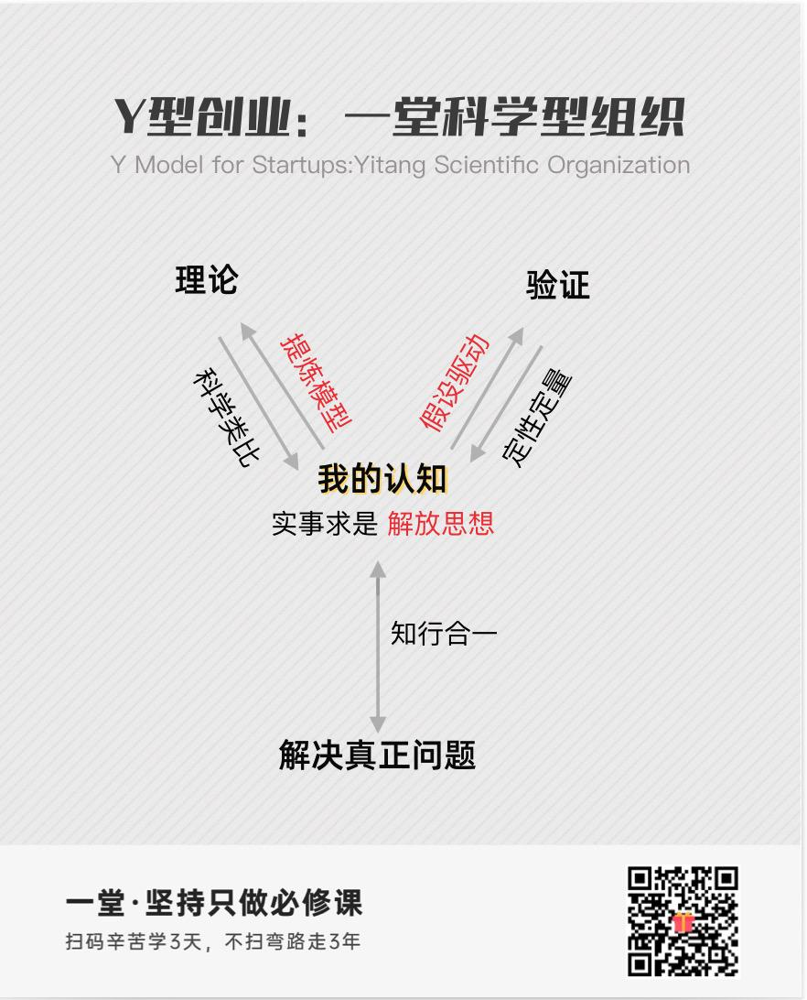

什么是科学学习的因果关系呢？

- 果：我想成倍提升学习效率（数量&质量）
- 因：IPO模型（3个基础要素+3个闭环加强）

“凡人畏果、菩萨畏因”，你的IPO模型，完全决定了你的学习水平，所以你不要盯着学习的结果，甚至不要盯着学习的习惯，而是把注意力放在因上，放在IPO的几大要素上，持续进步、持续反思，你的能力自然就提升了。

而且最有意思的是，有了这个科学的基础框架，一些工作都可以展开了：

- 我可以给自己的**学习建模**吗？当然可以。
- 我可以给自己的**提出假设**吗？当然可以。
- 我可以给自己的**调研同行**吗？当然可以。
- 我可以给自己的**学习理论**吗？当然可以。

你看我，拆过很多同行的IPO手段，也提出过大量的磨课假设，甚至还建立各种各样专属于一堂，甚至专属于我私人的学习方法，其中前提，就是你得相信IPO是科学的客观规律。

ok，现在，我们来到最后一层。

### 第五层理解：巨大底气

前面讲了很多的故事和理性，最后我想讲一层感性，为什么我说这节课对于我，对于一堂，是一个"塑造体系"级别的课程。

在美团，有一个早年的故事，曾经被王兴提起，并且这些年广为流传：

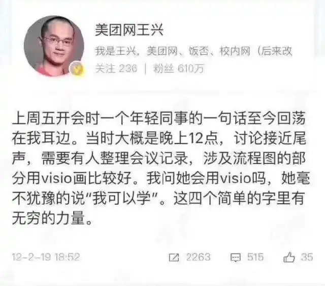

"**我可以学**"这四个字有无穷的力量，这背后代表了对于自己学习能力的足够强的信心，给我一个晚上，我一定能学会新工具visio，这个就是对于自己能力很强的信心。

这些年，我也没少做过类似的事情：

四五年前，我家属在滴滴，需要帮助做一个小年会的拜年视频，要的很急，问我能不能帮忙做。

我说：给我吧，我半夜回来现学，明天早晨你起床给你一个合格的版本。

那个时候的我还不太会专业剪辑，而且也没做过拜年视频，我怎么敢答应呢？

> 实际情况：大概成片3-5min，有大概20-30min的原始素材。那时还没有剪映，我得新学用Premier（专业剪辑软件），大学当年用过一点会声会影（另一款剪辑软件）。

**因为我在过去，经历了太多太多次新课题的IPO学习了啊！**

只要给我合格的Input，能简单建个模（雷达图），我就一定能吐出来合格的Output。

我当时的判断是：给我3-5个小时，学习20-30个最佳实践（Input），建立一个基本审美（Process），然后学习点简单的教程（I&P），然后一轮轮调整个几轮十几轮，一定能做到70分啊。

所以我慢慢养成了一个习惯：**用学习潜力做计划，而不是按过去能力。**

如果每次都做自己会的东西，该多无趣啊。

这些年我分配工作，越来越喜欢把"跳一跳"学习的潜力加进去了：

- 第一次决定做一堂课，应该能学会，就做了一个海报把100份卖完了。
- 第一次做马拉松大课，应该能学会，就承诺出去了。
- 第一次做线下课，应该能学会，就承诺出去了。
- 第一次直播，应该能学会，就承诺出去了。
- 第一次出书，应该能学会，就宣布出去了。
- ......

这种勇气不是来自无知和自我麻痹，毕竟几乎所有的事情，最后我们都平稳落地了，最大的底气，是来自我和一堂，这些年IPO重复太多轮了：几百、几千轮的重复，我们知道我们的潜力可以做到。

同样对于大家也是，"**我可以学**"，这四个字充满着超人的**勇气**；

而如果你敢于增加一个字，"**我可以学会**"，这五个字充满着无限的**底气**。

你对学习的追求越高，越需要高配版的IPO模型来实现；

而你的IPO水平，又会一次次推高你的野心和追求。

IPO是一个十年尺度的工具，每天都在高频实践，持续在打磨，而你打磨的程度和质量，就是你未来最大的潜力。

我们的学习，不是只为了解决眼下的一两个问题，不是为了眼下一城一地的得失，而是**增强你的认知水平**，**构建你的思维模型**，**提升你的输出段位**，甚至养成习惯和肌肉记忆，未来可以**持续获得解决问题的能力**。

你在路上可能会遇到数以万计的文章、信息、书、形形色色的人，你也许会见到几百条做事原则和框架，最后如果能找到30个重要的模型长期学习，其中三五个能够熟练掌握，远超同行，对于你的业务，可能就足够成功了。

最后送大家一句话吧：**学习是结果，IPO才是根本。**

诸君共勉，大家加油~~~