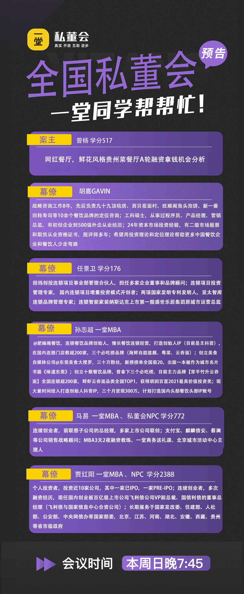
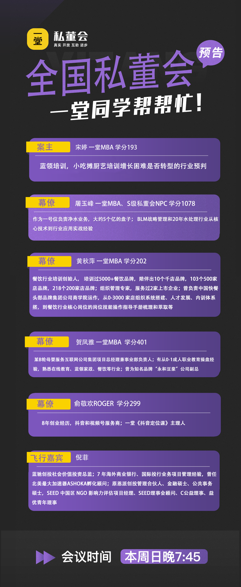
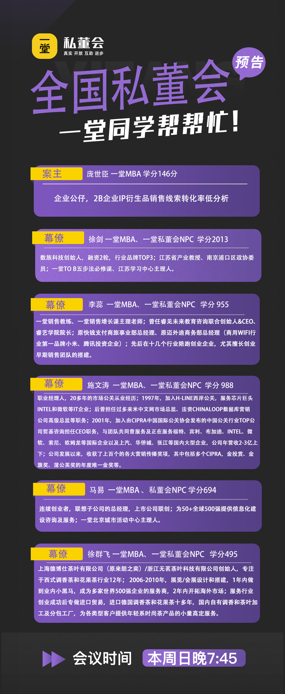
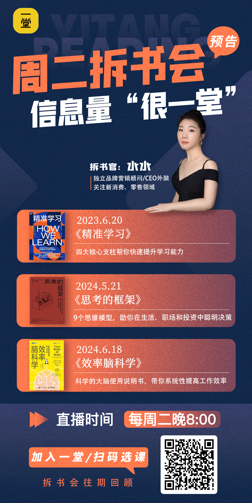

## 作业与Candy

好啦，今天作为《认知篇》即将告一段落，我们计划后续增加一篇《实操篇》，给大家展开讲讲IPO里面具体的工具和策略，如何选择和打磨自己的IPO模型。

下节课，我试着解答一些实操层，很具体的问题和卡点：

- 市场上信息这么多，我该阅读什么信息？
- 书太多了啊，一年也读不了几本，我怎么阅读啊？
- 建模太难了，我该怎么理解建模？
- 怎么理解"碎片学习"和"系统学习"啊？
- 我没有机会实践和输出啊，我该怎么使用费曼学习法？

下节课，我会给你一套具体的执行建议和工具箱。

### 作业和Candy奖励

这节课，我给大家留了三个作业，你可以3选1完成。当然我鼓励你听完课后，都尝试写一写。

**简单版：学习心得题。**

今天的课程，有哪些知识点是你之前忽视了的？哪个点、哪个案例对你启发最大？可以自由讲一讲你的收获和心得。

**进阶版：复盘总结题。**

请用今天的IPO“3+3”模型（输入，处理，输出，目标，模型，反馈），复盘一下哪个环节是你做得比较充分和不错的，哪个环节是你重视不够和打磨不够的？请做一次认真的复盘和拆解思考。

**高阶版：学习里程碑题。**

你有经历过课上我讲的 or 杜金科的学习模式质变和飞跃么？你可以模拟课上的行文，写一写你学习能力大幅飞跃和质变的几次过程，越详细越好，越强体感越好。

如果你写得足够好，后续教研团队可能会邀请你访谈 or 邀请你来讲课 or 开放麦。

**【Flag🙋】**这节课做起来很辛苦，希望大家不要辜负。

来来来，希望大家一起立一个Flag（承诺），认真听课吸收，最后完成这次训练作业。

扣一句话吧：**一定作业！！**  Or ** 一定挑战！！**

提醒：新课免费内测，请务必按时学习提交作业，3次报名内测不写作业，后面不会再邀请。

**🎁 作业奖励Candy**：

这次Candy也是下血本了哈，把压箱底的东西都找出来，翻了一堂三大俱乐部的宝库，把可以帮助大家学习的一些经典回放，当做本次作业的Candy。

> - **私董会**：网红餐厅、蓝领培训、ToB企业IP，三场回放

> - 网红餐厅，鲜花风格贵州菜连锁A轮融资拿钱机会分析 #ToC 融资

> - 蓝领培训，小吃摊厨艺培训增长困难是否转型的行业预判 #ToC 转型

> - ToB企业IP，ToB企业衍生品销售线索转化率低分析 #ToB 增长

> - **拆书会**：《精准学习》、《思考的框架》、《效率脑科学》，三场回放

> - **AI俱乐部**：Truman学习AI写歌、视频专家鲲特同学用AI、最近爆火的DeepSeek怎么用，三场回放

