## 开始上课

Hello，大家好啊，

我是Truman，许久未见~~

欢迎大家回来继续（来到）上课，进入**成长加速时间**。

这是我的介绍，如果直播间有新人的话，自己读一下吧：
> 1. **以太一堂CEO：**2016年加入以太创服，现为合伙人，兼一堂CEO。
> 2. **前美团产品专家：**擅长从0到1业务探索、产品快速起盘、商业分析。
> 3. **一堂课程总设计师：**研发100节创业实操课，收到50万份创业训练作业。
> 4. **曾创办“易项直通车”**：资本对接平台，帮助100+项目融资成功。

**【热场🙋‍♂️】**来来来，我们热个身吧，哈哈，我们做一个架空设定：如果从一堂/我/教研团队复制走一个能力给到你，你最渴望立刻复制走的能力是______哈哈哈。

————

上节课我们讲了一节一堂关于学习最底层的课《重新理解“科学学习”》，给了大家一个底层的科学成长思考模型，我们在内部开会复盘时，不断感慨：

> IPO这节课才是“一堂第一课”啊，它解释了我们作为教育公司最底层的机制，也是同学们追求高水平学习最重要的指导思路，一定程度，也是一堂面对同行竞争，最核心的底牌了。

非常难得，这是一节越做越觉得关键和必要的课程。

讲完了认知模型，这周我们来讲这节课的第二部分：**实操篇。**

### 快速回顾

为了避免有同学还没上第一节课，或者断片儿了，我先用几分钟，给大家快速串讲一下第一节课的内容，帮助大家更好地承上启下。

长期来说，如果我们想持续高水平解决问题，持续高水平写作，持续高水平做短视频，持续高水平平等对话，持续高水平辅导，持续高水平讨论专业问题，背后的**学习角度**，背后支撑的**核心的能力模型**是什么？

上节课开篇，我们就给出了科学学习的底层模型——**IPO模型**。直接指出了**你的学习能力，其实就是你IPO的速度和质量。**

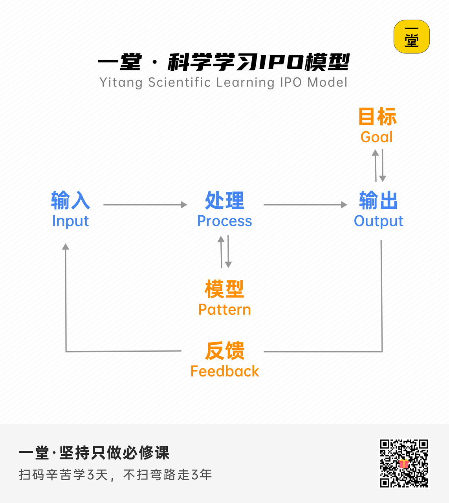

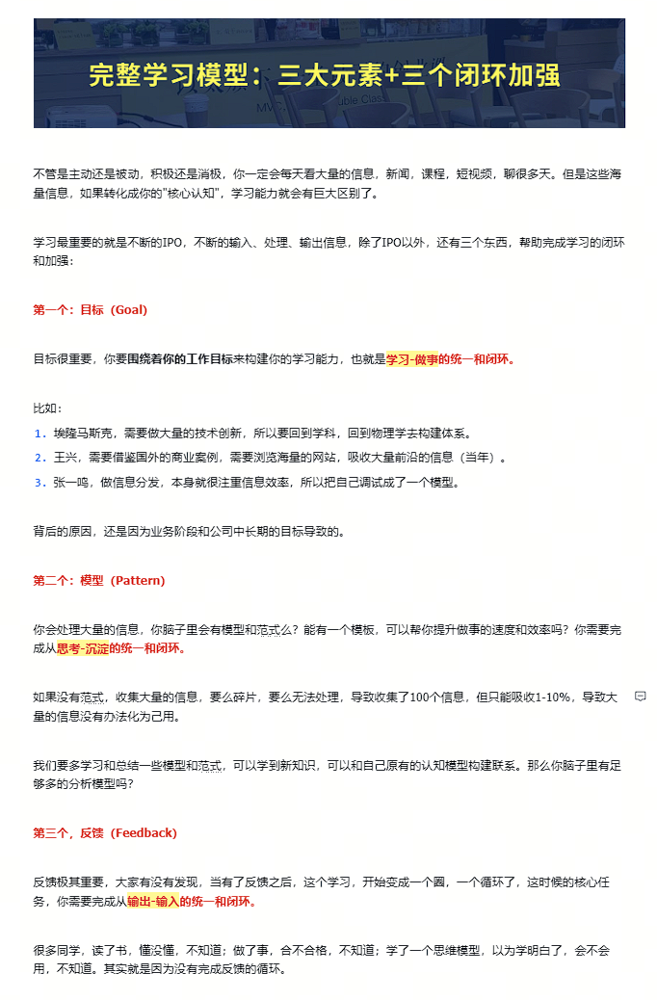

同时，还讲解了IPO模型的三大价值：**快速上手，体系科学，无限进步。**

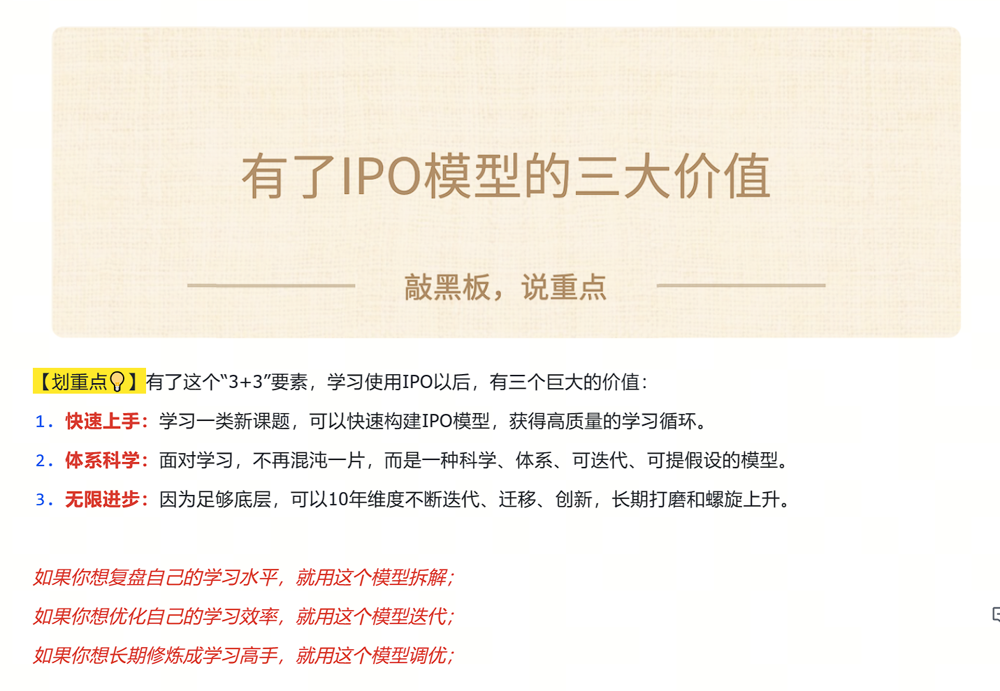

为了能够帮大家加强体感，真正理解**学习能力的提升，就是IPO模型的提升。**我详细地复盘了我毕业以后，学习能力的几次进步和飞跃过程。

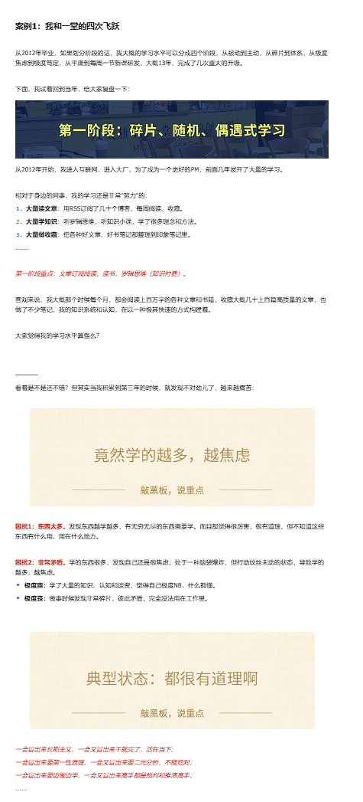

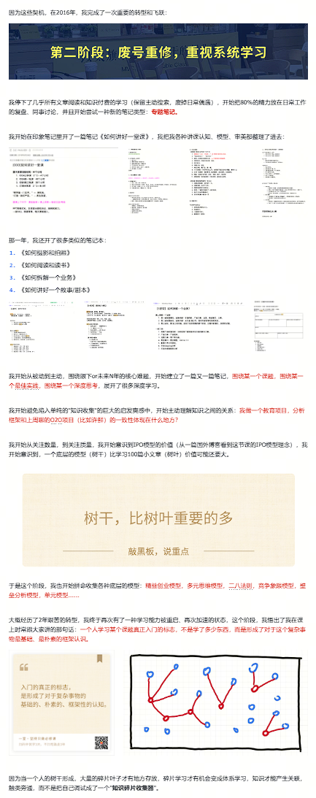

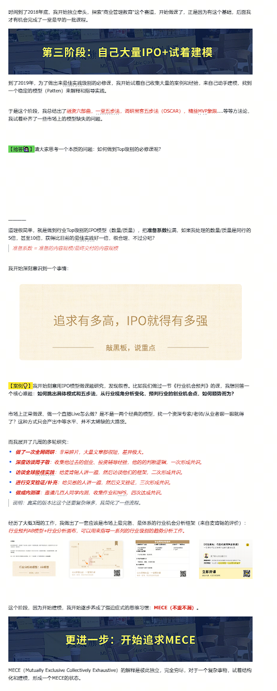

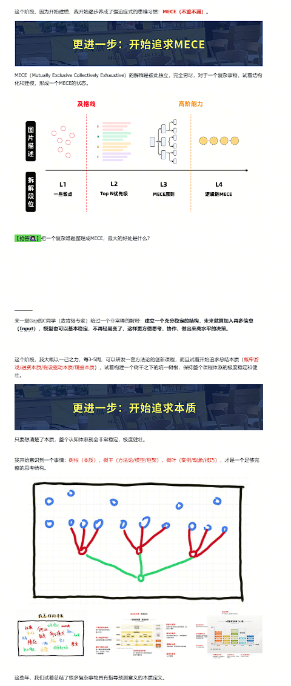

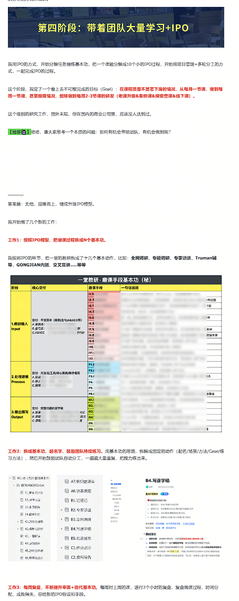

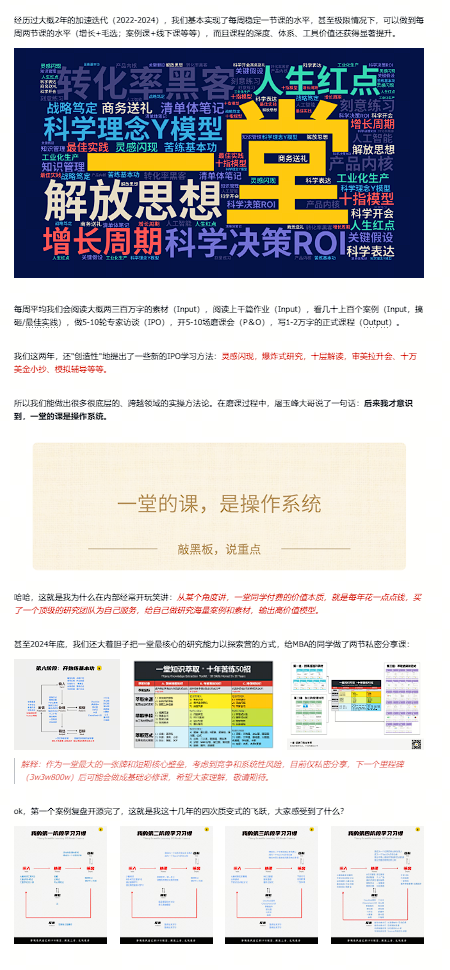

还讲了一些一堂同学们的科学学习案例。

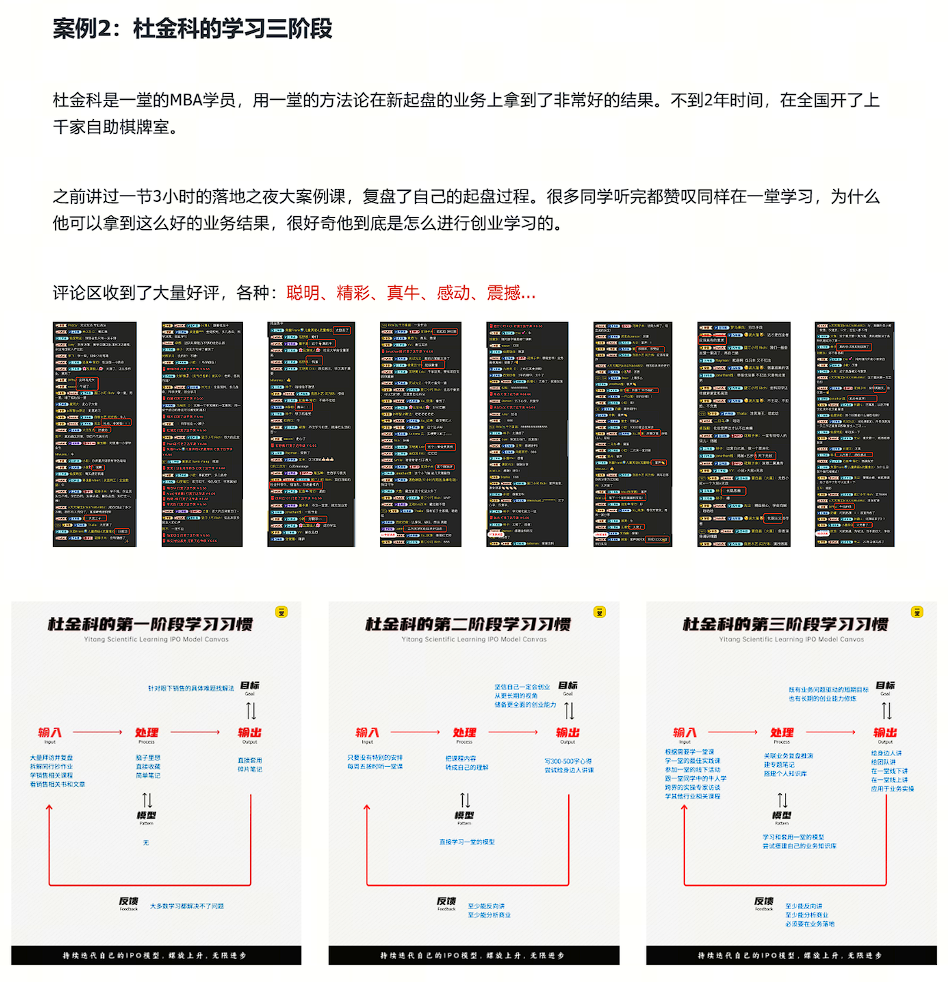

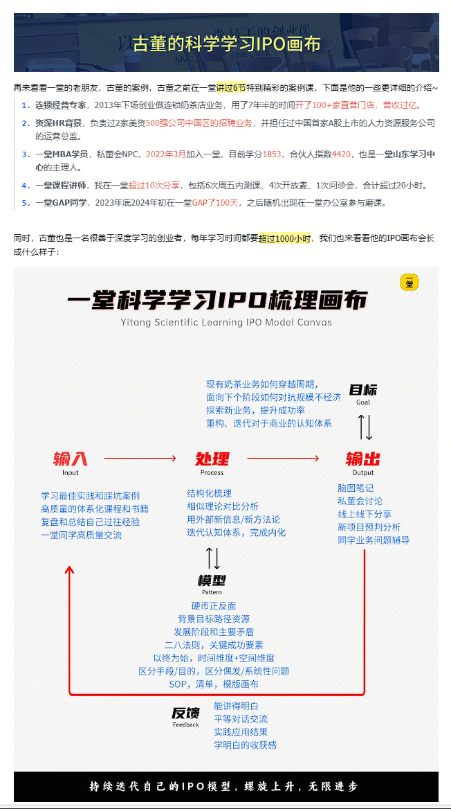

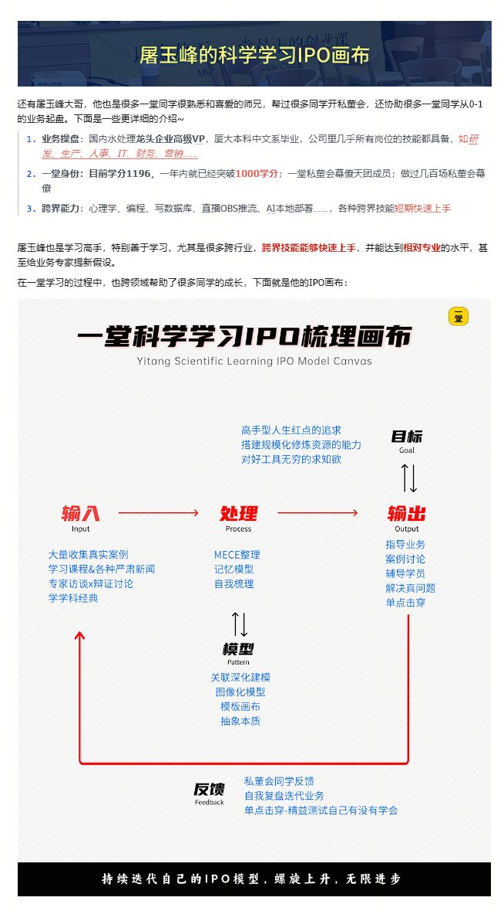

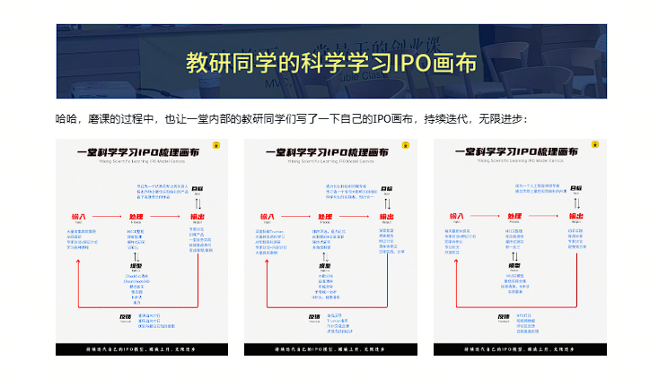

然后，我还和大家讲解了IPO模型中，关于输入、处理和输出的三大学习策略：**世界学习法**，**知识树学习法**和**费曼学习法**。

后半段给了大家深度理解IPO的五层解读：**正确姿势，螺旋上升，本质抽象，科学体系，巨大底气。**

在《认知篇》中，我们带大家建立了对科学学习IPO模型的基本认知，提升了对于提升自己IPO的渴望，希望大家能够理解：**学习是结果，IPO才是根本。**

接下来，这节课我们就展开讲一讲，IPO里面具体的工具和策略，如何使用和打磨自己的IPO模型。

### 为什么要学

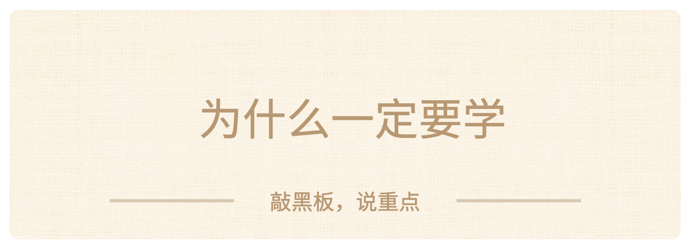

上节课讲了原理，但是回到具体实操：**我该怎么持续提升我的IPO模型呢？**回顾过去几年，你们有感觉自己（和团队）的IPO模型每年有在显著提升，显著进化吗？

回到实务层面，我们看到了很多很具体的问题：
1. 信息太爆炸了，每天遇到大量的信息，我该怎么主动管理我的"输入"呢？
2. 学的东西太多太杂了，导致越学越焦虑，越学习越难吸收？
3. 学了一遍，过一段时间又学一遍，记也记不住，理解也很难理解。
4. .....

在上节课，我们讲了IPO不是一蹴而就的，需要不断关注自己的学习机制，不断**螺旋上升：**

十几年的时间，信心越来越足，目标越来越高，野心越来越大，IPO的能力和工具也在每年进步，不断升级、鸟枪换炮，才有机会不断进步。

今天，我就给大家讲讲IPO实操的一些具体的策略、工具和卡点，给大家一个可以不断提升的训练地图吧。

### 预热思考题

来来，照例，给大家两个预热思考题吧：

**第一个题目：渴望唤醒题。**

我曾经课上讲过一个判断：不论起点高低，每个领域/赛道能够突围领先的，一定是快速迭代出"**顶级认知**"的团队。（**靠运气**是没办法持续正确决策的，所以一定要去追求顶层认知）

你们真的有长期渴望吗？渴望不断升级IPO、渴望成倍提升学习认知的效率，渴望5-10年以后，拥有Top级别的学习能力和认知水平？

越远大的追求，越强的渴望，越需要更强的IPO模型，认真问问自己：你真的渴望你的**认知水平持续进步**吗？你真的渴望进入到**无限进步、没有天花板**的状态吗？

可以自测&勇敢激发一下：不重要，有兴趣，重要，关键，必经之路。

**第二个题目：深度洞察题。**

你学了很多东西，平时会看很多文章，刷很多短视频，学很多课，聊很多天，你这几年的感觉，是感觉学的越多越乱越焦虑，还是学的越多越快，越爽？

重点是，背后的区别是什么？真正高水平的长期主义者，最该修炼的是什么？世界有**千变万化**，什么是你最最最最需要积累的**一定之规**？

希望大家可以提前想一想，这节课结束以后，希望你能有一个全面的提升，不管是自己安排时间学习，还是无限进步的勇气，还是在一堂的学习，都能笃定特别多。

### 提前划重点

提前划一下重点，大家不要迷路，今天我会讲5个部分：

第1部分，**熟悉工具。**我会先带大家迅速熟悉，浏览一下IPO完整的工具箱，大家先有一个初步的认识。

第2-4部分，我会分别按照**输入、处理、输出**给大家讲讲一些具体的实操策略和工具。

最后一部分，我们**重新理解**一下"科学学习IPO"，给这个课题收个尾。

今天我会分享很多一堂这两年的教研新习得的核心能力，也会分享一些一堂这两年构建服务背后的思考逻辑，希望大家耐心学完，有一个全面的提升。

这是一节看似不起眼，但很醇厚，常看常新的课程：

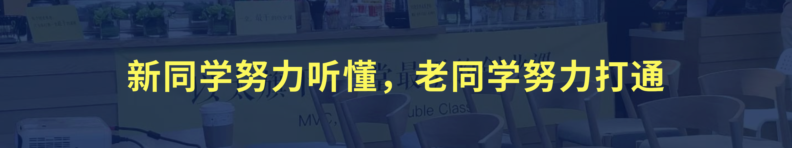

新同学有点难，但努力跟上听懂了，你会拥有翻倍的高学习效率；

老同学有点旧，但你试着串成体系，你可能会现场升级一轮体系。

向大家介绍一下本期磨课研究组的同学：

### 本期磨课组成员名单

**角色**

课题组成员

**工作**

**主理人**

** 楚门Truman**

把控选题、课程方法论架构和教学设计。

**小组成员**

**产品经理：路禹**

- 课程支持：于陆，盈盈，李頔，春萍，Jammy，古董
- 课程助理：刘倩，Sherry，砻沣

完成整个课题的拆解和落地：

- 案例调研，专家访谈、案例拆解。
- 参与方法论萃取、课后数据分析和迭代。

特别感谢下，这节课有很多**一堂AI俱乐部的同学**，提供了他们使用AI辅助学习IPO的场景，是集体成果。他们贡献了很多的**真实案例和实践经验**，这次我们选了几个典型的用AI的场景放在课里。

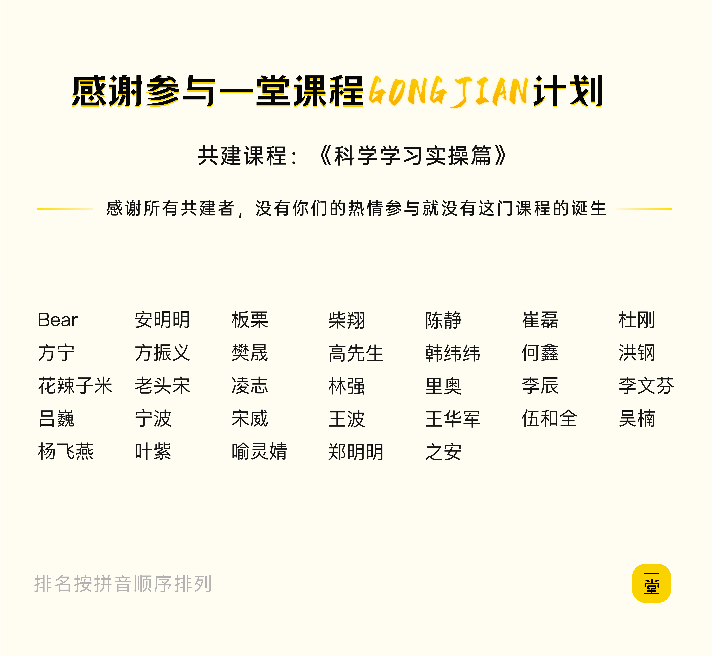

**【毛遂自荐🙋】欢迎大家主动报名“学习委员”，谁愿意？**在评论区扣一个：**我愿意**

> 请大家积极报名学习委员，提升上课质量、班级群氛围、督促选课和互帮互助。

**"翻过一个墙，最好的方式，就是先把自己的鞋子，勇敢扔过去"**

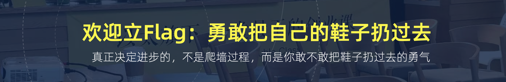

来来来，希望大家一起立一个Flag（承诺），认真听课吸收，最后完成这次训练作业。

扣四个字吧：**一定作业**

> 我们正在持续升级作业陪伴&督促服务，口令代表有更高配的周末学习服务：）

**【划重点💡】**欢迎大家勇敢一点承诺，这四个字代表：
1. **给自己的一个预期：**把这个收录进你的10年进步练习清单。
2. **倒逼自己一定进步**：提高优先级，帮你排除杂念进行学习。
3. **享受更高配的服务：**更完备、更好的班班周末督促服务：）

哈哈哈，欢迎大家**一定作业**，未来在这个课题上，持续享受持续进步的滋养和复利。

OK，进入第一个话题。