## 认识工具

哈哈，我们还是用我最近新探索的"武器库"教学方法吧，为了让大家最短时间拥有最强的体系感，我还是采用**先看武器，多轮复习，最后升华**的方法来教学吧。

我们先来复习下上节课最重要的三套工具：

### 上节课给过的工具

第一个，我给了大家一个完整的认知模型：

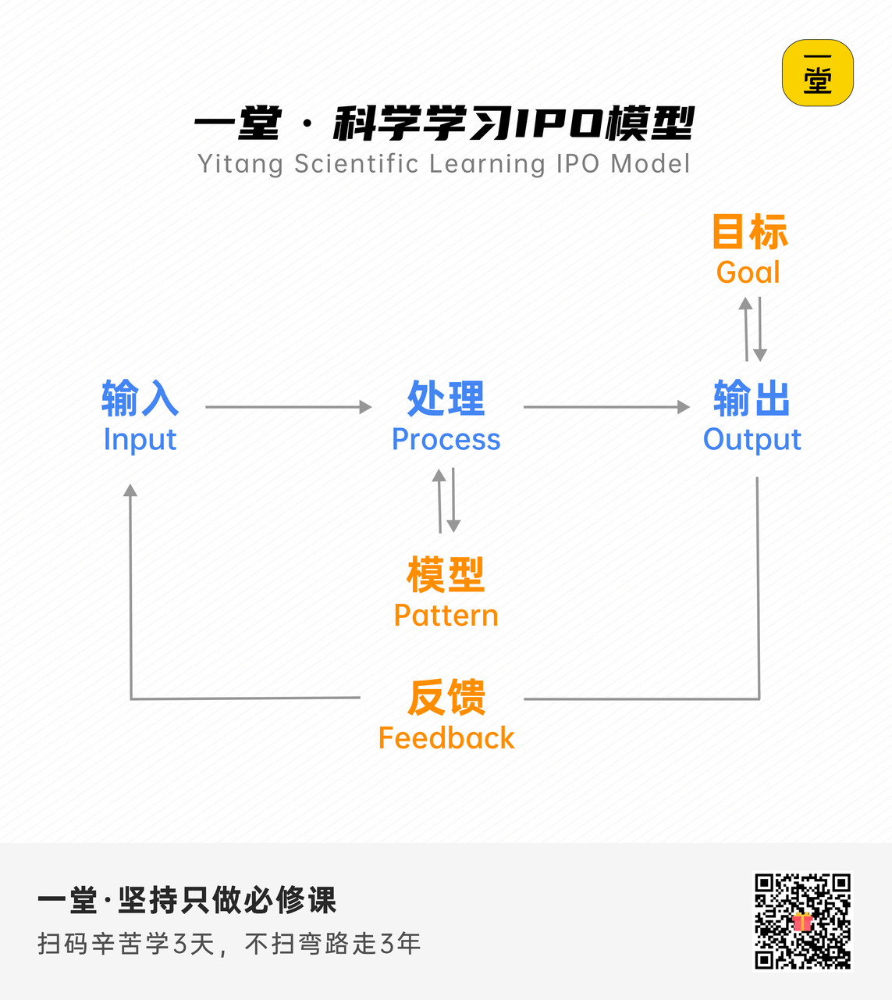

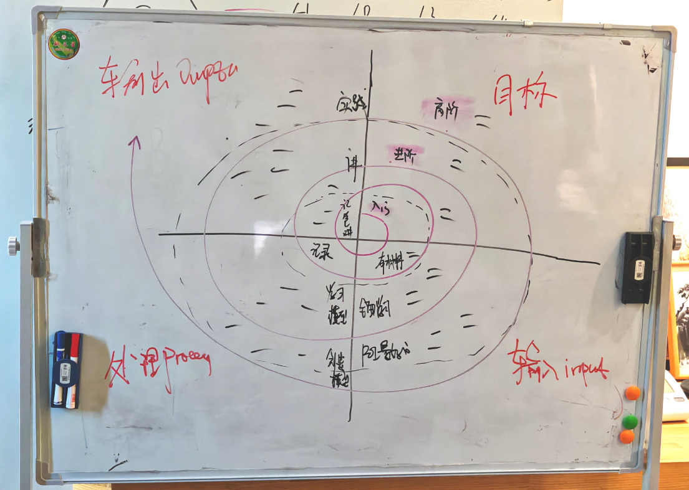

> 右图是我在内部解读“螺旋上升”的时候，给团队画的示意图，仅供参考。

然后，我给了大家一个核心理念，以及一个自我梳理工具：

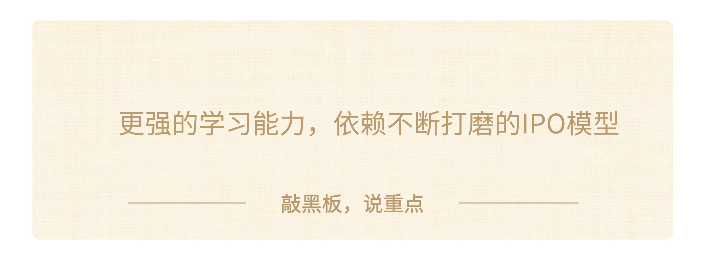

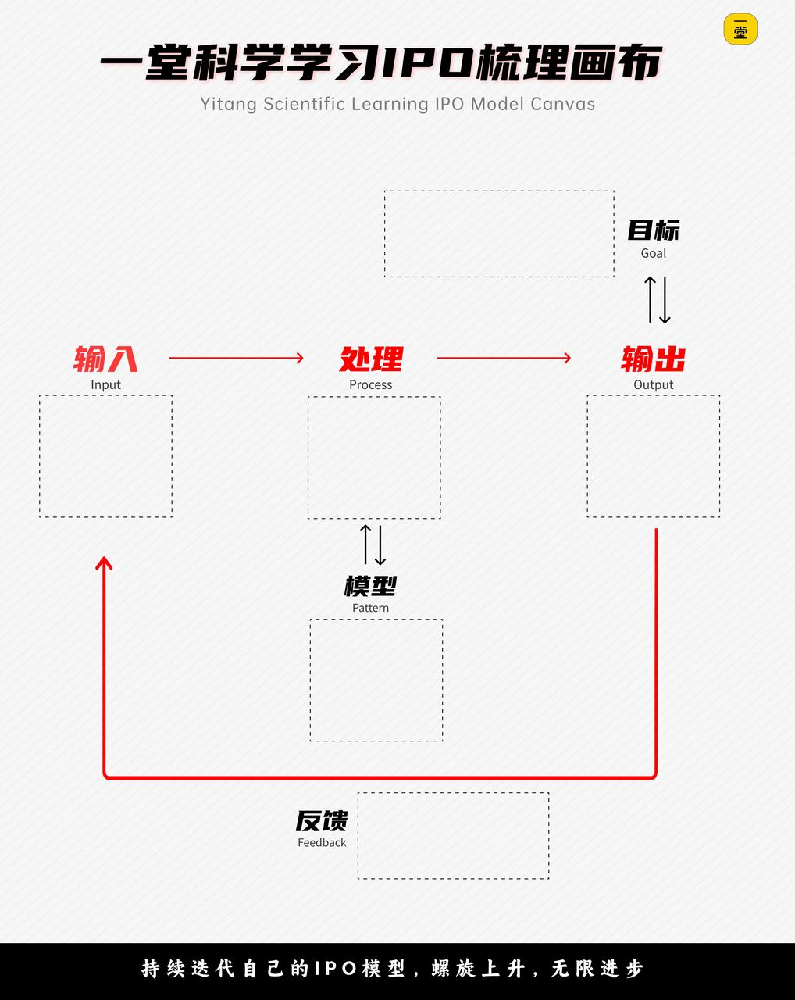

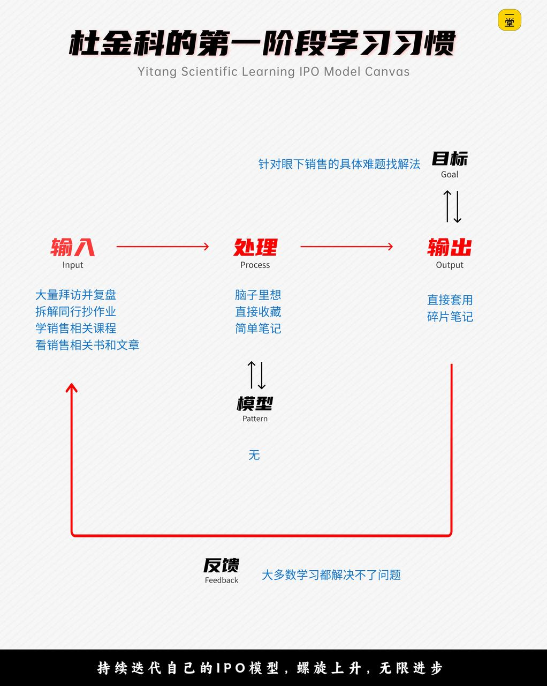

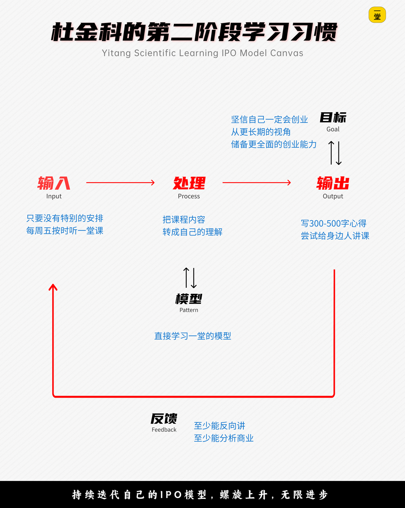

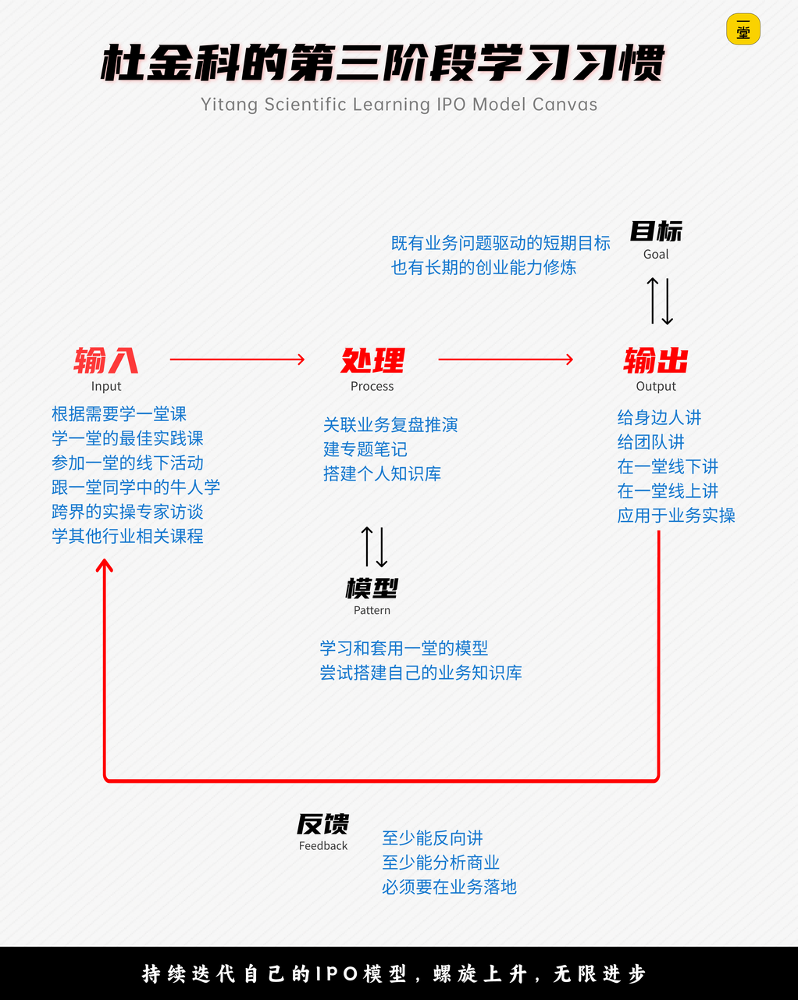

随着你一步步打磨，优化，添加，提升，你的学习能力，就会确定性地持续进步。

**挑战**：如果现在就让你围绕1-5年的高难度追求，升级你的IPO体系，你会怎么调整和打磨呢？

具体怎么填写呢？每个环节有哪些关键的、必要的常见要素呢？我给大家初步展示了一个“**全景地图**”，里面一共有几十个大大小小的策略，大家可以用来自查和提升自己：

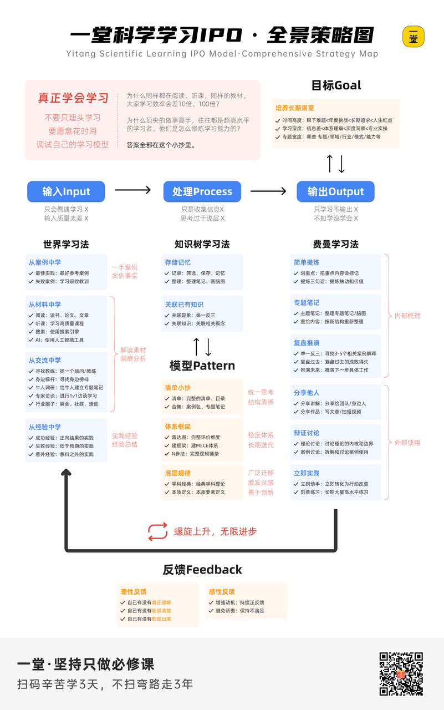

这张地图做完以后，我们觉得很开心，一定程度回答了一个问题：**一个全面的、高水平的学习者，最主要的提升和打磨策略是什么？**

因为拆成两节课，我们有了更多时间打磨（IPO），我们开了两次磨课会，总感觉差点火候，于是我提出了更高要求：这个模型还是不够好，还是太碎，指导性不够，没有呈现出那种"螺旋上升"的各个击破的修炼感觉，有些单薄。

为了升级成“**十万美金小抄**”，哈哈，我提出了三个愿望：
1. **足够丰富：**最好不重不漏，包含高水平学习者持续打磨的常见要素。
2. **可以练习：**尽量降低悟性，降低运气和偶遇比例，可以有明确的路径可以练习。
3. **有指导性：**给出方法，可以指导我去展开学习、给我明确的动作。

甚至能不能把一堂这几年构建的各种课题、案例课、练习方法，都融合进这个模型，做一个“大一统”的武器库，对内可以自我梳理，对外可以用来辅助学习？

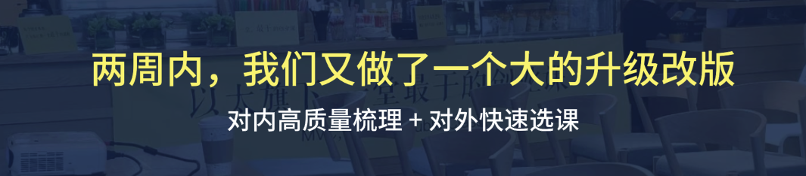

哈哈，于是经过了几次友好的吵架，我们终于打磨了一个新的小抄，变化很大：

### 今天的新工具

我们尝试把各个阶段的策略按照难度和深度，分成了L1234，并且把一堂IPO相关的工具、课题、地图、学习活动和俱乐部，全部都标了进去，你花5分钟理解了这张地图，你就抓住了一堂整个学习体系的灵魂：

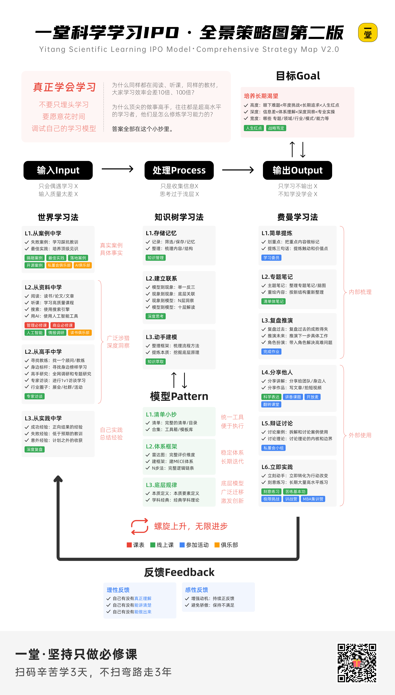

而且为了帮大家更好地使用，我们还重点打磨了【目标】和【反馈】部分：

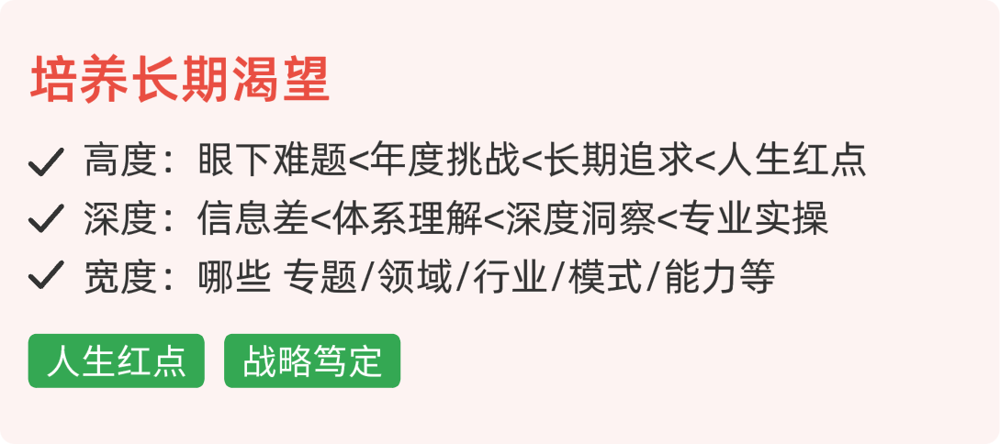

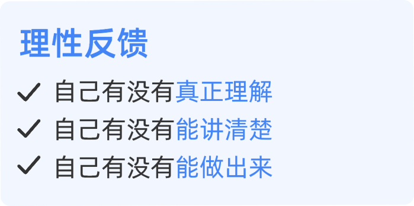

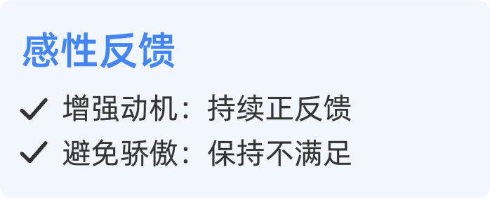

为了让大家更好的落地，教研团队也很贴心地给大家准备了一个动态更新的“完整清单”，放上了课题和简介，以及如果你想深入学习，你需要的选课口令和学习入口。

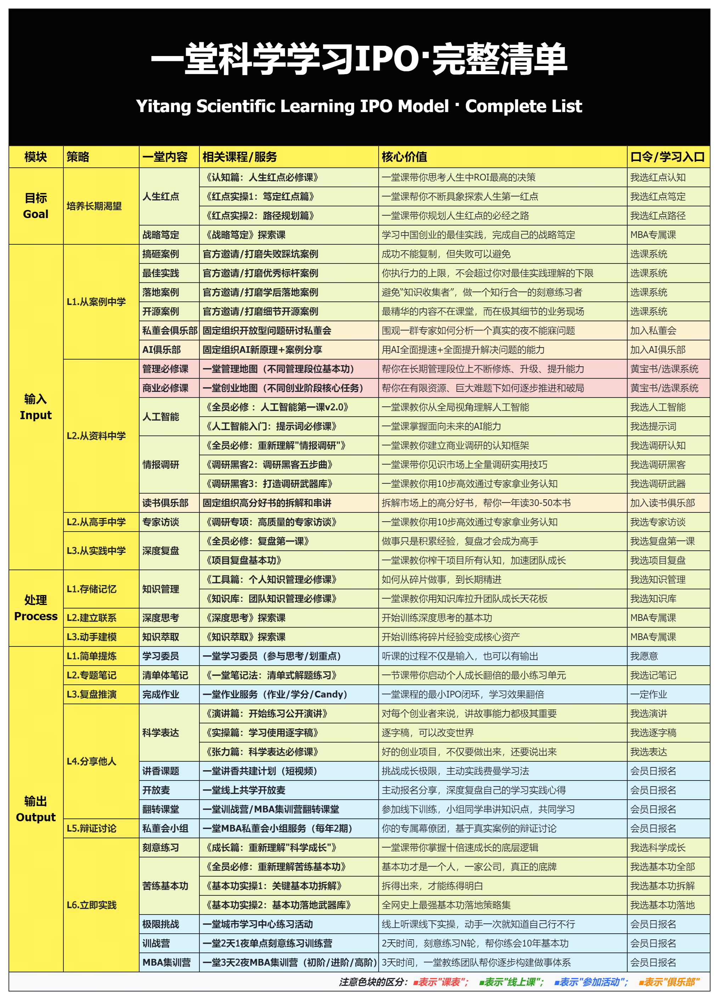

> 注意：我们的服务模型每年都在显著升级，最新版本更新会在Candy里，请以Candy新版本为准。

时隔四年，到了2025年，我们终于可以基本把一堂教学体系初步构建完整了：**从一个IPO模型，到六个要素，到几十个策略，再具体到每个策略，如果你卡住了，可以进一步修炼、学习的课程**，全部都在这里了。

好啦，下面我们逐步来展开，希望大家带着三个问题思考：

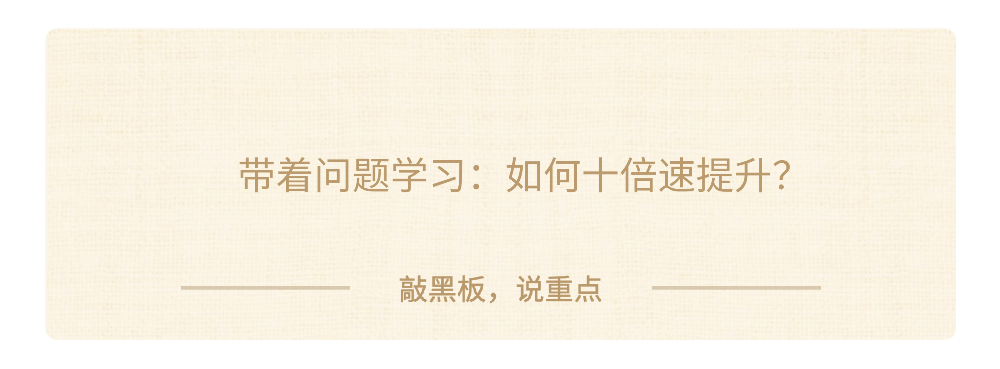

- **梳理盲区：**你过去习惯用哪些方法，哪些方法是你没重视、没用过的？
- **思考提升：**未来3-5年，哪些新策略应该加到你的IPO模型里，你要努力重视？
- **延展学习：**一堂哪些课题、服务和产品你之前轻视了？请你从今天开始，重视起来。

ok，我们下面开始第一部分。