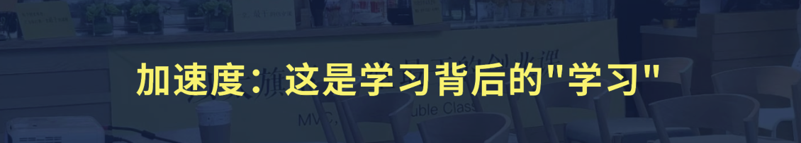
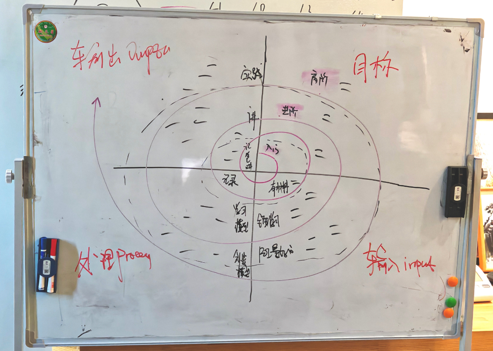
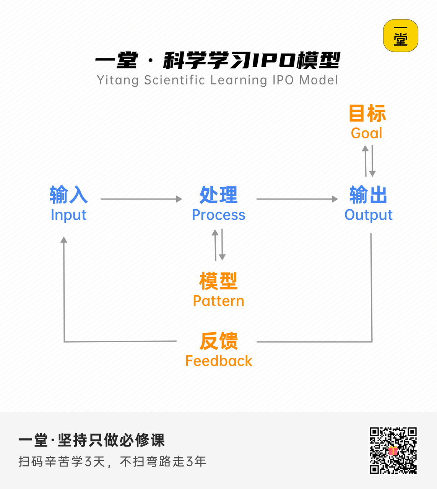
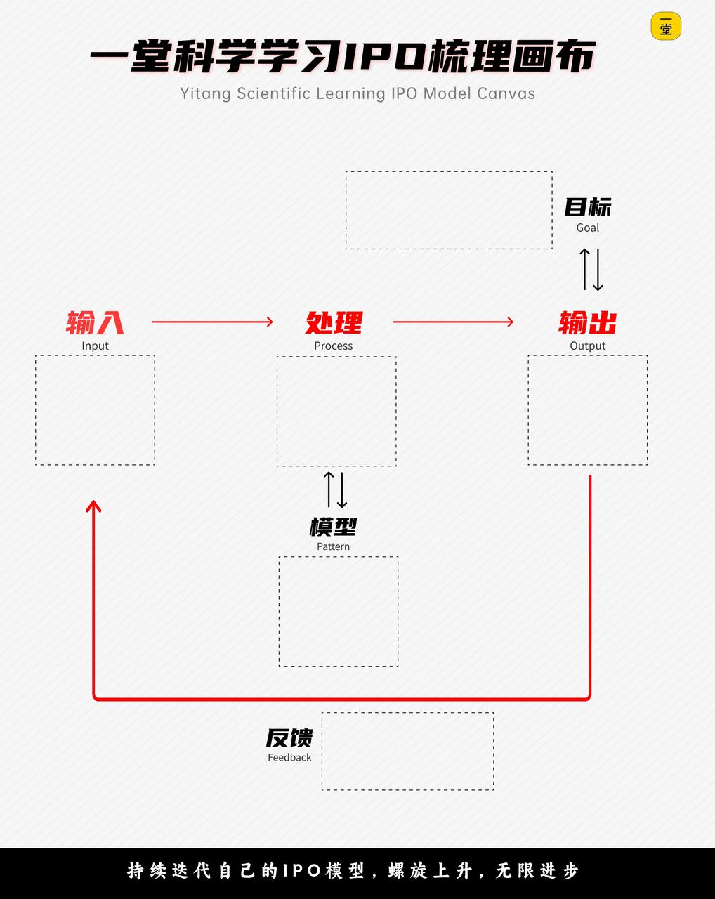
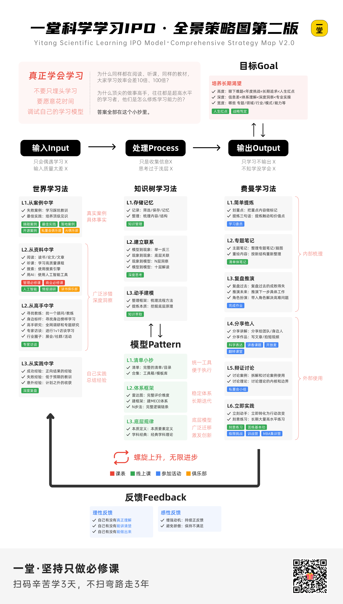
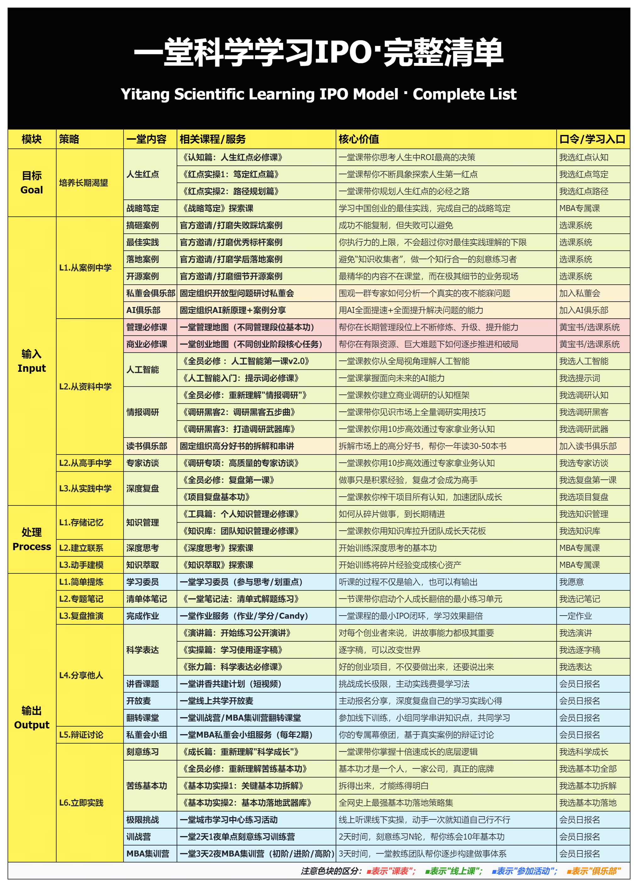
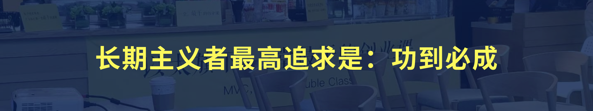

## 重新理解"科学学习"

### 理解学习：不断螺旋上升

开篇我讲过一个大概的“加速度”的理解：**学习背后的学习。**

你可能过去听过各种新鲜（NB）的学习方法：体系学习法，知识树学习法，费曼学习法，第一性原理，多元思维模型，关联学习法....今天我试着给大家用一个更系统、更科学、更底层的模型，给大家讲清楚这些原理。

这节课是一节非常特殊的"元认知"的课，如果其他课题是帮你"**提速（v）**"的话，那么这节课就是帮你提升速度背后的“**加速度（a）**”，可以让你持续提升你的学习效率。

核心在于：**不能单纯靠直觉，你得主动关注你的加速度。**

大家现在能大概感受到我的那个手绘稿的意思了么：

没有人可以一蹴而就，你的模型，你的体系，你的输入质量，你的输出质量，都会随着你一轮轮循环，变得越来越成熟，十几年的时间，信心越来越足，目标越来越高，野心越来越大，IPO的能力和工具也在每年进步，不断升级、鸟枪换炮，才有机会不断进步。

我相信两件事：

我如果想成为一个顶级的教育创业者，一定得有顶级的教育认知/做课能力。

那我就用10年时间，循环几百上千轮，大概率是能做到的。

我如果想带出一个中国顶级的教研团队，就一定得有顶级的教研模型和基本功。

那我就用10年的时间，也循环几百上千轮，大概率是能做到的。

这个就是科学和确定性。

那么具体如何做呢？这套课给了大家一些核心工具。

### 快速复习：核心的知识

我给了大家一个框架，一个梳理工具，一个武器库，一个落地清单。

这节课的底层逻辑（IPO）是源自计算机科学，上层有一系列的具体方法：调研黑客OSCAR模型，专家访谈十步法，深度复盘，深度思考等等。

这是一堂《个人成长三部曲》的第一节课，后面还有《刻意练习》和《知识管理》，这三门课加在一起，就是一个人对于个人成长的核心三板斧了。

- **科学学习**：侧重于"学"，高水平的认知进步。
- **刻意练习**：侧重于"练"，少量能力练成专家水准。
- **知识管理**：侧重于"存"，给你的大脑准备一个海量硬盘。

这三门课，就是我这些年个人成长和做一堂的核心能力了。

### 最后鼓励：挑战成长的极限

我们的学习，不是只为了解决眼下的一两个问题，不是为了眼下一城一地的得失，而是强大你的认知水平，构建你的思维模型，提升你的输出段位，甚至养成习惯和肌肉记忆，未来可以持续获得解决问题的能力。

你在路上可能会遇到数以万计的文章、信息、书、形形色色的人，你也许会见到几百条做事原则和框架，最后如果能找到30个重要的模型长期学习，其中三五个能够熟练掌握，远超同行，对于你的创业，可能就足够成功了。

有些路很快，很轻松，但是也很短；

有些路很慢，很辛苦，但是也很长。

而IPO的体系，直接决定了一个人最极限的做事高度。

科学学习IPO，刚好就是那个长周期的确定性。

我最近特别喜欢一句话：**挑战成长的极限。**

希望这套课给大家的不是更多焦虑和痛苦，而是更多信心吧：**有一个确定的道路，可以通向一个极其未知又美好的未竟之地。**

剩下的就是专注眼下，保持长期耐心。

这已经很幸福了，最后送给大家一句话吧：“**长期主义者最高追求是：功到必成**”。

大家一起共勉吧~~~~