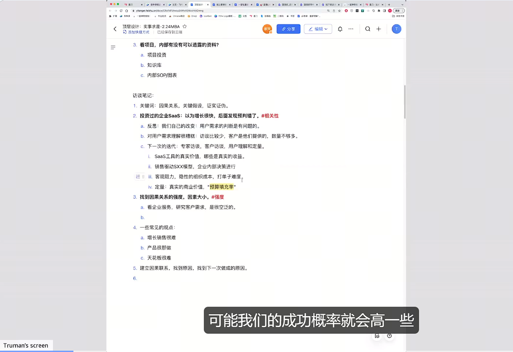
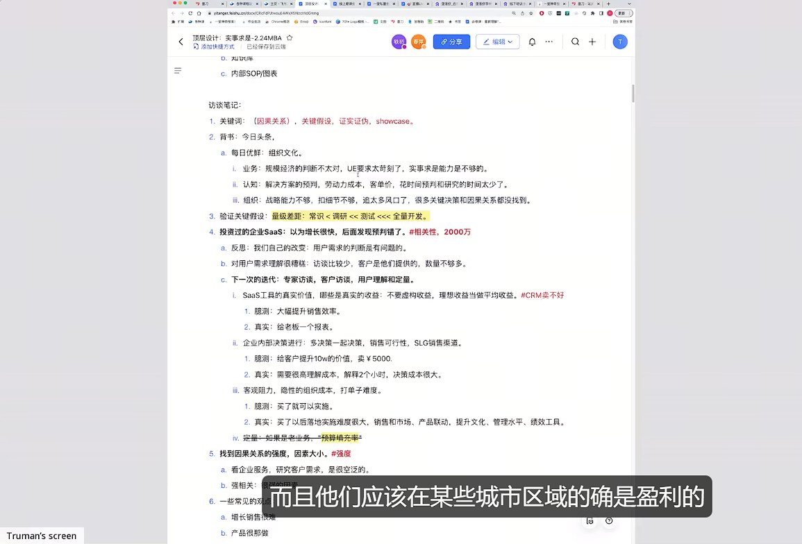
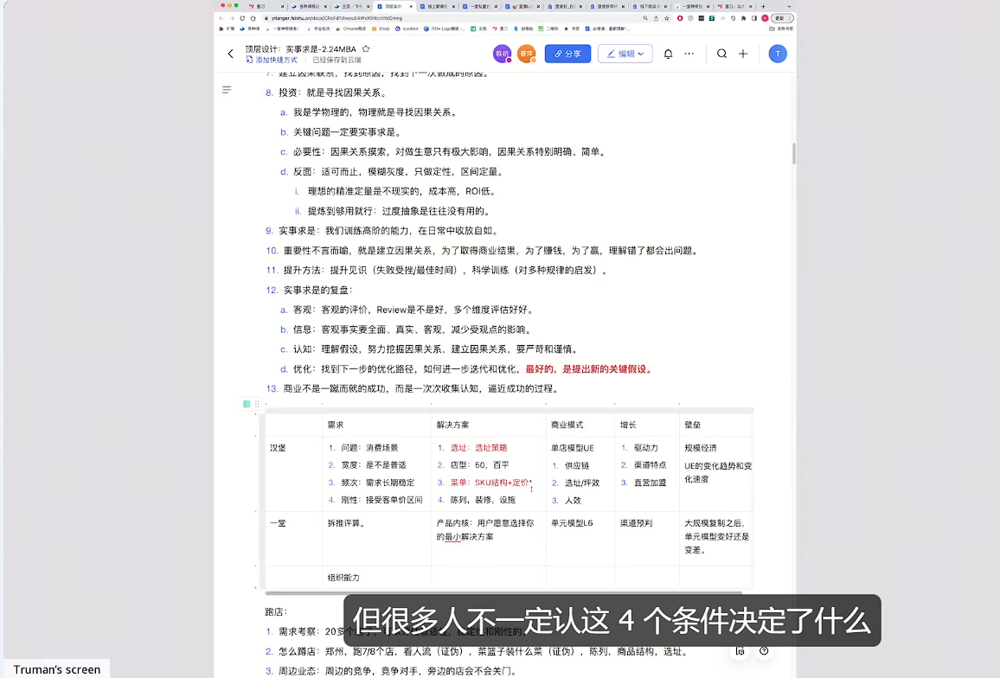

## 作业与Candy

这节课，我给大家留了两个作业，你可以2选1完成。当然我鼓励你听完课后，都尝试写一写。

**第一个作业：心得题。**

今天我讲了IPO各个环节的工具和策略，请讲一讲你的心得和体会，哪些对你很有启发和触动，可以试着深入讲一讲你的思考和收获，尤其是有什么想对Truman讲的？如果你认真写了一封信，我们会转给他阅读。

**第二个作业：规划题。**

请你根据“螺旋上升”和超级小抄，规划未来1-3年的螺旋提升计划，在IPO三个环节，你希望未来如何补全和修正？你希望拥有哪些能力？如果觉得太难，也可以分成123阶段里程碑，尽量做一个有执行性的计划。

**【Flag🙋】**这节课做起来很辛苦，希望大家不要辜负。

来来来，希望大家一起立一个Flag（承诺），认真听课吸收，最后完成这次训练作业。

扣一句话吧：**一定作业！！ **

**🎁 作业奖励Candy**：
1. **《一堂科学学习IPO·完整清单》**：动态更新版，保持一堂最佳学习计划，我们会不定期更新服务和课程。
2. **一场磨课回放**：Truman和子敬的**辨证讨论**，我们当时讨论“**实事求是**”聊了90多分钟，这场磨课里面有很多深度探讨/分歧和一致性共识，值得大家感受下我的成长和快乐。

