## 进阶：提升复盘深度

在这部分，我们先别管什么复盘会议、复盘流程、复盘SOP、复盘模板，这些都是"工具"，不是最重要的，我们先掌握一个能力：**提升复盘深度。**

借假修真，事情是假的，背后的认知才是真的，我们发现大家在复盘时候，有以下常见的情况：
1. 不复盘，慢慢过渡到开始回顾，评价做的好坏。
2. 聊观点，慢慢过渡到对于客观事实的关注。
3. 看现象，慢慢过渡到分析背后的原因，得失，底层原因。
4. 看原因，慢慢过渡到背后的抽象模型，可以复用到更多地方。
5. 看能力，慢慢过渡到事情背后的能力和团队基本功。

然后尝试把这些复盘深度展开，就会发现一个有意思的图。

举两个例子：线下训练营复盘；做了一次攻坚会；创业失败一次。

下面我们一层层来讲：

### 第一层：主观感受

第一层，就是从不复盘到开始回顾，开始谈感性的、印象上的认知。

这一层相对简单：
1. 我觉得这次大家表现都很棒，很成功。
2. 这次效率很高，继续保持啊。
3. 这次xxx不靠谱，拖累了大家。
4. 这次产品不错，销售没做好，下次销售团队得努力！

这些复盘，大家有没有意识到哪里姿势不太对？

怎么判断大家的回顾姿势对不对呢？在这一层，你就得重视这四个字了：

什么意思呢？

从开始复盘开始，你就得面向未来复盘：**全部都是为了下一次的认知而存在的。**

- 不吐槽，不批评，多针对问题。
- 面向未来做复盘，而不是面向过去做复盘。
- 不是追究责任，开批判会，而是寻求改进，学习提高。

**【划重点💡】**我内部有个小技巧：以下一次计划为目标做复盘。

原来的话术是面向过去："这次这里很差，那里不行，这里还凑合"

换成了话术是面向未来："**为了下次**能做的更好，这次xxx要坚持，这些问题xxx要解决"

甚至你把下一次的计划和这一次的复盘适当一起讨论，效率瞬间就很高了。

好，这是第一层，主观感受层比不复盘要好，但往往效率不高：太依赖主观感受，缺少细节，缺少现场，而且不同人非常容易争执起来。

ok，进入下一环节：

### 第二层：客观事实

第二层，开始避免空对空讨论感受，开始还原客观事实。

复盘的精髓，就在于：**真实发生。**它是实实在在发生的事情，复盘就是找到关键事项和重要节点，需要将来龙去脉整理清楚。

如果事实不够，就很难进行深入的分析和讨论。

**【划重点💡】我们讲复盘是从头捋一遍，这个"头"有两层含义：**

- ①顺着时间轴捋
- ②顺着当初的目标初衷捋一遍

**很多的复盘，当你深挖到事实层的时候，就能得到结论了：**
1. 这次转化率很好，就是xx客户的复购率高了。
2. 这次项目严重Delay，是因为中间xx部分，当时没分工，缺少R角色（负责）
3. 上周做课效率不高，xxx，xxx，xxx动作的磨课入课率加一起不到10%。

有了具体的事实，才有机会进一步学习和分析。

**【划重点💡】**复盘要求我们**要多摆事实，少抛观点。**
1. 我觉得这节课做的很好。
2. 我感觉这次销售，最后没卖好，但最能体现咱们的战斗力。
3. 我认为用户不买，是因为产品没讲清楚。

通常，职场最忌讳的是不断观点碰撞、辩论，这是非常糟糕的。辩论往往是为了赢，一个观点走到底。这种情况就非常难有优秀的复盘。

原因上，一方面是用人的素质（空杯），一方面，也是公司要主动地多搜集事实，观点横行，往往是因为事实不够。

**这个环节，一般来说是复盘非常必要的环节，而且要主动收集事实。**

- **事前：**有意识地增加统计、收集评价和事实。
- **事中：**记录关键事件和事实。
- **事后：**做复盘or复盘会，先呈现事实，基于事实探讨背后问题。

我们发现，很多人没有去收集、整理事实的习惯，导致很多工作很难深入复盘。

**【提问🙋‍♂️】**你们猜一下，为了复盘每周直播课制作，我们会**主动收集哪些事实**？

————

**1）简单的一层：课程NPS，以及过程指标，听课留存率，分层作业率、NPS等等。**

ok，还有吗？

**2）更深入一层：我们会收集课程课程好评、差评、建议。**

这些事实更具体了，还有吗?

**3）还深入一层：我们会记录和还原当初的磨课计划手段list。**

我以为是12345，事实上有帮助的是哪个？哪里判断错了？

**4）再深入一层，我最近让团队在收集三类细节：**
1. **每个人的写课时间：**具体的做课动作的实践、贡献占比。
2. **过程中的版本迭代：**关键方法、工具的一步步迭代过程。
3. **精华知识点的出现：最早是谁提出来的，谁的助攻？**

同样地，如果你们想复盘项目销售结果，复盘线下运营，就尽量把事实收集上来。

最后我想强调一下，核心还是围绕你们**预判的复盘重点**，收集关键的信息和事实。

每周有了这些事实，我们才能有机会分析认知，总结背后的规律。

如果没意识记录，或者还原做的一步步过程，就很难做后面的复盘了。

ok，下面进入第三步。

### 第三层：背后原因

上面两步还是浅层，这一步是从现象到背后原因的飞跃。也是毛选《实践论》里从感性认识，到理性认识的过程。

没有办法，就是停下来不断追问，不断纵深向下问问题，就这样剥洋葱，一直剥，连续问五六个问题，最后一定能复盘到本质上，找到事情的真相。

**【划重点💡】**在这个环节，要不断追问为什么：
1. 做对了什么？为什么导致了这个？
2. 做错了什么？背后的原因是什么？
3. 这次成功了？背后的原因是什么？
4. 关键成功要素是什么？

我在《我用一堂1》里讲过一个当初的故事，一堂这家公司早期试错的一次复盘。

当我们正准备看下一个机会时，正好发现隔壁市场团队在拉一个创业者社群。

快速介绍：
1. **社群名称：**A+社（A+创业联盟）
2. **运营模式：**获得大规模创业者手机号（库里/同行互换），然后主动邀请免费加入社群，提供每周一场Live观点分享，2-3场社群话题讨论。
3. **成本结构：**Leads可以通过换量，几乎为0，**微信转化成本20元/人。**
4. **活跃数据：**社群活跃度很高，**周活跃占比30%**（群发言/报名听分享）
5. **拉新数据：**线索到进群转化率很高（15-20%）
6. **增长数据：**社群很快拉到了8000人，后面很快又到了1w，2w

先说故事线：当社群从8000，很快到10000、12000人的时候，就开始测试用户信任和商业化能力了。

当时子敬有一个基本假设：20块钱拉来一个高质量的创业者用户，都是精英，一年平均收个50块钱，还是一定能收回来的吧。如果单个用户能跑通，未来拉一个20-30万人的超级社群，也是个体面的业务。

于是，我们开始测试这个商业模型：

我去跟着一起打磨产品，包装课程，试着从0元，卖到9.9元，瞬间转化率掉到了原来的5%。

原来2000人的课，变成了100人。

试着带别人的货，某头部KOL过来做了一个分享，讲了一晚上，群里挺热闹，3000人听分享，最后卖了不到5000块钱。

后面我们考虑推一个￥699的会员，把这些服务打包一起售卖。后面测了测，大家反馈很冷淡，本身￥9.9都不好卖，加在一起都不值￥699的东西，这个价格大家就更难接受了。

**【提问🙋‍♂️】**这个背后，大家猜一猜，觉得问题出在了哪里？

————

我不是一号位，但是一直重度参与业务的学习，特别希望从里面拿到一些认知。业务从测试迭代，又做了大概三个月，测试了三轮变现，都很悲观，人心渐散，大家已经有些没信心，准备转型放弃了。

当时一号位（市场出身）的判断是：国内的创业者就爱社交凑热闹，不愿意踏踏实实学习。

**【深挖原因】**而我自己尝试复盘了背后原因：
1. **支付率低：用户画像问题？产品问题？商业模式问题？**

1. 画像问题不大：这批人是一批融资型创业者，画像精准。
2. **产品问题：是。√ **
3. 商业模式问题？未知，但产品问题会导致商业问题。
4. **下一步，产品什么问题？**

1. 选题问题？可调整试试。NO
2. 老师问题？可换人试试。NO
3. **质量问题？√**
4. **下一步，为什么质量很难好？**

1. **不稀缺：内容大路货，没有Top稀缺认知。**
2. **没品控：对老师没有掌控力，无法参与内容。**

如果想解决问题，得从根源解决课程质量问题，不然这个事情很难攻坚。

**在最down的时候，我也在准备下一个方向，甚至打算离开以太，出去单干了。**

一次偶然的机会，周子敬约了我和A+社的负责人一起去吃了个午饭，就聊到了对于这个业务的本质认知，为什么一直不顺？

当时A+社的负责人还在分享他坚持的判断：

创业者只是爱凑热闹（活跃很好），但是，不是真的愿意学习和付费（商业很差）。

还在一直在那分享那句话：“产品不重要，多烂的产品都能卖好”……

**尼玛我就在你对面，我是个产品经理啊。**

诶，终于逮着机会，这个商业判断我琢磨了两个月了，于是，我把对于业务的判断完整讲了出来。

**这个业务不顺，根本在于4个问题：**
1. 产品上，没办法磨课和品控，交付毫无竞争力。
2. 商业上，客单价太低了，面对创业者，几十几百块钱建渠道很难。
3. 资源上，没有用好以太最核心的投资认知和创业方法论。
4. 模式上，社群太依赖人的朋友式运营，规模越大运营越辛苦。

**于是我提出了我的设想，用一个课程模型，解决上面所有难题。**

**能不能构建一个以课程为主的服务：**
1. 产品上，强教研，做出来真正最佳实践级的课程，每一节课都是立在市场的一杆旗帜。
2. 商业上，客单价千这个量级，早期可能1-3k，长期在5-8k，能支撑渠道。
3. 资源上，把我们这些年的案例、方法论、核心能力，毫无保留地分享出去。
4. 模式上，做一个标准产品，可以超大规模提供交付，万人学习品质不降低。

我现在还记得那天子敬的表情，想了10秒钟，说：**嗯，这个服务的确很难构建，但你说的是对的，你去试试看吧。**

于是，又一次我把**47Ag**团队拉出来，启动了一个新项目。

这个47Ag团队，后来改了个名字，叫做：一堂。

提醒大家，当初我没有一堂，挖掘背后的原因还是凭手感、运气和直觉。现在的你们，可以用一些一堂现成的模型，比如**一堂五步法、科学销售模型、项目管理模型、科学决策ROI、动力阻力、单元模型**等等。

这些模型，可以帮你把复盘往下挖掘1-3层，找到更底层的原因。

**【练习🙋‍♂️】**做了一个"转发有礼"的页面，但转化率很差，**如何复盘背后的原因？**

**【练习🙋‍♂️】**门店原来3家店，盈利性很好，但是扩张到10家，**导致持续亏损？**

**【练习🙋‍♂️】**项目计划3个月营收100万，但是只完成了72万，**复盘背后的原因？**

————

参考提问模型：动力阻力触点，单元模型&规模经济，销售路径拆解。

基本上做到第三层差不多很多复盘就可以结束了。

但如果你在大量重复，希望不断提升做事确定性和成功率，可以试试总结底层模型。

### 第四层：底层模型

这是一次新的飞跃：从具体到迁移的飞跃。

到这个环节，我们再来看看这个图，应该就能一目了然了：

你就能抽象出一些模型、清单、方法论、过程资产了。

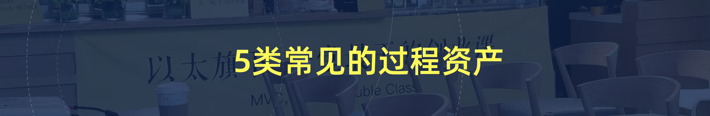

**【划重点💡】**提醒一下大家，总结底层过程资产，通常用的最多的是5类：
1. **关键成功要素KSF：**最重要的3-5个要素。
2. **雷达图：**评价和筛选的雷达图。
3. **N步法：**总结一个做事的N步步骤。
4. **执行清单：**执行框架，写动作清单。
5. **SOP：**确定性的工作，事无巨细写执行流程。

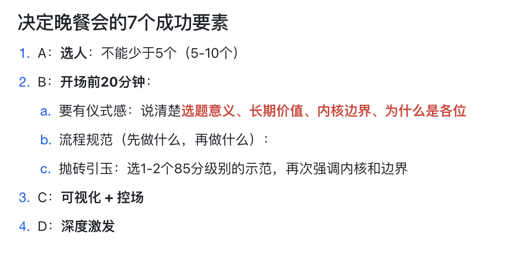

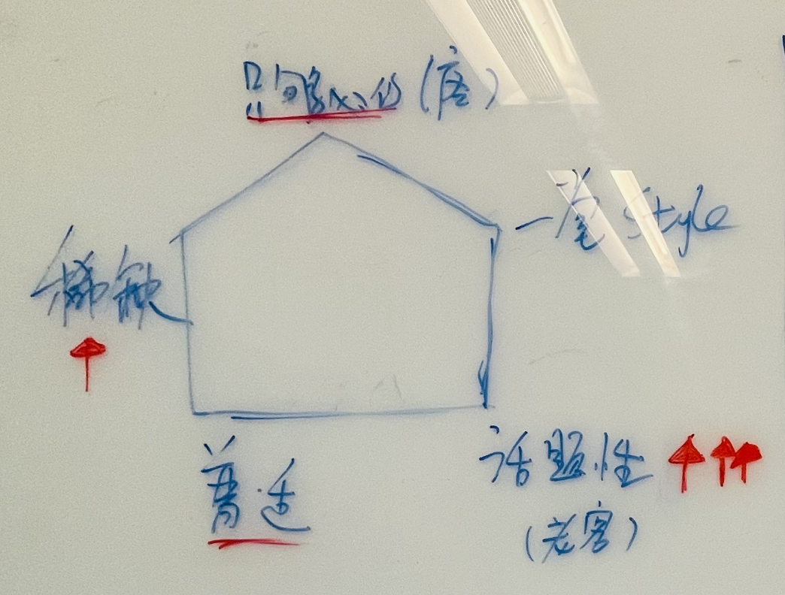

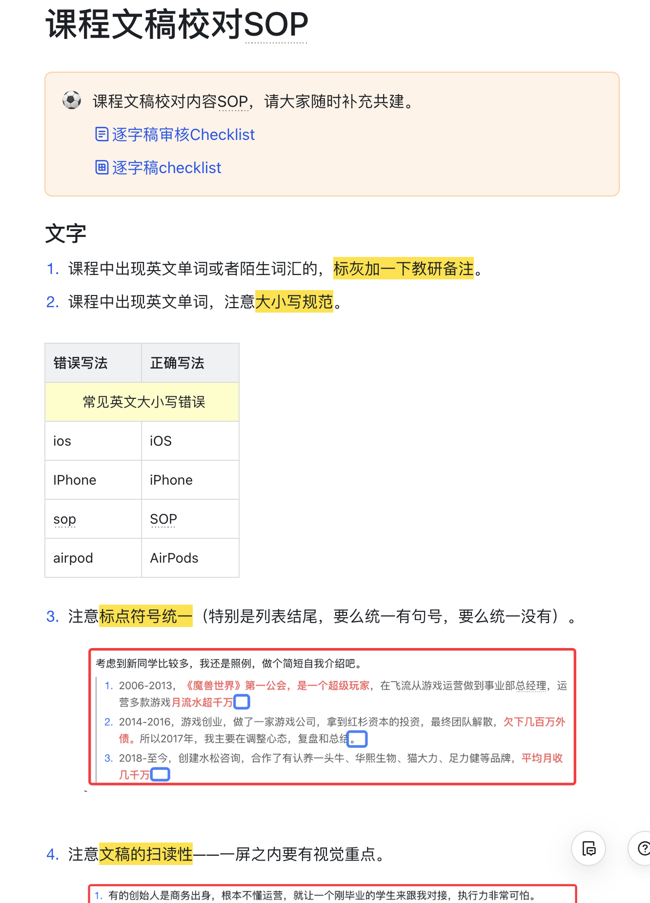

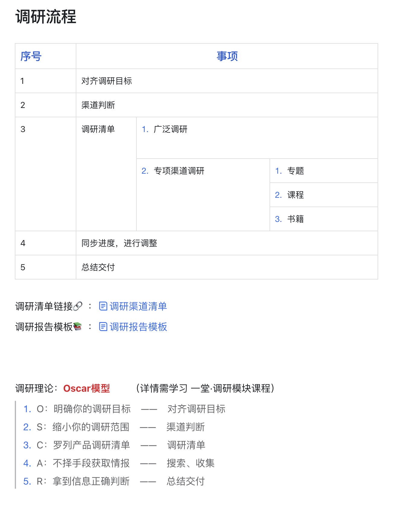

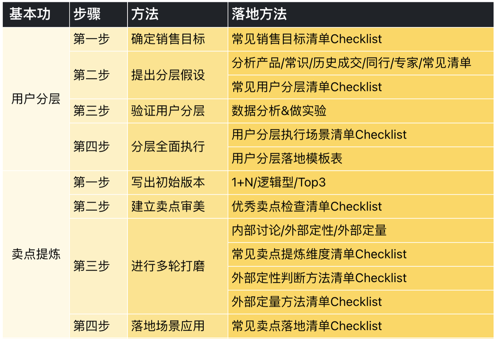

比如，我们有一个磨课动作，作业挖掘，但是效率一直很低。

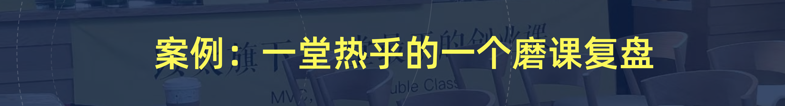

**第一次复盘：**

- **感觉：**原因最后是ROI低，一百万字，阅读效率太低了。
- **事实：**分析数量，统计具体工作量。
- **原因：**排序混乱，导致全量阅读，没有阅读重点。
- **模型：**增加一个排序规则，按照分数&学分排序，挑选top30%。#清单

**第二次复盘：**

- **感觉：**效率更高，但依然很慢，
- **事实：**多个人协作，阅读时间，入课率低。
- **原因：**需要多人协作，看作业很难判断好坏，标准不一致。
- **模型：**增加一个雷达图，什么是好的案例类型。  #建雷达图

**第三次复盘：**

- **感觉：**沟通效率很低，很多聊了，但没帮助。
- **事实：**分析入课案例、非入课案例的情况。
- **原因：**很多优秀案例字少，没办法入课。
- **模型：**增加一个KSF，作业入围的核心，不是看作业高分，而是背后案例优秀，加mini访谈。#KSF

经过大概5周，几次快速地升级，这个**mini访谈**变成了一个标准动作，ROI超级高，经过一轮轮做事，这个现在已经是一堂**Top3重要的磨课手段了**。

> 当然，这个后面，也成为了一堂的基本功之一，进入了下一个层级。

前面四个还是事情侧，最后一个层级，是能力侧。

### 第五层：能力建设

你们很多时候，分析到最后，发现不是事情的问题，而是能力不够，或者组织机制的问题，需要找到事情背后人的因素，才能复盘到位。

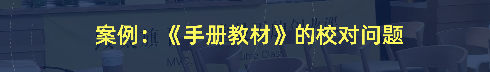

比如，一堂教材《手册》项目出现了一个很严重的问题，本来计划在正式寄送供应商大规模印刷之前，会有3-5个同学做最后的评审和校对，避免出现错别字问题。

但是这次大家都很忙，这几个同学就大概翻了翻，有人只是夸了夸手册，有人只是象征性地找了两三个错误交工。临近印刷前两天，到Truman这终审，他发现了50+各种排版、表达问题。

如果问题没发现就进入印刷环节，这一批生产会全部不合格作废，而且会直接影响2周的排期，项目无法按时交付，直接失败。

**【版本1】《手册》检查要细致一点，我们下次要细心。**

> 归因到大家是不是细心的问题 => 未来能解决态度问题。

主观层，要细心：**有点用，但不多。**

**【版本2】《手册》检查问题，角色缺失，没有负责人。**

> 归因到《手册》角色缺失问题 => 未来能解决负责人问题。

事实+归因：回顾事实，找到原因，**但有点浅。**

**【版本3】本质上，是流程缺失的问题，补评审流程。**

> 归因到《手册》评审流程问题 => 未来能解决流程问题。

模型层：找到原因+**建立评审SOP。**

**【版本4】这种公司重要的课程交付物，尤其是大批量印刷物，无法撤回，一旦出错，都是数万+数周的损失，所以公司要补齐这种品控的基本功。**

- 场景：重要交付物、印刷物等的品控。
- 流程：明确评审人，并评审后签字。
- 工具：共建《检查清单》

> 归因到重要交付缺品控，未来直播课、录播课、印刷材料都能使用。

这个本质上是公司的【**品控基本功**】没有重视，这是公司缺少的基本能力和素质，创业公司松散（简单）惯了，是时候打一个补丁，跟大家讲，以后的关键设计一定要做好品控。

这个还是流程类的，我之前这些年的经验，很多复盘最后都复盘到了这一层：
1. 做新业务，从0到1探索很慢，总觉得是流程/方法论问题，最后发现是**缺合格的业务负责人。**
2. 内部做营销，标题总是不如人意，分析到过程、方法，最后发现，团队没重视**卖点打磨基本功。**
3. 线下NPC培训，总结方法论、过程资产，最后最大的收益是公司"**有能力做志愿者内训**"了。

不管是成功还是教训，如果你能复盘到能力建设这一层，深度就足够深了。

**【更多💡】**一堂至少80%的认知资产，都来自于复盘：
1. 复盘马拉松，我们总结了一套活动共建玩法...
2. 写投放标题，我们总结了一套写标题的方法论...
3. 做直播讲课，我们整了一套直播配置严格SOP... 
4. 做临时开会，我们形成了一套攻坚会的特别机制...
5. 做磨课拉升，我们把跟我开会，提炼成了审美拉升会...
6. 做会员推荐，我们搭建了一个动力阻力认知模型....
7. 做教育创新，我们提炼了一套教育的本质公式.....
8. ....

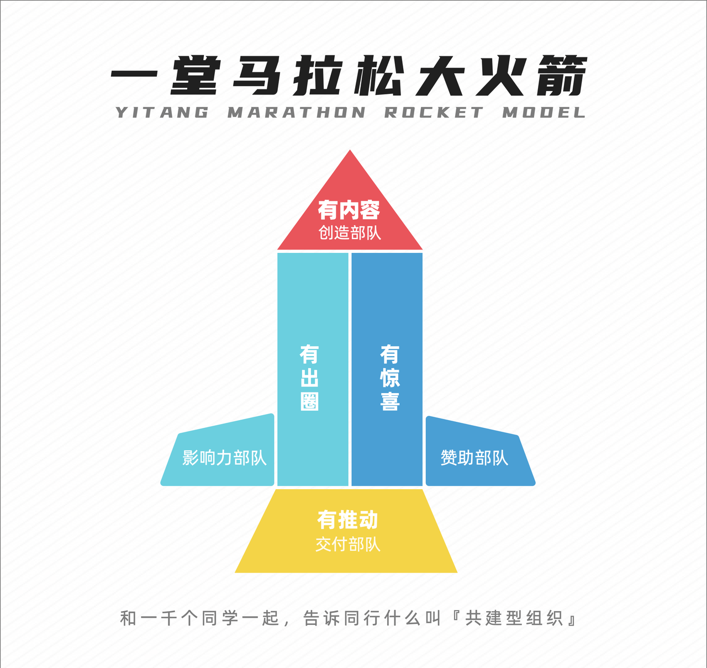

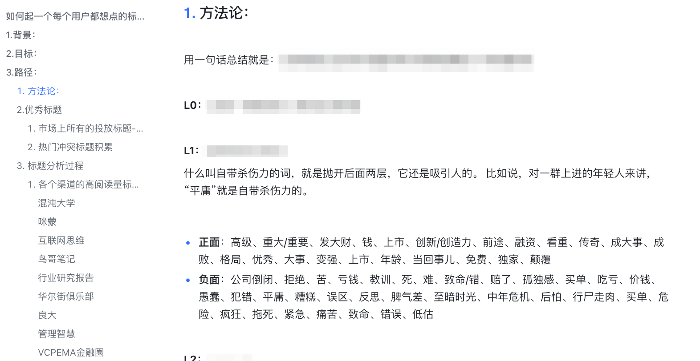

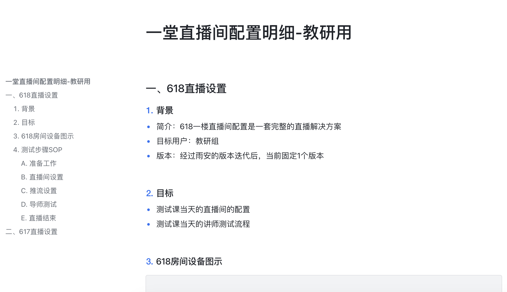

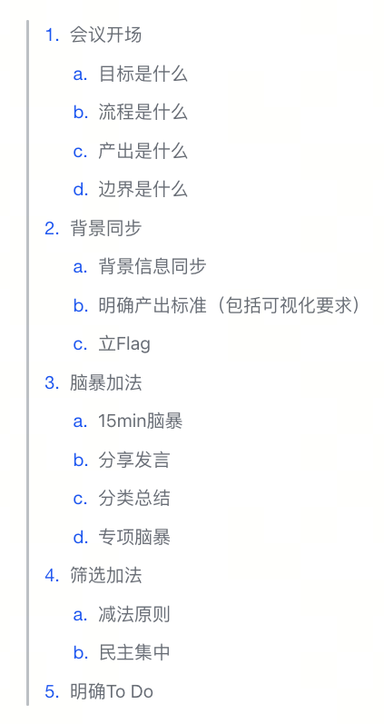

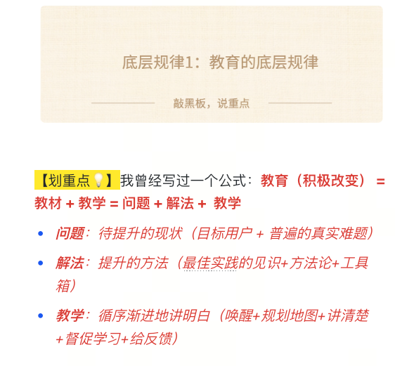

好，这几层讲完了，我们再回顾一下。

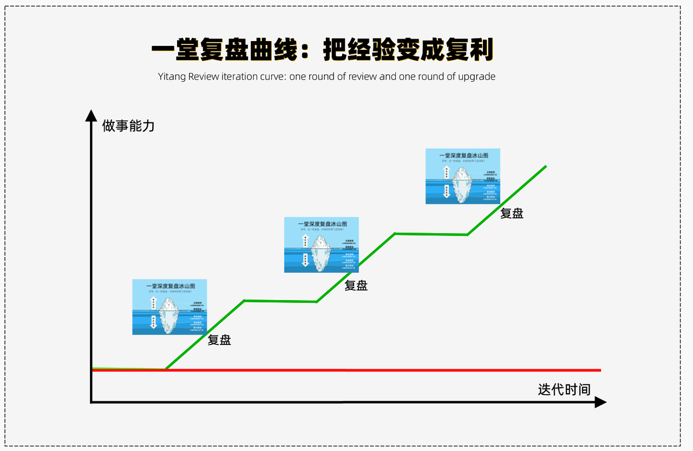

理解了复盘的价值、复盘的深度，我们进入高阶部分，让复盘真正变成你们团队的武器。