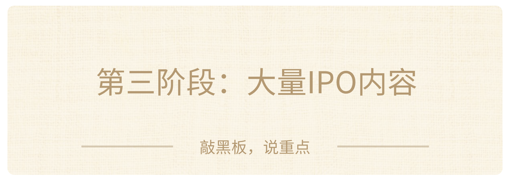

## 我的成长过程

**【提问🙋‍♂️】**大家觉得，什么是好的知识管理？应该有哪些特点？

————

磨课时，不少同学（包括一个清华本硕博学霸）看了我的知识管理系统，都觉得很受启发，平时太少看到这么完整+具体的知识管理了。

所以这次我不再用Leo的身份了：），估计装不像了哈哈，这次，我就正式给大家讲讲真实世界的Truman，这10年是怎么做个人知识管理的。

说明：请内部自己学啊，很多个人笔记很糙不严谨，从没想过会对外展示，所以有些担（xiu）心（chi），仅供大会员学习，谢绝一切形式外传。

### 第一阶段：按直觉总结

刚毕业的时候，我就知道了记笔记是一个非常好的习惯，所以，领导每次跟我说的话，我都努力记在本子上。有时候手上没拿本子的时候，我就会记在word里、A4纸上，甚至是纸巾上。

当时记的时候，很爽，但是经过一段时间的记录之后，我突然发现两个问题：

**第一个问题**：我发现**真正需要用的时候，这些东西，我很难找到**。

> **领导说**：上次跟你说的xxx的事，你为什么没记住？上次跟你说的xxx模型，怎么又忘了？

> **我的内心独白**：我真记不住啊，上次的那张纸，早就不知道被我扔到哪里去了……

**第二个问题**：当我换了一个工作的时候，我**不知道自己积累了什么**。

虽然之前工作挺努力的，也获得了不少成绩，但是我能找到的，就只有我的那个笔记本了，那时候就感觉自己成长很慢。

大家感受一下，是不是很真实？我们在磨课的时候，发现很多人都是从这个阶段开始的。只不过有些人很快过渡到了下一个阶段，有些人，要在这个阶段停留很久。

可能是我运气比较好，大概经历了半年的时间，我就已经渡过了第一个阶段。

来，咱们一起进入下一个阶段。

### 第二阶段：记下来备忘

对于我来说，从第一个阶段到第二个阶段，最大的里程碑，就是发现了**印象笔记（Evernote）**。

我当时发现身边的同事在用印象笔记，他可以把所有东西都往里扔，看起来挺不错的，所以那个时候我也开始学着用印象笔记，用法也很简单，就是每天打开一个笔记本，**把最近做的项目、写的方案、我自己的思考、老板说的话，一篇一篇往里扔**。

用了印象笔记之后，的确解决了我丢信息的问题，**我不太会错过身边的优质信息了**。

**【案例】金句的不断积累，这篇笔记积累了10年。**

之前没有印象笔记的时候，其实也遇到过很多灵光乍现，或者优秀的文案，但当时也就是看完一乐，根本不记录。直到需要写文案的时候，才发现根本记不起来，还得自己绞尽脑汁去想。

后来，我专门开了一篇叫**「各种正能量收集」**的笔记，就是把我在生活里遇到的所有金句，那种特别好、特别正能量的句子，未来有可能会被我用到的句子，全都扔到一篇笔记里，我给大家读读吧。

你们看到的一堂的金句，很多都是从这篇笔记里面摘出来的。

> 十年饮冰，难凉热血。

> 预测未来最好的方式，就是亲手实现它。

> 山脚下太挤了，我们山顶见。

> ……

在这个阶段，我已经不太容易丢事情了，而且我沉淀下来的内容，都是可以搜索的。大概持续写了200-300篇笔记之后，新的问题出现了。

**新的困扰**

随着我的笔记越来越多，我发现它们越来越混乱，所有的笔记，都是排成行，这一片儿是工作心得相关的，那一片儿是业务思考相关的，还有一片儿是外部建设相关的。

当我的主题越来越多的时候，有些笔记，我就**不知道该放哪儿**了。

> 比如一篇营销相关的读书笔记，到底应该放到【营销】里，还是放到【读书】里？

> 比如一篇读书相关的思考笔记，到底应该放到【读书】里，还是放到【思考】里？

这个时候，我就**特别希望能有一个完整的个人知识体系**，让我所有的笔记有结构，怎么办呢?

而且觉得自己的笔记增长速度太慢了，如何可以大范围的加速学习呢？如何把我大量平时的学习、思考都沉淀进来？

来，我们进入下一个阶段~

### 第三阶段：大量IPO内容

这个阶段，我开始大量的IPO，我甚至做了一个工作，就是在我的主要阅读场景里面，围绕着印象笔记，去挑选一个能跟印象笔记关联的工具。

给大家举几个例子吧：

> Chrome 到印象笔记：使用Chrome插件

> 微信文章到印象笔记：剪藏笔记工具

> 36kr文章到印象笔记：Mac的Reader

使用大量的工具之后，我的信息收集效率提升了一个量级，当时觉得自己特别厉害，那段时间，正好是我做一堂之前，没有那么忙，有比较多的自由支配时间，然后我就**开始大量丝滑地去阅读、整理、收集**。

我在三年的时间里，大概收藏了3000篇左右的文章。3000篇意味着什么？意味着我至少看过3万篇偶遇的内容，才能积累3000篇收藏到印象笔记里面的文章。

那个时候，我会看一些商业的主题、营销的主题、产品的主题，各种演讲，各种最佳实践，各种读书。如果没有那三年的积累，我是不可能做出现在的一堂的。大家可以看一下我当时的一些整理。

这段时间确实对我的帮助很大，让我在商业、产品等各个领域，都有了比较长期的想法。但是这个阶段，我又陷入了新的困扰。

**新的困扰：**

这个阶段，我收藏的东西太多了，**收藏的内容，已经远远大于我能消化的内容**。大量的收藏导致我特别焦虑，就是我学了很多、收藏了很多、知道了很多，但是跟我有没有关系？对我解决问题有没有帮助？我真正理解这些知识了吗？不一定。反正我收藏了，我就很快乐。

**【互动🙋‍♀️】**大家经历过这个阶段么？如果经历过，可以在评论区扣个：**333**

——————

这个阶段，我对全量的信息都很感兴趣，所有人推荐的书我都想看一看，所有的领域我都想学一学。区块链来了，我想看一看，WEB3.0来了，我也想学一学。当时的我，**感觉自己无所不能，什么都想学**，好奇心无穷大，我不想给自己设边界。

这就导致一个后果，我学了很多，但是做事能力几乎没有增长。

当我遇到非常具体的商业问题的时候，我发现我学的知识毫无用处。**真正有效的东西，来自于我自己的思考，我自己的总结，我自己的萃取，我自己的刻意练习，我自己的专题学习。**这个才是有价值的，东拼西凑的内容，其实是没有意义的。

带着这个认知，我进入了第四阶段。

### 第四阶段：结构化专题树

到了这个阶段，我开始问自己：

- 未来，我想要什么？不想要什么？
- 一个人的内核是什么？
- 一个人的边界是什么？

**我的内核**

我给自己画了个圈，最核心的，只有三个能力。

**第一个能力**：做教育的能力

**第二个能力**：泛产品创新的能力

**第三个能力**：把一家公司做成的能力

**我的边界**

我对教育感兴趣，对商业感兴趣，对营销感兴趣，对摄影感兴趣，还有自己的一些爱好。但是这个圈之外，未来10年，甚至20年，都不是我感兴趣的。比如金融、比如二级市场炒股、比如区块链，边界外的内容，在我这都是会被屏蔽的。

有了内核和边界，我就可以给未来10年甚至20年的自己，建立个人成长的知识树了。然后划分个人成长的专题，这个时候，我就可以**Top Down地划分我的几个板块**了。比如个人成长的几个板块、公司经营的几个板块、兴趣爱好的几个板块。

通过这些板块，我开始给自己做减法，尝试着把我那几千篇笔记分类。

你知道整理几千篇笔记有多难吗？因为它都是我精挑出来的笔记。到底怎么做呢？我**开始有信息的结构，开始有笔记本，开始有二级分类，开始有文章排序**，然后**全部Top Down，全部是结构化的**。

所以大家看出来了吗？这个事，是有顺序的。当我**有了自己的内核**、有了现在要做的事，比如我想做教育创业，我就**知道了我长期需要锻炼的能力**以及**我的边界**，这个时候再构建知识体系，就更容易做到清晰，做到结构化了。

我大约用了半年的时间，打造了一个相对流畅、高效的个人IPO模型，搭建完之后，内心就感觉非常安全、非常笃定，因为我的**知行在这个环节是合一的**。

那个时候就非常开心，所以我就不会再出现当年那种越学越多、越学越弱的情况了。给大家稍微看看我现在的知识库。

**【互动🙋‍♀️】**我在印象笔记里敲了一本书，但是这本书我从来没读过，笔记一个字都没写，这个东西有价值吗?
1. 有
2. 没有

——————

我的答案是非常有用，**把书名放在笔记里的价值，甚至比我读它还有用**。

放到我的印象笔记里，就是让我清楚地知道，如果我想学营销增长领域，这些书，都是过往在各个地方有人推荐过的。比如说，我笔记里有一本《让创意更有黏性》，这本书是王兴当时推荐过的，我就赶紧把名字记在这了。

我知道现在我不着急学，但是当我未来需要学、或者需要了解这个领域的时候，它在我的知识体系里就是一个线索，让我知道这本书很好。这就像你在某个领域有一个非常专业的朋友，推荐给你一本书，说你以后但凡要做这个事，一定要看这本书，然后他把书送给你，你放在书架上。**你给自己留了一个线索和确定性，这个确定性本身，就非常重要**。

除了敲书名之外，我还有一些其他的习惯，可以跟大家简单分享一下。

**开始养成习惯：关于给文章打分**

我会给一篇文章打分，我的习惯是xx%，一般是**70%-99%**，99%代表它是我在市场上、在这个领域内能找到的几乎最好的文章、最好的案例，对我启发很大，未来对我自己做事会有很大程度的影响。

看文章的时候，如果我觉得这篇文章里面至少有一个核心观点或者知识点，会对我长期有用，我都会收藏到我的笔记里。打过分的，意味着如果我未来想深入了解这个领域，要主动阅读，没打分的，可能主要以搜索为主。

**开始养成习惯：关于文章评论和思考**

每一篇笔记，我自己的习惯是用三个颜色，分别是粉色、红色、黑色。

**粉色**：我的心得，是我**自己手敲**的

**红色**：是我标出来的**重点**

**黑色**：用来**结构化**

这就是我的第四个阶段，我Top Down地搭建了自己的IPO模型，并且用各种方法和技巧，让我的IPO比较丝滑和舒适，甚至要跟别人聊一些专业领域的时候，我也能各种给你推荐东西，还能给你讲清楚。但是这个阶段，我同样遇到了一些困扰。

**新的困扰**

这个阶段，我的学习还是太浅了。什么是太浅了？就是**收集、汇总、思考、分享，然后就没了**。虽然我的宽度够了，但是对于某个领域的深入了解、深度训练，还是没有达到。如果我想创业，**光IPO是远远不够的，我需要修炼一些核心能力**。

很幸运，这个时候，我开始接触到刻意练习，把我带入了第五个阶段。

### 第五阶段：持续思考 + 刻意练习

这个阶段，我开始理解【学习】和【刻意练习】之间的差距，我开始坚信，**所有的能力，都是练出来的**。

这个时候，我开始做一些特别的笔记，比如**专题学习笔记**、**话题萃取笔记**、**深度思考笔记**、**刻意练习笔记**。这四种笔记，对我长期的能力成长，有巨大的帮助。

给大家举几个例子吧~

**案例：优秀决策主题的专题学习**

比如说，之前我思考过一个特别有意思的问题，**我党很多改革开放的优秀决策，跟一个优秀的公司的决策，以及一个优秀的创业者的决策，是不是有很多共性？**

为了想清楚这个问题，我大量地去看改革开放那时候是怎么思考的，什么叫解放思想，改革又是怎么做分区实验的。所以当时我就开了一篇笔记，收集了一堆信息，还做了横向对比。

**案例：逐字稿主题的专题学习**

再比如说，有一段时间，我遇到了一个很有意思的工具：**逐字稿**。

我感觉逐字稿太厉害了，真的是颠覆认知，以前从来都没见过。我终于能抓着一个让我提升讲课能力的工具了。

所以我就花了一个晚上的时间，**把所有我在各种主流平台上能找到的逐字稿的文章内容，全都给抓回来放到一篇笔记里，然后整理了一篇专题学习笔记。**

**案例：优秀标题的专题学习**

再给大家举一个我学习优秀标题的例子。

有一段时间，我发现自己每次看到优秀的标题就深受启发，但是回家给自己的文章、课程起标题的时候，又不知道该怎么做了。

所以我就想了一招，**我把所有能找到的优秀标题，做了一次全量的研究和分类，一次性把这个专题吃透。**

我做好分类之后，未来想要什么类型的标题，只要抄他们的就行了。

那次我大概用了一晚上的时间，把印象笔记里面**3000+篇文章**，做了一次review，把我觉得好的标题一个个分类。

最后大概整理了**200多个优秀的标题**，然后分成了**10类**，这10个类型，基本涵盖了所有标题的套路，未来只要对这10个套路进行组合，就**几乎能涵盖我想要的所有类型的标题**。

做完这个工作，我就特别开心，我觉得以后再写标题，就可以直接抄作业了。

**【🎁礼物】**哈哈哈，这篇笔记大家想要么？写作业吧，课后Candy送给大家~~~

上面三个例子，都是一些专项能力的学习，其实**我的核心能力，也是按照这个套路刻意练习出来的**。

之前有很多同学都好奇，我是怎么练习讲课能力的，今天就跟大家简单分享一下我有关【讲课】这个核心能力的刻意练习笔记。

**案例：讲课主题的专题学习**

说到讲课，大家通常的做法就是做教案。好一点的，自己写教案，普通人可能就是网上找一个自己觉得不错的教案，改一下就直接讲了。讲完之后，随便记一记心得，这儿记一点、那儿记一点，就完了。

这样很难精进啊，结果大概率就是一直在低水平地不断重复。我是怎么做的呢？

我专门在我的印象笔记里面开了一篇笔记，叫**【如何做好一节课】**，这篇笔记整理了我那段时间中100个小时的刻意练习，包含了我的**反思、**我试过的所有**假设**，以及我构建的做课**模型**。那100个小时我的**体会**和**收获，**我所有的**成长**，都可以在这篇笔记里面找到。

我用这篇笔记，把我自己变成了一个会做课的人。你们现在看到的【预热思考题】、【Candy】、【金句图】，看到的很多教学方法以及情节设置，都是在这个阶段练出来的。

如果没有这篇笔记辅助我做知识管理，我几乎不可能做出现在这样质量的课程。持续思考 + 刻意练习，让我可以一直提升个人IPO的上限，不断突破天花板。

最后，是一个我比较羞于分享的案例，我一直不太想在公开场合讲，但是教研组都觉得这个案例特别精彩，大家想听吗？如果想听，可以在**评论区打个1**，我看看大家的想法，要不要跳过这个案例：）

——————

**案例：打麻将的案例**

> 提醒：这个就是20小时小白入门版，请不要用这个模型用来赌博，真的会输光的。

**深度思考笔记**

好，讲完专题笔记，再跟大家聊聊深度思考笔记：其实**虽然深度思考的能力比较难，但它是可以刻意练习的**。面对一个复杂的事情，如何深度思考，甚至如何挖掘本质，这是一个核心能力。

很多人看得特别浅，是因为没有意识和方法，没有反复要求自己深度思考。**越懒越浅，越浅越懒**。其实深入几次，养成习惯，就会变得很容易。

我在印象笔记里面开了很多深度思考的笔记，给大家举一个例子吧。

**关于《流浪地球2》的深度思考**

看完《流浪地球2》的电影之后，我发现我特别喜欢这个电影，觉得它是一部非常顶级的作品。然后我就发现，各种平台上有很多关于《流浪地球2》的影评，什么角度的都有，特别多、特别散。

然后我就想，**我能不能做一次深度思考，一次性地把各方的影评和我认可的观点都给结构化**？所以我就一层一层地深挖，看自己能不能挖到三层、五层，甚至七层。

那好电影怎么评价？

**第一层：**

一般的评价，看到的是电影的**设定、任务、剧情、画面**。

再深挖一层，它是一部科幻电影，科幻电影看什么？看的是科幻的价值、看的是场景的炸裂和情节的冲突，从科幻电影这一层来说，《流浪地球2》也是顶级的。

**第二层：**

第二层看到的是**中国工业电影的发展。**这是电影工业的一个成果，电影工业看的是什么？看的是整个的电影产业的分工，看的是工业化能力，看的是我们现在产业的成熟度。从这个层面出发，你会看到一个不一样的东西。

**第三层：**

这个电影背后你再深看一层，会看到一个大市场注定会产生好的作品，就是**中国电影市场**通过这些年的蓬勃发展，成为了一个足够大的市场，它能养出好电影这件事情是必然的。

**第四层：**

然后再往后看，你会看到所谓**东方文化的内核**，这里就不展开了。

好，咱们回来。大家应该能感受到，当你们不断地深挖一个复杂的事情，看一层、两层、三层、四层，你可以**越看越本质**，这个东西其实是可以刻意练习的，你就逼着自己往后想个3-5层就好了。

好了，我的知识管理的成长之路，基本就讲完了。

在磨课的时候，我说过一句话：**如果没有知识管理，我的成长很快就见顶了。**

但是有了知识管理，我可以**持续沉淀积累、持续迭代升级、持续保持最佳的认知状态**。

### Now：一堂团队知识管理

现在我主要是带着团队来学习，个人的知识管理不太重要了，我尽量避免纯个人的私密学习。我在带着团队一起搭建新的IPO模型。

主战场在**飞书**（方便协作），我个人辅助用印象笔记（个人知识）和Flomo（记录灵感和新关键假设）。

好啦，我的故事讲完了。

在这次磨课中，我们收到近100份共建作业，我看到了大量同学的成长故事，基本都是这个方向。不过有的同学可能刚上手，还在第一第二阶段徘徊；有的同学很资深，甚至有同学用Notion搭建了一个很复杂的个人系统，比我这个还要复杂很多。

看完了案例，下面，我们来回顾一下背后的**『知识管理』**逻辑。