## 60分合格：做备忘

ok，我们先来看看第三个阶段：做备忘。

### 理解差距

我们先来看两类典型的知识管理习惯：

**第一类，我叫做『随做随忘』型。**

- **相信脑子：**平时会遇到很多想法、点子、项目，用脑子记："我可千万别忘了"。
- **碎片记录：**偶尔会用纸笔记录一些，但是很碎片，扔得到处都是。
- **大量丢失：**1周以后，1个月以后，1年以后，这些重要内容留存不到10%，甚至1%了，大量丢失。
- **无法回顾：**真正需要用的时候，发现又得从头开始，没有积累、没有沉淀、没法搜索。

**第二类，我叫做：『沉淀备忘』型。**

- **积极收藏：**平时遇到各种好文章、书、课程、案例，都会有意识收藏，保存到统一的笔记本里。
- **超级靠谱**：领导说过的话，交代的事情，不需要重复两次。
- **点子很多**：遇到需要头脑风暴的时候，点子总是很多很快。
- **效率很高**：同类型的问题基本不会犯两次，总能快速找到答案。

### 开始掌握

知识管理做到60分段位的人，他们善于用工具来记忆和存储，打造第二大脑，大幅提升效率。

我们大量总结发现，做到60分段位，需要遵循三条原则：**全部沉淀，结构清晰，方便调用。**

**【提问🙋‍♂️】**哪些值得被收录、收藏，沉淀进你的『知识库』？

————

很多人都对于知识的来源很有『心理包袱』，就只保存读书笔记+文章，希望每一篇都**完整、清晰、工整**。

常常因为『不够完整』『没想清楚』就羞于放到笔记本里。

但这样其实浪费了大量的知识，所以知识管理的第一个原则：『全部沉淀』。

信息来源不应该设限。不局限于书、课，一句话、一张图、一个奇怪的想法都可以，不要有包袱。

比如我就有各种奇怪的笔记：一句话金句，一个关键假设，一段录音，一个书名字，一段歌词，一个标题or昵称，飞机场偶遇的一个广告牌子，都可以扔进去。

比如，下面是同学们的随手收藏：

中心思想，就一个逻辑：形式和来源不重要，所有对于未来大概率有用、miss掉很可惜的内容，都可以扔进去。

> 不太重要的你可以随手收藏Mark一下，如果你想消化、整理的，就可以收录进你的笔记本。

有个同学，做了个有趣的比喻：**把自己想象成一只蜘蛛，有一张大网，随时等待「猎物」上门。**

如果你能把日常偶遇的重要知识&材料，有意识地不断整理，长此以往，两三年以后，你会拥有很强的确定性信心，你会对于自己『积累式的成长』，充满力量。

第二个原则，结构要尽量清晰，你可以用笔记本目录、标签等管理内容。

1）非常常见的问题，不管形式，就是**一直堆叠**，一直堆，一直堆，堆到最后发现混乱不堪，压力很大，没有分类、没有分级、没法查找、很难排序。

2）或者第二种情况，就是**追求大而全的体系**，一次性建立几十个笔记本，用了几年，多数的空着，觉得自己学习水平特别差，很自责，开始逃避，也就越用越少了。

如果你刚开始做笔记，就准备3-5个目录吧，最好不要超过10个，而且最好控制在2-3层以内，越简单越好，只需要尽量做到两件事就好了：

**【划重点1💡】尽量符合你的思考习惯，跟你自己有默契。**

不要尝试抄别人的现成答案，根据你自己的需要，自己组织结构吧，你要清晰知道每个词的含义，以及彼此有哪些区别和不同。

而且好的笔记，最好是随着内容的不断复杂，去不断拆解，逐步长出来的。

比如@Liming的Notion笔记本，开始想学习写东西，建立一个笔记本：**写文案。**

后来发现内容太多了，发现里面有两类完全不同的能力，就分成了两个目录：长文案，短文案。

**【划重点2💡】如果可以，顶层目录，尽量追求MECE（不重不漏）**

在顶层目录，尽管很难，你应该尽量追求MECE，彼此区分开，这样更方便你整理和查找内容。如果你能做到MECE，你就能更清楚地知道：**这篇笔记放在哪儿，这篇笔记从哪儿找。**

大家可以对比一下这几个目录的区别，能感受到区别么？

**【划重点3💡】如果给自己一些余地，可以设置一个『其他』（或『归档』，『更多』）**

如果你每次整理分类都很费劲，试试这个文件夹，你会很喜欢它的：）

**【提问🙋‍♂️】**假设你现在有1000+篇笔记，如何找到某一个特定的笔记？有哪些方法？

——————

通常来说，有4个常见方法：
1. **目录查找：**根据目录、标题排序快速找到。**#最重要**
2. **搜索查找：**通过关键词查找，记住特定关键词。#最快速
3. **标签查找：**根据笔记标签，进行分类查找。#进阶
4. **链接查找**：利用文档之间的双向链接，构建知识地图。#复杂

下面，我快速讲一讲，大家检查一下自己的能力：

**【目录查找💡】如果你想用好目录，请做好三件事：**

| 可以试着整理逻辑 | 参考 |
| --- | --- |
| 1. 笔记本：最好清晰，有逻辑，有顺序。 2. 文件名：最好清晰，有逻辑，有顺序。 3. 文件内：最好清晰，有逻辑，有顺序。 |  |

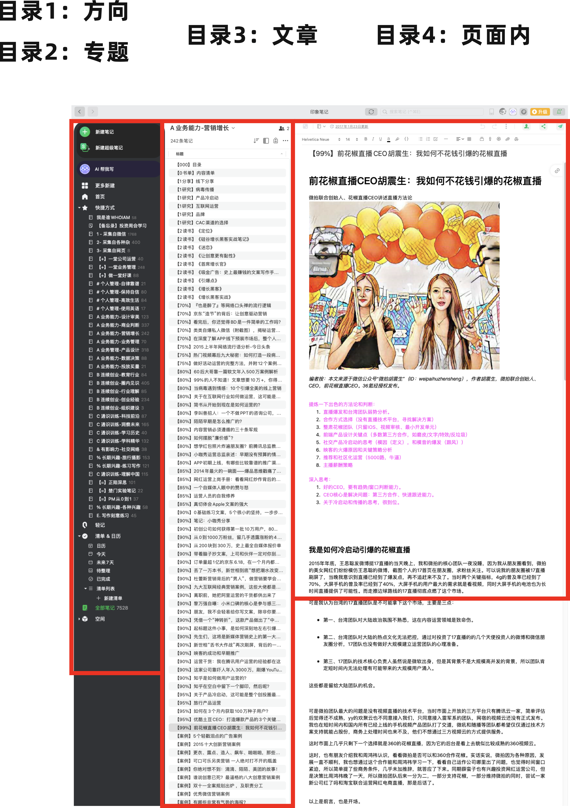

> 目录是一个构建Topdown最好的方法，用来多层次快速锁定内容，难点是需要持续更新、分化和调整。

注意，重要文档一定要规范命名：不要出现《无标题》、《未命名》、《演示文稿1》这样的命名，**创建一时爽，查找火葬场**，这样的文档基本就石沉大海了。

**【搜索查找💡】方法2：在方法1的基础上，可以大幅提升搜索效率，比如：**

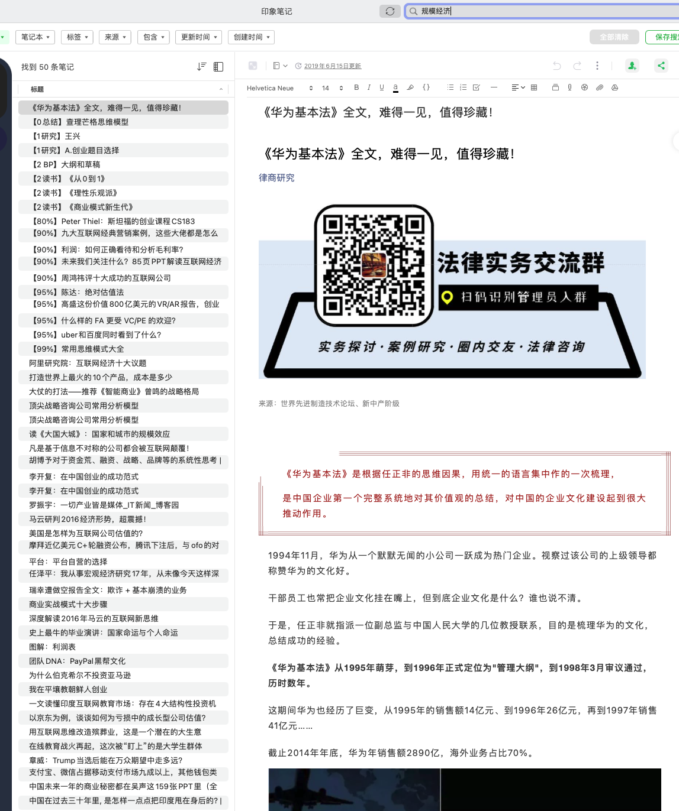

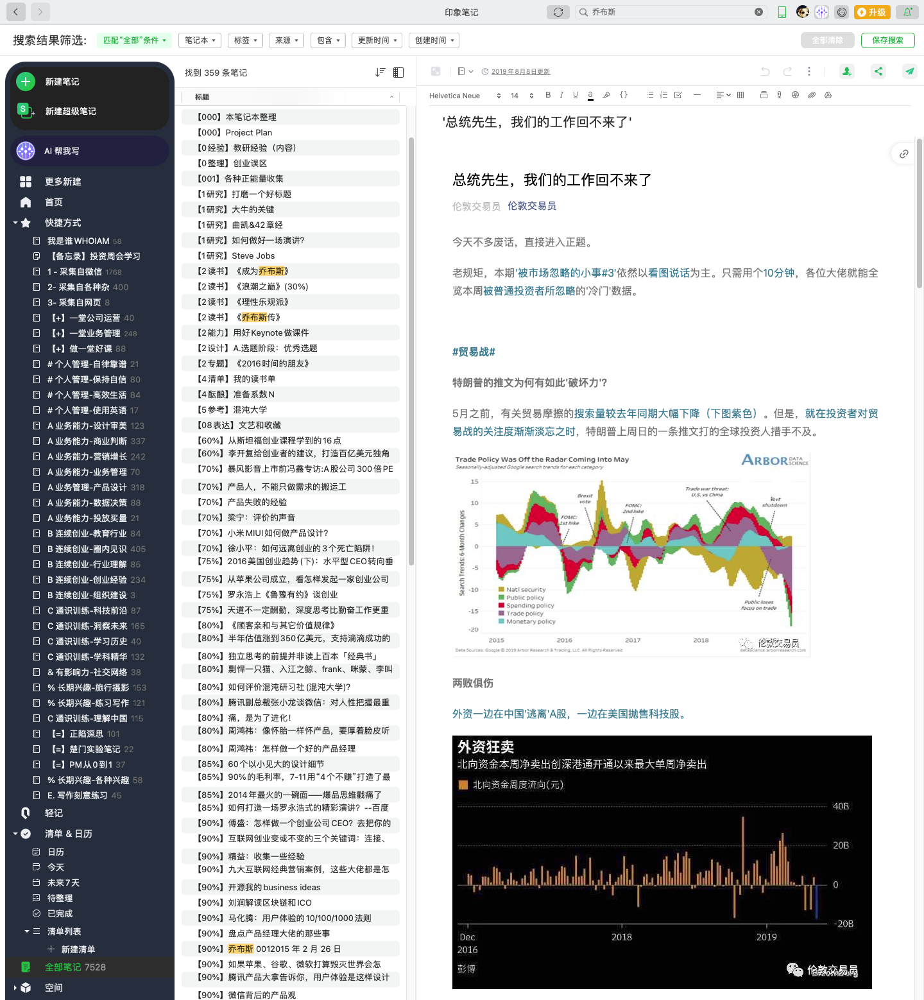

> 好的目录结构，会大幅提升检索效率，如上图。

**【标签查找💡】方法3：如果你想精细化管理，可以参考这些同学的标签系统：**

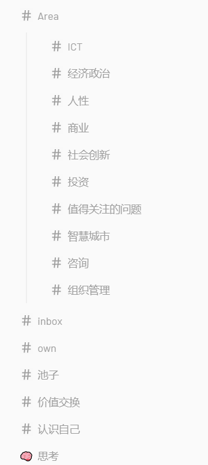

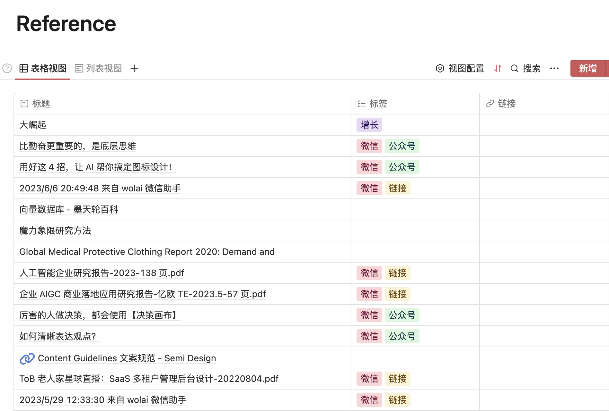

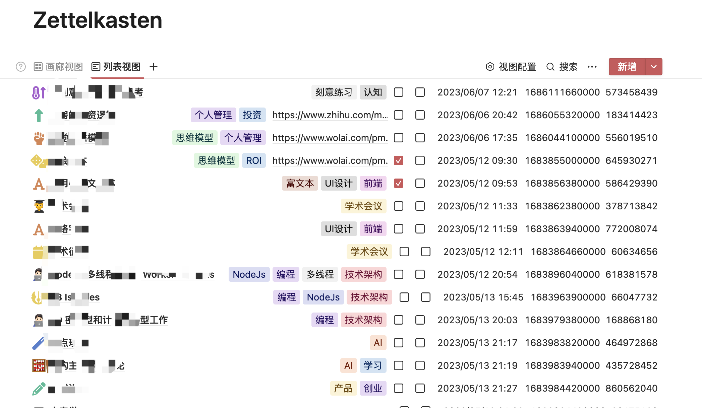

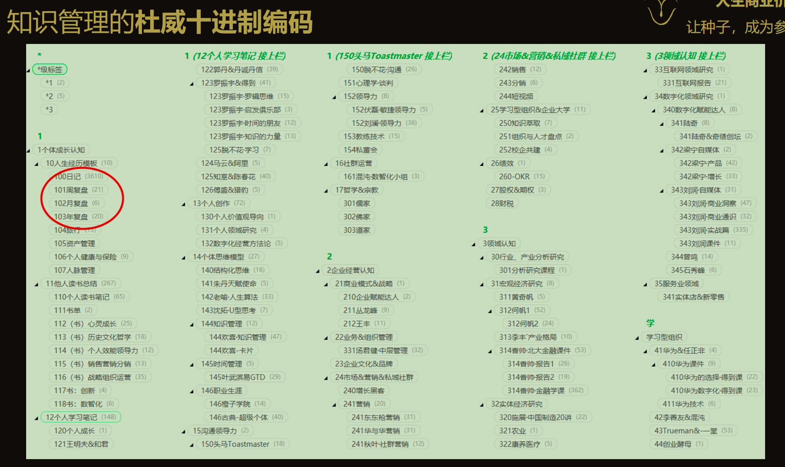

> 如果你在做数千篇笔记，且50+以上标签，可以尝试用用标签。

> 注意：标签因为很难MECE，管理和更新成本是很高的，除非遇到很复杂的体系，否则慎用。

> 我自己尝试过，发现成本太高了，就弃用了，我现在更多用【多级目录】管理。

**【链接查找💡】**更多方法：用好双向链接，让你的知识系统连成一片。

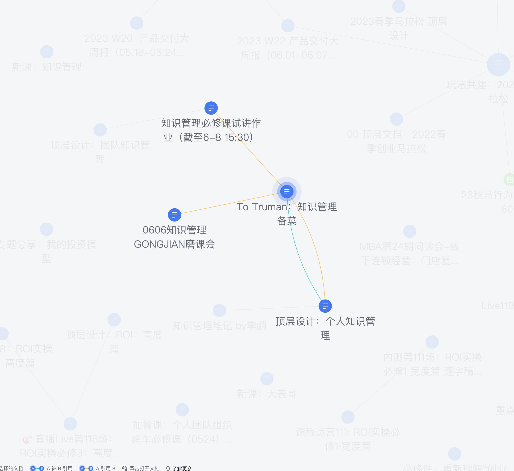

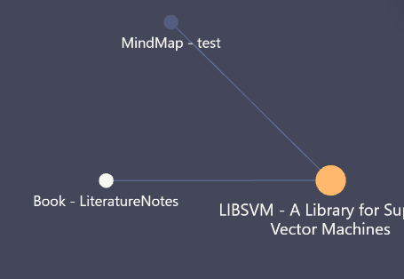

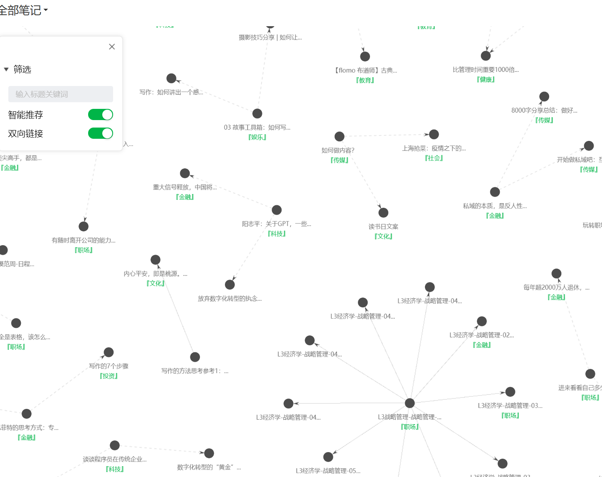

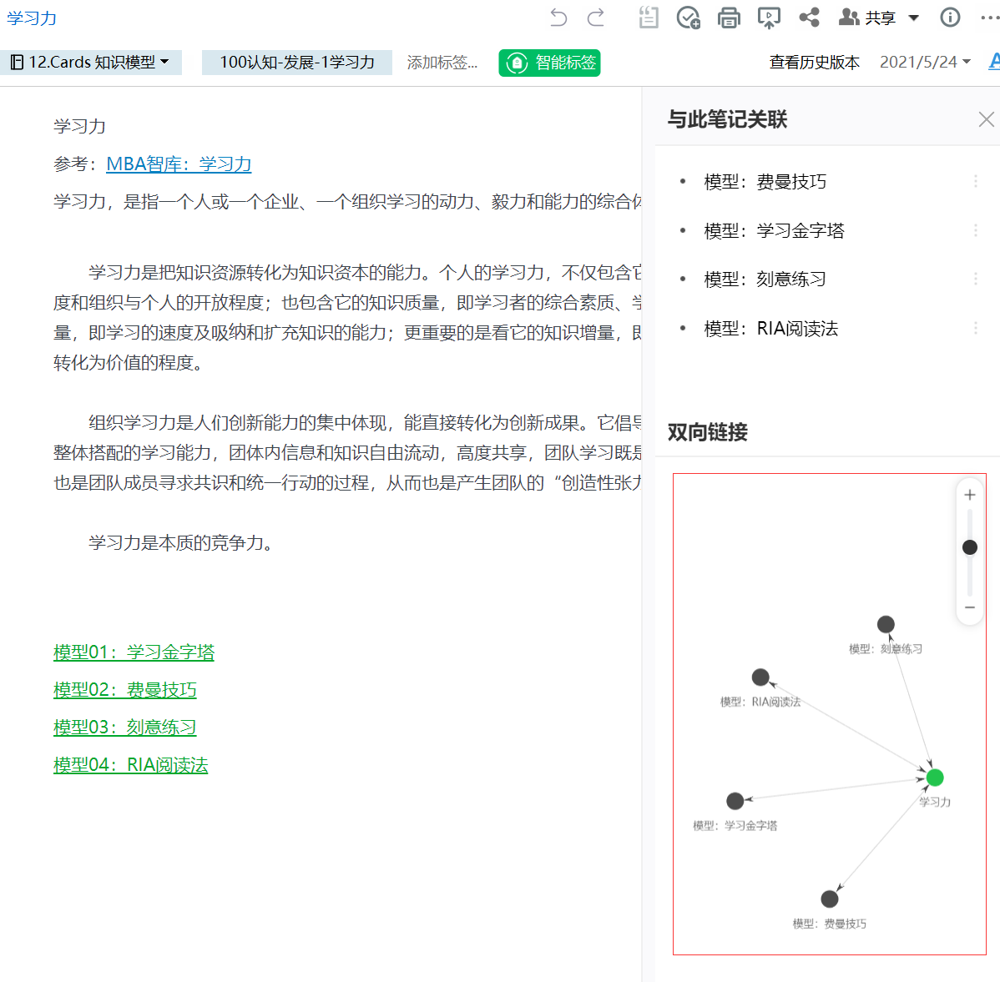

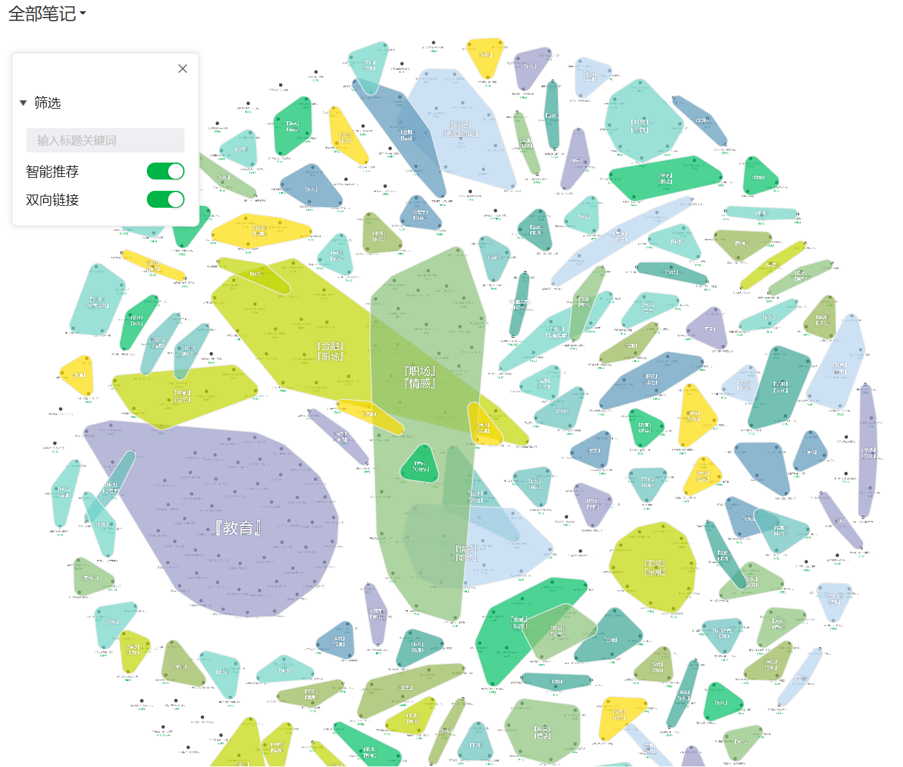

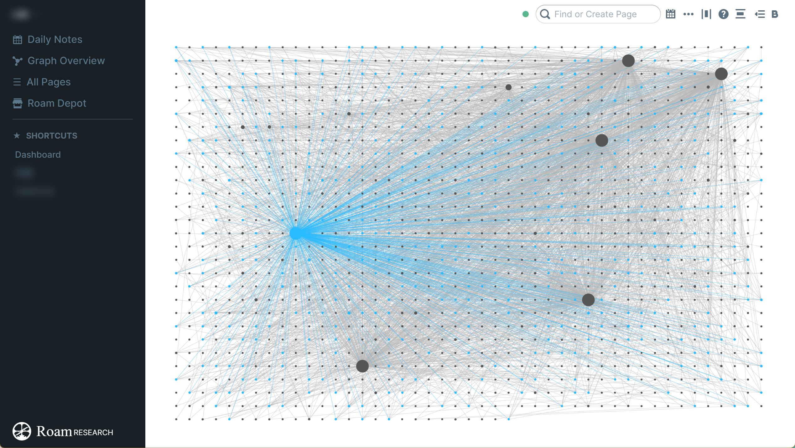

如果你的内容非常多，且很难简单分类（目录/标签），那么双向链接可以帮你找到文档之前的知识联系，把大量的旧文档、隐形文档挖出来，让你的知识连成一片。

OK，这就是60分，沉淀备忘的知识管理系统。

你只需要做到：**全部沉淀，结构清晰，方便调用。**就能够合格啦，大家觉得自己够合格吗？

：）

好啦，知识管理之旅才刚开始，下面进入第二阶段：建体系。