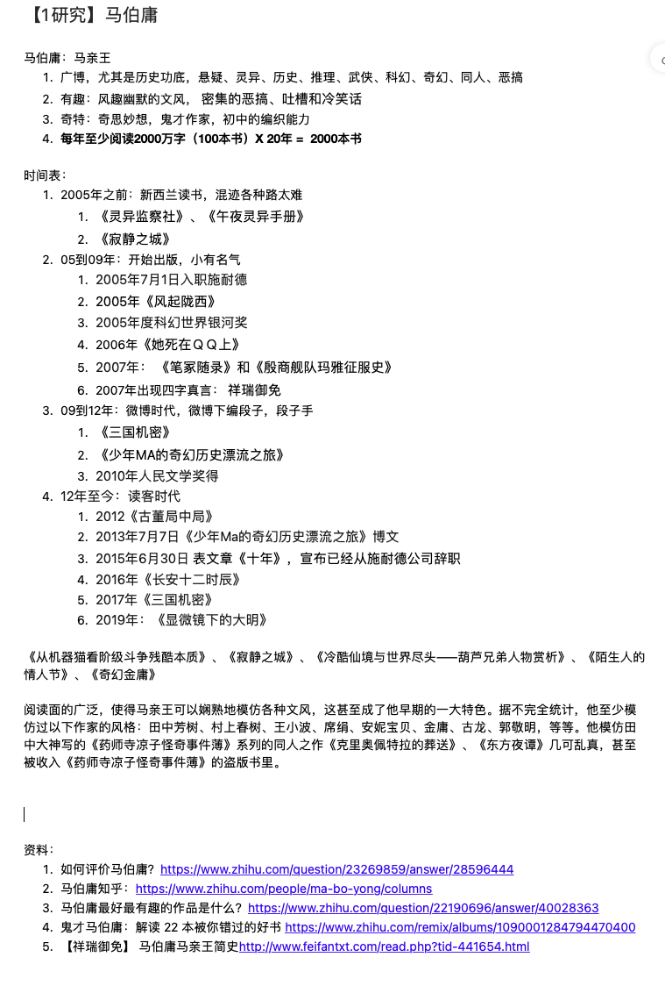
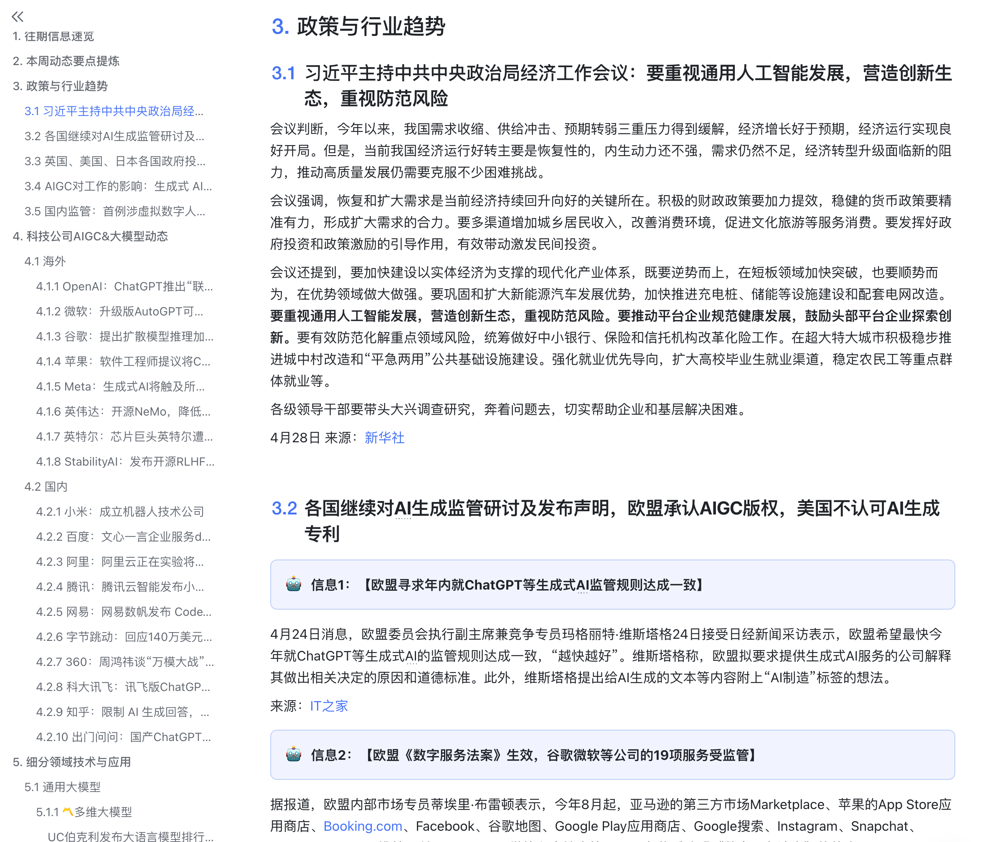
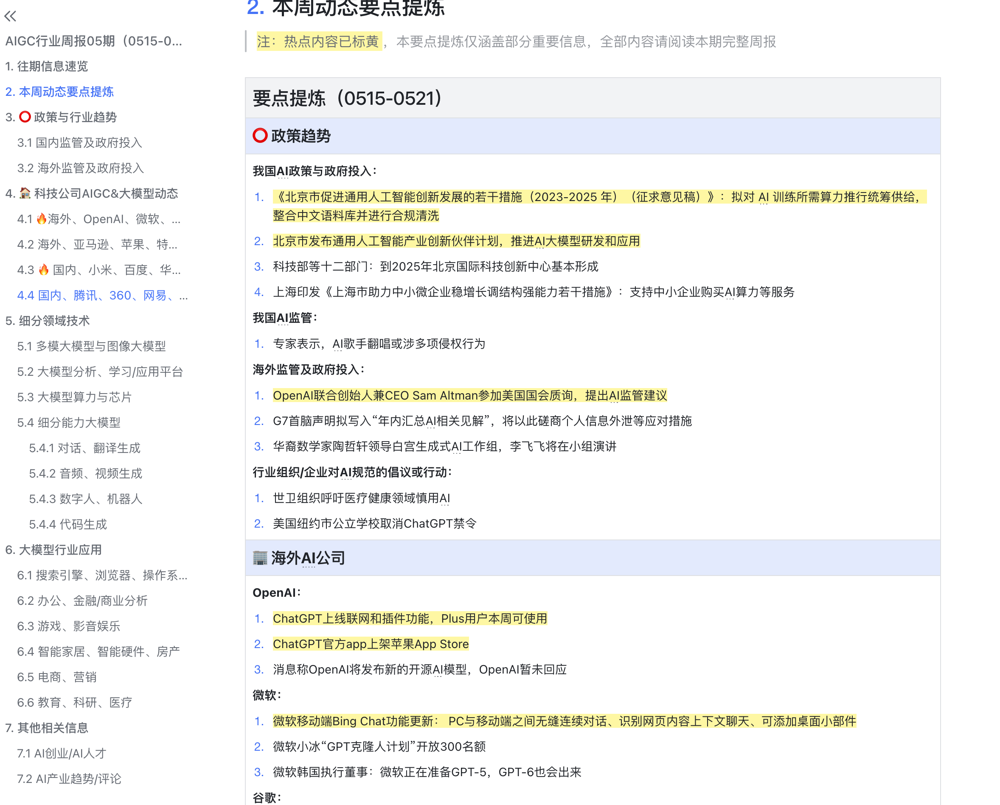
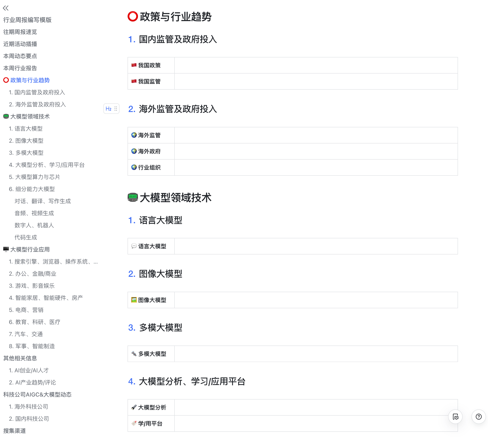
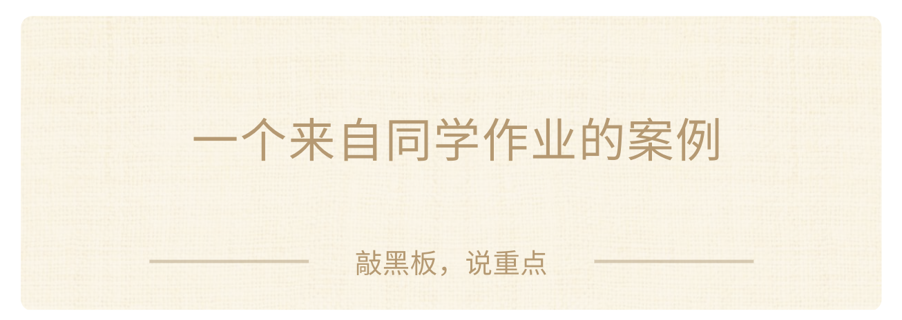
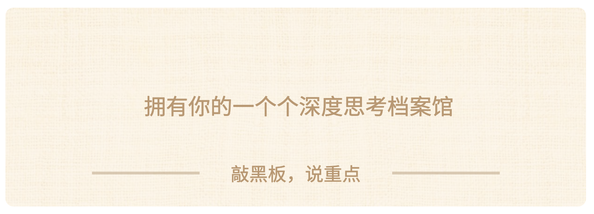

## 70分进阶：建体系

如果你可以基本做到，过去的重要素材，长期备忘、持续沉淀，这时候你就可以进入第二阶段的难题了。

### 理解差距

**第一类，我叫做『混乱堆叠』型。**

- **越做越难：**大量信息放到笔记本里，越放越多，存入越来越顺手，提取越来越困难。
- **收藏成癖：**开始一种热爱收藏的状态，大量囤积但消化不了，存了大量没读的文章。
- **不想再见：**面对上千篇笔记，压力山大，获得的不是成就感，而是"满地碎片的废纸"。
- **兴趣无穷：**拥有一堆文章太美好了，以为拥有了就可以学会，所有领域都想看，兴趣无穷大。

有个同学写了一句话，哈哈：**收藏如山倒，阅读如抽丝。**

很真实，大量地收集，却越堆越多，没办法消化。

**第二类，我把他叫做：『丝滑体系』型。**

- **明确目标：**知道自己想要什么，围绕自己的未来核心能力来构建知识体系。
- **整理有序**：定期分类笔记、整理顶层思考，让整个笔记变得整洁而有效。
- **高速IPO**：大量涉猎信息，方便收藏一起，并且定期分类、分级、消化吸收，IPO丝滑而高质量。

怎么提升呢？还是给你三个应对原则：**成长建模、设缓存区、主题学习。**

这一篇的方法论原理，涉及到《IPO模型》，如果想挑战L4段位，请务必先修完这节课

### 开始掌握

这是一个消除『无限收藏』的基本方法：**成长建模。**

你可以尝试列出来3-5个你最核心的领域专题，以及N个你感兴趣的其他专题。但是同时告诉自己一句话：我的精力是有限的，N数量可以多，但是一定不能无限拥有，**图书馆书都很好，但把全部书搬到知识体系里是没意义的。**

**【划重点💡】**什么意思呢，请认真问自己2个问题：
1. 什么是我的**内核？**我的长期核心能力 or 领域是什么？
2. 什么是我的**边界？**哪些领域越界了，我并不关心，可以直接跳过？

**比如，以我自己的个人笔记本为例：**

- **内核x4：**教育、产品、创业、商业。
- **重要x10：**审美、营销、数据、组织、科技、历史、未来、中国、写作、摄影。
- **不碰：**金融、区块链、编程、算法、二级市场、理财、汽车.....xN。

当我想清楚了我的核心领域，基本上我的IPO就有的放矢了。

属于这些领域的文章、好书、课程我都可以扔进来，统一消化处理。而这个范围外的内容，暂时可以不关心。

所以也请你不断思考你的【认知内核+边界】吧，把这些内容，变成你的知识体系。

ok，下面是大家通常会遭遇的一个新的问题：

**【选择🙋‍♂️】**很多内容都没认真看过，太碎，可能没啥用，要放到我的笔记本体系里吗？
1. 不放，保持笔记本高质量和整洁。
2. 放，直接放到对应领域目录。
3. 其他：_____________

————

这时候，笔记本一个重要的特性就出现了。

好，下一个策略：给你的知识系统，设计一个缓存区。

什么意思呢？把一些搜集来的、未分类的、未想清楚的，统一放到一起，然后长期慢慢消化。

我的日常工作流：**日常全场景偶遇 - 一键收藏 - 印象笔记缓存区 -  打分/收录主题**

- **手机偶遇：**微信群、朋友圈、公众号。**#目前服务暂停了**
- **电脑偶遇：**Chrome插件。
- **主动RSS阅读：**Reeder。
- **主动纸张扫描：**扫描宝。

然后我不定期整理：阅读笔记（用于速读），打分（用于排序），收录笔记本（用于主题阅读）。

> 这截图是比较好的状态，并不是每一篇都值得认真记笔记，大概20%左右。

**【爱心❤️】**提醒一下，不用太担心缓存区无法清空，没关系，虽然没有全部整理，但是『搜索』完全ok，这些内容依然非常有价值。

比如我的印象笔记一共7528篇笔记，其中有2100+篇存在缓存区里没有整理，没关系，能搜能找，未来如果有时间再整理好了。

比如我的Flomo里，几个月时间写了100多个灵感（金句/关键假设/朋友圈选题），其中70%都没有变成任务，没关系啊，堆得越来越多并不会有心理压力，反而会非常爽：**开会的时候，满脑子都是idea：）**

当我们有了明确的领域目录，有了足够大的缓存区，就可以持续往里面丢东西了。

这时候，IPO的巨大价值就可以发挥出来了：**主题学习。**

我在内部讲过一句话：**新人只会按渠道学习，老兵常常按主题学习**。

还是以我为例，一次专题学习的价值，胜过10次随机学习。

- 某个方向，多读几本书。比如精益创业、互联网思维。
- 某个话题，搜索构建模型。比如逐字稿、冷启动、单元模型。
- 某个作者，搜集信息整理专题笔记。比如罗辑思维、李叫兽，马伯庸。

比如有个同学，最近想学习AI，就开了一个专题笔记，研究AI：

> 最近在学习AI，需要了解行业动态。所以建立了一个动态收集文档，确定动态分类和渠道，做好框架，有目的性地搜集并进行整理。按照每周更新迭代的方式持续推进。

有一个同学，在GONGJIAN计划里，分享了一个他领导的案例：

> 以下均是作业案例原文，未修改。

——————————————————

**案例来源：我的上级，做过多个突破性的创新产品（招行第一代一卡通、银联第一代电话支付系统等），同时也是深圳图书馆第一代数字化图书馆的总架构师（对图书情报处理有顶层认知）**

我曾经问过他：

>  为什么能够做到解放思想，走在所有人前面，做“无中生有”的突破性创新，也敢于挑战权威并且成功了？

他的回答是：

> 理解了**该领域的本质。**

我继续追问：

>  每个领域的知识量巨大，如何知道哪些知识是关于本质的，哪些是非本质的？

他的回答是：

> 不要总是跟风追太新的书籍，找该领域的经典大学教材，或者反复多次升级版本的理论书，**越是稳定的框架，越接近本质**。

我补充提问：

>  经典教材建立的框架虽然稳定且接近本质，但不能与时俱进，如何将新生的知识与现有的领域知识框架良好融合？

他的回答是：

> 以领域经典知识体系为骨架，建立增量知识与现有理论体系的对标索引，在自己脑子里建立自己的信息索引体系。

他给出的一个判断是：

> 任何领域涉及本质的书籍和文章，**数量极少**，一旦找到之后，要不遗余力的反复进阶萃取，**不要太过于追求知识的新、快、多。**

我理解上面的最佳实践，也是支持能够做到解放思想的基础。

——————————————————

而且最有趣的是，这个专题学习，是在一个领域专题里才能酝酿出来的。

我们脑补一个场景：

> 有一天你有时间，进入了一个虚拟档案馆，这个档案馆叫做『创业』，这里面有你前N年所有遇到的好书、好文章、思考、灵感、反思，几百篇内容，上百万字的精华内容，全部呈现在你面前。

> 这个时候你去思考一些更高维 or 更底层的问题：什么是商业的本质？什么是产品经理的本质？美团为什么有机会胜出？

> 这个时候，你的思考质量，是远远比在路上遛弯，随便想想质量要高的。

面对几万字的各种笔记，再去二次提炼一篇几百字的笔记，这个笔记的思考质量会远胜于任何一篇文章。

这就是我跟大家讲的，如果没有我的知识管理，**一堂很难被做出来**，大家现在能认可这句话了吧？