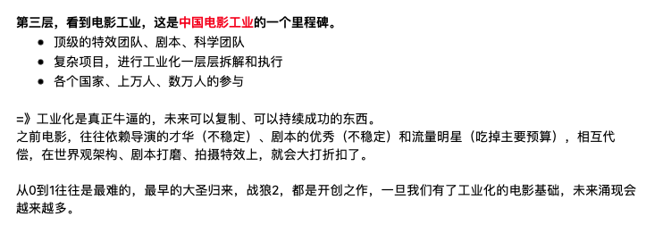
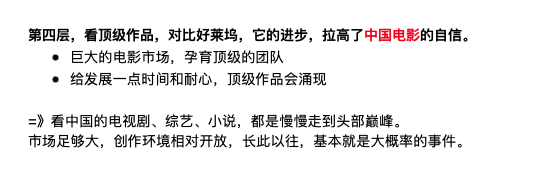
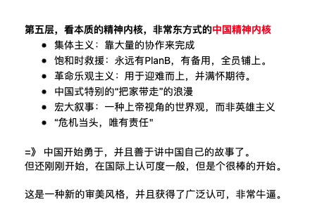
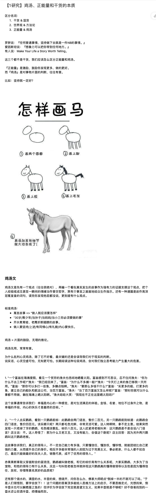
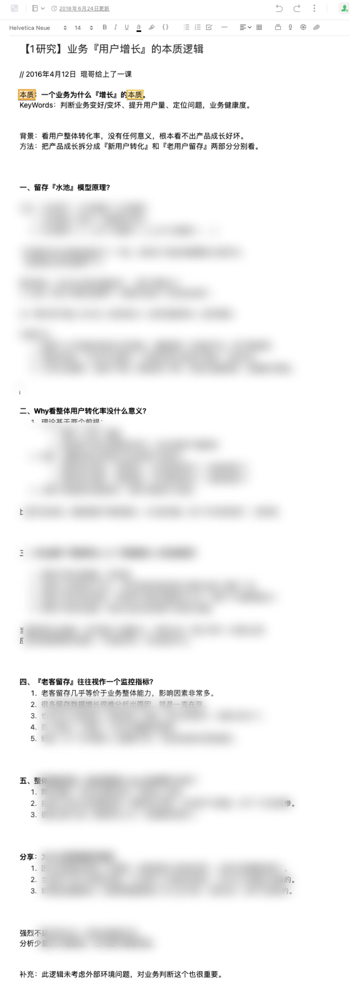
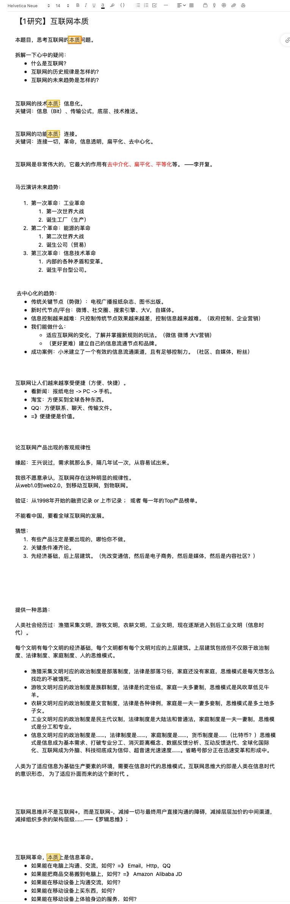
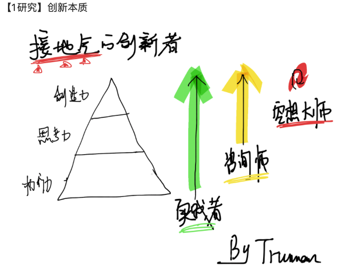
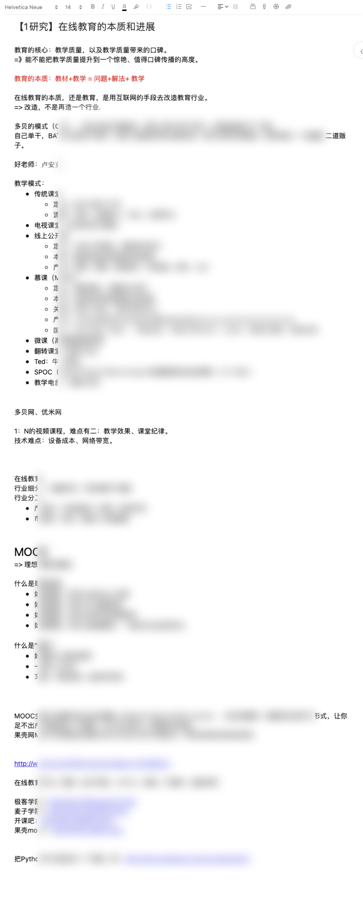

## 85分高阶：练能力

如果你可以基本做到，明确自己的内核和边界，有大量的缓存区，并主动去做主题学习，这时候你就可以进入第三阶段的难题了。

### 理解差距

**第一类，我叫做『只学不用』型。**

- **碎片撞车：**大量的碎片内容，感觉自己知道了很多，但做事能力没啥改变。
- **更加焦虑：**学的东西越多，感觉自己越牛逼，但做事时候，也越来越焦虑。
- **很少迭代：**基本上收集、阅读、开心一下就结束了，很少持续使用笔记。

这时候，开始感慨：我读了这么多书，依然过不好这一生啊。

**第二类，我把他叫做：『知行合一』型。**

- **目标笃定：**非常知道自己想训练什么能力，相信刻意练习。
- **整理套路：**把自己的关键能力，整理成一篇笔记，一边做，一边更新，一边进步。
- **持续迭代：**入门水平的笔记就是入门水平，随着笔记变成专家水平，人也会变成专家。

怎么提升呢？还是给你三个应对原则：**保持渴望、练习笔记、持续更新。**

这一阶段的方法论原理，涉及到**《刻意练习》**，如果想挑战L5段位，请务必先修完这节课：

### 开始掌握

**【提问🙋‍♂️】**你有哪些想长期刻意练习的能力？有多少条？

————

刻意练习的前提，就是保持对于成长目标的渴望。为了这个目标，你需要刻意练习一些能力。

建议你可以开一篇笔记，整理你想用20个小时锻炼的一些小能力，用10000个小时锻炼的长期能力，这些能力就可以成为你知识管理L5段位的核心。

> 20小时定律和一万小时定律，参考一堂《重新理解『科学成长』》

如果你想达到L5段位的知识管理水平，请务必反复问自己，自己内心最想训练的能力是什么？列出3-5个，或者10-20个都可以，你得希望在这些能力上，练成合格选手，甚至专家。

**【划重点💡】比如我对自己的练习的理解（部分）：**
1. **核心能力：**泛产品创新、方法论提炼、底层思考、商业分析。
2. **专项能力：**讲课，记笔记、逐字稿、写文案、用户体验设计。
3. **兴趣训练：**写作、摄影、打麻将（20h）。

**【提问🙋‍♂️】**有了我的抛砖引玉，你有哪些想要长期训练的能力？

当我有了这些训练的目标，L4级别的知识管理系统瞬间就不够用了。

有了练习目标，下一步，就是伴随着你的知识管理，进行长期的刻意练习了。

**【划重点💡】**笔记类型：**主题学习笔记 < 刻意练习笔记 < 深度思考笔记 << 本质思考笔记**

- 主题学习：学一个话题，而不是拘泥于某一个材料。
- 刻意练习：总结一个能力的套路和模型，并持续回顾反思。
- 深度思考：练习3-5层深度思考能力，持续挖掘背后逻辑。
- 本质思考：思考事情的底层稳定框架，思考本质规律（底层逻辑/学科经典/第一性原理)

第一种**主题笔记**：上面讲过了，可以对于某些话题做汇总、整理、重新思考。

每一篇主题阅读笔记，都是你对于这个领域最Topdown的通透理解。

第二种**刻意练习笔记**，可以专门总结属于你的套路和方法论。

每一篇笔记，都是你刻意练习的模板，是你的核心套路。

第三种，**深度思考笔记**，深度思考几层，拨开表象，找到更底层的逻辑。

每深看一层，你都能举一反三，找到非常多的新规律。

最后一种，也是最难的一种，**本质思考笔记**，非常难，但是做完了非常爽。

好啦，最后一个原则，就是持续更新。

为什么到了L5要持续更新了？因为这些笔记都是『**长期笔记**』。

这每一篇笔记，都代表了你以年为单位的思考、更新和再思考，所有值得长期更新、长期迭代的，不求新，但求体系完备、自洽。

比如我的《如何写好一个需求文档》，每一次评审发现bug，我都更新一条进去；

比如我的《如何讲好一堂课》，我连续更新了半年，刻意练习了100个小时；

比如我的《在线教育的本质》，前两年断断续续更新了十几次；

比如我的《理解王兴》，我大概每读一本书 or 有新的想法，都会更新一轮；

再比如我的《打麻将的段位》，每打完一场，我都会去添加2条(一共就2个月内)...

笔记伴随着你的练习和升级，慢慢变成『人页合一』的状态，你就过关了。

好，三个段位我就讲完了。大家感觉怎么样？能判断出自己在哪个段位吗？

下面最后一个环节，我来带大家重新理解一下，知识管理的内核是什么。