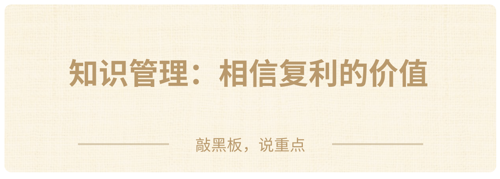
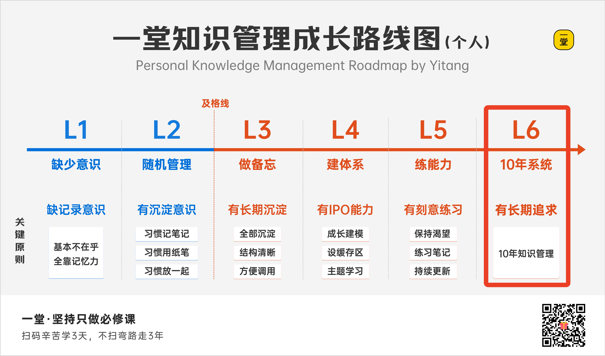

## 重新理解知识管理

### 第一个词：打造你的知识仓库

在共建作业里，我们看到这样一句话：**以前只知道学习知识就可以，没想到知识也需要管理。**

我们普遍接触知识的场景，就是遇到困难，拿来学习和解决问题的，很少系统思考过，要对知识进行管理。

所以我们做知识管理，到底是在做什么？

知识管理不是todolist，不是备忘录，不是图书馆，不是精美的知识收藏夹，**知识管理是在打造你的知识仓库**。

就是你可以把你每一天工作生活中，各种各样的知识都缓存进去，等到需要用了再随时取出来。

回顾一下前面我们讲到的三个段位，正好代表了三层知识，分别对应了三个缓存区。

**【划重点💡】松散的知识(备忘) <结构化的知识( IPO) << 萃取的知识(刻意练习)**

所以，知识管理，就是帮你打造一个，面向未来的，所需的知识缓存仓库。

### 第二个词：追求长期主义

很多人可能已经有做知识管理的意识了，但普遍面临一个难题就是：**坚持不下去**。

我们在磨课的时候，听到了各种同学的遗憾：

- 如果我在做教练的时候，能坚持沉淀和迭代我的训练库的话，现在我一定可以成为一个职业的足球教练了。
- 如果我在做产品的时候，能长期沉淀对于产品的创新理解，现在我说不定就是一个产品专家了。
- 如果我在做运营的时候，每个活动结束能坚持去沉淀新认知的话，现在我一定是一个牛逼的运营操盘手了。
- 如果我每次写文案，不是就当一篇文章去写，而是尝试提炼要素然后反复修正，或许早就成为文案高手了。
- ……

首先不得不承认，知识管理是一个先付出再收获的过程。这背后需要的就是我们的**长期主义**。

追求长期主义，就是让我们把一天天的工作，变成工作能力，甚至放大到10年的成长里。

如果你对自己有要求，想成为某个领域的专家，想拥有某个核心能力，那么追求长期主义的知识管理，几乎是你的必经之路。

### 第三个词：相信复利的价值

我在课上反复说，**如果没有我之前的知识管理，不可能有现在的我和一堂。**

其实这就是复利效应。复利的价值，远比我们想象中的大。

我一直觉得，知识管理，让经验一丝一毫都不浪费，永远在激发和萃取的路上，是让我们拥有**「人生复利」**的最好方式。

这也是我们在知识管理上追求的最高段位L6，以十年成长为目标的长期追求。

终于可以把这张图讲完了：**L6段位，就是以10年为单位视角，来构建你的知识体系。**

最后，送大家一句话吧：**种一棵树，最好的时间是十年前，其次是现在。**

从最小的笔记开始，去积累吧，去行动吧！十年后遇见最好的自己~~