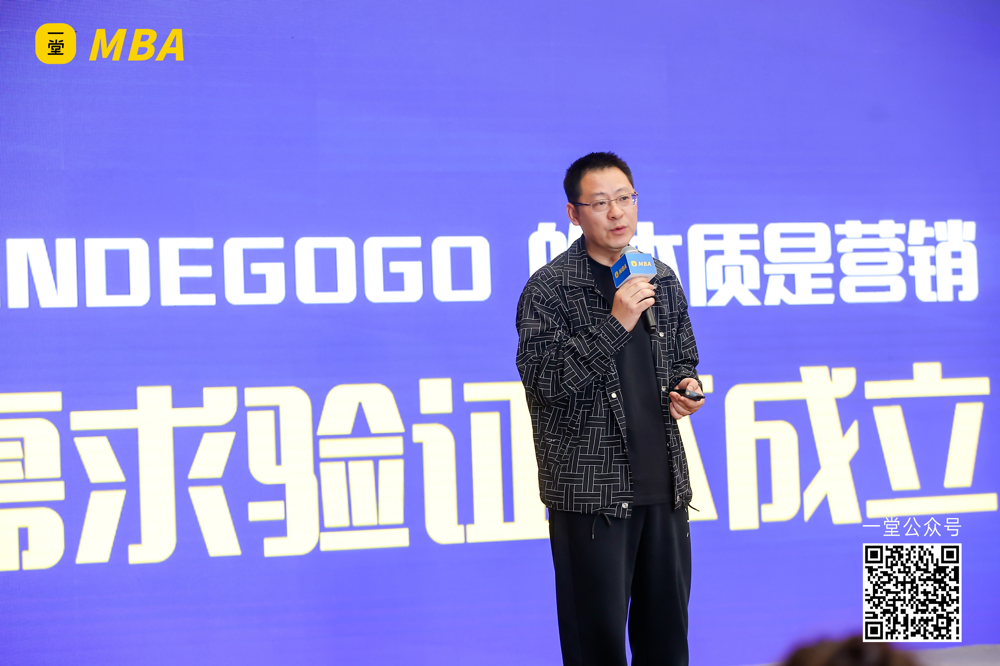
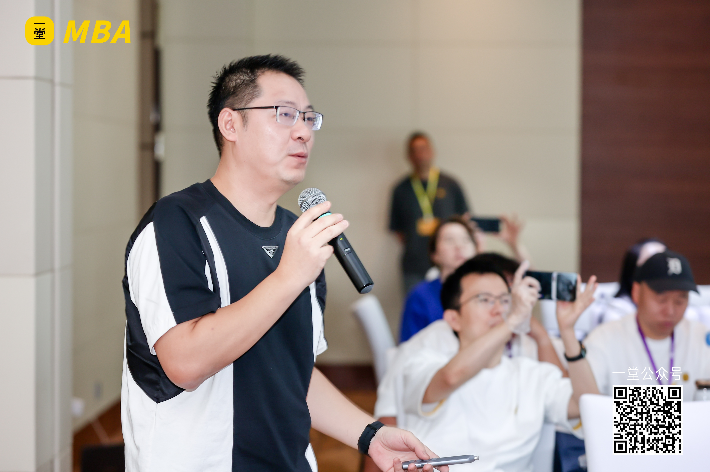
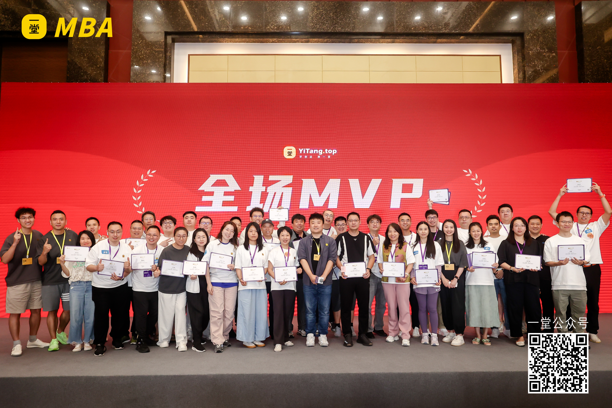

## 从猫到虎：Y模型与大客户销售

### 开始上课

hello，大家好，我是劉衞。

很开心今天收到一堂的邀请，来做这一次的 Y 模型解读之夜。

大多数同学估计都是第一次见面，下面简单做个自我介绍吧：

**我在商业管理领域的经验，几乎持续积累在ToB/ToG的业务上：**

- 我是做**人力资源出身**，04年毕业进入跨国公司，05年加入华为；
- 07年加入某专网通讯龙头上市公司，开始和**营销**杠上了，负责过**海外业务**和**国内销售管理**工作，主要客户是ToB和ToG，具体点就是公检法司，电网水利，石油石化，铁路林业等大客户生意。
- 12 年加入亚洲最大的工业设计公司，做CEO。
- 15年前后，下场创业，横跨ToC、ToB、ToG领域，做过无人机，机器人，物联网和人工智能设备。
- 18年前后，斗胆开始陪伴一些头部公司和创业公司进行**组织和战略升级**，在工信部专精特新小巨人和北京大学智能科技研讨班，担任创业导师和IPO商业顾问。这些年**参与和操盘过三家公司上市**。
- 我在一堂还有一节正式的必修课：《重新理解"战略会"》

除了连续创业者，还有一个我特别想说的身份，我是一堂的**连续MVP**：

- 2025年，复盘营第一次拿MVP，再到MBA线下营初进高阶，我一共拿了4个MVP，据说目前这个比较稀缺；
- 2026年，Truman邀请我成为MBA线下营教练，一堂同学生猛，我们班级也拿了进阶营和高阶营全场MVP：）

#### 为什么要讲

今天来分享，倒不是为了证明我很会卖东西。这已经是很久远的事情了。

为了让大家更有代入感，我先问一个更具体的场景，尤其是在做的ToB/ToG业务的同学，或者带销售队伍的同学，应该会有感觉。

你们公司有没有这样一种业务？

里面总有两三个人特别能打，客户也认他，业绩也靠他。可一旦你问：**这个项目为什么能成？换一个人能不能接？项目风险在哪里？大家就说不清楚了。换一句，不说清楚。**

最后往往只剩下几句话：**关系搞到位，客户挺支持，应该差不多**。

如果你是老板/业务负责人，或者管理销售队伍，这种状态应该不陌生。看上去每个人都在忙，单子也在往前推，但组织层面其实看不见过程。只能等最后那个结果回来：**成了，大家松一口气；丢了，再找一套解释。**

**心若在，梦就在，只不过是从头再来。**

十几年前，我花了很长一段时间，就在处理这个问题。

我最早不是做销售的，我是做人力资源出身。先去了华为，后来进入专网通讯龙头，从海外大客户销售做起，再管理国内事业部的大客户业务。

**一堂让我今天来分享这个案例，不是因为我天生特别会卖东西。**恰恰相反，我刚开始连大客户的门道都摸不着。

如果让我自己定义，我觉得自己更像一个**组织塑造者。**说白了，我关心的不是培养一/多个销冠，而是**能不能让一批新人也做到七八十分，让客户关系不只长在某一个人身上，让一件事的成功可以被解释、被训练、被复制，然后持续。**

后来，这套东西在国内事业部逐步跑起来：

- 我们连续两年超额完成业绩。
- 在 18 个铁路局里拿了 14 个。
- 林业和消防的市场占有率从 30% 提升到 60%

这组结果在十几前当然重要，但今天更重要的，是我探索这件事的过程：**一个原来依赖个人能力的大客户销售团队，怎样慢慢长出组织判断。**

再往后，我又管过工业设计公司，经历过无人机/机器人/AI物联网方面的创业，也做过企业上市辅导。

**行业一直在换，客户一直在换，但有一件事没变：每换一个边界，我就得重新回到事实里，把原来的判断再修一遍。**

这也是我今天想借自己的经历，和大家把 Y 模型讲一讲的原因。

不是因为它能替你解决具体业务，也不是说用了它就不会失败。

我想讲的是：**做得多，但是到底怎样才会真的越来越会？一个人从实践里长出来的判断，又怎样变成组织下一轮还能接着用的能力？**

BTW，在这里先感谢李𬱖输出的逐字稿，如果一会我讲得还行，是她总结得好。如果一会得差强人意，是我的问题。

#### 提前划重点

为了不让大家听到后面迷路，我先把今天的路线交代清楚。

我会讲自己对于大客户销售体系认知的五次迭代。

认知版本

时间

主要背景和认知

认知1.0

2009-2010

接手某专网通讯龙头国内事业部，从现成的理论和经验出发，做出第一版销售流程

认知2.0

2011-2012

开始分组测试销售实践，复盘形成五要素

认知3.0

2012-2013

开始全面推行销售体系，开始加入组织配套

认知4.0

2013-2018

工业设计公司CEO，后又持续在创业中实践，持续跨行业迁移大客户销售认知

认知5.0

2015至今

遇到Y模型，进一步把大客户销售本质转化成公理

在这里，也先把一个边界说清楚：**不是我当年先学了 Y 模型，才有这些实践。**恰恰相反，前面很多事我已经在做了，只是我说不清自己为什么这么做。

后来扥到 Y 模型，把我背后的认识过程重新点出来了，我才知道，原来我一直在围绕目标、事实、框架、假设、反馈和边界做事情。

所以，今天我想带大家看的是：**怎样从照着别人的答案做，慢慢变成能自己提问题、找事实、修正模型；一个组织又怎样从依赖个人，变成下一轮向上出发。**

大家听的过程中，可以一直带着三个问题：

第一，为什么一套看起来很完整的框架，反而会让团队更不会做？

第二，一个人脑子里的判断，怎样变成组织能共同使用的能力？

第三，换行业、换客户、换边界以后，到底什么能带走，什么必须重新做？

好，我们直接回到 2009 年。2009年，我很怀念它。