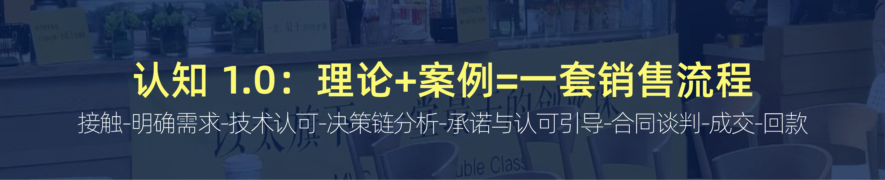
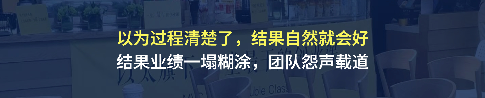

### 认知 1.0：一套完整的流程

#### 真实过程

当时我们做的业务，简单理解，就是把对讲机和专业通讯解决方案，卖给企业或政府客户。

**我当时国内业务，大概情况是这样的：**

- **不成体系：**过去以渠道和小 B 客户为主，真正的To大 B、To G 大客户能力不成体系
- **产值有限：**我接的是一个正在往大客户方向转的团队，团队大概二十五六个人，年营收三千多万元，人均一百多万元
- **下滑趋势：**业务又处在连续下滑中，队伍里每个人还都有自己的打法。

而我是什么背景？

我原来做人力资源，后来去海外做销售，算是比较有规矩的大客户打法。但**海外和国内不是一回事**。国内大客户更复杂，关系、吃饭、喝酒、各种台下动作都有，单子走到一半被抢，也不是稀奇事。

说白一点，我像一个原来在河里游泳的人，突然被扔进了海里。**那套动作我记得，但水有多深、底下有什么暗流，我得重新摸。**

我先做了两件事。

当时的我，碰到一摊自己摸不清楚的事，习惯常常是先找理论依据。**第一件事，找理论：**

- 我去看 IBM 的大客户销售、摩托罗拉的方法、华为的大客户打法
- 也看《输赢》这类当时很有影响的书
- 华为的铁三角、客户分类、项目运作，这些框架我都拿来参考。

**第二件事，看事实。**我把团队过去成功的案例、失败的案例，找销售一个一个聊。总得知道，过去到底哪些动作有用，哪些动作是运气，哪些只是销售讲出来的故事。

拆完以后，我看到了几个很刺眼的事实：

- 少数几个人扛住了部门的大部分业绩，但大量线索却要很多人一起跟。
- 成熟的销售会控制自己的节奏。他明明有机会做两千万元，却只愿意领一千三百万元的任务。因为任务领得越高，下一年的业绩压力就越大。
- 大客户销售又常常在外地，过程不可控、不可考、难评价。组织最后只能看回款，看业绩，看利润。至于手上的项目是在变好还是变坏，谁也拿不出一套标准。要么不开张，开张吃三年。
- 更麻烦的是，团队打法五花八门。有人靠关系，有人靠行业理解，有人靠技术方案，还有人靠命。你让他讲，他讲的都是自己的招，别人学不了。

这时候我形成了一个判断：**大家不是不会做，而是组织没有一套标准：**

**我们不知道一个项目为什么成，也不知道它为什么丢；不知道风险是在变小还是变大；更不知道一个人的能力怎样教给其他人。**

于是我把理论框架和案例实践拼在一起，做出第一版销售流程， 8 个销售里程碑：

接触 → 明确需求 → 技术认可 → 决策链分析 → 承诺与认可引导 → 合同谈判 → 成交 → 回款。

这套东西今天回头看，不难理解。它把一个大客户项目从找线索、做跟进、明需求、到招投标和交付，画成了一条清楚的线。逻辑自洽，框架坚固，流程清晰。

问题在于，我当时认为，只要所有人用同一把尺子，能力就统一了。

所以我不是先找一个组试，也不是先拿几个项目验证。我选择了在全公司强推。要求很快加上来了：

- 销售要写周报，甚至要求日报；
- 要记录拜访，要反馈进度；
- 要填流程，要反馈项目节点成果，要接受考核；
- 说不清楚，还要罚
- ……

我当时的想法很朴素：**过程清楚了，结果自然就会好。**

结果恰恰相反。

**第一，老销售头一个不买账。**他们觉得这套东西太死板。我做了十几年销售，客户认的是我，单是我一顿顿喝出来的，你现在让我天天写报告，填这些表，有什么用？他们对这套流程的反馈最差。

**第二，新人也没有接住。**对他们来说，这套系统太复杂。一个刚转销售的人，还没有形成业务手感。一下面对 8 个里程碑、一堆表格和一堆判断，他不知道从哪里开始。最后只能机械地填，填完也不知道自己填的是什么。

**第三，中间还有一批人，**本来能力就没有那么强，他们看到老人反对，看到流程复杂，也开始摆烂。表面上跟着做，实际上一动不动。以前靠嘴说故事，现在靠文字编故事。

就这样用了三个多月，**业绩一塌糊涂，团队怨声载道**。

我那时候是空降管理者：

- 业务不熟，自己的队伍还没有带出来。
- 老人对我不满，新人也对我不满。
- 上面有业绩压力，下面没有信任基础。

所以，盲人瞎🐎，夜半临渊。第一版的全公司推行，只能暂缓。

#### 背后思考

这次失败让我很难受，但逼着我把问题重新想了一遍。

错误归因嘛，指责他人最简单：**失败是因为团队不听话，老销售太顽固，新人能力不够。**

**这个解释最省事，也最没用。解决问题不行，我还不能解决提出问题的人？**

**不行。**

真正的问题是什么？至少有两件事没有成立。

IBM、摩托罗拉、华为的方法，都是其他企业从自己的事实里长出来的。我拿过来以后，只看到了它们的“形”：有哪些阶段，要填哪些表，要做什么动作。

但我没有先回答：在我们这个行业、这群客户、这个团队里，哪些动作真的改变了项目结果？哪些要素一旦不具备，项目就做不成？

在这种情况下，以为可行，但是没有结果验证，贸然全面推行，必然产生组织上的阻力。

我给团队规定了要做什么，却没有建立一套事实因果系统：同样的阶段，有的人做对了什么，有的人漏掉了什么；一个项目从有希望到没希望，中间到底发生了哪些事，做了哪些动作。

周报如果只是“我见了谁、我做了什么”，它记录的是动作。要能复盘，至少还得有：这个项目现在走到哪，我原来怎么判断，客户给了什么反馈，哪里和判断不一样，下一步准备验证/推进什么。

没有这些事实逻辑和因果关系，表格填得再满，也只是管理痕迹，不是组织能力。

当然，我也没有全盘否定第一版。错也要错得冠冕堂皇。

**如果没有前面的理论梳理和案例拆解，我连大客户项目大概要经过哪些节点都不知道。**理论不是没用，它至少给了我一个可选的骨架，让我知道应该从哪里看。

**但如果只有理论，没有事实和反馈，这个骨架就是一个空架子。**

放到后世的 Y 模型里看：

- 我当时主要抓住了“理论”这一叉，只是做了一套管理动作。
- 事实我看了，但看得不够深；尤其是没有抓住因果关系。
- 假设和反馈也拿到了，但反馈没有变成下一轮框架的修正依据。

**更像是在用别人的答案，要求自己的团队交卷。**

所以第一次迭代真正留给我的，不是一个更好的流程。是一个新问题：

**既然不能靠强推让别人照着做，那我怎样才能先看见事实，再让团队从事实里形成自己的判断？**

那怎么办？

这就是第二次认知迭代要讲的事。请听下回分解。

书接上回。