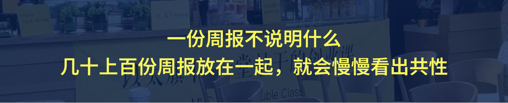
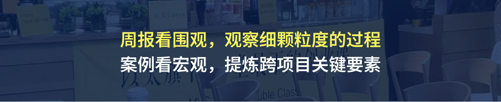

### 认知 2.0：提炼销售五要素

#### 真实过程

第一版强推失败以后，我不可能把所有人都换掉。这样做，老板估计要把我换掉。业务还得做，客户还在那儿，团队也不能一直耗着。

那我怎么办？

2010 年年初，我从学校招了 30 多个销售，实习先放到技术行销部练技术。这个岗位是做售前方案支持的。新人先跟着看现场、摸产品、做方案，练一两个月，再从里面挑适合做销售的人，正式入职转到销售岗。

这里说个细节，为什么让他们先练技术？大客户销售如果连客户的需求都听不懂，连技术方案能不能匹配都不知道，他只能回去讲关系。先有一层技术底子，再到项目里做判断，至少不会歪。

**原来的销售队伍，我没有再用同样要求把所有人绑在一起，而是分成了两类。**

**一类是能力很强、独立性也很强的老销售，作为A组。**他们有自己的一套，也有自己的客户。我暂时搞不定，那就晚点搞。先不硬改，你们继续按自己的方式做，前提是把结果交回来。

**另一类是愿意往新方法上靠、但能力还没有那么强的人，组成 B 组。**B 组不能只接业绩，要按新的流程记录过程，参加复盘，把每一步为什么这么做讲出来。

再加上我自己带的新人，实际上就是三组并行：**新人组、独立老销售A组、新方法B 组。**

这套安排，里面有大胆实验，也有心酸妥协。

**你不能让所有人承认自己过去可能是不对的，也不能让业务停下来等大家想通。**那怎么办？

**让不同做法先并存，让结果慢慢说话。**

所以，那次不是争取说服所有人，而是让假设有了比较的机会。

**分组只是第一步。**真正难的是，怎么知道一个人这一周到底做了什么、为什么做成、为什么没做成。

之前第一次尝试，我也让销售写周报。但那个周报更像管理检查表：拜访了谁，跟到哪一步，下周继续。写得很满，拿回来还是不知道怎么判断。

**第二次，我把周报改成了项目学习记录。**格式大概就四件事：

- 这个项目这周推进到了哪个阶段；
- 具体做了什么；
- 哪些判断对了，哪些动作错了，下一次应该怎么做；
- 下一步准备验证/推进什么。

听起来还是很朴素，对吧。

和原来的周报有一个**本质区别**：**原来记录的是“我很忙”，现在记录的是“我原来的判断，和客户给回来的事实有没有对上”。**

比如，一个销售这周说，我要约客户的关键人吃饭，把技术问题讲清楚。到了下周，他没约出来。原来的周报可能写“继续跟进”。这句话等于没写。

真正有用的复盘要往下追：是电话没打通，是他不愿意单独见，是采购流程变了，还是你的技术方案根本没有进入他的关注范围？你原来以为约出来就能推进，这个判断为什么不成立？

这个里面，你只有把项目拆在固定流程里，才能追问。否则很多老销售从 A 点直接跳到 C 点，B 点到底是做了关键动作，还是碰上了死耗子，谁也说不清。

当然，只让销售自己评价自己，也有问题。人会美化自己。哪怕这件事没做好，周报里也可能写成“客户极度认可，正在努力推进”。

所以，**一份周报不说明什么，几十份、几百份周报放在一起，才会慢慢看出共性：到底哪类动作真实有效，哪类动作只是证明我很勤奋。**

各位如果正在带团队，可以想一想：你们一周一次的复盘，到底是在汇报动作/结果，还是在核对关键判断？如果大家只写“见了谁、做了什么”，却说不出原来怎么判断、现实哪里不一样、下一步验证什么，那个复盘基本无效。

周报解决的是颗粒度。**但周报只看一个项目，很容易陷在局部。**

有的项目做成了，不代表方法对；有的项目丢了，也不代表动作全错。

客户的预算出了问题？

友商技术实力太强大？

销售人员见神磕头，遇庙抽签？

。。。。。。

你要是做过大客户销售，就知道什么叫做**不确定性**。就知道什么是**波粒二象不可测。**

那怎么从一堆项目里判断，什么才是真正影响成败的？

**我们又加了一个动作，叫正反案例评选。**

每个月把成功和失败的案例拿出来，评选好案例前三、坏案例前三，8 个区域经理和我一起评。

这个评选有一个很关键的标准：**不是按结果好坏评，而是按案例分析的深度和典型性来评。**

有句话叫做，事已至此，来都来了，大过年的。

事情已经发生了，单子成了就是成了，丢了就是丢了。我们要看的是：**你原来阶段是什么，每个阶段的判断什么，客户实际反馈什么，中间发生了哪几个关键变化，哪个判断导致项目走不下去，哪个判断让项目拐到了南泥湾。**

所以，周报和案例集不是一回事：

- 周报看细颗粒度的过程：这一周发生了什么，下一步怎么办。
- 案例集看跨项目的东西：哪些要素反复出现，在不同项目里谁的权重更大

说白了，**周报帮我还原事实，看实事；案例集帮我比较事实，找规律。**

比较得多了，**销售五要素**才开始一点点成形。

**最早，我重点盯的是预算和关键决策链。**因为一个大客户项目，如果没有预算，或者你连谁拍板都不知道，后面很多动作都是空的。

但是，项目很快给了我一个反例。有些单子，预算已经摸清了，关键决策人也搞定了，大家以为差不多了。**继续往技术里走，才发现技术根本不匹配。**前面关系做得再顺，方案过不去，这个单子还是做不了。**所以，技术认可必须补进来。**

**多说一嘴，强扭的瓜不甜。生命中所有不属于你的灿烂，终将要用你的寂寞来偿还。**

再往后，**客户需求、友商竞争**也进来了。同一个项目，如果客户真实需求没有摸清，你拿的方案再完整，也只是自己觉得完整。

**如果友商已经在客户内部设了标准、做了参数、拿住了关键关系，你还按正常节奏往前推，就可能一直是在陪跑。**

这样一步步走，最后才形成**预算、需求、技术认可、关键决策链、友商**这五个要素。

#### 背后思考

这里我要说清楚：**五要素不是我坐在办公室里列出来，再拿到现场验证的。它也不是一次性设计完整的。它是项目做回来以后，不断发现“这个判断还少一层”，再一点点补出来的。**

模型不是我想完整的，是被项目和失败一步一步逼出来的。

那五要素出来以后，原来的 8 个里程碑还有没有用？

有，而且两者不是并列的两套东西：

- **8 个里程碑管的是项目走到哪**：从接触、明确、技术认可、决策链分析，到承诺、谈判、成交、回款。
- **五要素管的是，你走到这一步，到底要看什么、判断什么、接下来做什么。**

你可以理解为，**八步是进军路线和里程碑，五要素是每一步必须核对的战术动作。**

**比如刚开始收客户信息、做客户分类，不是每个客户都要往上冲。**先看需求匹不匹配，实在不匹配就早点放弃，不要把团队的时间耗进去。

**到了技术认可这一步，才重点去摸关键决策链、组织结构、中间人、内部支持者。**谁是使用者，谁提技术标准，谁有否决权，谁最后拍板，这些东西要一层一层梳理。

问一个问题：可不可以同时做？

第二个问题：第一个要做的是什么？

**首先是预算。**

**不展开了，如何做预算都可以单开一门课。**

**至少不能只写一句“客户有预算”。**预算怎么编，钱从哪里来，谁参与审批，什么时间窗口能影响，这些都要变成具体动作。

**△天龙八部 checklist**

**同一个五要素，在不同客户、不同项目阶段，权重也不一样。**大项目和小项目不一样，新技术和老技术不一样，有预算和临时立项也不一样。

八步告诉你什么时候做什么，五要素提醒你，做这件事到底要拿到什么事实和判断。

这套东西不是第一次讲就都会。我们大概用了六七个月，才把第二次模型磨出来。

到 2010 年下半年，B 组和新人的销售业绩开始起来。这个时候，团队里反对和质疑的声音才慢慢变少。

为什么？不是因为我讲得更好了，是因为他们真看到了：同样一批客户，按这套方法做，项目结果确实在变。

也只有到了这个时候，8 个里程碑和五要素才具备**全面推行**的条件。

我后来回看第二次迭代，会发现它其实已经在做一件很接近 Y 模型的事：**先有一个判断，再把它放到项目里做，拿回事实，比较结果，错了就修模型，再指导下一步实践。**

当时没有Y模型这一套，我们就是被项目逼到那儿了，只能用这种笨办法一层层试。后来学了 Y 模型，我才反过来把它说清楚。

第二次迭代解决的是“**怎么让事实可比、让实践迭代认知、让模型长出来**”。

**但新的问题又来了：**这套方法如果只能靠我盯着，离开我就跑不动，那它还是个人能力。怎么让区域经理自己带复盘，怎么让好案例变成培训，怎么让新人一批批接上来？

这就是第三次迭代要讲的事。