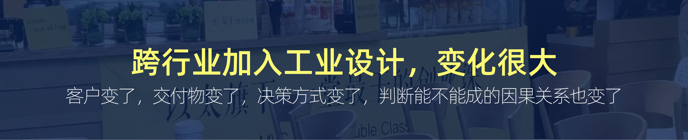
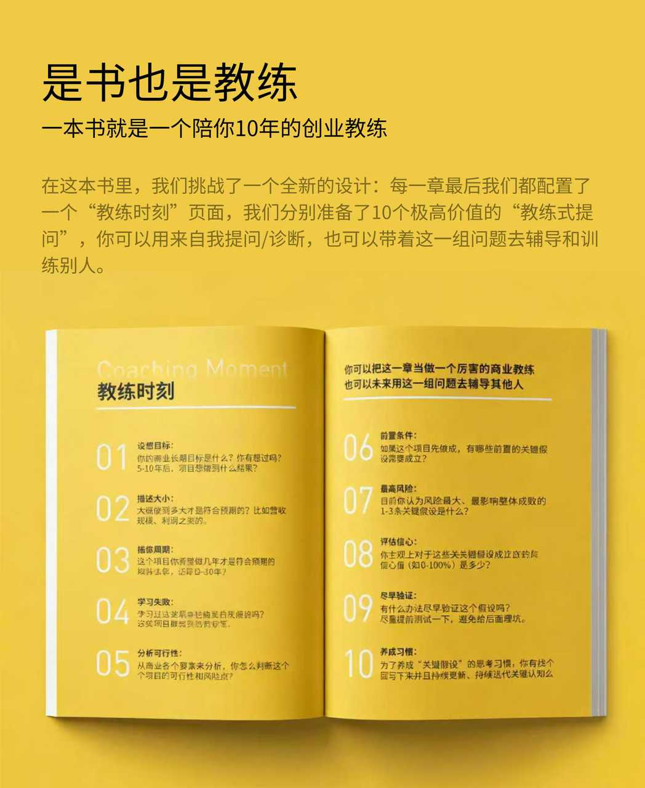
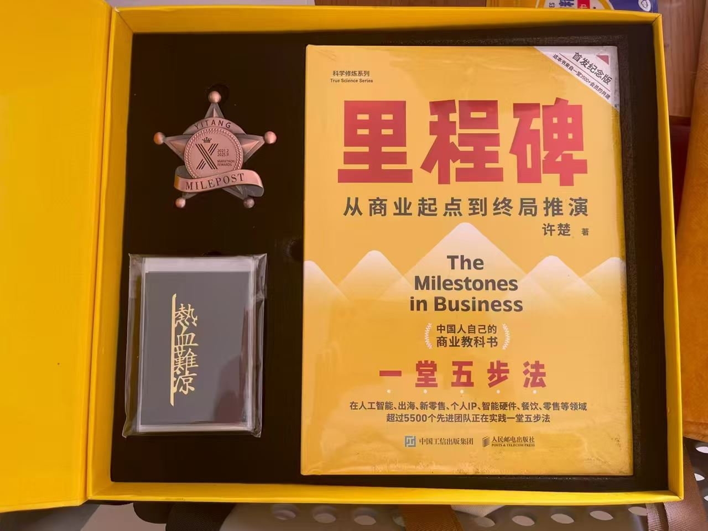

### 认知4.0：实现跨行业迁移

#### 真实过程

2012 年前后，我去了当时亚洲最大的工业设计公司，给客户做产品的外观设计、结构设计，简单理解，交付的是产品效果图和市场品牌服务。

这和上家公司完全不是一回事。

**客户变了，从原来ToG为主，变成ToB业务。**

原来在上家公司，主要是做军队、公安、消防、石油石化、电力能源、铁路、林业这些客户。

而这家工业设计公司的客户构成基本是大B小B混合，有3C数码比如手机、手环、手表、电脑的品牌，也有医疗设备类的厂商，小米，联想，华为，摩托罗拉，迈瑞，还有三一重工、中联重工这样的重工类客户，甚至还有矿泉水瓶子的品牌。

买个关子，你们可能想不到是哪一家矿泉水。

**交付物上，从标准化产品变成非标设计服务。**

上家公司卖给政府和企业的是对讲机、通信解决方案，最后有一个实实在在的产品。

这家公司卖的是设计服务。客户把项目交给你，你给他几张图、一套结构方案，他认可了再往下开模、生产、销售。

手机、医疗设备、重工机械、3C 产品，客户都做，需求千差万别。

同样做一个手环，成熟大品牌和创业公司要的东西不一样；同样的医疗设备，面向医院和面向家庭，审美、成本、使用方式也不一样。厚一点、薄一点，方一点、圆一点，用什么颜色、什么材质，都没有一套固定答案。

所以这次，客户变了，交付物变了，决策方式变了，判断一笔生意能不能成的因果关系也变了。

需要说一下，这家公司本身很强。公司有 200 多名工业设计师，很多人拿过红点、iF 这类奖项。按我当时的理解，行业里想找外部设计公司的客户，很多会找到它。品牌、设计师、交付能力，都是它的优势。

**但也正因为公司一直很强，团队形成了一套很顺手的业务惯性**：我熟悉这个行业，我认识这个客户，公司出活快，价格稍微高一点也能接受，过去就是这么卖成的。所以提案的时候，经常先讲公司多厉害、拿过多少奖、做过多少大项目。

这套打法有没有用？在品牌本身就能带来信任的时候，有用。

但它有一个问题：它证明的是“我很成功”，没有证明“你为什么能成功”。客户听完知道你很强，却不一定知道，你为什么真的理解他的产品、他的市场和他的生意。

**如果我当时直接把上家公司的八步、五要素和十八般武艺搬过来，会怎么样？**

大概率也会出问题。因为那些动作是长在上家公司那个业务里的。这家公司客户买的不是一个标准产品，也不是一套技术参数明确的解决方案。你拿旧答案来套新问题，表面上动作都很熟，实际上判断可能是错的。

那怎么办？

先别急着改，**第一件事，先把事实看清楚。**

我花了大概一个月时间，**去看他们原来怎么做销售、怎么见客户、怎么提案、设计团队怎么画图、项目最后怎么成交**。我关心的不是他们哪个动作看起来不专业，而是这套业务真正靠什么往前走。

客户为什么买工业设计？预算是怎么来的？谁决定用哪家公司？他更在意品牌、价格、创意，还是产品能不能卖好？友商是谁？一个项目从第一次接触到签约，中间到底经过哪些关键节点？

**没有调查，没有发言权。**

上家公司的五要素，是我在通信行业的事实里一层层摸出来的。到了这家公司我也得重新摸一遍。摸完以后，我才发现，**五要素的名字好像都还在，但它们的内涵、权重和先后关系，已经变了。**

在上家公司，我们最早用两个维度看客户：**有没有钱，进入难度高不高。**两个维度一分，四象限，基本就能判断一个客户值不值得投入。

到了工业设计，这个颗粒度不够了。

同样是“有预算”的客户，行业不同、规模不同、品牌定位不同，愿意为设计付的钱完全不一样。一个成熟手机品牌做旗舰产品，和一个创业公司做第一款产品，对设计的要求、预算的上限、决策人的关注点都不一样。

所以客户分类要重新做。我们后来用**行业特性、客户规模、定位要求**三个维度，每个维度再分三档，形成一个九宫格。这个分类不是为了画得漂亮，它直接决定一个客户的交易价格上限，也决定你该用什么方式去打。

**上家公司面对的大客户，很多是国家预算、单位预算。钱一旦列进去，什么时候花、怎么审批、走不走招投标，相对有规律。**

**工业设计面对的是商业预算，客户可花可不花，可以增加，也可以临时取消，**还要看产品上市的紧急程度、市场竞争和供应链准备。

预算不再是一个静态数字，而是一个会变化的经营选择。

**在上家公司，技术认可经常是主战场。**你的产品行不行、方案能不能过、参数符不符合要求，过不了这一关，关系再好也没用。

到了这家公司，情况不一样。它本来就是行业头部，客户对它的设计能力有基础信任。**技术认可不是不重要，**而是不再需要花那么大力气证明“我能不能做”。真正要证明的，变成了“我做的这个东西，能不能帮你在市场上赢”。

这家公司的竞争对手大概分成两类：一类是大量的小型设计公司，一类是同样有品牌、有规模的头部设计公司。

面对前者和面对后者，你靠的东西不一样。有时候靠设计能力，有时候靠品牌，有时候靠价格，有时候靠你对客户行业的理解。竞争策略不能笼统地写一句“打败友商”。

To G 的大项目，往往要从预算开始，一路做技术认可、关键决策链、招投标、合同、交付，周期很长。工业设计经常一两次交流就能把需求、预算和竞争情况摸个大概，真正决定胜负的是提案现场。

路径短，不等于事情简单。它只是把原来分散在几个月里的判断，压缩到了一两次高密度的交流里。你在现场能不能快速理解客户、匹配预算、找到技术边界、说清竞争差异，反而更难。

这里有个有意思的点，过去团队习惯带三个方案，让客户从 A、B、C 里挑。看起来给了客户选择，实际上经常把判断责任又推回给了客户。

我后来遇到一些团队搞不定的客户，也会去上阵提案，但是我只带一个方案。

不是因为我拍脑袋觉得哪个好看，而是前面要把信息摸够：客户到底为什么现在要做这个产品，他的预算和上市时间是什么，竞争对手是谁，供应链准备到什么程度，关键决策人过去喜欢什么风格。信息够了，我再给一个最有把握的推荐。

现场讲的重点也变了。我不再问客户“你想做一个多好看的东西”，而是告诉他：你的企业现在为什么需要这个产品，这个产品在市场上应该长成什么样，才有更大的机会成功。

说白了，我要让客户感觉到，我不是来卖一张图的，我是站在他这边，帮他降低产品失败的风险。

不过，“只带一个方案”不是一个到处都能用的招。它依赖前期信息足够充分，依赖你对客户和市场的判断，也依赖客户对你的信任。前面没摸清楚，只带一个方案，风险反而更大。

这就是迁移里最关键的一层：**五要素的名字没有变，但每一个要素里装的事实变了，权重变了，因果关系也变了。**客户分类、预算性质、技术认可、友商竞争、销售路径、提案方式，都得重新长。

后来，这套调整在这家工业设计公司跑出了结果，人均月产出从 1 万提升到 3 万。

再往后，人生不甘平凡，哪怕倾家荡产。我开始自己下场创业，做过无人机，机器人，也做过电力行业的 AI 产品。

**无人机这段，迁移反而顺一些。**

客户还是公安、消防、电力、石油石化这些 To G 客户，销售路径、样板点、试用、小批量、预算逻辑，很多都能接上原来的经验。

难的地方不在销售方法，而在资源有限、市场要教育、组织要等它慢慢长起来。打个不太准确的比方，还是卖油翁那套手艺，只是葫芦变小了，倒的时候要慢一点。

这个阶段，我们的市场占有率，三年内做到公安、消防、电力、石油石化四个行业第一。

机器人不再赘述，参见案例Leo的狗，一堂的书里面有。你买来看，肯定有帮助。

> 京东图书搜索“里程碑”，即可购买

**电力 AI 就不同了。**

只有一两个销售，只做一个行业，产品适用性还很窄，前面很长时间只能靠样板点一点点验证。这个时候，你拿着过去的成功经验，不会立刻变成订单。边界离得越远，模型要重新长的部分就越多。

#### 背后思考

后来回看，我越来越确定一件事：**能带走的不是一套固定动作，而是重新面对事实、重新定义问题、重新建立模型的能力。**

上家公司的动作到了工业设计公司，很多都不能照搬；工业设计公司的提案方式到了无人机，也未必完全适用。但只要还愿意回到客户、预算、需求、竞争、决策链这些事实里，模型就能重新长出来。

反过来，如果每次都从旧答案出发，路径依赖会越来越重；如果每次都把过去全扔掉，又从零开始，组织也永远积累不下来。

所以真正的难处在这两个极端之间：**哪些东西必须跟着边界变，哪些东西换了行业以后，底层的因果关系还是一样的？**

我的答案是，**只有物理事实和现实情况不可转移。**换句话说，经验和方法可以带走，但每门生意当下的事实不能跟着你走。客户是谁，预算怎么来，谁拍板，竞争怎么打，你手里有什么资源，每到一个新边界，都得重新看。经验可以帮我提出假设，不能代替事实。

**所以不能路径依赖，也不能完全照搬以前的经验。边界条件和外部环境一变，原来的模型就要往上再走一层。**不是把名字换一遍，而是重新提取关键变量，重新判断谁更重要、谁影响谁，再把动作、组织配套和做事次序一起微调。

但往上走一层，不等于把过去全都推翻，也不等于每次从零开始。**可以变的是动作，真正稳定的是底层的因果关系。**很有可能你做的两个动作完全不一样，但它们贴近的本质是一样的。

所以从那时候开始，**我不再只关心下一套具体动作怎么设计，而是开始往更底下追**：**这些不断变化的客户、预算、竞争和资源背后，大客户销售有没有稳定的因果关系。我意识到，自己已经从“找方法”，走到了“找本质”。**

这个变化，把我带到了第五次迭代。