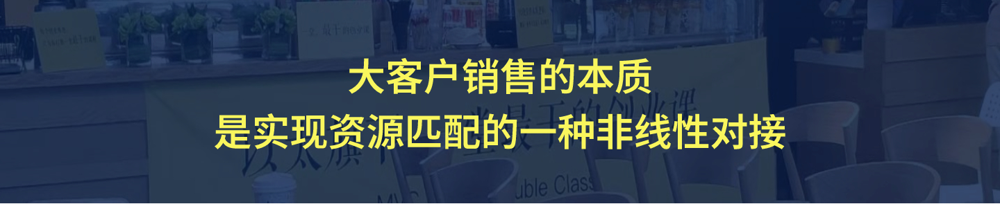

### 认知5.0：真正不变的底层

在展开这个阶段之前，还是要再强调一下：

前面这些事，不是我当年先学了 Y 模型，再照着它去做的。恰恰相反，专网通讯公司、工业设计、无人机、电力 AI，这些事情发生的时候，我并不知道 Y 模型。我是已经做了很多年以后，才遇到这个模型。

初次遇到Y模型的感受，也不是“我终于拿到一个正确答案”。更像是：原来我一直在这么做，但说不清；现在终于有一套语言，能把我原来的认识过程重新点出来。

关于大客户销售本质的推动，来自一次MBA高阶营的线下讨论。

当时Truman和我说，曾经聊大客户销售的课题，几个都做过大客户的人，连“大客户销售到底是什么”都没有共识。有人讲关系，有人讲流程，有人讲产品，有人讲决策链。每个词都对，但放在一起，说的不是一回事，最后几乎吵起来。

我当时想，能不能试着统一一下。不是统一大家的说法，是看看这些不同案例背后，有没有一条共同的因果关系。

我就把前面这些项目、失败、复盘、迁移重新往回捋。后来借 Y 模型，把目标、事实、框架、假设、反馈、边界这些原来散着的东西摆到一起，慢慢收成了三句话。

如果现在一定要用一句话说，我会暂时把它概括成：

什么叫非线性？不是你有产品、他有需求，两边一对接就完了。中间隔着风险、信息差、决策层级和资源消耗。你的资源刚好能接住他的问题，这个结合点找到了，事情才往前走。

这句话我还一直在磨，不一定最后就长这样。

这句话也不是突然从天上掉下来的。很多年前我已经有一个模糊版本，只是一直没有把它磨准。那次线下讨论，才逼着我把它和后面的三条公理接起来。

**第一条，风险转移公理。**

**ToB、ToG 的交易，本质上是客户把一项业务风险转移给供应商。**比如上一套系统失败了，客户要承担停产、返工、错过市场窗口的后果。他找供应商，不只是买一个产品，也是在找一个能替他把这类风险接住的人。

**所以客单价的上限，不是由你有多辛苦决定的，而是由这项风险对客户的影响价值决定的。**说白了，客户买的不是一堆功能，是风险降低量，或者效益提升。

再回头看工业设计的提案，我不再只证明公司多强，而是告诉客户：这个东西为什么能帮你在市场上赢。本质上，就是在降低他做错产品的风险。

**第二条，交易成本公理。**

**ToB 的总耗费，不只是产品价格，还要加上客户为了搞清信息、协调决策、评估方案所付出的交易成本。**

决策链每多一层，信息就可能衰减一部分。按我的经验估计，大概会衰减 20%—30%。这不是一个精密公式，但它提醒你：客户不是只听你一个人讲完，就能把信息原样传到老板那里。

这对应的就是关键决策链。客户要花时间搞清谁能拍板、谁会影响、谁有顾虑。销售如果只会催单，其实是在把客户的交易成本继续推高。

反过来，我把前面的信息摸够，只带一个最有把握的方案，不是在替客户做决定，而是在降低他的评估成本。他不用在三个都差不多的方案里反复猜，到底哪一个更适合。

**第三条，资源非均质公理。**

服务大客户和小客户、To 大 B 和 To 小 B，资源消耗完全不一样。不能因为八步和五要素看起来是同一套东西，就用同一种投入方式覆盖所有客户。

**有些客户值得一个团队跟半年，有些客户只值得一次快速判断，不匹配就尽早放弃。**核心只有一句：**客户不同，你能压上去的资源强度也不能一样。**

那么，谁是你的客户。课后有个Candy，可以自行检查。

电力 AI 就是这样。只有一两个销售，只做一个行业，产品边界还很窄，那就不能把每个客户都当成必须饱和攻击的大项目。前面很长时间只能靠样板点一点点验证，先把最值得投入的场景认出来。

这三条不是三个并列口号。风险转移回答客户为什么买，交易成本回答客户多大成本买，资源非均质回答你该用多大代价去卖。三个一放回去，八步和五要素才不再是动作清单，而是能解释一笔生意为什么成、为什么丢的因果关系。

所以 Y 模型帮我的，不是凭空发明了这三条。它帮我把原来埋在项目里的事实，经验、判断和因果关系，最后提取成了可以说清楚的三句话。

上次，跟一堂团队一起打磨马拉松案例，我回看自己的知识库，里面有三个文件夹，第一个叫实事求是，第二个叫解放思想，第三个叫知行合一。一堂的教研路禹看见以后说，大哥，你这个讲的不就是 Y 模型吗？

我说，其实我没想那么多。

不是一开始照着 Y 模型画了一张图。是我先按自己的方式积累，后来才发现，原来我一直在沿着类似的结构做事。

