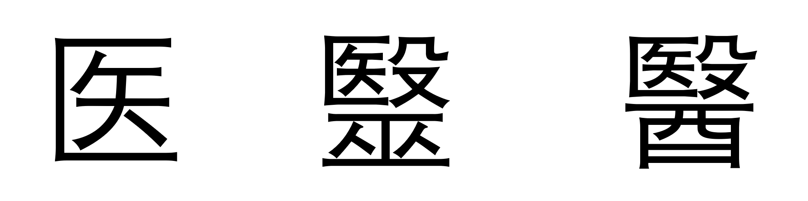
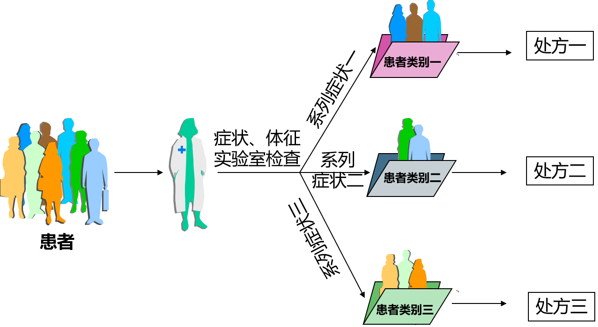
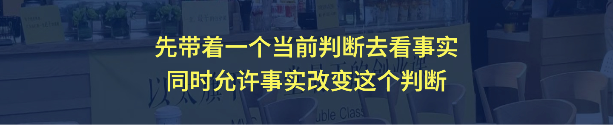
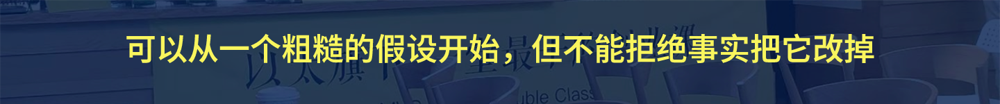
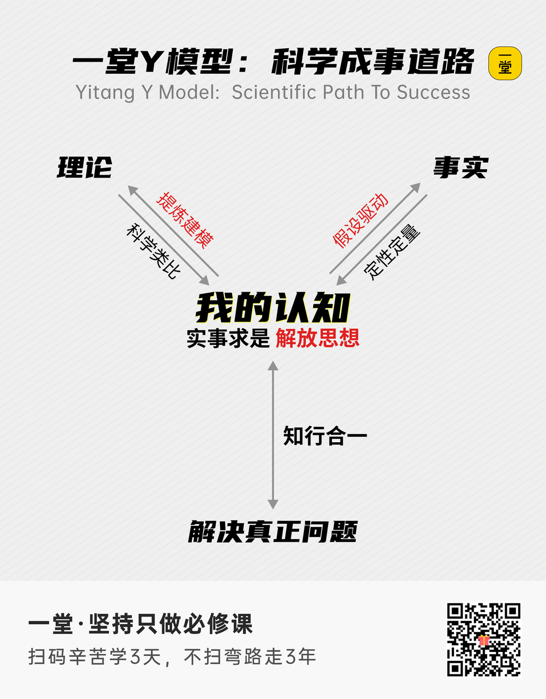

### 第一部分：医学上的"科学"

在正式开始案例分享之前，我想先讲一次近期在一堂的交流。

我和另一位一堂同学杏树林的创始人聊到Y模型，他们是协和背景，我是华西背景。大家发现医学院校出身的人对Y模型有一种很自然的亲切感。

不是因为学医的人判断一定正确，更不是因为我们对所有事情都懂。恰恰相反，医学训练经常提醒我们：**眼前的解释可能不完整，后来的事实可能改变现在的判断。**

怎么理解呢？

我们先进入今天的第一个小例子，也是一个大家都能理解的场景说这件事。

#### 案例1：医生问诊

一个患者来找医生，说：“我肚子疼。”

**【互动🙋🏻‍♀️】**假如你是医生，接下来你会做什么？

————

是哪里疼？怎么疼？疼了多久？

有没有其他不舒服？以前有没有类似情况？

这些问题没有立刻给出一个病名。它们是在寻找事实：哪一条信息会让某一种判断更有可能，哪一条又会让它下降。

同样三个字“肚子疼”，后面可能有不同的判断。医生会借助已经掌握的专业知识，先形成几种可能，再选择值得追问的信息。

有时问完还不够。医生会查体。哪里按下去疼？手松开疼不疼？如果再不清楚，还会安排检查。

可能几次问询之后，判断越来越明确；也可能一个新信息出来，医生发现原来的思路不对，要转向另一个方向。

#### 放回Y模型看案例

医学训练反复给我的，正是这个动作：

当然，医生也会依靠经验，而且很多时候必须在几秒钟内作出判断。医学训练的价值，不是让人永远不下结论，而是即使已经形成判断，也知道什么样的新事实可能推翻它。

经验让我们更快看到熟悉的模式。检验让我们有机会看到熟悉模式之外的东西。两样都有，判断才既有效率，也有继续修正的余地。

科学不是一开始就必须有一个完整答案，它可以是一个粗糙的假设，它允许被验证，允许被推翻，也恰恰因为这样，科学才能不断地进步。

这里有两个条件同时成立：

- 有一个当前假设，才知道接下来要看什么；
- 愿意接受检验，才知道现在的解释站不站得住。

我对Y模型最有共鸣的地方，就在这里。

它让我把理论、事实、自己的认识和接下来的实践放在一起看。我的认知不是贴在中间的一个静态结论，而是这几方面不断往返时形成的判断。

**有时，一个反常的事实先引起了注意，我再去找理论解释它。**

**有时，先学到一个新理论，我开始想：它在我的问题里有没有用？**

**两个入口都可以开始，但最终都要回到我们正在面对的真实世界。**

我们医颉有一句经营理念：

**以科学方法论探索世界，永葆对生命与商业本质的好奇。**

这句话对我不是装饰。做医药与健康相关业务，我们一方面要理解产品为什么有价值，另一方面要理解它怎样在真实使用和经营中创造价值。

一个产品有科学依据，并不意味着用户自动理解它；一个市场结果很好，也不意味着我们对原因的判断一定正确。

前者需要研究生命与健康，后者需要研究人的选择、组织的行为和商业运行。两个方向都不能只靠“我觉得”。

后来学习Y模型，我发现它给这些习惯提供了一张更清楚的地图。过去偶尔做到的，开始可以有意识地做；过去卡住时只知道继续努力，现在可以停下来检查自己到底卡在哪一层。

今天，我不会把Y模型讲成一个保证成功的按钮。我更想给大家看：**它怎样帮助一个人在不熟悉的领域里开始，怎样在碰壁后修改认识，又怎样把这一轮留下的东西带进下一轮。**

接下来，我们进入今天的第二部分，我如何把“科学”的思考方式带进了一个自己并不熟悉的领域：个人AI。