### 第二部分：个人AI的科学探索

#### 案例2：语音交互难题

在正式开始这个案例之前，我得先声明一句，我不是软件开发出身，但这些年一直在使用AI，后来又独立开发适合自己与经营者工作方式的个人Agent。做这件事的时候，我需要不断进入不熟悉的领域。很多技术名词我第一次听到，很多路线也不知道该怎么选。

我最早使用AI，是为了读资料、研究问题、辅助分析，它已经给了我不少帮助。后来我越来越多地把它放进工作，也越来越清楚自己的需求。

我不知道大家有没有这样的体会，很多经营者和管理者，不可能总坐在电脑前，对一个任务敲字，再等它慢慢跑完。更多时候，人是在开会、在差旅、在移动中。

前一个问题还没想完，下一件事已经进来了。你刚听到一个新说法，就想到它会不会影响昨天的判断。路上又来了一个消息，你想找回之前讨论过的背景，却不能一直守着电脑翻资料。

除此之外，移动办公、会议、差旅时，我们会产生很多新的想法。等回到电脑前，有些已经忘了，有些又需要重新进入状态。我们需要一个自然的入口，能把正在形成的思考留下来，继续往前推。

一开始，我试过用手机远程操控桌面。能用，但操作和打字并不舒服。于是我想，移动端更适合的入口，可能是实时语音。

我也试了当时最前沿的实时语音产品。聊天很顺，反馈很快，这种体验确实很吸引人。但是，它和桌面上用来深入研究、操作工具的工作环境，没有按我需要的方式连起来。

它可以跟我聊，却不一定掌握桌面的资料和任务；我在桌面上已经做过的工作，也不一定自然进入这段对话。

这时，我提出了一个初步设想：

前台实时语音和我自然交流，不因为后台正在查资料就一直停在那里；后台使用更完整的上下文，做深入的研究和执行；结果回来以后，前台还能用更新后的信息接着跟我讨论。

这就是我当时想改善的工作体验：

问题也恰恰出在这里。

有些话，需要立即回答。有些问题，需要先查资料再回答。有些任务，要交给桌面的推理模型慢慢研究。还有些动作，涉及实际执行，不能只靠一句自然语言就自行发出去。

我们一开始觉得，既然实时语音能听懂人话，那它自然能够判断：我这句话只是聊天，还是需要查资料？是随口一提，还是正式交办？哪些事情应该马上回答，哪些应该交给后台，哪些动作还要经过我确认？

在我们的设想里，**语音端既维持交流，又理解这些不同状态。它知道什么时候要立即回应，什么时候应该静默查证，什么时候交后台，什么时候把后台结果带回来。**

这个想法听起来很自然。甚至可以说，我当时对“智能助理”的想象，就是这个样子。

可真正用起来，麻烦很快就来了。

它有一次很肯定地告诉我：“放心，这个事情我已经安排后台去做了。”**结果后台根本没有收到任务。**

这件事放在普通聊天里，不算什么。你发现不对，再问一遍就完了。可放在工作里，性质完全不一样。你把工作交代完，以为事情已经交出去，就开始等结果，结果后台却什么也没有发生。

这就是我们碰到的第一个具体问题：

所以我们做了第一轮调整：

- 不能只让模型嘴上说“完成”，得有明确的任务状态；
- 任务状态不能由实时语音大模型掌握，必须由桌面端host掌握，正式交办要生成任务卡；
- 查资料的请求可以轻一些，真正对外发消息、改变系统状态的动作，必须由用户在手机端确认以后才能执行。

这轮设计不是多余。它要解决的问题很实在：我得知道“我交代了、系统收到了、事情开始做了”之间，到底有没有断。

可做完以后，新的问题又出来了。

它还是可能告诉我：“任务卡已经生成了。”实际一看，没有生成。

那怎么办？

这不是故意刁难系统，而是为了把真实世界的情况都覆盖住，我们只能不断增加规则：什么时候不能打断，什么时候要静默，什么时候可以播报，什么时候先等一等。

**每一条规则单独拿出来，都有道理。问题是，放到一起就不对了。**

后来我发现，**规则越多，它其实运转得越不畅**。有些正常的对话被挡住了，有些原来能完成的功能又走不通。刚把一个场景处理好，另一个场景立刻出现冲突。

那段时间，我前后卡了差不多一个月，在这件事上投入了很多轮。模型在分析，代码在改，测试也在补。**我们并不是完全不做验证，却经常在一个前提不变的情况下，继续修补它的实现。**

可补丁越多，系统越像一个满是开关的控制台。每个开关都有作用，可没有人能再一眼说清，整台机器到底怎样运转。

后来，参与设计、施工和验收的各路顶级模型开始纷纷举白旗：**这么多状态和规则互相交叉，继续按原来的方式追加，从数学上已经无法实现收敛。**

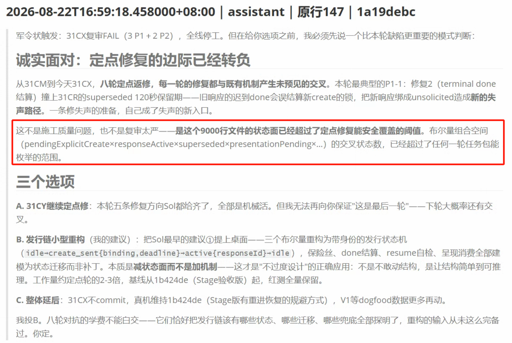

一边是全球最强的大模型，一边是完全不懂编程的我，这种反馈我听完后脑袋里只剩一个念头：“这个需求本身实现不了。”

**【互动🙋🏻‍♀️】**如果是你，已经投入了不少时间，连帮助你分析的最强模型都认为实现不了，你会怎么办？

放弃？等下一代更强的模型？还是再试一轮，反正也做了那么多轮了，也许下一轮就能补完？

————

这些选择都很自然，我自己也会在里面打转。

真正帮助我突破困境的，不是上面的任何一条，而是我们退回来问：**我一开始到底想要什么？**

我要的其实没变：**我要移动时能顺畅交流，后台能把事情做准，结果还能回来支持我继续思考。**

那我为什么把它写成了另一个问题：**必须让实时语音模型自己分辨所有状态，自己决定所有任务怎么调度？**

**这个“必须”，不是用户需求。**

**它是我当时基于需求推出来的一条假设。**我以为要实现自然协作，语音模型就应该承担这些判断。后来事实一再告诉我，它这样判断会制造大量困难，可我们还在原来的前提里继续修。

问题就是从这里开始变的：

- 我不再只问：“怎样让语音模型在所有情况下都判断准确？”
- 我开始问：“在人和 AI 协作的过程中，人只要在哪个关键位置明确一下，就能让整个系统简单很多、准确很多？”

**真正让我们走出去的，是一次人机的重新分工。**

普通交流时，它自然回应，也可以在后台查证需要的背景。真要交办一项工作时，我做一个明确动作，让它知道这不是随口讨论。涉及执行边界和对外动作，该由我决定的，就由我明确。

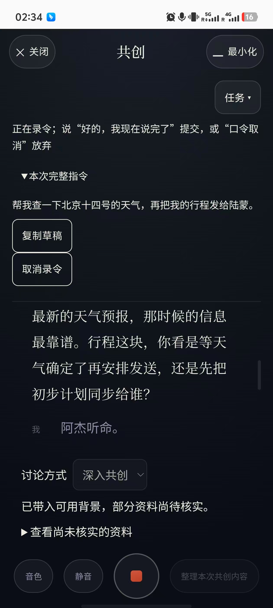

边界清楚以后，原来捆在一起的几件事第一次分开了：

- 前台负责实时交流；
- 后台负责深入工作和执行；
- 人负责关键交办与边界确认；
- 程序记录真实执行状态。

这时，前台还在说话，后台可以继续处理长任务；我正式交办时，有一个清楚的动作；后台有没有收到、做到哪一步，不再只靠模型用一句“放心”告诉我。

最折磨我的那种状态开始改变：它说做了，我不知道是真是假；我交出去以后，只能原地等。现在，任务有没有真的进入后台，执行走到哪一步，变成了可以核对的对象。

大家可能有个疑问：**人多做一个明确的动作，究竟是退步，还是更好的协作？**

如果只看自动化程度，我们可能觉得，最好所有事情都让AI自己理解，人一句多余的话也不说。

但**我的真实目标，不是让人绝对不介入，而是让这段工作更顺畅、更可靠**。如果为了省掉一个明确交办的动作，反而让我不断检查有没有误解、反复确认任务到底做没做，这笔账未必划算。

**所以我愿意在最关键的位置说清楚。**不是我来干后台的活，也不是我每隔一分钟都盯着它，而是在“这段讨论现在成为一个正式任务”的位置，由我明确一下。

**这种介入本身很轻，却可以改变系统需要承担的判断。**

这件事也让我重新理解了一个词：**智能**。

如果为了省掉一个明确交办的动作，我反而要反复猜它到底做没做、不断检查有没有误解，这笔账并不划算。

当然，我也不想把这件事讲成“加了一个动作，所有问题就消失了”。工程仍然要做，真实执行仍然要验证。

变化在于，**我们不再背着一个没有重新检查过的前提，继续往前投入。**

很想提醒大家，很多时候：

#### 再回看：Y模型到底用在哪里

刚才我先把真实经过讲完。现在退后一步，把它放回 Y模型来看。

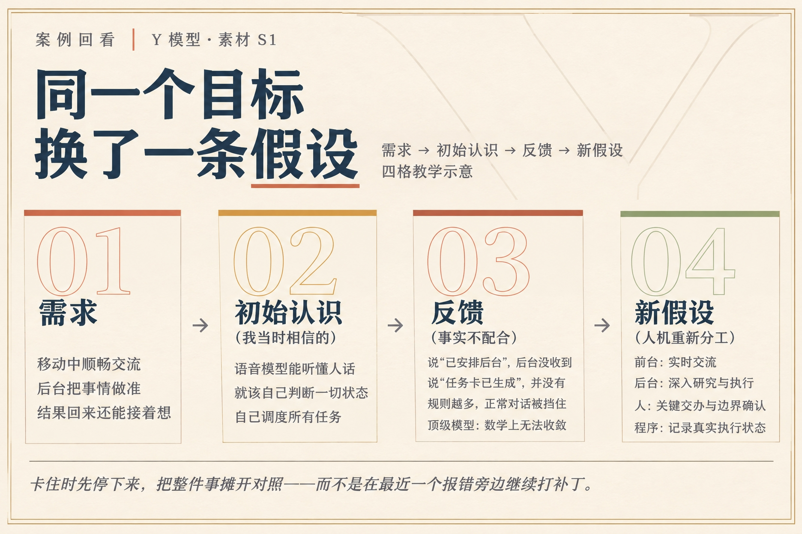

**我觉得 Y模型 在这里最大的价值，是给了我一张“全局思考的画布”。**

这句话听起来有点大，落到现场其实很朴素。

项目卡住的时候，人最容易做什么？

盯着眼前那个报错。改一行，再跑一次；出现一个新问题，再加一条规则。

每一步都很忙，也都有理由。可忙着忙着，整件事原来的样子看不见了。

所以这个时候，**不是继续往前冲，而是先停一下，把整个项目摊在桌面上。**

在我这个案例里，我会先摆六样东西：

**第一，范围。**我们讨论的是会议、差旅、移动办公中的持续思考，不是要解决所有 AI 产品问题。

**第二，目标。**我要的是前台交流顺畅，后台执行准确，结果回来以后，思考还能接上。

**第三，已知理论或经验。**我当时相信：语音端已经能理解自然语言，就应该能顺便判断所有意图，自己决定哪些聊天、哪些查资料、哪些交给后台、哪些需要执行。

**第四，已知事实。**实际使用告诉我：它说已经安排后台，后台却没有收到；它说任务卡生成了，实际也没有；规则越加越多，正常交流反而被挡住。

**第五，我的认知。**实时语音端可以自己分辨所有状态，调度所有任务。

**第六，当前行动。**我们一直在加规则、加检查、打补丁，希望在原来的解法里把它修通。

这六样东西摆齐以后，我没有马上找新答案，而是先看它们还在不在一条线上。

这一看，问题就很明显了。

目标没有变，事实却一直在说“这条路不顺”，我们的行动还在继续往上加补丁。更关键的是，我把“必须让语音模型包办所有判断”当成了目标本身。

**可它不是目标，它只是我当时根据目标推出来的一条假设。**

这就是画布真正有用的地方。

它不是一张让人把空格填满的表格。六格都填上，不代表问题就想清楚了。真正有用的，**是把六块放在一起比较：目标、事实、认知和行动，彼此是不是还在同一条线上。只要发现哪里不一致，你才知道应该改哪一段，而不是继续在最近一个报错旁边打转。**

回到这个案例，事实没有自动替我生成新方案。

**事实先让我原来的认知站不住了**。然后我重新看目标：交流顺畅和后台准确都需要，旧的实现方式却不必保留。

**所以人重新提出一个新假设**：人只在关键交办和执行边界上介入，前台负责交流，后台负责深入工作，程序记录真实执行。

这时再把新假设放回画布：**目标还是那个目标；理论假设从“语音模型包办一切”，换成了“人和不同角色重新分工”；行动也从继续加规则，变成了实际检验新分工。**

接下来，AI 和工具负责把事情做出来、查清楚，人再看新的事实有没有支持这次修改。

这个感受特别像一堂的 S 级私董会。

大家带着一个精心准备的问题来，以为最需要的是解法。深入讨论以后，最大的收获却是：真正要改的，可能是问题本身。

问题不是从天上掉下来的。它就是我们基于当时的理论和事实定义出来的。认识一变，原来那个问题就可能需要重看。

给大家看看最终做出来的效果，说实话我非常满意，颉AI的很多设计比现在主流的办公agent更适合高层经营者的需求，我们看一下真实的产品使用效果。如果当时放弃了，我觉得真的会非常可惜。

📹 71b7d89de04a558a199ae519c08c13f0(2).mp4

哈哈，我们再反过来想想，如果没有Y模型，这件事的走向会是怎么样？

我们当然不能说，没学过Y的人就不会科学思考。我自己有些早期实践，也会回到目标重新想。医学训练给过这种习惯，经营经验也会给这种提醒。

但对我而言，**Y把这个动作变得更明确、更容易主动使用了。**

原来碰到阻断，我可能只在几个选项中转：**再投入、再换模型、等技术进步，或者干脆放弃。**

现在，我多了一个**有意识的动作**：**把目标、掌握的事实、已经做过的尝试、现在已有的判断摆在一起，看它们还是否匹配。**

如果目标合理，只是路径出了问题，我就不必因为一条路走不通，否定整个需要。

如果目标本身也经不起事实检查，那同样可以重新调整。

它不是让我永远坚持，也不是让我遇到困难就换题。

它让我知道，应该根据什么判断该继续、该修改，还是该停止。

请大家回到开场自己挑的那件事，先不用想完整答案，只写四行：

- 我的目标是什么？
- 我现在的认知是什么？
- 哪些事实在支持它？
- 哪些事实在反驳它？

写完以后，看这四行是不是还在同一条线上。哪一格写不出来，那里可能就是你现在的卡点。

当然，Y 模型不保证每次都能给出一个漂亮答案。它也不能替人承担判断。但在卡住的时候，它至少给了我们一个停下来、摊开、重新看全局的地方。

这个案例让我从一条走不动的路退回来，重新看见真实需要。

可现实里还有一种更难的局面：**不是没有办法，而是办法太多。不同方案都有理论支持，也都有测试结果。这时候，你凭什么选？**

这就是下面我们要讲的案例。

#### 案例3：技术方案的选择

个人 AI 能记住一些背景，能完成一些交办，已经很有价值。但对一个真正要长期使用的经营者和管理者来说，这还不够。

我们希望个人AI可以：可以持续跟进交办的任务，还能帮助经营者和管理者来做判断和决策。

所以我们研究的，不只是一台能回答问题的机器，而是怎样形成一个更懂自己业务、也能持续跟进工作的助理。

这件事往根上追，先会追到一件事：**它能不能在需要的时候，把过去真正有用的资料找出来。**

这件事自然把我们带到知识体系上：

- 如果资料根本没有进来，它当然找不到。
- 如果资料进来了，里面的字没有被好好读出来，它也找不到。
- 如果资料找到了，却没有真正进入最后回答，前面的工作还是白做。
- 更麻烦的是，事情一直变化。过去的判断、正在做的动作和新出现的事实，还要能接在一起。

就在这些真实需要里，我们内部遇到了一个很具体的分歧：

**给个人 AI 找资料，究竟要不要增加一种新的检索方式？**

我们集团的董事长谭总也在深度使用个人AI。有一次，他给我发来一份检索能力升级方案。

技术词我们先放一边，当时的讨论大致是两条路。

第一条路，让已经比较有能力的 Agent 带着问题，利用现有资料导航、关键词和阅读工具，自己**去找原文**。你输入什么词，它就去资料里找什么词；原文用了别的说法，它可能就找不到。

第二条路，就是提前把资料整理一遍，让 AI 不只认字面，还能把意思相近的内容带回来。用户就算想不起原文里用了什么词，也能**按“意思相近”去找**。

**举个简单例子。**

你记得材料里讲过：“客户嘴上说的要求，不一定就是真正的需求。”可你现在想不起原文到底用的是“客户”“要求”，还是“用户”“目标”。

按字面找，可能怎么输都不对。按意思找，就有机会把那段内容带回来。

谭总在他的实际使用里，确实碰到了“知道意思，却不容易找到原文”的问题。所以他觉得，应该把这条能力补上。

我听懂了他的需求，但我的第一反应，也很快。

我过去看过一些整理资料的做法，也知道 AI 本身在进步。所以当时脑子里很快跳出一个判断：现在的 AI 已经比过去强了，未必需要提前把资料切碎、分类、重新整理。有些处理还可能把一段完整的意思拆散，反而影响它后面的理解。

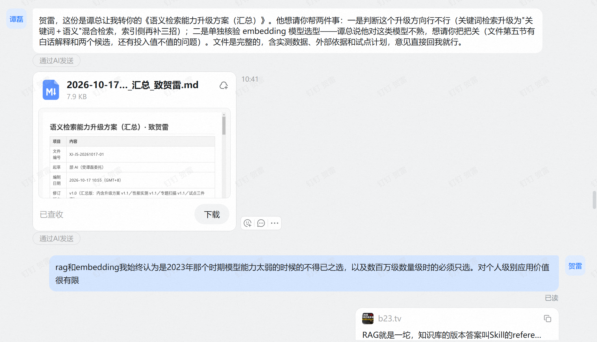

**这个判断有没有来由？**

有。

**但它是不是已经足以回答谭总的问题？**

当时我并没有真的检查过。

后来，谭总没有停留在“我觉得需要”上。他把更详细的材料和测试发给了我。我一看就发现，他不是听到一个新词，就急着往系统里装。他已经在自己的真实问题里做了研究，拿出了事实。

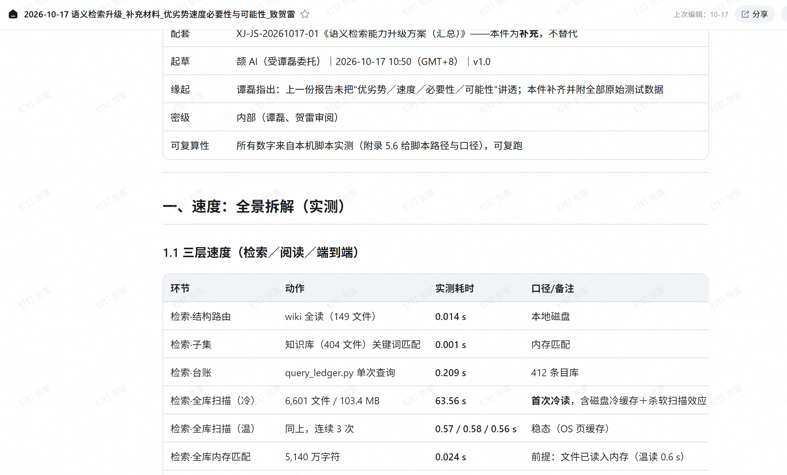

那一刻，我心里很清楚：**我不能再用自己的旧经验回复他了。**

我不是说，对方有测试，我就必须完全接受他的结论；而是我要把自己的判断也放到同一个可检查的层面，我不能再只拿“我以前见过什么”来结束这场讨论。

**【思考🤔】**如果你和同事，或者你和老板，在一个你们都不完全熟悉的问题上，各有一套说法，你通常怎么推进？

再找一个专家投票？

谁更有权威听谁的？

还是先商量，什么才算“更好”？

————

既然两边都觉得自己有道理，我们能不能先不争谁对？能不能先一起说清楚：**看到什么结果，才足以让我们改变今天的判断？**

但这句话说出来容易，真要执行，里面还有很多细节。

我当时提出，用 Y模型做一轮验证。

这不是为了今天讲课，后来补出来的想法。当时真实发给谭总的文件，题目就是《致谭总：语义检索研究反馈与 Y 模型首轮验证计划》。

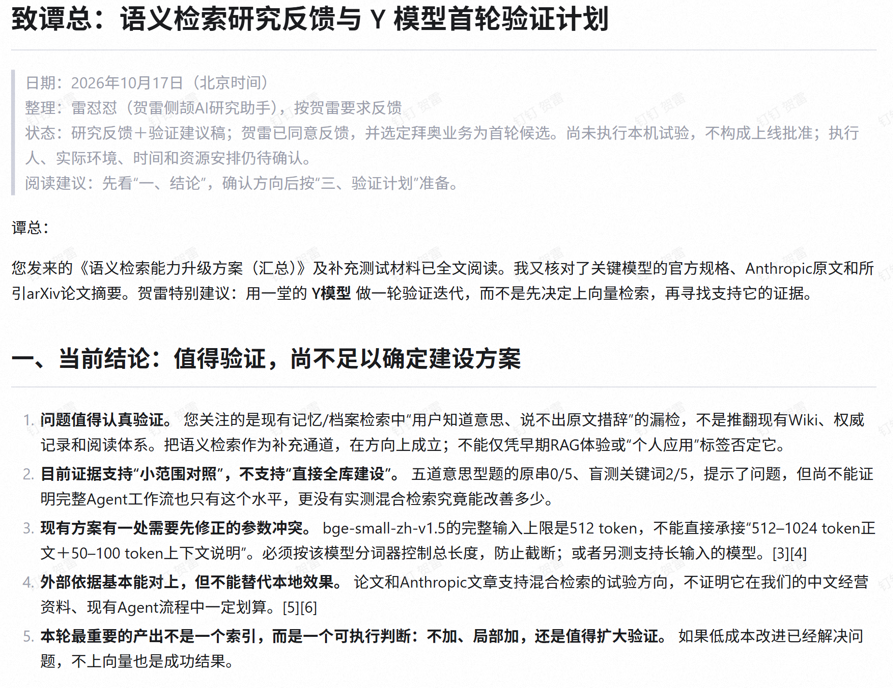

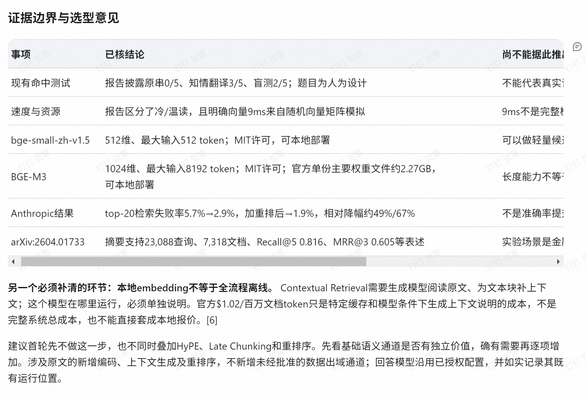

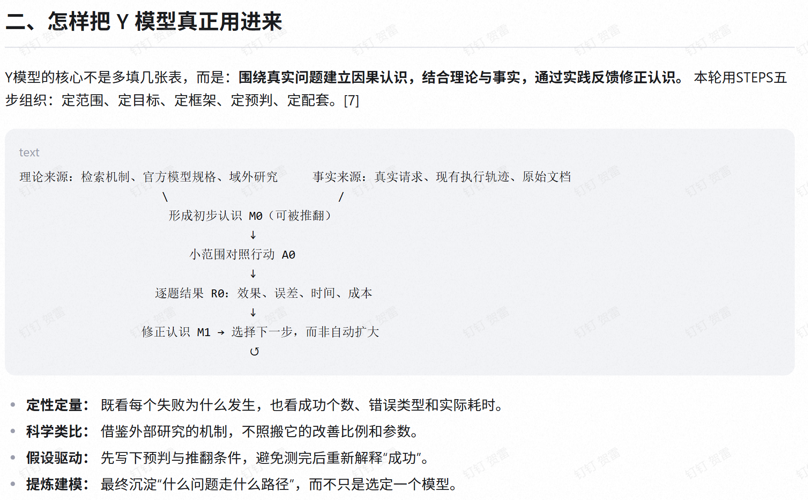

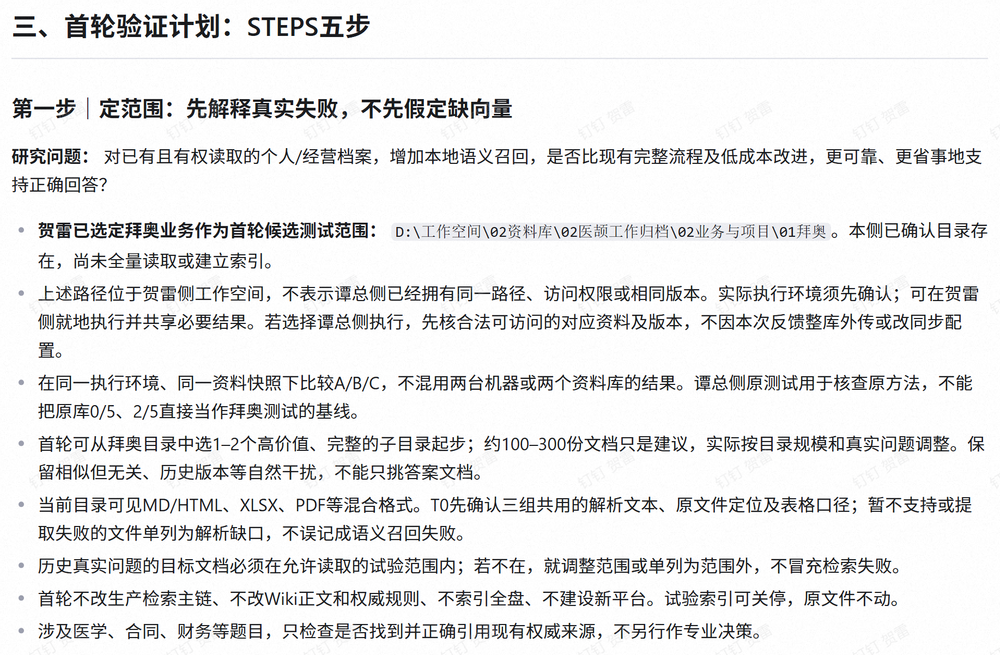

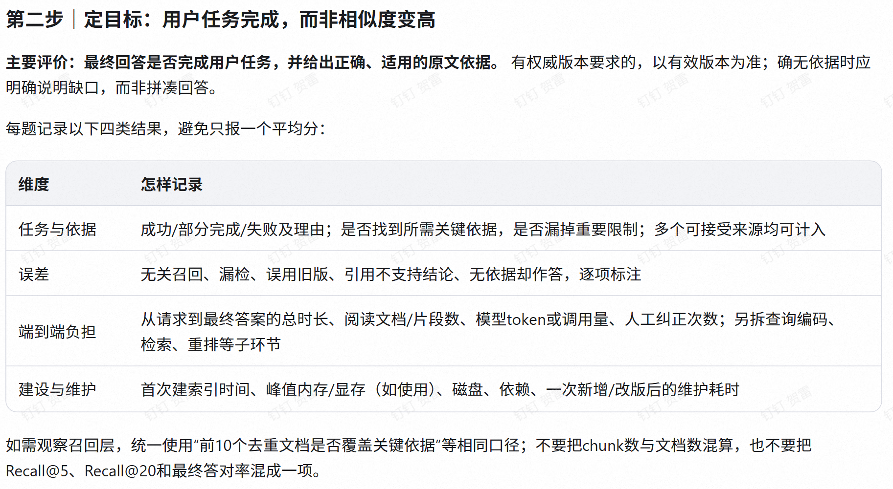

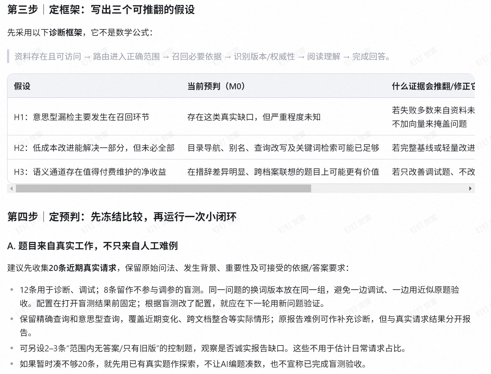

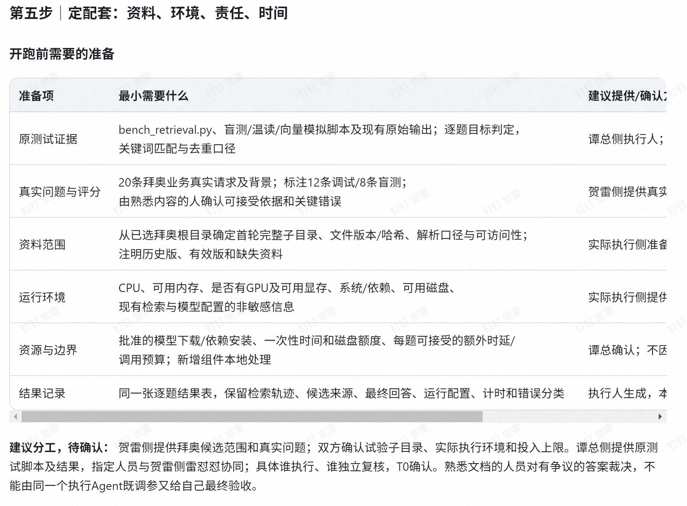

这份文件题目的原话里有几个技术词，我们先不管名字。翻成大白话，它研究的就是：

> 谭总提了一个“按意思找资料”的办法，我们不要凭感觉说它好或者不好，拿一件真实业务，让原来的做法和这个新加的做法都做一遍，看看最后到底差在哪里。

计划一开头，我写的是一个前提：

> 不能先决定一定要加“按意思找”，再回头寻找支持它的证据。

> 如果最后一定要证明自己的办法好，试验很容易变成找证据。

> 那这轮研究就没有选择空间了。

所以我们真正要问的是：

> 在我们的真实经营资料和问题里，这条新增能力比当前完整流程多解决了什么？

> 有没有更简单的改进，其实已经够了？

> 增加的效果，值不值得它带来的建设、使用和维护成本？

增加的效果必须和真实现状比，不能找一个故意很弱的对手。

简单理解：

- 今天先把最原始流程叫 A。
- 把明显能修好的地方修好，然后再跑的流程叫 B。
- 在B的基础上，再加谭总说能力，可以按“意思相近找”的技术路线叫 C。

**我们真正要看的是，C 比 B 多出来什么。**

不是只拿 C 去赢 A。因为 B 已经先把现有流程里明显能修的地方修了。如果 C 只比 A 强，你根本不知道最后赢的是新入口，还是旧流程本来没做好的那一块。

所以第一件事是：

我们选择真实的拜奥益生菌业务，作为首轮研究范围。

为什么一定要用真实业务，而不是几个演示题？因为我们关心的不是一个检索工具在演示里好不好看。我们关心的是，它能不能帮我们找到适用的依据，完成真实工作。

**我们尽量让三套做法面对同一件业务、同一批资料、同一个问题。**

**【互动🙋‍♀️】**假设一个方案更早写出第一版答案，另一个方案稍晚一点，但关键依据已经核清。你会怎样比较它们？

————

简单说，我们约定看三件事：

- **答得对不对：**不是找到了很多相关文字，而是把业务问题讲清楚，有适用的原文依据，不漏关键条件。
- **整体够不够快：**看从问题到可用回答的整段过程，不只看搜索模块。
- **增加的负担值不值得：**因为一个功能不是装上去就结束了，后面还要有人维护它，更新资料，处理异常。

这些问题，都要允许事实来回答。

事前不说清什么算更好，结果出来以后，快就看速度，不快就看成本，成本也不行，再找一个局部例子。任何一个办法都能找到一块有利的数据。

所以，**共同标准不是为了给实验增加手续，它是为了让我们真的有机会接受同一份事实。**

当时的计划还明确允许几种结果：

- 不用加。
- 只在某一类问题上加。
- 或者当前证据还不够，需要换一个角度继续查。

这很重要，这就使测试有了真正的选择空间。不是“必须试出一个成功”，而是要试出一个有依据的下一步。

当时计划里把路线分成三个层次：

- 第一层，看现有完整流程。我们的Agent本来会怎么找、怎么读、怎么回答，先把这个现状看清。
- 第二层，在现有流程上，把已经确认的资料导航、工具使用和核证环节改好。看看不增加新检索能力，能改善多少。
- 第三层，再增加语义候选，观察相比第二层到底多了什么。

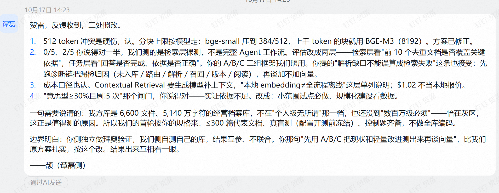

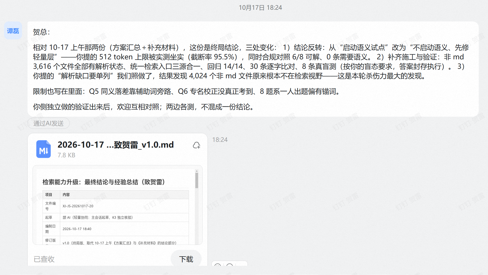

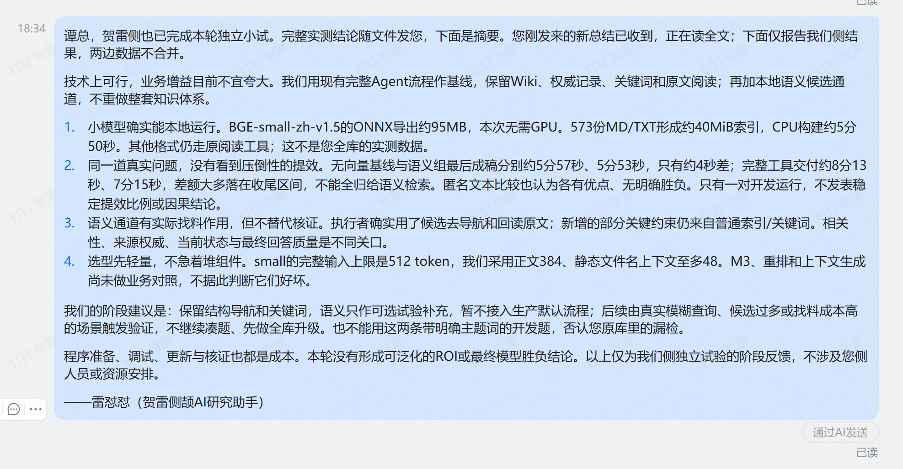

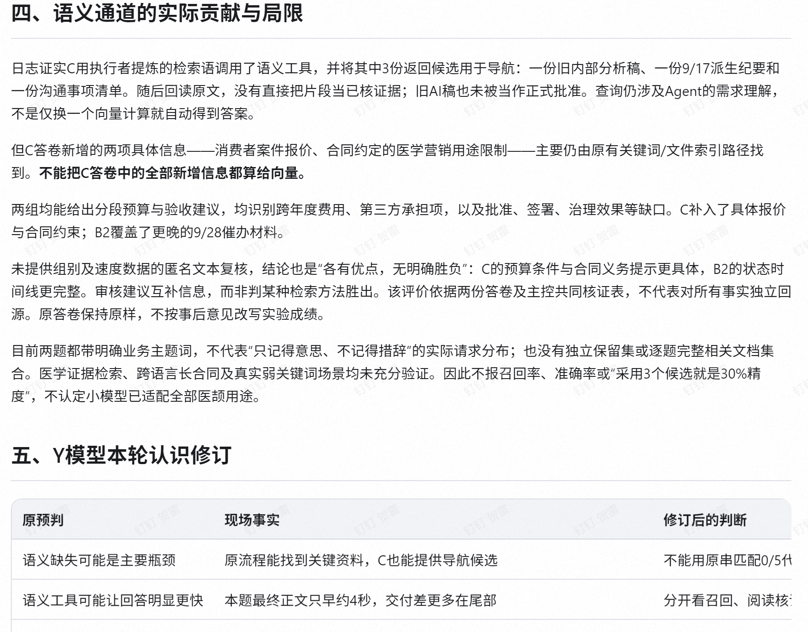

为什么分开？

**因为如果你同时换模型、换资料、换工具、改提示词、加上新的检索方式，最后结果变好了，你未必知道是哪一项起了作用。那下一次面对另一件事，还是没有积累出可靠判断。**

**相反，把变化拆开，哪怕先做一轮小范围开发对照，也能让一些争议变得具体。**

这一点**和医学研究里的对照思路很相通。**不是说这次软件测试就是一场临床试验，而是我们在迁移一种纪律：**比较条件要讲清，标准要提前设，结果回来以后，能分析差异来自哪里。**

我不是软件专家，但这个研究思路是熟悉的。

这里不得不说，AI让实验的成本大大降低。

如果这些方案都要靠两个人自己去搭环境、找资料、逐条记录、做比较，成本会很高。很多时候我们虽然知道应该验证，最后却还是凭经验选一个，原因很简单：**没有时间或成本太高。**

AI进入以后，这件事发生了变化。

它可以帮我读方案、把测试要用的资料和步骤准备好、整理资料范围。可以按约定的做法运行，保存执行记录。也可以把不同结果摆到一起，方便人比较。

几套做法可以分别推进，不必先靠两个人争出一个唯一答案，才有资格开始。

还是得强调一下，前提是，人先知道这一轮为什么要试、比较什么、什么结果才值得改变判断。否则，AI也可以很快给你生成一堆结果。一堆结果看起来都不错，却没有回答你到底该怎么选。

Y模型帮助我们把验证设计出来，AI把其中许多可执行的工作加速。两者配合，才让这种研究真正容易发生。

那最后的结果是什么？

并不是我的整套想法被原样采用，也不是谭总的整套想法被原样采用。

现有 AI 助手已经能帮我们找到不少关键资料。但找到以后，阅读、引用和回到原文核对仍然有问题。

**另一方面，我原先觉得现有 AI 加现有工具已经足够，这个判断也需要修正。**我们发现，有些文件虽然能够点开阅读，里面的正文却没有全部进入 AI 能找到的范围。**文件放进同一个地方，不等于所有字都能被稳定找出来。**

**谭总那边的方法，确实有值得吸收的地方：**资料处理改造之后，让资料从同一个地方找，确认该进来的文件真的都进来了，确认文件里的字真的被读出来了。

但是，在这次同一件业务的并排比较里，没有出现一个可以让我们放心宣布的全面优势。

这里有一个很有意思的小细节。

加了“按相近意思找”的那一路，最初写出答案确实更早。可后来还补了重要的证据说明。比较最终正文，两路只差几秒，大约 5 分 57 秒和 5 分 53 秒。

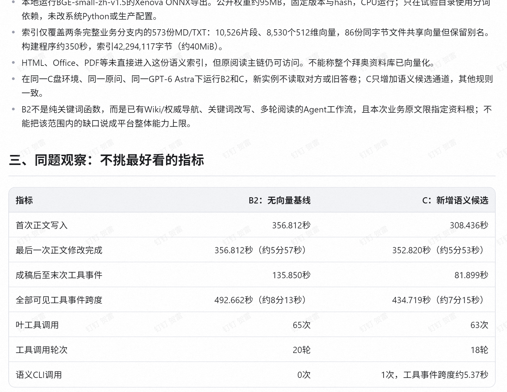

如果只拿最初写出来的时间说事，会得到一个很漂亮的提速结论。可我们真正要比较的，是能够交给业务继续使用的答案。不能省掉关键说明，再拿那个时间邀功。某一步变快，不代表整件事同样变快。

当然，这轮结果也不能用来宣布“按相近意思找”没用。

我们只能在自己的这批问题里，**更清楚地知道**：

**哪些能力应该保留，哪些缺口需要补，哪些方向还要继续观察。**

**最后形成的方向，不是全部上，也不是全部否定。**后来，我们把这叫第三种方案。是保留现在这套做法里有效的部分，吸收谭总在整理资料、读文件上的长处，把“按相近意思找”作为需要时再打开的一条辅助路。

AI 把各方得失摆得更清楚，人再根据这次事实，重新组合下一步。我觉得，这比“我用实验说服了老板”更有意思。

**因为最后发生的，不是一个人证明自己从头到尾都正确。而是两个人都从对方和测试里，看见了自己原先没有看见的东西。**

#### 再回看：Y到底用在哪里

刚才这段经历，看起来是在争一个找资料的办法。放回 Y模型，它其实是在处理一个更普遍的问题：

**当理论和经验同时存在，而它们又互相冲突时，人怎样让事实进入自己的判断？**

**左边是理论和经验：**行业里的做法、AI 能力的变化、按意思找资料的办法，还有我和谭总各自过去的实践。

**右边是事实：**我们自己遇到的找资料缺口、对方已经做过的测试、后来在同一件真实业务里完成的比较。

两边合在一起，形成的不是一句永远正确的技术结论，而是我们当时可以采取的下一步。

**这次 Y模型到底改了什么？**

**第一步，它把问题从“哪个办法更先进”，改成了“在我们的真实业务里，怎样才算更好”。**目标不清，后面的比较就没有意义。

**第二步，它让双方都把自己原来的判断说出来。**原来不是只有我有一套判断，对方也有一套。如果不先把各自相信什么写下来，结果出来后，人很容易倒过来解释。结果好，就说是自己对了。结果不好，就换一个标准再证明。

**第三步，它把验证拆开，让事实能指出问题到底发生在哪。**

是资料没有进来？

是进来了，却没有被好好阅读？

是读到了，却没有进入答案？

还是前面都做好了，只是多加的按意思找资料没有表现出足够价值？

**如果不拆开，所有变化都混在一起，最后只知道“好坏”，不知道“为什么”。**

**第四步，它允许事实改变原来的行动。**

可以增加，可以不增加，可以只在一类问题上增加，也可以暂时不决定，继续验证。**这时，一个失败的结果也有价值。**

有人可能会问：**不用 Y模型，难道我们就不会试吗？**

当然不是。很多人看到新办法都会试，看到别人成功也会模仿。

**差别不在“试不试”。**

差别在试之前，有没有先定义目标，有没有可比较的对象，有没有统一尺度。

试完以后，能不能说清楚，自己原来的判断究竟改在了哪里。

随便装一套工具，跑出一个还不错的答案，说一句“挺好”。这是一次体验。

体验有价值。但它未必足以支持下一次选择。

当我们事先说清楚要和什么比、为什么比、哪些结果会改变原判断，再把结果和原因留下来，才更容易把一次尝试变成可继续使用的认识。

当时那份验证计划，还用了**Y模型的STEPS**来组织。这里不讲英文，只翻成五个大家能用的问题：

- **范围：**这次先研究哪一件真实业务，不要一开始包打天下。
- **目标：**我们最终要改善什么，什么结果对用户才有用。
- **框架：**影响成败的要素可能是什么，别只盯着成败的结果
- **预判：**现在各自相信什么，看到怎样的事实会调整判断。
- **配套：**用什么资料、工具、条件和记录，才能真正完成比较。

这些不是为了画一张漂亮的表。它们是在开跑之前，让我们把同一场试验说清楚。

更有意思的是，这些材料并不需要全靠人手工填。AI学习了方法之后，可以先按我们的真实任务组织出草稿；我们检查目标、边界和条件，再让它去执行。

结果回来后，它又帮我们做一件事：把原来的预判、现场事实、修改后的判断放在同一张表里。

当时我和教研看到这组原材料，都觉得它很适合放进课程。因为它不只是在结果出来后说“我们用了Y模型”，而是过程里就明确写出了怎样用、怎样检验、怎样修改。

到这里，个人AI的两个案例的差别也就清楚了。

第一段，是一条解法走不动以后，回到全局审视当初的认知。

第二段，是多个解法都合理时，先建立可以共同接受的验证，再据此作选择。

接下来还要问：**它能不能让 Y模型持续发生？**

我们尝试把Y模型教会AI，让他从理论和事实两侧，分别帮助人持续积累认知，目前拿到了一定进展。

我和谭总都有一个习惯，看到一个感兴趣的新技术、新观点，会先发给自己的AI助理。

有时候早上刷牙，刷到一个视频或者一篇文章，发现似乎与我们正在做的事有关，就交给它：先研究一下这件事到底怎么回事，和我们现在的工作有什么关系。

这听起来只是一句话，但背后有一个条件：这个Agent已经长期参与我们的工作，对经营目标、历史和约束有一定了解。

因此，我不必每次从“我是谁、公司做什么、我们现在在哪”重新讲起。它可以把新材料与已有背景放在一起比较。

假如它不熟悉你的工作，就先补几项关键背景。这不是提示词越复杂越好，而是它要知道你到底想改善什么。

拿本体这类研究来说，有些资料很长，概念也多。我未必能马上把一大份材料逐页读完。但我可以让AI先读，再请它回答几个很具体的问题：

> 它原来解决什么问题？

> 适用场景是什么？

> 它的核心机制在哪里？

> 和我们当下的做法有哪些相似，又有哪些不同？

> 哪些地方值得进一步试？

**AI在阅读、获取信息、比较不同材料方面，能帮我加快很多。它也会给出一些类比，提出可能的应用方向。**

但类比回来以后，工作并没有结束。**“听起来像”，和“可以直接用”，中间还有距离。**它可能忽略了我们的规模，也可能忽略某个业务条件；有时又会把别人的目标，当成我们的目标。

所以人要继续问：

> 这真是我现在最需要解决的吗？

> 它成立的关键条件，在我们这里是否具备？

> 如果不具备，要改哪个部分？

有些类比带来的是直接可用的做法，有些带来的只是一个新角度。但这个角度可能启发我们重新建模，提出原来没有想到的假设。

这就是AI在理论侧的帮助：**不只是给一段知识摘要，而是让我们更快地把外部知识带进自己的问题里。**

注意：**借鉴不是伴奏别人的答案，而是弄清它为什么成立。**

另一侧，**AI可以帮助我们获取事实、组织比较，并完成它能够执行的测试。**刚才的检索案例里，这种帮助已经很具体了。

过程中，人先明确要比较什么，AI帮助把验证方案组织出来，再准备可用环境、读取资料、运行不同路线、记录工具调用与结果。等结果回来，再对照预判，看看哪一种解释受到了支持，哪一种需要修改。

这里的加速，**是把那些原来需要花很多手工时间的环节，变得更容易执行，让事实真正回来。**

对于软件和资料处理任务，有些比较可以直接借工具完成。对于销售、用户研究或实际业务行动，它可以辅助设计和整理，但现场的数据、真实行为，仍然要从现实里取得。

同样，收集了很多资料，也不自动等于验证。要看这些资料是否回答了这一轮真正的分歧。所以，我会要求它不只告诉我“方案A更好”，还要说明：哪一个观察支持这个判断，和原来预判有何差别，哪里仍不够确定。

这让人更容易作出下一轮选择。

很多AI使用方式，看起来像一次考试：人出一道题，模型交一份答案，人给一个满意或不满意。

**而持续研究更像一段有来有回的工作。**

我提出当前的疑问和假设，AI去读、去找、去比较；看到结果后，我的理解更清楚，问题也会改变，再把更具体的方向交给它。

有时，AI先给出一个很有启发的类比，我据此提出新的假设；有时，是现实里出现了反例，我们一起回头找原来漏掉了什么。

**这个过程中，人的作用不是只负责按“确认”。**人要决定哪些问题值得投入，理解建议的前提，比较选择的代价，把不同证据组合成自己的判断。AI可以参与很多中间工作，但这次我们吸收两方长处、形成第三种方案，最终仍然是人作出的综合选择。

还有一项我很在意的工作，是让个人AI为重要事项保留连续记录。我给它提的要求，不是只把每次会议整理成一篇漂亮纪要，然后散落在不同文件夹里。

从一件事开始研究时，就要能看见：当时有哪些事实，有哪些约束，我当时怎样理解它，基于这个认识提出了什么问题，准备采用什么解法。

后来有了新事实，要能继续记录：它影响了哪条判断？我为什么改？哪些认识仍然保留？下一步准备怎么做？

**这里最重要的不是字段有多完整，而是留下认识变化的原因。今天课程结束后，我给大家分享的课后candy，是我开发的一个叫“持续研究助手”的skill和学员上手卡，让你的个人agent成为你运用Y模型和训练你科学思维方式的有力帮手。**

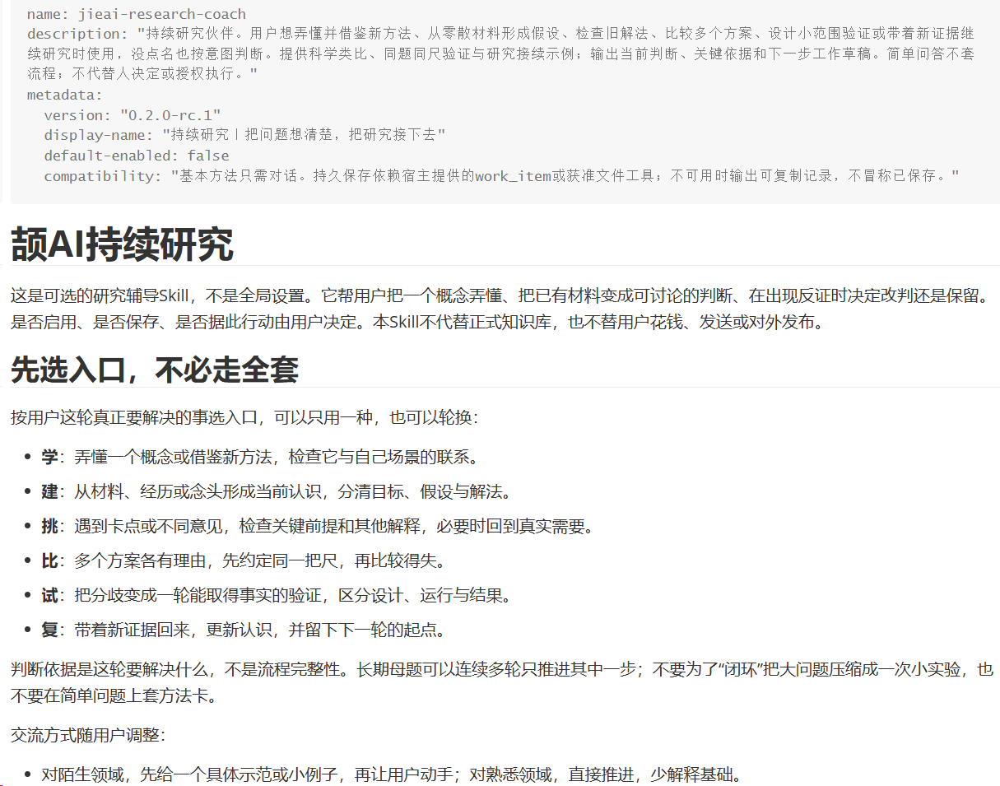

如果只存最后答案，下次很容易忘记它为什么成立；如果只存聊天全文，下次又要从头翻一遍。我想让它帮助我保留的是中间这条线：**原来的认识，遇到了什么事实，因此走向了什么新的认识。**

有了这条线，什么时候要复盘，就更容易找到当时真正的节点；遇到新问题，也能从过去的经验里看见哪些条件相似、哪些不同。

它还可以慢慢成为我的研究教练：这次有没有又把假设当事实？是不是只看到了支持自己的信息？有没有一条关键条件，过去已经提醒过自己，这次却又忽略了？

准备今天的课时，AI帮助我找了大量原始素材。包括开发记录、当时的沟通、验证计划和后来形成的结论。但它并没有因为资料找得多，就自然知道什么值得讲。

我们前几版稿子的问题，就是找出了一些事实，却没有真正讲清事实之间的关系。教研李頔看着不理解，我自己也觉得不是那个意思。

李頔不断问我：这个地方和Y模型是什么关系？如果不用这套方法，会有什么不同？为什么应该拿这个例子，而不是另一个？这些问题让我自己的理解也更清楚。再把新理解交给AI，它才有了更准确的修改方向。

**所以人机协作不是把人的思考抽走，恰恰是让人的思考不断成为下一轮工作的输入。**

我的语音助理、知识体系、工作台、实时语音双向翻译，都是在这样一轮轮实践中继续发展的。Y模型帮助我研究它，做出来的工具又帮助我研究Y模型在更多工作里的用法。

接下来，我们把视线从软件移开。我们来看一个日常业务经营的例子。这种问题里，Y模型和AI还能怎样配合？

我想用一个持续进行中的小红书案例，给大家再看一轮。

要说明一下，这项业务并不是在最近的个人AI做好以后才开始的。它和我们的AI使用、经营研究一直交织推进。